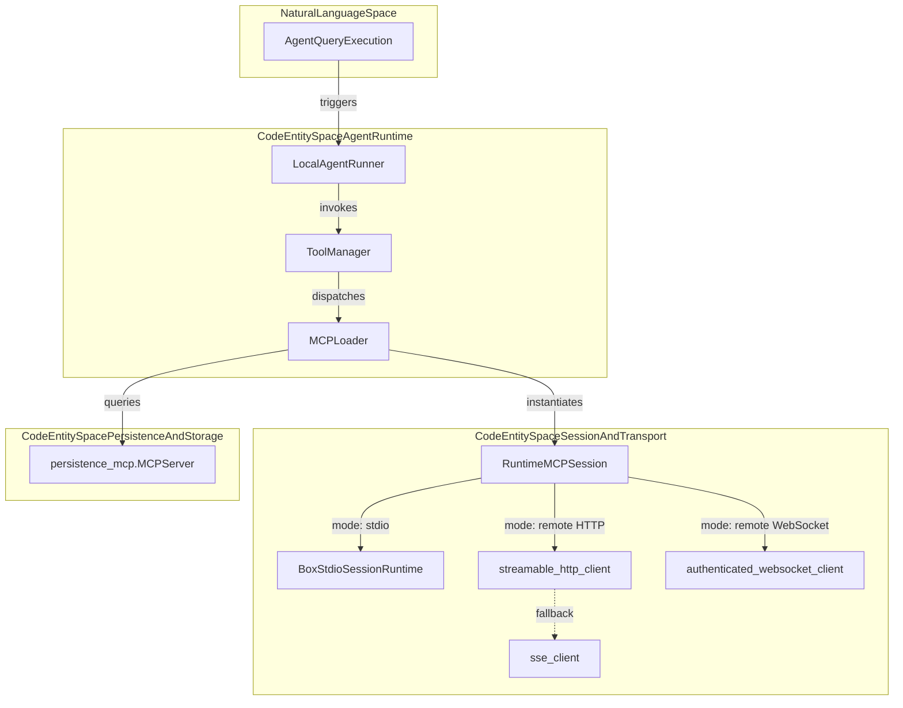
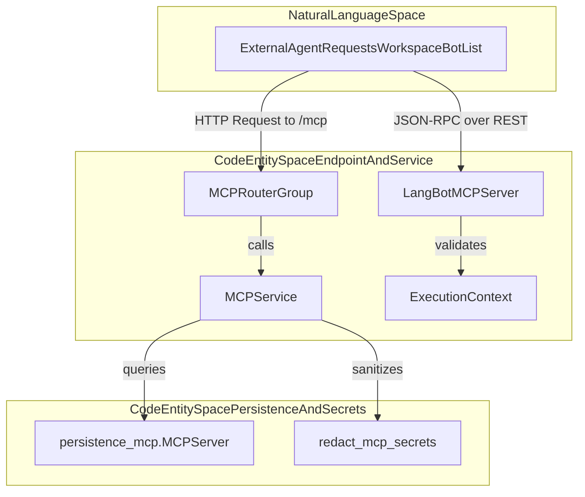

<!-- source: DeepWiki mcp.deepwiki.com · repo langbot-app/LangBot · page 6.3 MCP (Model Context Protocol) Integration · fetched 2026-10-29 -->

# MCP (Model Context Protocol) Integration

Relevant source files

The following files were used as context for generating this wiki page:

- [src/langbot/pkg/api/http/service/mcp.py](src/langbot/pkg/api/http/service/mcp.py)
- [src/langbot/pkg/box/connector.py](src/langbot/pkg/box/connector.py)
- [src/langbot/pkg/box/service.py](src/langbot/pkg/box/service.py)
- [src/langbot/pkg/provider/tools/loaders/mcp.py](src/langbot/pkg/provider/tools/loaders/mcp.py)
- [src/langbot/pkg/provider/tools/loaders/mcp_stdio.py](src/langbot/pkg/provider/tools/loaders/mcp_stdio.py)
- [tests/unit_tests/box/test_box_connector.py](tests/unit_tests/box/test_box_connector.py)
- [tests/unit_tests/box/test_box_service.py](tests/unit_tests/box/test_box_service.py)
- [tests/unit_tests/plugin/test_connector_ping.py](tests/unit_tests/plugin/test_connector_ping.py)
- [tests/unit_tests/provider/test_mcp_box_integration.py](tests/unit_tests/provider/test_mcp_box_integration.py)
- [tests/unit_tests/provider/test_mcp_remote_transport.py](tests/unit_tests/provider/test_mcp_remote_transport.py)
- [tests/unit_tests/provider/test_mcp_resources.py](tests/unit_tests/provider/test_mcp_resources.py)
- [web/src/app/home/mcp/MCPDetailContent.tsx](web/src/app/home/mcp/MCPDetailContent.tsx)
- [web/src/app/home/mcp/components/mcp-form/MCPForm.tsx](web/src/app/home/mcp/components/mcp-form/MCPForm.tsx)
- [web/src/app/home/mcp/page.tsx](web/src/app/home/mcp/page.tsx)

This page details LangBot's dual-role integration with the Model Context Protocol (MCP). LangBot operates both as an **MCP Client**, connecting external tool servers, resources, and sandboxed stdio processes into agent pipelines, and as an **MCP Server**, exposing its internal management APIs, resources, and services at a built-in endpoint (`/mcp`) for external AI agents like Claude Code, Cursor, and Windsurf [src/langbot/pkg/provider/tools/loaders/mcp.py:21-44]().

---

## 1. LangBot as MCP Client Architecture and Transports

LangBot's MCP client integration enables it to connect to external MCP servers, treating them as tool providers within agent pipelines. This functionality is primarily implemented in the `MCPLoader` class, which manages sessions represented by `RuntimeMCPSession` instances [src/langbot/pkg/provider/tools/loaders/mcp.py:21-44]().

### Connection Modes and Transports

LangBot supports multiple transport protocols for MCP client communication:

- **`stdio` (Local Sandbox Processes)**:
  LangBot spawns MCP servers as sandboxed local processes inside Box containers using the `BoxStdioSessionRuntime` class. This runtime manages the lifecycle, dependency installation, and environment setup (e.g., host path mounts, memory limits) using configuration encapsulated in `MCPServerBoxConfig` [src/langbot/pkg/provider/tools/loaders/mcp_stdio.py:79-95](), [src/langbot/pkg/provider/tools/loaders/mcp_stdio.py:179-190]().
  The system handles cold start delays (e.g., `npx -y` installs) via an internal `_ColdStartRetry` exception to avoid premature session failures [src/langbot/pkg/provider/tools/loaders/mcp_stdio.py:170-178]().

- **`remote` (Streamable HTTP and SSE)**:
  For remote MCP servers accessible over HTTP, the client uses the `streamable_http_client` transport, which allows streaming responses. Legacy servers that only support Server-Sent Events (SSE) are accessed with `sse_client` as a fallback to maintain backward compatibility [src/langbot/pkg/provider/tools/loaders/mcp.py:23-27]().

- **`websocket` (Authenticated WebSocket Relay)**:
  Some MCP servers, especially those backed by Box runtime sandbox containers, expose a WebSocket relay endpoint. The `authenticated_websocket_client` async context manager establishes this connection, injecting Box control tokens securely in headers while avoiding secret leakages in URLs or logs [src/langbot/pkg/provider/tools/loaders/mcp_stdio.py:100-152]().

### Execution and Tool Invocation Flow

When a user query triggers an agent, the pipeline invokes `MCPLoader` to dispatch tool calls through one of these transport-backed `RuntimeMCPSession` instances, which handle connection lifecycle, error states, and tool catalog discovery.

**Diagram: MCP Client Execution and Transport Topology**

Sources: [src/langbot/pkg/provider/tools/loaders/mcp.py:21-44](), [src/langbot/pkg/provider/tools/loaders/mcp_stdio.py:79-95](), [src/langbot/pkg/provider/tools/loaders/mcp_stdio.py:100-152](), [src/langbot/pkg/provider/tools/loaders/mcp_stdio.py:170-190]()

---

## 2. MCP Resources and Tool Synthesis

LangBot extends the basic MCP tool catalog by synthesizing special LLM-accessible resource tools, allowing agent programs to discover and read server-hosted resources, such as files or API endpoints, directly from MCP servers.

### Synthesized Tools and Schemas

- **`langbot_mcp_list_resources`**:
  A tool to list available resources and resource templates on a specified MCP server. Its input parameter requires a `server_name` (the MCP server configured in LangBot) validated by the `MCP_LIST_RESOURCES_SCHEMA` JSON schema [src/langbot/pkg/provider/tools/loaders/mcp.py:53-92]().

- **`langbot_mcp_read_resource`**:
  A tool to read the contents of a resource specified by a `uri` on the MCP server. It accepts a JSON object containing `server_name` and `uri`, validated by `MCP_READ_RESOURCE_SCHEMA` [src/langbot/pkg/provider/tools/loaders/mcp.py:54-107]().

### Implementations and Safeguards

- Discovered resources and templates are cached for 30 seconds (TTL) with a limited number of cached entries to avoid overloading MCP servers [src/langbot/pkg/provider/tools/loaders/mcp.py:56-58]().

- Resource content is truncated before use to avoid excessive memory or token usage, with maximum byte and token limits configurable (`MCP_RESOURCE_AGENT_READ_MAX_BYTES` and `MCP_RESOURCE_AGENT_READ_MAX_TOKENS`) [src/langbot/pkg/provider/tools/loaders/mcp.py:59-62](), [src/langbot/pkg/provider/tools/loaders/mcp.py:124-140]().

- Content MIME types are inspected to determine if they are "text-like", controlling how reading and parsing occurs [src/langbot/pkg/provider/tools/loaders/mcp.py:70-184]().

- Tool execution enforces a configurable timeout duration (`tool_call_timeout_sec`, default 300 seconds), raising timeout exceptions on expiration, which the client treats gracefully without poisoning sessions [src/langbot/pkg/provider/tools/loaders/mcp.py:68]().

Sources: [src/langbot/pkg/provider/tools/loaders/mcp.py:53-184]()

---

## 3. LangBot as MCP Server (`/mcp` Endpoint)

LangBot ships a built-in MCP server, exposing a curated subset of its HTTP service API as MCP tools. This allows external AI agents and automation frameworks to programmatically manage the LangBot instance over the `/mcp` endpoint.

### Service Facade and Execution Fencing

The MCP server delegates calls to `MCPService`, which enforces workspace-scoped execution contexts (`ExecutionContext`) tied to the authenticated API key and tenant identity. This fencing guarantees secure, multi-tenant operation and authorization enforcement [src/langbot/pkg/api/http/service/mcp.py:168-187]().

### Authentication and Access Control

- The `/mcp` endpoint reuses the existing API key authentication infrastructure for the HTTP API. Accepted headers are `X-API-Key` or `Authorization: Bearer <token>`.
- Two API key types are supported:
  1. **Web-UI-generated keys** (`lbk_...` prefix), scoped to single Workspace tenants with explicit scopes and expirations.
  2. **Global API keys**, configured in `data/config.yaml` as `api.global_api_key` for single-Workspace community instances.

### Secrets Redaction and Masking

To prevent sensitive information leakage, LangBot applies recursive redaction over configuration data before sending results to MCP clients. Sensitive keys (like API keys, passwords, and tokens) are masked with a fixed string (`***`), using heuristics around key names. On write/update operations, masked fields are restored from the existing stored secrets to preserve credentials transparently [src/langbot/pkg/api/http/service/mcp.py:23-157]().

**Diagram: Natural Language Space to Code Entity Space for MCP Server Operations**

Sources: [src/langbot/pkg/api/http/service/mcp.py:23-157](), [src/langbot/pkg/api/http/service/mcp.py:168-187]()

---

## 4. Management API and Frontend Integration

LangBot exposes full CRUD management for MCP server configurations and runtime-related queries via workspace-scoped REST API endpoints, integrated with the web management panel for administrative convenience.

### REST API Endpoints for MCP Servers

| Method | Endpoint | Description |
| --- | --- | --- |
| `GET` | `/api/v1/mcp/servers` | List all configured MCP servers with live runtime status |
| `POST` | `/api/v1/mcp/servers` | Register a new MCP server configuration |
| `GET` | `/api/v1/mcp/servers/<path:server_name>` | Retrieve MCP server definition by name |
| `PUT` / `DELETE` | `/api/v1/mcp/servers/<path:server_name>` | Modify or remove an MCP server |
| `POST` | `/api/v1/mcp/servers/<path:server_name>/test` | Launch an asynchronous connection test task targeting the server |
| `GET` | `/api/v1/mcp/servers/<path:server_name>/resources` | Fetch cached/discovered resource and template lists from the server |
| `POST` | `/api/v1/mcp/servers/<path:server_name>/resources/read` | Read a remote resource's contents by URI |

These endpoints are implemented leveraging `MCPService` and extend to runtime status retrieval and resource discovery, enabling management of MCP servers without needing direct database interaction [src/langbot/pkg/api/http/service/mcp.py:160-536]().

### Frontend Management Panel

The MCP server configuration and status management is integrated into LangBot's React-based web UI, supporting creation, editing, and real-time status visualization of configured MCP servers [web/src/app/home/mcp/MCPDetailContent.tsx:36-116](). The frontend includes real-time Box runtime availability checks, stdio MCP enablement policies, and status error rendering for codes like `box_unavailable` and `oauth_required` [web/src/app/home/mcp/components/mcp-form/MCPForm.tsx:89-140]().

### Persistence and Migration

MCP server entities persist in the database via the `persistence_mcp.MCPServer` ORM model [src/langbot/pkg/entity/persistence/mcp.py:1-1](). Alembic migration scripts extend pipeline configuration preferences to support fine-grained MCP resource bindings per pipeline, enhancing runtime resolution.

Sources: [src/langbot/pkg/entity/persistence/mcp.py:1-1](), [src/langbot/pkg/api/http/service/mcp.py:160-536](), [web/src/app/home/mcp/MCPDetailContent.tsx:36-116](), [web/src/app/home/mcp/components/mcp-form/MCPForm.tsx:89-140]()

---

