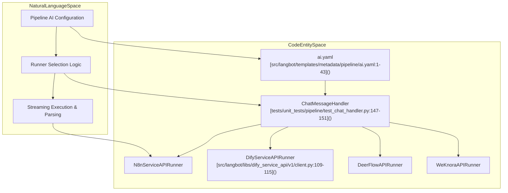
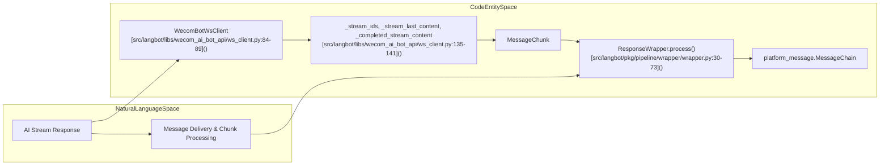

<!-- source: DeepWiki mcp.deepwiki.com · repo langbot-app/LangBot · page 6.4 Streaming and Advanced LLM Features · fetched 2026-10-29 -->

# Streaming and Advanced LLM Features

<details>
<summary>Relevant source files</summary>

The following files were used as context for generating this wiki page:

- [scripts/build_dingtalk_card_template.py](scripts/build_dingtalk_card_template.py)
- [src/langbot/libs/dify_service_api/v1/client.py](src/langbot/libs/dify_service_api/v1/client.py)
- [src/langbot/libs/dingtalk_api/card_callback.py](src/langbot/libs/dingtalk_api/card_callback.py)
- [src/langbot/libs/wecom_ai_bot_api/ws_client.py](src/langbot/libs/wecom_ai_bot_api/ws_client.py)
- [src/langbot/pkg/persistence/sqlite_migration_backup.py](src/langbot/pkg/persistence/sqlite_migration_backup.py)
- [src/langbot/pkg/pipeline/aggregator.py](src/langbot/pkg/pipeline/aggregator.py)
- [src/langbot/pkg/pipeline/wrapper/wrapper.py](src/langbot/pkg/pipeline/wrapper/wrapper.py)
- [tests/unit_tests/pipeline/test_aggregator.py](tests/unit_tests/pipeline/test_aggregator.py)
- [tests/unit_tests/pipeline/test_chat_handler.py](tests/unit_tests/pipeline/test_chat_handler.py)
- [tests/unit_tests/pipeline/test_command_handler.py](tests/unit_tests/pipeline/test_command_handler.py)
- [tests/unit_tests/pipeline/test_longtext.py](tests/unit_tests/pipeline/test_longtext.py)
- [tests/unit_tests/pipeline/test_preproc.py](tests/unit_tests/pipeline/test_preproc.py)
- [tests/unit_tests/pipeline/test_ratelimit.py](tests/unit_tests/pipeline/test_ratelimit.py)
- [tests/unit_tests/pipeline/test_wrapper.py](tests/unit_tests/pipeline/test_wrapper.py)
- [tests/unit_tests/pipeline/test_wrapper_outbound_attachments.py](tests/unit_tests/pipeline/test_wrapper_outbound_attachments.py)
- [tests/unit_tests/platform/test_wecombot_stream_empty_final.py](tests/unit_tests/platform/test_wecombot_stream_empty_final.py)
- [tests/unit_tests/platform/test_wecombot_template_card.py](tests/unit_tests/platform/test_wecombot_template_card.py)
- [tests/unit_tests/provider/test_litellm_convert_messages.py](tests/unit_tests/provider/test_litellm_convert_messages.py)
- [tests/unit_tests/provider/test_session_manager.py](tests/unit_tests/provider/test_session_manager.py)
- [tests/unit_tests/vector/test_filter_utils.py](tests/unit_tests/vector/test_filter_utils.py)

</details>


LangBot supports progressive response delivery through streaming output, token-by-token delivery, multi-modal content handling, and advanced LLM features including sequential model fallback, request policies, context management, system prompts, and LLMOps integrations (`dify-service-api`, `coze-api`, `n8n-service-api`, `langflow-api`, `dashscope-app-api`, `deerflow-api`, `weknora-api`). This page documents the streaming architecture, runner implementations, request policies, and integration patterns for advanced LLM capabilities.

---

## Purpose and Scope

This page provides full technical documentation for streaming output delivery, WebSocket message updates, LLM context management, system prompts, LLM request policies, and LLMOps integrations. It is targeted at developers building or extending the AI execution pipeline in LangBot.

Sources: [src/langbot/templates/metadata/pipeline/ai.yaml:1-43](), [src/langbot/templates/default-pipeline-config.json:39-65](), [docs/LLM_REQUEST_POLICY.md:1-40]()

---

## Runner Architecture

LangBot's AI processing is abstracted through a **runner** system. Each runner implements logic to interact with AI providers and is selected per pipeline configuration [src/langbot/templates/metadata/pipeline/ai.yaml:19-43](). Runners are registered and selected based on the `ai.runner.runner` key in the pipeline's configuration.

The `ChatMessageHandler` dynamically instantiates the configured runner and executes it, supporting both standard and streaming delivery modes [tests/unit_tests/pipeline/test_chat_handler.py:56-63](). Specific runners handle the nuances of their respective upstream APIs:

-   **LocalAgentRunner**:
    The core engine supporting sequential model fallback and RAG integration. It utilizes streaming accumulators to manage fragmented OpenAI-style tool calls and content chunks, ensuring accurate reassembly of streamed data. It includes logic to strip internal "think" blocks from output for clearer user messages.

-   **DifyServiceAPIRunner**:
    Manages file uploads with enforced size limits, file type detection mapped to Dify categories (Image, Document, Video, Voice), and paused workflows requiring human input via `AsyncDifyServiceClient` [src/langbot/libs/dify_service_api/v1/client.py:118-198](). Pending human input forms are tracked in a process-local store keyed by a pending form key, expiring after a TTL.

-   **N8nServiceAPIRunner**:
    Offers workflow automation integration with robust, partial JSON stream parsing tailored for n8n webhook responses. Supports multiple authentication methods (`none`, `basic`, `jwt`, `header`). Frontend dynamic form component dynamically renders fields based on selected auth type for user-friendly configuration.

-   **DeerFlowAPIRunner**:
    Integrates LangGraph-based queries via asynchronous clients with SSE streaming. It manages sessions with automatic thread ID generation and tracks stream state for value, message-tuples, and task failures. It extracts multi-modal inputs, converting base64 images to DataURIs for LangGraph compatibility.

-   **WeKnoraAPIRunner**:
    Supports both RAG-style knowledge chat and agentic agent chat with SSE streaming through asynchronous clients. Handles session persistence, web search integration, and tool call decoding to yield structured tool calls and assistant answer chunks.

### Runner Selection Diagram



Sources: [src/langbot/templates/metadata/pipeline/ai.yaml:1-43](), [tests/unit_tests/pipeline/test_chat_handler.py:56-63](), [src/langbot/libs/dify_service_api/v1/client.py:118-198]()

---

## Streaming and Context Management

### Streaming Path and Message Delivery

When streaming is enabled (`is_stream` is `True`), typically detected via the platform adapter's capability check `query.adapter.is_stream_output_supported()`, the core message handler (`ChatMessageHandler`) runs the configured agent asynchronously and processes streamed message chunks:

1.  **Initialization**: The handler initializes messaging UI cards or channels on the platform as chunks arrive.
2.  **Chunk Handling**: Partial messages (`MessageChunk` entities) arrive and are appended to `query.resp_messages` for incremental user display. Each chunk may carry flags like `is_final` to indicate the completion of the stream.
    -   The `ResponseWrapper` stage in the pipeline also plays a role in handling `MessageChunk` entities, specifically checking `result.is_final` to determine if outbound attachments should be collected [src/langbot/pkg/pipeline/wrapper/wrapper.py:48-53]().
    -   The `WecomBotWsClient` manages stream IDs, last sent content, and completed stream content to handle streaming responses over WebSocket, ensuring deduplication and proper completion [src/langbot/libs/wecom_ai_bot_api/ws_client.py:135-141]().
3.  **Safety Checks**: The handler enforces limits on total message length using `_check_response_size` methods to prevent runaway memory or abuse.

Sources: [src/langbot/pkg/pipeline/wrapper/wrapper.py:30-73](), [src/langbot/libs/wecom_ai_bot_api/ws_client.py:135-141]()

### LLM Context Management, System Prompts, and Request Policy

LangBot manages conversation context and system prompts with configurable pipelines:

-   **System Prompt**: Defined in the pipeline configuration, typically under AI settings, with defaults available in `DEFAULT_PROMPT_CONFIG` [tests/unit_tests/pipeline/test_preproc.py:101-104](). System prompts set the initial assistant persona and instructions.
-   **RAG Context Injection**: When Retrieval Augmented Generation is enabled, context documents are prepended to the message list to enrich the LLM input [src/langbot/templates/default-pipeline-config.json:39-65]().
-   **Request Policy and Timeouts**: Core owns chat-call deadlines, retries, and transport timeouts as configured under `llm_request_policy` [docs/LLM_REQUEST_POLICY.md:16-40](). Precedence flows from instance defaults to model extra arguments and call-level arguments. Supported parameters include retries, total timeout, first-event timeout, stream idle timeout, and backoff settings [docs/LLM_REQUEST_POLICY.md:24-46]().

Sources: [tests/unit_tests/pipeline/test_preproc.py:101-104](), [src/langbot/templates/default-pipeline-config.json:39-65](), [docs/LLM_REQUEST_POLICY.md:1-50]()

### Streaming Data Flow Diagram



Sources: [src/langbot/pkg/pipeline/wrapper/wrapper.py:30-73](), [src/langbot/libs/wecom_ai_bot_api/ws_client.py:84-89](), [src/langbot/libs/wecom_ai_bot_api/ws_client.py:135-141]()

---

## Advanced LLM Features

### LLMOps Integrations

LangBot supports direct integration with popular LLMOps platforms through specialized runners, configurable via pipeline settings:

| Provider | Runner Name | Key Features | Configuration Location |
| :------- | :---------- | :----------- | :--------------------- |
| **Dify** | `dify-service-api` | Supports Chat, Agent, and Workflow types; file uploads; human-in-the-loop paused workflows. | `ai.dify-service-api` in [src/langbot/templates/default-pipeline-config.json:61-65]() |
| **Coze** | `coze-api` | Integrates with the Coze platform workflows and conversational bots. | Configured via `ai.coze-api` in pipeline metadata |
| **n8n** | `n8n-service-api` | Workflow automation; robust JSON stream parsing; multiple auth types (`none`, `basic`, `jwt`, `header`). | `ai.n8n-service-api` in [src/langbot/templates/default-pipeline-config.json:65]() |
| **Langflow** | `langflow-api` | Integrates with Langflow flows; supports flexible input/output types and tweaks. | `ai.langflow-api` in pipeline config |
| **DashScope** | `dashscope-app-api` | Aliyun Dashscope App integration; supports agents and quoting references. | `ai.dashscope-app-api` in pipeline config |
| **DeerFlow** | `deerflow-api` | LangGraph integration; SSE stream tracking; automatic thread ID management. | `ai.deerflow-api` in pipeline metadata |
| **WeKnora** | `weknora-api` | Session-based RAG and Agent chat; web search; tool calls via SSE streaming. | `ai.weknora-api` in pipeline metadata |

Sources: [src/langbot/templates/default-pipeline-config.json:39-65](), [src/langbot/templates/metadata/pipeline/ai.yaml:1-43]()

### Telemetry and Bound Resources

LangBot incorporates telemetry for operational awareness and resource tracing:

-   **TelemetryManager** handles asynchronous, non-blocking sending of telemetry payloads as background tasks to a configured telemetry server.
-   **Heartbeat Snapshots** send periodic anonymous snapshots of configuration profiles and resource counts (bots, pipelines, KBs, MCP servers, skills) via `heartbeat.py`.
-   **Bound-Resource Reporting** via execution execution counters records which plugins, MCP servers, knowledge bases, tools, and models were bound or granted to a pipeline lane or agent run without recording user content.

Sources: [src/langbot/pkg/telemetry/telemetry.py:15-61](), [src/langbot/pkg/telemetry/heartbeat.py:31-47]()

### Entity Space Mapping Diagram

```mermaid
erDiagram
  Query ||--o{ Message : "generates"
  ChatHandler ||--o{ Runner : "instantiates"
  TelemetryManager ||--o{ TelemetryTask : "spawns"
  ResourceSnapshot ||--o{ PipelineLane : "bounds"

  Query : "pipeline_query.Query"
  Message : "provider_message.MessageChunk"
  ChatHandler : "ChatMessageHandler\n[tests/unit_tests/pipeline/test_chat_handler.py:147-151]()"
  Runner : "RequestRunner"
  TelemetryManager : "TelemetryManager"
  TelemetryTask : "asyncio.Task"
  ResourceSnapshot : "WorkspaceResourceSnapshot\n[src/langbot/pkg/telemetry/heartbeat.py:31-47]()"
  PipelineLane : "PipelineStage"
```

Sources: [tests/unit_tests/pipeline/test_chat_handler.py:147-151](), [src/langbot/pkg/telemetry/telemetry.py:15-21](), [src/langbot/pkg/telemetry/heartbeat.py:31-47]()

---

