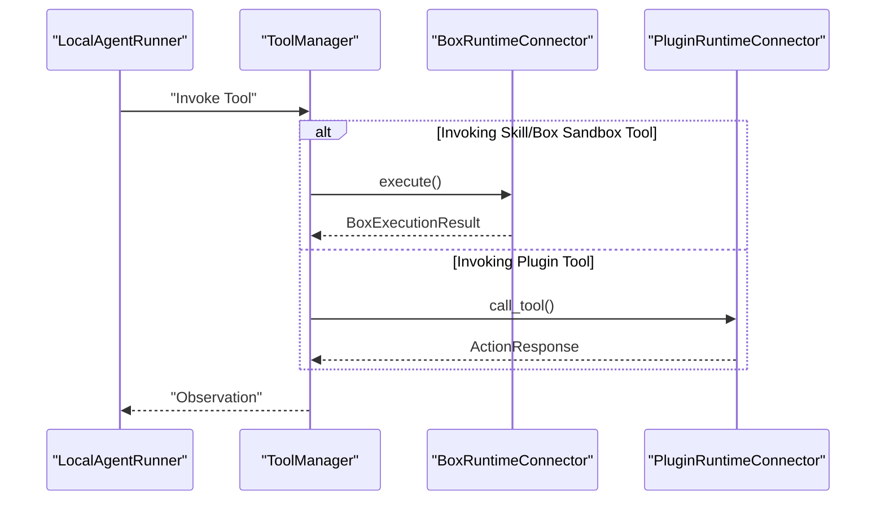
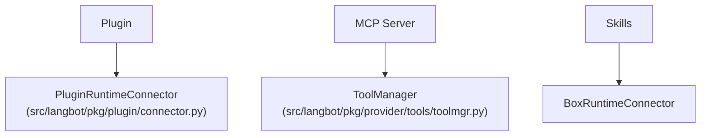
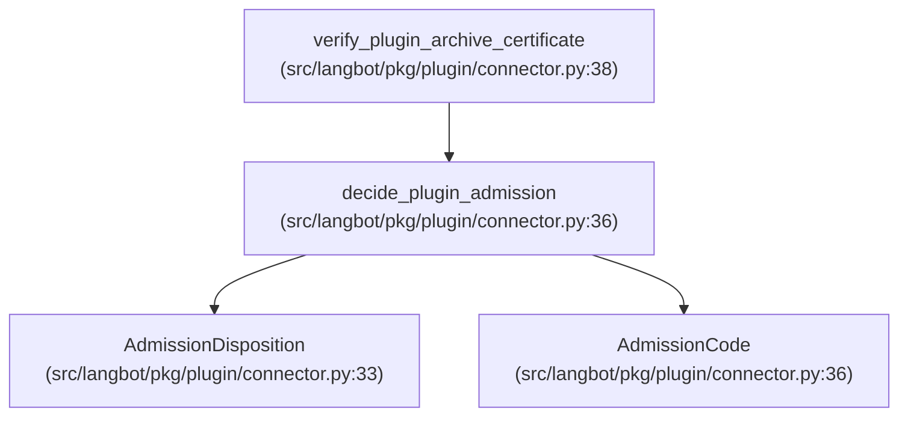

<!-- source: DeepWiki mcp.deepwiki.com · repo langbot-app/LangBot · page 7 Plugin and Extension System · fetched 2026-10-29 -->

# Plugin and Extension System

<details>
<summary>Relevant source files</summary>

The following files were used as context for generating this wiki page:

- [src/langbot/pkg/agent/runner/orchestrator.py](src/langbot/pkg/agent/runner/orchestrator.py)
- [src/langbot/pkg/agent/runner/resource_builder.py](src/langbot/pkg/agent/runner/resource_builder.py)
- [src/langbot/pkg/pipeline/pipelinemgr.py](src/langbot/pkg/pipeline/pipelinemgr.py)
- [src/langbot/pkg/plugin/connector.py](src/langbot/pkg/plugin/connector.py)
- [src/langbot/pkg/provider/tools/toolmgr.py](src/langbot/pkg/provider/tools/toolmgr.py)
- [src/langbot/pkg/workspace/repository.py](src/langbot/pkg/workspace/repository.py)
- [src/langbot/pkg/workspace/service.py](src/langbot/pkg/workspace/service.py)
- [tests/unit_tests/agent/test_resource_builder.py](tests/unit_tests/agent/test_resource_builder.py)
- [tests/unit_tests/pipeline/test_pipelinemgr.py](tests/unit_tests/pipeline/test_pipelinemgr.py)
- [tests/unit_tests/plugin/test_connector_methods.py](tests/unit_tests/plugin/test_connector_methods.py)
- [tests/unit_tests/plugin/test_connector_reconcile.py](tests/unit_tests/plugin/test_connector_reconcile.py)
- [tests/unit_tests/workspace/test_workspace_service.py](tests/unit_tests/workspace/test_workspace_service.py)

</details>


This wiki page documents LangBot's extensible architecture, covering the three primary extension types: **Plugins**, **MCP Servers**, and **Skills**. It describes how these systems interface with the core backend (`PluginRuntimeConnector` [src/langbot/pkg/plugin/connector.py:10-65](), `ToolManager` [src/langbot/pkg/provider/tools/toolmgr.py:37-48]()) to provide tools, event listeners, specialized RAG engines, and AI behaviors.

For details on individual sub-topics, see the respective child pages:
- [Plugin Architecture and Runtime](#7.1) — Plugin runtime separation (stdio/WebSocket), `RuntimeConnectionHandler`, `PluginRuntimeConnector` [src/langbot/pkg/plugin/connector.py:1-190](), desired-state reconciliation, `lbpkg` storage, component types.
- [Plugin Installation and Lifecycle](#7.2) — Installation from GitHub/local/marketplace, async task tracking, progress dialogs, plugin ID parsing, upgrade, deletion, sorting.
- [Plugin Configuration and Settings](#7.3) — Plugin config schemas, dynamic form rendering, file uploads, config persistence via `persistence_plugin.PluginSetting`.
- [Plugin Marketplace Integration](#7.4) — Marketplace, search/filter by component type and tags, recommendation lists, discovery, install count, `CloudServiceClient`.
- [MCP Server Management](#7.5) — MCP server CRUD, connection modes, secret masking, status monitoring, tool discovery, server testing.
- [Skills and Box Sandbox Runtime](#7.6) — Skills extension type, `SkillManager`, Box sandbox runtime, `BoxService`, `BoxRuntimeConnector`, quotas, in-repo `skills/` directory, `lbs` CLI.
- [Plugin Certification and Admission Policy](#7.7) — Ed25519-signed `.lbpkg` archives, `verify_plugin_archive_certificate`, `decide_plugin_admission`, `AdmissionDisposition`, `AdmissionCode`, dedicated vs shared-certified execution modes, cloud vs OSS fail-closed policy, trusted key ring config.

---

## Extension Type Overview

LangBot supports three distinct extension mechanisms. The backend manages these through dedicated runtime connectors and services to maintain security, tenant isolation, and failure containment.

| Extension Type | Execution Environment | Primary Purpose | Backend Service / Connector |
|---|---|---|---|
| **Plugins** | Separate Process (stdio/WebSocket) | System hooks, custom tools, RAG engines, parsers, UI pages | `PluginRuntimeConnector` [src/langbot/pkg/plugin/connector.py:10-65]() |
| **MCP Servers**| Local Subprocess / Remote HTTP | Standardized tool and context sharing via Model Context Protocol | `ToolManager` [src/langbot/pkg/provider/tools/toolmgr.py:37-48]() / `MCPLoader` |
| **Skills** | Markdown + Box Sandbox | Instruction-heavy agentic behaviors with isolated code execution | `BoxRuntimeConnector` [src/langbot/pkg/box/connector.py:45-57]() |

Sources: [src/langbot/pkg/plugin/connector.py:1-190](), [src/langbot/pkg/provider/tools/toolmgr.py:37-48]()

---

## 7.1 Plugin Architecture and Runtime

Plugins run as external processes to isolate dependencies and protect the core application from crashes. Communication relies on stdio or WebSocket for IPC, mediated by `PluginRuntimeConnector` [src/langbot/pkg/plugin/connector.py:10-190]() in the main process, and the runtime `RuntimeConnectionHandler` which manages lifecycle events and message dispatch.

The runtime architecture involves desired-state reconciliation to keep installed plugins in sync, with plugin artifacts stored using the `lbpkg` binary packaging format [src/langbot/pkg/plugin/connector.py:81-83](). Plugins can contribute component types such as Tools, Commands, Event Listeners, Knowledge Engines, Parsers, and UI Pages defined in plugin manifests.

For details, see [Plugin Architecture and Runtime](#7.1).

### Plugin and Extension Runtime Map

```mermaid
graph TD
    PRC["PluginRuntimeConnector\n(src/langbot/pkg/plugin/connector.py)"]
    RCH["RuntimeConnectionHandler"]
    BRC["BoxRuntimeConnector"]
    SM["StorageMgr"]
    PS["PluginSetting Persistence"]
    LBP_RT["Plugin Runtime\n(langbot_plugin)"]
    BOX_RT["Box Runtime (Skills Sandbox)"]
    MCP_EXT["MCP Servers\n(stdio/SSE/HTTP)"]

    PRC <--- "WebSocket or stdio IPC" --> LBP_RT
    RCH -->|"DB ops"| PS
    RCH -->|"Uses"| SM
    BRC <--- "ActionRPC Box Client" --> BOX_RT
    PRC -->|"Heartbeat / Control"| LBP_RT
    MCP_EXT <--- "MCP Protocol Connections" --> PRC
```

Sources: [src/langbot/pkg/plugin/connector.py:18-70](), [src/langbot/pkg/provider/tools/toolmgr.py:37-48]()

---

## 7.2 Plugin Installation and Lifecycle

Plugins can be installed from local files, GitHub repositories, or the online marketplace. Installation processes track progress via asynchronous tasks (`taskmgr`) and ensure artifact integrity by verifying content length and file size limits [src/langbot/pkg/plugin/connector.py:84-88]().

The `PluginRuntimeConnector` [src/langbot/pkg/plugin/connector.py:10-65]() handles installation commands, including validating GitHub URLs and release assets against allowed hosts with redirection limits. Plugin archives are stored durably in tenant-scoped binary storage pools and indexed in persistent plugin setting entities.

For the complete workflow and details on progress dialogs, async task tracking, parsing plugin IDs, upgrades, and deletions, see [Plugin Installation and Lifecycle](#7.2).

Sources: [src/langbot/pkg/plugin/connector.py:40-88](), [src/langbot/pkg/plugin/connector.py:108-190]()

---

## 7.3 Plugin Configuration and Settings

Plugins expose configuration schemas which are rendered dynamically in LangBot's web UI. Schemas may include sensitive fields (processed via `_is_sensitive_config_key` [src/langbot/pkg/api/http/controller/groups/plugins.py:79-87]()) that are redacted before being sent to the frontend (`redact_plugin_secrets` [src/langbot/pkg/api/http/controller/groups/plugins.py:103-116]()) and restored transparently on updates (`restore_plugin_secret_placeholders` [src/langbot/pkg/api/http/controller/groups/plugins.py:118-156]()).

Configuration persistence is handled through the `PluginSetting` database model which stores plugin settings scoped by workspace and installation, allowing each tenant to customize plugin behavior independently.

For more on config schemas, dynamic form rendering, file upload handling for attachments, and persistence strategies, see [Plugin Configuration and Settings](#7.3).

Sources: [src/langbot/pkg/api/http/controller/groups/plugins.py:79-156]()

---

## 7.4 Plugin Marketplace Integration

LangBot integrates with its plugin marketplace to enable users to discover, search, and install community-published plugins. This integration uses `CloudServiceClient` to fetch metadata and package files, observing size limits such as `_MARKETPLACE_METADATA_MAX_BYTES` [src/langbot/pkg/plugin/connector.py:85]() and `_MARKETPLACE_PLUGIN_DOWNLOAD_MAX_BYTES` [src/langbot/pkg/plugin/connector.py:86]().

Marketplace listings support filtering by component types, tags, and search queries. The system matches versions and manages downloads with safeguards on redirects and maximum download size.

See [Plugin Marketplace Integration](#7.4) for detailed handling of marketplace search, filtering, recommendation lists, and install count tracking.

Sources: [src/langbot/pkg/plugin/connector.py:83-185]()

---

## 7.5 MCP Server Management

Model Context Protocol (MCP) servers provide a standard interface to share tools and context models between LangBot and external services. LangBot can act as both an MCP client, connecting through stdio, SSE, or HTTP streaming, and as an MCP server exposing resources at the `/mcp` HTTP endpoint.

The `ToolManager` [src/langbot/pkg/provider/tools/toolmgr.py:37-48]() integrates `MCPLoader` to manage server creation, connection modes, status monitoring, and tool discovery.

For full details on CRUD interfaces, connection management, secret masking, and tool lifecycle, see [MCP Server Management](#7.5).

Sources: [src/langbot/pkg/provider/tools/toolmgr.py:37-48]()

---

## 7.6 Skills and Box Sandbox Runtime

Skills are a special extension type characterized by instruction-heavy markdown packages executed inside isolated Box sandboxes. They provide agentic behaviors, safe code evaluation, and scripted workflows.

The sandbox lifecycle is managed by connectors that communicate with the isolated runtime. The `ToolManager` coordinates skill tool loaders alongside plugin and MCP tools [src/langbot/pkg/provider/tools/toolmgr.py:42-46]().

### Tool Execution and Sandbox Flow



Skills are typically stored in a `skills/` directory within LangBot repositories and managed through the `lbs` CLI tool.

For full documentation on `SkillManager`, sandbox quotas, box visibility, built-in skills, and CLI tooling, see [Skills and Box Sandbox Runtime](#7.6).

Sources: [src/langbot/pkg/provider/tools/toolmgr.py:37-48](), [src/langbot/pkg/plugin/connector.py:10-65]()

---

## 7.7 Plugin Certification and Admission Policy

LangBot supports a certification and admission policy for plugin archives to ensure security and trusted execution, particularly important for multi-tenant cloud deployments.

The system uses Ed25519 cryptography to verify plugin archives `.lbpkg` through functions like `verify_plugin_archive_certificate` [src/langbot/pkg/plugin/connector.py:38](), which validates the signed normalized ZIP digest against a configured trusted public key ring.

After verification, admission decisions are made by `decide_plugin_admission` [src/langbot/pkg/plugin/connector.py:36]() based on deployment mode (Cloud or OSS), certificate validity, and administrator override flags. These decisions produce an `AdmissionDisposition` and `AdmissionCode` [src/langbot/pkg/plugin/connector.py:33-36]() which determine if a plugin runs in shared-certified, dedicated, or rejected modes.

For detailed explanation of cryptographic verification, admission matrices, execution mode selection, and cloud vs OSS policy distinctions, see [Plugin Certification and Admission Policy](#7.7).

Sources: [src/langbot/pkg/plugin/connector.py:31-39]()

---

# Additional Diagrams

## Natural Language Concepts to Code Entities



Sources: [src/langbot/pkg/plugin/connector.py:10-65](), [src/langbot/pkg/provider/tools/toolmgr.py:37-48]()

## Certification and Admission Code Mapping



Sources: [src/langbot/pkg/plugin/connector.py:31-39]()

---

