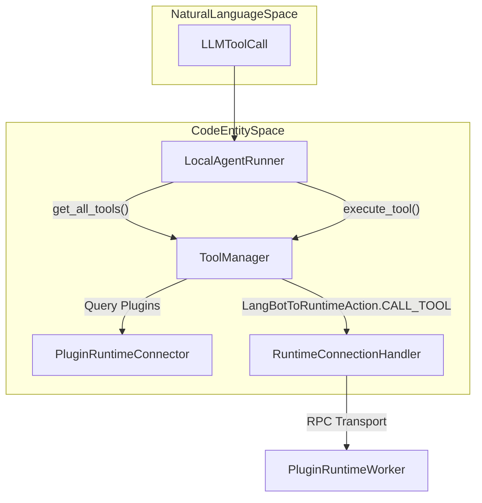

<!-- source: DeepWiki mcp.deepwiki.com · repo langbot-app/LangBot · page 7.1 Plugin Architecture and Runtime · fetched 2026-10-29 -->

# Plugin Architecture and Runtime

<details>
<summary>Relevant source files</summary>

The following files were used as context for generating this wiki page:

- [scripts/test-complexity.py](scripts/test-complexity.py)
- [src/langbot/pkg/agent/runner/orchestrator.py](src/langbot/pkg/agent/runner/orchestrator.py)
- [src/langbot/pkg/agent/runner/resource_builder.py](src/langbot/pkg/agent/runner/resource_builder.py)
- [src/langbot/pkg/pipeline/pipelinemgr.py](src/langbot/pkg/pipeline/pipelinemgr.py)
- [src/langbot/pkg/plugin/connector.py](src/langbot/pkg/plugin/connector.py)
- [src/langbot/pkg/plugin/handler.py](src/langbot/pkg/plugin/handler.py)
- [src/langbot/pkg/provider/tools/toolmgr.py](src/langbot/pkg/provider/tools/toolmgr.py)
- [src/langbot/pkg/workspace/repository.py](src/langbot/pkg/workspace/repository.py)
- [src/langbot/pkg/workspace/service.py](src/langbot/pkg/workspace/service.py)
- [tests/README.md](tests/README.md)
- [tests/unit_tests/agent/test_chat_handler.py](tests/unit_tests/agent/test_chat_handler.py)
- [tests/unit_tests/agent/test_event_log_transcript.py](tests/unit_tests/agent/test_event_log_transcript.py)
- [tests/unit_tests/agent/test_handler_auth.py](tests/unit_tests/agent/test_handler_auth.py)
- [tests/unit_tests/agent/test_history_event_api_auth.py](tests/unit_tests/agent/test_history_event_api_auth.py)
- [tests/unit_tests/agent/test_resource_builder.py](tests/unit_tests/agent/test_resource_builder.py)
- [tests/unit_tests/pipeline/test_pipelinemgr.py](tests/unit_tests/pipeline/test_pipelinemgr.py)
- [tests/unit_tests/plugin/test_connector_methods.py](tests/unit_tests/plugin/test_connector_methods.py)
- [tests/unit_tests/plugin/test_connector_reconcile.py](tests/unit_tests/plugin/test_connector_reconcile.py)
- [tests/unit_tests/plugin/test_extract_deps.py](tests/unit_tests/plugin/test_extract_deps.py)
- [tests/unit_tests/plugin/test_handler.py](tests/unit_tests/plugin/test_handler.py)
- [tests/unit_tests/plugin/test_handler_actions.py](tests/unit_tests/plugin/test_handler_actions.py)
- [tests/unit_tests/plugin/test_handler_helpers.py](tests/unit_tests/plugin/test_handler_helpers.py)
- [tests/unit_tests/test_complexity_report.py](tests/unit_tests/test_complexity_report.py)
- [tests/unit_tests/workspace/test_workspace_service.py](tests/unit_tests/workspace/test_workspace_service.py)

</details>


## Purpose and Scope
This page details LangBot's plugin architecture and runtime separation. It covers process-level isolation via stdio and WebSocket transports, the `PluginRuntimeConnector` and `RuntimeConnectionHandler` RPC bridge, desired-state reconciliation, `.lbpkg` binary storage persistence, and component types.

Sources:
[src/langbot/pkg/plugin/connector.py:45-49](), [src/langbot/pkg/plugin/handler.py:21-39]()

---

## Architecture and Transport Layer

LangBot separates core execution from plugins using **process-level isolation**. Plugins run in an isolated environment called the **Plugin Runtime**, communicating via a bidirectional RPC mechanism over stdio pipes or WebSockets [src/langbot/pkg/plugin/connector.py:1-49]().

The transport is managed by `PluginRuntimeConnector` [src/langbot/pkg/plugin/connector.py:229-230](), which inherits from `ManagedRuntimeConnector` [src/langbot/pkg/plugin/connector.py:45]() to supervise subprocess lifecycles. Depending on the environment, it selects:
- `stdio_client_controller` for Unix-like systems using standard input/output pipes [src/langbot/pkg/plugin/connector.py:47-48]().
- `ws_client_controller` for Windows, Docker, or Kubernetes using WebSockets [src/langbot/pkg/plugin/connector.py:49]().

The connector monitors connection health by sending a periodic `ping` every 20 seconds [src/langbot/pkg/plugin/connector.py:99](). If disconnected, it invokes a configurable `runtime_disconnect_callback` [src/langbot/pkg/plugin/connector.py:230]().

### Diagram: Plugin System Runtime Bridge

This diagram illustrates the bridge between LangBot's Python core and the isolated Plugin Runtime process.

```mermaid
graph LR
    subgraph "LangBotCore"
        AP["Application"]
        PRC["PluginRuntimeConnector"]
        RCH["RuntimeConnectionHandler"]
    end

    subgraph "TransportLayer"
        IO["Connection\n(stdio/WebSocket)"]
    end

    subgraph "PluginRuntime"
        RT["langbot_plugin.cli"]
        PM["PluginManager"]
        PL["Plugins"]
    end

    AP --> PRC
    PRC --> RCH
    RCH <--- "LangBotToRuntimeAction" ---> IO
    IO <--- "RuntimeToLangBotAction" ---> RT
    RT --> PM
    PM --> PL
```
Sources:
[src/langbot/pkg/plugin/connector.py:45-49](), [src/langbot/pkg/plugin/connector.py:99](), [src/langbot/pkg/plugin/connector.py:229-230](), [src/langbot/pkg/plugin/handler.py:21-39]()

---

## RuntimeConnectionHandler and RPC Protocol

The `RuntimeConnectionHandler` processes incoming RPC messages from the runtime worker, enforcing tenant boundaries using `ActionContext` and `InstallationBinding` [src/langbot/pkg/plugin/handler.py:21-27]().

### Core-to-Runtime and Runtime-to-Core Actions
- **Tool Invocation**: Executes plugin tools via `CALL_TOOL` actions [tests/unit_tests/plugin/test_handler_actions.py:166]() to support LLM tool calling.
- **State Storage**: Plugins store binary state in `persistence_bstorage.BinaryStorage`, bounded by `max_value_bytes` (default 10 MiB, hard-capped at 64 MiB) [src/langbot/pkg/plugin/handler.py:90-108]().
- **RAG Operations**: Knowledge engines and parsers interact with LangBot's RAG subsystem, formatting errors via `_make_rag_error_response()` [src/langbot/pkg/plugin/handler.py:134-145]().

Sources:
[src/langbot/pkg/plugin/handler.py:21-29](), [src/langbot/pkg/plugin/handler.py:90-108](), [src/langbot/pkg/plugin/handler.py:134-145](), [tests/unit_tests/plugin/test_handler_actions.py:166-174]()

---

## Desired-State Reconciliation and lbpkg Binary Storage

LangBot uses a **desired-state reconciliation** model to synchronize plugin installations:
- `PluginInstallationDesiredState` defines the target configuration snapshot [src/langbot/pkg/plugin/connector.py:69]().
- `PluginRuntimeConnector._prepare_connected_runtime()` invokes `RuntimeConnectionHandler.reconcile_plugin_installations()` to push the desired state to the runtime [tests/unit_tests/plugin/test_connector_reconcile.py:148]().
- The `reconcile_plugin_installations` method in `RuntimeConnectionHandler` accepts a `timeout` parameter, which defaults to 300 seconds but can be configured, for example, to 900 seconds for cold starts [tests/unit_tests/plugin/test_handler.py:109-132]().

### Binary Storage
Plugin distribution archives (`.lbpkg`) are stored as durable binary objects in `persistence_bstorage` [src/langbot/pkg/plugin/connector.py:74]() using:
- Owner type: `_PLUGIN_ARTIFACT_OWNER_TYPE` [src/langbot/pkg/plugin/connector.py:81]()
- Storage key: `_PLUGIN_ARTIFACT_KEY` [src/langbot/pkg/plugin/connector.py:82]()
- Storage marker: `_PLUGIN_ARTIFACT_STORAGE_MARKER` [src/langbot/pkg/plugin/connector.py:83]()

Sources:
[src/langbot/pkg/plugin/connector.py:69](), [src/langbot/pkg/plugin/connector.py:74](), [src/langbot/pkg/plugin/connector.py:81-83](), [tests/unit_tests/plugin/test_connector_reconcile.py:148](), [tests/unit_tests/plugin/test_handler.py:109-132]()

---

## Certified Plugins and Admission Policy

Plugin archives undergo cryptographic verification before installation:
- `verify_plugin_archive_certificate()` validates Ed25519 signatures stored in the archive ZIP comment [src/langbot/pkg/plugin/connector.py:38]().
- `decide_plugin_admission()` evaluates facts against tenant deployment modes (`oss` vs `cloud`), returning an `AdmissionDisposition` and `AdmissionCode` [src/langbot/pkg/plugin/connector.py:36]().
- Admitted packages run under `PluginExecutionMode.SHARED_CERTIFIED`, while uncertified plugins default to `PluginExecutionMode.DEDICATED` [src/langbot/pkg/plugin/connector.py:68](). The `apply_plugin_installation` method serializes the `PluginExecutionMode` to a string like 'shared-runtime-v1' for the runtime [tests/unit_tests/plugin/test_handler.py:135-150]().

Sources:
[src/langbot/pkg/plugin/connector.py:36](), [src/langbot/pkg/plugin/connector.py:38](), [src/langbot/pkg/plugin/connector.py:68](), [tests/unit_tests/plugin/test_handler.py:135-150]()

---

## Plugin Component Types

Plugins register modular components defined in their `ComponentManifest` [src/langbot/pkg/plugin/connector.py:53]():

| Component Kind | Description | Core Caller / Interface |
|---|---|---|
| `Tool` | LLM-callable functions | `PluginRuntimeConnector.call_tool()` |
| `Command` | Slash or explicit user commands | `PluginRuntimeConnector.execute_command()` |
| `EventListener` | IM platform event listeners | `PluginRuntimeConnector.emit_event()` |
| `KnowledgeEngine` | RAG retrieval engines | `persistence_plugin.KnowledgeEngine` |
| `Parser` | Ingestion document parsers | `PluginRuntimeConnector.call_parser()` |
| `Page` | Web management panel UI integrations | Managed via `PluginsRouterGroup` |

Sources:
[src/langbot/pkg/plugin/connector.py:53]()

---

## Event-Driven Architecture and Response Handling

Plugins integrate with the query-response pipeline while maintaining strict boundary separation:
- **Query Variable Protection**: Ephemeral query variables can be set or read via `SET_QUERY_VAR` / `GET_QUERY_VAR`. Host-reserved keys and prefixes (`_host_`, `_pipeline_bound_`, `_activated_skills`) prevent external plugin tampering [src/langbot/pkg/plugin/handler.py:69-84]().
- **Delivery Failures**: Outgoing message failures notify the runtime via `notify_response_delivery_failure` to trigger reactive handling.

### Diagram: Tool Discovery and Invocation Flow

This diagram bridges natural language query evaluation in the AI layer to the code entities managing plugin tool execution.


Sources:
[src/langbot/pkg/plugin/connector.py:229-230](), [src/langbot/pkg/plugin/handler.py:21-39](), [src/langbot/pkg/plugin/handler.py:69-84](), [src/langbot/pkg/provider/tools/toolmgr.py:37-136]()

---

