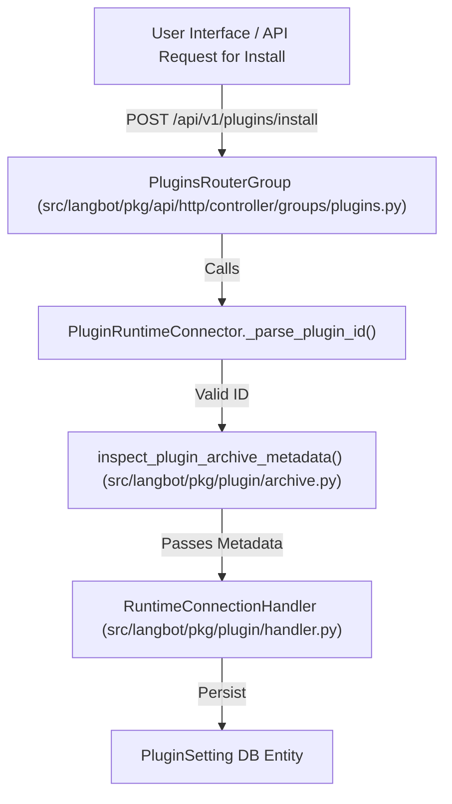
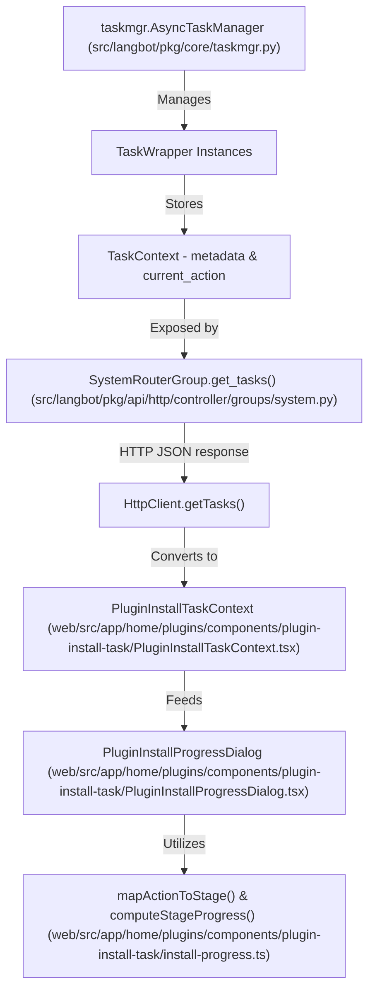
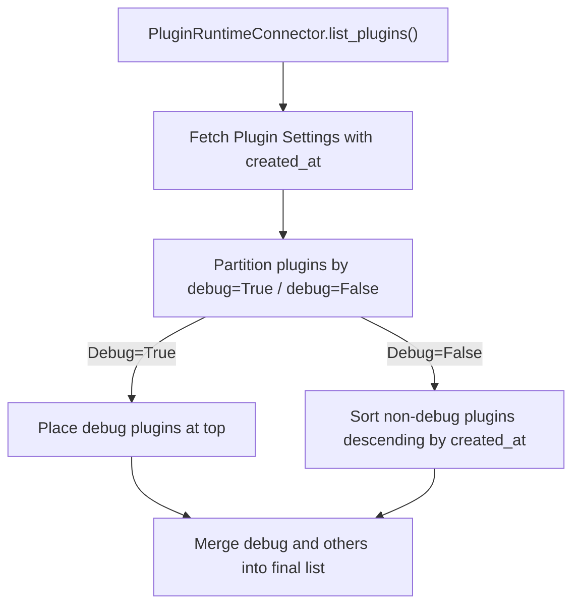

<!-- source: DeepWiki mcp.deepwiki.com · repo langbot-app/LangBot · page 7.2 Plugin Installation and Lifecycle · fetched 2026-10-29 -->

# Plugin Installation and Lifecycle

<details>
<summary>Relevant source files</summary>

The following files were used as context for generating this wiki page:

- [src/langbot/pkg/api/http/controller/groups/plugins.py](src/langbot/pkg/api/http/controller/groups/plugins.py)
- [web/src/app/home/plugins/components/plugin-install-task/PluginInstallProgressDialog.tsx](web/src/app/home/plugins/components/plugin-install-task/PluginInstallProgressDialog.tsx)
- [web/src/app/home/plugins/components/plugin-install-task/PluginInstallTaskContext.tsx](web/src/app/home/plugins/components/plugin-install-task/PluginInstallTaskContext.tsx)
- [web/src/app/home/plugins/components/plugin-install-task/PluginInstallTaskQueue.tsx](web/src/app/home/plugins/components/plugin-install-task/PluginInstallTaskQueue.tsx)
- [web/src/app/home/plugins/components/plugin-install-task/install-progress.ts](web/src/app/home/plugins/components/plugin-install-task/install-progress.ts)
- [web/src/app/home/plugins/components/plugin-market/marketplace-installed.ts](web/src/app/home/plugins/components/plugin-market/marketplace-installed.ts)
- [web/src/app/home/plugins/components/plugin-market/useMarketplaceInstalledIndex.ts](web/src/app/home/plugins/components/plugin-market/useMarketplaceInstalledIndex.ts)
- [web/src/components/ui/dialog.tsx](web/src/components/ui/dialog.tsx)
- [web/tests/e2e/knowledge-engine-marketplace.spec.ts](web/tests/e2e/knowledge-engine-marketplace.spec.ts)
- [web/tests/e2e/marketplace-likes.spec.ts](web/tests/e2e/marketplace-likes.spec.ts)
- [web/tests/e2e/plugin-upgrade-recovery.spec.ts](web/tests/e2e/plugin-upgrade-recovery.spec.ts)
- [web/tests/e2e/wizard-platform-regressions.spec.ts](web/tests/e2e/wizard-platform-regressions.spec.ts)
- [web/tests/unit/install-progress.test.mjs](web/tests/unit/install-progress.test.mjs)
- [web/tests/unit/knowledge-engine-marketplace.test.mjs](web/tests/unit/knowledge-engine-marketplace.test.mjs)
- [web/tests/unit/marketplace-installed-state.test.mjs](web/tests/unit/marketplace-installed-state.test.mjs)
- [web/tests/unit/marketplace-likes.test.mjs](web/tests/unit/marketplace-likes.test.mjs)
- [web/tests/unit/wizard-page-bot.test.mjs](web/tests/unit/wizard-page-bot.test.mjs)

</details>


This document details the plugin installation, ID parsing, asynchronous task tracking, upgrade, deletion, and sorting mechanisms in LangBot. For architectural details about plugin components and structure, see page [7.1. Plugin Architecture and Runtime](). For plugin configuration schemas and settings, see page [7.3. Plugin Configuration and Settings](). For marketplace integration, see page [7.4. Plugin Marketplace Integration]().

---

## Installation Sources and ID Parsing

LangBot supports installing extensions from multiple sources: GitHub repositories, local archives or folders, and the official marketplace. Installation requests flow through REST endpoints, coordinated by backend connector classes that enforce strict validation and handle the installation lifecycle.

### Plugin ID Validation

The core method parsing and validating plugin IDs for installation is `PluginRuntimeConnector._parse_plugin_id` ([src/langbot/pkg/plugin/connector.py:1700-1723]()). It requires IDs to strictly be in the `author/name` format. Rules enforced:

- **Accepted**: Two segments separated by a single slash, e.g., "langbot/rag-engine".
- **Rejected Cases**: Empty strings, only single segment (e.g. "langbot"), leading/trailing slashes, or more than two segments (e.g. "langbot/rag/extra").

This guarantees uniformity in plugin identification across the system.

#### Installation ID Parsing Flow



Sources: [src/langbot/pkg/api/http/controller/groups/plugins.py:1-208](), [src/langbot/pkg/plugin/connector.py:1680-1725](), [src/langbot/pkg/plugin/archive.py:20-80](), [src/langbot/pkg/plugin/handler.py:50-100](), [tests/unit_tests/plugin/test_plugin_id_parsing.py:5-21]()

---

### Installation Sources Comparison

| Source | Identifier Format | Processing Handler | Validation Mechanism |
| :------------- | :----------------------------------- | :--------------------------- | :--------------------------------------------------------------------------------------------------------------------------------------------------------------------------------------------------------------------------------------------------------------------------------------------------------------------------------------------------------------------------------------------------------------------------------------------------------------------------------------------------------------------------------------------------------------------------------------------------------------------------------------------------------------------------------------------------------------------------------------------------------------------------------------------------------------------------------------------------------------------------------------------------------------------------------------------------------------------------------------------------------------------------------------------------------------------------------------------------------------------------------------------------------------------------------------------------------------------------------------------------------------------------------------------------------------------------------------------------------------------------------------------------------------------------------------------------------------------------------------------------------------------------------------------------------------------------------------------------------------------------------------------------------------------------------------------------------------------------------------------------------------------------------------------------------------------------------------------------------------------------------------------------------------------------------------------------------------------------------------------------------------------------------------------------------------------------------------------------------------------------------------------------------------------------------------------------------------------------------------------------------------------------------------------------------------------------------------------------------------------------------------------------------------------------------------------------------------------------------------------------------------------------------------------------------------------------------------------------------------------------------------------------------------------------------------------------------------------------------------------------------------------------------------------------------------------------------------------------------------------------------------------------------------------------------------------------------------------------------------------------------------------------------------------------------------------------------------------------------------------------------------------------------------------------------------------------------------------------------------------------------------------------------------------------------------------------------------------------------------------------------------------------------------------------------------------------------------------------------------------------------------------------------------------------------------------------------------------------------------------------------------------------------------------------------------------------------------------------------------------------------------------------------------------------------------------------------------------------------------------------------------------------------------------------------------------------------------------------------------------------------------------------------------------------------------------------------------------------------------------------------------------------------------------------------------------------------------------------------------------------------------------------------------------------------------------------------------------------------------------------------------------------------------------------------------------------------------------------------------------------------------------------------------------------------------------------------------------------------------------------------------------------------------------------------------------------------------------------------------------------------------------------------------------------------------------------------------------------------------------------------------------------------------------------------------------------------------------------------------------------------------------------------------------------------------------------------------------------------------------------------------------------------------------------------------------------------------------------------------------------------------------------------------------------------------------------------------------------------------------------------------------------------------------------------------------------------------------------------------------------------------------------------------------------------------------------------------------------------------------------------------------------------------------------------------------------------------------------------------------------------------------------------------------------------------------------------------------------------------------------------------------------------------------------------------------------------------------------------------------------------------------------------------------------------------------------------------------------------------------------------------------------------------------------------------------------------------------------------------------------------------------------------------------------------------------------------------------------------------------------------------------------------------------------------------------------------------------------------------------------------------------------------------------------------------------------------------------------------------------------------------------------------------------------------------------------------------------------------------------------------------------------------------------------------------------------------------------------------------------------------------------------------------------------------------------------------------------------------------------------------------------------------------------------------------------------------------------------------------------------------------------------------------------------------------------------------------------------------------------------------------------------------------------------------------------------------------------------------------------------------------------------------------------------------------------------------------------------------------------------------------------------------------------------------------------------------------------------------------------------------------------------------------------------------------------------------------------------------------------------------------------------------------------------------------------------------------------------------------------------------------------------------------------------------------------------------------------------------------------------------------------------------------------------------------------------------------------------------------------------------------------------------------------------------------------------------------------------------------------------------------------------------------------------------------------------------------------------------------------------------------------------------------------------------------------------------------------------------------------------------------------------------------------------------------------------------------------------------------------------------------------------------------------------------------------------------------------------------------------------------------------------------------------------------------------------------------------------------------------------------------------------------------------------------------------------------------------------------------------------------------------------------------------------------------------------------------------------------------------------------------------------------------------------------------------------------------------------------------------------------------------------------------------------------------------------------------------------------------------------------------------------------------------------------------------------------------------------------------------------------------------------------------------------------------------------------------------------------------------------------------------------------------------------------------------------------------------------------------------------------------------------------------------------------------------------------------------------------------------------------------------------------------------------------------------------------------------------------------------------------------------------------------------------------------------------------------------------------------------------------------------------------------------------------------------------------------------------------------------------------------------------------------------------------------------------------------------------------------------------------------------------------------------------------------------------------------------------------------------------------------------------------------------------------------------------------------------------------------------------------------------------------------------------------------------------------------------------------------------------------------------------------------------------------------------------------------------------------------------------------------------------------------------------------------------------------------------------------------------------------------------------------------------------------------------------------------------------------------------------------------------------------------------------------------------------------------------------------------------------------------------------------------------------------------------------------------------------------------------------------------------------------------------------------------------------------------------------------------------------------------------------------------------------------------------------------------------------------------------------------------------------------------------------------------------------------------------------------------------------------------------------------------------------------------------------------------------------------------------------------------------------------------------------------------------------------------------------------------------------------------------------------------------------------------------------------------------------------------------------------------------------------------------------------------------------------------------------------------------------------------------------------------------------------------------------------------------------------------------------------------------------------------------------------------------------------------------------------------------------------------------------------------------------------------------------------------------------------------------------------------------------------------------------------------------------------------------------------------------------------------------------------------------------------------------------------------------------------------------------------------------------------------------------------------------------------------------------------------------------------------------------------------------------------------------------------------------------------------------------------------------------------------------------------------------------------------------------------------------------------------------------------------------------------------------------------------------------------------------------------------------------------------------------------------------------------------------------------------------------------------------------------------------------------------------------------------------------------------------------------------------------------------------------------------------------------------------------------------------------------------------------------------------------------------------------------------------------------------------------------------------------------------------------------------------------------------------------------------------------------------------------------------------------------------------------------------------------------------------------------------------------------------------------------------------------------------------------------------------------------------------------------------------------------------------------------------------------------------------------------------------------------------------------------------------------------------------------------------------------------------------------------------------------------------------------------------------------------------------------------------------------------------------------------------------------------------------------------------------------------------------------------------------------------------------------------------------------------------------------------------------------------------------------------------------------------------------------------------------------------------------------------------------------------------------------------------------------------------------------------------------------------------------------------------------------------------------------------------------------------------------------------------------------------------------------------------------------------------------------------------------------------------------------------------------------------------------------------------------------------------------------------------------------------------------------------------------------------------------------------------------------------------------------------------------------------------------------------------------------------------------------------------------------------------------------------------------------------------------------------------------------------------------------------------------------------------------------------------------------------------------------------------------------------------------------------------------------------------------------------------------------------------------------------------------------------------------------------------------------------------------------------------------------------------------------------------------------------------------------------------------------------------------------------------------------------------------------------------------------------------------------------------------------------------------------------------------------------------------------------------------------------------------------------------------------------------------------------------------------------------------------------------------------------------------------------------------------------------------------------------------------------------------------------------------------------------------------------------------------------------------------------------------------------------------------------------------------------------------------------------------------------------------------------------------------------------------------------------------------------------------------------------------------------------------------------------------------------------------------------------------------------------------------------------------------------------------------------------------------------------------------------------------------------------------------------------------------------------------------------------------------------------------------------------------------------------------------------------------------------------------------------------------------------------------------------------------------------------------------------------------------------------------------------------------------------------------------------------------------------------------------------------------------------------------------------------------------------------------------------------------------------------------------------------------------------------------------------------------------------------------------------------------------------------------------------------------------------------------------------------------------------------------------------------------------------------------------------------------------------------------------------------------------------------------------------------------------------------------------------------------------------------------------------------------------------------------------------------------------------------------------------------------------------------------------------------------------------------------------------------------------------------------------------------------------------------------------------------------------------------------------------------------------------------------------------------------------------------------------------------------------------------------------------------------------------------------------------------------------------------------------------------------------------------------------------------------------------------------------------------------------------------------------------------------------------------------------------------------------------------------------------------------------------------------------------------------------------------------------------------------------------------------------------------------------------------------------------------------------------------------------------------------------------------------------------------------------------------------------------------------------------------------------------------------------------------------------------------------------------------------------------------------------------------------------------------------------------------------------------------------------------------------------------------------------------------------------------------------------------------------------------------------------------------------------------------------------------------------------------------------------------------------------------------------------------------------------------------------------------------------------------------------------------------------------------------------------------------------------------------------------------------------------------------------------------------------------------------------------------------------------------------------------------------------------------------------------------------------------------------------------------------------------------------------------------------------------------------------------------------------------------------------------------------------------------------------------------------------------------------------------------------------------------------------------------------------------------------------------------------------------------------------------------------------------------------------------------------------------------------------------------------------------------------------------------------------------------------------------------------------------------------------------------------------------------------------------------------------------------------------------------------------------------------------------------------------------------------------------------------------------------------------------------------------------------------------------------------------------------------------------------------------------------------------------------------------------------------------------------------------------------------------------------------------------------------------------------------------------------------------------------------------------------------------------------------------------------------------------------------------------------------------------------------------------------------------------------------------------------------------------------------------------------------------------------------------------------------------------------------------------------------------------------------------------------------------------------------------------------------------------------------------------------------------------------------------------------------------------------------------------------------------------------------------------------------------------------------------------------------------------------------------------------------------------------------------------------------------------------------------------------------------------------------------------------------------------------------------------------------------------------------------------------------------------------------------------------------------------------------------------------------------------------------------------------------------------------------------------------------------------------------------------------------------------------------------------------------------------------------------------------------------------------------------------------------------------------------------------------------------------------------------------------------------------------------------------------------------------------------------------------------------------------------------------------------------------------------------------------------------------------------------------------------------------------------------------------------------------------------------------------------------------------------------------------------------------------------------------------------------------------------------------------------------------------------------------------------------------------------------------------------------------------------------------------------------------------------------------------------------------------------------------------------------------------------------------------------------------------------------------------------------------------------------------------------------------------------------------------------------------------------------------------------------------------------------------------------------------------------------------------------------------------------------------------------------------------------------------------------------------------------------------------------------------------------------------------------------------------------------------------------------------------------------------------------------------------------------------------------------------------------------------------------------------------------------------------------------------------------------------------------------------------------------------------------------------------------------------------------------------------------------------------------------------------------------------------------------------------------------------------------------------------------------------------------------------------------------------------------------------------------------------------------------------------------------------------------------------------------------------------------------------------------------------------------------------------------------------------------------------------------------------------------------------------------------------------------------------------------------------------------------------------------------------------------------------------------------------------------------------------------------------------------------------------------------------------------------------------------------------------------------------------------------------------------------------------------------------------------------------------------------------------------------------------------------------------------------------------------------------------------------------------------------------------------------------------------------------------------------------------------------------------------------------------------------------------------------------------------------------------------------------------------------------------------------------------------------------------------------------------------------------------------------------------------------------------------------------------------------------------------------------------------------------------------------------------------------------------------------------------------------------------------------------------------------------------------------------------------------------------------------------------------------------------------------------------------------------------------------------------------------------------------------------------------------------------------------------------------------------------------------------------------------------------------------------------------------------------------------------------------------------------------------------------------------------------------------------------------------------------------------------------------------------------------------------------------------------------------------------------------------------------------------------------------------------------------------------------------------------------------------------------------------------------------------------------------------------------------------------------------------------------------------------------------------------------------------------------------------------------------------------------------------------------------------------------------------------------------------------------------------------------------------------------------------------------------------------------------------------------------------------------------------------------------------------------------------------------------------------------------------------------------------------------------------------------------------------------------------------------------------------------------------------------------------------------------------------------------------------------------------------------------------------------------------------------------------------------------------------------------------------------------------------------------------------------------------------------------------------------------------------------------------------------------------------------------------------------------------------------------------------------------------------------------------------------------------------------------------------------------------------------------------------------------------------------------------------------------------------------------------------------------------------------------------------------------------------------------------------------------------------------------------------------------------------------------------------------------------------------------------------------------------------------------------------------------------------------------------------------------------------------------------------------------------------------------------------------------------------------------------------------------------------------------------------------------------------------------------------------------------------------------------------------------------------------------------------------------------------------------------------------------------------------------------------------------------------------------------------------------------------------------------------------------------------------------------------------------------------------------------------------------------------------------------------------------------------------------------------------------------------------------------------------------------------------------------------------------------------------------------------------------------------------------------------------------------------------------------------------------------------------------------------------------------------------------------------------------------------------------------------------------------------------------------------------------------------------------------------------------------------------------------------------------------------------------------------------------------------------------------------------------------------------------------------------------------------------------------------------------------------------------------------------------------------------------------------------------------------------------------------------------------------------------------------------------------------------------------------------------------------------------------------------------------------------------------------------------------------------------------------------------------------------------------------------------------------------------------------------------------------------------------------------------------------------------------------------------------------------------------------------------------------------------------------------------------------------------------------------------------------------------------------------------------------------------------------------------------------------------------------------------------------------------------------------------------------------------------------------------------------------------------------------------------------------------------------------------------------------------------------------------------------------------------------------------------------------------------------------------------------------------------------------------------------------------------------------------------------------------------------------------------------------------------------------------------------------------------------------------------------------------------------------------------------------------------------------------------------------|
| **GitHub**    | Repository references or release asset URL | `PluginsRouterGroup` ([src/langbot/pkg/api/http/controller/groups/plugins.py:205-208]()) | `validate_github_plugin_install_info()` ([src/langbot/pkg/plugin/github.py]()) |
| **Local**     | Local file paths or `.lbpkg` archives | `PluginInstallSource.LOCAL` | Local archive file inspection |
| **Marketplace** | Plugin IDs as `author/name` strings | `PluginsRouterGroup` ([src/langbot/pkg/api/http/controller/groups/plugins.py:205-208]()) | Marketplace catalog and cloud client |

Each source triggers a specific subflow for installation, including remote asset download, local file inspection, or synchronous installation from the marketplace catalog.

Sources: [src/langbot/pkg/plugin/connector.py:38-190](), [src/langbot/pkg/api/http/controller/groups/plugins.py:23-53](), [tests/unit_tests/plugin/test_plugin_id_parsing.py:5-21]()

---

## Asynchronous Task Tracking and Progress Dialogs

Plugin installation involves asynchronous steps like network downloads, archive validation, dependency installation, and runtime activation. LangBot tracks these as background tasks with fine-grained progress updates surfaced to the frontend.

### Backend Async Installation Task Management

- The primary async task orchestrator is `taskmgr.AsyncTaskManager` ([src/langbot/pkg/core/taskmgr.py]()) managing `TaskWrapper` instances for install workflows.
- Each task context includes metadata on current install stage, bytes downloaded, download speed, and the plugin name.
- The HTTP API exposes these with `SystemRouterGroup.get_tasks()` ([src/langbot/pkg/api/http/controller/groups/system.py:16-94]()) to feed frontend progress indicators.

### Frontend Task State Management with `PluginInstallTaskContext`

- The React context `PluginInstallTaskContext` ([web/src/app/home/plugins/components/plugin-install-task/PluginInstallTaskContext.tsx:70-81]()) manages a list of active install tasks, keyed by a combination of source, backend task ID, and operation.
- It handles adding, updating, and removing tasks based on Axios/polling feedback from the backend.
- Callbacks support notifying when tasks complete successfully or fail.

### Installation Lifecycle Stages and Progress Computation

Stages of plugin installation are enumerated as `InstallStage` in `web/src/app/home/plugins/components/plugin-install-task/install-progress.ts`:

```typescript
export enum InstallStage {
  CHECKING = 'checking',           // For upgrades only: checking for new version
  DOWNLOADING = 'downloading',     // Downloading archive
  VALIDATING = 'validating',       // Validating downloaded package
  INSTALLING_DEPS = 'installing_deps', // Installing dependencies (pip)
  INITIALIZING = 'initializing',   // Initial configuration phase
  LAUNCHING = 'launching',         // Plugin activation
  DONE = 'done',                   // Completed successfully
  ERROR = 'error',                 // Installation error state
}
```

- Backend action strings map precisely to these stages using `mapActionToStage()` ([web/src/app/home/plugins/components/plugin-install-task/install-progress.ts:29-79]()) for frontend UI synchronization.
- Progress percentage is computed by `computeStageProgress()` ([web/src/app/home/plugins/components/plugin-install-task/install-progress.ts:124-157]()) blending download progress or estimated time-based completion.
- Install progress caps at 99% until completion for a smooth UI experience ([web/src/app/home/plugins/components/plugin-install-task/install-progress.ts:99-99]()).

### Task Data Conversion Logic

Conversion of backend `AsyncTask` to frontend `PluginInstallTask` includes the following:

- **Source extraction:** Via substring matching on task name (e.g., "github", "marketplace", or "local") ([web/src/app/home/plugins/components/plugin-install-task/PluginInstallTaskContext.tsx:86-93]()).
- **Plugin name parsing:** Uses task metadata or falls back to `source extension`.
- **Operation type:** Differentiates 'install' vs 'upgrade' from either metadata or name prefix ([web/src/app/home/plugins/components/plugin-install-task/PluginInstallTaskContext.tsx:126-130]()).
- **Stage decoding:** Translates backend action string into install stage (checked/error/done).
- **Progress and error handling:** Computes overall progress and captures errors or failed install stages.

---

#### Task Progress Tracking Flow



Sources: [src/langbot/pkg/core/taskmgr.py](), [src/langbot/pkg/api/http/controller/groups/system.py:16-94](), [web/src/app/infra/http/HttpClient.ts](), [web/src/app/home/plugins/components/plugin-install-task/PluginInstallTaskContext.tsx:1-215](), [web/src/app/home/plugins/components/plugin-install-task/install-progress.ts:11-157](), [web/src/app/home/plugins/components/plugin-install-task/PluginInstallProgressDialog.tsx:36-222]()

---

## Plugin Upgrades, Deletion, and Sorting

LangBot provides full lifecycle management for plugins including upgrades, removal, and curated listing display order.

### Upgrades

- Recognized as a specialized install operation. Task names start with `"plugin-upgrade-"`, parsed accordingly on frontend as `operation='upgrade'` ([web/src/app/home/plugins/components/plugin-install-task/PluginInstallTaskContext.tsx:126-130]()).
- The install task UI shows an initial `CHECKING` stage to verify update availability ([web/src/app/home/plugins/components/plugin-install-task/PluginInstallProgressDialog.tsx:38-46]()).
- Upgrade steps overwrite existing plugin binaries, dependencies, and runtime state.
- Upon completion, the connector reconciles the runtime state to ensure the new version is activated.

### Deletion

- Deleting a plugin involves:
  - Removing persistent settings entries in the `PluginSetting` storage entity.
  - Cleaning up binary storage relevant to the plugin.
  - Invoking runtime cleanup to deregister commands, event listeners, and worker components.
- Deletion APIs are exposed by `PluginsRouterGroup` ([src/langbot/pkg/api/http/controller/groups/plugins.py:390-400]()) with connector invocations.

### Sorting in Plugin Listings

Plugins returned by `PluginRuntimeConnector.list_plugins()` are sorted by:

1.  **Debug flag:** Plugins with `debug=True` are listed first to highlight active debug sessions.
2.  **Installation timestamp:** Remaining plugins are sorted descending by their `created_at` timestamp (newest first).
3.  The sorted lists are merged for the final result delivered to frontend lists.

---

#### Plugin Sorting Logic Flow



Sources: [tests/unit_tests/plugin/test_connector_methods.py:186-240](), [web/src/app/home/plugins/components/plugin-install-task/PluginInstallTaskContext.tsx:50-90](), [web/src/app/home/plugins/components/plugin-install-task/PluginInstallProgressDialog.tsx:36-70]()

---

# Summary

This page has explained the comprehensive plugin installation and lifecycle management in LangBot, including:

- Supported plugin installation sources with strict plugin ID parsing.
- Backend asynchronous task management supporting staged progress tracking.
- Frontend React-based install task context and progress dialogs.
- Upgrade flows with pre-checking and runtime reconciliation.
- Plugin deletion procedures ensuring runtime and persistent cleanup.
- Deterministic sorting of plugins prioritizing debug sessions and recency.

These mechanisms provide a robust, user-friendly foundation for managing extensions in LangBot's extensible platform.

---

# References

- `src/langbot/pkg/api/http/controller/groups/plugins.py`
- `src/langbot/pkg/plugin/connector.py`
- `src/langbot/pkg/plugin/handler.py`
- `src/langbot/pkg/plugin/archive.py`
- `src/langbot/pkg/core/taskmgr.py`
- `src/langbot/pkg/api/http/controller/groups/system.py`
- `web/src/app/home/plugins/components/plugin-install-task/PluginInstallTaskContext.tsx`
- `web/src/app/home/plugins/components/plugin-install-task/install-progress.ts`
- `web/src/app/home/plugins/components/plugin-install-task/PluginInstallProgressDialog.tsx`
- `web/src/app/infra/http/HttpClient.ts`
- `tests/unit_tests/plugin/test_plugin_id_parsing.py`
- `tests/unit_tests/plugin/test_connector_methods.py`

---

