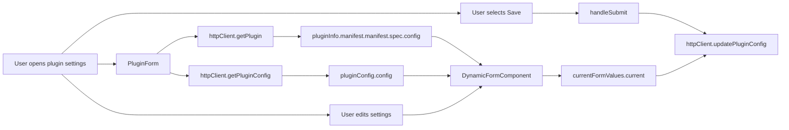
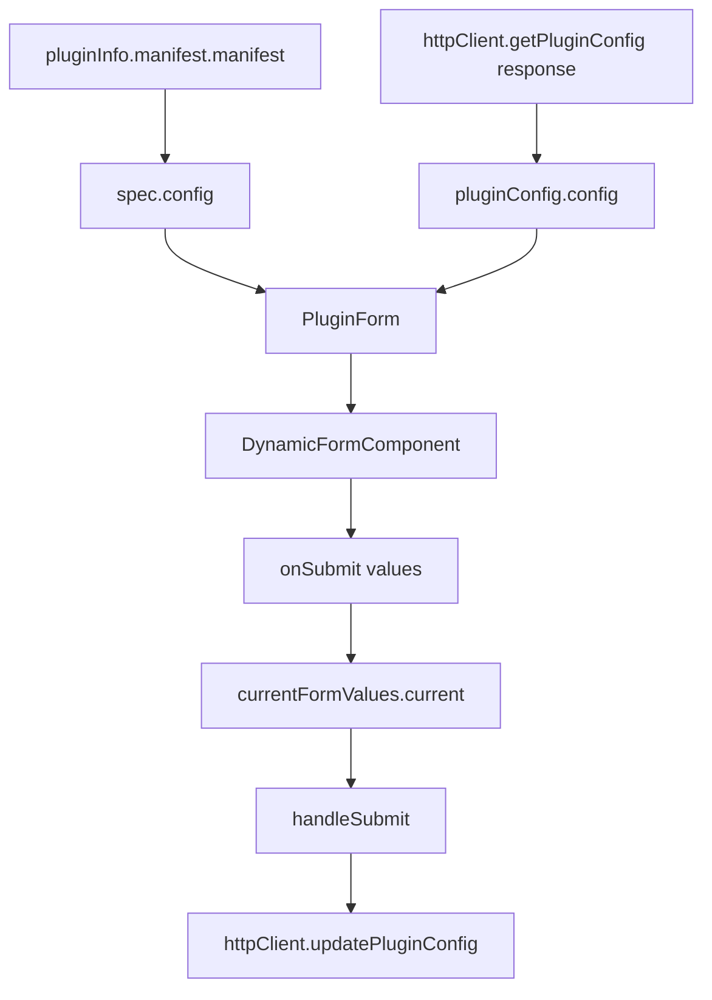
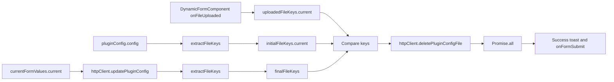

<!-- source: DeepWiki mcp.deepwiki.com · repo langbot-app/LangBot · page 7.3 Plugin Configuration and Settings · fetched 2026-10-29 -->

# Plugin Configuration and Settings

Relevant source files

The following files were used as context for generating this wiki page:

- [web/src/app/home/pipelines/components/pipeline-extensions/PipelineExtension.tsx](web/src/app/home/pipelines/components/pipeline-extensions/PipelineExtension.tsx)
- [web/src/app/home/plugins/components/plugin-installed/ExtensionCardComponent.tsx](web/src/app/home/plugins/components/plugin-installed/ExtensionCardComponent.tsx)
- [web/src/app/home/plugins/components/plugin-installed/PluginCardVO.ts](web/src/app/home/plugins/components/plugin-installed/PluginCardVO.ts)
- [web/src/app/home/plugins/components/plugin-installed/PluginComponentList.tsx](web/src/app/home/plugins/components/plugin-installed/PluginComponentList.tsx)
- [web/src/app/home/plugins/components/plugin-installed/PluginInstalledComponent.tsx](web/src/app/home/plugins/components/plugin-installed/PluginInstalledComponent.tsx)
- [web/src/app/home/plugins/components/plugin-installed/plugin-card/PluginCardComponent.tsx](web/src/app/home/plugins/components/plugin-installed/plugin-card/PluginCardComponent.tsx)
- [web/src/app/home/plugins/components/plugin-installed/plugin-form/PluginForm.tsx](web/src/app/home/plugins/components/plugin-installed/plugin-form/PluginForm.tsx)
- [web/src/app/home/plugins/components/plugin-market/PluginComponentIcons.ts](web/src/app/home/plugins/components/plugin-market/PluginComponentIcons.ts)
- [web/src/app/home/plugins/components/plugin-market/PluginComponentList.tsx](web/src/app/home/plugins/components/plugin-market/PluginComponentList.tsx)
- [web/src/app/home/plugins/components/plugin-market/PluginMarketComponent.tsx](web/src/app/home/plugins/components/plugin-market/PluginMarketComponent.tsx)
- [web/src/app/home/plugins/components/plugin-market/RecommendationLists.tsx](web/src/app/home/plugins/components/plugin-market/RecommendationLists.tsx)
- [web/src/app/home/plugins/components/plugin-market/plugin-market-card/PluginMarketCardComponent.tsx](web/src/app/home/plugins/components/plugin-market/plugin-market-card/PluginMarketCardComponent.tsx)
- [web/src/app/home/plugins/components/plugin-market/plugin-market-card/PluginMarketCardVO.ts](web/src/app/home/plugins/components/plugin-market/plugin-market-card/PluginMarketCardVO.ts)
- [web/src/app/infra/hooks/useInstalledPluginIcon.ts](web/src/app/infra/hooks/useInstalledPluginIcon.ts)
- [web/src/app/infra/http/CloudServiceClient.ts](web/src/app/infra/http/CloudServiceClient.ts)
- [web/src/hooks/useAuthenticatedPluginResource.ts](web/src/hooks/useAuthenticatedPluginResource.ts)
- [web/tests/unit/installed-plugin-icon-cache.test.mjs](web/tests/unit/installed-plugin-icon-cache.test.mjs)
- [web/tests/unit/plugin-component-icons.test.mjs](web/tests/unit/plugin-component-icons.test.mjs)

## Purpose and Scope

This page describes the plugin-configuration flow visible in the supplied frontend code: loading plugin metadata and saved configuration, rendering a schema-driven form, saving values, and removing configuration files that are no longer referenced. It also identifies what the supplied files do—and do not—show about plugin logs and README display. [web/src/app/home/plugins/components/plugin-installed/plugin-form/PluginForm.tsx:19-35]()

**Sources:** [web/src/app/home/plugins/components/plugin-installed/plugin-form/PluginForm.tsx:19-35]()

---

## Configuration Flow

`PluginForm` coordinates two asynchronous reads: `httpClient.getPlugin` loads plugin metadata, and `httpClient.getPluginConfig` loads the current configuration. Once both are available, the component passes the plugin’s `manifest.manifest.spec.config` schema and the saved `pluginConfig.config` values to `DynamicFormComponent`. [web/src/app/home/plugins/components/plugin-installed/plugin-form/PluginForm.tsx:38-87] [web/src/app/home/plugins/components/plugin-installed/plugin-form/PluginForm.tsx:157-183]()

The form’s `onSubmit` callback stores the latest values in `currentFormValues.current`; the Save button invokes `handleSubmit`, which sends those values to `httpClient.updatePluginConfig`. This separates form-value capture from the explicit persistence action. [web/src/app/home/plugins/components/plugin-installed/plugin-form/PluginForm.tsx:89-99] [web/src/app/home/plugins/components/plugin-installed/plugin-form/PluginForm.tsx:190-199]()

### Natural-language actions mapped to code entities

**Diagram: Opening and editing plugin settings**

**Sources:** [web/src/app/home/plugins/components/plugin-installed/plugin-form/PluginForm.tsx:38-87] [web/src/app/home/plugins/components/plugin-installed/plugin-form/PluginForm.tsx:89-99] [web/src/app/home/plugins/components/plugin-installed/plugin-form/PluginForm.tsx:163-199]()

### Load, error, and retry behavior

The loading effect clears previous plugin and configuration state, starts both reads, and uses a cancellation flag to avoid applying results after cleanup. A failure from either request sets `loadFailed`; the component then renders `EntityLoadState` with a retry action that increments `loadAttempt`, causing the effect to run again. Until both the plugin information and config response are available, it renders the loading state. [web/src/app/home/plugins/components/plugin-installed/plugin-form/PluginForm.tsx:29-32] [web/src/app/home/plugins/components/plugin-installed/plugin-form/PluginForm.tsx:38-87] [web/src/app/home/plugins/components/plugin-installed/plugin-form/PluginForm.tsx:157-162]()

**Sources:** [web/src/app/home/plugins/components/plugin-installed/plugin-form/PluginForm.tsx:29-32] [web/src/app/home/plugins/components/plugin-installed/plugin-form/PluginForm.tsx:38-87] [web/src/app/home/plugins/components/plugin-installed/plugin-form/PluginForm.tsx:157-162]()

---

## Schema-driven Form Rendering

`PluginForm` obtains the form schema from `pluginInfo.manifest.manifest.spec.config` and supplies it as `itemConfigList` to `DynamicFormComponent`. It supplies the stored config as `initialValues`. The available source shows this integration point, but does not include the definitions of the schema types or the dynamic-form field-rendering implementation; details such as supported field types, conditional visibility, and validation rules cannot be established from this file alone. [web/src/app/home/plugins/components/plugin-installed/plugin-form/PluginForm.tsx:163-183]()

When the schema has no entries, the form displays the “plugin has no config” message and omits the Save button. When it has entries, the component renders the dynamic form and a Save button, which is disabled while a save is in progress. [web/src/app/home/plugins/components/plugin-installed/plugin-form/PluginForm.tsx:171-199]()

**Diagram: Schema and value flow across named code entities**

**Sources:** [web/src/app/home/plugins/components/plugin-installed/plugin-form/PluginForm.tsx:53-80] [web/src/app/home/plugins/components/plugin-installed/plugin-form/PluginForm.tsx:163-183] [web/src/app/home/plugins/components/plugin-installed/plugin-form/PluginForm.tsx:89-99]()

---

## Configuration Persistence

The Save handler sets the saving state before attempting persistence. It passes `pluginAuthor`, `pluginName`, and the current form values to `httpClient.updatePluginConfig`. On success, it performs file-reference cleanup, shows a success toast, and invokes `onFormSubmit(1000)`. On error, it shows an error toast containing the error message. The saving state is reset in `finally`, regardless of outcome. [web/src/app/home/plugins/components/plugin-installed/plugin-form/PluginForm.tsx:89-99] [web/src/app/home/plugins/components/plugin-installed/plugin-form/PluginForm.tsx:139-154]()

The supplied file shows the client method invocation, not the method definition, request route, backend persistence implementation, or storage transaction semantics. [web/src/app/home/plugins/components/plugin-installed/plugin-form/PluginForm.tsx:89-99]()

**Sources:** [web/src/app/home/plugins/components/plugin-installed/plugin-form/PluginForm.tsx:89-99] [web/src/app/home/plugins/components/plugin-installed/plugin-form/PluginForm.tsx:139-154]()

---

## Configuration File Uploads and Cleanup

`PluginForm` tracks newly uploaded file keys in `uploadedFileKeys` through the dynamic form’s `onFileUploaded` callback. It also scans the initially loaded configuration and stores the discovered file keys in `initialFileKeys`. Both scans recursively traverse nested objects and arrays, collecting string-valued `file_key` properties. [web/src/app/home/plugins/components/plugin-installed/plugin-form/PluginForm.tsx:34-35] [web/src/app/home/plugins/components/plugin-installed/plugin-form/PluginForm.tsx:60-80] [web/src/app/home/plugins/components/plugin-installed/plugin-form/PluginForm.tsx:179-182]()

After configuration persistence succeeds, the handler scans the final form values to build `finalFileKeys`. It schedules deletion for newly uploaded files absent from the final values and for initially configured files that are no longer present. Deletions use `httpClient.deletePluginConfigFile`; individual deletion errors are caught and logged with `console.warn`, and the handler waits for all deletion attempts before showing the save-success notification. [web/src/app/home/plugins/components/plugin-installed/plugin-form/PluginForm.tsx:100-146]()

The cleanup comparison is based on `file_key` references found in the submitted values. The supplied file does not establish the upload endpoint, backend file-storage implementation, or whether file deletion errors affect server-side persistence. [web/src/app/home/plugins/components/plugin-installed/plugin-form/PluginForm.tsx:100-146]()

**Diagram: File-key lifecycle during a configuration edit**

**Sources:** [web/src/app/home/plugins/components/plugin-installed/plugin-form/PluginForm.tsx:34-35] [web/src/app/home/plugins/components/plugin-installed/plugin-form/PluginForm.tsx:60-80] [web/src/app/home/plugins/components/plugin-installed/plugin-form/PluginForm.tsx:89-146] [web/src/app/home/plugins/components/plugin-installed/plugin-form/PluginForm.tsx:179-182]()

---

## Plugin Logs and README

The supplied `PluginForm.tsx` establishes configuration loading, editing, saving, and file cleanup; it does not show plugin log retrieval or README rendering. The supplied plugin-card files show installed-plugin metadata and component summaries, but the excerpts do not establish how logs or README content are fetched or displayed. Those behaviors therefore cannot be documented reliably from the available file contents. [web/src/app/home/plugins/components/plugin-installed/plugin-form/PluginForm.tsx:19-204] [web/src/app/home/plugins/components/plugin-installed/plugin-card/PluginCardComponent.tsx:24-159]()

**Sources:** [web/src/app/home/plugins/components/plugin-installed/plugin-form/PluginForm.tsx:19-204] [web/src/app/home/plugins/components/plugin-installed/plugin-card/PluginCardComponent.tsx:24-159]()

---

## Related Installed-Extension UI

`PluginInstalledComponent` fetches installed extensions using `httpClient.getExtensions()` and separately requests marketplace plugin metadata through `getMarketplacePlugins`. For plugin entries, it reads metadata from the installed plugin manifest and constructs an `ExtensionCardVO`; when a marketplace record is available, it compares versions to determine whether an update is available. [web/src/app/home/plugins/components/plugin-installed/PluginInstalledComponent.tsx:111-169]()

This is installed-extension listing and marketplace enrichment, not the configuration persistence path. The configuration editor is the `PluginForm` flow described above. [web/src/app/home/plugins/components/plugin-installed/PluginInstalledComponent.tsx:111-169] [web/src/app/home/plugins/components/plugin-installed/plugin-form/PluginForm.tsx:38-99]()

**Sources:** [web/src/app/home/plugins/components/plugin-installed/PluginInstalledComponent.tsx:111-169] [web/src/app/home/plugins/components/plugin-installed/plugin-form/PluginForm.tsx:38-99]()

---

## Key Code Entities

| Code entity | Role established by the supplied files |
|---|---|
| `PluginForm` | Loads plugin metadata and config, wires the schema and initial values into the dynamic form, and coordinates saving and file-key cleanup. [web/src/app/home/plugins/components/plugin-installed/plugin-form/PluginForm.tsx:19-35] [web/src/app/home/plugins/components/plugin-installed/plugin-form/PluginForm.tsx:38-204]() |
| `DynamicFormComponent` | Receives `itemConfigList`, `initialValues`, `onSubmit`, and `onFileUploaded` from `PluginForm`. Its internal rendering behavior is not included in the supplied contents. [web/src/app/home/plugins/components/plugin-installed/plugin-form/PluginForm.tsx:171-183]() |
| `httpClient.getPlugin` | Called to load plugin metadata. [web/src/app/home/plugins/components/plugin-installed/plugin-form/PluginForm.tsx:43-52]() |
| `httpClient.getPluginConfig` | Called to load saved configuration. [web/src/app/home/plugins/components/plugin-installed/plugin-form/PluginForm.tsx:53-83]() |
| `httpClient.updatePluginConfig` | Called to persist submitted form values. [web/src/app/home/plugins/components/plugin-installed/plugin-form/PluginForm.tsx:89-99]() |
| `httpClient.deletePluginConfigFile` | Called to remove file keys absent from the final configuration. [web/src/app/home/plugins/components/plugin-installed/plugin-form/PluginForm.tsx:139-146]() |
| `PluginInstalledComponent` | Builds installed-extension cards from backend extension data and marketplace metadata. [web/src/app/home/plugins/components/plugin-installed/PluginInstalledComponent.tsx:111-169]() |

**Sources:** [web/src/app/home/plugins/components/plugin-installed/plugin-form/PluginForm.tsx:19-204] [web/src/app/home/plugins/components/plugin-installed/PluginInstalledComponent.tsx:111-169]()

---

## Summary

The supplied configuration editor uses plugin-manifest configuration metadata to drive `DynamicFormComponent`, while `PluginForm` owns loading, save orchestration, and tracking of file references. Configuration values are persisted through `httpClient.updatePluginConfig`; afterward, file keys no longer referenced by the submitted values are passed to `httpClient.deletePluginConfigFile`. The available files do not establish dynamic-form internals, backend persistence details, or plugin log and README display behavior. [web/src/app/home/plugins/components/plugin-installed/plugin-form/PluginForm.tsx:38-204]()

**Sources:** [web/src/app/home/plugins/components/plugin-installed/plugin-form/PluginForm.tsx:38-204]()

---

