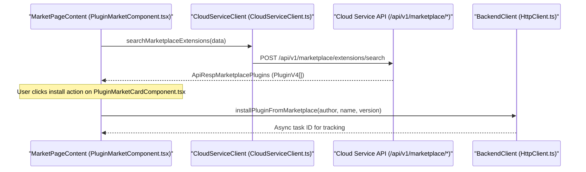
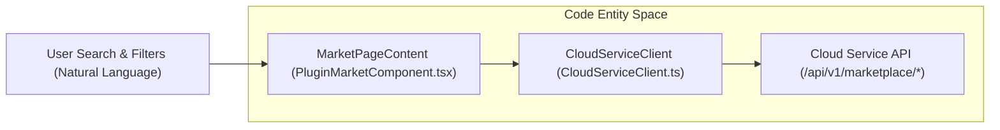
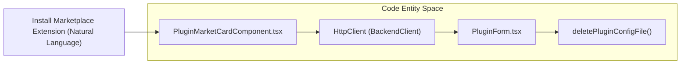

<!-- source: DeepWiki mcp.deepwiki.com · repo langbot-app/LangBot · page 7.4 Plugin Marketplace Integration · fetched 2026-10-29 -->

# Plugin Marketplace Integration

<details>
<summary>Relevant source files</summary>

The following files were used as context for generating this wiki page:

- [web/src/app/home/plugins/components/plugin-installed/PluginCardVO.ts](web/src/app/home/plugins/components/plugin-installed/PluginCardVO.ts)
- [web/src/app/home/plugins/components/plugin-installed/PluginComponentList.tsx](web/src/app/home/plugins/components/plugin-installed/PluginComponentList.tsx)
- [web/src/app/home/plugins/components/plugin-installed/PluginInstalledComponent.tsx](web/src/app/home/plugins/components/plugin-installed/PluginInstalledComponent.tsx)
- [web/src/app/home/plugins/components/plugin-installed/plugin-card/PluginCardComponent.tsx](web/src/app/home/plugins/components/plugin-installed/plugin-card/PluginCardComponent.tsx)
- [web/src/app/home/plugins/components/plugin-installed/plugin-form/PluginForm.tsx](web/src/app/home/plugins/components/plugin-installed/plugin-form/PluginForm.tsx)
- [web/src/app/home/plugins/components/plugin-market/PluginComponentIcons.ts](web/src/app/home/plugins/components/plugin-market/PluginComponentIcons.ts)
- [web/src/app/home/plugins/components/plugin-market/PluginComponentList.tsx](web/src/app/home/plugins/components/plugin-market/PluginComponentList.tsx)
- [web/src/app/home/plugins/components/plugin-market/PluginMarketComponent.tsx](web/src/app/home/plugins/components/plugin-market/PluginMarketComponent.tsx)
- [web/src/app/home/plugins/components/plugin-market/RecommendationLists.tsx](web/src/app/home/plugins/components/plugin-market/RecommendationLists.tsx)
- [web/src/app/home/plugins/components/plugin-market/plugin-market-card/PluginMarketCardComponent.tsx](web/src/app/home/plugins/components/plugin-market/plugin-market-card/PluginMarketCardComponent.tsx)
- [web/src/app/home/plugins/components/plugin-market/plugin-market-card/PluginMarketCardVO.ts](web/src/app/home/plugins/components/plugin-market/plugin-market-card/PluginMarketCardVO.ts)
- [web/src/app/infra/http/CloudServiceClient.ts](web/src/app/infra/http/CloudServiceClient.ts)
- [web/tests/unit/plugin-component-icons.test.mjs](web/tests/unit/plugin-component-icons.test.mjs)

</details>


## Purpose and Scope
This page documents the plugin marketplace browser within LangBot. It details how the frontend discovers extensions (Plugins, MCP Servers, and Skills) from an external cloud service via `CloudServiceClient`, implements search and filtering by component type and tags, manages recommendation lists, tracks install counts, and coordinates installation with the backend.

---

## 1. CloudServiceClient Architecture & API Operations

The `CloudServiceClient` [web/src/app/infra/http/CloudServiceClient.ts:17]() serves as the primary communication bridge between the LangBot frontend and the public cloud extension registry (`space.langbot.app`). Unlike the internal backend client (`BaseHttpClient`), `CloudServiceClient` operates without requiring local JWT tokens [web/src/app/infra/http/CloudServiceClient.ts:19-20]().

### Core Methods
- `getMarketplacePlugins(...)`: Fetches paginated marketplace lists [web/src/app/infra/http/CloudServiceClient.ts:23-34]().
- `searchMarketplacePlugins(...)`: Dispatches queries based on extension type (`plugin`, `mcp`, or `skill`) [web/src/app/infra/http/CloudServiceClient.ts:37-103]().
- `searchMarketplaceExtensions(...)`: Provides a unified search interface across all formats with automatic fallback to legacy endpoints if necessary [web/src/app/infra/http/CloudServiceClient.ts:105-144]().
- `getMarketplaceLikedExtensions(...)` & `setMarketplaceExtensionLike(...)`: Manages community engagement metrics (likes) via client fingerprints [web/src/app/infra/http/CloudServiceClient.ts:146-170]().

### System Interaction Diagram

Sources: [web/src/app/infra/http/CloudServiceClient.ts:17-170](), [web/src/app/home/plugins/components/plugin-market/PluginMarketComponent.tsx:110-120]()

---

## 2. Marketplace UI Discovery, Filtering, and State Persistence

Managed by `MarketPageContent` within `PluginMarketComponent.tsx` [web/src/app/home/plugins/components/plugin-market/PluginMarketComponent.tsx:110-120](), the marketplace UI provides multi-dimensional filtering and discovery tools.

### Filtering Dimensions
1. **Extension Format/Type**: Filters between `plugin`, `mcp`, and `skill` [web/src/app/home/plugins/components/plugin-market/PluginMarketComponent.tsx:124-129]().
2. **Component Type**: Filters by sub-components such as `Tool`, `Command`, `EventListener`, `KnowledgeEngine`, `Parser`, `Page`, and `Runner` [web/src/app/home/plugins/components/plugin-market/PluginMarketComponent.tsx:76-84]().
3. **Tags & Runner Usage**: Supports multi-tag filtration and runner usage refinement (`agent` vs `event`) [web/src/app/home/plugins/components/plugin-market/PluginMarketComponent.tsx:98-145]().
4. **Sorting**: Orders results by hot score (`hot_score_desc`), install count, or creation date [web/src/app/home/plugins/components/plugin-market/PluginMarketComponent.tsx:206-213]().

### State Persistence
Filter states (type, component, selected tags, and sort options) are serialized and persisted to browser `localStorage` under the key `langbot_market_filters` [web/src/app/home/plugins/components/plugin-market/PluginMarketComponent.tsx:72-107](), [web/src/app/home/plugins/components/plugin-market/PluginMarketComponent.tsx:184-199]().

Sources: [web/src/app/home/plugins/components/plugin-market/PluginMarketComponent.tsx:72-213]()

---

## 3. Recommendation Lists and Carousel Dynamics

Curated extension recommendations are rendered via `RecommendationLists` [web/src/app/home/plugins/components/plugin-market/RecommendationLists.tsx:1-195]().

### Carousel Lifecycle & Auto-Advance
- **VO Conversion**: Raw `PluginV4` entities are converted to `PluginMarketCardVO` instances using `pluginToVO()` [web/src/app/home/plugins/components/plugin-market/RecommendationLists.tsx:25-67]().
- **Progress Timer**: An active interval ticks every 50ms, accumulating delta time in `elapsedRef` and driving a smooth countdown ring over `AUTO_ADVANCE_MS` (10,000ms) [web/src/app/home/plugins/components/plugin-market/RecommendationLists.tsx:87-166]().
- **Resize Handling**: A `ResizeObserver` monitors the CSS grid container to dynamically calculate column capacity (`perPage`) [web/src/app/home/plugins/components/plugin-market/RecommendationLists.tsx:108-121]().

### Recommendation Data and Carousel Architecture
```mermaid
graph TD
    CloudAPI["Cloud Service Recommendation API"] -->|RecommendationList[]| RecComp["RecommendationLists.tsx"]
    RecComp -->|pluginToVO()| VO["PluginMarketCardVO.ts"]
    VO --> Card["PluginMarketCardComponent.tsx"]

    Resize["ResizeObserver (gridRef)"] -->|Calculates columns| Grid["CSS Grid Container"]
    Timer["setInterval (50ms)"] -->|Updates elapsedRef| Progress["Progress Ring State"]
    Progress -->|Reaches 10000ms| Advance["setPage(p => p + 1)"]
    UserNav["Manual Prev/Next / Pause"] -->|resetCountdown()| Timer
```
Sources: [web/src/app/home/plugins/components/plugin-market/RecommendationLists.tsx:1-195](), [web/src/app/home/plugins/components/plugin-market/plugin-market-card/PluginMarketCardVO.ts:1-58]()

---

## 4. Plugin Market Cards, Social Engagement, and Deprecation Handling

Individual marketplace cards are implemented by `PluginMarketCardComponent` [web/src/app/home/plugins/components/plugin-market/plugin-market-card/PluginMarketCardComponent.tsx:30-42]().

### Key Features
- **Visual Badges**: Distinguishes types (`mcp` in sky blue, `skill` in emerald, `plugin` in violet) [web/src/app/home/plugins/components/plugin-market/plugin-market-card/PluginMarketCardComponent.tsx:62-74]().
- **Social Likes**: Fetches viewer like status via `getMarketplaceExtensionLiked()` and syncs state globally using `subscribeMarketplaceLikeChanges()` [web/src/app/home/plugins/components/plugin-market/plugin-market-card/PluginMarketCardComponent.tsx:84-108]().
- **Adaptive Tags**: Measures available card width via `ResizeObserver` to truncate overflowing tags into a `+N` badge [web/src/app/home/plugins/components/plugin-market/plugin-market-card/PluginMarketCardComponent.tsx:111-140]().
- **Deprecation Detection**: Automatically flags extensions whose sole component is `KnowledgeRetriever` [web/src/app/home/plugins/components/plugin-market/plugin-market-card/PluginMarketCardComponent.tsx:53-57]().
- **Component Icons**: Icons for various plugin component types (e.g., `Tool`, `EventListener`, `Command`, `KnowledgeEngine`, `Parser`, `Page`, `Runner`) are mapped in `pluginComponentIconMap` [web/src/app/home/plugins/components/plugin-market/PluginComponentIcons.ts:12-20](). These icons are used in `PluginComponentList` [web/src/app/home/plugins/components/plugin-installed/PluginComponentList.tsx:28-36]() to visually represent the components provided by a plugin.

Sources: [web/src/app/home/plugins/components/plugin-market/plugin-market-card/PluginMarketCardComponent.tsx:30-211](), [web/src/app/home/plugins/components/plugin-market/PluginComponentIcons.ts:12-20](), [web/src/app/home/plugins/components/plugin-installed/PluginComponentList.tsx:28-36]()

---

## 5. Installation Lifecycle and Configuration Management

Installed extensions are managed via `PluginInstalledComponent` and configured through `PluginForm` [web/src/app/home/plugins/components/plugin-installed/PluginInstalledComponent.tsx:73-76](), [web/src/app/home/plugins/components/plugin-installed/plugin-form/PluginForm.tsx:19-27]().

### Update Checks and File Cleanup
- **Version Comparison**: Compares installed versions against registry metadata using `isNewerVersion()` [web/src/app/home/plugins/components/plugin-installed/PluginInstalledComponent.tsx:138-146]().
- **Orphan File Garbage Collection**: During configuration updates in `PluginForm`, uploaded file keys are tracked; unreferenced or deleted files trigger cleanup calls to `httpClient.deletePluginConfigFile()` [web/src/app/home/plugins/components/plugin-installed/plugin-form/PluginForm.tsx:34-146]().

Sources: [web/src/app/home/plugins/components/plugin-installed/PluginInstalledComponent.tsx:73-194](), [web/src/app/home/plugins/components/plugin-installed/plugin-form/PluginForm.tsx:19-204]()

---

## 6. Natural Language to Code Entity Mapping

### Mapping Diagram: Marketplace Discovery & Search

Sources: [web/src/app/home/plugins/components/plugin-market/PluginMarketComponent.tsx:110-120](), [web/src/app/infra/http/CloudServiceClient.ts:17-103]()

### Mapping Diagram: Installation & Configuration Workflow

Sources: [web/src/app/home/plugins/components/plugin-market/plugin-market-card/PluginMarketCardComponent.tsx:30-42](), [web/src/app/home/plugins/components/plugin-installed/plugin-form/PluginForm.tsx:89-155]()

---

