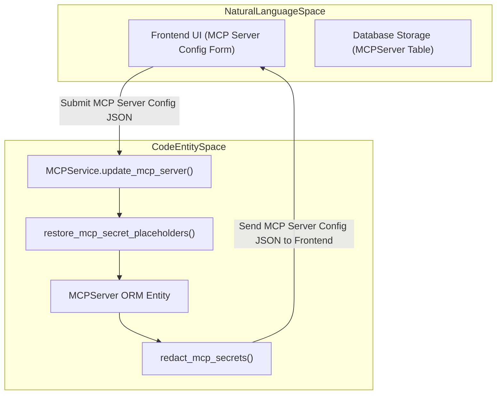
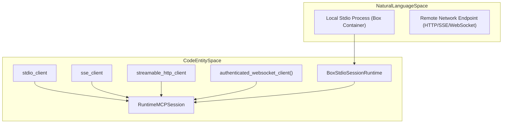
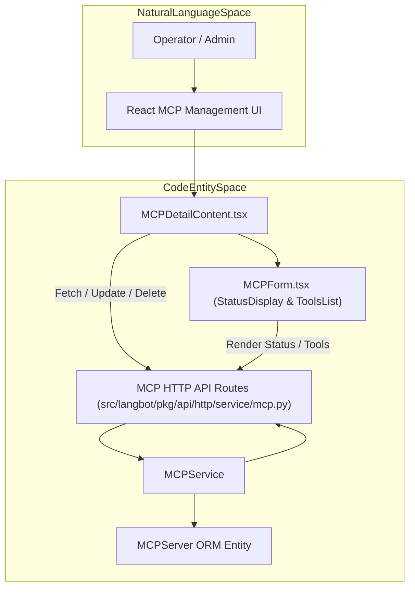

<!-- source: DeepWiki mcp.deepwiki.com · repo langbot-app/LangBot · page 7.5 MCP Server Management · fetched 2026-10-29 -->

# MCP Server Management

Relevant source files

The following files were used as context for generating this wiki page:

- [src/langbot/pkg/api/http/service/mcp.py](src/langbot/pkg/api/http/service/mcp.py)
- [src/langbot/pkg/box/connector.py](src/langbot/pkg/box/connector.py)
- [src/langbot/pkg/box/service.py](src/langbot/pkg/box/service.py)
- [src/langbot/pkg/provider/tools/loaders/mcp.py](src/langbot/pkg/provider/tools/loaders/mcp.py)
- [src/langbot/pkg/provider/tools/loaders/mcp_stdio.py](src/langbot/pkg/provider/tools/loaders/mcp_stdio.py)
- [tests/unit_tests/box/test_box_connector.py](tests/unit_tests/box/test_box_connector.py)
- [tests/unit_tests/box/test_box_service.py](tests/unit_tests/box/test_box_service.py)
- [tests/unit_tests/plugin/test_connector_ping.py](tests/unit_tests/plugin/test_connector_ping.py)
- [tests/unit_tests/provider/test_mcp_box_integration.py](tests/unit_tests/provider/test_mcp_box_integration.py)
- [tests/unit_tests/provider/test_mcp_remote_transport.py](tests/unit_tests/provider/test_mcp_remote_transport.py)
- [tests/unit_tests/provider/test_mcp_resources.py](tests/unit_tests/provider/test_mcp_resources.py)
- [web/src/app/home/mcp/MCPDetailContent.tsx](web/src/app/home/mcp/MCPDetailContent.tsx)
- [web/src/app/home/mcp/components/mcp-form/MCPForm.tsx](web/src/app/home/mcp/components/mcp-form/MCPForm.tsx)
- [web/src/app/home/mcp/page.tsx](web/src/app/home/mcp/page.tsx)

This page details the Model Context Protocol (MCP) server management architecture in LangBot. It covers MCP server CRUD operations, connection modes (`stdio` and `remote`), secret masking and restoration, status monitoring, tool and resource discovery, server testing, and the MCP readme feature in the web UI.

---

## 1. Entity Model and Persistence Layer

MCP server configurations are stored relationally per workspace using the `MCPServer` SQLAlchemy ORM entity [src/langbot/pkg/entity/persistence/mcp.py:15-30](). This entity manages:

- **Unique server identity:**
  - `uuid` (primary key)
  - `name` (workspace-scoped unique display name)

- **Operational flags and modes:**
  - `enable` boolean to activate or deactivate the connection
  - `mode` string to specify connection type: `'stdio'` (local process via Box) or `'remote'` (network endpoint)

- **Connection parameters:**
  - `extra_args` JSON dictionary storing arbitrary mode-specific configuration like command lines, environment variables, URLs, and HTTP headers.

| Attribute | Type | Description |
|---|---|---|
| `uuid` | `str` | Primary key identifier for MCP server entity [src/langbot/pkg/entity/persistence/mcp.py:19]() |
| `name` | `str` | Workspace-unique server display name [src/langbot/pkg/entity/persistence/mcp.py:20]() |
| `enable` | `bool` | Whether this server is activated and loaded by the tool loader [src/langbot/pkg/entity/persistence/mcp.py:21]() |
| `mode` | `str` | Transport mode, e.g. `'stdio'` or `'remote'` [src/langbot/pkg/entity/persistence/mcp.py:22]() |
| `extra_args` | `dict` | JSON blob containing command line arguments, environment variables, URLs, headers [src/langbot/pkg/entity/persistence/mcp.py:23]()

Sources: [src/langbot/pkg/entity/persistence/mcp.py:15-30]()

---

## 2. Backend Service Layer and Secret Management

The `MCPService` class in `src/langbot/pkg/api/http/service/mcp.py` manages workspace-scoped MCP server configuration, runtime session binding, and CRUD lifecycle operations. It abstracts the complexity of securely storing and restoring sensitive MCP configuration settings associated with servers [src/langbot/pkg/api/http/service/mcp.py:158-185]().

### Secret Masking and Restoration

MCP configurations commonly contain sensitive information such as API keys, passwords, tokens, DSNs, and authorization headers. To prevent accidental exposure:

- Outgoing MCP server config payloads are sanitized with `redact_mcp_secrets(value)` which:
  - Recursively masks sensitive config keys (e.g., `api_key`, `password`, `token`) by replacing their values with a placeholder `"***"`.
  - Handles nested dictionaries, lists, and tuples properly [src/langbot/pkg/api/http/service/mcp.py:90-108]().

- On update writes, placeholder secret keys in the payload are restored back to their previous unmasked values via `restore_mcp_secret_placeholders(value, current_value)` which:
  - Recursively restores secret leaves from existing database state.
  - Validates masked secrets are present in current config or errors if missing [src/langbot/pkg/api/http/service/mcp.py:111-155]().

Title: Secret Masking Data Flow Mapping

Sources: [src/langbot/pkg/api/http/service/mcp.py:90-155]()

---

## 3. Connection Modes and Session Runtime

LangBot supports two primary MCP server connection modes, both managed by the `RuntimeMCPSession` class in `src/langbot/pkg/provider/tools/loaders/mcp.py`:

### 3.1 Stdio Mode (`stdio`)

- Launches MCP servers locally as subprocesses or sandboxed containers leveraging the Box sandbox runtime.
- Managed by `BoxStdioSessionRuntime` [src/langbot/pkg/provider/tools/loaders/mcp_stdio.py:180-190]() which:
  - Handles process lifecycle, environment setup, mounting, network access, and resource limits.
  - Performs cold start detection and retry to await dependencies installation [src/langbot/pkg/provider/tools/loaders/mcp_stdio.py:170-177]().
  - Reports error phases such as `BOX_UNAVAILABLE` if Box is disabled or unreachable [src/langbot/pkg/provider/tools/loaders/mcp_stdio.py:54-60]().
  - Default memory limits controlled by `_get_default_memory_mb()` [src/langbot/pkg/provider/tools/loaders/mcp_stdio.py:62-77]().

### 3.2 Remote Mode (`remote`)

- Uses network protocols to connect to remote MCP servers via HTTP or WebSocket.
- Implements multiple fallback transports:
  - **Streamable HTTP** (preferred modern transport) [src/langbot/pkg/provider/tools/loaders/mcp.py:27]()
  - **Server-Sent Events (SSE)** (legacy fallback) [src/langbot/pkg/provider/tools/loaders/mcp.py:26]()
  - **WebSocket** (for Box relay) [src/langbot/pkg/provider/tools/loaders/mcp_stdio.py:100-151]()
- Selection and probing managed automatically by `RuntimeMCPSession`.
- Connects with optional authorization, URL parsing, and long-lived client sessions [tests/unit_tests/provider/test_mcp_remote_transport.py:30-160]().

Title: MCP Session Runtime and Transport Architecture

Sources: [src/langbot/pkg/provider/tools/loaders/mcp_stdio.py:80-151](), [tests/unit_tests/provider/test_mcp_remote_transport.py:30-160](), [src/langbot/pkg/provider/tools/loaders/mcp.py:24-27]()

---

## 4. Tool and Resource Discovery

Once connected, `RuntimeMCPSession` queries MCP servers for registered tools and available resources:

- **Tool Discovery:**
  The server exposes tools via the `tools/list` MCP method and their parameters, descriptions, and capabilities are aggregated by `MCPLoader`.

- **Resource Discovery:**
  MCP supports listing data resources (`resources/list`) and resource templates which may represent generic URI patterns.

- **Synthesized LLM Tools for MCP Resources:**
  LangBot injects synthesized tools to enable LLM agents to:
  - List MCP resources on a server: tool name `langbot_mcp_list_resources` [src/langbot/pkg/provider/tools/loaders/mcp.py:53]()
  - Read resource contents from a URI: tool name `langbot_mcp_read_resource` [src/langbot/pkg/provider/tools/loaders/mcp.py:54]()

- **Resource size and context window safeguards:**
  To prevent overly large context payloads, resource reads are strictly truncated by configured byte and token limits (default 64 KB, 12k tokens) [src/langbot/pkg/provider/tools/loaders/mcp.py:59-61]().

Sources: [src/langbot/pkg/provider/tools/loaders/mcp.py:47-107](), [tests/unit_tests/provider/test_mcp_resources.py:10-50]()

---

## 5. Web Management UI and Lifecycle Integration

The React-based frontend in `web/src/app/home/mcp/MCPDetailContent.tsx` and subcomponents provide a full-featured UI for MCP server CRUD and runtime interaction.

### 5.1 Core UI Features

- **Server CRUD & Enable Toggle:**
  - Create, edit, and delete MCP server configurations by workspace-scoped server `id`.
  - Toggle enable/disable state, triggering backend `toggleMCPServer` API calls [web/src/app/home/mcp/MCPDetailContent.tsx:135-147]().

- **Connection Status Monitoring:**
  - Displays live runtime connection states such as `connected`, `connecting`, `error`, `disabled`, and `disconnected` with localized labels and colors [web/src/app/home/mcp/MCPDetailContent.tsx:33-116]().

- **Save Blocking on Box Unavailability:**
  - When `stdio` mode is selected but Box sandbox is disabled/unreachable, saving a server is blocked to prevent creating unusable configurations [web/src/app/home/mcp/MCPDetailContent.tsx:64-66]().

- **Server Delete Confirmation and Workflow Integration:**
  - Confirm delete dialogs, toast notifications, page navigation, and server list refresh using Sidebar context [web/src/app/home/mcp/MCPDetailContent.tsx:173-183]().

### 5.2 Status Display Component

- The `StatusDisplay` React component from `web/src/app/home/mcp/components/mcp-form/MCPForm.tsx` renders runtime connection health indicators, including spinners for `connecting` and descriptive error messages for errors such as `box_unavailable` or `oauth_required`.

- It deciphers backend reported `error_phase` and `error_code` to provide actionable frontend messaging [web/src/app/home/mcp/components/mcp-form/MCPForm.tsx:69-167]().

### 5.3 Tools Listing UI

- The `ToolsList` component presents all discovered MCP tools with their parameters based on JSON Schema properties.

- Parameter metadata such as name, type, description, and required flag are extracted by the helper `getToolParameters()` [web/src/app/home/mcp/components/mcp-form/MCPForm.tsx:170-198]().

### 5.4 MCP README Display

- The `MCPReadme` component (referenced in the MCP form UI) fetches and displays server README content to inform users about server purpose and usage [web/src/app/home/mcp/components/mcp-form/MCPReadme.tsx]().

Title: MCP Server Frontend and Backend Integration Mapping

Sources:
[web/src/app/home/mcp/MCPDetailContent.tsx:1-190](),
[web/src/app/home/mcp/components/mcp-form/MCPForm.tsx:69-213](),
[src/langbot/pkg/api/http/service/mcp.py:158-191](),
[src/langbot/pkg/entity/persistence/mcp.py:15-30]()

---

# Summary

LangBot's MCP Server Management subsystem provides a robust framework for:

- Defining workspace-scoped MCP server configurations with secure secret handling.
- Supporting flexible connection modes: local stdio via Box sandbox and remote network endpoints.
- Dynamically discovering tools and resources exposed by MCP servers.
- Presenting rich frontend UI integration for CRUD, enablement, status monitoring, server testing, and README viewing.
- Ensuring sensitive configuration secrets are automatically masked/redacted from UIs and logs.

This layered architecture spanning persistence, runtime sessions, transport protocols, and frontend components allows LangBot operators to manage distributed MCP servers safely and effectively within their bot deployment environments.

---

# References and Sources

- MCP persistence, service, and secret handling:
  [src/langbot/pkg/api/http/service/mcp.py:15-191](), [src/langbot/pkg/entity/persistence/mcp.py:15-30]()

- MCP runtime connection modes and sessions:
  [src/langbot/pkg/provider/tools/loaders/mcp.py:20-92](), [src/langbot/pkg/provider/tools/loaders/mcp_stdio.py:10-153](), [tests/unit_tests/provider/test_mcp_remote_transport.py:20-160]()

- Frontend UI for MCP management:
  [web/src/app/home/mcp/MCPDetailContent.tsx:1-190](), [web/src/app/home/mcp/components/mcp-form/MCPForm.tsx:60-213](), [web/src/app/home/mcp/components/mcp-form/MCPReadme.tsx]()

- MCP synthesized resource tools and truncation policies:
  [src/langbot/pkg/provider/tools/loaders/mcp.py:48-110](), [tests/unit_tests/provider/test_mcp_resources.py:10-70]()

- Box sandbox runtime and MCP stdio mode:
  [src/langbot/pkg/provider/tools/loaders/mcp_stdio.py:30-153]()

This concludes the "7.5 MCP Server Management" wiki page.

---

