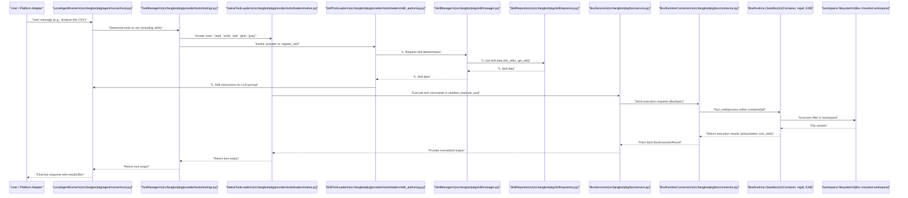
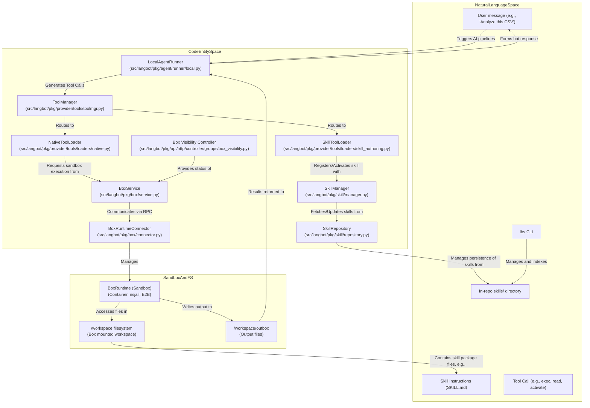

<!-- source: DeepWiki mcp.deepwiki.com · repo langbot-app/LangBot · page 7.6 Skills and Box Sandbox Runtime · fetched 2026-10-29 -->

# Skills and Box Sandbox Runtime

Relevant source files

The following files were used as context for generating this wiki page:

- [docs/review/box-architecture.md](docs/review/box-architecture.md)
- [skills/scripts/e2e/agent-run-ledger-audit.mjs](skills/scripts/e2e/agent-run-ledger-audit.mjs)
- [skills/scripts/e2e/agent-run-ledger-audit.py](skills/scripts/e2e/agent-run-ledger-audit.py)
- [skills/scripts/e2e/agent_run_ledger_policy.py](skills/scripts/e2e/agent_run_ledger_policy.py)
- [skills/scripts/e2e/lib/debug-chat.mjs](skills/scripts/e2e/lib/debug-chat.mjs)
- [skills/scripts/e2e/lib/langbot-e2e.mjs](skills/scripts/e2e/lib/langbot-e2e.mjs)
- [skills/scripts/e2e/local-agent-steering-debug-chat.mjs](skills/scripts/e2e/local-agent-steering-debug-chat.mjs)
- [skills/scripts/e2e/pipeline-debug-chat.mjs](skills/scripts/e2e/pipeline-debug-chat.mjs)
- [skills/skills.index.json](skills/skills.index.json)
- [skills/skills/langbot-testing/cases/agent-run-ledger-audit.yaml](skills/skills/langbot-testing/cases/agent-run-ledger-audit.yaml)
- [skills/test/lbs-cli.test.ts](skills/test/lbs-cli.test.ts)
- [skills/test/test_agent_run_ledger_policy.py](skills/test/test_agent_run_ledger_policy.py)
- [src/langbot/pkg/api/http/service/mcp.py](src/langbot/pkg/api/http/service/mcp.py)
- [src/langbot/pkg/box/connector.py](src/langbot/pkg/box/connector.py)
- [src/langbot/pkg/box/service.py](src/langbot/pkg/box/service.py)
- [src/langbot/pkg/provider/tools/loaders/mcp.py](src/langbot/pkg/provider/tools/loaders/mcp.py)
- [src/langbot/pkg/provider/tools/loaders/mcp_stdio.py](src/langbot/pkg/provider/tools/loaders/mcp_stdio.py)
- [src/langbot/pkg/provider/tools/loaders/native.py](src/langbot/pkg/provider/tools/loaders/native.py)
- [src/langbot/pkg/provider/tools/loaders/skill.py](src/langbot/pkg/provider/tools/loaders/skill.py)
- [src/langbot/pkg/provider/tools/loaders/skill_authoring.py](src/langbot/pkg/provider/tools/loaders/skill_authoring.py)
- [src/langbot/pkg/skill/repository.py](src/langbot/pkg/skill/repository.py)
- [tests/integration_tests/box/test_cloud_box_admission_integration.py](tests/integration_tests/box/test_cloud_box_admission_integration.py)
- [tests/unit_tests/box/test_box_connector.py](tests/unit_tests/box/test_box_connector.py)
- [tests/unit_tests/box/test_box_service.py](tests/unit_tests/box/test_box_service.py)
- [tests/unit_tests/plugin/test_connector_ping.py](tests/unit_tests/plugin/test_connector_ping.py)
- [tests/unit_tests/provider/test_mcp_box_integration.py](tests/unit_tests/provider/test_mcp_box_integration.py)
- [tests/unit_tests/provider/test_mcp_remote_transport.py](tests/unit_tests/provider/test_mcp_remote_transport.py)
- [tests/unit_tests/provider/test_mcp_resources.py](tests/unit_tests/provider/test_mcp_resources.py)
- [tests/unit_tests/provider/test_skill_tools.py](tests/unit_tests/provider/test_skill_tools.py)
- [tests/unit_tests/provider/test_tool_manager_native.py](tests/unit_tests/provider/test_tool_manager_native.py)
- [tests/unit_tests/test_skill_repository.py](tests/unit_tests/test_skill_repository.py)

This page documents the **Skills** extension type and the **Box** sandbox runtime environment. Skills are instruction-based packages (Markdown) that leverage the Box runtime for isolated code execution, enabling LangBot to perform complex tasks safely without compromising the host system.

---

## Overview of Skills

Skills in LangBot are a specialized extension type distinct from full Python plugins or MCP servers. They are primarily instruction sets packaged in Markdown that can include executable code blocks or reference specialized sandbox tools.

### Key Characteristics

- **Instruction-Based**: Skills are defined via `SKILL.md` files containing system instructions guiding AI behavior and tool usage. They often reside under a package root directory as identified by the Box runtime [skills/skills/langbot-testing/references/skill-all-tool-acceptance.md:37-37]().

- **Activation and Tool-Driven Execution**: Skills are activated through specific tool calls during pipeline execution. The LangBot `LocalAgentRunner` manages the agentic loop where the `activate` tool invocation loads skill instructions. Activated skills allow agents to use sandbox tools such as `exec`, `read`, `write`, and `edit` to interact with underlying skill package files within the isolated filesystem [src/langbot/pkg/provider/tools/loaders/skill_authoring.py:110-152](), [src/langbot/pkg/provider/tools/loaders/native.py:29-34]().

- **Management via SkillManager**: The `SkillManager` holds a cache of skills synchronized from the `SkillRepository`. It serves skills metadata and content for active pipelines and agents. Reloading of skills fetches updated skill data, respecting whether the LangBot process shares the filesystem with Box (local mode) or uses remote Box runtimes (separated mode) [tests/unit_tests/provider/test_skill_tools.py:76-163]().

- **In-Repo Skills Directory**: The **`skills/`** directory within the LangBot repository is the canonical source for all agent skills. It contains curated skill sets, including:

  - `langbot-dev`: Core backend and frontend development skills.
  - `langbot-testing`: Web UI and end-to-end QA skills and test harness, integrating the `lbs` CLI [skills/skills/langbot-testing/cases/skill-discovery-via-mcp-gateway.yaml:1-1]().
  - `langbot-deploy`: Skills describing deployment, configuration, the Box sandbox, and plugin runtime.

- **`lbs` CLI**: The `lbs` tool is a Node.js command-line utility for skill indexing, validation, and test running. It processes the `skills/` directory, regenerates `skills.index.json`, and executes skill-associated test plans. It is bootstrapped via `scripts/bootstrap-lbs.mjs` inside the LangBot repo [skills/scripts/e2e/reset-sandbox-skill.mjs:1-1](). The `lbs` CLI also includes commands for managing cases, environments, fixtures, logs, suites, tests, and troubleshooting [skills/test/lbs-cli.test.ts:18-51]().

Sources:
[skills/scripts/e2e/reset-sandbox-skill.mjs:1-1]()
[skills/skills/langbot-testing/cases/skill-discovery-via-mcp-gateway.yaml:1-1]()
[skills/skills/langbot-testing/references/skill-all-tool-acceptance.md:37-37]()
[skills/test/lbs-cli.test.ts:18-51]()
[src/langbot/pkg/provider/tools/loaders/native.py:29-34]()
[src/langbot/pkg/provider/tools/loaders/skill_authoring.py:110-152]()
[tests/unit_tests/provider/test_skill_tools.py:76-163]()

---

## Box Sandbox Runtime

The **Box** runtime subsystem provides isolated code execution environments tailored for running arbitrary code safely on behalf of LangBot's AI agents. The Box runtime supports backends like Docker containers, nsjail sandboxes, or Enterprise-to-Box (E2B) setups. It is the runtime environment that native sandbox tools interface with.

### BoxService Class

The `BoxService` component ([src/langbot/pkg/box/service.py:104-175]()) is the LangBot backend's gateway to the Box sandbox runtime.

- **Configuration Loading**: On initialization, `BoxService` reads config keys such as `box.enabled`, `box.profile`, `box.default_workspace`, and quota settings ([src/langbot/pkg/box/service.py:111-126]()). It determines if Box support is enabled.

- **Available Property**: The `available` property signals whether sandbox features are usable. If Box is disabled (e.g., `box.enabled = false`), this returns false and disables `exec`, file tools, and the stdio MCP server ([src/langbot/pkg/box/service.py:150-158]()).

- **Runtime Connection via Connector**: It instantiates and manages a `BoxRuntimeConnector` ([src/langbot/pkg/box/connector.py:103-177]()), which handles the actual connection and communication with the Box runtime process via stdio pipes or WebSocket ([src/langbot/pkg/box/service.py:112-119]()).

- **Error and Reconnections**: `BoxService` maintains recent error logs with bounded queue storage and launches background reconnect tasks on disconnection events ([src/langbot/pkg/box/service.py:139-141]()).

- **Quotas**: The Box runtime enforces workspace quotas via `workspace_quota_mb` and limits on workspace entries to prevent resource exhaustion ([src/langbot/pkg/box/service.py:125-126]()). The `_create_shared_workspace_probe` and `_remove_shared_workspace_probe` functions are used to verify shared workspace access and manage probes ([src/langbot/pkg/box/service.py:46-91]()).

- **Box Visibility Controller**: The `box_visibility` controller group in the HTTP API provides endpoints to check the status and availability of the Box runtime ([src/langbot/pkg/api/http/controller/groups/box_visibility.py]()).

### BoxRuntimeConnector

The `BoxRuntimeConnector` manages the communication channel to the Box runtime ([src/langbot/pkg/box/connector.py:103-177]()).

- **Transport Selection**: The connector automatically picks between:
  - **stdio transport** if running locally on Unix-like systems without Docker or explicit endpoint, sharing filesystem with LangBot.
  - **WebSocket transport** if configured with `box.runtime.endpoint`, running inside Docker container environments, or when `--standalone-box` CLI flag is specified ([src/langbot/pkg/box/connector.py:141-159]()).

- **WebSocket Relay URL**: The `resolve_box_ws_relay_url` function derives the base URL for WebSocket connections to the Box relay, considering explicit config, Docker environment, or default localhost with port 5410 ([src/langbot/pkg/box/connector.py:74-100]()).

- **Lifecycle Management**: Connector handles startup, reconnection, and graceful shutdown mechanics. It can launch a Box runtime subprocess on Windows to compensate for the lack of async pipes ([src/langbot/pkg/box/connector.py:173-177]()).

Sources:
[src/langbot/pkg/api/http/controller/groups/box_visibility.py]()
[src/langbot/pkg/box/connector.py:103-177]()
[src/langbot/pkg/box/connector.py:74-100]()
[src/langbot/pkg/box/service.py:103-175]()
[src/langbot/pkg/box/service.py:111-126]()
[src/langbot/pkg/box/service.py:125-126]()
[src/langbot/pkg/box/service.py:139-141]()
[src/langbot/pkg/box/service.py:150-158]()
[src/langbot/pkg/box/service.py:46-91]()
[tests/unit_tests/box/test_box_service.py:202-210]()

---

## System Flow: From Natural Language Input to Box Sandbox Execution

The following diagram illustrates the high-level interaction between LangBot's core components and the Box sandbox runtime when processing a user request that involves skills and sandbox tools.

### Diagram: LangBot to Box Sandbox Execution Flow

This flow shows how a user request through the platform adapter results in LLM pipelines executing commands or scripts inside the isolated Box runtime, with results fed back to LangBot for response.

Sources:
[src/langbot/pkg/box/connector.py:103-159]()
[src/langbot/pkg/box/service.py:101-120]()
[src/langbot/pkg/provider/tools/loaders/native.py:29-34]()
[src/langbot/pkg/provider/tools/loaders/skill_authoring.py:110-152]()
[src/langbot/pkg/skill/manager.py:1-1]()
[src/langbot/pkg/skill/repository.py:1-1]()
[tests/unit_tests/provider/test_skill_tools.py:76-163]()
[tests/unit_tests/provider/test_tool_manager_native.py:81-125]()

---

## Technical Implementation Details

### SkillManager and Skill Lifecycle

The `SkillManager` maintains the authoritative in-memory cache of skills, which originates from the `SkillRepository` ([tests/unit_tests/provider/test_skill_tools.py:76-156]()).

- **SkillRepository**: The `SkillRepository` ([src/langbot/pkg/skill/repository.py:20-262]()) provides an asynchronous, workspace-scoped adapter around the SDK's `SkillStore`. It handles CRUD operations for skills, ensuring workspace isolation and managing skill revisions using `asyncio.Lock` for concurrency safety ([src/langbot/pkg/skill/repository.py:31-36]()).

- **Reloading Skills**: The `reload_skills` method asynchronously fetches skill metadata from the `SkillRepository` via `ap.skill_repository.list_skills()`. If the Box runtime shares a filesystem with LangBot (stdio transport), the manager verifies that the skill's `package_root` directory exists on the host to avoid stale mount points ([tests/unit_tests/provider/test_skill_tools.py:102-163]()).

- **Refreshing Skills**: The method `refresh_skill_from_disk` checks cache presence keyed by context and skill name ([tests/unit_tests/provider/test_skill_tools.py:80-99]()).

### Skill Activation via Tool Calls

Skills are activated through the `activate` tool, which is part of the `SkillToolLoader` tool set ([src/langbot/pkg/provider/tools/loaders/skill_authoring.py:16-29]()):

- On invocation, `_invoke_activate_skill` registers the skill internally by name and scope for use in the current agent context, returning the skill's `SKILL.md` instructions for injection into the assistant's prompt context ([src/langbot/pkg/provider/tools/loaders/skill_authoring.py:157-166]()).

- `register_skill` tool call allows skills to be promoted or stored into the LangBot skills data directory from within sandboxed environments ([src/langbot/pkg/provider/tools/loaders/skill_authoring.py:103-112]()), checking for sandbox availability ([src/langbot/pkg/provider/tools/loaders/skill_authoring.py:108-111]()).

### Native Sandbox Tools

The `NativeToolLoader` exports a set of core file and execution tools that interface directly with the Box sandbox runtime ([src/langbot/pkg/provider/tools/loaders/native.py:29-34]()):

- `exec`: Runs shell commands or Python scripts inside the sandboxed `/workspace` environment ([src/langbot/pkg/provider/tools/loaders/native.py:29-29]()).

- `read` / `write` / `edit`: Perform file I/O operations constrained to `/workspace` mount ([src/langbot/pkg/provider/tools/loaders/native.py:30-32]()). Secure host file operations are available if the OS supports `O_NOFOLLOW` and `dir_fd` for `os.open`, `os.stat`, `os.mkdir`, `os.listdir`, and `os.scandir` ([src/langbot/pkg/provider/tools/loaders/native.py:62-69]()).

- `glob` / `grep`: File system search and content matching across sandbox directories with configured limits ([src/langbot/pkg/provider/tools/loaders/native.py:33-34]()). These operations use secure directory and file opening mechanisms to prevent path traversal and symlink attacks ([src/langbot/pkg/provider/tools/loaders/native.py:107-179]()).

Sources:
[src/langbot/pkg/provider/tools/loaders/native.py:107-179]()
[src/langbot/pkg/provider/tools/loaders/native.py:29-34]()
[src/langbot/pkg/provider/tools/loaders/native.py:62-69]()
[src/langbot/pkg/provider/tools/loaders/skill_authoring.py:103-112]()
[src/langbot/pkg/provider/tools/loaders/skill_authoring.py:157-166]()
[src/langbot/pkg/provider/tools/loaders/skill_authoring.py:16-29]()
[src/langbot/pkg/skill/repository.py:20-262]()
[src/langbot/pkg/skill/repository.py:31-36]()
[tests/unit_tests/provider/test_skill_tools.py:76-163]()

---

## Entity Association Map

The diagram below maps natural language and UI concepts in LangBot to their corresponding runtime and code entities related to skills and Box runtime.

### Diagram: Natural Language to Code Entity Mapping

This mapping clarifies the interactions between front-facing user events, LangBot runtime components, skill management, and the isolated Box runtime.

Sources:
[skills/test/lbs-cli.test.ts:18-51]()
[src/langbot/pkg/api/http/controller/groups/box_visibility.py]()
[src/langbot/pkg/box/connector.py:103-124]()
[src/langbot/pkg/box/service.py:101-120]()
[src/langbot/pkg/provider/tools/loaders/native.py:29-34]()
[src/langbot/pkg/provider/tools/loaders/skill_authoring.py:110-152]()
[src/langbot/pkg/provider/tools/toolmgr.py:1-1]()
[src/langbot/pkg/skill/manager.py:1-1]()
[src/langbot/pkg/skill/repository.py:1-1]()
[tests/unit_tests/provider/test_skill_tools.py:76-156]()

---

## Resource Summary

| Component | Class / Entity | Responsibility |
|---|---|---|
| **Sandbox Service** | `BoxService` | High-level API for managing sandbox lifecycle, executing commands, file materialization, and quota enforcement [src/langbot/pkg/box/service.py:101]() |
| **Sandbox Connector** | `BoxRuntimeConnector` | Manages communication and protocol with Box runtime via stdio or WebSocket transports [src/langbot/pkg/box/connector.py:103-177]() |
| **Native Tools** | `NativeToolLoader` | Provides sandboxed native tools: `exec`, `read`, `write`, `edit`, `glob`, and `grep` [src/langbot/pkg/provider/tools/loaders/native.py:29-34]() |
| **Skill Authoring Tools** | `SkillToolLoader` | Handles skill activation and registration as tool calls, integrating skill content into LLM prompts [src/langbot/pkg/provider/tools/loaders/skill_authoring.py:26-171]() |
| **Skill Management** | `SkillManager` | Caches and synchronizes skill data between `SkillRepository` and LangBot backend, sensitive to filesystem sharing [tests/unit_tests/provider/test_skill_tools.py:76-156]() |
| **Skill Persistence** | `SkillRepository` | Provides workspace-scoped CRUD operations for skills, managing revisions and file content [src/langbot/pkg/skill/repository.py:20-262]() |
| **Box Visibility** | `BoxVisibilityController` | HTTP API controller for checking Box runtime status and availability [src/langbot/pkg/api/http/controller/groups/box_visibility.py]() |
| **CLI Tool** | `lbs` | Node.js CLI tool for skill repository indexing, validation, and testing [skills/scripts/e2e/reset-sandbox-skill.mjs:1-1]() |

Sources:
[skills/scripts/e2e/reset-sandbox-skill.mjs:1-1]()
[src/langbot/pkg/api/http/controller/groups/box_visibility.py]()
[src/langbot/pkg/box/connector.py:103-177]()
[src/langbot/pkg/box/service.py:101]()
[src/langbot/pkg/provider/tools/loaders/native.py:29-34]()
[src/langbot/pkg/provider/tools/loaders/skill_authoring.py:26-171]()
[src/langbot/pkg/skill/repository.py:20-262]()
[tests/unit_tests/provider/test_skill_tools.py:76-156]()

---

