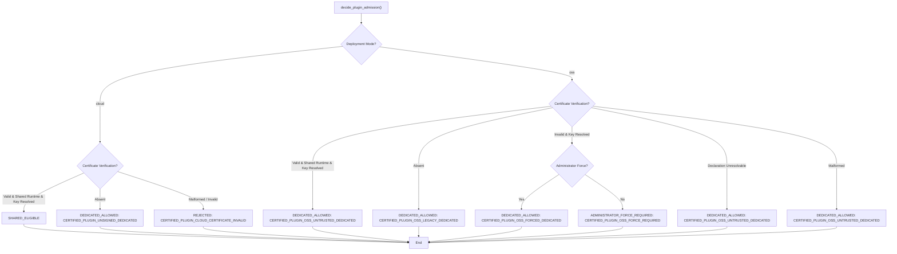
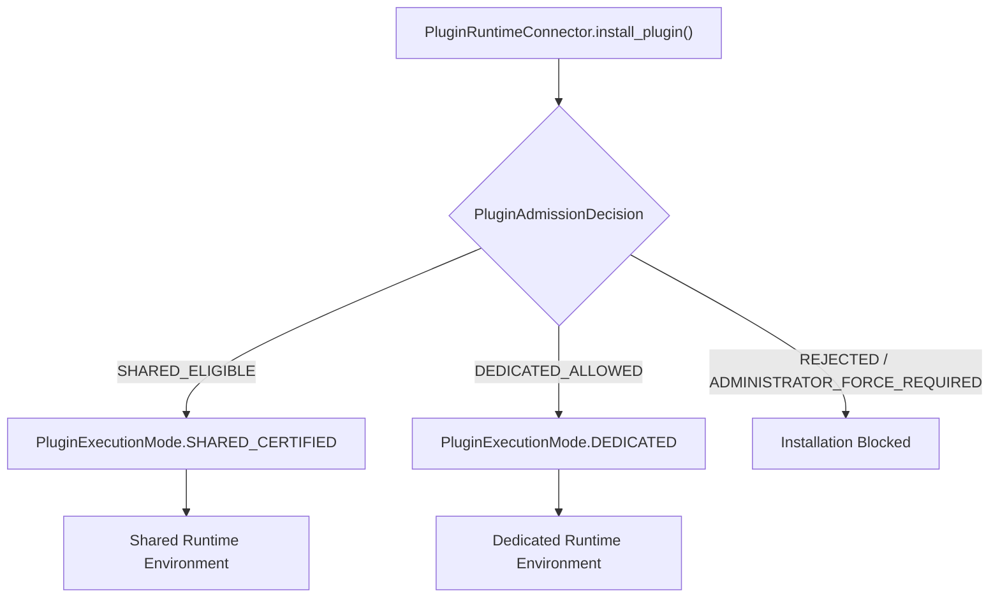
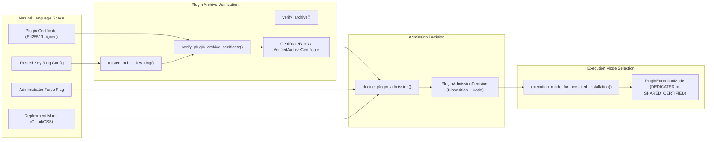

<!-- source: DeepWiki mcp.deepwiki.com · repo langbot-app/LangBot · page 7.7 Plugin Certification and Admission Policy · fetched 2026-10-29 -->

# Plugin Certification and Admission Policy

<details>
<summary>Relevant source files</summary>

The following files were used as context for generating this wiki page:

- [docs/architecture/certified-plugins.md](docs/architecture/certified-plugins.md)
- [src/langbot/pkg/plugin/certification.py](src/langbot/pkg/plugin/certification.py)
- [tests/integration/plugin/test_certified_plugin_admission.py](tests/integration/plugin/test_certified_plugin_admission.py)
- [tests/unit_tests/plugin/test_certified_plugin_policy.py](tests/unit_tests/plugin/test_certified_plugin_policy.py)

</details>


This page details LangBot's plugin certification and admission policy, focusing on the use of Ed25519-signed `.lbpkg` archives. It covers the verification process, admission decision logic, execution modes, policy differences between Cloud and OSS deployments, and trusted key ring configuration [docs/architecture/certified-plugins.md:1-122]().

---

## Ed25519-Signed .lbpkg Archives

LangBot plugins are packaged as `.lbpkg` archives. These archives can be cryptographically signed using Ed25519 signatures embedded in the ZIP comment, protecting the integrity and authenticity of the plugin and its metadata [docs/architecture/certified-plugins.md:5-9]().

The signature is over a normalized ZIP digest computed by ignoring non-functional differences (like comment variations), ensuring deterministic verification [docs/architecture/certified-plugins.md:5-9](). The SDK function `verify_archive()` from the `langbot_plugin.certification` package performs the low-level verification and returns the detailed verification state and embedded certificate envelope without extracting the payload [src/langbot/pkg/plugin/certification.py:150-175]().

Sources:
- [docs/architecture/certified-plugins.md:5-9]()
- [src/langbot/pkg/plugin/certification.py:150-175]()

---

## Trusted Key Ring Configuration

To verify the signatures of certified plugins, LangBot maintains a configured trusted public key ring. This ring is a mapping from key IDs to Ed25519 public keys, represented as base64-encoded 32-byte keys [src/langbot/pkg/plugin/certification.py:115-121]().

The key ring is configured in the instance configuration under the key path `plugin.certification.trusted_public_keys` [docs/architecture/certified-plugins.md:26-30](). The `trusted_public_key_ring()` function:

- Validates that configuration is a mapping [src/langbot/pkg/plugin/certification.py:125-126]().
- Parses and base64-decodes each public key [src/langbot/pkg/plugin/certification.py:133-135]().
- Builds a dictionary of verifier functions that check Ed25519 signatures [src/langbot/pkg/plugin/certification.py:128-146]().
- Fails closed by raising explicit errors if any key is invalid, preventing silent weakening of trust policies [src/langbot/pkg/plugin/certification.py:115-147]().

Example configuration snippet:
```yaml
plugin:
  certification:
    trusted_public_keys:
      issuer-2026-q3: "<base64 encoded 32-byte Ed25519 public key>"
```

The ring may also be supplied out-of-band via environment variables, for example:
```bash
PLUGIN__CERTIFICATION__TRUSTED_PUBLIC_KEYS_JSON='{"ed25519:issuer":"<base64>"}'
```
An empty ring is a supported state, not a misconfiguration. OSS defaults to an empty ring, and configuring certification keys on OSS is not a supported way to enable cross-tenant sharing [docs/architecture/certified-plugins.md:44-49]().

Sources:
- [src/langbot/pkg/plugin/certification.py:115-147]()
- [docs/architecture/certified-plugins.md:25-30]()
- [docs/architecture/certified-plugins.md:44-49]()

---

## `verify_plugin_archive_certificate`

This core function validates a `.lbpkg` archive's certificate and signature using the configured trusted key ring [src/langbot/pkg/plugin/certification.py:150-154]():

```python
verify_plugin_archive_certificate(archive: bytes, *, trusted_public_keys: object) -> VerifiedArchiveCertificate
```

**Workflow:**

1. Constructs the trusted key ring from the provided configuration using `trusted_public_key_ring()` [src/langbot/pkg/plugin/certification.py:157]().

2. Calls the SDK's `verify_archive()` passing the archive bytes and a key-lookup function from the ring [src/langbot/pkg/plugin/certification.py:158]().

3. Extracts verification status and the embedded certificate envelope (which includes `runtime_profile`, `component_model`, and `key_id`) from the SDK verification result [src/langbot/pkg/plugin/certification.py:159-168]().

4. Determines `CertificateVerification` status (`ABSENT`, `MALFORMED`, `INVALID`, `VALID`) based on the SDK verifier output [src/langbot/pkg/plugin/certification.py:170-173]().

5. Only records `certificate_id` if the key ring resolves the issuer key ID, allowing flexible OSS fallback behavior [src/langbot/pkg/plugin/certification.py:157-168]().

6. Returns a `VerifiedArchiveCertificate` object containing the normalized archive digest and certificate facts [src/langbot/pkg/plugin/certification.py:174-177]().

Sources:
- [src/langbot/pkg/plugin/certification.py:150-177]()

---

### Certificate Facts and Types

- `CertificateFacts`: Immutable data describing verification outcome, declared runtime profile, component model, and resolved certificate ID [src/langbot/pkg/plugin/certification.py:60-79]().
- `PluginCertificationFacts`: Immutable Core-side facts for one plugin installation artifact, including the installation UUID, artifact digest, and certificate facts [src/langbot/pkg/plugin/certification.py:85-97]().
- `VerifiedArchiveCertificate`: Binds `CertificateFacts` to the normalized ZIP digest, supports creating stable `PluginCertificationFacts` records for installation [src/langbot/pkg/plugin/certification.py:101-112]().

Sources:
- [src/langbot/pkg/plugin/certification.py:60-112]()

---

## `decide_plugin_admission`

Determines if a plugin archive is admitted for installation and its allowed execution mode based on [src/langbot/pkg/plugin/certification.py:178-307]():

- LangBot deployment mode (`cloud` or `oss`),
- The `PluginCertificationFacts` (verification status, profile, issuer presence),
- Whether an administrator has explicitly forced installation (bool flag).

It outputs a `PluginAdmissionDecision`, consisting of:

- `disposition` from `AdmissionDisposition` enum [src/langbot/pkg/plugin/certification.py:37-41]():
  - `SHARED_ELIGIBLE`: Allowed shared-certified runtime.
  - `DEDICATED_ALLOWED`: Allowed dedicated-only runtime.
  - `REJECTED`: Denied installation.
  - `ADMINISTRATOR_FORCE_REQUIRED`: Requires administrator override to proceed.

- `code` from `AdmissionCode` enum [src/langbot/pkg/plugin/certification.py:44-51](): Detailed reason code for tracking and errors.

Sources:
- [src/langbot/pkg/plugin/certification.py:37-51]()
- [src/langbot/pkg/plugin/certification.py:178-307]()

---

### Admission Policy Matrix

Below is the condensed admission logic implemented in `decide_plugin_admission()` [src/langbot/pkg/plugin/certification.py:178-307]().


**Diagram: Plugin Admission Decision Flow**

### Explanation

- **Cloud Deployment** is strict and requires valid certification signed by a trusted issuer. Any invalid or malformed certificate leads to immediate rejection before storage or runtime application. Administrator force does NOT override this [src/langbot/pkg/plugin/certification.py:200-211]().
- **OSS Deployment** is more flexible, allowing legacy unsigned plugins but forbidding invalid declared certificates unless overridden by explicit administrator force. Importantly, OSS without a trusted key ring configured admits certified archives in dedicated mode to avoid lockout [src/langbot/pkg/plugin/certification.py:212-236]().
- The `shared-runtime-v1` runtime profile and `stateless-v1` component model are required for shared-certified placement eligibility. Legacy certificates without these are not admitted for shared runtime [src/langbot/pkg/plugin/certification.py:74-78]().
- The presence and resolution of the issuer key ID in the trusted ring distinguishes between rejected (known bad signature) and untrusted but accepted (unknown issuer, fallback) plugins [src/langbot/pkg/plugin/certification.py:168-168]().

Sources:
- [src/langbot/pkg/plugin/certification.py:74-78]()
- [src/langbot/pkg/plugin/certification.py:168-168]()
- [src/langbot/pkg/plugin/certification.py:178-307]()
- [tests/unit_tests/plugin/test_certified_plugin_policy.py:12-120]()
- [docs/architecture/certified-plugins.md:52-62]()

---

## Dedicated vs. Shared-Certified Execution Modes

LangBot distinguishes two main plugin execution modes based on certification admission [src/langbot/pkg/plugin/certification.py:20-22]():

| Mode | Description |
|---|---|
| `DEDICATED` | Each plugin runs isolated in its own runtime environment (e.g., process sandbox). |
| `SHARED_CERTIFIED` | Multiple certified plugins share a single runtime environment, optimizing resource use but requiring trust. |

The runtime mode is selected based on admission decision [src/langbot/pkg/plugin/certification.py:290-307]():


**Diagram: Plugin Execution Mode Selection**

The function `execution_mode_for_persisted_installation()` returns the current effective mode for an already installed plugin from its persisted certification facts, ensuring consistent enforcement across restarts [src/langbot/pkg/plugin/certification.py:292-307]().

Sources:
- [src/langbot/pkg/plugin/certification.py:20-22]()
- [src/langbot/pkg/plugin/certification.py:290-307]()

---

## Cloud vs. OSS Fail-Closed Policy

LangBot enforces a fail-closed security posture but differs between Cloud and OSS [docs/architecture/certified-plugins.md:52-62]():

| Deployment | Policy Summary |
|---|---|
| **Cloud** | Rejects any plugin archive with missing, invalid, malformed certificate for shared runtime placement.<br>Only valid certified plugins allowed shared runtime.<br>Admin force cannot override invalid signature rejections.<br>Ensures multi-tenant safety and trust. |
| **OSS** | Allows legacy unsigned plugins to run dedicated.<br>Blocks invalid declared certificates unless `administrator_force` is `true`.<br>Unknown issuer keys cause fallback to dedicated mode without blocking (no forced rejection).<br>Balances security with usability for self-hosted. |

This policy avoids compromising security while allowing smooth operation and upgrades for diverse deployment scenarios [docs/architecture/certified-plugins.md:52-62]().

Sources:
- [docs/architecture/certified-plugins.md:52-62]()
- [tests/integration/plugin/test_certified_plugin_admission.py:78-90]()
- [tests/integration/plugin/test_certified_plugin_admission.py:141-151]()

---

## Core Data Flow Overview in Certification and Admission


**Diagram: From Certificate and Config to Admission Decision and Execution Mode**

Sources:
- [src/langbot/pkg/plugin/certification.py:1-178]()
- [src/langbot/pkg/plugin/certification.py:179-314]()
- [tests/unit_tests/plugin/test_certified_plugin_policy.py:12-120]()
- [tests/integration/plugin/test_certified_plugin_admission.py:1-162]()

---

## Summary

- LangBot plugins distributed as `.lbpkg` archives can be Ed25519 signed to prove authenticity [docs/architecture/certified-plugins.md:5-9]().
- The instance configuration supplies a trusted public key ring mapping key IDs to Ed25519 public keys [src/langbot/pkg/plugin/certification.py:115-121]().
- `verify_plugin_archive_certificate()` checks the signature and extracts facts without unpacking the plugin [src/langbot/pkg/plugin/certification.py:150-177]().
- `decide_plugin_admission()` applies a policy matrix considering deployment mode, certification facts, and admin override [src/langbot/pkg/plugin/certification.py:178-307]().
- Cloud deployment enforces strict fail-closed criteria, OSS is more flexible with fallback [docs/architecture/certified-plugins.md:52-62]().
- Admission decision determines whether a plugin runs in a dedicated isolated runtime or a shared-certified runtime [src/langbot/pkg/plugin/certification.py:20-22]() [src/langbot/pkg/plugin/certification.py:290-307]().
- Persistent certification records ensure reliable enforcement across plugin lifecycle [docs/architecture/certified-plugins.md:11-16]().

---

## Appendix: Key Classes and Enums

| Name | Type | Description | Source Lines |
|---|---|---|---|
| `CertificateFacts` | dataclass | Immutable cert verification facts and metadata | [src/langbot/pkg/plugin/certification.py:60-84]() |
| `PluginCertificationFacts` | dataclass | Core facts per plugin installation | [src/langbot/pkg/plugin/certification.py:85-97]() |
| `VerifiedArchiveCertificate` | dataclass | Verified certificate bound to normalized archive digest | [src/langbot/pkg/plugin/certification.py:98-113]() |
| `CertificateVerification` | Enum | Verification status: ABSENT, MALFORMED, INVALID, VALID | [src/langbot/pkg/plugin/certification.py:24-29]() |
| `AdmissionDisposition` | Enum | Admission disposition: SHARED_ELIGIBLE, DEDICATED_ALLOWED, REJECTED, ADMINISTRATOR_FORCE_REQUIRED | [src/langbot/pkg/plugin/certification.py:37-41]() |
| `AdmissionCode` | Enum | Detailed reason codes for admission outcomes | [src/langbot/pkg/plugin/certification.py:44-51]() |
| `PluginAdmissionDecision` | dataclass | Encapsulates admission disposition, code, and runtime profile | [src/langbot/pkg/plugin/certification.py:178-181]() |

Sources:
- [src/langbot/pkg/plugin/certification.py:24-181]()

---

## References

- Certified Plugins Architecture Doc: [docs/architecture/certified-plugins.md]()
- `langbot_plugin.certification` SDK types and utilities
- Integration tests ensuring compliance: [tests/integration/plugin/test_certified_plugin_admission.py]()
- Unit tests covering admission policy matrix: [tests/unit_tests/plugin/test_certified_plugin_policy.py]()

Sources:
- [docs/architecture/certified-plugins.md:1-122]()
- [tests/integration/plugin/test_certified_plugin_admission.py:1-162]()
- [tests/unit_tests/plugin/test_certified_plugin_policy.py:1-120]()

---

