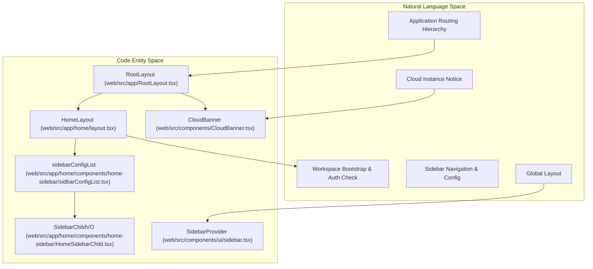
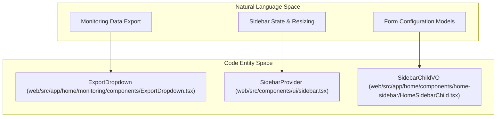
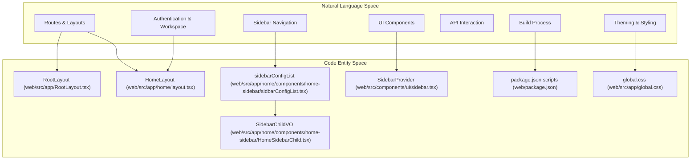

<!-- source: DeepWiki mcp.deepwiki.com · repo langbot-app/LangBot · page 8.1 Frontend Architecture and Technology Stack · fetched 2026-10-29 -->

# Frontend Architecture and Technology Stack

<details>
<summary>Relevant source files</summary>

The following files were used as context for generating this wiki page:

- [web/index.html](web/index.html)
- [web/src/app/RootLayout.tsx](web/src/app/RootLayout.tsx)
- [web/src/app/global.css](web/src/app/global.css)
- [web/src/app/home/components/home-sidebar/HomeSidebarChild.tsx](web/src/app/home/components/home-sidebar/HomeSidebarChild.tsx)
- [web/src/app/home/components/home-sidebar/sidbarConfigList.tsx](web/src/app/home/components/home-sidebar/sidbarConfigList.tsx)
- [web/src/app/home/components/new-version-dialog/NewVersionDialog.tsx](web/src/app/home/components/new-version-dialog/NewVersionDialog.tsx)
- [web/src/app/home/knowledge/knowledgeBase.module.css](web/src/app/home/knowledge/knowledgeBase.module.css)
- [web/src/app/home/layout.tsx](web/src/app/home/layout.tsx)
- [web/src/app/home/monitoring/components/ExportDropdown.tsx](web/src/app/home/monitoring/components/ExportDropdown.tsx)
- [web/src/components/ui/sidebar.tsx](web/src/components/ui/sidebar.tsx)
- [web/tsconfig.json](web/tsconfig.json)

</details>


## Purpose and Scope

This document describes the frontend web application architecture for LangBot, covering its Vite, React Router 7, shadcn/ui, and Tailwind CSS technology stack, project structure, routing, `RootLayout`, home layout and sidebar configuration, key component primitives, dynamic form value normalization, and build/serving lifecycle. The frontend operates as a Vite Single Page Application (SPA) compiled into static assets and served directly by the Quart backend on port `5300`.

Sources:
- [web/src/app/home/layout.tsx:88-174]()
- [web/package.json:5-13]()

---

## Technology Stack

The frontend leverages a suite of modern and proven frontend tools and libraries chosen for performance, developer ergonomics, and UI/UX accessibility.

| Technology | Version | Purpose |
|---|---|---|
| **Vite** | 8.3.4 | Next-generation frontend build tool offering fast hot module replacement (HMR) and optimized builds [web/package.json:106-106]() |
| **React** | 19.2.1 | Primary UI library enabling declarative, component-based user interfaces [web/package.json:87-88]() |
| **React Router** | 7.18.4 | Client-side routing for SPA navigation using declarative route definitions and `createBrowserRouter` [web/package.json:93-93]() |
| **TypeScript** | 5.8.3 | Static typing support enhancing code quality and maintainability [web/package.json:132-132]() |
| **Radix UI** | 1.x | Accessible, unstyled UI primitives forming the base of shadcn/ui components [web/package.json:48-68]() |
| **shadcn/ui** | N/A | Custom reusable component library built on Radix UI + Tailwind CSS, e.g., `Button` and `Badge` [web/src/components/ui/sidebar.tsx:1-8]() |
| **Tailwind CSS** | 4.1.5 | Utility-first CSS framework for rapid and consistent styling, integrated with PostCSS [web/package.json:104-104]() |
| **Lucide React** | 0.507.0 | Iconography library supplying scalable SVG icons [web/package.json:83-83]() |

Sources:
- [web/package.json:42-108]()
- [web/src/components/ui/sidebar.tsx:1-8]()

---

## Project Structure and Directory Organization

The frontend source code is organized to separate routing logic, feature layouts, common utilities, and infrastructure layers for modularity and scalability.

| Directory / File | Purpose |
|---|---|
| `web/src/app/` | Main application routes, including global layouts and feature subfolders such as `home`, `wizard`, `login`, and `register`. |
| `web/src/app/home/` | Core management interface feature pages for bots, pipelines, plugins, monitoring, skills, knowledge bases. |
| `web/src/app/infra/` | Fundamental entities, type definitions, HTTP/WebSocket client wrappers, authentication and session helpers. |
| `web/src/components/` | Globally reusable UI components such as error pages and shared widget primitives [web/src/components/ui/sidebar.tsx:1-25](). |
| `web/src/components/ui/` | shadcn/ui components built on Radix UI primitives and styled with Tailwind CSS. |
| `web/src/hooks/` | Custom React hooks, e.g., for document title management, mobile detection [web/src/components/ui/sidebar.tsx:6](). |
| `web/tsconfig.json` | TypeScript compiler configuration targeting ESNext and moduleResolution bundler [web/tsconfig.json:1-22](). |

This structure supports clean separation between feature logic and UI rendering with React, facilitating maintainability and extensibility.

Sources:
- [web/src/components/ui/sidebar.tsx:1-25]()
- [web/tsconfig.json:1-22]()

---

## Routing, Navigation, and Layout Hierarchy

The frontend employs React Router 7 to declare routes and manage in-app navigation. 

### Root and Home Layouts

- **RootLayout** (`web/src/app/RootLayout.tsx`): The very top-level layout component wrapping the entire app UI. It handles authentication checks and provides contexts for global state and error boundary rendering. The `CloudBanner` component is rendered here to ensure it's present on every route, including login, and publishes its height via CSS variables for other elements to offset themselves [web/src/app/RootLayout.tsx:9-17]().
- **HomeLayout** (`web/src/app/home/layout.tsx`): Mounted at the `/home` route, this component handles workspace bootstrap and permission gating:
  - Calls `bootstrapWorkspaceSession()` to ensure account and workspace identities are initialized [web/src/app/home/layout.tsx:105](). Redirects happen if workspace selection is required [web/src/app/home/layout.tsx:109-112]().
  - On successful workspace initialization, it loads `systemInfo` containing workspace wizard statuses [web/src/app/home/layout.tsx:118]().
  - It applies permission-based guarding to restrict mutation-only routes for read-only members [web/src/app/home/layout.tsx:134-150]().
  - If the workspace wizard status is incomplete (`none`), it redirects users to the setup wizard (except for support admins) [web/src/app/home/layout.tsx:161-166]().
  - Provides `SidebarDataProvider` context and renders the sidebar and main content area [web/src/app/home/layout.tsx:170-174]().

Sidebar navigation is constructed from a fixed set of routes defined as instances of `SidebarChildVO` capturing route path, icon, display name, description, and optional help links.

### Sidebar Configuration

- Defined in `web/src/app/home/components/home-sidebar/sidbarConfigList.tsx` [web/src/app/home/components/home-sidebar/sidbarConfigList.tsx:17-111]().
- Sidebar items are grouped into logical sections: Quick Start, Home, Extensions [web/src/app/home/components/home-sidebar/sidbarConfigList.tsx:17-111]().
- Each sidebar item is typed via the `SidebarChildVO` class [web/src/app/home/components/home-sidebar/HomeSidebarChild.tsx:15-33]().

### Document Title Management

The layout dynamically sets the browser document title based on the current route and sidebar selection state using title management helpers. The `HOME_TITLE_KEYS` constant in `HomeLayout` provides a robust fallback for document titles on direct page loads [web/src/app/home/layout.tsx:63-80]().

---

### Diagram: Frontend Routing and Layout Architecture



Sources:
- [web/src/app/home/layout.tsx:88-174]()
- [web/src/app/home/components/home-sidebar/sidbarConfigList.tsx:17-111]()
- [web/src/app/home/components/home-sidebar/HomeSidebarChild.tsx:15-33]()
- [web/src/components/ui/sidebar.tsx:79-110]()
- [web/src/app/RootLayout.tsx:9-17]()

---

## Home Layout and Sidebar Configuration

### Home Layout Details

The `HomeLayout` component performs critical initialization and authorization logic before displaying any workspace-owned pages:

- It asynchronously boots the workspace session using `bootstrapWorkspaceSession()` [web/src/app/home/layout.tsx:105](). Redirects happen if workspace selection is required [web/src/app/home/layout.tsx:109-112]().
- On successful workspace initialization, it loads `systemInfo` containing workspace wizard statuses [web/src/app/home/layout.tsx:118]().
- It applies permission-based guarding to restrict mutation-only routes for read-only members [web/src/app/home/layout.tsx:134-150]().
- If the workspace wizard status is incomplete (`none`), it redirects users to the setup wizard (except for support admins) [web/src/app/home/layout.tsx:161-166]().
- Finally, it renders the sidebar and children nodes inside `SidebarDataProvider` for state sharing [web/src/app/home/layout.tsx:170-174]().

### Sidebar Configuration Listing (`sidebarConfigList`)

- Sidebar entries are constructed as `SidebarChildVO` instances [web/src/app/home/components/home-sidebar/sidbarConfigList.tsx:17-111]().
- Each entry provides:
  - `id`: Unique identifier [web/src/app/home/components/home-sidebar/HomeSidebarChild.tsx:16]().
  - `name`: Localized display name [web/src/app/home/components/home-sidebar/HomeSidebarChild.tsx:18]().
  - `icon`: React icon component (Lucide React) [web/src/app/home/components/home-sidebar/HomeSidebarChild.tsx:17]().
  - `route`: App route path for navigation [web/src/app/home/components/home-sidebar/HomeSidebarChild.tsx:19]().
  - `description`: Localized description string [web/src/app/home/components/home-sidebar/HomeSidebarChild.tsx:20]().
  - `helpLink`: i18n map of external documentation URLs [web/src/app/home/components/home-sidebar/HomeSidebarChild.tsx:21]().
  - `section`: Logical grouping (`home`, `extensions`, `standalone`) [web/src/app/home/components/home-sidebar/HomeSidebarChild.tsx:22]().

Common sidebar sections:
- Quick Start (e.g., wizard page) [web/src/app/home/components/home-sidebar/sidbarConfigList.tsx:19-30]()
- Home (monitoring, bots, agents, knowledge) [web/src/app/home/components/home-sidebar/sidbarConfigList.tsx:33-83]()
- Extensions (plugins, MCP servers, skills) [web/src/app/home/components/home-sidebar/sidbarConfigList.tsx:85-110]()

Sources:
- [web/src/app/home/layout.tsx:88-174]()
- [web/src/app/home/components/home-sidebar/sidbarConfigList.tsx:17-111]()
- [web/src/app/home/components/home-sidebar/HomeSidebarChild.tsx:15-33]()

---

## Radix UI and Component Primitives

The UI layer combines unstyled Radix UI primitives with Tailwind CSS utilities through the `shadcn/ui` component set, yielding accessible, composable, and themeable components. State management helpers such as `useSidebar` handle sidebar resizing, collapsing, and persistence in `localStorage` (`sidebar_state`, `sidebar_width`) [web/src/components/ui/sidebar.tsx:26-59](). The `SidebarProvider` component manages the sidebar's open/collapsed state, width, and responsiveness, persisting these settings in `localStorage` [web/src/components/ui/sidebar.tsx:79-141](). It also provides a keyboard shortcut (`Ctrl/Cmd + b`) to toggle the sidebar [web/src/components/ui/sidebar.tsx:149-162]().

Sources:
- [web/src/components/ui/sidebar.tsx:26-59]()
- [web/src/components/ui/sidebar.tsx:79-141]()
- [web/src/components/ui/sidebar.tsx:149-162]()

---

## Dynamic Form State and Value Normalization

The frontend includes normalization utilities to properly initialize and sanitize dynamic form data when rendering and saving form-based configurations:
- Handling array defaults, boolean checkboxes, and model selector fallbacks.
- Preparing form values before saving to backend by trimming extraneous whitespace and preserving multiline content or object metadata.

### Diagram: Dynamic Form Value Normalization Architecture



Sources:
- [web/src/app/home/monitoring/components/ExportDropdown.tsx:38-179]()
- [web/src/components/ui/sidebar.tsx:36-48]()
- [web/src/app/home/components/home-sidebar/HomeSidebarChild.tsx:5-13]()

---

## Build Process and Backend Serving

### Development

- The frontend uses `pnpm` for managing dependencies and scripts [web/package.json:135-135]().
- To run the development server with hot module replacement, execute:

  ```sh
  pnpm run dev
  ```
  [web/package.json:6-6]()

### Production Build

- To build the frontend for production, including TypeScript compilation and bundling:

  ```sh
  pnpm run build
  ```
  [web/package.json:7-7]()

- This produces statically optimized files in the output directory.

### Serving

- During production execution (Docker, standalone mode), the Python Quart backend serves these static assets directly on port `5300`.

Sources:
- [web/package.json:5-13]()

---

# Summary Diagram: From Natural Language UI Concepts to Code Entities



Sources:
- [web/src/app/home/layout.tsx:88-174]()
- [web/src/app/home/components/home-sidebar/sidbarConfigList.tsx:17-111]()
- [web/src/app/home/components/home-sidebar/HomeSidebarChild.tsx:15-33]()
- [web/src/components/ui/sidebar.tsx:79-110]()
- [web/package.json:5-13]()
- [web/src/app/global.css:1-192]()

---

