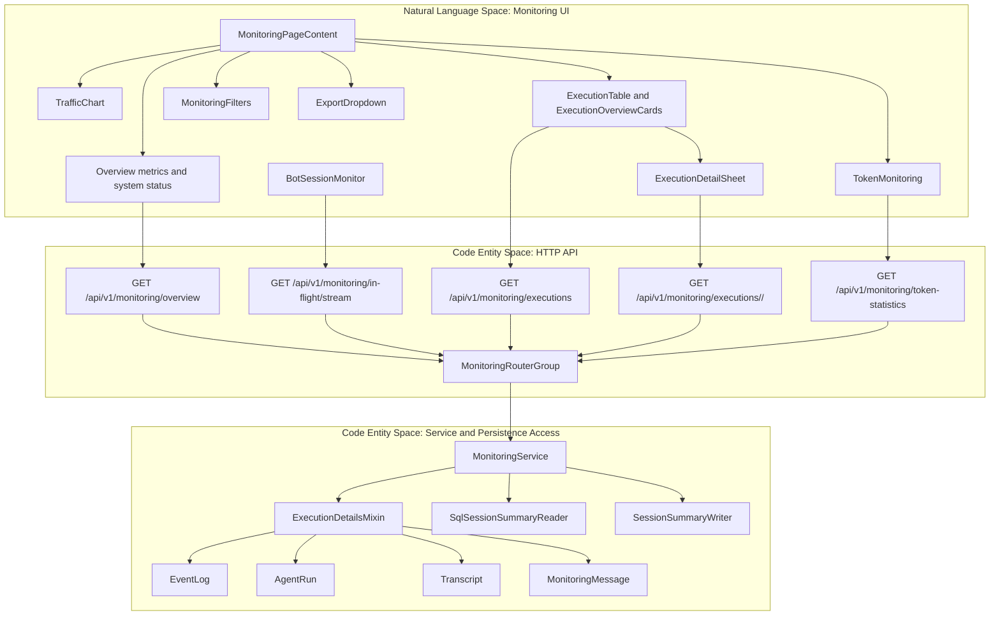
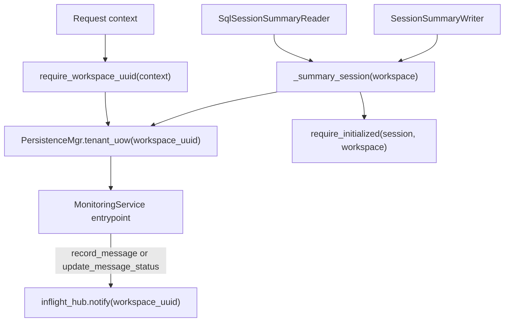
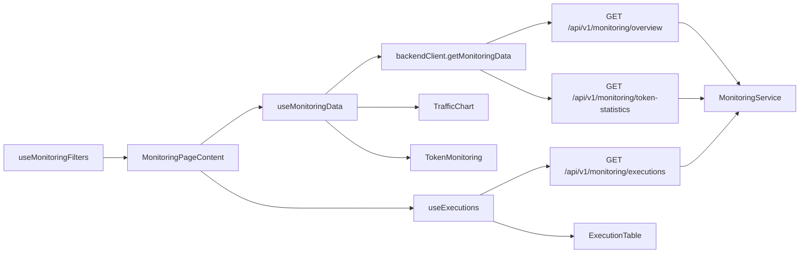

<!-- source: DeepWiki mcp.deepwiki.com · repo langbot-app/LangBot · page 8.10 Monitoring and Telemetry UI · fetched 2026-10-29 -->

# Monitoring and Telemetry UI

<details>
<summary>Relevant source files</summary>

The following files were used as context for generating this wiki page:

- [skills/skills/langbot-mcp-ops/SKILL.md](skills/skills/langbot-mcp-ops/SKILL.md)
- [src/langbot/pkg/api/http/controller/groups/box_visibility.py](src/langbot/pkg/api/http/controller/groups/box_visibility.py)
- [src/langbot/pkg/api/http/controller/groups/monitoring.py](src/langbot/pkg/api/http/controller/groups/monitoring.py)
- [src/langbot/pkg/api/http/service/monitoring.py](src/langbot/pkg/api/http/service/monitoring.py)
- [src/langbot/pkg/api/http/service/monitoring_execution_details.py](src/langbot/pkg/api/http/service/monitoring_execution_details.py)
- [src/langbot/pkg/api/mcp/server.py](src/langbot/pkg/api/mcp/server.py)
- [tests/unit_tests/api/service/test_monitoring_executions.py](tests/unit_tests/api/service/test_monitoring_executions.py)
- [tests/unit_tests/api/test_box_controller.py](tests/unit_tests/api/test_box_controller.py)
- [web/.prettierrc.mjs](web/.prettierrc.mjs)
- [web/eslint.config.mjs](web/eslint.config.mjs)
- [web/src/app/home/agents/PluginProcessorDetailContent.tsx](web/src/app/home/agents/PluginProcessorDetailContent.tsx)
- [web/src/app/home/agents/components/PluginProcessorSettings.tsx](web/src/app/home/agents/components/PluginProcessorSettings.tsx)
- [web/src/app/home/agents/components/PluginProcessorTrace.tsx](web/src/app/home/agents/components/PluginProcessorTrace.tsx)
- [web/src/app/home/agents/components/ProcessorRunList.tsx](web/src/app/home/agents/components/ProcessorRunList.tsx)
- [web/src/app/home/agents/components/RunnerSelect.tsx](web/src/app/home/agents/components/RunnerSelect.tsx)
- [web/src/app/home/agents/runner-marketplace.ts](web/src/app/home/agents/runner-marketplace.ts)
- [web/src/app/home/bots/components/bot-session/BotSessionMonitor.tsx](web/src/app/home/bots/components/bot-session/BotSessionMonitor.tsx)
- [web/src/app/home/monitoring/components/ConversationTurnList.tsx](web/src/app/home/monitoring/components/ConversationTurnList.tsx)
- [web/src/app/home/monitoring/components/MessageContentRenderer.tsx](web/src/app/home/monitoring/components/MessageContentRenderer.tsx)
- [web/src/app/home/monitoring/components/MessageDetailsCard.tsx](web/src/app/home/monitoring/components/MessageDetailsCard.tsx)
- [web/src/app/home/monitoring/components/TokenMonitoring.tsx](web/src/app/home/monitoring/components/TokenMonitoring.tsx)
- [web/src/app/home/monitoring/components/executions/ExecutionDetailSheet.tsx](web/src/app/home/monitoring/components/executions/ExecutionDetailSheet.tsx)
- [web/src/app/home/monitoring/components/overview-cards/SystemStatusCards.tsx](web/src/app/home/monitoring/components/overview-cards/SystemStatusCards.tsx)
- [web/src/app/home/monitoring/components/overview-cards/TrafficChart.tsx](web/src/app/home/monitoring/components/overview-cards/TrafficChart.tsx)
- [web/src/app/home/monitoring/hooks/useExecutions.ts](web/src/app/home/monitoring/hooks/useExecutions.ts)
- [web/src/app/home/monitoring/hooks/useMonitoringData.ts](web/src/app/home/monitoring/hooks/useMonitoringData.ts)
- [web/src/app/home/monitoring/page.tsx](web/src/app/home/monitoring/page.tsx)
- [web/src/app/home/monitoring/types/monitoring.ts](web/src/app/home/monitoring/types/monitoring.ts)
- [web/src/app/home/monitoring/utils/conversationTurns.ts](web/src/app/home/monitoring/utils/conversationTurns.ts)
- [web/src/app/home/monitoring/utils/dateUtils.ts](web/src/app/home/monitoring/utils/dateUtils.ts)
- [web/src/app/home/pipelines/components/debug-dialog/ImagePreviewDialog.tsx](web/src/app/home/pipelines/components/debug-dialog/ImagePreviewDialog.tsx)
- [web/src/app/home/pipelines/components/monitoring-tab/PipelineMonitoringTab.tsx](web/src/app/home/pipelines/components/monitoring-tab/PipelineMonitoringTab.tsx)
- [web/src/components/ui/select.tsx](web/src/components/ui/select.tsx)
- [web/tests/e2e/bot-session-tool-timeline.spec.ts](web/tests/e2e/bot-session-tool-timeline.spec.ts)
- [web/tests/e2e/codex-subscription.spec.ts](web/tests/e2e/codex-subscription.spec.ts)
- [web/tests/e2e/contextual-guides.spec.ts](web/tests/e2e/contextual-guides.spec.ts)
- [web/tests/e2e/event-processor-marketplace.spec.ts](web/tests/e2e/event-processor-marketplace.spec.ts)
- [web/tests/e2e/event-processor.spec.ts](web/tests/e2e/event-processor.spec.ts)
- [web/tests/e2e/monitoring-executions.spec.ts](web/tests/e2e/monitoring-executions.spec.ts)
- [web/tests/e2e/monitoring-turns.spec.ts](web/tests/e2e/monitoring-turns.spec.ts)
- [web/tests/e2e/pipeline-monitoring-turns.spec.ts](web/tests/e2e/pipeline-monitoring-turns.spec.ts)
- [web/tests/e2e/plugin-subscriptions.spec.ts](web/tests/e2e/plugin-subscriptions.spec.ts)

</details>


**Purpose:**  
This page describes the Monitoring and Telemetry UI and the backend code paths visible in the supplied repository excerpts. It covers dashboard metrics, traffic and token monitoring, execution filtering and detail views, conversation history, the pipeline-monitoring entry point, bot sessions, and the bounds of what can be established about storage analysis from the available code. [web/src/app/home/monitoring/page.tsx:53-101]() [src/langbot/pkg/api/http/controller/groups/monitoring.py:45-153]()

**Scope:**  
The available implementation excerpts include the monitoring page, its data hook and traffic chart, the monitoring API routes, the service’s workspace-transaction and session-summary setup, execution-detail serialization, a bot session monitor, and end-to-end tests. They do not include the implementations of the token and storage-analysis components, the complete monitoring service, or the persistence model definitions. Those areas are described only to the extent supported by the supplied code. [web/src/app/home/monitoring/page.tsx:31-47]() [web/src/app/home/monitoring/hooks/useMonitoringData.ts:13-23]() [src/langbot/pkg/api/http/service/monitoring.py:150-178]()

Sources: [web/src/app/home/monitoring/page.tsx:31-101]() [web/src/app/home/monitoring/hooks/useMonitoringData.ts:13-23]() [src/langbot/pkg/api/http/service/monitoring.py:150-178]()

---

## 1. System Overview and Architecture

The monitoring page connects operator-facing dashboard concepts—overview metrics, traffic, filtered executions, and execution details—to `MonitoringRouterGroup`, `MonitoringService`, and `ExecutionDetailsMixin`. The page also imports `TokenMonitoring` and `ExportDropdown`, but their implementation and API behavior are not present in the supplied excerpts. [web/src/app/home/monitoring/page.tsx:31-47]() [src/langbot/pkg/api/http/controller/groups/monitoring.py:45-153]() [src/langbot/pkg/api/http/service/monitoring.py:150-178]() [src/langbot/pkg/api/http/service/monitoring_execution_details.py:102-114]()

### Monitoring Component Architecture (Natural Language to Code Entity)



Sources: [web/src/app/home/monitoring/page.tsx:31-47]() [web/src/app/home/bots/components/bot-session/BotSessionMonitor.tsx:57-127]() [src/langbot/pkg/api/http/controller/groups/monitoring.py:45-153]() [src/langbot/pkg/api/http/service/monitoring.py:13-29]() [src/langbot/pkg/api/http/service/monitoring.py:150-178]() [src/langbot/pkg/api/http/service/monitoring_execution_details.py:13-17]() [src/langbot/pkg/api/http/service/monitoring_execution_details.py:102-169]()

### Backend request path

The monitoring API is registered under `/api/v1/monitoring`. Its shown routes require `Permission.RESOURCE_VIEW`; dashboard windows are parsed and validated before service calls. The execution-detail route passes `section`, `offset`, and `limit` to `MonitoringService.get_execution_detail`. [src/langbot/pkg/api/http/controller/groups/monitoring.py:27-43]() [src/langbot/pkg/api/http/controller/groups/monitoring.py:45-70]() [src/langbot/pkg/api/http/controller/groups/monitoring.py:97-144]()

```mermaid
sequenceDiagram
    participant UI as "MonitoringPageContent"
    participant Route as "MonitoringRouterGroup"
    participant Service as "MonitoringService"
    participant Details as "ExecutionDetailsMixin"
    participant DB as "Workspace transaction session"

    UI->>Route: "GET /api/v1/monitoring/executions"
    Route->>Route: "Parse filters and validate time window"
    Route->>Service: "get_executions(request_context, filters)"
    Service-->>Route: "Execution list result"
    Route-->>UI: "Success response"

    UI->>Route: "GET /api/v1/monitoring/executions/{source}/{execution_id}?section=overview"
    Route->>Service: "get_execution_detail(context, source, execution_id, section, offset, limit)"
    Service->>Details: "Build execution detail pages"
    Details->>DB: "Read workspace-scoped event and message sources"
    DB-->>Details: "Execution and conversation rows"
    Details-->>Service: "Serialized detail items"
    Service-->>Route: "Detail result"
    Route-->>UI: "Success response"
```

Sources: [src/langbot/pkg/api/http/controller/groups/monitoring.py:97-144]() [src/langbot/pkg/api/http/service/monitoring.py:150-178]() [src/langbot/pkg/api/http/service/monitoring_execution_details.py:102-169]()

---

## 2. Backend Implementation and Data Flow

### Monitoring routes and query bounds

`MonitoringRouterGroup` is registered with the group name `monitoring` and base path `/api/v1/monitoring`. `parse_iso_datetime` accepts ISO timestamps, converts a trailing `Z` to an explicit UTC offset, and normalizes timezone-aware values to naive UTC to match the database convention described in the function. `validate_monitoring_window` rejects reversed or disallowed point windows and explicit windows longer than 365 days. [src/langbot/pkg/api/http/controller/groups/monitoring.py:12-43]() [src/langbot/pkg/api/http/controller/groups/monitoring.py:45-46]()

| Route | Inputs visible in the controller | Service action |
|---|---|---|
| `/overview` | Repeated `botId` and `pipelineId`, `startTime`, `endTime` | `get_overview_metrics` |
| `/in-flight/stream` | Workspace from request context | SSE frames produced using `inflight_hub.watch` and `get_inflight_snapshot` |
| `/executions` | Bot, pipeline, and agent IDs; status; source; mode; time range; limit; offset | `get_executions` |
| `/executions/<source>/<execution_id>` | `section`, `offset`, `limit` | `get_execution_detail` |
| `/token-statistics` | Bot and pipeline IDs; time range; `bucket` defaulting to `hour` | Token-statistics route handler; the remainder of its implementation is not included in the excerpt |

The routes shown require `Permission.RESOURCE_VIEW`. The controller defaults execution-list `source` and `mode` to `all`, and defaults execution pagination to `limit=50` and `offset=0`. [src/langbot/pkg/api/http/controller/groups/monitoring.py:45-70]() [src/langbot/pkg/api/http/controller/groups/monitoring.py:72-124]() [src/langbot/pkg/api/http/controller/groups/monitoring.py:126-153]()

Sources: [src/langbot/pkg/api/http/controller/groups/monitoring.py:12-43]() [src/langbot/pkg/api/http/controller/groups/monitoring.py:45-153]()

### Workspace scoping and session summaries

`MonitoringService` is initialized with the application and constructs a `SqlSessionSummaryReader` using `_summary_session` as its session provider. `_summary_session` joins `PersistenceMgr.tenant_uow(workspace)` and yields that unit of work’s database session. `_summary_write_session` checks `require_initialized` before yielding the session for summary writes. `_serialize_session` uses `serialize_model` and restricts the result to `SUMMARY_FIELDS`. [src/langbot/pkg/api/http/service/monitoring.py:150-178]()

The `_workspace_transaction` decorator resolves the workspace UUID from the request context and, when available, runs the wrapped service method inside `tenant_uow`. For `record_message` and `update_message_status`, it notifies `inflight_hub` after the method completes. [src/langbot/pkg/api/http/service/monitoring.py:129-147]()



Sources: [src/langbot/pkg/api/http/service/monitoring.py:129-178]()

### Execution status normalization

The service defines shared status groups for agent and pipeline records. Agent statuses map `completed` to `completed`, `failed` and `timeout` to `failed`, `cancelled` to `cancelled`, `created` and `queued` to `queued`, and `claimed` and `running` to `running`. Pipeline statuses map `success` to `completed`, `error` to `failed`, `pending` to `running`, and `discarded` and `not_matched` to `ignored`. `_status_group` selects the mapping based on whether the source is `agent` or pipeline. [src/langbot/pkg/api/http/service/monitoring.py:45-68]()

| Source | Source statuses | Normalized groups |
|---|---|---|
| Agent | `completed` | `completed` |
| Agent | `failed`, `timeout` | `failed` |
| Agent | `cancelled` | `cancelled` |
| Agent | `created`, `queued` | `queued` |
| Agent | `claimed`, `running` | `running` |
| Pipeline | `success` | `completed` |
| Pipeline | `error` | `failed` |
| Pipeline | `pending` | `running` |
| Pipeline | `discarded`, `not_matched` | `ignored` |

Sources: [src/langbot/pkg/api/http/service/monitoring.py:45-68]()

### Execution details and conversation data

`ExecutionDetailsMixin` has serializers for event, monitoring-message, and transcript rows. `event_item` parses event metadata and input JSON, keeps event-specific properties alongside normalized input, and emits event identity, source, timestamp, actor, conversation, thread, content, and metadata fields. `message_item` emits role, content, actor, status, event/run IDs, and marks assistant messages as `delivery` origin. `transcript_item` emits role, content, parsed attachment references, event/run IDs, and distinguishes assistant-generated content from input. [src/langbot/pkg/api/http/service/monitoring_execution_details.py:33-38]() [src/langbot/pkg/api/http/service/monitoring_execution_details.py:57-99]()

For conversation queries, `_conversation_message_queries` combines stored `MonitoringMessage` records with ingress records from `EventLog`. It derives the conversation identity using the event’s conversation ID, a related `AgentRun` conversation ID, or a fallback derived from group/private chat fields in event input JSON. `_conversation_message_source` unions query identities while selecting only identity and paging columns, rather than carrying historical payloads through the count/page source. [src/langbot/pkg/api/http/service/monitoring_execution_details.py:102-169]()

The execution-detail endpoint supports selecting a `section` and paging with `offset` and `limit`; invalid execution lookup expressed as `ValueError` is returned as a 404 failure by the controller. The frontend test verifies that the initial detail request asks only for `section=overview`, that conversation history is fetched when expanded, that a failed history request can be retried, and that additional history can be loaded without re-fetching it on close/reopen. [src/langbot/pkg/api/http/controller/groups/monitoring.py:126-144]() [web/tests/e2e/monitoring-executions.spec.ts:90-174]()

Sources: [src/langbot/pkg/api/http/service/monitoring_execution_details.py:33-99]() [src/langbot/pkg/api/http/service/monitoring_execution_details.py:102-169]() [src/langbot/pkg/api/http/controller/groups/monitoring.py:126-144]() [web/tests/e2e/monitoring-executions.spec.ts:90-174]()

---

## 3. Frontend UI Components and Data Flows

### Dashboard layout, filtering, and refresh

`MonitoringPageContent` composes the monitoring filters, overview components, traffic chart, token monitoring, export control, execution overview/table/detail sheet, and feedback components. It reads the active workspace and computes `canExport` from the `data.export` permission. It keeps filter state through `useMonitoringFilters` and sends the resulting selection, mode, status, and time range into the monitoring-data and execution hooks. [web/src/app/home/monitoring/page.tsx:31-101]()

Execution results are requested with a page size of 50. The page resets the execution offset when mode, status, selected bots, selected pipelines, or time range changes. Manual refresh refetches monitoring and executions and changes a feedback refresh key. The automatic refresh interval is read from local storage and accepts only `5`, `15`, `30`, `60`, or `300` seconds; refresh is performed only while the document is visible and the UI is not already busy. [web/src/app/home/monitoring/page.tsx:80-113]() [web/src/app/home/monitoring/page.tsx:150-200]()

`useMonitoringData` resolves the selected time window and calls `backendClient.getMonitoringData` with mode, status, bot IDs, pipeline IDs, start/end timestamps, and a limit of 50. It guards responses using a request ID and a current-workspace snapshot check so stale or cross-workspace responses are ignored. It transforms API fields such as `total_messages`, `llm_calls`, and `input_tokens`-style records into frontend monitoring types, and converts traffic timestamps with `parseUTCTimestamp`. [web/src/app/home/monitoring/hooks/useMonitoringData.ts:16-23]() [web/src/app/home/monitoring/hooks/useMonitoringData.ts:39-72]() [web/src/app/home/monitoring/hooks/useMonitoringData.ts:75-128]()

### Overview metrics and traffic chart

The data hook defaults a missing overview to zero message/model-call counts, a 100% success rate, and zero active sessions. It maps message, LLM-call, tool-call, embedding-call, session, and error arrays, and derives fallback totals from returned array lengths when `totalCount` is absent. [web/src/app/home/monitoring/hooks/useMonitoringData.ts:75-106]()

`TrafficChart` renders message and LLM-call series in a responsive Recharts `AreaChart`. It formats dates differently for daily versus smaller buckets, displays a loading skeleton before traffic data arrives, and distinguishes unavailable data from an available-but-empty series. When the response indicates truncation, the chart renders a status notice. Its open/collapsed state is persisted under `langbot-traffic-chart-open`. [web/src/app/home/monitoring/components/overview-cards/TrafficChart.tsx:27-45]() [web/src/app/home/monitoring/components/overview-cards/TrafficChart.tsx:86-143]() [web/src/app/home/monitoring/components/overview-cards/TrafficChart.tsx:194-198]()

### Monitoring data flow: dashboard to service



Sources: [web/src/app/home/monitoring/page.tsx:31-101]() [web/src/app/home/monitoring/hooks/useMonitoringData.ts:39-128]() [web/src/app/home/monitoring/components/overview-cards/TrafficChart.tsx:86-143]() [src/langbot/pkg/api/http/controller/groups/monitoring.py:45-70]() [src/langbot/pkg/api/http/controller/groups/monitoring.py:97-124]() [src/langbot/pkg/api/http/controller/groups/monitoring.py:146-153]()

### Execution filters, details, and conversation turns

The page applies bot, pipeline, time-range, execution-mode, and status-group filters to its monitoring and execution requests. The execution list is separately paginated, and the page resets its offset when relevant execution filters change. The controller accepts bot, pipeline, and agent IDs, status, source, mode, time bounds, limit, and offset. [web/src/app/home/monitoring/page.tsx:58-113]() [src/langbot/pkg/api/http/controller/groups/monitoring.py:97-124]()

The execution detail endpoint is keyed by source and execution ID and supports section-level paging. The end-to-end tests establish the frontend behavior for an overview-first detail load and deferred conversation history. They also verify stale conversation responses are ignored when a different execution is selected. [src/langbot/pkg/api/http/controller/groups/monitoring.py:126-144]() [web/tests/e2e/monitoring-executions.spec.ts:90-174]() [web/tests/e2e/monitoring-executions.spec.ts:176-203]()

Conversation-turn display is part of the monitoring UI, and a separate test suite exercises turn behavior for messages, LLM calls, tools, and errors. The supplied excerpt shows the test’s data shapes and scenario, but does not include the `buildConversationTurns` implementation; detailed turn-grouping rules therefore cannot be stated from the available code. [web/tests/e2e/monitoring-turns.spec.ts:7-13]() [web/tests/e2e/monitoring-turns.spec.ts:29-125]() [web/tests/e2e/monitoring-turns.spec.ts:206-245]()

### Pipeline monitoring tab and export

The monitoring page imports `ExportDropdown` and checks `data.export` permission when computing export availability. The supplied page excerpt does not show the dropdown’s props, format choices, or export endpoint, so those details cannot be confirmed here. [web/src/app/home/monitoring/page.tsx:31-57]()

A pipeline-specific monitoring tab exists at `web/src/app/home/pipelines/components/monitoring-tab/PipelineMonitoringTab.tsx`, and the supplied end-to-end test list includes `pipeline-monitoring-turns.spec.ts`. Their contents were not provided, so the precise tab layout, query parameters, and relationship to the global monitoring page are not documented here. [web/src/app/home/pipelines/components/monitoring-tab/PipelineMonitoringTab.tsx]()

Sources: [web/src/app/home/monitoring/page.tsx:31-101]() [src/langbot/pkg/api/http/controller/groups/monitoring.py:97-144]() [web/tests/e2e/monitoring-executions.spec.ts:90-203]() [web/tests/e2e/monitoring-turns.spec.ts:7-13]() [web/tests/e2e/monitoring-turns.spec.ts:206-245]() [web/src/app/home/pipelines/components/monitoring-tab/PipelineMonitoringTab.tsx]()

### Token monitoring and log categories

The monitoring UI imports `TokenMonitoring`; the backend exposes `GET /token-statistics`, whose visible query inputs include repeated bot and pipeline IDs, a time range, and a `bucket` value defaulting to `hour`. The remainder of the route handler and the token component are not included, so available token breakdown dimensions, cost calculations, chart layout, and paging behavior are not asserted here. [web/src/app/home/monitoring/page.tsx:31-37]() [src/langbot/pkg/api/http/controller/groups/monitoring.py:146-153]()

The data hook handles message, LLM-call, tool-call, embedding-call, session, and error collections, and maps message fields including status, level, platform, user, runner, variables, and role. LLM call fields include model name, input/output/total tokens, duration, status, bot/pipeline identifiers, session, error message, and message ID. [web/src/app/home/monitoring/hooks/useMonitoringData.ts:83-106]() [web/src/app/home/monitoring/hooks/useMonitoringData.ts:129-164]() [web/src/app/home/monitoring/hooks/useMonitoringData.ts:166-190]()

Sources: [web/src/app/home/monitoring/page.tsx:31-37]() [src/langbot/pkg/api/http/controller/groups/monitoring.py:146-153]() [web/src/app/home/monitoring/hooks/useMonitoringData.ts:83-106]() [web/src/app/home/monitoring/hooks/useMonitoringData.ts:129-190]()

### Bot session monitor

`BotSessionMonitor` is a bot-specific session UI. Its visible state includes paginated sessions and messages, date and user filters, selected session ID, feedback, tool calls, and loading/error flags. Its page sizes are 20 sessions and 50 messages. It checks `resource.manage` before enabling the session-reset capability and calls `httpClient.resetSessionContext(botId, resetTarget)` when resetting a selected context. [web/src/app/home/bots/components/bot-session/BotSessionMonitor.tsx:57-107]() [web/src/app/home/bots/components/bot-session/BotSessionMonitor.tsx:125-173]() [web/src/app/home/bots/components/bot-session/BotSessionMonitor.tsx:174-207]()

The session monitor’s types represent a timeline containing message and tool items. Message records carry session, bot, pipeline, role, status, platform, user, and runner data; tool-call records carry tool name/source, duration, status, arguments, result, and error text. The shown excerpt does not include the component’s API-loading functions, so the exact backend routes used by this dialog are not inferred. [web/src/app/home/bots/components/bot-session/BotSessionMonitor.tsx:72-123]() [web/src/app/home/bots/components/bot-session/BotSessionMonitor.tsx:174-207]()

Sources: [web/src/app/home/bots/components/bot-session/BotSessionMonitor.tsx:57-123]() [web/src/app/home/bots/components/bot-session/BotSessionMonitor.tsx:125-207]()

---

## 4. Storage, Indexing, and Retention Cleanup

The supplied code shows monitoring service access to persistence entities including `MonitoringSession`, `MonitoringMessage`, `EventLog`, `AgentRun`, and `Transcript`. Execution conversation queries combine monitoring messages and event ingress, while detail serializers parse stored JSON content and attachment references. [src/langbot/pkg/api/http/service/monitoring.py:13-29]() [src/langbot/pkg/api/http/service/monitoring.py:176-178]() [src/langbot/pkg/api/http/service/monitoring_execution_details.py:13-17]() [src/langbot/pkg/api/http/service/monitoring_execution_details.py:57-99]() [src/langbot/pkg/api/http/service/monitoring_execution_details.py:116-169]()

The monitoring service defines defaults and hard limits for page rows, export rows, detail rows, timeseries buckets, and offsets. It also defines cleanup batch defaults and a hard maximum. The excerpt shows these bounds as constants, but does not include the functions that apply them or the cleanup implementation; operational retention behavior cannot be specified from the provided lines. [src/langbot/pkg/api/http/service/monitoring.py:32-43]()

| Concern | Evidence in supplied code | What can be concluded |
|---|---|---|
| Query bounds | Default and hard maximum constants for page, export, detail, timeseries, and offset limits | Limits are defined; the consuming code is not shown. |
| Cleanup batching | Default and maximum cleanup batches per table | Batch bounds are defined; cleanup scheduling and deletion behavior are not shown. |
| Session summaries | `SqlSessionSummaryReader`, `SessionSummaryWriter`, and `SUMMARY_FIELDS` | Session summary read/write components are wired into `MonitoringService`; their schemas and algorithms are not shown. |
| Execution history | `MonitoringMessage` and `EventLog` are unioned as conversation sources | The detail-query source includes stored delivered messages and ingress missing from the legacy ledger. |
| Attachments | `Transcript` serializer parses `attachment_refs_json` | Transcript detail items can include parsed attachment references. |

The supplied excerpts do not show the persistence model definitions, database indexes, migrations, storage-analysis UI, or retention job implementation. Consequently, table schemas, index names, migration behavior, storage-size calculations, and cleanup effects should be verified in those files before being documented as implementation facts. [src/langbot/pkg/api/http/service/monitoring.py:32-43]() [src/langbot/pkg/api/http/service/monitoring.py:150-178]() [src/langbot/pkg/api/http/service/monitoring_execution_details.py:89-99]() [src/langbot/pkg/api/http/service/monitoring_execution_details.py:116-169]()

Sources: [src/langbot/pkg/api/http/service/monitoring.py:13-43]() [src/langbot/pkg/api/http/service/monitoring.py:150-178]() [src/langbot/pkg/api/http/service/monitoring_execution_details.py:13-17]() [src/langbot/pkg/api/http/service/monitoring_execution_details.py:57-99]() [src/langbot/pkg/api/http/service/monitoring_execution_details.py:116-169]()

---

## 5. Verification and Observable UI Behavior

The monitoring execution end-to-end tests cover detail-sheet behavior against mocked monitoring responses. They verify that an external input image can be loaded and previewed without a `Referer` header, that conversation history loads on demand and can be retried and paged, and that a late history response is ignored after selecting a different execution. [web/tests/e2e/monitoring-executions.spec.ts:27-88]() [web/tests/e2e/monitoring-executions.spec.ts:90-174]() [web/tests/e2e/monitoring-executions.spec.ts:176-203]()

The backend execution tests describe coverage for a unified agent-run and pipeline-query execution list, rollup summary, and single-execution traces. The shown test case verifies preservation of event-specific properties in detail snapshots, including falsey values such as `count: 0`, and checks fallback behavior when event-log rows are present. [tests/unit_tests/api/service/test_monitoring_executions.py:1-5]() [tests/unit_tests/api/service/test_monitoring_executions.py:26-82]()

Sources: [web/tests/e2e/monitoring-executions.spec.ts:27-203]() [tests/unit_tests/api/service/test_monitoring_executions.py:1-5]() [tests/unit_tests/api/service/test_monitoring_executions.py:26-82]()

---

**Summary:**  
The visible monitoring implementation consists of a workspace-aware React dashboard, bounded monitoring API routes, a `MonitoringService` with tenant transaction and session-summary wiring, and `ExecutionDetailsMixin` serializers and conversation sources. The UI supports filtered overview and execution views, traffic visualization, token-monitoring integration, export permission gating, lazy conversation-history loading, and bot-session inspection. Detailed storage analysis, retention execution, persistence schemas/indexes, and the full token/export implementations require the corresponding files, which were not included in the supplied excerpts. [web/src/app/home/monitoring/page.tsx:31-101]() [web/src/app/home/monitoring/hooks/useMonitoringData.ts:39-128]() [src/langbot/pkg/api/http/controller/groups/monitoring.py:45-153]() [src/langbot/pkg/api/http/service/monitoring.py:129-178]() [src/langbot/pkg/api/http/service/monitoring_execution_details.py:57-169]()

---

