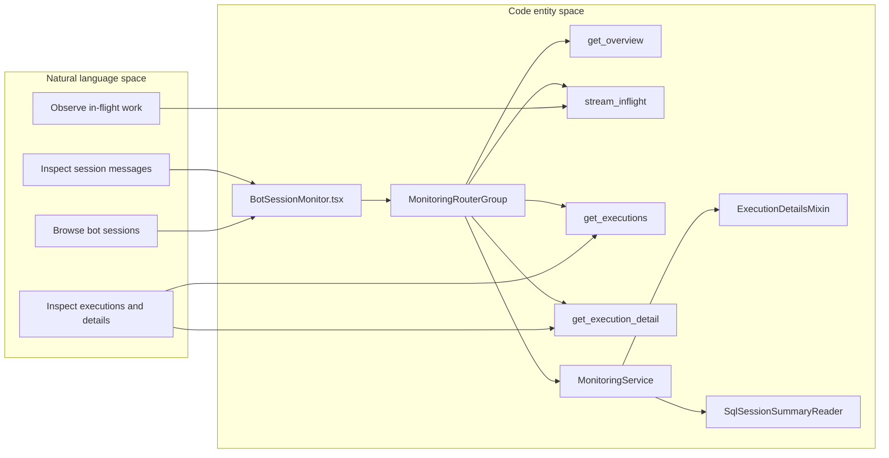
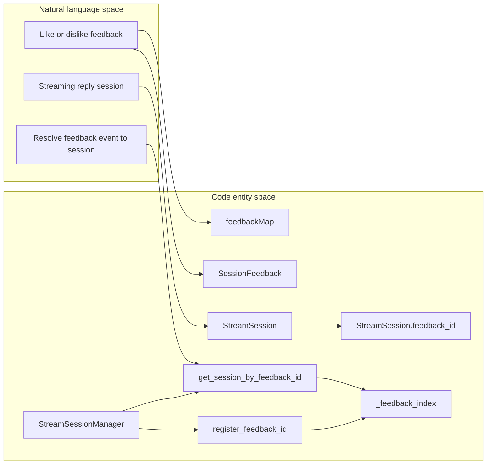
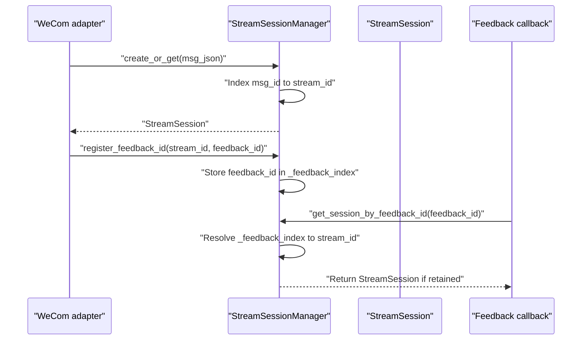
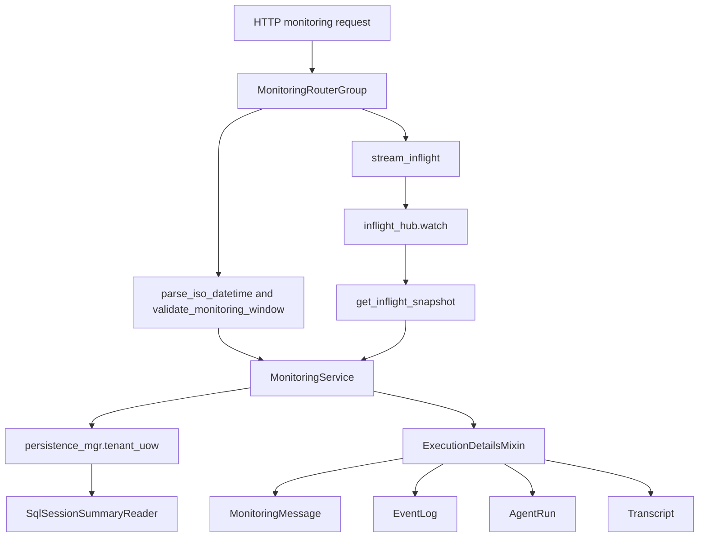

<!-- source: DeepWiki mcp.deepwiki.com · repo langbot-app/LangBot · page 8.11 Bot Session Monitor and Feedback · fetched 2026-10-29 -->

# Bot Session Monitor and Feedback

Relevant source files

The following files were used as context for generating this wiki page:

- [skills/skills/langbot-mcp-ops/SKILL.md](skills/skills/langbot-mcp-ops/SKILL.md)
- [src/langbot/libs/wecom_ai_bot_api/api.py](src/langbot/libs/wecom_ai_bot_api/api.py)
- [src/langbot/libs/wecom_ai_bot_api/wecombotevent.py](src/langbot/libs/wecom_ai_bot_api/wecombotevent.py)
- [src/langbot/pkg/api/http/controller/groups/monitoring.py](src/langbot/pkg/api/http/controller/groups/monitoring.py)
- [src/langbot/pkg/api/http/service/monitoring.py](src/langbot/pkg/api/http/service/monitoring.py)
- [src/langbot/pkg/api/http/service/monitoring_execution_details.py](src/langbot/pkg/api/http/service/monitoring_execution_details.py)
- [src/langbot/pkg/api/mcp/server.py](src/langbot/pkg/api/mcp/server.py)
- [src/langbot/pkg/pipeline/preproc/preproc.py](src/langbot/pkg/pipeline/preproc/preproc.py)
- [src/langbot/pkg/platform/sources/wecombot.py](src/langbot/pkg/platform/sources/wecombot.py)
- [src/langbot/pkg/platform/sources/wecombot.yaml](src/langbot/pkg/platform/sources/wecombot.yaml)
- [tests/unit_tests/api/service/test_monitoring_executions.py](tests/unit_tests/api/service/test_monitoring_executions.py)
- [web/src/app/home/bots/components/bot-session/BotSessionMonitor.tsx](web/src/app/home/bots/components/bot-session/BotSessionMonitor.tsx)
- [web/src/app/home/monitoring/components/executions/ExecutionDetailSheet.tsx](web/src/app/home/monitoring/components/executions/ExecutionDetailSheet.tsx)
- [web/src/app/home/monitoring/hooks/useFeedbackData.ts](web/src/app/home/monitoring/hooks/useFeedbackData.ts)

## Purpose and Scope

Section 8.11 covers the bot-session monitor UI, the backend monitoring paths visible in the supplied source, and the WeCom streaming-session feedback mechanism. These are related but distinct flows: `BotSessionMonitor` presents session data and feedback state in the web UI, while `MonitoringRouterGroup` exposes monitoring APIs and `StreamSessionManager` maintains WeCom stream sessions and feedback-ID lookups. The supplied excerpts do not show the complete UI request handlers, the full monitoring service implementation, or the full feedback-survey implementation; this page describes only behavior supported by the cited source ranges. [web/src/app/home/bots/components/bot-session/BotSessionMonitor.tsx:57-127](), [src/langbot/pkg/api/http/controller/groups/monitoring.py:45-95](), [src/langbot/pkg/api/http/service/monitoring.py:129-175](), [src/langbot/libs/wecom_ai_bot_api/api.py:43-103]()

Sources: [web/src/app/home/bots/components/bot-session/BotSessionMonitor.tsx:57-127](), [src/langbot/pkg/api/http/controller/groups/monitoring.py:45-95](), [src/langbot/pkg/api/http/service/monitoring.py:129-175](), [src/langbot/libs/wecom_ai_bot_api/api.py:43-103]()

---

## Component Architecture and Code Mapping

The implementation spans a React component, HTTP monitoring routes, a workspace-aware service, execution-detail projection helpers, and a platform-specific stream-session manager. The bot session monitor’s data interfaces describe session summaries, messages, feedback, and tool calls; the monitoring routes provide workspace-authorized monitoring APIs; and WeCom’s stream manager indexes active stream sessions by message and feedback identifiers. [web/src/app/home/bots/components/bot-session/BotSessionMonitor.tsx:57-127](), [src/langbot/pkg/api/http/controller/groups/monitoring.py:45-145](), [src/langbot/pkg/api/http/service/monitoring.py:129-175](), [src/langbot/libs/wecom_ai_bot_api/api.py:43-140]()

| Area | Code entity | Responsibility evidenced by the supplied source |
|---|---|---|
| Bot session UI | `BotSessionMonitor` | Holds session, message, feedback, and tool-call state; receives a `botId`; exposes `refreshSessions` through its imperative handle. [web/src/app/home/bots/components/bot-session/BotSessionMonitor.tsx:57-127]() |
| Monitoring routes | `MonitoringRouterGroup` | Registers overview, in-flight stream, execution-list, and execution-detail routes under `/api/v1/monitoring`. [src/langbot/pkg/api/http/controller/groups/monitoring.py:45-145]() |
| Monitoring service | `MonitoringService` | Instantiates a `SqlSessionSummaryReader`, opens workspace-scoped summary sessions, and constructs a `SessionSummaryWriter`. [src/langbot/pkg/api/http/service/monitoring.py:150-175]() |
| Execution projections | `ExecutionDetailsMixin` | Builds message/event conversation queries and projects event, message, and transcript rows into response items. [src/langbot/pkg/api/http/service/monitoring_execution_details.py:33-99,102-169]() |
| WeCom stream lifecycle | `StreamSessionManager` | Maintains stream sessions and reverse indexes, including lookup and registration by feedback ID. [src/langbot/libs/wecom_ai_bot_api/api.py:88-140]() |

Sources: [web/src/app/home/bots/components/bot-session/BotSessionMonitor.tsx:57-127](), [src/langbot/pkg/api/http/controller/groups/monitoring.py:45-145](), [src/langbot/pkg/api/http/service/monitoring.py:150-175](), [src/langbot/pkg/api/http/service/monitoring_execution_details.py:33-169](), [src/langbot/libs/wecom_ai_bot_api/api.py:88-140]()

### Natural Language Space to Code Entity Mapping: Session Monitoring

This diagram maps user-facing monitoring concepts to the names of the UI, route, service, and persistence-projection entities in the source. The route and service links shown are the monitoring API path; the supplied excerpts do not establish that every UI operation in `BotSessionMonitor` calls these exact routes. [web/src/app/home/bots/components/bot-session/BotSessionMonitor.tsx:57-127](), [src/langbot/pkg/api/http/controller/groups/monitoring.py:45-145](), [src/langbot/pkg/api/http/service/monitoring.py:150-175](), [src/langbot/pkg/api/http/service/monitoring_execution_details.py:102-169]()

**Diagram: Monitoring concepts mapped to code entities**

Sources: [web/src/app/home/bots/components/bot-session/BotSessionMonitor.tsx:57-127](), [src/langbot/pkg/api/http/controller/groups/monitoring.py:45-145](), [src/langbot/pkg/api/http/service/monitoring.py:150-175](), [src/langbot/pkg/api/http/service/monitoring_execution_details.py:102-169]()

### Natural Language Space to Code Entity Mapping: Streaming Feedback

The UI’s `SessionFeedback` type represents a feedback type and optional content and stream identifier. Separately, the WeCom stream model carries a `feedback_id`, and `StreamSessionManager` registers and resolves that ID to a stream session. This is a code-level mapping of feedback state; it does not establish a direct connection between the web UI feedback controls and WeCom feedback callbacks. [web/src/app/home/bots/components/bot-session/BotSessionMonitor.tsx:90-95](), [src/langbot/libs/wecom_ai_bot_api/api.py:43-75,88-140]()

**Diagram: Feedback concepts mapped to UI and WeCom code entities**

Sources: [web/src/app/home/bots/components/bot-session/BotSessionMonitor.tsx:90-95,193-196](), [src/langbot/libs/wecom_ai_bot_api/api.py:43-75,88-140]()

---

## Bot Session Monitor UI

`BotSessionMonitor` is a `forwardRef` React component accepting a `botId`. Its exported `BotSessionMonitorHandle` exposes `refreshSessions`, allowing a parent component to request a session refresh. The component reads the current workspace and derives `canReset` from the `resource.manage` permission. [web/src/app/home/bots/components/bot-session/BotSessionMonitor.tsx:125-158]()

### UI data shapes

The component defines separate structures for session summaries, messages, feedback, and tool calls. A session includes identity, bot and pipeline names, message count, start and activity times, an active flag, and optional platform/user fields. A message includes content, status, level, session identity, and optional runner, variables, platform, user, and role information. Feedback uses numeric `feedback_type` values documented as `1` for like and `2` for dislike, with optional content and stream ID. [web/src/app/home/bots/components/bot-session/BotSessionMonitor.tsx:57-107]()

| UI type | Principal fields | Purpose |
|---|---|---|
| `SessionInfo` | `session_id`, `bot_id`, `pipeline_id`, `message_count`, `start_time`, `last_activity`, `is_active` | Describes a session row, with optional platform and user metadata. [web/src/app/home/bots/components/bot-session/BotSessionMonitor.tsx:57-70]() |
| `SessionMessage` | `id`, `timestamp`, `message_content`, `session_id`, `status`, `level` | Describes a message row, with optional platform, user, runner, variables, and role metadata. [web/src/app/home/bots/components/bot-session/BotSessionMonitor.tsx:72-88]() |
| `SessionFeedback` | `feedback_type`, `feedback_content`, `stream_id` | Describes a feedback value; the source comment assigns `1` to like and `2` to dislike. [web/src/app/home/bots/components/bot-session/BotSessionMonitor.tsx:90-95]() |
| `SessionToolCall` | `tool_name`, `tool_source`, `duration`, `status`, `arguments`, `result`, `error_message` | Describes a tool-call record associated with the session UI. [web/src/app/home/bots/components/bot-session/BotSessionMonitor.tsx:96-107]() |
| `SessionTimelineItem` | `type: 'message'` or `type: 'tool'`, timestamp, order | A discriminated union for message and tool-call timeline entries. [web/src/app/home/bots/components/bot-session/BotSessionMonitor.tsx:109-123]() |

Sources: [web/src/app/home/bots/components/bot-session/BotSessionMonitor.tsx:57-127]()

### UI state, filtering, and reset

The component stores session and message pages separately, including totals, filters, selected session, loading states, and error flags. It keeps both editable and applied user-query values, as well as date filters. Page sizes are defined as 20 sessions and 50 messages. [web/src/app/home/bots/components/bot-session/BotSessionMonitor.tsx:133-150,174-191]()

For reset, the component tracks a `resetTarget` and a `resetting` flag. `resetContext` returns if there is no target or a reset is already underway; otherwise it calls `httpClient.resetSessionContext(botId, resetTarget)`, displays a translated success or error toast, and clears the in-progress state. The visible excerpt does not show how the target is selected or the complete session-loading and feedback-submission handlers. [web/src/app/home/bots/components/bot-session/BotSessionMonitor.tsx:152-173]()

The component also distinguishes sessions whose IDs contain `person` or `group` and checks whether a session matches a bot admin using the parsed session type and an ID derived from `user_id` or `session_id`. [web/src/app/home/bots/components/bot-session/BotSessionMonitor.tsx:209-227]()

Sources: [web/src/app/home/bots/components/bot-session/BotSessionMonitor.tsx:133-173,174-227]()

---

## Backend Monitoring Service and API

### Routes and request behavior

`MonitoringRouterGroup` is registered as the `monitoring` group at `/api/v1/monitoring`. The shown routes require `Permission.RESOURCE_VIEW`. [src/langbot/pkg/api/http/controller/groups/monitoring.py:45-48]()

| Route | Behavior visible in the controller |
|---|---|
| `GET /overview` | Parses repeated `botId` and `pipelineId` query parameters and optional time bounds, validates the window, then calls `monitoring_service.get_overview_metrics`. [src/langbot/pkg/api/http/controller/groups/monitoring.py:48-70]() |
| `GET /in-flight/stream` | Obtains the workspace, defines a snapshot callback using `get_inflight_snapshot`, watches workspace changes through `inflight_hub`, and emits JSON frames as server-sent events. [src/langbot/pkg/api/http/controller/groups/monitoring.py:72-95]() |
| `GET /executions` | Parses bot, pipeline, agent, status, source, mode, time, limit, and offset filters, then calls `monitoring_service.get_executions`. [src/langbot/pkg/api/http/controller/groups/monitoring.py:97-124]() |
| `GET /executions/<source>/<execution_id>` | Calls `get_execution_detail` with optional section, offset, and limit; converts `ValueError` to a 404 response. [src/langbot/pkg/api/http/controller/groups/monitoring.py:126-145]() |

`parse_iso_datetime` supports a trailing `Z` by replacing it with `+00:00`, then converts timezone-aware values to UTC and strips timezone information for database comparison. `validate_monitoring_window` rejects non-positive windows and ranges longer than 365 days. [src/langbot/pkg/api/http/controller/groups/monitoring.py:12-42]()

### In-flight updates and workspace transactions

The in-flight route keeps a `previous` snapshot containing only items whose `status_group` is `running` or `queued`. Its `snapshot` callback passes that previous state to `get_inflight_snapshot`; the response is streamed as `text/event-stream` with buffering disabled and no-cache headers. [src/langbot/pkg/api/http/controller/groups/monitoring.py:72-95]()

`MonitoringService` creates a `SqlSessionSummaryReader` backed by `_summary_session`. That context manager enters `persistence_mgr.tenant_uow(workspace)` and yields its session. `_summary_write_session` additionally calls `require_initialized` before yielding the session for summary writes. [src/langbot/pkg/api/http/service/monitoring.py:150-175]()

The `_workspace_transaction` decorator requires a workspace UUID and, when the persistence manager supplies `tenant_uow`, runs the decorated service method inside that workspace unit of work. After `record_message` or `update_message_status`, it notifies `inflight_hub` for the workspace. [src/langbot/pkg/api/http/service/monitoring.py:129-147]()

### Limits and status normalization

The monitoring service declares default and hard maximum values for page, export, detail, time-series, and offset queries, alongside cleanup-batch limits. The shown excerpt also defines canonical status mappings: agent statuses such as `created` and `claimed` map to `queued` and `running`, while pipeline statuses such as `success`, `error`, and `pending` map to `completed`, `failed`, and `running`. `_status_group` selects the mapping table based on whether the source is `agent` or pipeline. [src/langbot/pkg/api/http/service/monitoring.py:32-68]()

Sources: [src/langbot/pkg/api/http/controller/groups/monitoring.py:12-145](), [src/langbot/pkg/api/http/service/monitoring.py:32-68,129-175]()

---

## Execution Details and Conversation Projection

`ExecutionDetailsMixin` defines helpers for projecting event, message, and transcript records into response items. `event_item` parses event metadata and input, preserves event-specific data alongside normalized input through `event_content`, and includes actor, conversation, thread, source, and timestamp fields. `message_item` includes role, content, actor, status, event/run IDs, and an origin of `delivery` for assistant messages or `input` otherwise. `transcript_item` includes parsed content and attachment references, and labels assistant content as `generated`. [src/langbot/pkg/api/http/service/monitoring_execution_details.py:33-99]()

Conversation-message queries combine stored `MonitoringMessage` records with ingress `EventLog` records. The event-side projection derives a conversation identifier from `EventLog.conversation_id`, a matching `AgentRun`, or chat-type-specific fields in the event input. It extracts bot, pipeline, status, platform, actor, event, and run data from event records and their metadata. [src/langbot/pkg/api/http/service/monitoring_execution_details.py:102-169]()

The query source selects only message identity fields before combining the message and event queries with `union_all`. This supports counting and paging identities without first carrying historical message payloads through that source query. [src/langbot/pkg/api/http/service/monitoring_execution_details.py:102-115]()

Sources: [src/langbot/pkg/api/http/service/monitoring_execution_details.py:33-115,116-169]()

---

## Feedback and Streaming Session Collection

The UI’s `SessionFeedback` shape describes likes/dislikes and optional feedback content and stream ID. The supplied UI excerpt does not include the code that submits or persists that feedback, so no web feedback endpoint or database write path can be established from it. [web/src/app/home/bots/components/bot-session/BotSessionMonitor.tsx:90-95]()

For WeCom streaming, `StreamSession` stores a `feedback_id` in addition to the stream ID, originating message ID, chat/user identifiers, timestamps, queue, completion state, and cached last chunk. `StreamSessionManager` maintains maps from stream IDs to sessions, message IDs to stream IDs, and feedback IDs to stream IDs. [src/langbot/libs/wecom_ai_bot_api/api.py:43-106]()

`register_feedback_id` records a feedback-to-stream association when both identifiers are present. `get_session_by_feedback_id` resolves the index entry and returns the associated session if it remains in `_sessions`. `_drop_session` removes a session and its message, feedback, and pending-form reverse indexes. The manager also declares a 600-second feedback-session TTL, documented in the source as intended to keep a session available across a like/cancel/dislike flow. [src/langbot/libs/wecom_ai_bot_api/api.py:88-103,116-140,184-194]()

**Diagram: WeCom stream session and feedback lookup**

Sources: [src/langbot/libs/wecom_ai_bot_api/api.py:88-140,184-210]()

---

## End-to-End Monitoring Data Flow

The shown HTTP monitoring flow starts at `MonitoringRouterGroup`, which validates and parses request filters before delegating to `MonitoringService`. The service establishes workspace-scoped persistence sessions for summary operations; execution-detail projections combine monitoring messages, ingress events, agent runs, and transcripts. Separately, the in-flight route streams snapshots and listens for workspace notifications through `inflight_hub`. [src/langbot/pkg/api/http/controller/groups/monitoring.py:45-145](), [src/langbot/pkg/api/http/service/monitoring.py:129-175](), [src/langbot/pkg/api/http/service/monitoring_execution_details.py:73-169]()

**Diagram: Monitoring route to workspace-scoped data**

Sources: [src/langbot/pkg/api/http/controller/groups/monitoring.py:12-145](), [src/langbot/pkg/api/http/service/monitoring.py:129-175](), [src/langbot/pkg/api/http/service/monitoring_execution_details.py:73-169]()

---

## Summary

`BotSessionMonitor` defines the UI’s session, message, feedback, and tool-call data shapes, maintains paginated/filterable component state, and exposes a session-refresh handle. The monitoring HTTP group provides overview, in-flight SSE, execution-list, and execution-detail routes; its service uses workspace-scoped persistence contexts and an inflight notification hook. Execution-detail helpers project event, message, and transcript records into conversation-oriented response items. WeCom streaming feedback is handled separately through `StreamSession.feedback_id` and `StreamSessionManager`’s feedback index. [web/src/app/home/bots/components/bot-session/BotSessionMonitor.tsx:57-127,133-196](), [src/langbot/pkg/api/http/controller/groups/monitoring.py:45-145](), [src/langbot/pkg/api/http/service/monitoring.py:129-175](), [src/langbot/pkg/api/http/service/monitoring_execution_details.py:73-169](), [src/langbot/libs/wecom_ai_bot_api/api.py:43-140]()

Sources: [web/src/app/home/bots/components/bot-session/BotSessionMonitor.tsx:57-127,133-196](), [src/langbot/pkg/api/http/controller/groups/monitoring.py:45-145](), [src/langbot/pkg/api/http/service/monitoring.py:129-175](), [src/langbot/pkg/api/http/service/monitoring_execution_details.py:73-169](), [src/langbot/libs/wecom_ai_bot_api/api.py:43-140]()

---

