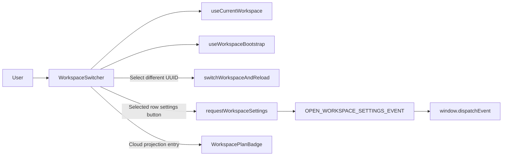
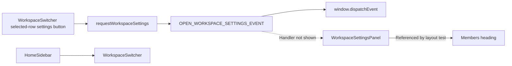
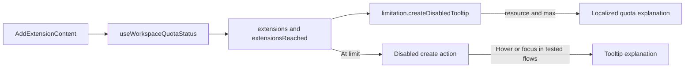
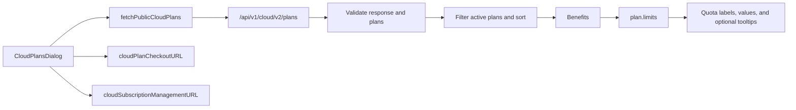
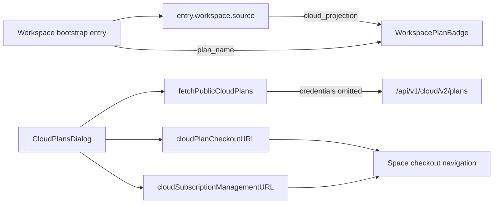
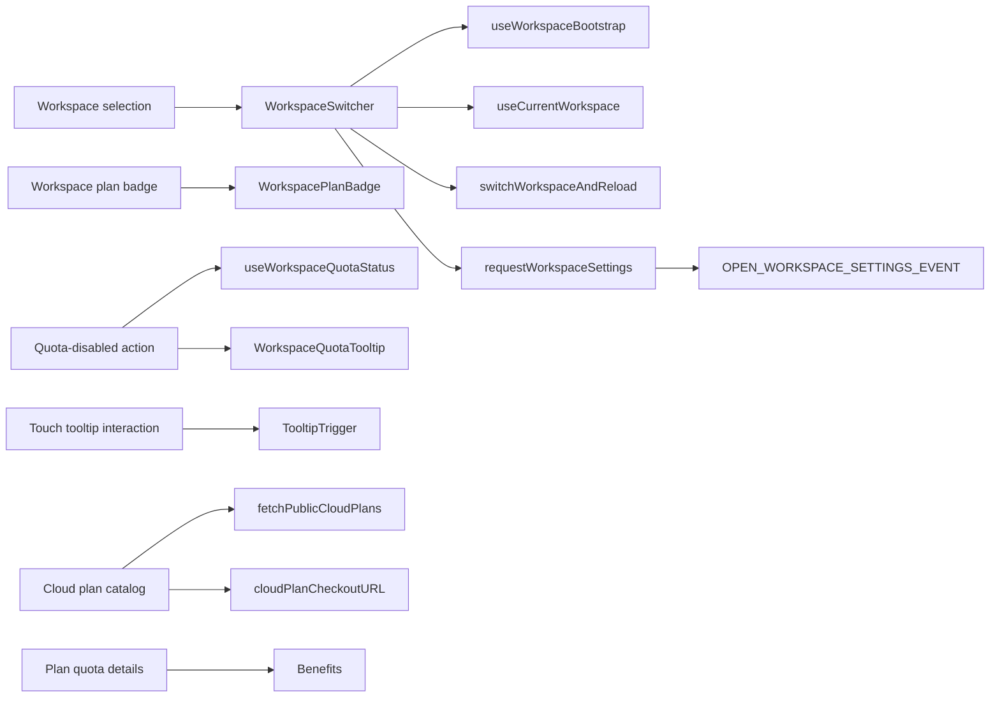

<!-- source: DeepWiki mcp.deepwiki.com · repo langbot-app/LangBot · page 8.12 Workspace, Quota, and Invitation UI · fetched 2026-10-29 -->

# Workspace, Quota, and Invitation UI

Relevant source files

The following files were used as context for generating this wiki page:

- [web/src/app/home/add-extension/page.tsx](web/src/app/home/add-extension/page.tsx)
- [web/src/app/home/components/workspace-quota/WorkspaceQuotaTooltip.tsx](web/src/app/home/components/workspace-quota/WorkspaceQuotaTooltip.tsx)
- [web/src/app/home/components/workspace-settings/CloudPlansDialog.tsx](web/src/app/home/components/workspace-settings/CloudPlansDialog.tsx)
- [web/src/app/home/components/workspace-settings/WorkspacePlanBadge.tsx](web/src/app/home/components/workspace-settings/WorkspacePlanBadge.tsx)
- [web/src/app/home/components/workspace-settings/WorkspaceSwitcher.tsx](web/src/app/home/components/workspace-settings/WorkspaceSwitcher.tsx)
- [web/src/app/home/components/workspace-settings/cloud-plan-platforms.ts](web/src/app/home/components/workspace-settings/cloud-plan-platforms.ts)
- [web/src/app/home/components/workspace-settings/cloud-plans.ts](web/src/app/home/components/workspace-settings/cloud-plans.ts)
- [web/src/app/home/plugins/components/PluginLocalPreviewPanel.tsx](web/src/app/home/plugins/components/PluginLocalPreviewPanel.tsx)
- [web/src/app/home/skills/components/SkillZipPreviewPanel.tsx](web/src/app/home/skills/components/SkillZipPreviewPanel.tsx)
- [web/src/components/ui/tooltip.tsx](web/src/components/ui/tooltip.tsx)
- [web/tests/e2e/bot-session-pagination-contract.spec.ts](web/tests/e2e/bot-session-pagination-contract.spec.ts)
- [web/tests/e2e/qr-code-workspace.spec.ts](web/tests/e2e/qr-code-workspace.spec.ts)
- [web/tests/e2e/quota-create-actions.spec.ts](web/tests/e2e/quota-create-actions.spec.ts)
- [web/tests/e2e/space-launch.spec.ts](web/tests/e2e/space-launch.spec.ts)
- [web/tests/e2e/workspace-layout.spec.ts](web/tests/e2e/workspace-layout.spec.ts)
- [web/tests/e2e/workspace-member-email.spec.ts](web/tests/e2e/workspace-member-email.spec.ts)
- [web/tests/e2e/workspace-quota-contract.spec.ts](web/tests/e2e/workspace-quota-contract.spec.ts)
- [web/tests/revisions/verify.mjs](web/tests/revisions/verify.mjs)
- [web/tests/unit/cloud-plans.test.mjs](web/tests/unit/cloud-plans.test.mjs)
- [web/tests/unit/plan-revisions.test.mjs](web/tests/unit/plan-revisions.test.mjs)
- [web/tests/unit/qr-code-login-workspace.test.mjs](web/tests/unit/qr-code-login-workspace.test.mjs)
- [web/tests/unit/quota-create-actions.test.mjs](web/tests/unit/quota-create-actions.test.mjs)
- [web/tests/unit/workspace-switcher-layout.test.mjs](web/tests/unit/workspace-switcher-layout.test.mjs)

## Purpose and scope

This page describes the frontend workspace switcher, workspace settings entry point, quota-related UI behavior, Cloud plan presentation, and the evidence available for invitation and OSS-versus-Cloud behavior. The provided source excerpts cover the switcher, plan utilities and dialog, tooltip primitive, quota-related extension-page usage, and selected tests. They do not include the implementation of `WorkspaceSettingsPanel`, the quota hook or tooltip component, or the invitation acceptance page, so those internals are not specified here.

Sources: `web/src/app/home/components/workspace-settings/WorkspaceSwitcher.tsx:1-99`; `web/src/app/home/components/workspace-settings/CloudPlansDialog.tsx:1-43`; `web/src/app/home/components/workspace-settings/cloud-plans.ts:1-183`; `web/src/components/ui/tooltip.tsx:1-143`; `web/src/app/home/add-extension/page.tsx:140-164`

## 1. Workspace switcher and settings entry point

`WorkspaceSwitcher` obtains the current workspace through `useCurrentWorkspace()` and the available workspace entries through `useWorkspaceBootstrap()`. It returns no UI when there is no current workspace. Otherwise, it renders a dropdown whose trigger displays the current workspace name; workspace names are truncated in the trigger and menu rows. Each entry is marked selected by comparing workspace UUIDs. Selecting a different entry invokes `switchWorkspaceAndReload()` with that workspace UUID [web/src/app/home/components/workspace-settings/WorkspaceSwitcher.tsx:26-50]()[web/src/app/home/components/workspace-settings/WorkspaceSwitcher.tsx:56-69]().

Entries with `source === 'cloud_projection'` display `WorkspacePlanBadge` using the entry’s `plan_name`. The selected entry includes a settings button. Its click handler prevents the dropdown item’s default action and propagation, then calls `requestWorkspaceSettings()` [web/src/app/home/components/workspace-settings/WorkspaceSwitcher.tsx:75-92](). That function dispatches the window event named by `OPEN_WORKSPACE_SETTINGS_EVENT` (`langbot:open-workspace-settings`) [web/src/app/home/components/workspace-settings/WorkspaceSwitcher.tsx:20-24]().

The e2e layout test covers singleton local, singleton Cloud, and multiple-workspace cases. It expects the switcher to be absent for the singleton-local case and visible for the other tested cases. It also checks the plan-upgrade control’s placement, workspace-name truncation, and the settings button opening a dialog with “Workspace” and “Members” headings [web/tests/e2e/workspace-layout.spec.ts:14-56]()[web/tests/e2e/workspace-layout.spec.ts:63-148]().

Sources: `web/src/app/home/components/workspace-settings/WorkspaceSwitcher.tsx:20-24`; `web/src/app/home/components/workspace-settings/WorkspaceSwitcher.tsx:26-99`; `web/tests/e2e/workspace-layout.spec.ts:14-56`; `web/tests/e2e/workspace-layout.spec.ts:63-148`

### Workspace selection and settings event

The diagram connects user-facing workspace actions to the code symbols used to implement them.

Sources: `web/src/app/home/components/workspace-settings/WorkspaceSwitcher.tsx:4-24`; `web/src/app/home/components/workspace-settings/WorkspaceSwitcher.tsx:26-97`

## 2. Workspace settings and member/email management

The switcher exposes settings through a custom window event rather than rendering the settings panel itself. The supplied unit test checks that `WorkspaceSwitcher` is rendered from `HomeSidebar`, not directly from the home layout or `WorkspaceSettingsPanel`. It also checks that `WorkspaceSettingsPanel` includes the `workspace.inviteMember` translation key and does not contain the selectors or identifiers `#workspace-members`, `cloudMembersURL`, or `canManageCloudMembers` [web/tests/unit/workspace-switcher-layout.test.mjs:14-32]().

The available e2e layout test verifies that opening settings displays “Workspace” and “Members” headings. The provided excerpts do not include the panel implementation or the member-email e2e test contents; details such as member API calls, role controls, invitation submission, and email validation therefore cannot be established from the supplied code [web/tests/e2e/workspace-layout.spec.ts:128-148]().

Sources: `web/tests/unit/workspace-switcher-layout.test.mjs:14-32`; `web/tests/e2e/workspace-layout.spec.ts:128-148`

### Workspace settings event bridge

This diagram maps the settings interaction to the component and event identifiers available in the supplied source. It does not assume how the event is handled beyond the provided excerpts.

Sources: `web/src/app/home/components/workspace-settings/WorkspaceSwitcher.tsx:20-24`; `web/src/app/home/components/workspace-settings/WorkspaceSwitcher.tsx:78-92`; `web/tests/unit/workspace-switcher-layout.test.mjs:14-25`; `web/tests/e2e/workspace-layout.spec.ts:128-148`

## 3. Quota hooks, disabled creation actions, and tooltips

The provided extension page consumes `useWorkspaceQuotaStatus()` and reads `extensions` and `extensionsReached` from its result. It builds localized tooltip copy using `limitation.createDisabledTooltip`, the translated extension label, and the extension quota maximum [web/src/app/home/add-extension/page.tsx:154-164]().

The quota-related e2e test configures community system information with limits including `max_bots`, `max_pipelines`, `max_extensions`, and `max_knowledge_bases`. It verifies that bot, processor, and knowledge creation actions are disabled at their tested limits, while the “Add Extension” navigation action remains enabled. After navigation, “Manual Add” is disabled at the extension limit and its parent element exposes the explanatory tooltip on hover [web/tests/e2e/quota-create-actions.spec.ts:24-47]()[web/tests/e2e/quota-create-actions.spec.ts:101-149]().

The test also exercises keyboard focus for the bot quota tooltip, so the tested explanation is available on hover and focus [web/tests/e2e/quota-create-actions.spec.ts:120-138](). The supplied excerpt does not show `useWorkspaceQuotaStatus` or `WorkspaceQuotaTooltip` implementations, so their request strategy, refresh behavior, and exact wrapper mechanics are not described here.

Sources: `web/src/app/home/add-extension/page.tsx:52-53`; `web/src/app/home/add-extension/page.tsx:154-164`; `web/tests/e2e/quota-create-actions.spec.ts:24-47`; `web/tests/e2e/quota-create-actions.spec.ts:101-149`

### Quota decision path

Sources: `web/src/app/home/add-extension/page.tsx:52-53`; `web/src/app/home/add-extension/page.tsx:154-164`; `web/tests/e2e/quota-create-actions.spec.ts:120-149`

### Tooltip behavior on touch devices

The shared tooltip wrapper uses Radix primitives and maintains open state either internally or through a controlled `open` prop. `useIsTouchDevice()` checks `(hover: none), (pointer: coarse)` and subscribes to media-query changes where supported [web/src/components/ui/tooltip.tsx:19-32](). On touch devices, `TooltipTrigger` toggles the tooltip on click, while still invoking the trigger’s supplied `onClick` handler. On desktop, Radix hover and focus changes are forwarded through the wrapper’s open-state handler [web/src/components/ui/tooltip.tsx:47-79]()[web/src/components/ui/tooltip.tsx:82-107]().

`TooltipContent` renders through a Radix portal and includes an arrow [web/src/components/ui/tooltip.tsx:110-140](). This shared component is also used by the `Help` component in `CloudPlansDialog` [web/src/app/home/components/workspace-settings/CloudPlansDialog.tsx:67-84]().

Sources: `web/src/components/ui/tooltip.tsx:19-32`; `web/src/components/ui/tooltip.tsx:47-79`; `web/src/components/ui/tooltip.tsx:82-107`; `web/src/components/ui/tooltip.tsx:110-140`; `web/src/app/home/components/workspace-settings/CloudPlansDialog.tsx:67-84`

## 4. Cloud plans and quota presentation

`CloudPlansDialog` imports plan-fetching, localization, currency, pricing, and URL helpers from `cloud-plans.ts`. Its `Benefits` component uses plan limits, features, disabled adapters, display configuration, chat-history retention, and monthly bonus credits to construct plan-benefit rows [web/src/app/home/components/workspace-settings/CloudPlansDialog.tsx:28-43]()[web/src/app/home/components/workspace-settings/CloudPlansDialog.tsx:86-105]().

Quota summary presentation filters out `chat_history.retention_days`, derives a display label from localized quota configuration or a translation fallback, and displays negative limits as unlimited. If a per-quota tooltip is configured, it is rendered beneath the quota value [web/src/app/home/components/workspace-settings/CloudPlansDialog.tsx:126-165](). Retention and monthly credits also have help tooltips that use localized plan text when available and translation fallbacks otherwise [web/src/app/home/components/workspace-settings/CloudPlansDialog.tsx:167-190]().

`PublicCloudPlan` includes limit, feature, localized text, pricing, plan status, and optional `display_config` metadata for quota labels and tooltips [web/src/app/home/components/workspace-settings/cloud-plans.ts:1-38](). `localizedPlanText()` normalizes hyphens in the requested language, tries a case-insensitive locale match, then falls back to `en_US`, `zh_Hans`, the first truthy value, or an empty string [web/src/app/home/components/workspace-settings/cloud-plans.ts:40-56]().

`fetchPublicCloudPlans()` requests `/api/v1/cloud/v2/plans` with `credentials: 'omit'` and `referrerPolicy: 'no-referrer'`. It validates the response, filters inactive plans, validates required plan fields and prices in all three supported currencies, and sorts by `sort_order` [web/src/app/home/components/workspace-settings/cloud-plans.ts:137-161](). The plan checkout and subscription-management URL helpers construct navigation URLs with workspace and plan selection parameters. The URL helper rejects protocols other than HTTP(S) and URLs containing username or password credentials [web/src/app/home/components/workspace-settings/cloud-plans.ts:86-130]().

Sources: `web/src/app/home/components/workspace-settings/CloudPlansDialog.tsx:28-43`; `web/src/app/home/components/workspace-settings/CloudPlansDialog.tsx:86-105`; `web/src/app/home/components/workspace-settings/CloudPlansDialog.tsx:126-190`; `web/src/app/home/components/workspace-settings/cloud-plans.ts:1-38`; `web/src/app/home/components/workspace-settings/cloud-plans.ts:40-56`; `web/src/app/home/components/workspace-settings/cloud-plans.ts:86-161`

### Cloud plan data flow

Sources: `web/src/app/home/components/workspace-settings/CloudPlansDialog.tsx:28-43`; `web/src/app/home/components/workspace-settings/CloudPlansDialog.tsx:86-105`; `web/src/app/home/components/workspace-settings/CloudPlansDialog.tsx:126-165`; `web/src/app/home/components/workspace-settings/cloud-plans.ts:100-130`; `web/src/app/home/components/workspace-settings/cloud-plans.ts:137-161`

## 5. Invitation acceptance

The supplied source contents do not include the invitation acceptance page, invitation API client methods, or invitation-focused e2e tests. The available workspace layout test only establishes that workspace settings can display a “Members” heading; it does not specify how invitations are created or accepted [web/tests/e2e/workspace-layout.spec.ts:128-148]().

For the same reason, invitation token capture, validation, expiry handling, registration fallback, and acceptance-state transitions are not documented here. Those details require the implementation and tests for the invitation acceptance flow.

Sources: `web/tests/e2e/workspace-layout.spec.ts:128-148`

## 6. OSS and Cloud differences established by the supplied sources

The switcher implementation distinguishes workspace entries whose `source` is `cloud_projection`: those entries render a `WorkspacePlanBadge` with the associated `plan_name` [web/src/app/home/components/workspace-settings/WorkspaceSwitcher.tsx:75-77](). The layout e2e test covers a singleton-local case and Cloud-projection cases, expecting no switcher in the former and a switcher in the latter [web/tests/e2e/workspace-layout.spec.ts:14-57](). The test also verifies the upgrade control in the tested non-singleton-local scenarios [web/tests/e2e/workspace-layout.spec.ts:58-93]().

The Cloud plan utilities fetch the public plan catalog independently of Core and Space authenticated clients, omitting credentials and the referrer [web/src/app/home/components/workspace-settings/cloud-plans.ts:137-161](). The plan utilities provide workspace-specific checkout and subscription-management URLs, but the supplied source does not establish broader data synchronization, telemetry, storage visibility, or privacy policy differences between OSS and Cloud [web/src/app/home/components/workspace-settings/cloud-plans.ts:100-130]().

Sources: `web/src/app/home/components/workspace-settings/WorkspaceSwitcher.tsx:75-77`; `web/tests/e2e/workspace-layout.spec.ts:14-93`; `web/src/app/home/components/workspace-settings/cloud-plans.ts:100-161`

### Workspace source and plan navigation

Sources: `web/src/app/home/components/workspace-settings/WorkspaceSwitcher.tsx:56-77`; `web/src/app/home/components/workspace-settings/cloud-plans.ts:100-161`

## 7. Tests and behavioral contracts

| Area | What the supplied test verifies |
|---|---|
| Switcher placement and visibility | Singleton-local, singleton-Cloud, and multiple-workspace scenarios; switcher visibility, placement, plan-upgrade control, and long-name truncation [web/tests/e2e/workspace-layout.spec.ts:14-148]() |
| Settings entry | The selected workspace row exposes a settings button, and the resulting dialog shows “Workspace” and “Members” headings [web/tests/e2e/workspace-layout.spec.ts:112-148]() |
| Panel ownership and structure | `WorkspaceSwitcher` is rendered from `HomeSidebar`; the settings-panel source includes `workspace.inviteMember` and excludes the listed legacy identifiers [web/tests/unit/workspace-switcher-layout.test.mjs:14-32]() |
| Quota-disabled actions | Bot, processor, and knowledge creation actions are disabled at the mocked limits; extension navigation remains enabled, and “Manual Add” is disabled at the extension limit [web/tests/e2e/quota-create-actions.spec.ts:101-149]() |
| Quota explanation accessibility | The bot quota explanation appears after hover and remains available after focusing the trigger [web/tests/e2e/quota-create-actions.spec.ts:120-138]() |
| Quota translation | The Simplified Chinese locale contains quota-disabled tooltip copy describing a reached limit and deletion before creating again [web/tests/unit/quota-create-actions.test.mjs:9-14]() |
| Public plan handling | Tests cover credential omission, inactive-plan filtering, response validation, locale fallback, pricing, and URL safety [web/tests/unit/cloud-plans.test.mjs:31-119]() |

Sources: `web/tests/e2e/workspace-layout.spec.ts:14-148`; `web/tests/unit/workspace-switcher-layout.test.mjs:14-32`; `web/tests/e2e/quota-create-actions.spec.ts:101-149`; `web/tests/unit/quota-create-actions.test.mjs:9-14`; `web/tests/unit/cloud-plans.test.mjs:31-119`

## 8. Code-entity map

The diagram links the user-visible workspace and quota concepts to implementation symbols that can be searched in the frontend.

Sources: `web/src/app/home/components/workspace-settings/WorkspaceSwitcher.tsx:4-24`; `web/src/app/home/components/workspace-settings/WorkspaceSwitcher.tsx:26-97`; `web/src/app/home/add-extension/page.tsx:52-53`; `web/src/app/home/components/workspace-settings/CloudPlansDialog.tsx:86-105`; `web/src/app/home/components/workspace-settings/cloud-plans.ts:100-161`; `web/src/components/ui/tooltip.tsx:82-107`

## Summary

`WorkspaceSwitcher` renders workspace choices from bootstrap state, switches by UUID through `switchWorkspaceAndReload()`, and exposes settings through `OPEN_WORKSPACE_SETTINGS_EVENT`. Cloud-projection entries display a plan badge. The supplied quota usage shows `useWorkspaceQuotaStatus()` feeding extension-limit state and localized tooltip copy; e2e coverage verifies disabled actions and explanations. Cloud plan UI fetches and validates a public catalog, then renders localized quotas and related benefits.

The supplied excerpts do not contain the detailed implementation of `WorkspaceSettingsPanel`, quota hook and tooltip internals, or invitation acceptance. Those behaviors are intentionally left unspecified rather than inferred from filenames or earlier documentation.

Sources: `web/src/app/home/components/workspace-settings/WorkspaceSwitcher.tsx:20-99`; `web/src/app/home/add-extension/page.tsx:52-53`; `web/src/app/home/add-extension/page.tsx:154-164`; `web/src/app/home/components/workspace-settings/CloudPlansDialog.tsx:86-190`; `web/src/app/home/components/workspace-settings/cloud-plans.ts:137-161`

---

