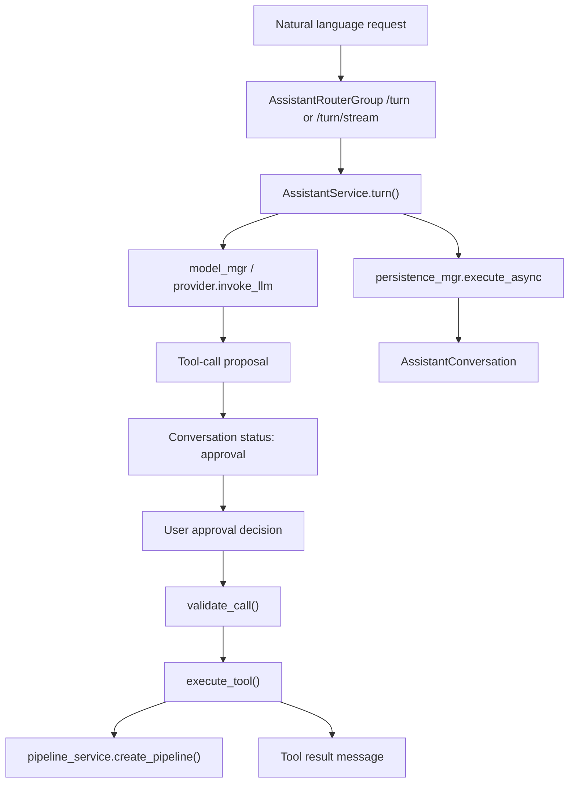
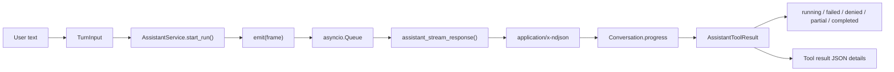

<!-- source: DeepWiki mcp.deepwiki.com · repo langbot-app/LangBot · page 8.13 Workspace Assistant · fetched 2026-10-29 -->

# Workspace Assistant

Relevant source files

The following files were used as context for generating this wiki page:

- [src/langbot/pkg/api/http/controller/groups/assistant.py](src/langbot/pkg/api/http/controller/groups/assistant.py)
- [src/langbot/pkg/api/http/service/assistant.py](src/langbot/pkg/api/http/service/assistant.py)
- [src/langbot/pkg/api/http/service/assistant_tools.py](src/langbot/pkg/api/http/service/assistant_tools.py)
- [tests/unit_tests/api/test_management_assistant.py](tests/unit_tests/api/test_management_assistant.py)
- [web/src/app/home/components/AssistantToolResult.tsx](web/src/app/home/components/AssistantToolResult.tsx)
- [web/src/app/home/components/WorkspaceAssistant.tsx](web/src/app/home/components/WorkspaceAssistant.tsx)

## Purpose and Scope

The Workspace Assistant is an in-panel management assistant for users with the workspace permission `runtime.operate`. Its frontend checks for a usable function-calling model, while its backend exposes conversation endpoints and delegates approved management operations to an explicit tool set. This page covers the implementation visible in the provided source excerpts: frontend entry and model readiness, tool-result rendering, HTTP routes, assistant-service run orchestration, tool schemas, and the safety and isolation behavior exercised by tests. [web/src/app/home/components/WorkspaceAssistant.tsx:59-72]()[web/src/app/home/components/WorkspaceAssistant.tsx:87-126]()[src/langbot/pkg/api/http/controller/groups/assistant.py:29-106]()[src/langbot/pkg/api/http/service/assistant.py:1-48]()[src/langbot/pkg/api/http/service/assistant_tools.py:1-20]()[tests/unit_tests/api/test_management_assistant.py:85-155]()

Sources: [web/src/app/home/components/WorkspaceAssistant.tsx:59-72]()[web/src/app/home/components/WorkspaceAssistant.tsx:87-126]()[src/langbot/pkg/api/http/controller/groups/assistant.py:29-106]()[src/langbot/pkg/api/http/service/assistant.py:1-48]()[src/langbot/pkg/api/http/service/assistant_tools.py:1-20]()[tests/unit_tests/api/test_management_assistant.py:85-155]()

## Frontend Implementation

### WorkspaceAssistant Entry and Access Check

`WorkspaceAssistant` reads the current workspace with `useCurrentWorkspace()`. It returns `null` unless the workspace grants `runtime.operate` and `userInfo.account_uuid` is present. Otherwise, it renders `AssistantEntry`, keyed by the workspace UUID and account UUID; that same identity forms the `storageKey` passed to the entry. This scopes the frontend assistant identity to the current workspace/account pair. [web/src/app/home/components/WorkspaceAssistant.tsx:59-73]()

Sources: [web/src/app/home/components/WorkspaceAssistant.tsx:59-73]()

### AssistantEntry: Model Availability and Setup

`AssistantEntry` checks available models through `backendClient.getProviderLLMModels()`. A model is considered usable when it has a nonblank UUID, supports `func_call`, and either is not from the LangBot models-service requester or the user is a Space account with the models service enabled. For non-Space accounts, the first usable model is selected as the initial local model. [web/src/app/home/components/WorkspaceAssistant.tsx:75-85]()[web/src/app/home/components/WorkspaceAssistant.tsx:87-113]()

The check runs when the settings dialog is closed, and is retriggered on window focus or `MODEL_CONFIGURATION_CHANGED`. A request sequence counter prevents an older overlapping check from overwriting a newer result. On failure the component records a failed state; the setup UI offers retry. If there are no usable models, it offers Space login and model configuration. [web/src/app/home/components/WorkspaceAssistant.tsx:87-126]()[web/src/app/home/components/WorkspaceAssistant.tsx:141-193]()

The Space login action requests a bind authorization URL from `httpClient.getSpaceBindAuthorizeUrl()` and redirects the browser to the returned URL. [web/src/app/home/components/WorkspaceAssistant.tsx:128-139]()

Sources: [web/src/app/home/components/WorkspaceAssistant.tsx:75-85]()[web/src/app/home/components/WorkspaceAssistant.tsx:87-126]()[web/src/app/home/components/WorkspaceAssistant.tsx:128-139]()[web/src/app/home/components/WorkspaceAssistant.tsx:141-193]()

### Conversation State Shape

The frontend `Conversation` type represents conversation identity and revision, lifecycle status (`ready`, `running`, `approval`, or `failed`), messages, pending tool calls, errors, model identity, and optional progress information. Progress can include text, a phase (`thinking` or `tool`), a round number, and tool-call details without a result. [web/src/app/home/components/WorkspaceAssistant.tsx:42-57]()

Sources: [web/src/app/home/components/WorkspaceAssistant.tsx:42-57]()

### AssistantToolResult Rendering

`AssistantToolResult` accepts an optional `AssistantTool` with a tool name, arguments, and result, plus message content and a default-collapsed setting. It derives display state from the result, distinguishing running, failed, denied, partial, and completed outcomes. Result data may expose arrays directly or through `items` or `records`; the component shows a count when available and displays at most six item summaries. [web/src/app/home/components/AssistantToolResult.tsx:11-26]()[web/src/app/home/components/AssistantToolResult.tsx:35-74]()[web/src/app/home/components/AssistantToolResult.tsx:144-169]()

The result panel is initially collapsible and tracks manual user toggles so changes to the default collapsed state do not override a user’s choice. A resource link is rendered only when its URL matches the accepted `/home/pipelines?id=…` or `/home/knowledge?id=…` form. The details disclosure presents formatted tool-result JSON, or message content when there is no tool result. [web/src/app/home/components/AssistantToolResult.tsx:27-34]()[web/src/app/home/components/AssistantToolResult.tsx:75-85]()[web/src/app/home/components/AssistantToolResult.tsx:87-130]()[web/src/app/home/components/AssistantToolResult.tsx:170-187]()

Sources: [web/src/app/home/components/AssistantToolResult.tsx:11-26]()[web/src/app/home/components/AssistantToolResult.tsx:27-34]()[web/src/app/home/components/AssistantToolResult.tsx:35-74]()[web/src/app/home/components/AssistantToolResult.tsx:75-85]()[web/src/app/home/components/AssistantToolResult.tsx:87-130]()[web/src/app/home/components/AssistantToolResult.tsx:144-187]()

## Backend API and Run Lifecycle

### AssistantRouterGroup Endpoints

`AssistantRouterGroup` registers the assistant API under `/api/v1/assistant`. Its routes list and create conversations, retrieve a conversation, submit a turn, stream a turn, stop a run, and retrieve a recommended model. Route permissions distinguish read access (`RESOURCE_VIEW`) from runtime operations (`RUNTIME_OPERATE`). [src/langbot/pkg/api/http/controller/groups/assistant.py:29-70]()

Turn and stop request bodies use Pydantic models configured with `extra='forbid'`. A turn requires either nonblank text or an approval decision, but not both; optional turn fields include a nonnegative strict revision and model UUID. Invalid input is returned as an `invalid_input` response, while `AssistantError` is mapped to its status and code. [src/langbot/pkg/api/http/controller/groups/assistant.py:16-27]()[src/langbot/pkg/api/http/controller/groups/assistant.py:69-87]()

| Route | Behavior |
|---|---|
| `GET /conversations` | Lists conversations. [src/langbot/pkg/api/http/controller/groups/assistant.py:34-37]() |
| `POST /conversations` | Creates a conversation and returns its public view. [src/langbot/pkg/api/http/controller/groups/assistant.py:55-61]() |
| `GET /conversations/<conversation_id>` | Retrieves progress or the public conversation view. [src/langbot/pkg/api/http/controller/groups/assistant.py:62-68]() |
| `POST /conversations/<conversation_id>/turn` | Validates and executes a text turn or approval decision. [src/langbot/pkg/api/http/controller/groups/assistant.py:69-87]() |
| `POST /conversations/<conversation_id>/turn/stream` | Starts a detached run and returns an NDJSON response. [src/langbot/pkg/api/http/controller/groups/assistant.py:89-106]()[src/langbot/pkg/api/http/controller/groups/assistant.py:108-127]() |
| `POST /conversations/<conversation_id>/stop` | Validates a revision and requests a stop. [src/langbot/pkg/api/http/controller/groups/assistant.py:38-46]() |
| `GET /recommended-model` | Retrieves the recommended assistant model. [src/langbot/pkg/api/http/controller/groups/assistant.py:48-53]() |

Sources: [src/langbot/pkg/api/http/controller/groups/assistant.py:16-27]()[src/langbot/pkg/api/http/controller/groups/assistant.py:29-70]()[src/langbot/pkg/api/http/controller/groups/assistant.py:69-106]()[src/langbot/pkg/api/http/controller/groups/assistant.py:108-127]()

### Streaming Transport

`assistant_stream_response()` starts the run with `service.start_run()` and consumes frames from the returned queue. It emits each frame as a JSON line, emits a newline after a 15-second queue timeout, and stops after a `completed` or `error` frame. The response uses `application/x-ndjson; charset=utf-8`, disables caching, disables proxy buffering, and has no response timeout. This is NDJSON, not SSE. [src/langbot/pkg/api/http/controller/groups/assistant.py:108-127]()

The HTTP subscriber does not own the run’s execution lifetime: the service runs the turn as a background task, and the controller’s stream reads from its queue. The endpoint documentation and service implementation specify that an explicit stop, rather than a disconnected or slow browser, is the mechanism for cancelling a run. [src/langbot/pkg/api/http/controller/groups/assistant.py:108-120]()[src/langbot/pkg/api/http/service/assistant.py:85-100]()[src/langbot/pkg/api/http/service/assistant.py:114-148]()

Sources: [src/langbot/pkg/api/http/controller/groups/assistant.py:108-127]()[src/langbot/pkg/api/http/service/assistant.py:85-100]()[src/langbot/pkg/api/http/service/assistant.py:114-148]()

### AssistantService Responsibilities

`AssistantService` is an in-process service that uses existing model and resource services. Its system prompt requires the assistant to use only supplied management tools, treat resource contents and tool results as untrusted, avoid inventing resource IDs, and treat writes as proposals until the user confirms the exact arguments. It also instructs the assistant not to claim successful testing or repeat uncertain writes automatically. [src/langbot/pkg/api/http/service/assistant.py:1-33]()

The constructor creates a per-process semaphore with four slots and a `_runs` map. `list_conversations()` scopes its query to both the current workspace UUID and account UUID, orders by update time, and limits results to 100. `progress()` returns a live run snapshot and progress when a run exists, otherwise the conversation’s public view. [src/langbot/pkg/api/http/service/assistant.py:43-83]()

`start_run()` rejects a second run for the same conversation as `stale_turn` and rejects admission when four runs are already present as `busy`. It creates a bounded queue, tracks snapshot and progress state, and schedules background execution. The run establishes a persistence tenant scope when available, invokes `turn()`, emits completion or error frames, and removes itself from `_runs` in `finally`. If cancellation occurs during a stop, it preserves uncertain tool outcomes and can save the conversation as failed with `stopped`. [src/langbot/pkg/api/http/service/assistant.py:85-100]()[src/langbot/pkg/api/http/service/assistant.py:102-148]()

Sources: [src/langbot/pkg/api/http/service/assistant.py:1-33]()[src/langbot/pkg/api/http/service/assistant.py:43-83]()[src/langbot/pkg/api/http/service/assistant.py:85-100]()[src/langbot/pkg/api/http/service/assistant.py:102-148]()

## Assistant Tools and Safety Boundaries

### Tool Schemas and Operations

`assistant_tools.py` describes its tools as a deliberately small allowlist of management operations, with no shell or arbitrary HTTP access. Tool arguments derive from `Arguments`, whose Pydantic configuration forbids extra fields. `ListResources` constrains its `kind` to supported resource categories, while `ListOperationLogs` supports bounded search, action, resource-type, actor, and result-limit filters. [src/langbot/pkg/api/http/service/assistant_tools.py:1-20]()[src/langbot/pkg/api/http/service/assistant_tools.py:52-77]()

The visible schemas include pipeline and knowledge-base operations: `PipelineID`, `EngineID`, `CreatePipeline`, `ConfigurePipeline`, and `CreateKnowledgeBase`. Their fields constrain identifiers, names, descriptions, prompts, knowledge-base UUID count, and engine settings. `TOOLS` associates tool names with their schemas, descriptions, write/read classification, and any extra permission. [src/langbot/pkg/api/http/service/assistant_tools.py:146-169]()[src/langbot/pkg/api/http/service/assistant_tools.py:171-186]()

The operation-log tool compacts returned records for assistant use. It bounds individual change values, limits changes per record, and retains actor, action, target, timestamp, outcome, and integrity-related fields while omitting heavier forensic payload details from this compact projection. [src/langbot/pkg/api/http/service/assistant_tools.py:80-105]()[src/langbot/pkg/api/http/service/assistant_tools.py:107-143]()

Sources: [src/langbot/pkg/api/http/service/assistant_tools.py:1-20]()[src/langbot/pkg/api/http/service/assistant_tools.py:52-77]()[src/langbot/pkg/api/http/service/assistant_tools.py:80-105]()[src/langbot/pkg/api/http/service/assistant_tools.py:107-143]()[src/langbot/pkg/api/http/service/assistant_tools.py:146-186]()

### Confirmation, Authorization, and Replay Protection

The service prompt establishes the proposal-and-confirmation model: a write is proposed first, and the user must confirm the exact arguments in the UI before execution. The tests verify that a proposed `create_pipeline` call leaves the pipeline service untouched while the conversation is in `approval`; after confirmation, concurrent attempts at the same revision result in only one successful write. [src/langbot/pkg/api/http/service/assistant.py:23-28]()[tests/unit_tests/api/test_management_assistant.py:85-116]()

The tests also verify conversation privacy across both account and workspace boundaries, denial when write permission is absent or revoked, and protection against replaying an uncertain write after a timeout. Tool argument validation rejects attempts to supply `workspace_uuid` or invoke an `exec` tool. [tests/unit_tests/api/test_management_assistant.py:94-109]()[tests/unit_tests/api/test_management_assistant.py:118-155]()

Sources: [src/langbot/pkg/api/http/service/assistant.py:23-28]()[tests/unit_tests/api/test_management_assistant.py:85-116]()[tests/unit_tests/api/test_management_assistant.py:118-155]()

## Conversation Persistence

`AssistantService.list_conversations()` queries persisted `AssistantConversation` rows through `persistence_mgr.execute_async`, filtering by both `workspace_uuid` and `account_uuid`. The test fixture imports `AssistantConversation`, copies its table definition into test metadata, and creates that metadata in a SQLite database. These excerpts establish the persistence entity and the tested SQLite use, but do not show the entity’s column definitions or migration table structure. [src/langbot/pkg/api/http/service/assistant.py:11-12]()[src/langbot/pkg/api/http/service/assistant.py:50-76]()[tests/unit_tests/api/test_management_assistant.py:54-66]()

The tests exercise conversation creation, retrieval, approval state, message persistence, and the public tool-result representation. They also verify that provider-specific fields such as `thought_signature` are preserved in saved messages. [tests/unit_tests/api/test_management_assistant.py:85-116]()

Sources: [src/langbot/pkg/api/http/service/assistant.py:11-12]()[src/langbot/pkg/api/http/service/assistant.py:50-76]()[tests/unit_tests/api/test_management_assistant.py:54-66]()[tests/unit_tests/api/test_management_assistant.py:85-116]()

## Architecture and Data Flow

### Request, Run, and Result Flow

This diagram maps the user’s natural-language request to the controller, service, model boundary, tool validation, and persisted conversation. The available excerpts show the route and run-start path, the service’s call to `turn()`, and tests for a confirmed tool call; they do not expose the full internal implementation of `turn()` or `execute_tool()`. [src/langbot/pkg/api/http/controller/groups/assistant.py:69-105]()[src/langbot/pkg/api/http/service/assistant.py:114-148]()[src/langbot/pkg/api/http/service/assistant.py:11-15]()[tests/unit_tests/api/test_management_assistant.py:85-116]()

**Diagram: Natural Language Request to Assistant Code Entities**

Sources: [src/langbot/pkg/api/http/controller/groups/assistant.py:69-105]()[src/langbot/pkg/api/http/service/assistant.py:11-15]()[src/langbot/pkg/api/http/service/assistant.py:114-148]()[tests/unit_tests/api/test_management_assistant.py:68-80]()[tests/unit_tests/api/test_management_assistant.py:85-116]()

### Streaming and Frontend Tool-Result Path

The frontend conversation type represents progress and pending calls, while `AssistantToolResult` renders the final tool result. On the backend, the stream endpoint consumes service-generated queue frames and emits NDJSON. This diagram associates those product concepts with the identifiers visible in the implementation; the supplied frontend excerpt does not show the code that parses stream frames. [web/src/app/home/components/WorkspaceAssistant.tsx:42-57]()[web/src/app/home/components/AssistantToolResult.tsx:11-26]()[src/langbot/pkg/api/http/controller/groups/assistant.py:108-127]()[src/langbot/pkg/api/http/service/assistant.py:102-112]()

**Diagram: Assistant Progress and Tool Results**

Sources: [src/langbot/pkg/api/http/controller/groups/assistant.py:21-27]()[src/langbot/pkg/api/http/controller/groups/assistant.py:108-127]()[src/langbot/pkg/api/http/service/assistant.py:91-112]()[web/src/app/home/components/WorkspaceAssistant.tsx:42-57]()[web/src/app/home/components/AssistantToolResult.tsx:11-26]()[web/src/app/home/components/AssistantToolResult.tsx:35-74]()[web/src/app/home/components/AssistantToolResult.tsx:182-187]()

## Summary

The visible implementation combines a workspace- and account-scoped frontend entry point, model-availability checks, assistant conversation routes, and a background-run service that emits progress through a queue. Management operations are constrained by Pydantic schemas and an explicit tool allowlist; tests cover approval, workspace/account isolation, permission revocation, and uncertain-write replay protection. Conversation persistence uses the `AssistantConversation` entity, although its schema and migrations are not included in the provided excerpts. [web/src/app/home/components/WorkspaceAssistant.tsx:59-126]()[src/langbot/pkg/api/http/controller/groups/assistant.py:29-127]()[src/langbot/pkg/api/http/service/assistant.py:43-48]()[src/langbot/pkg/api/http/service/assistant_tools.py:1-20]()[tests/unit_tests/api/test_management_assistant.py:85-155]()[src/langbot/pkg/api/http/service/assistant.py:11-12]()

Sources: [web/src/app/home/components/WorkspaceAssistant.tsx:59-126]()[src/langbot/pkg/api/http/controller/groups/assistant.py:29-127]()[src/langbot/pkg/api/http/service/assistant.py:11-12]()[src/langbot/pkg/api/http/service/assistant.py:43-48]()[src/langbot/pkg/api/http/service/assistant_tools.py:1-20]()[tests/unit_tests/api/test_management_assistant.py:85-155]()

---

