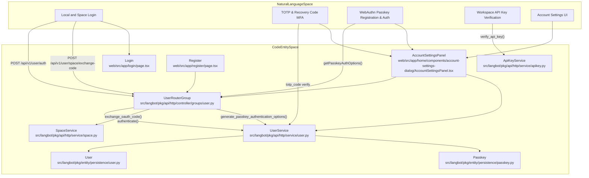
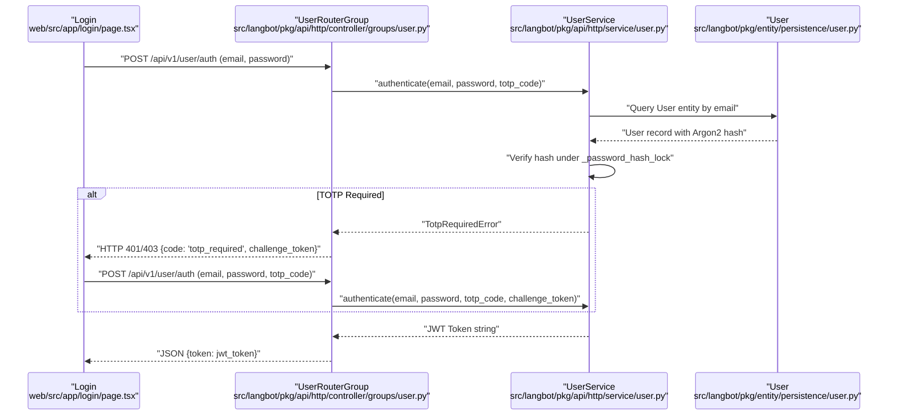
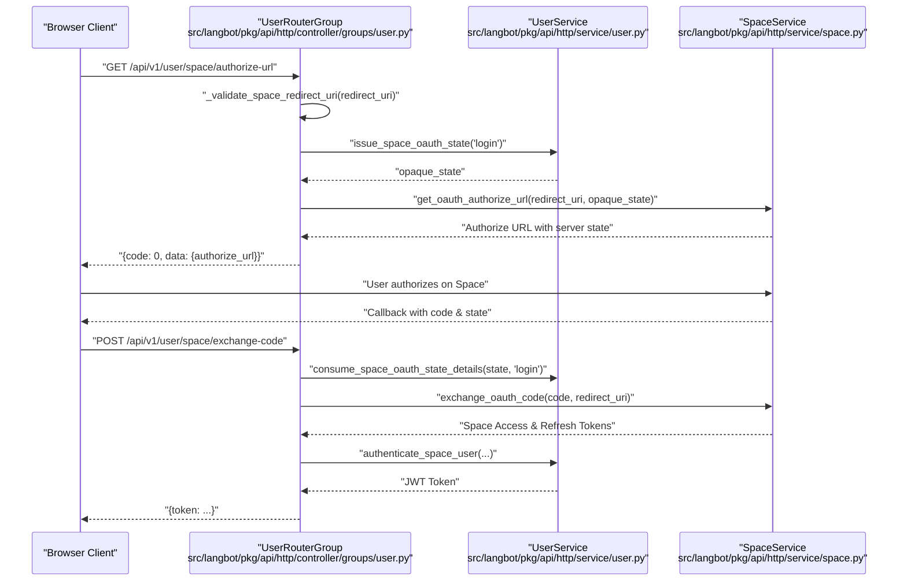

<!-- source: DeepWiki mcp.deepwiki.com · repo langbot-app/LangBot · page 8.2 Authentication and User Management · fetched 2026-10-29 -->

# Authentication and User Management

Relevant source files

The following files were used as context for generating this wiki page:

- [src/langbot/pkg/api/http/controller/groups/user.py](src/langbot/pkg/api/http/controller/groups/user.py)
- [src/langbot/pkg/api/http/service/apikey.py](src/langbot/pkg/api/http/service/apikey.py)
- [src/langbot/pkg/api/http/service/space.py](src/langbot/pkg/api/http/service/space.py)
- [src/langbot/pkg/api/http/service/user.py](src/langbot/pkg/api/http/service/user.py)
- [src/langbot/pkg/core/stages/genkeys.py](src/langbot/pkg/core/stages/genkeys.py)
- [src/langbot/pkg/entity/dto/space_model.py](src/langbot/pkg/entity/dto/space_model.py)
- [src/langbot/pkg/entity/persistence/passkey.py](src/langbot/pkg/entity/persistence/passkey.py)
- [src/langbot/pkg/persistence/alembic/versions/0024_passkey_credentials.py](src/langbot/pkg/persistence/alembic/versions/0024_passkey_credentials.py)
- [tests/integration/api/test_recovery_password_journey.py](tests/integration/api/test_recovery_password_journey.py)
- [tests/integration/api/test_smoke.py](tests/integration/api/test_smoke.py)
- [tests/integration/api/test_user_passkey_api.py](tests/integration/api/test_user_passkey_api.py)
- [tests/integration/api/test_user_space_oauth.py](tests/integration/api/test_user_space_oauth.py)
- [tests/unit_tests/api/service/test_space_service.py](tests/unit_tests/api/service/test_space_service.py)
- [tests/unit_tests/api/service/test_user_passkey.py](tests/unit_tests/api/service/test_user_passkey.py)
- [tests/unit_tests/api/test_apikey_service.py](tests/unit_tests/api/test_apikey_service.py)
- [tests/unit_tests/api/test_passkey_edition_gate.py](tests/unit_tests/api/test_passkey_edition_gate.py)
- [tests/unit_tests/api/test_user_reset_password.py](tests/unit_tests/api/test_user_reset_password.py)
- [web/src/app/home/components/account-settings-dialog/AccountSettingsPanel.tsx](web/src/app/home/components/account-settings-dialog/AccountSettingsPanel.tsx)
- [web/src/app/home/components/model-availability/useLangBotModelAvailability.ts](web/src/app/home/components/model-availability/useLangBotModelAvailability.ts)
- [web/src/app/login/page.tsx](web/src/app/login/page.tsx)
- [web/src/app/register/page.tsx](web/src/app/register/page.tsx)
- [web/tests/e2e/reset-password.spec.ts](web/tests/e2e/reset-password.spec.ts)

## Purpose and Scope

This document details LangBot's authentication and user management architecture (`[src/langbot/pkg/api/http/controller/groups/user.py:48-49]()`, `[src/langbot/pkg/api/http/service/user.py:85-86]()`). It covers local user registration and credential login, password reset mechanisms with fixed-window admission quotas and recovery keys, Time-based One-Time Password (TOTP) multi-factor authentication, WebAuthn passkey registration/authentication flows, LangBot Space OAuth federation, JWT session management, and workspace-scoped API key verification.

Sources: `[src/langbot/pkg/api/http/controller/groups/user.py:48-49]()`, `[src/langbot/pkg/api/http/service/user.py:85-86]()`

---

## Architecture and Control Flow

The authentication system bridges HTTP routing controllers (`UserRouterGroup`), business logic services (`UserService`, `SpaceService`, `ApiKeyService`), and persistence entities (`User`, `Passkey`, `ApiKey`, `WorkspaceMembership`).

### System Component Mapping Diagram

The following diagram bridges natural language functional concepts to concrete code entities within the backend and frontend packages.

Sources: `[src/langbot/pkg/api/http/controller/groups/user.py:48-156]()`, `[src/langbot/pkg/api/http/service/user.py:85-180]()`, `[src/langbot/pkg/api/http/service/space.py:23-35]()`, `[src/langbot/pkg/api/http/service/apikey.py:10-15]()`, `[web/src/app/home/components/account-settings-dialog/AccountSettingsPanel.tsx:58-91]()`, `[web/src/app/login/page.tsx:65-81]()`, `[web/src/app/register/page.tsx:43-55]()`

---

## Local Account Authentication and Registration

Local accounts use email and password verification through Argon2 hashing. CPU exhaustion during concurrent authentication attempts is mitigated by internal locks (`_password_hash_lock`) inside `UserService` (`[src/langbot/pkg/api/http/service/user.py:92-93]()`).

### Authentication Data Flow

Sources: `[src/langbot/pkg/api/http/controller/groups/user.py:138-156]()`, `[src/langbot/pkg/api/http/service/user.py:92-93]()`, `[web/src/app/login/page.tsx:140-199]()`

Initial system setup is governed by `UserService.is_initialized()` and `UserService.create_user()` (`[src/langbot/pkg/api/http/controller/groups/user.py:116-137]()`). If the instance is uninitialized, requests to `GET /api/v1/user/init` report initialization status, and requests to `POST /api/v1/user/init` instantiate the initial admin account (`[src/langbot/pkg/api/http/controller/groups/user.py:116-137]()`).

Sources: `[src/langbot/pkg/api/http/controller/groups/user.py:116-137]()`, `[src/langbot/pkg/api/http/service/user.py:92-93]()`, `[web/src/app/login/page.tsx:98-114]()`, `[web/src/app/register/page.tsx:58-93]()`

---

## Password Reset, Recovery Keys, and Rate-Limiting

Password reset requests via `POST /api/v1/user/reset-password` are protected against brute-force attacks and key exhaustion (`[src/langbot/pkg/api/http/controller/groups/user.py:20-45]()`).

- **Admission Quota**: `_admit_reset_attempt(now)` implements a fixed-window limiter (`_MAX_RESET_ATTEMPTS_PER_WINDOW = 5`, `_RESET_WINDOW_SECONDS = 15 * 60`) that runs synchronously without `await` points to ensure atomicity within the event loop (`[src/langbot/pkg/api/http/controller/groups/user.py:20-45]()`).
- **Constant-Time Comparison**: Recovery keys are compared using `hmac.compare_digest` against the system recovery key (`[src/langbot/pkg/api/http/controller/groups/user.py:995-1030]()`).
- **Recovery Key Generation**: `GenKeysStage` initializes high-entropy eight-character base32 recovery keys (`[src/langbot/pkg/core/stages/genkeys.py:1-43]()`), preserving legacy keys with warnings (`[tests/unit_tests/api/test_user_reset_password.py:84-93]()`).

Sources: `[src/langbot/pkg/api/http/controller/groups/user.py:20-45]()`, `[src/langbot/pkg/core/stages/genkeys.py:1-43]()`, `[tests/unit_tests/api/test_user_reset_password.py:1-175]()`

---

## TOTP MFA and Recovery Codes

Time-based One-Time Password (TOTP) multi-factor authentication is handled by `TotpService` and exposed via endpoints in `UserRouterGroup` (`[src/langbot/pkg/api/http/service/user.py:31-32]()`).

- **Enrollment & Verification**: Users configure TOTP in `AccountSettingsPanel` using `TotpEnrollDialog` (`[web/src/app/home/components/account-settings-dialog/AccountSettingsPanel.tsx:75-91]()`).
- **Recovery Codes**: Each TOTP setup generates fallback recovery codes stored with the account entity.
- **Admin Oversight**: Workspace owners and administrators can inspect and reset second factors for other workspace accounts (`[web/src/app/home/components/account-settings-dialog/AccountSettingsPanel.tsx:134-153]()`).

Sources: `[src/langbot/pkg/api/http/service/user.py:31-32]()`, `[src/langbot/pkg/api/http/controller/groups/user.py:150-160]()`, `[web/src/app/home/components/account-settings-dialog/AccountSettingsPanel.tsx:75-153]()`

---

## WebAuthn Passkey Registration and Authentication

Passkeys provide hardware-backed passwordless authentication in OSS/community editions (`[src/langbot/pkg/api/http/controller/groups/user.py:95-108]()`, `[src/langbot/pkg/entity/persistence/passkey.py]()`).

- **Capability Gates**: `_passkey_supported()` ensures passkeys are restricted to community/OSS non-cloud editions (`[src/langbot/pkg/api/http/controller/groups/user.py:95-108]()`).
- **Challenge Store**: `UserService` maintains bounded in-memory challenge maps (`_passkey_challenges`) with expiry heaps (`[src/langbot/pkg/api/http/service/user.py:46-48]()`).
- **Anti-Phishing Origin Enforcement**: RP IDs and expected origins are derived strictly from server configuration (`webui_url`, `webhook_prefix`, or loopback), ignoring client-supplied headers or JSON bodies (`[src/langbot/pkg/api/http/controller/groups/user.py:71-94]()`, `[tests/integration/api/test_user_passkey_api.py:132-185]()`).

Sources: `[src/langbot/pkg/api/http/controller/groups/user.py:71-114]()`, `[src/langbot/pkg/api/http/service/user.py:42-99]()`, `[web/src/app/home/components/account-settings-dialog/AccountSettingsPanel.tsx:171-203]()`, `[tests/integration/api/test_user_passkey_api.py:73-185]()`

---

## Space Account Authentication and OAuth Integration

LangBot Space integration allows cloud identity federation and workspace launching via OAuth 2.0 (`[src/langbot/pkg/api/http/service/space.py:23-56]()`).

### OAuth Code Exchange and State Verification Flow

Sources: `[src/langbot/pkg/api/http/controller/groups/user.py:50-70]()`, `[src/langbot/pkg/api/http/service/user.py:134-180]()`, `[src/langbot/pkg/api/http/service/space.py:116-161]()`, `[tests/integration/api/test_user_space_oauth.py:93-128]()`

Sources: `[src/langbot/pkg/api/http/controller/groups/user.py:50-70]()`, `[src/langbot/pkg/api/http/service/user.py:134-180]()`, `[src/langbot/pkg/api/http/service/space.py:116-161]()`, `[tests/integration/api/test_user_space_oauth.py:93-128]()`

---

## JWT Sessions and API Key Management

### JWT Token Lifecycle
- Clients include JWT tokens in the `Authorization` Bearer header for protected HTTP and WebSocket endpoints (`[src/langbot/pkg/api/http/controller/groups/user.py:123-140]()`).
- `UserService.verify_jwt_token()` validates token signatures and claims.

### API Key Verification
- Programmatic access is secured via API keys (`lbk_...`) managed by `ApiKeyService` (`[src/langbot/pkg/api/http/service/apikey.py:10-15]()`).
- Non-LBK formats or malformed keys are rejected immediately without database queries (`[tests/unit_tests/api/test_apikey_service.py:15-33]()`).
- Validated keys are hashed (`SHA-256`) and checked against the `api_keys` persistence table within tenant boundaries (`[tests/unit_tests/api/test_apikey_service.py:37-106]()`).

Sources: `[src/langbot/pkg/api/http/service/apikey.py:10-15]()`, `[tests/unit_tests/api/test_apikey_service.py:15-106]()`

---

