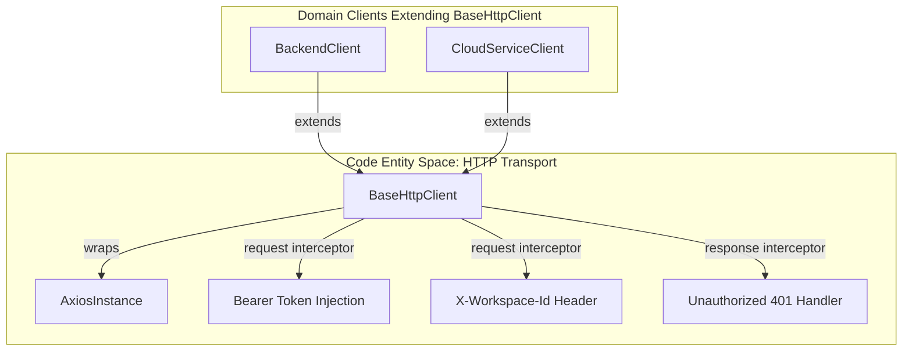
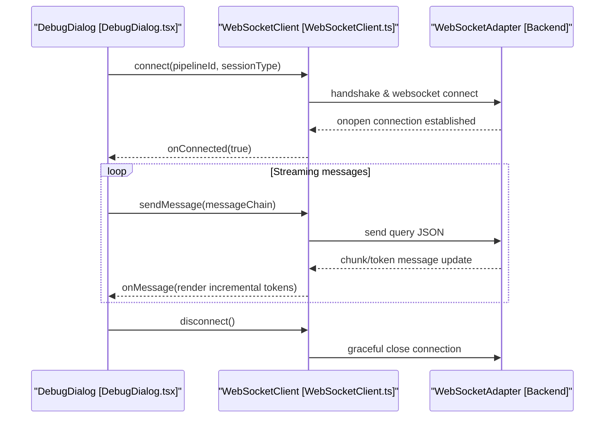

<!-- source: DeepWiki mcp.deepwiki.com · repo langbot-app/LangBot · page 8.3 HTTP and WebSocket Client System · fetched 2026-10-29 -->

# HTTP and WebSocket Client System

<details>
<summary>Relevant source files</summary>

The following files were used as context for generating this wiki page:

- [docs/pipeline-migration-config-map.zh-CN.md](docs/pipeline-migration-config-map.zh-CN.md)
- [src/langbot/pkg/pipeline/legacy_config_migration.py](src/langbot/pkg/pipeline/legacy_config_migration.py)
- [tests/unit_tests/pipeline/test_legacy_config_migration.py](tests/unit_tests/pipeline/test_legacy_config_migration.py)
- [tests/unit_tests/pipeline/test_migration_current_shape.py](tests/unit_tests/pipeline/test_migration_current_shape.py)
- [web/src/app/home/agents/AgentDetailContent.tsx](web/src/app/home/agents/AgentDetailContent.tsx)
- [web/src/app/home/agents/components/AgentDebugPanel.tsx](web/src/app/home/agents/components/AgentDebugPanel.tsx)
- [web/src/app/home/agents/components/AgentFormComponent.tsx](web/src/app/home/agents/components/AgentFormComponent.tsx)
- [web/src/app/home/bots/BotDetailContent.tsx](web/src/app/home/bots/BotDetailContent.tsx)
- [web/src/app/home/components/home-sidebar/HomeSidebar.tsx](web/src/app/home/components/home-sidebar/HomeSidebar.tsx)
- [web/src/app/home/components/home-sidebar/SidebarDataContext.tsx](web/src/app/home/components/home-sidebar/SidebarDataContext.tsx)
- [web/src/app/home/components/processor-detail/ProcessorDetailWorkbench.tsx](web/src/app/home/components/processor-detail/ProcessorDetailWorkbench.tsx)
- [web/src/app/home/knowledge/KBDetailContent.tsx](web/src/app/home/knowledge/KBDetailContent.tsx)
- [web/src/app/home/pipelines/PipelineDetailContent.tsx](web/src/app/home/pipelines/PipelineDetailContent.tsx)
- [web/src/app/home/pipelines/PipelineMigration.tsx](web/src/app/home/pipelines/PipelineMigration.tsx)
- [web/src/app/home/pipelines/components/debug-dialog/DebugDialog.tsx](web/src/app/home/pipelines/components/debug-dialog/DebugDialog.tsx)
- [web/src/app/home/pipelines/pipeline-migration-issues.ts](web/src/app/home/pipelines/pipeline-migration-issues.ts)
- [web/src/app/home/plugins/page.tsx](web/src/app/home/plugins/page.tsx)
- [web/src/app/infra/entities/api/index.ts](web/src/app/infra/entities/api/index.ts)
- [web/src/app/infra/http/BackendClient.ts](web/src/app/infra/http/BackendClient.ts)
- [web/src/app/infra/http/BaseHttpClient.ts](web/src/app/infra/http/BaseHttpClient.ts)
- [web/src/app/infra/http/HttpClient.ts](web/src/app/infra/http/HttpClient.ts)
- [web/src/app/wizard/page.tsx](web/src/app/wizard/page.tsx)
- [web/src/i18n/locales/en-US.ts](web/src/i18n/locales/en-US.ts)
- [web/src/i18n/locales/es-ES.ts](web/src/i18n/locales/es-ES.ts)
- [web/src/i18n/locales/ja-JP.ts](web/src/i18n/locales/ja-JP.ts)
- [web/src/i18n/locales/ru-RU.ts](web/src/i18n/locales/ru-RU.ts)
- [web/src/i18n/locales/th-TH.ts](web/src/i18n/locales/th-TH.ts)
- [web/src/i18n/locales/vi-VN.ts](web/src/i18n/locales/vi-VN.ts)
- [web/src/i18n/locales/zh-Hans.ts](web/src/i18n/locales/zh-Hans.ts)
- [web/src/i18n/locales/zh-Hant.ts](web/src/i18n/locales/zh-Hant.ts)
- [web/tests/e2e/fixtures/runner-migration-contract.json](web/tests/e2e/fixtures/runner-migration-contract.json)
- [web/tests/e2e/processor-detail-workbench.spec.ts](web/tests/e2e/processor-detail-workbench.spec.ts)

</details>


This page documents the frontend HTTP and WebSocket client implementations that facilitate communication between the React-based LangBot management interface and backend services. The HTTP client system is designed for RESTful API interactions handling resource management, while the WebSocket client provides real-time bidirectional communication for features like pipeline debugging and streaming chat responses.

---

## 1. HTTP Client Architecture

The HTTP client system is layered with a base transport class providing core network operations, extended by specialized clients focused on domain-specific API endpoints.

### BaseHttpClient and Interceptors

At the core is the `BaseHttpClient` class, which internally wraps an `axios` HTTP client instance [web/src/app/infra/http/BaseHttpClient.ts:1-6](). Its responsibilities include:

- Configuring a base URL and default headers [web/src/app/infra/http/BaseHttpClient.ts:48-52]().
- Injecting authentication credentials into requests [web/src/app/infra/http/BaseHttpClient.ts:83-86]().
- Attaching the workspace context header (`X-Workspace-Id`) when applicable [web/src/app/infra/http/BaseHttpClient.ts:91-96]().
- Handling common HTTP errors, notably intercepting `401 Unauthorized` to trigger logout and workspace reset flows [web/src/app/infra/http/BaseHttpClient.ts:118-135]().
- Providing a dedicated method for file downloads [web/src/app/infra/http/BaseHttpClient.ts:257-266]().

Key behaviors are implemented via **interceptors**:

- **Request Interceptors** inject the JWT bearer token dynamically from local storage and include the current workspace ID header unless explicitly disabled [web/src/app/infra/http/BaseHttpClient.ts:80-99]().
- **Response Interceptors** detect unauthorized responses and react by clearing stored user info, forcibly resetting workspace state, and navigating back to the login UI [web/src/app/infra/http/BaseHttpClient.ts:118-135]().

The class exposes typical HTTP verbs (`get`, `post`, `put`, `patch`, `delete`) for convenience, with typed generics for response bodies [web/src/app/infra/http/BaseHttpClient.ts:200-228]().

Title: "HTTP Transport Client Hierarchy"


Sources: [web/src/app/infra/http/BaseHttpClient.ts:1-266]()

---

## 2. BackendClient and CloudServiceClient

Specialized clients extend `BaseHttpClient` to provide domain-specific API methods for the LangBot frontend.

### BackendClient (`httpClient`)

The `BackendClient` class is the main client for interacting with the local LangBot backend API (`/api/v1`). It provides strongly typed methods covering a wide range of API resources [web/src/app/infra/http/BackendClient.ts:113-127]():

- **Model Providers:** Manage model providers (LLM, embedding, reranking) with CRUD operations [web/src/app/infra/http/BackendClient.ts:152-227]().
- **Pipelines and Agents:** Fetch, create and modify processing pipelines and agent configurations [web/src/app/infra/http/BackendClient.ts:230-280]().
- **Bots and Platform Adapters:** Manage bots connected to chat platforms [web/src/app/infra/http/BackendClient.ts:320-370]().
- **Plugins:** Query installed plugins, plugin system status, logs, and debug info [web/src/app/infra/http/BackendClient.ts:560-620]().
- **Knowledge Bases:** Upload and query knowledge bases and their documents [web/src/app/infra/http/BackendClient.ts:623-680]().
- **Operation Logs and Monitoring:** Access bot logs, telemetry, and operation traces [web/src/app/infra/http/BackendClient.ts:750-780]().
- **Authentication and Workspaces:** Manage user tokens, workspaces, and role-based context [web/src/app/infra/http/BackendClient.ts:805-850]().

This class exposes Promise-based async methods with typed response data to fully cover the LangBot backend surface.

A singleton instance `backendClient` is exported for use across the frontend, and also aliased as `httpClient` to maintain backwards compatibility [web/src/app/infra/http/HttpClient.ts:8-17]().

Title: "BackendClient API Routing"
```mermaid
graph TD
    subgraph "Code Entity Space: BackendClient API"
        BC["BackendClient (backendClient/httpClient)"] -->|extends| BH["BaseHttpClient"]
        BC -->|getProviderRequesters()| PR["GET /api/v1/provider/requesters"]
        BC -->|getModelProviders()| MP["GET /api/v1/provider/providers"]
        BC -->|getPipelines()| PP["GET /api/v1/pipelines"]
        BC -->|getPlugins()| PL["GET /api/v1/plugins"]
        BC -->|getSystemInfo()| SI["GET /api/v1/system/info"]
        BC -->|getCurrentWorkspace()| WS["GET /api/v1/workspaces/current"]
        BC -->|getBotLogs()| BL["GET /api/v1/platform/bots/logs"]
        BC -->|getPluginDebugInfo()| PDI["GET /api/v1/plugins/debug-info"]
        BC -->|downloadFile()| DF["GET /api/v1/files/image/{path}"]
        BC -->|downloadFile()| ME["GET /api/v1/monitoring/export"]
    end
```

| Domain | Key Methods | Description |
| --- | --- | --- |
| Model Providers | `getModelProviders()`, `createModelProvider()` | Manage model provider configs including LLMs, embeddings, rerankers [web/src/app/infra/http/BackendClient.ts:110-227]() |
| Pipelines | `getPipelines()`, `getPipeline(uuid)` | Manage agent and pipeline configurations [web/src/app/infra/http/BackendClient.ts:230-280]() |
| Plugins | `getPlugins()`, `getPluginSystemStatus()`, `getPluginDebugInfo()` | Manage plugin system runtime states and installation [web/src/app/infra/http/BackendClient.ts:560-620]() |
| Monitoring | `getBotLogs()`, `getOperationLog()`, `downloadFile()` | Retrieve logs and telemetry for troubleshooting, and export data [web/src/app/infra/http/BackendClient.ts:750-780](), [web/src/app/home/monitoring/components/ExportDropdown.tsx:103-105]() |
| Files | `downloadFile()` | Download files, e.g., images for debug chat [web/src/app/home/pipelines/components/debug-dialog/DebugDialog.tsx:82-84]() |

Sources: [web/src/app/infra/http/BackendClient.ts:80-2574](), [web/src/app/infra/http/HttpClient.ts:8-17](), [web/src/app/home/monitoring/components/ExportDropdown.tsx:103-105](), [web/src/app/home/pipelines/components/debug-dialog/DebugDialog.tsx:82-84]()

---

### CloudServiceClient

`CloudServiceClient` implements access to the public LangBot Space API for marketplace capabilities. It extends `BaseHttpClient` but disables token authentication (`disableToken=true`) since public market data does not require user authentication [web/src/app/infra/http/CloudServiceClient.ts:18-20]().

The client provides:

- Search and filtering for marketplace extensions (plugins, MCP services, skills) [web/src/app/infra/http/CloudServiceClient.ts:36-102]().
- Retrieval of marketplace metadata, extension icons, descriptions.
- Fetching download counts and installation stats.

Its methods facilitate the marketplace UI in the frontend to browse and discover user-installable extensions.

Title: "CloudServiceClient Marketplace Endpoints"
```mermaid
graph TD
    CSC["CloudServiceClient"] -->|extends| BH["BaseHttpClient"]
    CSC -->|searchMarketplacePlugins()| MKT_PLUGINS["POST /api/v1/marketplace/plugins/search"]
    CSC -->|searchMarketplaceExtensions()| MKT_EXTENSIONS["POST /api/v1/marketplace/extensions/search"]
    CSC -->|getMarketplaceLikedExtensions()| MKT_LIKES["POST /api/v1/marketplace/extensions/likes/status"]
    CSC -->|setMarketplaceExtensionLike()| MKT_LIKE_SET["PUT /api/v1/marketplace/extensions/{type}/{author}/{name}/like"]
```

Sources: [web/src/app/infra/http/CloudServiceClient.ts:13-285]()

---

## 3. WebSocket Client System

The WebSocket client system (class `WebSocketClient`) enables real-time bi-directional streaming communications, essential for interactive debugging sessions and finishing streaming LLM chat completions.

### Use Case: Pipeline DebugDialog Streaming

In the `DebugDialog` React component, a user can interactively test pipelines. The process follows a lifecycle:

1. Initial batch of pipeline message logs is fetched over REST using `BackendClient` (`httpClient`) [web/src/app/home/pipelines/components/debug-dialog/DebugDialog.tsx:180-183]().
2. A live WebSocket connection is established to the backend `/api/v1/pipelines/{uuid}/ws/connect` endpoint via `WebSocketClient` [web/src/app/infra/websocket/WebSocketClient.ts:99-100]().
3. The client sends serialized query message chains over the WebSocket [web/src/app/infra/websocket/WebSocketClient.ts:229-239]().
4. The backend streams back incremental execution outputs (text tokens, debug events) [web/src/app/infra/websocket/WebSocketClient.ts:205-211]().
5. Messages are parsed and the component UI updates live with responses [web/src/app/infra/websocket/WebSocketClient.ts:134-135]().
6. On dialog close or navigation away, the WebSocket connection is gracefully closed [web/src/app/infra/websocket/WebSocketClient.ts:300-301]().

Title: "Pipeline Debug WebSocket Sequence"


### Key Implementation Details

- `WebSocketClient` manages internal WebSocket instance and handlers for lifecycle events: `onopen`, `onmessage`, `onerror`, `onclose` [web/src/app/infra/websocket/WebSocketClient.ts:105-194]().
- Incoming messages are parsed asynchronously; JSON payloads are inspected for unique IDs to differentiate new streams from incremental updates [web/src/app/infra/websocket/WebSocketClient.ts:134-135]().
- Using React hooks ensures cleanup on component unmount (disconnecting from WebSocket) [web/src/app/home/pipelines/components/debug-dialog/DebugDialog.tsx:210-210]().
- Resilience is preserved by error and close event handlers, with UI notified via callbacks [web/src/app/infra/websocket/WebSocketClient.ts:167-167](), [web/src/app/infra/websocket/WebSocketClient.ts:192-192]().
- Authentication is handled by sending a token and workspace UUID after connection is established [web/src/app/infra/websocket/WebSocketClient.ts:111-126]().
- Automatic reconnection logic is implemented with exponential backoff, up to a maximum number of attempts [web/src/app/infra/websocket/WebSocketClient.ts:170-179]().
- Heartbeat messages (`ping`/`pong`) are sent to keep the connection alive [web/src/app/infra/websocket/WebSocketClient.ts:280-290]().

Sources: [web/src/app/home/pipelines/components/debug-dialog/DebugDialog.tsx:105-218](), [web/src/app/infra/websocket/WebSocketClient.ts:33-226](), [web/src/app/infra/websocket/WebSocketClient.ts:1-386](), [src/langbot/pkg/platform/sources/websocket_adapter.py:1-827]()

---

### Bridging Natural Language Concepts to Code Entities

Below are diagrams linking user-facing system roles with key code artifacts.

#### HTTP Client System Mapping

Title: "HTTP Client System Mapping"
```mermaid
graph LR
    "Natural_Language_Space" --> HTTP["HTTP Client System"]
    HTTP --> BH["BaseHttpClient"]
    BH --> BC["BackendClient (httpClient)"]
    BH --> CSC["CloudServiceClient"]

    BC -- "Manages" --> Models["LLMModel/EmbeddingModel APIs"]
    BC -- "Manages" --> Plugins["PluginV4 APIs"]
    BC -- "Manages" --> Pipelines["Pipeline APIs"]
    BC -- "Manages" --> Bots["Bot APIs"]
    BC -- "Provides" --> Monitoring["Monitoring/Export APIs"]
    BC -- "Provides" --> Files["File Download APIs"]

    CSC -- "Accesses" --> Marketplace["Marketplace APIs"]
```

#### WebSocket Client System in Pipeline Debugging

Title: "WebSocket Client System in Pipeline Debugging"
```mermaid
graph TD
    "User Debug Interaction" --> DD["DebugDialog React Component (web/src/app/home/pipelines/components/debug-dialog/DebugDialog.tsx)"]
    DD --> WS["WebSocketClient (web/src/app/infra/websocket/WebSocketClient.ts)"]
    WS --> BackendWS["Backend WebSocketAdapter (src/langbot/pkg/platform/sources/websocket_adapter.py)"]

    BackendWS -- "Sends" --> WSMessage["WebSocketMessage (src/langbot/pkg/platform/sources/websocket_adapter.py)"]
    WSMessage -- "Received by" --> WS
    WS -- "Processed by" --> DD
    DD --> "UI Update with Streamed Data"
```

Sources: [web/src/app/infra/http/BaseHttpClient.ts:1-266](), [web/src/app/infra/http/BackendClient.ts:80-2574](), [web/src/app/infra/websocket/WebSocketClient.ts:1-386](), [web/src/app/home/pipelines/components/debug-dialog/DebugDialog.tsx:105-218]()

---

# Summary

The frontend HTTP + WebSocket client system centers on `BaseHttpClient` providing robust transport with authentication, workspace context, and error handling. `BackendClient` and `CloudServiceClient` extend this to offer rich, typed APIs for LangBot backend and marketplace interactions respectively. The complementary `WebSocketClient` enables real-time streaming crucial for debugging and interactive chatbot sessions. Together, they form a flexible and extensible client communication layer powering LangBot's web management interface.

Sources:
- [web/src/app/infra/http/BaseHttpClient.ts:1-266]()
- [web/src/app/infra/http/BackendClient.ts:80-2574]()
- [web/src/app/infra/http/HttpClient.ts:8-17]()
- [web/src/app/infra/http/CloudServiceClient.ts:13-285]()
- [web/src/app/infra/websocket/WebSocketClient.ts:1-386]()
- [web/src/app/home/pipelines/components/debug-dialog/DebugDialog.tsx:105-218]()
- [web/src/app/home/monitoring/components/ExportDropdown.tsx:103-105]()
- [src/langbot/pkg/platform/sources/websocket_adapter.py:1-827]()

---

