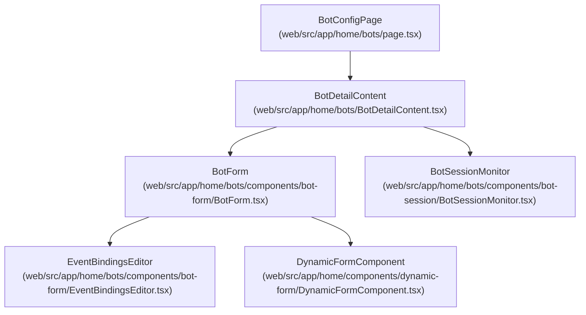
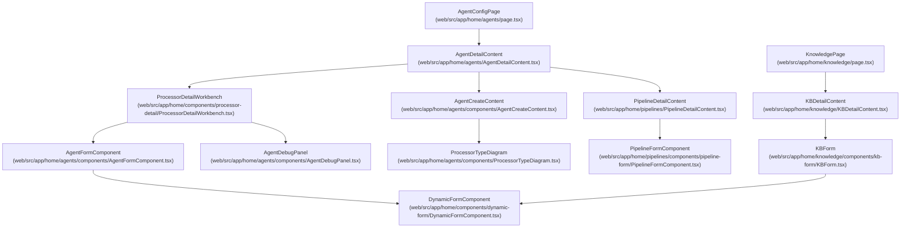
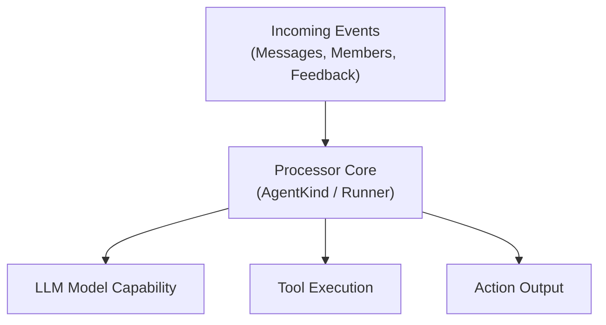
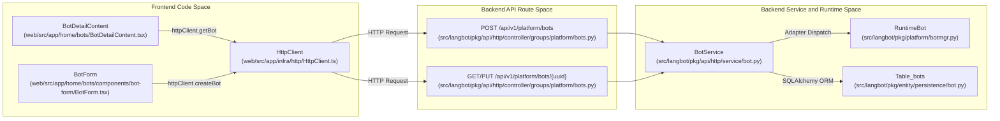
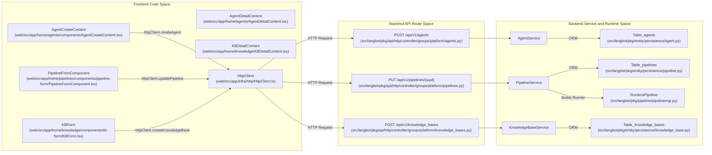

<!-- source: DeepWiki mcp.deepwiki.com · repo langbot-app/LangBot · page 8.4 Bot and Processor Management UI · fetched 2026-10-29 -->

# Bot and Processor Management UI

<details>
<summary>Relevant source files</summary>

The following files were used as context for generating this wiki page:

- [docs/assets/pr-2363/oauth-required-state.png](docs/assets/pr-2363/oauth-required-state.png)
- [tests/unit_tests/plugin/__init__.py](tests/unit_tests/plugin/__init__.py)
- [tests/unit_tests/plugin/test_plugin_list_sorting.py](tests/unit_tests/plugin/test_plugin_list_sorting.py)
- [web/playwright.config.ts](web/playwright.config.ts)
- [web/src/app/home/bots/botConfig.module.css](web/src/app/home/bots/botConfig.module.css)
- [web/src/app/home/bots/components/bot-card/botCard.module.css](web/src/app/home/bots/components/bot-card/botCard.module.css)
- [web/src/app/home/bots/components/bot-form/BotForm.tsx](web/src/app/home/bots/components/bot-form/BotForm.tsx)
- [web/src/app/home/bots/page.tsx](web/src/app/home/bots/page.tsx)
- [web/src/app/home/components/dynamic-form/DynamicFormComponent.tsx](web/src/app/home/components/dynamic-form/DynamicFormComponent.tsx)
- [web/src/app/home/components/dynamic-form/DynamicFormItemComponent.tsx](web/src/app/home/components/dynamic-form/DynamicFormItemComponent.tsx)
- [web/src/app/home/components/dynamic-form/DynamicFormItemConfig.ts](web/src/app/home/components/dynamic-form/DynamicFormItemConfig.ts)
- [web/src/app/home/knowledge/components/kb-card/KBCard.module.css](web/src/app/home/knowledge/components/kb-card/KBCard.module.css)
- [web/src/app/home/knowledge/components/kb-card/KBCard.tsx](web/src/app/home/knowledge/components/kb-card/KBCard.tsx)
- [web/src/app/home/knowledge/components/kb-card/KBCardVO.ts](web/src/app/home/knowledge/components/kb-card/KBCardVO.ts)
- [web/src/app/home/knowledge/components/kb-docs/FileUploadZone.tsx](web/src/app/home/knowledge/components/kb-docs/FileUploadZone.tsx)
- [web/src/app/home/knowledge/components/kb-docs/KBDoc.tsx](web/src/app/home/knowledge/components/kb-docs/KBDoc.tsx)
- [web/src/app/home/knowledge/components/kb-docs/documents/columns.tsx](web/src/app/home/knowledge/components/kb-docs/documents/columns.tsx)
- [web/src/app/home/knowledge/components/kb-form/KBForm.tsx](web/src/app/home/knowledge/components/kb-form/KBForm.tsx)
- [web/src/app/home/knowledge/page.tsx](web/src/app/home/knowledge/page.tsx)
- [web/src/app/home/pipelines/components/pipeline-card/pipelineCard.module.css](web/src/app/home/pipelines/components/pipeline-card/pipelineCard.module.css)
- [web/src/app/home/pipelines/components/pipeline-form/PipelineFormComponent.tsx](web/src/app/home/pipelines/components/pipeline-form/PipelineFormComponent.tsx)
- [web/src/app/home/pipelines/page.tsx](web/src/app/home/pipelines/page.tsx)
- [web/src/app/home/pipelines/pipelineConfig.module.css](web/src/app/home/pipelines/pipelineConfig.module.css)
- [web/src/app/home/plugins/plugins.module.css](web/src/app/home/plugins/plugins.module.css)
- [web/src/app/infra/basic-component/create-card-component/createCartComponent.module.css](web/src/app/infra/basic-component/create-card-component/createCartComponent.module.css)
- [web/src/app/infra/entities/form/dynamic.ts](web/src/app/infra/entities/form/dynamic.ts)
- [web/tests/e2e/entity-loading.spec.ts](web/tests/e2e/entity-loading.spec.ts)
- [web/tests/e2e/home-smoke.spec.ts](web/tests/e2e/home-smoke.spec.ts)
- [web/tests/e2e/pipeline-migration.spec.ts](web/tests/e2e/pipeline-migration.spec.ts)
- [web/tests/e2e/workspace-assistant.spec.ts](web/tests/e2e/workspace-assistant.spec.ts)
- [web/tests/unit/processor-detail-workbench.test.mjs](web/tests/unit/processor-detail-workbench.test.mjs)
- [web/tests/unit/token-monitoring-error.test.mjs](web/tests/unit/token-monitoring-error.test.mjs)

</details>


This page documents the React components that implement the bot and processor (agents, pipelines, and event processors) management screens in LangBot's web interface. It covers page components, detail views, card components, routing rule editors, the `ProcessorDetailWorkbench`, `ProcessorTypeDiagram`, and dynamic form integration interacting with backend HTTP APIs via `HttpClient`.

---

## Component Hierarchy

The bot and processor management user interface is organized into hierarchical component trees built with Vite, React Router, and shadcn/ui primitives.

### Bot Management Component Tree



Sources: `[web/src/app/home/bots/page.tsx:1-19]()`, `[web/src/app/home/bots/components/bot-form/BotForm.tsx:1-220]()`, `[web/src/app/home/components/dynamic-form/DynamicFormComponent.tsx:1-146]()`

### Processor Management Component Tree



Sources: `[web/src/app/home/pipelines/page.tsx:1-44]()`, `[web/src/app/home/pipelines/components/pipeline-form/PipelineFormComponent.tsx:1-131]()`, `[web/src/app/home/knowledge/page.tsx:1-70]()`, `[web/src/app/home/knowledge/components/kb-form/KBForm.tsx:1-196]()`

---

## Card Components and Layout

The management interface utilizes grid-based CSS layouts to list entities, featuring dedicated card components that display status overviews and quick action controls.

### BotCard, PipelineCard, and KBCard
- **BotCard:** Displays bot metadata (icon, name, description, and adapter label) alongside an enable/disable toggle switch. Toggling state triggers an update via `httpClient.updateBot`. The styling is defined in `[web/src/app/home/bots/components/bot-card/botCard.module.css:1-151]()`.
- **PipelineCard:** Displays an emoji container, metadata summary, default badge indicators, and modification timestamps. The styling is defined in `[web/src/app/home/pipelines/components/pipeline-card/pipelineCard.module.css:1-171]()`.
- **KBCard:** Displays knowledge base metadata, including name, description, and emoji. The styling is defined in `[web/src/app/home/knowledge/components/kb-card/KBCard.module.css]()`.

### Grid Layout Layouts

| Feature | CSS Module / Class | Grid Template |
|---|---|---|
| Bot Grid | `.botListContainer` | `repeat(auto-fill, minmax(24rem, 1fr))` |
| Pipeline Grid | `.pipelineListContainer` | `repeat(auto-fill, minmax(24rem, 1fr))` |
| Plugin Grid | `.pluginListContainer` | `repeat(auto-fill, minmax(min(100%, 22rem), 1fr))` |
| Knowledge Base Grid | `.kbListContainer` | `repeat(auto-fill, minmax(24rem, 1fr))` |

Sources: `[web/src/app/home/bots/botConfig.module.css]()`, `[web/src/app/home/pipelines/pipelineConfig.module.css]()`, `[web/src/app/home/plugins/plugins.module.css]()`, `[web/src/app/home/knowledge/components/kb-card/KBCard.module.css]()`

---

## Bot Management UI

### BotDetailContent and BotForm
`BotDetailContent` serves as the primary page component for viewing, editing, and instantiating bots. It coordinates breadcrumb updates, loading states, and tab selection (configuration, logs, session monitoring) `[web/src/app/home/bots/page.tsx:10-11]()`.

`BotForm` manages the form schema using `react-hook-form` coupled with Zod resolvers `[web/src/app/home/bots/components/bot-form/BotForm.tsx:167-197]()`. It handles connection modes (`webhook` vs `persistent`) via `detectConnectionMode` and `applyConnectionMode` helpers `[web/src/app/home/bots/components/bot-form/BotForm.tsx:88-165]()`, which evaluate adapter schemas against dynamic form rules.

```typescript
type ConnectionMode = 'webhook' | 'persistent';
```
`[web/src/app/home/bots/components/bot-form/BotForm.tsx:88-88]()`

### EventBindingsEditor: Event Routing Editor
`EventBindingsEditor` permits modification of `event_bindings` routing rules mapping incoming IM events to processors.
- Supports event pattern selection (e.g., `message.received`, `group.member_joined`) `[web/src/app/home/bots/components/bot-form/BotForm.tsx:177-195]()`.
- Evaluates filters on fields such as `chat_type`, `chat_id`, and `message_text`.
- Provides route priority sorting and dry-run validation.

Sources: `[web/src/app/home/bots/page.tsx:1-19]()`, `[web/src/app/home/bots/components/bot-form/BotForm.tsx:1-220]()`

---

## Processor Management UI

LangBot unifies agents, pipelines, and event processors under the processor abstraction.

### AgentCreateContent and ProcessorTypeDiagram
`AgentCreateContent` provides a multi-kind wizard (`pipeline`, `agent`, `event_processor`) `[web/src/app/home/agents/components/AgentCreateContent.tsx:45-45]()`. It embeds `ProcessorTypeDiagram`, an SVG-rendered visualization demonstrating event consumption paths and processing capabilities `[web/src/app/home/agents/components/ProcessorTypeDiagram.tsx:113-134]()`.


Sources: `[web/src/app/home/agents/components/AgentCreateContent.tsx:1-204]()`, `[web/src/app/home/agents/components/ProcessorTypeDiagram.tsx:1-134]()`

### ProcessorDetailWorkbench and AgentDebugPanel
`ProcessorDetailWorkbench` organizes the agent workspace into a split-pane interface:
- **Left Pane (`AgentDebugPanel`):** Simulates events, edits JSON payload inputs, runs tests against the processor, and inspects run transcripts and state transitions.
- **Right Pane (`AgentFormComponent`):** Manages runner selection, underlying configurations, and plugin bindings.

### PipelineFormComponent
`PipelineFormComponent` manages multi-stage pipeline configurations across tabs (`basic`, `ai`, `trigger`, `safety`, `output`) `[web/src/app/home/pipelines/components/pipeline-form/PipelineFormComponent.tsx:164-186]()`. It employs mount-scoped editing sessions via `PersistedRunnerForm` to preserve runner config structures during tab switching `[web/src/app/home/pipelines/components/pipeline-form/PipelineFormComponent.tsx:79-105]()`.

### KBForm
`KBForm` handles the creation and editing of Knowledge Bases. It uses `react-hook-form` and Zod for validation `[web/src/app/home/knowledge/components/kb-form/KBForm.tsx:125-133]()`. It dynamically renders configuration forms for `creation_settings` and `retrieval_settings` based on the selected `KnowledgeEngine` `[web/src/app/home/knowledge/components/kb-form/KBForm.tsx:58-81]()`. The form also manages the loading and saving of knowledge base configurations `[web/src/app/home/knowledge/components/kb-form/KBForm.tsx:181-195]()`. File uploads for documents are handled by `FileUploadZone` `[web/src/app/home/knowledge/components/kb-docs/FileUploadZone.tsx:1-321]()`.

Sources: `[web/src/app/home/pipelines/components/pipeline-form/PipelineFormComponent.tsx:1-131]()`, `[web/src/app/home/knowledge/components/kb-form/KBForm.tsx:1-196]()`, `[web/src/app/home/knowledge/components/kb-docs/FileUploadZone.tsx:1-321]()`

---

## Dynamic Form Integration

Both bot adapters and processor runners rely on schema-driven dynamic forms (`DynamicFormComponent` and `DynamicFormItemComponent`) to render configuration controls.

- **System Fields (`__system.*`):** Fields prefixed with `__system.` are resolved from `systemContext` (e.g., outbound IPs, read-only webhook URLs) and omitted from form mutation payloads `[web/src/app/infra/entities/form/dynamic.ts:3-25]()`.
- **Conditional Rendering (`show_if`, `disable_if`):** Evaluates dynamic visibility and read-only states based on sibling form values or runtime context `[web/src/app/infra/entities/form/dynamic.ts:32-41]()`.
- **DynamicFormItemComponent:** Renders individual form fields based on their `DynamicFormItemType` `[web/src/app/home/components/dynamic-form/DynamicFormItemComponent.tsx:127-147]()`. This includes various input types like `INT`, `STRING`, `SELECT`, and specialized selectors for LLM models, embedding models, knowledge bases, and tools `[web/src/app/infra/entities/form/dynamic.ts:63-95]()`. It also handles file uploads `[web/src/app/home/components/dynamic-form/DynamicFormItemComponent.tsx:154-155]()` and displays system-generated fields like webhook URLs `[web/src/app/home/components/dynamic-form/DynamicFormComponent.tsx:198-225]()` and embed codes `[web/src/app/home/components/dynamic-form/DynamicFormComponent.tsx:150-193]()`.

```typescript
export const SYSTEM_FIELD_PREFIX = '__system.';
```
`[web/src/app/infra/entities/form/dynamic.ts:6-6]()`

Sources: `[web/src/app/home/components/dynamic-form/DynamicFormComponent.tsx:1-146]()`, `[web/src/app/home/components/dynamic-form/DynamicFormItemComponent.tsx:1-196]()`, `[web/src/app/infra/entities/form/dynamic.ts:1-95]()`

---

## Entity and API Mapping

The diagrams below bridge Natural Language Space concepts to Code Entity Space implementations for bots and processors.

### Bot UI to Backend Code Mapping



Sources: `[web/src/app/home/bots/components/bot-form/BotForm.tsx:1-220]()`, `[web/src/app/infra/http/HttpClient.ts:1-1]()`

### Processor UI to Backend Code Mapping



Sources: `[web/src/app/home/pipelines/components/pipeline-form/PipelineFormComponent.tsx:1-131]()`, `[web/src/app/home/knowledge/components/kb-form/KBForm.tsx:1-196]()`

---

