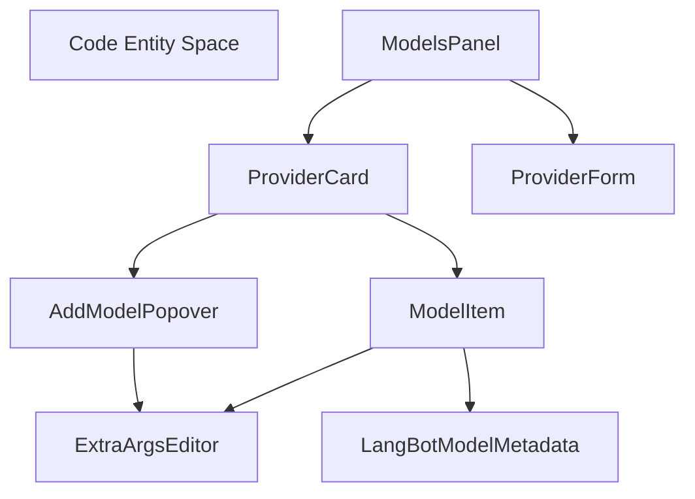
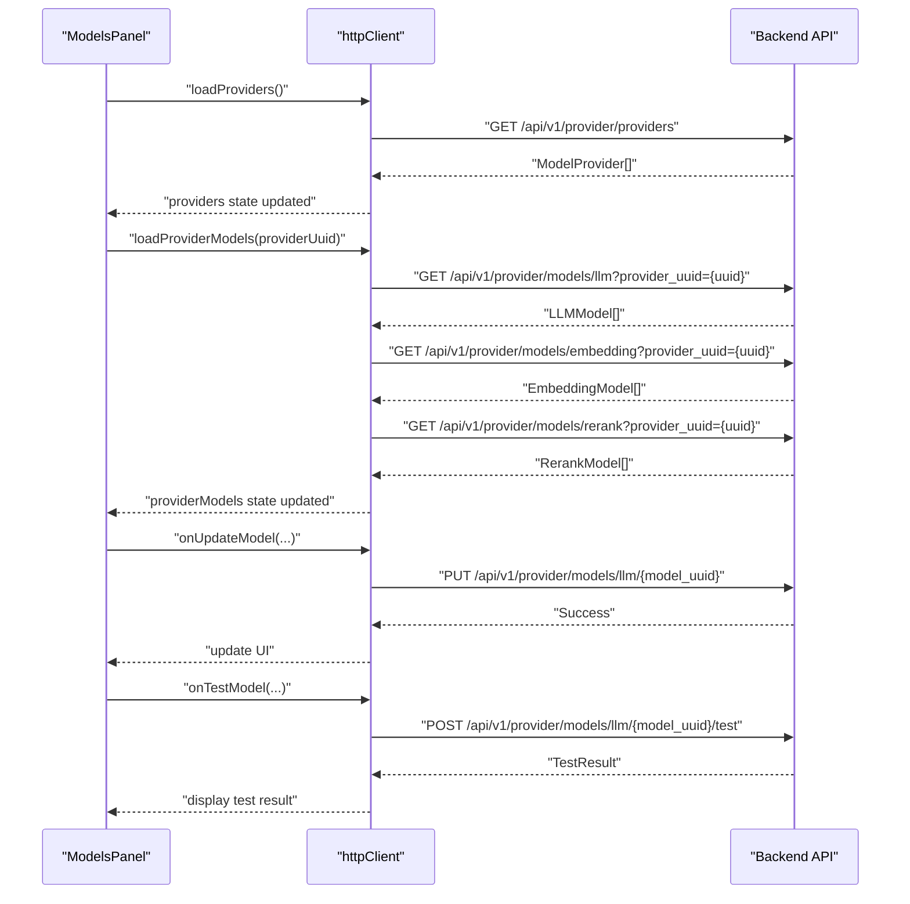
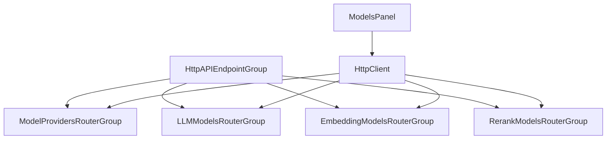

<!-- source: DeepWiki mcp.deepwiki.com · repo langbot-app/LangBot · page 8.5 Model Provider Management UI · fetched 2026-10-29 -->

# Model Provider Management UI

Relevant source files

The following files were used as context for generating this wiki page:

- [web/src/app/home/components/api-integration-dialog/ApiIntegrationPanel.tsx](web/src/app/home/components/api-integration-dialog/ApiIntegrationPanel.tsx)
- [web/src/app/home/components/models-dialog/ModelsPanel.tsx](web/src/app/home/components/models-dialog/ModelsPanel.tsx)
- [web/src/app/home/components/models-dialog/components/AddModelPopover.tsx](web/src/app/home/components/models-dialog/components/AddModelPopover.tsx)
- [web/src/app/home/components/models-dialog/components/ExtraArgsEditor.tsx](web/src/app/home/components/models-dialog/components/ExtraArgsEditor.tsx)
- [web/src/app/home/components/models-dialog/components/ModelItem.tsx](web/src/app/home/components/models-dialog/components/ModelItem.tsx)
- [web/src/app/home/components/models-dialog/components/ProviderCard.tsx](web/src/app/home/components/models-dialog/components/ProviderCard.tsx)
- [web/src/app/home/components/models-dialog/types.ts](web/src/app/home/components/models-dialog/types.ts)
- [web/src/app/home/components/settings-dialog/panel-layout.tsx](web/src/app/home/components/settings-dialog/panel-layout.tsx)
- [web/src/app/home/components/storage-analysis-dialog/StorageAnalysisPanel.tsx](web/src/app/home/components/storage-analysis-dialog/StorageAnalysisPanel.tsx)
- [web/tests/e2e/api-key-revocation.spec.ts](web/tests/e2e/api-key-revocation.spec.ts)

## Purpose and Scope

The Model Provider Management UI is the frontend interface within the LangBot web management panel dedicated to configuring and managing AI model providers. It encompasses:

- Listing and managing model providers (both internal LangBot models and external providers).
- Managing LLM, embedding, and rerank models per provider.
- Editing model details and extra parameters.
- Testing model configurations interactively.
- Displaying model availability and metadata.
- Presenting integration with Space user credits for model usage.

This UI is primarily implemented in React as the `ModelsPanel` component and several supporting dialog/popover components within the settings dialog framework. Users interact via expandable "provider cards" listing models, with modals and popovers to add, edit, scan, and test models.

Sources:
- [web/src/app/home/components/models-dialog/ModelsPanel.tsx:84-87]()

---

## Dialog Structure and Component Hierarchy

The management UI is architected as a composite of well-isolated components:

- **ModelsPanel**: The main container panel representing the entire model management UI within the settings dialog. It fetches providers and their models, manages state, and orchestrates data flow. [web/src/app/home/components/models-dialog/ModelsPanel.tsx:84-87]()

- **ProviderCard**: Represents a single model provider in an accordion-style card. It shows provider details, model counts, Space login status, and exposes model lists and management controls. [web/src/app/home/components/models-dialog/components/ProviderCard.tsx:114-150]()

- **ProviderForm**: A modal dialog used for creating or editing a provider's basic data (e.g., name, requester type, base URL, API keys). [web/src/app/home/components/models-dialog/ModelsPanel.tsx:14]()

- **ModelItem**: Itemized entry for each LLM/embedding/rerank model under a provider. Supports editing model properties, extra args, and testing. [web/src/app/home/components/models-dialog/components/ModelItem.tsx:90-110]()

- **AddModelPopover**: Popover UI for adding new models, either manually or via scanning available models exposed by the provider. [web/src/app/home/components/models-dialog/components/AddModelPopover.tsx:71-86]()

- **ExtraArgsEditor**: Component embedded within model item and add/edit views for editing model-specific extra arguments, supporting multiple data types including nested JSON objects. [web/src/app/home/components/models-dialog/components/ExtraArgsEditor.tsx:28-33]()

- **LangBotModelMetadata**: Displays model availability, pricing, and usage credit info for LangBot official models. [web/src/app/home/components/models-dialog/components/ModelItem.tsx:30]()

### Component Hierarchy Diagram

Sources:
- [web/src/app/home/components/models-dialog/ModelsPanel.tsx:14-27]()
- [web/src/app/home/components/models-dialog/components/ProviderCard.tsx:36-37]()
- [web/src/app/home/components/models-dialog/components/AddModelPopover.tsx:36-36]()
- [web/src/app/home/components/models-dialog/components/ModelItem.tsx:30]()

---

## Provider Management

### Provider Categories and State Tracking

The UI logically distinguishes two provider categories:

1.  **LangBot Models Provider:**
    This provider serves official LangBot-hosted models accessible under the requester `'space-chat-completions'` (symbolized by the constant `LANGBOT_MODELS_PROVIDER_REQUESTER` [web/src/app/home/components/models-dialog/types.ts:133]()). It is shown and handled specially for Space users with billing and credit integration.
    -   Its provider card displays Space login and credit info. [web/src/app/home/components/models-dialog/components/ProviderCard.tsx:203-209]()
    -   It is auto-expanded if no other external providers exist. [web/src/app/home/components/models-dialog/ModelsPanel.tsx:166-175]()

2.  **External Providers:**
    These are user-added providers with specific requester names (e.g., OpenAI, Anthropic, Ollama) configured in `ProviderForm`.
    -   Users can add, edit, and delete these providers if they have management permissions. [web/src/app/home/components/models-dialog/ModelsPanel.tsx:91-92]()
    -   A provider can only be deleted if it has no models associated. [web/src/app/home/components/models-dialog/components/ProviderCard.tsx:156-160]()

`ModelsPanel` is responsible for storing provider list, expanded panels state, loading states, and requester support types for tab filtering [web/src/app/home/components/models-dialog/ModelsPanel.tsx:93-134]().

### CRUD Operations on Providers

-   **Loading:**
    The `loadProviders()` async function calls `httpClient.getModelProviders()` API to fetch all current model providers, storing them in state [web/src/app/home/components/models-dialog/ModelsPanel.tsx:185-189]().

-   **Editing and Creating:**
    `ProviderForm` is a controlled modal dialog which creates or updates a provider. It enforces required inputs such as `name` and `requester` [web/src/app/home/components/models-dialog/ModelsPanel.tsx:14]()

-   **Deletion:**
    Deletion button is disabled or locked when the provider has models attached (`llm_count`, `embedding_count`, or `rerank_count` > 0). This safeguard prevents loss of configured models. [web/src/app/home/components/models-dialog/components/ProviderCard.tsx:156-160]()

-   **Expansion:**
    Provider cards can be expanded/collapsed to show/hide model lists. On expansion, model lists are fetched asynchronously per provider. [web/src/app/home/components/models-dialog/ModelsPanel.tsx:204-215]()

Sources:
- [web/src/app/home/components/models-dialog/ModelsPanel.tsx:14]()
- [web/src/app/home/components/models-dialog/ModelsPanel.tsx:91-92]()
- [web/src/app/home/components/models-dialog/ModelsPanel.tsx:93-134]()
- [web/src/app/home/components/models-dialog/ModelsPanel.tsx:166-175]()
- [web/src/app/home/components/models-dialog/ModelsPanel.tsx:185-189]()
- [web/src/app/home/components/models-dialog/ModelsPanel.tsx:204-215]()
- [web/src/app/home/components/models-dialog/components/ProviderCard.tsx:156-160]()
- [web/src/app/home/components/models-dialog/components/ProviderCard.tsx:203-209]()
- [web/src/app/home/components/models-dialog/types.ts:133]()

---

## Model Management

### Model Types and Structure

Models are managed per provider and classified into three types:

-   **LLM Models** (`LLMModel[]`): Language models with abilities, context length, extra arguments, and optional reasoning config.
-   **Embedding Models** (`EmbeddingModel[]`): Models for text embedding generation.
-   **Rerank Models** (`RerankModel[]`): Used for ordering or ranking retrieval results.

These typings and related interfaces are managed via `ProviderModels` [web/src/app/home/components/models-dialog/types.ts:24-28]().

### Model Scanning and Adding

-   The `AddModelPopover` component enables users to add models manually or scan a provider's available models (if supported). [web/src/app/home/components/models-dialog/components/AddModelPopover.tsx:71-86]()

-   Scanning triggers the `onScanModels` handler, fetching available models programmatically from the provider, then allows selective adding with ability assignments [web/src/app/home/components/models-dialog/components/AddModelPopover.tsx:173-182]().

-   When adding or editing, the "extra arguments" editor enables specifying custom parameters as typed key-value entries. `convertExtraArgsToObject()` converts these UI representations into the expected request payload [web/src/app/home/components/models-dialog/ModelsPanel.tsx:40-71]().

### Model Editing and Testing

-   Within each provider's card, lists of `ModelItem` components allow editing model names, abilities, extra args, and context length. [web/src/app/home/components/models-dialog/components/ModelItem.tsx:113-124]()

-   The model editor supports testing via `onTestModel`, running a backend call to verify connectivity and correctness, showing pass/fail results with duration or error message. [web/src/app/home/components/models-dialog/components/ModelItem.tsx:161-167]()

-   The reasoning capabilities of LLMs are detected and toggled carefully based on model abilities and system flags. [web/src/app/home/components/models-dialog/components/ModelItem.tsx:178-180]()

-   Popover and confirmation dialogs guard changes and deletions for models, integrating with `testResult` state for user feedback [web/src/app/home/components/models-dialog/components/ModelItem.tsx:125-126]().

Sources:
- [web/src/app/home/components/models-dialog/ModelsPanel.tsx:40-71]()
- [web/src/app/home/components/models-dialog/components/AddModelPopover.tsx:71-86]()
- [web/src/app/home/components/models-dialog/components/AddModelPopover.tsx:173-182]()
- [web/src/app/home/components/models-dialog/components/ModelItem.tsx:113-124]()
- [web/src/app/home/components/models-dialog/components/ModelItem.tsx:125-126]()
- [web/src/app/home/components/models-dialog/components/ModelItem.tsx:161-167]()
- [web/src/app/home/components/models-dialog/components/ModelItem.tsx:178-180]()
- [web/src/app/home/components/models-dialog/types.ts:24-28]()

---

## Space Integration and Model Availability Metadata

### Space Billing and Credits

-   The UI integrates with Space account billing and quota via `loadWorkspaceBilling()`. This fetches the workspace's Space credits metadata to be displayed in LangBot Models provider cards [web/src/app/home/components/models-dialog/ModelsPanel.tsx:177-179]().

-   `ProviderCard` conditionally renders Space login buttons and credit balances for the official LangBot models provider [web/src/app/home/components/models-dialog/components/ProviderCard.tsx:215-218]().

### Model Availability Metadata Display

-   The `LangBotModelMetadata` component is used inside model items to show detailed pricing, token limits, and availability info for LangBot-hosted models. [web/src/app/home/components/models-dialog/components/ModelItem.tsx:30]()

-   This metadata is loaded and managed through the `useLangBotModelAvailability` hook, which asynchronously fetches LangBot models availability via the external Models Service (controlled via feature flags) [web/src/app/home/components/models-dialog/ModelsPanel.tsx:93-96]()

Sources:
- [web/src/app/home/components/models-dialog/ModelsPanel.tsx:93-96]()
- [web/src/app/home/components/models-dialog/ModelsPanel.tsx:177-179]()
- [web/src/app/home/components/models-dialog/components/ProviderCard.tsx:215-218]()
- [web/src/app/home/components/models-dialog/components/ModelItem.tsx:30]()

---

## Technical Data Flow and API Interactions

This section details the interaction between the UI components and backend API for model provider and model management.

-   `ModelsPanel` is the root orchestrator of API communications. [web/src/app/home/components/models-dialog/ModelsPanel.tsx:185-189]()
-   `httpClient` handles request abstraction and endpoint calls. [web/src/app/infra/http/HttpClient.ts:11-12]()
-   Model updates and tests invoke specific API endpoints, with JSON payloads constructed from UI forms. [web/src/app/home/components/models-dialog/ModelsPanel.tsx:40-71]()

Sources:
- [web/src/app/home/components/models-dialog/ModelsPanel.tsx:40-71]()
- [web/src/app/home/components/models-dialog/ModelsPanel.tsx:185-189]()
- [web/src/app/infra/http/HttpClient.ts:11-12]()

---

## Summary

The Model Provider Management UI is a comprehensive React-based frontend suite inside the LangBot web settings dialog. It provides complete lifecycle management of AI model providers and their models, including advanced features like scanning provider endpoints for models, editing complex extra args, testing connectivity and usability, and showing integration with LangBot's Space platform for billing credits. The UI components are modular, extensible, and tightly integrated with the backend HTTP API via `httpClient`.

---

## Technical to Natural Language Mapping Diagrams

### Model Provider Management Components Correspondence

```mermaid
graph TB
    UI["ModelProviderManagementPanel"]
    Code["ModelsPanel"]

    UI --> Code

    UI1["ModelProviderManagementPanel"] --> Code1["ModelsPanel<br/>web/src/app/home/components/models-dialog/ModelsPanel.tsx"]
    UI2["ModelProviderCard"] --> Code2["ProviderCard<br/>web/src/app/home/components/models-dialog/components/ProviderCard.tsx"]
    UI3["ProviderForm"] --> Code3["ProviderForm<br/>web/src/app/home/components/models-dialog/component/provider-form/ProviderForm.tsx"]
    UI4["ModelListItem"] --> Code4["ModelItem<br/>web/src/app/home/components/models-dialog/components/ModelItem.tsx"]
    UI5["AddModelDialogPopover"] --> Code5["AddModelPopover<br/>web/src/app/home/components/models-dialog/components/AddModelPopover.tsx"]
    UI6["ExtraArgsEditorSubcomponent"] --> Code6["ExtraArgsEditor<br/>web/src/app/home/components/models-dialog/components/ExtraArgsEditor.tsx"]
    UI7["LangBotModelMetadataInfo"] --> Code7["LangBotModelMetadata<br/>web/src/app/home/components/models-dialog/components/ModelItem.tsx"]
```

Sources:
- [web/src/app/home/components/models-dialog/ModelsPanel.tsx:14-27]()
- [web/src/app/home/components/models-dialog/components/ProviderCard.tsx:36-37]()
- [web/src/app/home/components/models-dialog/components/ModelItem.tsx:30]()
- [web/src/app/home/components/models-dialog/components/AddModelPopover.tsx:71-86]()
- [web/src/app/home/components/models-dialog/components/ExtraArgsEditor.tsx:28-33]()

---

### Backend API Route Hierarchy for Model Providers and Models

Sources:
- [web/src/app/home/components/models-dialog/ModelsPanel.tsx:180-215]()

---

# End of Model Provider Management UI Documentation

---

