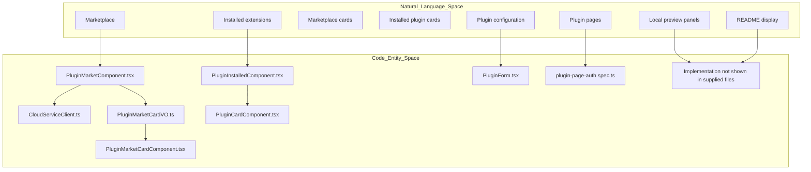
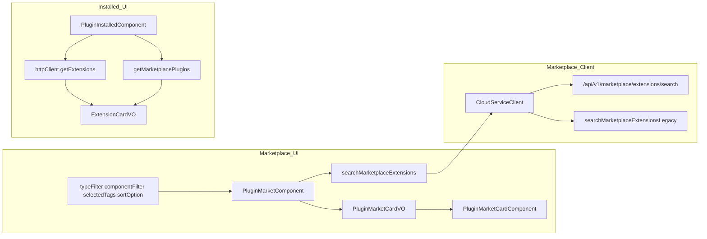
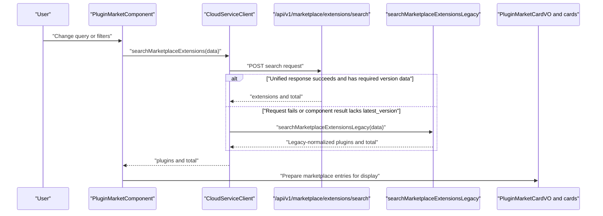
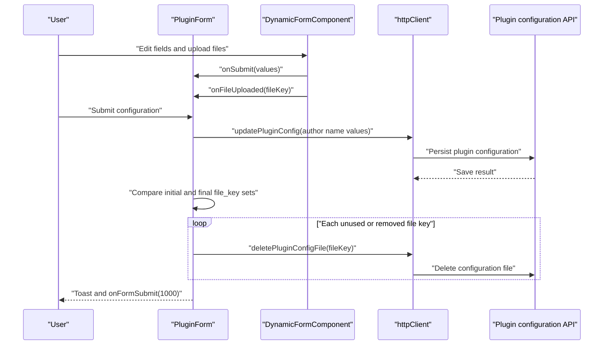
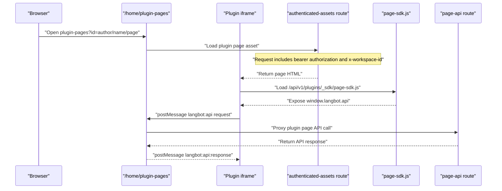

<!-- source: DeepWiki mcp.deepwiki.com · repo langbot-app/LangBot · page 8.6 Plugin Management UI · fetched 2026-10-29 -->

# Plugin Management UI

Relevant source files

The following files were used as context for generating this wiki page:

- [web/src/app/home/plugins/components/plugin-installed/PluginCardVO.ts](web/src/app/home/plugins/components/plugin-installed/PluginCardVO.ts)
- [web/src/app/home/plugins/components/plugin-installed/PluginComponentList.tsx](web/src/app/home/plugins/components/plugin-installed/PluginComponentList.tsx)
- [web/src/app/home/plugins/components/plugin-installed/PluginInstalledComponent.tsx](web/src/app/home/plugins/components/plugin-installed/PluginInstalledComponent.tsx)
- [web/src/app/home/plugins/components/plugin-installed/plugin-card/PluginCardComponent.tsx](web/src/app/home/plugins/components/plugin-installed/plugin-card/PluginCardComponent.tsx)
- [web/src/app/home/plugins/components/plugin-installed/plugin-form/PluginForm.tsx](web/src/app/home/plugins/components/plugin-installed/plugin-form/PluginForm.tsx)
- [web/src/app/home/plugins/components/plugin-market/PluginComponentIcons.ts](web/src/app/home/plugins/components/plugin-market/PluginComponentIcons.ts)
- [web/src/app/home/plugins/components/plugin-market/PluginComponentList.tsx](web/src/app/home/plugins/components/plugin-market/PluginComponentList.tsx)
- [web/src/app/home/plugins/components/plugin-market/PluginMarketComponent.tsx](web/src/app/home/plugins/components/plugin-market/PluginMarketComponent.tsx)
- [web/src/app/home/plugins/components/plugin-market/RecommendationLists.tsx](web/src/app/home/plugins/components/plugin-market/RecommendationLists.tsx)
- [web/src/app/home/plugins/components/plugin-market/plugin-market-card/PluginMarketCardComponent.tsx](web/src/app/home/plugins/components/plugin-market/plugin-market-card/PluginMarketCardComponent.tsx)
- [web/src/app/home/plugins/components/plugin-market/plugin-market-card/PluginMarketCardVO.ts](web/src/app/home/plugins/components/plugin-market/plugin-market-card/PluginMarketCardVO.ts)
- [web/src/app/infra/http/CloudServiceClient.ts](web/src/app/infra/http/CloudServiceClient.ts)
- [web/src/app/invitations/accept/page.tsx](web/src/app/invitations/accept/page.tsx)
- [web/tests/e2e/account-oauth.spec.ts](web/tests/e2e/account-oauth.spec.ts)
- [web/tests/e2e/bot-form-layout.spec.ts](web/tests/e2e/bot-form-layout.spec.ts)
- [web/tests/e2e/cloud-storage-privacy.spec.ts](web/tests/e2e/cloud-storage-privacy.spec.ts)
- [web/tests/e2e/invitations.spec.ts](web/tests/e2e/invitations.spec.ts)
- [web/tests/e2e/owner-space-billing.spec.ts](web/tests/e2e/owner-space-billing.spec.ts)
- [web/tests/e2e/plugin-page-auth.spec.ts](web/tests/e2e/plugin-page-auth.spec.ts)
- [web/tests/unit/oss-account-space-billing.test.mjs](web/tests/unit/oss-account-space-billing.test.mjs)
- [web/tests/unit/plugin-component-icons.test.mjs](web/tests/unit/plugin-component-icons.test.mjs)

## Purpose and Scope

This page describes the frontend surfaces for discovering marketplace extensions, inspecting installed extensions, editing plugin configuration, and rendering plugin-provided pages. The marketplace and installed-extension UI handle three extension types—`plugin`, `mcp`, and `skill`—and use distinct data sources for marketplace and locally installed state. [web/src/app/home/plugins/components/plugin-market/PluginMarketComponent.tsx:124-128]()[web/src/app/home/plugins/components/plugin-installed/PluginInstalledComponent.tsx:111-194]()

The supplied files show marketplace filters and cards, installed-extension loading and cards, configuration forms, and an end-to-end test of authenticated plugin pages. They do not show the implementation of local preview panels or README rendering, so those surfaces are identified in the scope but not described as implemented behavior here. [web/src/app/home/plugins/components/plugin-market/PluginMarketComponent.tsx:1-63]()[web/src/app/home/plugins/components/plugin-installed/PluginInstalledComponent.tsx:1-28]()[web/src/app/home/plugins/components/plugin-installed/plugin-form/PluginForm.tsx:1-18]()[web/tests/e2e/plugin-page-auth.spec.ts:16-147]()

Sources: [web/src/app/home/plugins/components/plugin-market/PluginMarketComponent.tsx:1-63]()[web/src/app/home/plugins/components/plugin-installed/PluginInstalledComponent.tsx:1-28]()[web/src/app/home/plugins/components/plugin-installed/plugin-form/PluginForm.tsx:1-18]()[web/tests/e2e/plugin-page-auth.spec.ts:16-147]()

---

## Component Architecture

The marketplace screen uses `PluginMarketComponent` to hold search and filter state, obtain installed-state information, and render marketplace cards and recommendation lists. `PluginMarketCardVO` is the marketplace-card data model; `PluginMarketCardComponent` renders an individual marketplace entry. [web/src/app/home/plugins/components/plugin-market/PluginMarketComponent.tsx:41-63]()[web/src/app/home/plugins/components/plugin-market/PluginMarketComponent.tsx:109-120]()[web/src/app/home/plugins/components/plugin-market/plugin-market-card/PluginMarketCardVO.ts:1-58]()[web/src/app/home/plugins/components/plugin-market/plugin-market-card/PluginMarketCardComponent.tsx:30-42]()

For installed extensions, `PluginInstalledComponent` retrieves local extension data and marketplace metadata, then constructs `ExtensionCardVO` instances. Installed plugin cards are rendered by `PluginCardComponent`; its icon is obtained with `useInstalledPluginIcon`. Plugin configuration is handled separately by `PluginForm`, which fetches plugin metadata and configuration before rendering `DynamicFormComponent`. [web/src/app/home/plugins/components/plugin-installed/PluginInstalledComponent.tsx:73-101]()[web/src/app/home/plugins/components/plugin-installed/PluginInstalledComponent.tsx:111-194]()[web/src/app/home/plugins/components/plugin-installed/plugin-card/PluginCardComponent.tsx:24-38]()[web/src/app/home/plugins/components/plugin-installed/plugin-form/PluginForm.tsx:19-37]()

### UI Concepts and Code Entities

The diagram maps user-facing concepts to entities shown in the supplied code. Local preview panels and README display are included as requested page-scope concepts, but their implementation is not present in the supplied files.

**Diagram: Plugin UI concept-to-code map**

Sources: [web/src/app/home/plugins/components/plugin-market/PluginMarketComponent.tsx:41-63]()[web/src/app/home/plugins/components/plugin-market/plugin-market-card/PluginMarketCardVO.ts:1-58]()[web/src/app/home/plugins/components/plugin-market/plugin-market-card/PluginMarketCardComponent.tsx:30-42]()[web/src/app/home/plugins/components/plugin-installed/PluginInstalledComponent.tsx:73-101]()[web/src/app/home/plugins/components/plugin-installed/plugin-card/PluginCardComponent.tsx:24-38]()[web/src/app/home/plugins/components/plugin-installed/plugin-form/PluginForm.tsx:19-37]()[web/tests/e2e/plugin-page-auth.spec.ts:16-147]()

### Marketplace and Installed-Extension Data Boundaries

Marketplace queries use `CloudServiceClient`, which extends `BaseHttpClient` and makes marketplace requests without token authentication. Installed-extension inventory instead calls `httpClient.getExtensions()`; the installed page also requests marketplace metadata to compare versions. [web/src/app/infra/http/CloudServiceClient.ts:13-35]()[web/src/app/home/plugins/components/plugin-installed/PluginInstalledComponent.tsx:111-145]()

**Diagram: Marketplace and installed-state code flow**

Sources: [web/src/app/home/plugins/components/plugin-market/PluginMarketComponent.tsx:124-180]()[web/src/app/infra/http/CloudServiceClient.ts:17-35]()[web/src/app/infra/http/CloudServiceClient.ts:105-143]()[web/src/app/infra/http/CloudServiceClient.ts:172-237]()[web/src/app/home/plugins/components/plugin-installed/PluginInstalledComponent.tsx:111-169]()

---

## Plugin Marketplace UI

### Filters, Search State, and Persistence

`MarketPageContent` initializes filters from URL search parameters and from `localStorage`. A valid `component` query parameter takes precedence over a saved component filter; its presence also causes the initial type filter to be `plugin`. The `runner_usage` query parameter accepts `agent` or `event`, and is only active when the component filter is `Runner`. [web/src/app/home/plugins/components/plugin-market/PluginMarketComponent.tsx:86-93]()[web/src/app/home/plugins/components/plugin-market/PluginMarketComponent.tsx:109-160]()

The persisted key is `langbot_market_filters`. The component stores `typeFilter`, `componentFilter`, `selectedTags`, and `sortOption` whenever those values change. Search text is held in component state, while the page size is set to 24. The shown code defines component filters for `Tool`, `Command`, `EventListener`, `KnowledgeEngine`, `Parser`, `Page`, and `Runner`, and type filters for `plugin`, `mcp`, and `skill`. [web/src/app/home/plugins/components/plugin-market/PluginMarketComponent.tsx:72-105]()[web/src/app/home/plugins/components/plugin-market/PluginMarketComponent.tsx:124-180]()[web/src/app/home/plugins/components/plugin-market/PluginMarketComponent.tsx:183-201]()

| Filter or state | Code representation | Behavior shown |
|---|---|---|
| Extension type | `typeFilter` | Supports `plugin`, `mcp`, and `skill`; the type selector also has an `all` option. [web/src/app/home/plugins/components/plugin-market/PluginMarketComponent.tsx:75-75]()[web/src/app/home/plugins/components/plugin-market/PluginMarketComponent.tsx:124-128]() |
| Component kind | `componentFilter` | Supports `Tool`, `Command`, `EventListener`, `KnowledgeEngine`, `Parser`, `Page`, and `Runner`. [web/src/app/home/plugins/components/plugin-market/PluginMarketComponent.tsx:76-84]() |
| Runner usage | `runnerUsage` / `activeRunnerUsage` | Accepts `agent` or `event` from the query string; only applies when the component filter is `Runner`. [web/src/app/home/plugins/components/plugin-market/PluginMarketComponent.tsx:138-145]() |
| Tags | `selectedTags` | Initialized from saved market filters. [web/src/app/home/plugins/components/plugin-market/PluginMarketComponent.tsx:161-165]() |
| Sorting | `sortOption` | Initialized from saved filters, defaulting to `hot_score_desc`; sort options include a `hot_score` descending entry. [web/src/app/home/plugins/components/plugin-market/PluginMarketComponent.tsx:179-181]()[web/src/app/home/plugins/components/plugin-market/PluginMarketComponent.tsx:205-212]() |
| Pagination | `currentPage`, `pageSize`, `hasMore` | The configured page size is 24. [web/src/app/home/plugins/components/plugin-market/PluginMarketComponent.tsx:171-176]()[web/src/app/home/plugins/components/plugin-market/PluginMarketComponent.tsx:200-201]() |

Sources: [web/src/app/home/plugins/components/plugin-market/PluginMarketComponent.tsx:72-105]()[web/src/app/home/plugins/components/plugin-market/PluginMarketComponent.tsx:109-180]()[web/src/app/home/plugins/components/plugin-market/PluginMarketComponent.tsx:183-212]()

### Marketplace Client and Search Endpoints

`CloudServiceClient.searchMarketplaceExtensions` posts unified extension-search data to `/api/v1/marketplace/extensions/search`. The request can include query text, page and page size, sorting, extension type, component kind, runner usage, and tags. If the unified request fails, the client falls back to `searchMarketplaceExtensionsLegacy`. It also falls back when a component-filtered unified response contains entries without `latest_version`. [web/src/app/infra/http/CloudServiceClient.ts:105-143]()

The legacy path adapts requests to older marketplace endpoints. For type-specific searches it calls `searchMarketplacePlugins`; for an unfiltered search it concurrently requests plugin, MCP, and skill results and combines them. The older plugin search method routes MCP and skill filters to their respective endpoints and normalizes those response objects to the common `plugins` result shape. [web/src/app/infra/http/CloudServiceClient.ts:37-103]()[web/src/app/infra/http/CloudServiceClient.ts:172-237]()

The component’s imports and state show that it uses `useMarketplaceInstalledIndex`, `resolveInstalledState`, `PluginMarketCardVO`, and `RecommendationLists` to relate marketplace entries to installed state and present results. The supplied excerpt does not include the full query-and-mapping portion of `PluginMarketComponent`, so details beyond these visible interfaces are not inferred here. [web/src/app/home/plugins/components/plugin-market/PluginMarketComponent.tsx:41-63]()[web/src/app/home/plugins/components/plugin-market/PluginMarketComponent.tsx:169-180]()

**Diagram: Marketplace search request and compatibility fallback**

Sources: [web/src/app/home/plugins/components/plugin-market/PluginMarketComponent.tsx:109-120]()[web/src/app/home/plugins/components/plugin-market/PluginMarketComponent.tsx:169-180]()[web/src/app/infra/http/CloudServiceClient.ts:105-143]()[web/src/app/infra/http/CloudServiceClient.ts:172-237]()

### Marketplace Card Model and Presentation

`PluginMarketCardVO` carries marketplace identity and presentation fields: `author`, `pluginName`, `label`, `description`, icon and repository URLs, install and like counts, version, certification status, component counts, tags, and extension type. It also holds `installed` and `hasUpdate` flags, defaulting both to `false` in the constructor when not supplied. [web/src/app/home/plugins/components/plugin-market/plugin-market-card/PluginMarketCardVO.ts:1-20]()[web/src/app/home/plugins/components/plugin-market/plugin-market-card/PluginMarketCardVO.ts:22-57]()

`PluginMarketCardComponent` uses the VO to display extension type, installation state, component summaries, and tags. It can render an installed mark when an extension is installed and has no update; it also accepts `installDisabled` and an optional tooltip, and prevents installation when disabled. Like state is retrieved and toggled through marketplace-like helpers, with changes shared via a subscription. [web/src/app/home/plugins/components/plugin-market/plugin-market-card/PluginMarketCardComponent.tsx:30-42]()[web/src/app/home/plugins/components/plugin-market/plugin-market-card/PluginMarketCardComponent.tsx:76-109]()[web/src/app/home/plugins/components/plugin-market/plugin-market-card/PluginMarketCardComponent.tsx:144-175]()

`PluginComponentList` renders component kinds as badges or non-badge rows. The known icon mapping includes `Tool`, `EventListener`, `Command`, `KnowledgeEngine`, `Parser`, `Page`, and `Runner`. [web/src/app/home/plugins/components/plugin-installed/PluginComponentList.tsx:13-38]()[web/src/app/home/plugins/components/plugin-installed/PluginComponentList.tsx:40-85]()

Sources: [web/src/app/home/plugins/components/plugin-market/plugin-market-card/PluginMarketCardVO.ts:1-58]()[web/src/app/home/plugins/components/plugin-market/plugin-market-card/PluginMarketCardComponent.tsx:30-42]()[web/src/app/home/plugins/components/plugin-market/plugin-market-card/PluginMarketCardComponent.tsx:76-109]()[web/src/app/home/plugins/components/plugin-market/plugin-market-card/PluginMarketCardComponent.tsx:144-188]()[web/src/app/home/plugins/components/plugin-installed/PluginComponentList.tsx:13-85]()

### Recommendation Lists

`RecommendationLists.tsx` defines recommendation entries as a UUID, localized label, sort order, and a list of `PluginV4` records. Its `pluginToVO` function resolves an icon URL through `CloudServiceClient.resolveMarketplaceIconURL`, extracts localized label and description text, and optionally resolves installed and update state from the installed index. [web/src/app/home/plugins/components/plugin-market/RecommendationLists.tsx:16-21]()[web/src/app/home/plugins/components/plugin-market/RecommendationLists.tsx:25-67]()

Each `RecommendationListRow` filters out entries whose only component kind is the deprecated `KnowledgeRetriever`. It measures the rendered grid’s columns with `ResizeObserver` to determine how many entries fit per page. When there are more entries than fit, an interval advances the row every 10 seconds; pause/resume and previous/next navigation are supported. [web/src/app/home/plugins/components/plugin-market/RecommendationLists.tsx:69-121]()[web/src/app/home/plugins/components/plugin-market/RecommendationLists.tsx:141-185]()

Sources: [web/src/app/home/plugins/components/plugin-market/RecommendationLists.tsx:16-67]()[web/src/app/home/plugins/components/plugin-market/RecommendationLists.tsx:69-121]()[web/src/app/home/plugins/components/plugin-market/RecommendationLists.tsx:141-185]()

---

## Installed Plugins Management

### Loading and Mapping Installed Extensions

`PluginInstalledComponent` loads installed extensions on mount by invoking `initData()`, which calls `getExtensionList()`. That method requests local extensions with `httpClient.getExtensions()` and marketplace plugin metadata with `getMarketplacePlugins(1, 100)` concurrently; either failed request is replaced with an empty result for that source. [web/src/app/home/plugins/components/plugin-installed/PluginInstalledComponent.tsx:73-109]()[web/src/app/home/plugins/components/plugin-installed/PluginInstalledComponent.tsx:111-120]()

For installed plugins, the component reads author, name, label, description, version, enabled state, installation source and status from the plugin manifest and runtime record. It indexes marketplace metadata by `${author}/${name}` and checks for a newer marketplace version only for marketplace-installed plugins with a matching marketplace record and a `latest_version`. [web/src/app/home/plugins/components/plugin-installed/PluginInstalledComponent.tsx:121-168]()

The same loop creates cards for MCP servers and skills, using type-specific fields. For example, MCP entries include runtime status, tool count, and mode; the shown code begins the skill mapping after that branch. [web/src/app/home/plugins/components/plugin-installed/PluginInstalledComponent.tsx:170-194]()

Sources: [web/src/app/home/plugins/components/plugin-installed/PluginInstalledComponent.tsx:73-109]()[web/src/app/home/plugins/components/plugin-installed/PluginInstalledComponent.tsx:111-168]()[web/src/app/home/plugins/components/plugin-installed/PluginInstalledComponent.tsx:170-194]()

### Refresh, Filtering, and Lifecycle State

`PluginInstalledComponent` accepts `filterType`, `groupByType`, `searchQuery`, and `onClearSearch` as props. It also obtains refresh functions for plugins, MCP servers, and skills from `useSidebarData`, and uses `usePluginInstallTasks` for plugin installation task state. [web/src/app/home/plugins/components/plugin-installed/PluginInstalledComponent.tsx:64-81]()

Deletion success closes the operation modal, reloads the extension list, and refreshes all three sidebar extension categories. The component also holds operation-modal state, a target extension, and a `deleteData` flag; the supplied excerpt does not show the full operation submission path. [web/src/app/home/plugins/components/plugin-installed/PluginInstalledComponent.tsx:81-101]()

Sources: [web/src/app/home/plugins/components/plugin-installed/PluginInstalledComponent.tsx:64-101]()

### Installed Cards

`PluginCardComponent` renders an installed plugin card with an icon from `useInstalledPluginIcon`, author/name, label, version, extension type, description, and component-kind counts. It displays installation-source badges for GitHub, local, or marketplace installs and a debugging badge when `cardVO.debug` is set. [web/src/app/home/plugins/components/plugin-installed/plugin-card/PluginCardComponent.tsx:24-38]()[web/src/app/home/plugins/components/plugin-installed/plugin-card/PluginCardComponent.tsx:41-103]()[web/src/app/home/plugins/components/plugin-installed/plugin-card/PluginCardComponent.tsx:104-159]()

The component receives callbacks for card click, deletion, and upgrade. It also maintains dropdown-menu open state. The supplied excerpt shows the menu-related imports and callbacks, but not the remainder of the menu implementation. [web/src/app/home/plugins/components/plugin-installed/plugin-card/PluginCardComponent.tsx:16-38]()

Sources: [web/src/app/home/plugins/components/plugin-installed/plugin-card/PluginCardComponent.tsx:16-38]()[web/src/app/home/plugins/components/plugin-installed/plugin-card/PluginCardComponent.tsx:41-159]()

---

## Plugin Configuration and Lifecycle UI

### Configuration Form Loading

`PluginForm` accepts `pluginAuthor`, `pluginName`, and `onFormSubmit`. When either identity or the retry counter changes, it requests plugin metadata with `httpClient.getPlugin()` and current configuration with `httpClient.getPluginConfig()`. A failed request sets the load-failure state; the component then renders `EntityLoadState` with a retry action. [web/src/app/home/plugins/components/plugin-installed/plugin-form/PluginForm.tsx:19-37]()[web/src/app/home/plugins/components/plugin-installed/plugin-form/PluginForm.tsx:38-87]()[web/src/app/home/plugins/components/plugin-installed/plugin-form/PluginForm.tsx:157-162]()

The current configuration is rendered with `DynamicFormComponent`, using `pluginInfo.manifest.manifest.spec.config` as the schema and `pluginConfig.config` as initial values. The form reports values through `onSubmit`, which stores the object reference in `currentFormValues`; uploaded file keys are tracked separately. If the manifest has no config fields, the UI displays a no-configuration message instead. [web/src/app/home/plugins/components/plugin-installed/plugin-form/PluginForm.tsx:163-189]()

Sources: [web/src/app/home/plugins/components/plugin-installed/plugin-form/PluginForm.tsx:19-37]()[web/src/app/home/plugins/components/plugin-installed/plugin-form/PluginForm.tsx:38-87]()[web/src/app/home/plugins/components/plugin-installed/plugin-form/PluginForm.tsx:157-189]()

### Saving Configuration and Cleaning Up Files

On submit, `handleSubmit` sends the current form values to `httpClient.updatePluginConfig()`. It then recursively extracts `file_key` values from the saved configuration and compares them with both the initially configured file keys and files uploaded during the editing session. Uploaded-but-unused files and initially configured files no longer referenced are deleted with `httpClient.deletePluginConfigFile()`. [web/src/app/home/plugins/components/plugin-installed/plugin-form/PluginForm.tsx:89-118]()[web/src/app/home/plugins/components/plugin-installed/plugin-form/PluginForm.tsx:120-146]()

On successful save, the form shows a success toast and invokes `onFormSubmit(1000)`. Errors produce a failure toast; the saving state is cleared in either case. [web/src/app/home/plugins/components/plugin-installed/plugin-form/PluginForm.tsx:146-155]()

**Diagram: Plugin configuration save and file cleanup**

Sources: [web/src/app/home/plugins/components/plugin-installed/plugin-form/PluginForm.tsx:89-118]()[web/src/app/home/plugins/components/plugin-installed/plugin-form/PluginForm.tsx:120-155]()

---

## Plugin Pages and Authentication

The supplied end-to-end test exercises a Cloud workspace plugin page at `/home/plugin-pages?id=...`. The test provides a plugin manifest with a page declaration, then verifies that the page loads in an iframe through an authenticated asset route. It asserts that the asset request carries both a bearer authorization header and an `x-workspace-id` header. [web/tests/e2e/plugin-page-auth.spec.ts:16-62]()[web/tests/e2e/plugin-page-auth.spec.ts:91-147]()

The test also stubs `/api/v1/plugins/_sdk/page-sdk.js`. The stub exposes `window.langbot.api()`, sends a `langbot:api` message to the parent frame, and resolves the request when it receives a matching `langbot:api:response`. A button in the test page invokes this API method; the test verifies a request to the plugin `page-api` route and the resulting page update. [web/tests/e2e/plugin-page-auth.spec.ts:68-89]()[web/tests/e2e/plugin-page-auth.spec.ts:91-147]()

**Diagram: Plugin page asset and API bridge**

Sources: [web/tests/e2e/plugin-page-auth.spec.ts:16-62]()[web/tests/e2e/plugin-page-auth.spec.ts:64-89]()[web/tests/e2e/plugin-page-auth.spec.ts:91-147]()

### Workspace Switching and Stale Page Assets

The same test file contains workspace-switch scenarios. Its fixtures include two workspaces, and the mocked plugin-list endpoint uses the `x-workspace-id` request header to return workspace-specific page labels. The test suite is structured to exercise both already-loaded and pending asset responses when the workspace changes. [web/tests/e2e/plugin-page-auth.spec.ts:149-197]()[web/tests/e2e/plugin-page-auth.spec.ts:198-207]()

Sources: [web/tests/e2e/plugin-page-auth.spec.ts:149-207]()

---

## Local Preview Panels and README Display

Local preview panels and README display are in the requested scope of this page, but their implementation files were not included in the supplied content. The available files do not establish their component names, route behavior, data sources, or rendering and security rules; those details are therefore not asserted here.

Sources: [web/src/app/home/plugins/components/plugin-market/PluginMarketComponent.tsx:1-63]()[web/src/app/home/plugins/components/plugin-installed/PluginInstalledComponent.tsx:1-28]()

---

## Summary

The supplied implementation shows three main UI paths: marketplace discovery through `PluginMarketComponent` and `CloudServiceClient`; installed-extension inventory through `PluginInstalledComponent` and the local HTTP client; and plugin configuration through `PluginForm` and `DynamicFormComponent`. Marketplace filters persist in local storage, marketplace searches support a unified endpoint and legacy fallback, and installed plugin metadata is compared with marketplace versions for update state. [web/src/app/home/plugins/components/plugin-market/PluginMarketComponent.tsx:72-105]()[web/src/app/infra/http/CloudServiceClient.ts:105-143]()[web/src/app/home/plugins/components/plugin-installed/PluginInstalledComponent.tsx:111-168]()[web/src/app/home/plugins/components/plugin-installed/plugin-form/PluginForm.tsx:163-183]()

Marketplace cards and installed cards present extension type and component information through their respective view objects and card components. The plugin-page test demonstrates workspace-scoped authenticated asset requests and a `postMessage` API bridge; local preview panels and README rendering remain outside what can be verified from the supplied files. [web/src/app/home/plugins/components/plugin-market/plugin-market-card/PluginMarketCardVO.ts:1-20]()[web/src/app/home/plugins/components/plugin-market/plugin-market-card/PluginMarketCardComponent.tsx:144-188]()[web/src/app/home/plugins/components/plugin-installed/plugin-card/PluginCardComponent.tsx:41-159]()[web/tests/e2e/plugin-page-auth.spec.ts:64-147]()

Sources: [web/src/app/home/plugins/components/plugin-market/PluginMarketComponent.tsx:72-105]()[web/src/app/infra/http/CloudServiceClient.ts:105-143]()[web/src/app/home/plugins/components/plugin-installed/PluginInstalledComponent.tsx:111-168]()[web/src/app/home/plugins/components/plugin-installed/plugin-form/PluginForm.tsx:163-183]()[web/src/app/home/plugins/components/plugin-market/plugin-market-card/PluginMarketCardVO.ts:1-20]()[web/src/app/home/plugins/components/plugin-market/plugin-market-card/PluginMarketCardComponent.tsx:144-188]()[web/src/app/home/plugins/components/plugin-installed/plugin-card/PluginCardComponent.tsx:41-159]()[web/tests/e2e/plugin-page-auth.spec.ts:64-147]()

---

