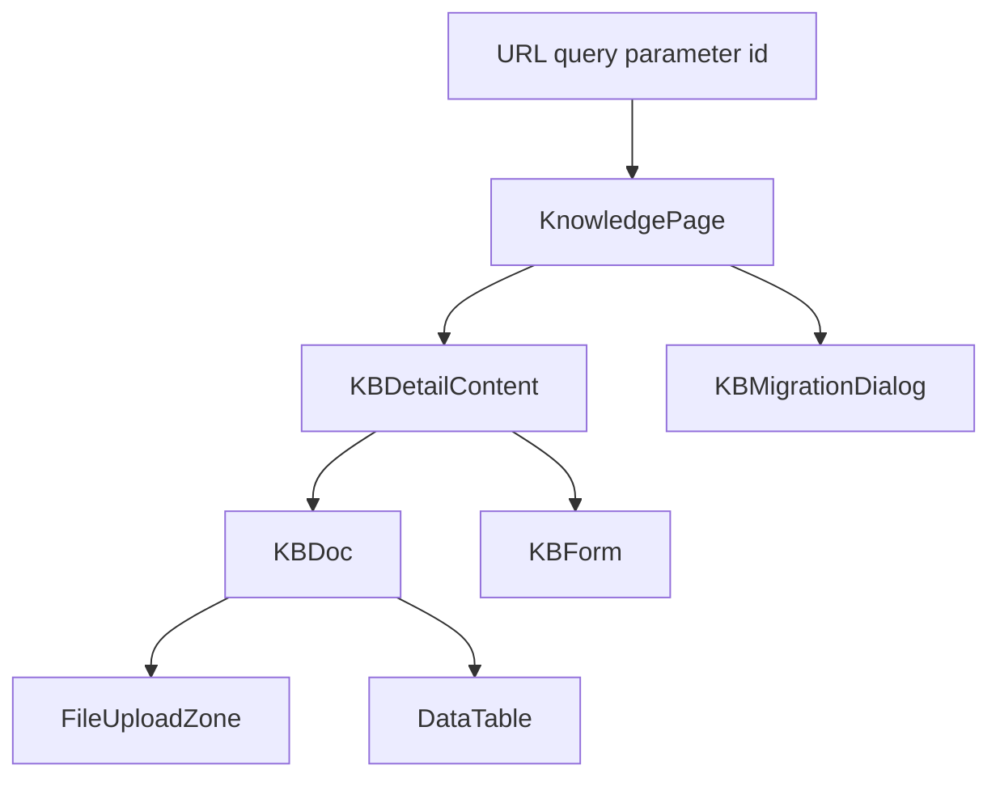
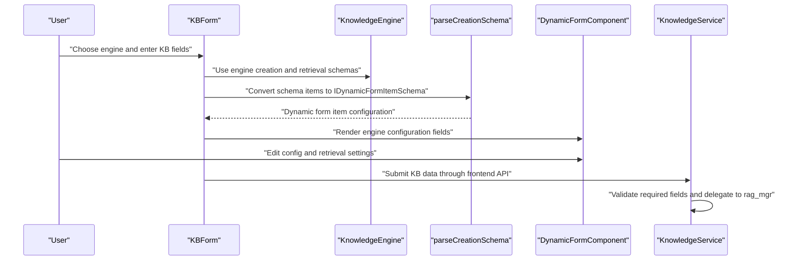
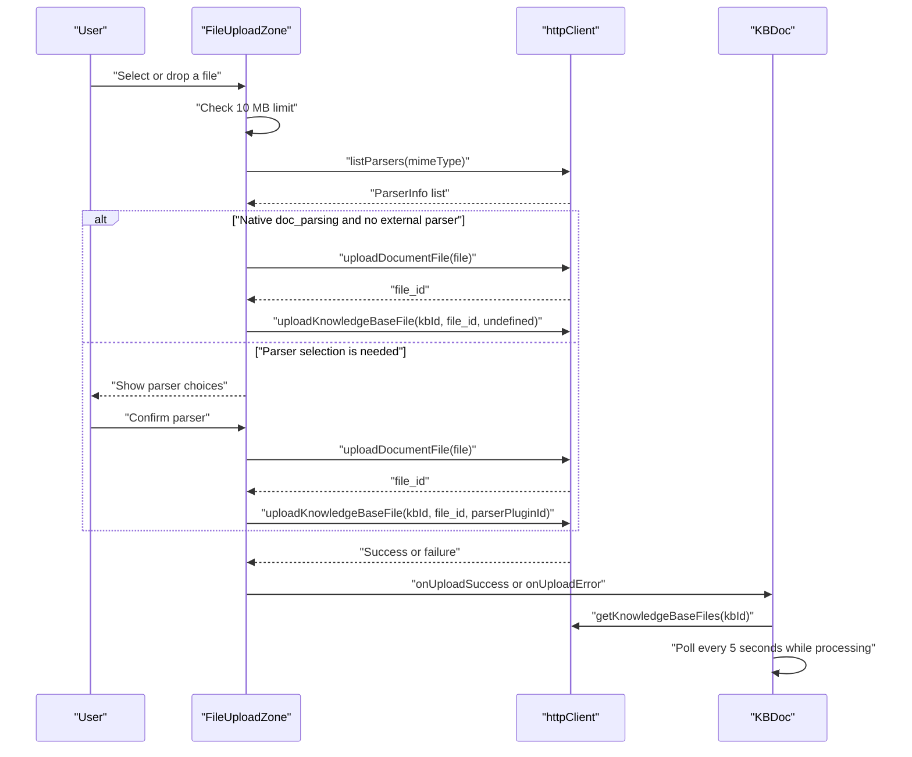
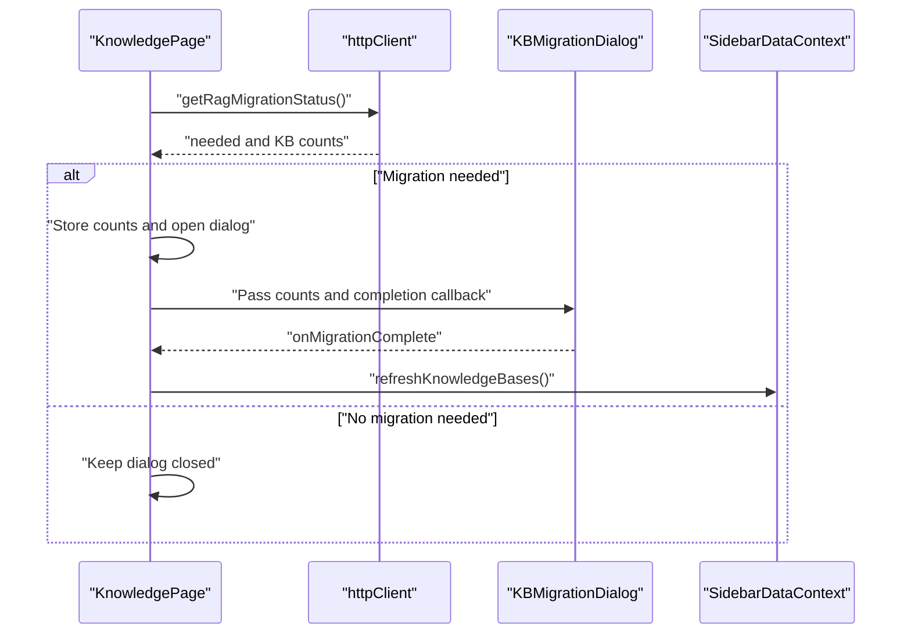
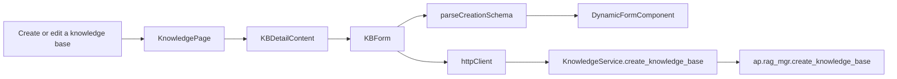
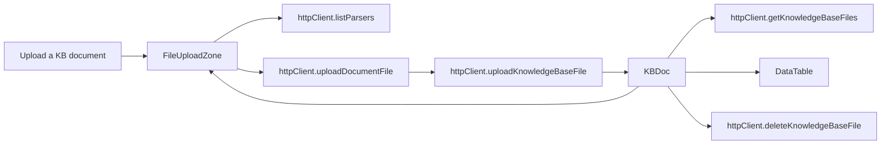

<!-- source: DeepWiki mcp.deepwiki.com · repo langbot-app/LangBot · page 8.7 Knowledge Base Management UI · fetched 2026-10-29 -->

# Knowledge Base Management UI

Relevant source files

The following files were used as context for generating this wiki page:

- [skills/skills/langbot-testing/references/langrag-knowledge-base.md](skills/skills/langbot-testing/references/langrag-knowledge-base.md)
- [src/langbot/pkg/api/http/controller/group.py](src/langbot/pkg/api/http/controller/group.py)
- [src/langbot/pkg/api/http/controller/groups/workspaces.py](src/langbot/pkg/api/http/controller/groups/workspaces.py)
- [src/langbot/pkg/api/http/service/knowledge.py](src/langbot/pkg/api/http/service/knowledge.py)
- [src/langbot/pkg/api/http/service/workspace_limits.py](src/langbot/pkg/api/http/service/workspace_limits.py)
- [src/langbot/pkg/entity/persistence/operation_log.py](src/langbot/pkg/entity/persistence/operation_log.py)
- [src/langbot/pkg/entity/persistence/rag.py](src/langbot/pkg/entity/persistence/rag.py)
- [src/langbot/pkg/persistence/alembic/versions/0025_rag_document_identity.py](src/langbot/pkg/persistence/alembic/versions/0025_rag_document_identity.py)
- [src/langbot/pkg/rag/knowledge/kbmgr.py](src/langbot/pkg/rag/knowledge/kbmgr.py)
- [tests/integration/plugin/test_rag_cancellation_protocol.py](tests/integration/plugin/test_rag_cancellation_protocol.py)
- [tests/unit_tests/test_workspace_subscription_limits.py](tests/unit_tests/test_workspace_subscription_limits.py)
- [web/src/app/home/bots/components/bot-form/BotForm.tsx](web/src/app/home/bots/components/bot-form/BotForm.tsx)
- [web/src/app/home/bots/page.tsx](web/src/app/home/bots/page.tsx)
- [web/src/app/home/components/dynamic-form/DynamicFormComponent.tsx](web/src/app/home/components/dynamic-form/DynamicFormComponent.tsx)
- [web/src/app/home/components/dynamic-form/DynamicFormItemComponent.tsx](web/src/app/home/components/dynamic-form/DynamicFormItemComponent.tsx)
- [web/src/app/home/components/dynamic-form/DynamicFormItemConfig.ts](web/src/app/home/components/dynamic-form/DynamicFormItemConfig.ts)
- [web/src/app/home/components/workspace-quota/useWorkspaceQuotaStatus.ts](web/src/app/home/components/workspace-quota/useWorkspaceQuotaStatus.ts)
- [web/src/app/home/knowledge/components/kb-card/KBCard.module.css](web/src/app/home/knowledge/components/kb-card/KBCard.module.css)
- [web/src/app/home/knowledge/components/kb-card/KBCard.tsx](web/src/app/home/knowledge/components/kb-card/KBCard.tsx)
- [web/src/app/home/knowledge/components/kb-card/KBCardVO.ts](web/src/app/home/knowledge/components/kb-card/KBCardVO.ts)
- [web/src/app/home/knowledge/components/kb-docs/FileUploadZone.tsx](web/src/app/home/knowledge/components/kb-docs/FileUploadZone.tsx)
- [web/src/app/home/knowledge/components/kb-docs/KBDoc.tsx](web/src/app/home/knowledge/components/kb-docs/KBDoc.tsx)
- [web/src/app/home/knowledge/components/kb-docs/documents/columns.tsx](web/src/app/home/knowledge/components/kb-docs/documents/columns.tsx)
- [web/src/app/home/knowledge/components/kb-form/KBForm.tsx](web/src/app/home/knowledge/components/kb-form/KBForm.tsx)
- [web/src/app/home/knowledge/page.tsx](web/src/app/home/knowledge/page.tsx)
- [web/src/app/home/pipelines/components/pipeline-form/PipelineFormComponent.tsx](web/src/app/home/pipelines/components/pipeline-form/PipelineFormComponent.tsx)
- [web/src/app/home/pipelines/page.tsx](web/src/app/home/pipelines/page.tsx)
- [web/src/app/infra/basic-component/create-card-component/createCartComponent.module.css](web/src/app/infra/basic-component/create-card-component/createCartComponent.module.css)
- [web/src/app/infra/entities/form/dynamic.ts](web/src/app/infra/entities/form/dynamic.ts)
- [web/src/app/infra/entities/workspace.ts](web/src/app/infra/entities/workspace.ts)

## Purpose and Scope

Section 8.7 documents the frontend entry point for knowledge-base (KB) management, KB configuration through `KBForm`, document upload and status management, and the page-level RAG migration check. The available code shows the page wiring and the upload flow in detail; it does not expose the internals of `KBDetailContent`, `KBMigrationDialog`, or the retrieval-testing component, so those internals are not inferred here. [web/src/app/home/knowledge/page.tsx:9-70]() [web/src/app/home/knowledge/components/kb-form/KBForm.tsx:47-81]() [web/src/app/home/knowledge/components/kb-docs/FileUploadZone.tsx:80-115]()

Sources: [web/src/app/home/knowledge/page.tsx:9-70]() [web/src/app/home/knowledge/components/kb-form/KBForm.tsx:47-81]() [web/src/app/home/knowledge/components/kb-docs/FileUploadZone.tsx:80-115]()

---

## Overview and Page Structure

`KnowledgePage` reads the `id` query parameter. When present, it renders `KBDetailContent` for that KB; otherwise, it renders a prompt to select a KB from the sidebar. The migration dialog is rendered in either case, and its initial status check runs on page mount. [web/src/app/home/knowledge/page.tsx:9-21]() [web/src/app/home/knowledge/page.tsx:41-70]()

The shown code establishes these UI responsibilities:

- `KnowledgePage` selects the detail or empty state and owns migration-dialog state. [web/src/app/home/knowledge/page.tsx:9-18]() [web/src/app/home/knowledge/page.tsx:41-70]()
- `KBDetailContent` receives the selected KB identifier. Its internal tabs and retrieval-testing behavior are not shown in the supplied code. [web/src/app/home/knowledge/page.tsx:41-52]()
- `KBDoc` loads and displays the KB’s document list, composes `FileUploadZone` with the document `DataTable`, and refreshes after upload or deletion. [web/src/app/home/knowledge/components/kb-docs/KBDoc.tsx:20-33]() [web/src/app/home/knowledge/components/kb-docs/KBDoc.tsx:72-106]()
- `KBForm` gathers basic KB fields and settings for the selected knowledge engine. [web/src/app/home/knowledge/components/kb-form/KBForm.tsx:47-55]() [web/src/app/home/knowledge/components/kb-form/KBForm.tsx:83-110]()

**Diagram: Knowledge-management page components**

Sources: [web/src/app/home/knowledge/page.tsx:9-70]() [web/src/app/home/knowledge/components/kb-docs/KBDoc.tsx:11-109]() [web/src/app/home/knowledge/components/kb-form/KBForm.tsx:83-110]()

Sources: [web/src/app/home/knowledge/page.tsx:9-70]() [web/src/app/home/knowledge/components/kb-docs/KBDoc.tsx:11-109]() [web/src/app/home/knowledge/components/kb-form/KBForm.tsx:83-110]()

---

## Knowledge Base Cards and Representation

The repository includes `KBCard` and `KBCardVO` components/files for representing KBs. The supplied code does not include their contents, so card fields, formatting behavior, and capability badges cannot be established here. [web/src/app/home/knowledge/components/kb-card/KBCard.tsx]() [web/src/app/home/knowledge/components/kb-card/KBCardVO.ts]()

Sources: [web/src/app/home/knowledge/components/kb-card/KBCard.tsx]() [web/src/app/home/knowledge/components/kb-card/KBCardVO.ts]()

---

## Knowledge Base Creation and Editing (`KBForm`)

`KBForm` is the KB configuration form. It accepts an optional `initKbId`, callbacks for newly created or updated KBs, and an optional dirty-state callback. It uses `react-hook-form` and Zod; the visible schema requires a non-empty `name` and `ragEngineId`, while `description` and `emoji` are optional. [web/src/app/home/knowledge/components/kb-form/KBForm.tsx:3-5]() [web/src/app/home/knowledge/components/kb-form/KBForm.tsx:47-55]() [web/src/app/home/knowledge/components/kb-form/KBForm.tsx:83-95]()

The form maintains separate state for available engines, selected engine, creation settings, and retrieval settings. It also tracks loading and initialization state, and keeps refs for saved-state comparison and validation functions supplied by the dynamic forms. [web/src/app/home/knowledge/components/kb-form/KBForm.tsx:97-121]()

### Dynamic Engine Configuration

`parseCreationSchema` accepts a schema as either an array or an object with a `schema` array. It converts each item into a `DynamicFormItemConfig`, generating an ID and parsing its type with `parseDynamicFormItemType`. [web/src/app/home/knowledge/components/kb-form/KBForm.tsx:57-81]()

`KBForm` imports `DynamicFormComponent` and the helpers used to build dynamic form configuration. The shared dynamic form schema defines typed items such as model selectors, KB selectors, plugin selectors, files, and JSON fields; `DynamicFormComponent` maps field types to validation schemas, including `KNOWLEDGE_BASE_SELECTOR` and `KNOWLEDGE_BASE_MULTI_SELECTOR`. [web/src/app/home/knowledge/components/kb-form/KBForm.tsx:31-37]() [web/src/app/infra/entities/form/dynamic.ts:62-95]() [web/src/app/home/components/dynamic-form/DynamicFormComponent.tsx:98-145]()

**Diagram: KB form schema to configured settings**

Sources: [web/src/app/home/knowledge/components/kb-form/KBForm.tsx:31-37]() [web/src/app/home/knowledge/components/kb-form/KBForm.tsx:57-81]() [web/src/app/home/knowledge/components/kb-form/KBForm.tsx:97-121]() [src/langbot/pkg/api/http/service/knowledge.py:52-103]()

### Backend creation contract

`KnowledgeService.create_knowledge_base` requires a workspace context and a `knowledge_engine_plugin_id`. It restores secret placeholders in `creation_settings`, reads `retrieval_settings`, and validates required schema fields unless initialization is deferred. It then delegates creation to `rag_mgr.create_knowledge_base`, passing the name, engine plugin ID, settings, and description. [src/langbot/pkg/api/http/service/knowledge.py:52-103]()

For normal initialization, `_validate_schema_required_fields` obtains the plugin’s creation and retrieval schemas and checks required fields. Plugin schema retrieval failures are logged; a `ValueError` from required-field validation is propagated. [src/langbot/pkg/api/http/service/knowledge.py:104-145]()

**Table: Basic KB form fields**

| Field | Required | UI validation / role |
|---|---:|---|
| `name` | Yes | Must contain at least one character. [web/src/app/home/knowledge/components/kb-form/KBForm.tsx:47-50]() |
| `description` | No | Optional description string. [web/src/app/home/knowledge/components/kb-form/KBForm.tsx:49-51]() |
| `emoji` | No | Optional emoji; the shown default is `📚`. [web/src/app/home/knowledge/components/kb-form/KBForm.tsx:49-51]() [web/src/app/home/knowledge/components/kb-form/KBForm.tsx:125-133]() |
| `ragEngineId` | Yes | Must contain at least one character; represents the selected engine in the form schema. [web/src/app/home/knowledge/components/kb-form/KBForm.tsx:52-55]() |

Sources: [web/src/app/home/knowledge/components/kb-form/KBForm.tsx:47-55]() [web/src/app/home/knowledge/components/kb-form/KBForm.tsx:97-133]()

---

## Document Upload and Management

### `KBDoc`

`KBDoc` uses `httpClient.getKnowledgeBaseFiles(kbId)` to retrieve files and maps each response item to a table row containing `uuid`, `file_name` as `name`, and `status`. [web/src/app/home/knowledge/components/kb-docs/KBDoc.tsx:20-33]()

On mount, it loads the list and starts polling if any document has a status other than `completed` or `failed`. Polling runs every five seconds and stops when the non-empty list has only completed or failed documents. The polling interval is cleared on unmount. [web/src/app/home/knowledge/components/kb-docs/KBDoc.tsx:35-70]()

Deletion calls `httpClient.deleteKnowledgeBaseFile(kbId, id)`. On success, `KBDoc` reloads the document list and shows a success toast; on failure, it logs the error and shows an error toast. [web/src/app/home/knowledge/components/kb-docs/KBDoc.tsx:81-95]()

### `FileUploadZone`

`FileUploadZone` accepts a KB identifier, optional engine name and capabilities, and success/error callbacks. It rejects files larger than 10 MB, then looks up parsers using the file MIME type. When the engine has the `doc_parsing` capability, the component selects the built-in parser; otherwise, it selects the first available parser or leaves the parser selection empty. [web/src/app/home/knowledge/components/kb-docs/FileUploadZone.tsx:20-51]() [web/src/app/home/knowledge/components/kb-docs/FileUploadZone.tsx:53-78]() [web/src/app/home/knowledge/components/kb-docs/FileUploadZone.tsx:117-135]()

The upload consists of two API operations:

1. `uploadDocumentFile(file)` sends the file and returns a `file_id`.
2. `uploadKnowledgeBaseFile(kbId, file_id, parserPluginId)` associates that uploaded file with the KB and optionally supplies a parser plugin ID. [web/src/app/home/knowledge/components/kb-docs/FileUploadZone.tsx:80-115]()

If the engine can parse documents natively and no external parsers are returned, an effect triggers upload automatically. Otherwise, the UI can offer parser selection and confirmation; selecting the built-in parser passes no parser plugin ID. [web/src/app/home/knowledge/components/kb-docs/FileUploadZone.tsx:137-160]() [web/src/app/home/knowledge/components/kb-docs/FileUploadZone.tsx:203-210]()

After a successful upload, `KBDoc` reloads the list and starts polling. The upload zone reports errors through its callback and displays a toast. [web/src/app/home/knowledge/components/kb-docs/FileUploadZone.tsx:96-109]() [web/src/app/home/knowledge/components/kb-docs/KBDoc.tsx:72-79]()

**Diagram: Upload, parser selection, and document status refresh**

Sources: [web/src/app/home/knowledge/components/kb-docs/FileUploadZone.tsx:20-115]() [web/src/app/home/knowledge/components/kb-docs/FileUploadZone.tsx:117-160]() [web/src/app/home/knowledge/components/kb-docs/FileUploadZone.tsx:203-210]() [web/src/app/home/knowledge/components/kb-docs/KBDoc.tsx:20-75]()

Sources: [web/src/app/home/knowledge/components/kb-docs/FileUploadZone.tsx:20-115]() [web/src/app/home/knowledge/components/kb-docs/FileUploadZone.tsx:117-160]() [web/src/app/home/knowledge/components/kb-docs/KBDoc.tsx:20-95]()

---

## Retrieval Testing

The page’s selected-KB branch renders `KBDetailContent`, but the supplied file contents do not show that component’s implementation or any retrieval-test component/API call. Consequently, the retrieval-testing UI and its request/response flow cannot be documented accurately from the available code. [web/src/app/home/knowledge/page.tsx:41-52]()

Sources: [web/src/app/home/knowledge/page.tsx:41-52]()

---

## RAG Migration Dialog

`KnowledgePage` checks migration status on mount by calling `httpClient.getRagMigrationStatus()`. When `resp.needed` is true, it stores the internal and external KB counts and opens the dialog. Errors from this non-critical check are silently ignored. [web/src/app/home/knowledge/page.tsx:15-35]()

The page passes the counts, open state, and `onMigrationComplete` callback to `KBMigrationDialog`. On completion, the callback invokes `refreshKnowledgeBases()` from `SidebarDataContext`. The dialog’s own migration request and confirmation behavior are not shown in the supplied code. [web/src/app/home/knowledge/page.tsx:13-18]() [web/src/app/home/knowledge/page.tsx:37-39]() [web/src/app/home/knowledge/page.tsx:41-64]()

**Diagram: Migration status check and page callback**

Sources: [web/src/app/home/knowledge/page.tsx:13-39]() [web/src/app/home/knowledge/page.tsx:41-64]()

Sources: [web/src/app/home/knowledge/page.tsx:13-39]() [web/src/app/home/knowledge/page.tsx:41-64]()

---

## Summary of Core Classes and Functions

| Name | Role | Definition / usage |
|---|---|---|
| `KnowledgePage` | Selects KB detail or empty state and owns migration status/dialog state. | [web/src/app/home/knowledge/page.tsx:9-70]() |
| `KBForm` | Form for basic KB fields and engine-defined settings. | [web/src/app/home/knowledge/components/kb-form/KBForm.tsx:47-95]() |
| `parseCreationSchema` | Converts engine schema items into dynamic form configuration. | [web/src/app/home/knowledge/components/kb-form/KBForm.tsx:57-81]() |
| `DynamicFormComponent` | Renders schema-driven fields and maps field types to validation schemas. | [web/src/app/home/components/dynamic-form/DynamicFormComponent.tsx:98-145]() |
| `KBDoc` | Loads, refreshes, and deletes KB documents; composes upload and table components. | [web/src/app/home/knowledge/components/kb-docs/KBDoc.tsx:11-109]() |
| `FileUploadZone` | Validates file size, resolves parser options, uploads files, and reports outcomes. | [web/src/app/home/knowledge/components/kb-docs/FileUploadZone.tsx:20-115]() |
| `KnowledgeService.create_knowledge_base` | Applies workspace/engine requirements and delegates KB creation to `rag_mgr`. | [src/langbot/pkg/api/http/service/knowledge.py:52-103]() |

Sources: [web/src/app/home/knowledge/page.tsx:9-70]() [web/src/app/home/knowledge/components/kb-form/KBForm.tsx:47-95]() [web/src/app/home/knowledge/components/kb-docs/KBDoc.tsx:11-109]() [web/src/app/home/knowledge/components/kb-docs/FileUploadZone.tsx:20-115]() [src/langbot/pkg/api/http/service/knowledge.py:52-103]()

---

## Diagrams Linking Natural Language and Code Entity Spaces

### 1. User intent to KB configuration entities

**Diagram: KB setup mapped to frontend and backend identifiers**

Sources: [web/src/app/home/knowledge/page.tsx:9-52]() [web/src/app/home/knowledge/components/kb-form/KBForm.tsx:57-81]() [web/src/app/home/components/dynamic-form/DynamicFormComponent.tsx:98-145]() [src/langbot/pkg/api/http/service/knowledge.py:52-103]()

### 2. User intent to document-upload entities

**Diagram: Add a document mapped to upload and persistence-facing calls**

Sources: [web/src/app/home/knowledge/components/kb-docs/FileUploadZone.tsx:53-115]() [web/src/app/home/knowledge/components/kb-docs/KBDoc.tsx:20-33]() [web/src/app/home/knowledge/components/kb-docs/KBDoc.tsx:81-106]()

Sources: [web/src/app/home/knowledge/page.tsx:9-52]() [web/src/app/home/knowledge/components/kb-form/KBForm.tsx:57-81]() [src/langbot/pkg/api/http/service/knowledge.py:52-103]() [web/src/app/home/knowledge/components/kb-docs/FileUploadZone.tsx:53-115]() [web/src/app/home/knowledge/components/kb-docs/KBDoc.tsx:20-106]()

---

## References

- `web/src/app/home/knowledge/page.tsx` [9-70]()
- `web/src/app/home/knowledge/components/kb-form/KBForm.tsx` [47-121]()
- `web/src/app/home/knowledge/components/kb-docs/KBDoc.tsx` [11-109]()
- `web/src/app/home/knowledge/components/kb-docs/FileUploadZone.tsx` [20-211]()
- `web/src/app/infra/entities/form/dynamic.ts` [15-95]()
- `web/src/app/home/components/dynamic-form/DynamicFormComponent.tsx` [98-145]()
- `src/langbot/pkg/api/http/service/knowledge.py` [32-145]()

Sources: [web/src/app/home/knowledge/page.tsx:9-70]() [web/src/app/home/knowledge/components/kb-form/KBForm.tsx:47-121]() [web/src/app/home/knowledge/components/kb-docs/KBDoc.tsx:11-109]() [web/src/app/home/knowledge/components/kb-docs/FileUploadZone.tsx:20-211]() [web/src/app/infra/entities/form/dynamic.ts:15-95]() [web/src/app/home/components/dynamic-form/DynamicFormComponent.tsx:98-145]() [src/langbot/pkg/api/http/service/knowledge.py:32-145]()

---

