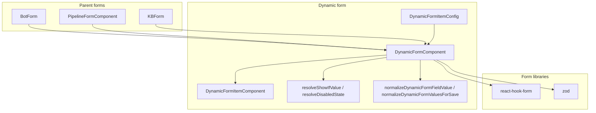
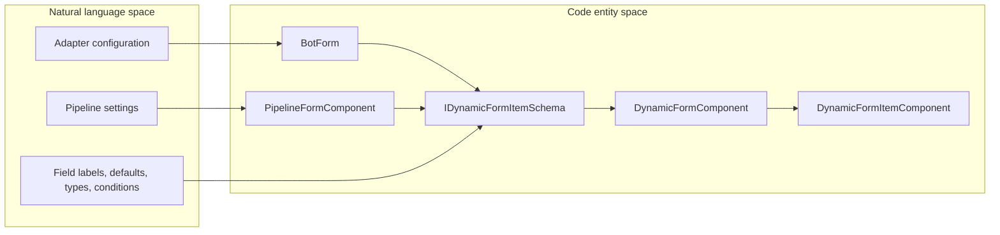
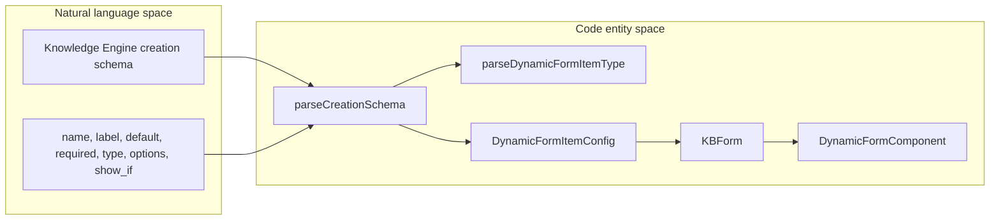

<!-- source: DeepWiki mcp.deepwiki.com · repo langbot-app/LangBot · page 8.8 Dynamic Form System · fetched 2026-10-29 -->

# Dynamic Form System

Relevant source files

The following files were used as context for generating this wiki page:

- [web/src/app/home/bots/components/bot-form/BotForm.tsx](web/src/app/home/bots/components/bot-form/BotForm.tsx)
- [web/src/app/home/bots/page.tsx](web/src/app/home/bots/page.tsx)
- [web/src/app/home/components/dynamic-form/DynamicFormComponent.tsx](web/src/app/home/components/dynamic-form/DynamicFormComponent.tsx)
- [web/src/app/home/components/dynamic-form/DynamicFormItemComponent.tsx](web/src/app/home/components/dynamic-form/DynamicFormItemComponent.tsx)
- [web/src/app/home/components/dynamic-form/DynamicFormItemConfig.ts](web/src/app/home/components/dynamic-form/DynamicFormItemConfig.ts)
- [web/src/app/home/knowledge/components/kb-card/KBCard.module.css](web/src/app/home/knowledge/components/kb-card/KBCard.module.css)
- [web/src/app/home/knowledge/components/kb-card/KBCard.tsx](web/src/app/home/knowledge/components/kb-card/KBCard.tsx)
- [web/src/app/home/knowledge/components/kb-card/KBCardVO.ts](web/src/app/home/knowledge/components/kb-card/KBCardVO.ts)
- [web/src/app/home/knowledge/components/kb-docs/FileUploadZone.tsx](web/src/app/home/knowledge/components/kb-docs/FileUploadZone.tsx)
- [web/src/app/home/knowledge/components/kb-docs/KBDoc.tsx](web/src/app/home/knowledge/components/kb-docs/KBDoc.tsx)
- [web/src/app/home/knowledge/components/kb-docs/documents/columns.tsx](web/src/app/home/knowledge/components/kb-docs/documents/columns.tsx)
- [web/src/app/home/knowledge/components/kb-form/KBForm.tsx](web/src/app/home/knowledge/components/kb-form/KBForm.tsx)
- [web/src/app/home/knowledge/page.tsx](web/src/app/home/knowledge/page.tsx)
- [web/src/app/home/pipelines/components/pipeline-form/PipelineFormComponent.tsx](web/src/app/home/pipelines/components/pipeline-form/PipelineFormComponent.tsx)
- [web/src/app/home/pipelines/page.tsx](web/src/app/home/pipelines/page.tsx)
- [web/src/app/infra/basic-component/create-card-component/createCartComponent.module.css](web/src/app/infra/basic-component/create-card-component/createCartComponent.module.css)
- [web/src/app/infra/entities/form/dynamic.ts](web/src/app/infra/entities/form/dynamic.ts)

## Purpose and Scope

The Dynamic Form System renders configuration forms from `IDynamicFormItemSchema` metadata rather than requiring every caller to define each field’s UI. Its main pieces are `DynamicFormComponent`, which manages form state and schema-driven rendering, and `DynamicFormItemComponent`, which renders individual field types. The system is used by bot, pipeline, and knowledge-base forms. [web/src/app/infra/entities/form/dynamic.ts:15-60](), [web/src/app/home/components/dynamic-form/DynamicFormComponent.tsx:1-23](), [web/src/app/home/components/dynamic-form/DynamicFormItemComponent.tsx:127-147](), [web/src/app/home/bots/components/bot-form/BotForm.tsx:13-24](), [web/src/app/home/pipelines/components/pipeline-form/PipelineFormComponent.tsx:19-26](), [web/src/app/home/knowledge/components/kb-form/KBForm.tsx:25-37]()

Sources: [web/src/app/infra/entities/form/dynamic.ts:15-60](), [web/src/app/home/components/dynamic-form/DynamicFormComponent.tsx:1-23](), [web/src/app/home/components/dynamic-form/DynamicFormItemComponent.tsx:127-147](), [web/src/app/home/bots/components/bot-form/BotForm.tsx:13-24](), [web/src/app/home/pipelines/components/pipeline-form/PipelineFormComponent.tsx:19-26](), [web/src/app/home/knowledge/components/kb-form/KBForm.tsx:25-37]()

## System Architecture

### Component Hierarchy

Parent forms supply configuration schemas and initial values to `DynamicFormComponent`. The component uses `react-hook-form`, builds Zod value schemas, and renders items through `DynamicFormItemComponent`. `DynamicFormItemConfig` implements the schema interface and provides type parsing and default-value helpers. [web/src/app/home/components/dynamic-form/DynamicFormComponent.tsx:1-23](), [web/src/app/home/components/dynamic-form/DynamicFormItemComponent.tsx:127-147](), [web/src/app/home/components/dynamic-form/DynamicFormItemConfig.ts:10-44](), [web/src/app/home/components/dynamic-form/DynamicFormItemConfig.ts:46-92]()

Sources: [web/src/app/home/bots/components/bot-form/BotForm.tsx:13-24](), [web/src/app/home/pipelines/components/pipeline-form/PipelineFormComponent.tsx:19-26](), [web/src/app/home/knowledge/components/kb-form/KBForm.tsx:25-37](), [web/src/app/home/components/dynamic-form/DynamicFormComponent.tsx:1-23](), [web/src/app/home/components/dynamic-form/DynamicFormItemConfig.ts:10-44]()

### Data Flow: Parent Forms to Dynamic Form Code Entities

Bot and pipeline forms import `DynamicFormComponent` and pass form configuration through it. The schema interface defines item metadata, while `DynamicFormComponent` imports condition and save-value helpers and delegates field rendering to `DynamicFormItemComponent`. [web/src/app/home/bots/components/bot-form/BotForm.tsx:13-24](), [web/src/app/home/pipelines/components/pipeline-form/PipelineFormComponent.tsx:19-29](), [web/src/app/home/components/dynamic-form/DynamicFormComponent.tsx:1-23](), [web/src/app/home/components/dynamic-form/DynamicFormComponent.tsx:51-57](), [web/src/app/infra/entities/form/dynamic.ts:15-60]()

Sources: [web/src/app/home/bots/components/bot-form/BotForm.tsx:13-24](), [web/src/app/home/pipelines/components/pipeline-form/PipelineFormComponent.tsx:19-29](), [web/src/app/infra/entities/form/dynamic.ts:15-60](), [web/src/app/home/components/dynamic-form/DynamicFormComponent.tsx:1-23]()

### Data Flow: Knowledge Engine Creation Schema

`KBForm.parseCreationSchema` accepts an array of items or an object containing a `schema` array, maps each item to a `DynamicFormItemConfig`, and parses the declared type with `parseDynamicFormItemType`. `KBForm` imports `DynamicFormComponent` to render the resulting metadata. [web/src/app/home/knowledge/components/kb-form/KBForm.tsx:31-37](), [web/src/app/home/knowledge/components/kb-form/KBForm.tsx:57-81]()

Sources: [web/src/app/home/knowledge/components/kb-form/KBForm.tsx:31-37](), [web/src/app/home/knowledge/components/kb-form/KBForm.tsx:57-81](), [web/src/app/home/components/dynamic-form/DynamicFormItemConfig.ts:46-67]()

## Schema Structure

### `IDynamicFormItemSchema`

`IDynamicFormItemSchema` describes a form item’s identity, value name, label, type, default, required status, optional choices, and conditional behavior. It also includes type-specific metadata such as file MIME acceptance, QR-login platform, download URL, and help links. [web/src/app/infra/entities/form/dynamic.ts:15-60]()

| Property | Meaning |
|---|---|
| `id` | Item identifier. [web/src/app/infra/entities/form/dynamic.ts:15-17]() |
| `name` | Form value key; names beginning with `__system.` are display-only system-context fields. [web/src/app/infra/entities/form/dynamic.ts:19-25]() |
| `label`, `description` | Localized display text represented by `I18nObject`. [web/src/app/infra/entities/form/dynamic.ts:1-1](), [web/src/app/infra/entities/form/dynamic.ts:15-29]() |
| `default` | Initial value for ordinary fields. [web/src/app/infra/entities/form/dynamic.ts:15-18]() |
| `required` | Required-field metadata. [web/src/app/infra/entities/form/dynamic.ts:25-28]() |
| `type` | A `DynamicFormItemType` discriminator. [web/src/app/infra/entities/form/dynamic.ts:26-29](), [web/src/app/infra/entities/form/dynamic.ts:62-95]() |
| `options` | Optional named and localized choices. [web/src/app/infra/entities/form/dynamic.ts:29-30](), [web/src/app/infra/entities/form/dynamic.ts:102-105]() |
| `allow_custom` | Allows an editable value in addition to declared select options. [web/src/app/infra/entities/form/dynamic.ts:30-31]() |
| `show_if` | Condition controlling whether the item is rendered. [web/src/app/infra/entities/form/dynamic.ts:32-35]() |
| `disable_if` | Condition controlling whether a visible item is disabled. [web/src/app/infra/entities/form/dynamic.ts:36-43]() |
| `disabled_tooltip`, `disabled_tooltip_overrides` | Explanatory text for disabled fields, with ordered conditional overrides. [web/src/app/infra/entities/form/dynamic.ts:41-50]() |
| Type-specific metadata | Includes `scopes`, `accept`, `login_platform`, `url`, `download_filename`, and help-link fields. [web/src/app/infra/entities/form/dynamic.ts:52-59]() |

Sources: [web/src/app/infra/entities/form/dynamic.ts:1-60](), [web/src/app/infra/entities/form/dynamic.ts:102-105]()

### Schema Type Parsing and Defaults

`parseDynamicFormItemType` maps compatibility aliases to canonical types: `select-llm-model` becomes `llm-model-selector`, `select-knowledge-bases` becomes `knowledge-base-multi-selector`, and `number` becomes `float`. Unrecognized strings become `UNKNOWN`. [web/src/app/home/components/dynamic-form/DynamicFormItemConfig.ts:46-67]()

`getDefaultValues` builds a value record from the schema defaults. It excludes `__system.*` items and supplies companion defaults for `RICH_TOOLS_SELECTOR` and `RESOURCES_SELECTOR`. [web/src/app/home/components/dynamic-form/DynamicFormItemConfig.ts:69-92]()

Sources: [web/src/app/home/components/dynamic-form/DynamicFormItemConfig.ts:46-92]()

## Conditional Logic: `show_if` and `disable_if`

A condition has a `field`, an operator (`eq`, `neq`, or `in`), and a comparison `value`. The schema documentation specifies that conditions can reference `__system.*` values through `DynamicFormComponent.systemContext`. `DynamicFormComponent` imports `resolveShowIfValue` and `resolveDisabledState` as its condition helpers. [web/src/app/infra/entities/form/dynamic.ts:3-13](), [web/src/app/infra/entities/form/dynamic.ts:32-43](), [web/src/app/home/components/dynamic-form/DynamicFormComponent.tsx:51-57]()

`show_if` hides an item when its condition does not match; `disable_if` keeps the item visible but makes it read-only or disabled when the condition matches. The schema supports `disabled_tooltip` and ordered `disabled_tooltip_overrides` to explain the disabled state. [web/src/app/infra/entities/form/dynamic.ts:32-50]()

Sources: [web/src/app/infra/entities/form/dynamic.ts:3-13](), [web/src/app/infra/entities/form/dynamic.ts:32-50](), [web/src/app/home/components/dynamic-form/DynamicFormComponent.tsx:51-57]()

## `__system.*` Fields

`SYSTEM_FIELD_PREFIX` is the shared `__system.` namespace used by display-only item names and condition references. A name such as `__system.outbound_ips` resolves against `systemContext.outbound_ips`. These items are specified as read-only, omitted from form state, validation, and emission, and hidden when their resolved value is empty. [web/src/app/infra/entities/form/dynamic.ts:3-6](), [web/src/app/infra/entities/form/dynamic.ts:19-25]()

`getDefaultValues` skips system-prefixed items, so their schema placeholder defaults do not enter ordinary configuration values. [web/src/app/home/components/dynamic-form/DynamicFormItemConfig.ts:69-80]()

Sources: [web/src/app/infra/entities/form/dynamic.ts:3-6](), [web/src/app/infra/entities/form/dynamic.ts:19-25](), [web/src/app/home/components/dynamic-form/DynamicFormItemConfig.ts:69-80]()

## Supported Field Types

`DynamicFormItemType` enumerates primitive inputs, selectors, and specialized display or interaction types. The schema also includes compatibility aliases that are normalized by `parseDynamicFormItemType`. [web/src/app/infra/entities/form/dynamic.ts:62-95](), [web/src/app/home/components/dynamic-form/DynamicFormItemConfig.ts:54-67]()

| Category | Types |
|---|---|
| Primitive values | `integer`, `float`, `boolean`, `string`, `secret`, `text`, `array[string]`, `json`. [web/src/app/infra/entities/form/dynamic.ts:62-71](), [web/src/app/infra/entities/form/dynamic.ts:93-95]() |
| File and choice fields | `file`, `array[file]`, `select`, `unknown`. [web/src/app/infra/entities/form/dynamic.ts:70-72](), [web/src/app/infra/entities/form/dynamic.ts:78-79]() |
| Model selectors | `llm-model-selector`, `embedding-model-selector`, `rerank-model-selector`, `model-fallback-selector`. [web/src/app/infra/entities/form/dynamic.ts:72-77]() |
| Resource selectors | `knowledge-base-selector`, `knowledge-base-multi-selector`, `plugin-selector`, `bot-selector`, `tools-selector`, `rich-tools-selector`, `resources-selector`. [web/src/app/infra/entities/form/dynamic.ts:79-85]() |
| Specialized fields | `webhook-url`, `embed-code`, `qr-code-login`, `download-link`, `prompt-editor`. [web/src/app/infra/entities/form/dynamic.ts:77-89]() |
| Compatibility aliases | `select-llm-model`, `select-knowledge-bases`, `number`. [web/src/app/infra/entities/form/dynamic.ts:90-95]() |

`DynamicFormItemComponent` receives the item schema, a `react-hook-form` field binding, current form values, optional system context, and callbacks for file upload and setting values. Its imports include specialized editors and selectors, including `StructuredFieldEditor`, `PresetSelect`, and `ToolResourceSelectors`. [web/src/app/home/components/dynamic-form/DynamicFormItemComponent.tsx:1-9](), [web/src/app/home/components/dynamic-form/DynamicFormItemComponent.tsx:73-76](), [web/src/app/home/components/dynamic-form/DynamicFormItemComponent.tsx:127-147]()

Sources: [web/src/app/infra/entities/form/dynamic.ts:62-95](), [web/src/app/home/components/dynamic-form/DynamicFormItemConfig.ts:54-67](), [web/src/app/home/components/dynamic-form/DynamicFormItemComponent.tsx:1-9](), [web/src/app/home/components/dynamic-form/DynamicFormItemComponent.tsx:73-76](), [web/src/app/home/components/dynamic-form/DynamicFormItemComponent.tsx:127-147]()

## Implementation Details

### Validation and Save-Value Handling

`DynamicFormComponent` builds Zod value schemas according to field type. The visible schema mapping includes numeric schemas for integer and float, booleans, strings for string/secret/select and several single selectors, arrays for multi-selectors, structured objects for model fallback selection, and custom validators for JSON and prompt values. [web/src/app/home/components/dynamic-form/DynamicFormComponent.tsx:98-145]()

The component imports `normalizeDynamicFormFieldValue` and `normalizeDynamicFormValuesForSave` from `DynamicFormSaveValues`. These are the save-value normalization boundary used by the form component; the helper implementation is not included in the supplied file contents, so its detailed transformations are not specified here. [web/src/app/home/components/dynamic-form/DynamicFormComponent.tsx:19-23]()

`getDefaultValues` creates initial values for schema items while excluding system-prefixed display-only fields and adding defaults for the rich-tools and resources selector companion values. [web/src/app/home/components/dynamic-form/DynamicFormItemConfig.ts:69-92]()

Sources: [web/src/app/home/components/dynamic-form/DynamicFormComponent.tsx:98-145](), [web/src/app/home/components/dynamic-form/DynamicFormComponent.tsx:19-23](), [web/src/app/home/components/dynamic-form/DynamicFormItemConfig.ts:69-92]()

### Connection Mode Application in Bot Forms

`BotForm` includes helpers for adapter connection modes. `supportsConnectionMode` checks for a webhook-related schema item and determines whether webhook or persistent mode is supported. `applyConnectionMode` finds the webhook field’s `show_if` controller and chooses a candidate value that matches (or does not match) the condition for the selected mode. `detectConnectionMode` evaluates the webhook field’s condition against the current controller value or its default. [web/src/app/home/bots/components/bot-form/BotForm.tsx:88-165]()

These helpers use the same `show_if` condition shape as dynamic form metadata; the bot form’s local `conditionMatches` handles `eq`, `neq`, and membership in an array for the `in` operator. [web/src/app/home/bots/components/bot-form/BotForm.tsx:111-118](), [web/src/app/infra/entities/form/dynamic.ts:8-13]()

Sources: [web/src/app/home/bots/components/bot-form/BotForm.tsx:88-165](), [web/src/app/infra/entities/form/dynamic.ts:8-13]()

---

