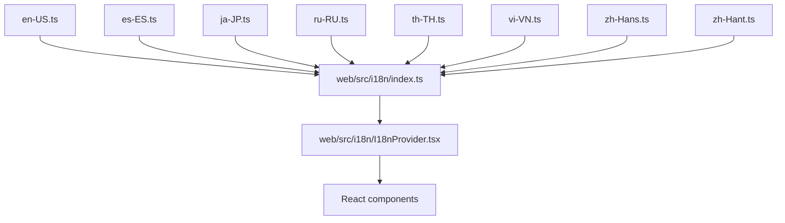
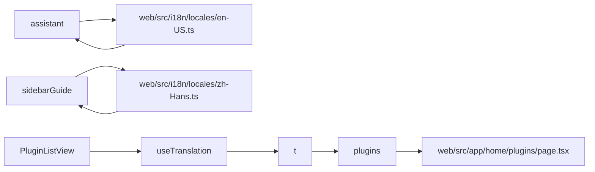
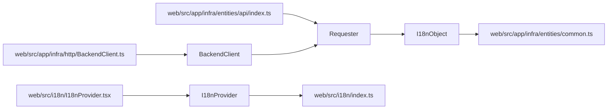
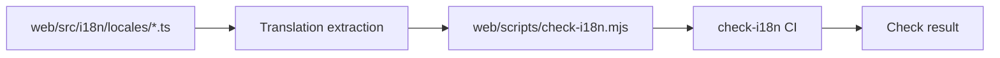

<!-- source: DeepWiki mcp.deepwiki.com · repo langbot-app/LangBot · page 8.9 Internationalization (i18n) · fetched 2026-10-29 -->

# Internationalization (i18n)

Relevant source files

The following files were used as context for generating this wiki page:

- [src/langbot/pkg/platform/sources/websocket.yaml](src/langbot/pkg/platform/sources/websocket.yaml)
- [web/src/app/home/components/home-sidebar/HomeSidebar.tsx](web/src/app/home/components/home-sidebar/HomeSidebar.tsx)
- [web/src/app/home/components/home-sidebar/SidebarDataContext.tsx](web/src/app/home/components/home-sidebar/SidebarDataContext.tsx)
- [web/src/app/home/plugins/page.tsx](web/src/app/home/plugins/page.tsx)
- [web/src/app/infra/entities/api/index.ts](web/src/app/infra/entities/api/index.ts)
- [web/src/app/infra/entities/common.ts](web/src/app/infra/entities/common.ts)
- [web/src/app/infra/http/BackendClient.ts](web/src/app/infra/http/BackendClient.ts)
- [web/src/app/wizard/page.tsx](web/src/app/wizard/page.tsx)
- [web/src/components/ui/language-selector.tsx](web/src/components/ui/language-selector.tsx)
- [web/src/i18n/I18nProvider.tsx](web/src/i18n/I18nProvider.tsx)
- [web/src/i18n/index.ts](web/src/i18n/index.ts)
- [web/src/i18n/locales/en-US.ts](web/src/i18n/locales/en-US.ts)
- [web/src/i18n/locales/es-ES.ts](web/src/i18n/locales/es-ES.ts)
- [web/src/i18n/locales/ja-JP.ts](web/src/i18n/locales/ja-JP.ts)
- [web/src/i18n/locales/ru-RU.ts](web/src/i18n/locales/ru-RU.ts)
- [web/src/i18n/locales/th-TH.ts](web/src/i18n/locales/th-TH.ts)
- [web/src/i18n/locales/vi-VN.ts](web/src/i18n/locales/vi-VN.ts)
- [web/src/i18n/locales/zh-Hans.ts](web/src/i18n/locales/zh-Hans.ts)
- [web/src/i18n/locales/zh-Hant.ts](web/src/i18n/locales/zh-Hant.ts)

## Purpose and Scope

LangBot’s web frontend uses i18next and `react-i18next` to render localized interface text. This page describes the locale dictionaries, translation-key organization, backend-facing `I18nObject` type, language selector, and the translation-check workflow. The frontend interface language is distinct from the workspace language used for backend messages and default bot replies. [web/src/app/home/components/home-sidebar/HomeSidebar.tsx:13-13]() [web/src/i18n/locales/en-US.ts:121-126]()

Sources: `web/src/app/home/components/home-sidebar/HomeSidebar.tsx`, `web/src/i18n/locales/en-US.ts`

---

## Overview and Supported Languages

Locale resources are TypeScript modules under `web/src/i18n/locales/`. The supplied locale files show eight locale codes: `en-US`, `es-ES`, `ja-JP`, `ru-RU`, `th-TH`, `vi-VN`, `zh-Hans`, and `zh-Hant`. Their dictionaries contain nested keys and translated strings; for example, each supplied dictionary includes `planRevision`, `cloudPlans`, and `workspaceLanguage` namespaces. [web/src/i18n/locales/en-US.ts:1-3]() [web/src/i18n/locales/es-ES.ts:1-2]() [web/src/i18n/locales/ja-JP.ts:1-3]() [web/src/i18n/locales/ru-RU.ts:1-2]() [web/src/i18n/locales/th-TH.ts:1-2]() [web/src/i18n/locales/vi-VN.ts:1-2]() [web/src/i18n/locales/zh-Hans.ts:1-3]() [web/src/i18n/locales/zh-Hant.ts:1-3]()

| Locale code | Language label | Locale module |
|---|---|---|
| `en-US` | English (US) | `web/src/i18n/locales/en-US.ts` [web/src/i18n/locales/en-US.ts:1-3]() |
| `es-ES` | Spanish | `web/src/i18n/locales/es-ES.ts` [web/src/i18n/locales/es-ES.ts:1-2]() |
| `ja-JP` | Japanese | `web/src/i18n/locales/ja-JP.ts` [web/src/i18n/locales/ja-JP.ts:1-3]() |
| `ru-RU` | Russian | `web/src/i18n/locales/ru-RU.ts` [web/src/i18n/locales/ru-RU.ts:1-2]() |
| `th-TH` | Thai | `web/src/i18n/locales/th-TH.ts` [web/src/i18n/locales/th-TH.ts:1-2]() |
| `vi-VN` | Vietnamese | `web/src/i18n/locales/vi-VN.ts` [web/src/i18n/locales/vi-VN.ts:1-2]() |
| `zh-Hans` | Simplified Chinese | `web/src/i18n/locales/zh-Hans.ts` [web/src/i18n/locales/zh-Hans.ts:1-3]() |
| `zh-Hant` | Traditional Chinese | `web/src/i18n/locales/zh-Hant.ts` [web/src/i18n/locales/zh-Hant.ts:1-3]() |

Several locale modules import feature-specific translation modules, such as `slack-setup` and `pipeline-migration`; other supplied locale modules import `pipeline-migration`. This lets those dictionary entries be maintained in separate files while being incorporated into the locale object. [web/src/i18n/locales/en-US.ts:1-3]() [web/src/i18n/locales/zh-Hans.ts:1-3]() [web/src/i18n/locales/ja-JP.ts:1-3]() [web/src/i18n/locales/vi-VN.ts:1-2]()

Sources: `web/src/i18n/locales/en-US.ts`, `web/src/i18n/locales/es-ES.ts`, `web/src/i18n/locales/ja-JP.ts`, `web/src/i18n/locales/ru-RU.ts`, `web/src/i18n/locales/th-TH.ts`, `web/src/i18n/locales/vi-VN.ts`, `web/src/i18n/locales/zh-Hans.ts`, `web/src/i18n/locales/zh-Hant.ts`

---

## File and Module Structure

Each locale module exports a nested object of translation keys and values. The frontend’s i18n configuration and provider are located at `web/src/i18n/index.ts` and `web/src/i18n/I18nProvider.tsx`; the available file listing identifies these integration points, but does not provide their implementation details. [web/src/i18n/index.ts:1-1]() [web/src/i18n/I18nProvider.tsx:1-1]() The locale dictionaries demonstrate the nested structure and feature-module imports directly. [web/src/i18n/locales/en-US.ts:1-3]() [web/src/i18n/locales/zh-Hans.ts:1-3]()

**Diagram: Locale resources and frontend integration**

Sources: `web/src/i18n/index.ts`, `web/src/i18n/I18nProvider.tsx`, `web/src/i18n/locales/en-US.ts`, `web/src/i18n/locales/es-ES.ts`, `web/src/i18n/locales/ja-JP.ts`, `web/src/i18n/locales/ru-RU.ts`, `web/src/i18n/locales/th-TH.ts`, `web/src/i18n/locales/vi-VN.ts`, `web/src/i18n/locales/zh-Hans.ts`, `web/src/i18n/locales/zh-Hant.ts`

---

## Translation Key Namespace Structure and Code Mapping

Translation resources use nested namespaces to group text by feature. For example, `assistant` includes labels and statuses for assistant interactions, while `plugins` supplies text used in the plugin-management page. The page imports `useTranslation` from `react-i18next` and calls `t(...)` with plugin keys for errors, toasts, and interface labels. [web/src/i18n/locales/en-US.ts:155-216]() [web/src/app/home/plugins/page.tsx:27-28]() [web/src/app/home/plugins/page.tsx:77-89]() [web/src/app/home/plugins/page.tsx:98-108]()

**Diagram: Translation namespaces linked to frontend entities**

Sources: `web/src/i18n/locales/en-US.ts`, `web/src/i18n/locales/zh-Hans.ts`, `web/src/app/home/plugins/page.tsx`

Common dictionary groups visible in the supplied locale files include:

| Namespace | Example keys | Role indicated by the strings |
|---|---|---|
| `planRevision` | `subscribedOn`, `current`, `fields` | Subscription revision and quota text. [web/src/i18n/locales/en-US.ts:4-47]() |
| `cloudPlans` | `title`, `description`, `limits` | Plan comparison and workspace-quota text. [web/src/i18n/locales/en-US.ts:49-119]() |
| `workspaceLanguage` | `label`, `description`, `saved`, `saveFailed` | Workspace language setting labels and outcomes. [web/src/i18n/locales/en-US.ts:121-126]() |
| `inflight` | `queued`, `running`, `completed`, `failed` | In-progress event state labels. [web/src/i18n/locales/en-US.ts:129-153]() |
| `assistant` | `thinking`, `toolRunning`, `operationFailed` | Workspace assistant state and action text. [web/src/i18n/locales/en-US.ts:155-216]() |
| `plugins` | `failedToGetStatus`, `installSuccess`, `connectionError` | Plugin-page messages passed to `t(...)`. [web/src/app/home/plugins/page.tsx:77-89]() [web/src/app/home/plugins/page.tsx:98-108]() [web/src/app/home/plugins/page.tsx:116-124]() |

Sources: `web/src/i18n/locales/en-US.ts`, `web/src/i18n/locales/zh-Hans.ts`, `web/src/app/home/plugins/page.tsx`

---

## Component Consumption and Interpolation

React components can obtain the translation function through `useTranslation` from `react-i18next`. In `PluginListView`, `t` is used for status-fetch failures, install and update success messages, and plugin state/error labels. [web/src/app/home/plugins/page.tsx:27-28]() [web/src/app/home/plugins/page.tsx:77-89]() [web/src/app/home/plugins/page.tsx:98-108]() [web/src/app/home/plugins/page.tsx:138-155]()

Dictionary strings use `{{variable}}` placeholders where runtime values are part of the message. For example, the English dictionary includes `{{date}}`, `{{plan}}`, `{{revision}}`, and `{{count}}` placeholders. [web/src/i18n/locales/en-US.ts:5-5]() [web/src/i18n/locales/en-US.ts:14-14]() [web/src/i18n/locales/en-US.ts:101-108]() [web/src/i18n/locales/en-US.ts:169-170]()

Sources: `web/src/app/home/plugins/page.tsx`, `web/src/i18n/locales/en-US.ts`

---

## Backend-Provided i18n: `I18nObject`

The frontend imports `I18nObject` from `web/src/app/infra/entities/common.ts`. API entity definitions use it for localized metadata: the `Requester` interface declares `label` and `description` as `I18nObject`. [web/src/app/infra/http/BackendClient.ts:88-88]() [web/src/app/infra/entities/api/index.ts:25-35]()

`I18nObject` is separate from the frontend’s translation dictionaries: dictionaries provide application UI text, while an `I18nObject` field carries localized metadata in API-facing entities. The supplied file contents do not show the `I18nObject` definition itself, so its exact property names and fallback behavior should be verified in `web/src/app/infra/entities/common.ts`. [web/src/app/infra/entities/api/index.ts:25-35]() [web/src/app/infra/http/BackendClient.ts:88-88]()

**Diagram: API metadata type and UI translation integration**

Sources: `web/src/app/infra/entities/api/index.ts`, `web/src/app/infra/entities/common.ts`, `web/src/app/infra/http/BackendClient.ts`, `web/src/i18n/I18nProvider.tsx`, `web/src/i18n/index.ts`

---

## Language Selector

`HomeSidebar` imports the `LanguageSelector` component from `web/src/components/ui/language-selector.tsx`. This places the selector in the sidebar’s UI integration path; the supplied contents do not include the selector implementation, so its state-persistence and language-change behavior cannot be specified here. [web/src/app/home/components/home-sidebar/HomeSidebar.tsx:67-67]() The selector’s component source is `web/src/components/ui/language-selector.tsx`. [web/src/components/ui/language-selector.tsx:1-1]()

Sources: `web/src/app/home/components/home-sidebar/HomeSidebar.tsx`, `web/src/components/ui/language-selector.tsx`

---

## Workspace Language

The application exposes a separate workspace-language API through `BackendClient`. `getWorkspaceLanguage()` issues a GET request to `/api/v1/workspaces/current/language` and returns a language plus `supported_languages`; `setWorkspaceLanguage(language)` sends a PUT request to the same route with the selected language. [web/src/app/infra/http/BackendClient.ts:113-123]()

The English locale describes this setting as controlling backend messages and default bot replies, without changing the personal interface language. Equivalent descriptions and save-result strings appear in other supplied locale dictionaries. [web/src/i18n/locales/en-US.ts:121-126]() [web/src/i18n/locales/zh-Hans.ts:116-121]() [web/src/i18n/locales/ja-JP.ts:120-126]()

Sources: `web/src/app/infra/http/BackendClient.ts`, `web/src/i18n/locales/en-US.ts`, `web/src/i18n/locales/zh-Hans.ts`, `web/src/i18n/locales/ja-JP.ts`

---

## Translation Extraction and CI

The repository’s i18n workflow includes translation extraction and a `check-i18n` CI check, as identified by the page scope and the checker path `web/scripts/check-i18n.mjs`. The available file contents do not include the extraction script, checker implementation, or workflow configuration, so this page does not claim specific validation rules, fallback behavior, or CI invocation details. [web/scripts/check-i18n.mjs:1-1]()

The locale modules provide the source dictionaries for translation keys; for example, the supplied English and Chinese modules define nested resource objects and include interpolation placeholders. [web/src/i18n/locales/en-US.ts:3-5]() [web/src/i18n/locales/zh-Hans.ts:3-5]()

**Diagram: Translation resources and check-i18n workflow entities**

Sources: `web/src/i18n/locales/en-US.ts`, `web/src/i18n/locales/zh-Hans.ts`, `web/scripts/check-i18n.mjs`

---

