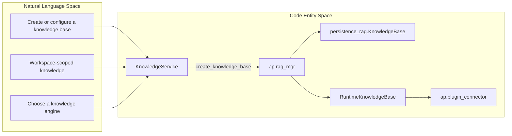
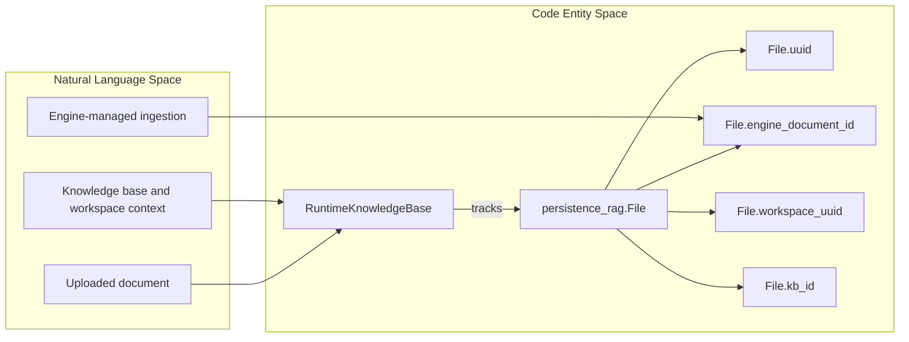

<!-- source: DeepWiki mcp.deepwiki.com · repo langbot-app/LangBot · page 9 Knowledge Base and RAG System · fetched 2026-10-29 -->

# Knowledge Base and RAG System

Relevant source files

The following files were used as context for generating this wiki page:

- [skills/skills/langbot-testing/references/langrag-knowledge-base.md](skills/skills/langbot-testing/references/langrag-knowledge-base.md)
- [src/langbot/pkg/api/http/controller/group.py](src/langbot/pkg/api/http/controller/group.py)
- [src/langbot/pkg/api/http/controller/groups/workspaces.py](src/langbot/pkg/api/http/controller/groups/workspaces.py)
- [src/langbot/pkg/api/http/service/knowledge.py](src/langbot/pkg/api/http/service/knowledge.py)
- [src/langbot/pkg/api/http/service/workspace_limits.py](src/langbot/pkg/api/http/service/workspace_limits.py)
- [src/langbot/pkg/entity/persistence/operation_log.py](src/langbot/pkg/entity/persistence/operation_log.py)
- [src/langbot/pkg/entity/persistence/rag.py](src/langbot/pkg/entity/persistence/rag.py)
- [src/langbot/pkg/persistence/alembic/versions/0025_rag_document_identity.py](src/langbot/pkg/persistence/alembic/versions/0025_rag_document_identity.py)
- [src/langbot/pkg/rag/knowledge/kbmgr.py](src/langbot/pkg/rag/knowledge/kbmgr.py)
- [tests/integration/plugin/test_rag_cancellation_protocol.py](tests/integration/plugin/test_rag_cancellation_protocol.py)
- [tests/unit_tests/test_workspace_subscription_limits.py](tests/unit_tests/test_workspace_subscription_limits.py)
- [web/src/app/home/components/workspace-quota/useWorkspaceQuotaStatus.ts](web/src/app/home/components/workspace-quota/useWorkspaceQuotaStatus.ts)
- [web/src/app/infra/entities/workspace.ts](web/src/app/infra/entities/workspace.ts)

## Purpose and Scope

LangBot’s Knowledge Base and Retrieval-Augmented Generation (RAG) system stores workspace-scoped knowledge base metadata and document records, then delegates knowledge-engine operations through plugins. This parent page outlines how knowledge base management, document ingestion, vector storage, and retrieval fit together; it links to child pages for implementation detail. [src/langbot/pkg/entity/persistence/rag.py:5-40](), [src/langbot/pkg/api/http/service/knowledge.py:16-30]()

Sources: [src/langbot/pkg/entity/persistence/rag.py:5-40](), [src/langbot/pkg/api/http/service/knowledge.py:16-30]()

## Knowledge Base Architecture

The `KnowledgeBase` entity stores a workspace association, knowledge-engine plugin ID, collection ID, creation settings, and retrieval settings. `KnowledgeService.create_knowledge_base` requires a `knowledge_engine_plugin_id` and delegates creation to `rag_mgr`; it can also validate plugin-defined settings schemas. [src/langbot/pkg/entity/persistence/rag.py:5-40](), [src/langbot/pkg/api/http/service/knowledge.py:52-102](), [src/langbot/pkg/api/http/service/knowledge.py:104-145]()

`RuntimeKnowledgeBase` provides a runtime boundary for knowledge base operations. It checks execution context against the owning workspace and asks the plugin connector to establish workspace context before plugin-runtime calls. For details, see [Knowledge Base Architecture](#9.1). [src/langbot/pkg/rag/knowledge/kbmgr.py:33-45](), [src/langbot/pkg/rag/knowledge/kbmgr.py:84-111]()

Sources: [src/langbot/pkg/entity/persistence/rag.py:5-40](), [src/langbot/pkg/api/http/service/knowledge.py:52-102](), [src/langbot/pkg/api/http/service/knowledge.py:104-145](), [src/langbot/pkg/rag/knowledge/kbmgr.py:33-45](), [src/langbot/pkg/rag/knowledge/kbmgr.py:84-111]()

### Diagram: Knowledge Base Management Mapped to Code Entities

Sources: [src/langbot/pkg/api/http/service/knowledge.py:32-36](), [src/langbot/pkg/api/http/service/knowledge.py:52-102](), [src/langbot/pkg/entity/persistence/rag.py:5-40](), [src/langbot/pkg/rag/knowledge/kbmgr.py:33-45](), [src/langbot/pkg/rag/knowledge/kbmgr.py:104-111]()

## Document Processing Pipeline

The `File` entity records a document’s workspace and KB association, its public Host UUID, an optional engine-side document identity, and an ingestion status. The status field supports `pending`, `processing`, `completed`, `failed`, and `interrupted`. [src/langbot/pkg/entity/persistence/rag.py:78-105]()

`RuntimeKnowledgeBase` coordinates ingestion work and reconciliation. On initialization it checks for pending or processing records that have no live task and marks them `interrupted`; it does not infer that the remote operation stopped. This supports operator-led recovery rather than an automatic retry. For details, see [Document Processing Pipeline](#9.2). [src/langbot/pkg/rag/knowledge/kbmgr.py:54-82]()

Sources: [src/langbot/pkg/entity/persistence/rag.py:78-105](), [src/langbot/pkg/rag/knowledge/kbmgr.py:54-82]()

### Document Lifecycle at a Glance

| Status | High-level meaning |
|---|---|
| `pending` | Ingestion has not yet been claimed. |
| `processing` | Ingestion is in progress. |
| `completed` | The record is marked complete. |
| `failed` | Ingestion has a confirmed failure. |
| `interrupted` | The Host cannot establish the remote ingestion outcome; operator reconciliation is needed. |

The status values are defined on `File`; the reconciliation behavior marks abandoned pending or processing work as `interrupted`. [src/langbot/pkg/entity/persistence/rag.py:78-94](), [src/langbot/pkg/rag/knowledge/kbmgr.py:57-82]()

Sources: [src/langbot/pkg/entity/persistence/rag.py:78-94](), [src/langbot/pkg/rag/knowledge/kbmgr.py:57-82]()

## Vector Database Integration

The knowledge base record includes a `collection_id` and an optional `embedding_dimension`, connecting KB metadata to the storage and embedding configuration used by the selected engine. The supplied code excerpts do not show the vector database abstraction or its backend implementations, so this page does not enumerate backend behavior. For details on supported databases, collections, filters, and embeddings, see [Vector Database Integration](#9.3). [src/langbot/pkg/entity/persistence/rag.py:18-40]()

Sources: [src/langbot/pkg/entity/persistence/rag.py:18-40]()

### Diagram: Document Identity and Engine Boundary

Sources: [src/langbot/pkg/entity/persistence/rag.py:78-105](), [src/langbot/pkg/rag/knowledge/kbmgr.py:33-52](), [src/langbot/pkg/rag/knowledge/kbmgr.py:129-159]()

## Semantic Retrieval and Context Augmentation

Knowledge bases store `retrieval_settings`, and `KnowledgeService` passes those settings to `rag_mgr` when creating a KB. The available excerpts do not include the runtime retrieval service, search modes, fusion logic, or prompt-context injection path. For those topics, see [Semantic Retrieval and Context Augmentation](#9.4). [src/langbot/pkg/entity/persistence/rag.py:30-31](), [src/langbot/pkg/api/http/service/knowledge.py:76-102]()

Sources: [src/langbot/pkg/entity/persistence/rag.py:30-31](), [src/langbot/pkg/api/http/service/knowledge.py:76-102]()

## Child Pages

- [Knowledge Base Architecture](#9.1) — `KnowledgeBase`, plugin engine selection, settings, and `kbmgr`.
- [Document Processing Pipeline](#9.2) — Upload and ingestion lifecycle, document identity, status tracking, and recovery.
- [Vector Database Integration](#9.3) — Vector database abstraction, backends, collections, filters, and embeddings.
- [Semantic Retrieval and Context Augmentation](#9.4) — Retrieval modes, RRF, runtime retrieval, and context injection.

Sources: [src/langbot/pkg/entity/persistence/rag.py:5-40](), [src/langbot/pkg/rag/knowledge/kbmgr.py:33-82](), [src/langbot/pkg/api/http/service/knowledge.py:52-102]()

---

