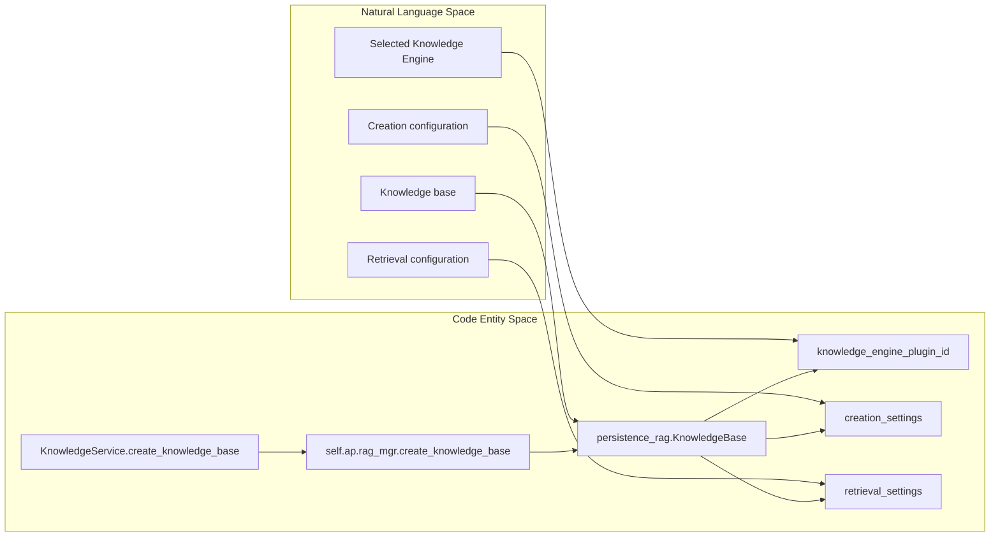
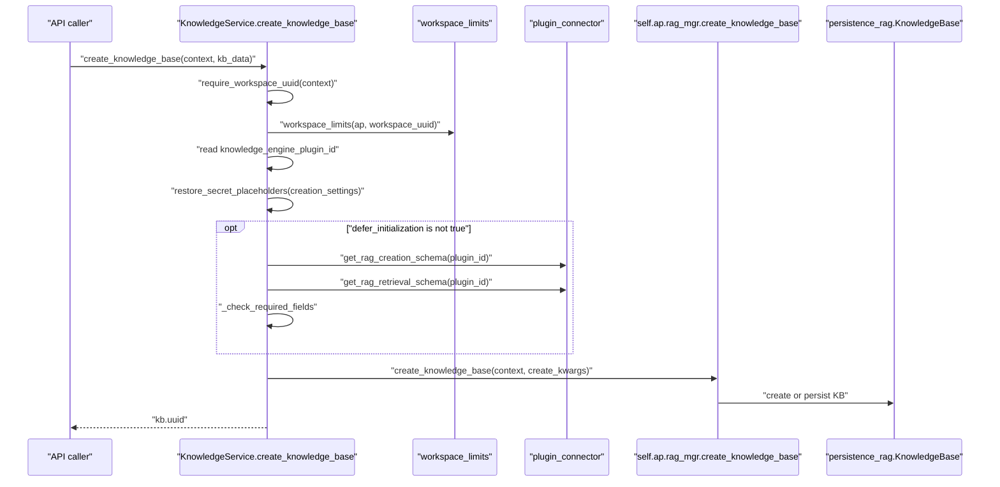
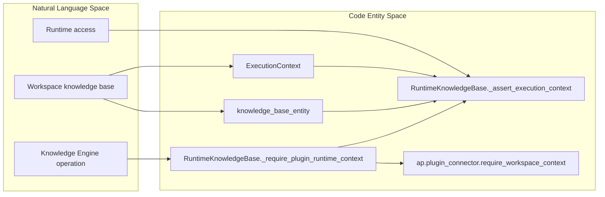

<!-- source: DeepWiki mcp.deepwiki.com · repo langbot-app/LangBot · page 9.1 Knowledge Base Architecture · fetched 2026-10-29 -->

# Knowledge Base Architecture

Relevant source files

The following files were used as context for generating this wiki page:

- [skills/skills/langbot-testing/references/langrag-knowledge-base.md](skills/skills/langbot-testing/references/langrag-knowledge-base.md)
- [src/langbot/pkg/api/http/controller/group.py](src/langbot/pkg/api/http/controller/group.py)
- [src/langbot/pkg/api/http/controller/groups/workspaces.py](src/langbot/pkg/api/http/controller/groups/workspaces.py)
- [src/langbot/pkg/api/http/service/knowledge.py](src/langbot/pkg/api/http/service/knowledge.py)
- [src/langbot/pkg/api/http/service/workspace_limits.py](src/langbot/pkg/api/http/service/workspace_limits.py)
- [src/langbot/pkg/entity/persistence/operation_log.py](src/langbot/pkg/entity/persistence/operation_log.py)
- [src/langbot/pkg/entity/persistence/rag.py](src/langbot/pkg/entity/persistence/rag.py)
- [src/langbot/pkg/persistence/alembic/versions/0025_rag_document_identity.py](src/langbot/pkg/persistence/alembic/versions/0025_rag_document_identity.py)
- [src/langbot/pkg/rag/knowledge/kbmgr.py](src/langbot/pkg/rag/knowledge/kbmgr.py)
- [tests/integration/plugin/test_rag_cancellation_protocol.py](tests/integration/plugin/test_rag_cancellation_protocol.py)
- [tests/unit_tests/test_workspace_subscription_limits.py](tests/unit_tests/test_workspace_subscription_limits.py)
- [web/src/app/home/components/workspace-quota/useWorkspaceQuotaStatus.ts](web/src/app/home/components/workspace-quota/useWorkspaceQuotaStatus.ts)
- [web/src/app/infra/entities/workspace.ts](web/src/app/infra/entities/workspace.ts)

## Purpose and Scope

This page describes the knowledge-base persistence model, plugin selection and settings, API-level creation flow, and the runtime knowledge-base object visible in the provided implementation. A knowledge base belongs to a Workspace and selects a Knowledge Engine plugin by ID. The plugin-based architecture is reflected in the entity’s engine and settings fields and in `KnowledgeService` delegating creation to `rag_mgr`. [src/langbot/pkg/entity/persistence/rag.py:5-41](); [src/langbot/pkg/api/http/service/knowledge.py:52-102]()

This page does not document vector-store backends, detailed document parsing, or retrieval execution. Those topics belong to sections 9.2–9.4. The available code excerpts do not show the full `RAGManager` implementation or the plugin protocol, so those details are not inferred here.

Sources: `src/langbot/pkg/entity/persistence/rag.py`; `src/langbot/pkg/api/http/service/knowledge.py`

---

## Knowledge Engine Plugin Architecture

Knowledge-base creation requires a `knowledge_engine_plugin_id`. `KnowledgeService.create_knowledge_base()` obtains that ID from the request data, restores secret placeholders in `creation_settings`, reads `retrieval_settings`, and delegates creation to `self.ap.rag_mgr.create_knowledge_base(...)`. [src/langbot/pkg/api/http/service/knowledge.py:52-102]()

The persistence entity stores the selected plugin ID and both settings dictionaries. The code shown establishes that settings are plugin-schema-aware at creation time: when initialization is not deferred, `KnowledgeService` retrieves the plugin’s creation and retrieval schemas and checks their required fields. [src/langbot/pkg/entity/persistence/rag.py:18-36](); [src/langbot/pkg/api/http/service/knowledge.py:76-90](); [src/langbot/pkg/api/http/service/knowledge.py:104-145]()

### High-Level Architecture and Code Mapping

**Diagram: Knowledge-base concepts mapped to implementation entities**

Sources: `src/langbot/pkg/api/http/service/knowledge.py:52-102`; `src/langbot/pkg/entity/persistence/rag.py:5-41`

### Plugin Schema Validation

When plugin support is enabled, `_validate_schema_required_fields()` first requires Workspace context, then requests `creation_schema` and `retrieval_schema` from `plugin_connector` and checks the corresponding settings. `ValueError` is propagated; other schema-fetch exceptions are logged as warnings. If plugin support is disabled, validation returns without checking either schema. [src/langbot/pkg/api/http/service/knowledge.py:104-145]()

`_check_required_fields()` accepts either a list schema or a dictionary containing a `schema` list. It iterates schema items, reads each item’s `name`, and uses the item’s `required` flag to determine which settings must be checked. The provided excerpt ends during this method, so its remaining empty-value rules and error construction are not described here. [src/langbot/pkg/api/http/service/knowledge.py:147-176]()

Sources: `src/langbot/pkg/api/http/service/knowledge.py:104-176`

---

## Knowledge Base Data Model and Creation Flow

### Core `KnowledgeBase` Entity

`persistence_rag.KnowledgeBase` maps to the `knowledge_bases` table. Its Workspace ownership, selected engine, settings, initialization state, and collection-related fields are stored on the entity. [src/langbot/pkg/entity/persistence/rag.py:5-41]()

| Field | Role |
|---|---|
| `uuid` | String primary key. [src/langbot/pkg/entity/persistence/rag.py:5-7]() |
| `workspace_uuid` | Required foreign key to `workspaces.uuid`, with cascade deletion. [src/langbot/pkg/entity/persistence/rag.py:8-12]() |
| `name`, `description`, `emoji` | Display metadata; `emoji` is nullable and defaults to `📚`. [src/langbot/pkg/entity/persistence/rag.py:13-17]() |
| `knowledge_engine_plugin_id` | Selected Knowledge Engine plugin identifier. [src/langbot/pkg/entity/persistence/rag.py:18-20]() |
| `collection_id` | Collection identifier stored with the KB. [src/langbot/pkg/entity/persistence/rag.py:18-20]() |
| `legacy_vector_collection` | Server-managed compatibility marker for pre-tenancy vector collections. [src/langbot/pkg/entity/persistence/rag.py:21-29]() |
| `creation_settings` | Nullable JSON creation configuration. [src/langbot/pkg/entity/persistence/rag.py:30-31]() |
| `retrieval_settings` | Nullable JSON retrieval configuration. [src/langbot/pkg/entity/persistence/rag.py:30-31]() |
| `initialized` | Non-null initialization flag, defaulting to true. [src/langbot/pkg/entity/persistence/rag.py:32-37]() |
| `embedding_dimension` | Nullable server-selected embedding dimension; the model constraint requires any stored value to be positive. [src/langbot/pkg/entity/persistence/rag.py:38-40](); [src/langbot/pkg/entity/persistence/rag.py:71-74]() |

The model declares `name`, `description`, and `retrieval_settings` as mutable fields. Creation fields additionally include the UUID, engine ID, collection ID, and creation settings. [src/langbot/pkg/entity/persistence/rag.py:42-58]()

The table also defines Workspace-scoped uniqueness for `(workspace_uuid, uuid)`, a Workspace/name index, and a partial unique index for non-null `(workspace_uuid, collection_id)` values. [src/langbot/pkg/entity/persistence/rag.py:60-70]()

Sources: `src/langbot/pkg/entity/persistence/rag.py:5-75`

### Creation Settings and Initialization

`create_knowledge_base()` requires Workspace context and applies Workspace knowledge-base limits before creation. If a configured maximum is non-negative, it fetches existing KB details and raises a `ValueError` when the count has reached the limit. [src/langbot/pkg/api/http/service/knowledge.py:52-75]()

The service then requires `knowledge_engine_plugin_id`. It restores secret placeholders in `creation_settings`, reads `retrieval_settings` without that restoration step, and checks whether `defer_initialization` is exactly `True`. Unless initialization is deferred, the service validates required fields against the selected plugin’s schemas. [src/langbot/pkg/api/http/service/knowledge.py:76-90]()

The service passes `name` (default `Untitled`), the engine ID, both settings dictionaries, and `description` (default empty string) to `rag_mgr.create_knowledge_base()`. If initialization is deferred, it additionally passes `initialize=False`; the service returns the created KB’s UUID. [src/langbot/pkg/api/http/service/knowledge.py:92-102]()

**Diagram: API creation flow mapped to code entities**

Sources: `src/langbot/pkg/api/http/service/knowledge.py:52-102`; `src/langbot/pkg/api/http/service/knowledge.py:104-176`; `src/langbot/pkg/api/http/service/workspace_limits.py:1-20`; `src/langbot/pkg/entity/persistence/rag.py:5-41`

### Required-Field Checks

The validation path is conditional on `plugin_connector.is_enable_plugin`. With plugins enabled, it requires Workspace context for schema access and independently requests the creation and retrieval schemas. A `ValueError` from schema processing is preserved, while other exceptions cause a warning to be logged. [src/langbot/pkg/api/http/service/knowledge.py:124-145]()

`_check_required_fields()` ignores an empty schema, handles either a direct list or a dictionary’s `schema` value, and skips items without a field name. The supplied excerpt does not include the rest of the method, so this page does not specify the exact missing-value predicate or error message. [src/langbot/pkg/api/http/service/knowledge.py:147-176]()

Sources: `src/langbot/pkg/api/http/service/knowledge.py:124-176`

---

## Workspace Scope and Service Boundary

The `KnowledgeService` read methods require a `TenantContext` with a Workspace UUID and delegate listing or detail retrieval to `rag_mgr`. By default, returned details have secrets redacted; callers can request `include_secret=True` to receive unredacted results. [src/langbot/pkg/api/http/service/knowledge.py:32-50]()

The creation service accepts a `RequestContext` or `ExecutionContext` and calls `require_workspace_uuid()` before proceeding. `_execution_context()` can convert a `RequestContext` into an `ExecutionContext`, pass through an existing execution context, or raise `WorkspaceRequiredError` for other values. [src/langbot/pkg/api/http/service/knowledge.py:24-30](); [src/langbot/pkg/api/http/service/knowledge.py:52-60]()

`RuntimeKnowledgeBase` binds its entity and execution context at construction. Its `_assert_execution_context()` rejects non-`ExecutionContext` values and mismatches in instance UUID, Workspace UUID, placement generation, entity Workspace, or Workspace execution binding. A mismatch is reported as `WorkspaceNotFoundError`. [src/langbot/pkg/rag/knowledge/kbmgr.py:33-53](); [src/langbot/pkg/rag/knowledge/kbmgr.py:84-103]()

**Diagram: Workspace-scoped runtime access mapped to code**

Sources: `src/langbot/pkg/rag/knowledge/kbmgr.py:33-53`; `src/langbot/pkg/rag/knowledge/kbmgr.py:84-112`

---

## Plugin Architecture Migration

The persistence model identifies `knowledge_engine_plugin_id`, `creation_settings`, and `retrieval_settings` as plugin-based RAG fields. `KnowledgeService.create_knowledge_base()` explicitly documents that the new architecture delegates to `RAGManager` and that legacy internal KB creation has been removed. [src/langbot/pkg/entity/persistence/rag.py:18-31](); [src/langbot/pkg/api/http/service/knowledge.py:57-61]()

The model also includes compatibility fields: `legacy_vector_collection` marks historical collection handling, while `collection_id` stores a collection identifier. The code comments state that pre-tenancy installations stored vectors directly under `collection_id`, whereas new knowledge bases use a tenant-derived opaque physical collection. [src/langbot/pkg/entity/persistence/rag.py:18-29]()

A separate migration reference in the testing documentation says migration `0025_rag_document_identity` adds or manages the external engine document identity mapping for files, and notes that historical mappings cannot be reconstructed from the migration. That document identity migration is distinct from the KB’s plugin selection and settings fields. [skills/skills/langbot-testing/references/langrag-knowledge-base.md:63-75]()

Sources: `src/langbot/pkg/entity/persistence/rag.py:18-31`; `src/langbot/pkg/api/http/service/knowledge.py:57-61`; `skills/skills/langbot-testing/references/langrag-knowledge-base.md:63-75`

---

## Runtime Knowledge Base (`kbmgr`)

`RuntimeKnowledgeBase` implements `KnowledgeBaseInterface` and holds the `KnowledgeBase` entity and an `ExecutionContext`. Its constructor shares ingestion-task and lock registries through the application object. The admission lock is keyed by `(workspace_uuid, knowledge_base_uuid)`, allowing KB object reloads to reuse the lock. [src/langbot/pkg/rag/knowledge/kbmgr.py:23-53]()

On initialization, `RuntimeKnowledgeBase.initialize()` calls `reconcile_interrupted_ingestions()`. Reconciliation takes the admission lock, identifies live task IDs for the same Workspace and KB, and updates pending or processing file rows not associated with those live tasks to `interrupted`, inside a Workspace unit of work. The method’s documentation explicitly says this records loss of Host observation and does not infer that a remote operation has stopped. [src/langbot/pkg/rag/knowledge/kbmgr.py:54-82]()

Before plugin calls, `_require_plugin_runtime_context()` verifies the runtime’s execution context and obtains the Workspace-scoped plugin context through `plugin_connector.require_workspace_context()`. Upload object keys are also checked through `storage_mgr.require_scoped_object_key()` with the expected owner type `upload_document`; invalid or unscoped keys are translated to `WorkspaceNotFoundError`. [src/langbot/pkg/rag/knowledge/kbmgr.py:104-127]()

The visible beginning of `_store_file_task()` keys each task by Workspace UUID, KB UUID, and file UUID, rejects a second live ingestion for the same key, registers the current task, and verifies the execution context and upload object key before proceeding. Its remaining ingestion behavior is outside the provided excerpt and is not detailed here. [src/langbot/pkg/rag/knowledge/kbmgr.py:129-159]()

### Related Persistence Entities

The same persistence module defines `File` and `Chunk`. `File` is Workspace-owned, associates with a KB through a composite Workspace/KB foreign key, tracks a status string, and stores `engine_document_id` separately from its public UUID. `Chunk` is Workspace-owned and associates with a file through a composite Workspace/file foreign key. [src/langbot/pkg/entity/persistence/rag.py:78-127]()

| Entity | Table | Architectural role |
|---|---|---|
| `File` | `knowledge_base_files` | Stores Workspace and KB association, filename metadata, ingestion status, and optional engine document identity. [src/langbot/pkg/entity/persistence/rag.py:78-105]() |
| `Chunk` | `knowledge_base_chunks` | Stores text associated with a Workspace and, optionally, a file. [src/langbot/pkg/entity/persistence/rag.py:108-127]() |

Sources: `src/langbot/pkg/rag/knowledge/kbmgr.py:23-159`; `src/langbot/pkg/entity/persistence/rag.py:78-127`

---

## Core Backend Classes Reference

| Code symbol | Role supported by the shown implementation |
|---|---|
| `persistence_rag.KnowledgeBase` | SQLAlchemy entity for KB metadata, Workspace ownership, engine selection, settings, and collection-related state. [src/langbot/pkg/entity/persistence/rag.py:5-75]() |
| `KnowledgeService` | Service-layer listing, detail retrieval, creation, secret handling, quota enforcement, and plugin-schema required-field validation. [src/langbot/pkg/api/http/service/knowledge.py:16-176]() |
| `RuntimeKnowledgeBase` | Runtime KB object that holds its entity and execution context, reconciles interrupted ingestion rows, and checks Workspace/plugin runtime context. [src/langbot/pkg/rag/knowledge/kbmgr.py:33-127]() |
| `KnowledgeBaseInterface` | Base interface named by `RuntimeKnowledgeBase` inheritance. Its implementation is not included in the provided excerpts. [src/langbot/pkg/rag/knowledge/kbmgr.py:23-34]() |
| `File` | Persistence entity for uploaded-document metadata and ingestion state. [src/langbot/pkg/entity/persistence/rag.py:78-106]() |
| `Chunk` | Persistence entity for text associated with a file. [src/langbot/pkg/entity/persistence/rag.py:108-127]() |

Sources: `src/langbot/pkg/api/http/service/knowledge.py:16-176`; `src/langbot/pkg/entity/persistence/rag.py:5-127`; `src/langbot/pkg/rag/knowledge/kbmgr.py:23-127`

---

## Summary

- A KB is persisted as `persistence_rag.KnowledgeBase`, with Workspace ownership, a selected `knowledge_engine_plugin_id`, and separate creation and retrieval settings. [src/langbot/pkg/entity/persistence/rag.py:5-41]()
- `KnowledgeService.create_knowledge_base()` enforces the Workspace limit, requires an engine plugin ID, restores creation-setting secret placeholders, optionally validates plugin schemas, and delegates to `rag_mgr.create_knowledge_base()`. [src/langbot/pkg/api/http/service/knowledge.py:52-102]()
- Plugin schema validation checks required fields from the engine’s creation and retrieval schemas when plugin support is enabled. [src/langbot/pkg/api/http/service/knowledge.py:104-176]()
- `RuntimeKnowledgeBase` fences access to its Workspace execution context and marks abandoned pending or processing file rows as interrupted rather than assuming remote ingestion has stopped. [src/langbot/pkg/rag/knowledge/kbmgr.py:54-112]()

Sources: `src/langbot/pkg/entity/persistence/rag.py:5-41`; `src/langbot/pkg/api/http/service/knowledge.py:52-176`; `src/langbot/pkg/rag/knowledge/kbmgr.py:54-112`

---

