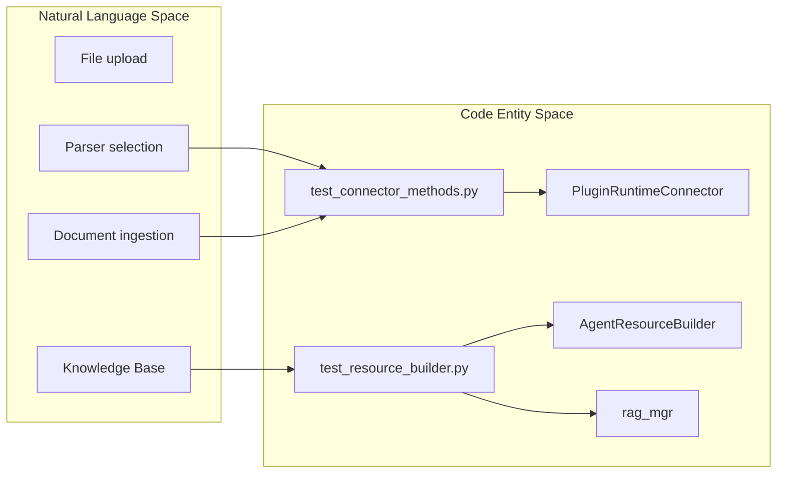
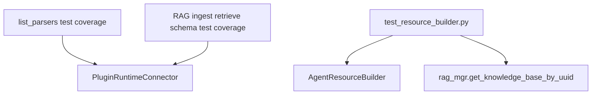

<!-- source: DeepWiki mcp.deepwiki.com · repo langbot-app/LangBot · page 9.2 Document Processing Pipeline · fetched 2026-10-29 -->

# Document Processing Pipeline

Relevant source files

The following files were used as context for generating this wiki page:

- [src/langbot/pkg/agent/runner/orchestrator.py](src/langbot/pkg/agent/runner/orchestrator.py)
- [src/langbot/pkg/agent/runner/resource_builder.py](src/langbot/pkg/agent/runner/resource_builder.py)
- [src/langbot/pkg/pipeline/pipelinemgr.py](src/langbot/pkg/pipeline/pipelinemgr.py)
- [src/langbot/pkg/plugin/connector.py](src/langbot/pkg/plugin/connector.py)
- [src/langbot/pkg/provider/tools/toolmgr.py](src/langbot/pkg/provider/tools/toolmgr.py)
- [src/langbot/pkg/workspace/invitation_delivery.py](src/langbot/pkg/workspace/invitation_delivery.py)
- [src/langbot/pkg/workspace/repository.py](src/langbot/pkg/workspace/repository.py)
- [src/langbot/pkg/workspace/service.py](src/langbot/pkg/workspace/service.py)
- [tests/unit_tests/agent/test_resource_builder.py](tests/unit_tests/agent/test_resource_builder.py)
- [tests/unit_tests/command/test_cmdmgr.py](tests/unit_tests/command/test_cmdmgr.py)
- [tests/unit_tests/pipeline/test_pipelinemgr.py](tests/unit_tests/pipeline/test_pipelinemgr.py)
- [tests/unit_tests/plugin/test_connector_methods.py](tests/unit_tests/plugin/test_connector_methods.py)
- [tests/unit_tests/plugin/test_connector_reconcile.py](tests/unit_tests/plugin/test_connector_reconcile.py)
- [tests/unit_tests/rag/test_file_storage.py](tests/unit_tests/rag/test_file_storage.py)
- [tests/unit_tests/rag/test_kbmgr.py](tests/unit_tests/rag/test_kbmgr.py)
- [tests/unit_tests/survey/test_survey_manager.py](tests/unit_tests/survey/test_survey_manager.py)
- [tests/unit_tests/telemetry/test_telemetry.py](tests/unit_tests/telemetry/test_telemetry.py)
- [tests/unit_tests/workspace/test_invitation_delivery.py](tests/unit_tests/workspace/test_invitation_delivery.py)
- [tests/unit_tests/workspace/test_workspace_service.py](tests/unit_tests/workspace/test_workspace_service.py)

## Purpose and Scope

This page describes the document-processing flow only to the extent supported by the supplied source excerpts. The excerpts identify the plugin connector’s parser and RAG method surface through unit-test coverage, and establish that Knowledge Base resource building is available to agent runs. They do **not** include the upload routes, document persistence model, ingestion implementation, status-reconciliation logic, or frontend upload components; details of those behaviors cannot be verified from the available files. [tests/unit_tests/plugin/test_connector_methods.py:1-7]()[tests/unit_tests/agent/test_resource_builder.py:108-119]()

Sources: `tests/unit_tests/plugin/test_connector_methods.py`, `tests/unit_tests/agent/test_resource_builder.py`

## Pipeline Overview

The code entities visible in the supplied material connect plugin-facing parser and RAG operations with the application’s Knowledge Base manager. The connector-method test explicitly lists parser discovery and RAG ingestion/retrieval/schema methods as covered behavior, while the resource-builder test fixture supplies `rag_mgr` and stubs `get_knowledge_base_by_uuid`. These excerpts establish the integration surface, but not the request-to-storage flow or the concrete behavior of those connector methods. [tests/unit_tests/plugin/test_connector_methods.py:1-7]()[tests/unit_tests/agent/test_resource_builder.py:108-119]()

**Diagram: Document concepts mapped to supplied code entities**

Sources: `tests/unit_tests/plugin/test_connector_methods.py`, `tests/unit_tests/agent/test_resource_builder.py`

**Diagram: Visible code-level integration boundaries**

Sources: `tests/unit_tests/plugin/test_connector_methods.py:1-7`, `tests/unit_tests/agent/test_resource_builder.py:108-119`

## Parser Selection and Plugin Connector

The connector test module describes its coverage as including `list_parsers()` and RAG methods for ingestion, retrieval, and schema. It also includes connector setup helpers that create a `PluginRuntimeConnector`, set an execution context, and configure workspace-related methods. The supplied excerpt does not show the connector method definitions or their call sites, so it does not establish how parsers are filtered, selected, or invoked in production. [tests/unit_tests/plugin/test_connector_methods.py:1-7]()[tests/unit_tests/plugin/test_connector_methods.py:41-72]()

The connector implementation imports plugin runtime handlers, workspace context types, and persistence modules. Those imports show dependencies used by the connector module, but the displayed lines do not expose document-ingestion behavior or parser-selection rules. [src/langbot/pkg/plugin/connector.py:21-25]()[src/langbot/pkg/plugin/connector.py:66-78]()

Sources: `tests/unit_tests/plugin/test_connector_methods.py`, `src/langbot/pkg/plugin/connector.py`

## `doc_ingestion` Capability

The supplied excerpts do not define or mention the `doc_ingestion` capability, nor do they show a capability check that gates file upload or ingestion. The connector tests identify RAG ingestion as a covered method category, but that is not sufficient evidence to specify capability negotiation or UI behavior. [tests/unit_tests/plugin/test_connector_methods.py:1-7]()

Sources: `tests/unit_tests/plugin/test_connector_methods.py`

## Document Identity and Ingestion

The available test material identifies RAG ingestion as part of the connector’s tested method surface. It does not show the ingestion method implementation, the data passed to it, the response shape, or the persistence entity used to track a document. Consequently, document identifiers, external engine IDs, file metadata, and status fields cannot be documented from these excerpts. [tests/unit_tests/plugin/test_connector_methods.py:1-7]()

The agent resource-builder test fixture provides a `rag_mgr` and replaces `get_knowledge_base_by_uuid` with an asynchronous mock. This establishes that the resource-builder test environment exposes a Knowledge Base lookup through that manager; it does not establish that this path performs document ingestion. [tests/unit_tests/agent/test_resource_builder.py:108-119]()

Sources: `tests/unit_tests/plugin/test_connector_methods.py`, `tests/unit_tests/agent/test_resource_builder.py`

## Interrupted Ingestion and Status Tracking

The supplied files do not show interrupted-ingestion recovery, ingestion task registration, document status transitions, or status polling. The connector test module’s scope mentions RAG ingestion, but does not describe recovery or status behavior. These implementation details require the corresponding persistence, task-management, API, and frontend source files. [tests/unit_tests/plugin/test_connector_methods.py:1-7]()

Sources: `tests/unit_tests/plugin/test_connector_methods.py`

## File Management

The excerpts do not include document upload or deletion endpoints, file-storage operations, Knowledge Base file-management methods, or frontend document-management components. The connector module imports persistence modules, but the shown import lines do not establish file lifecycle behavior. [src/langbot/pkg/plugin/connector.py:73-78]()

Sources: `src/langbot/pkg/plugin/connector.py`

---

