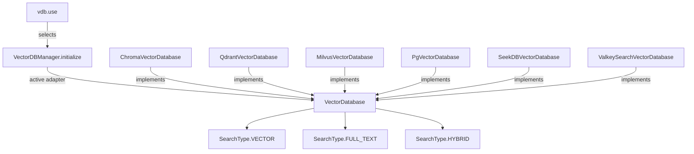
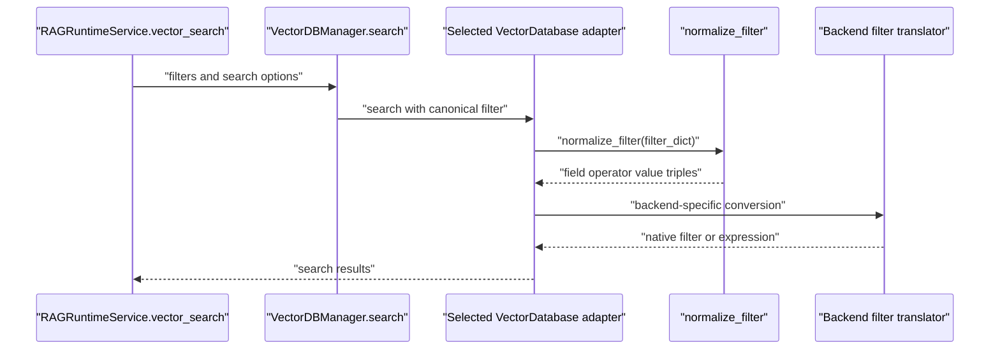
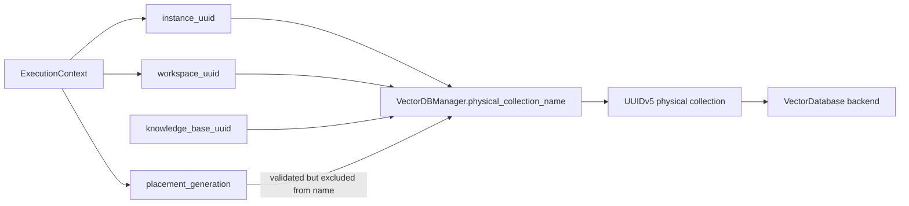
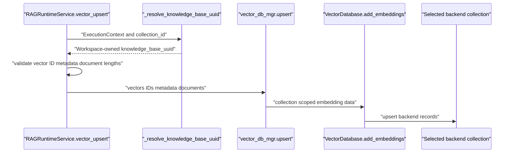
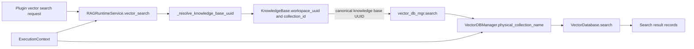

<!-- source: DeepWiki mcp.deepwiki.com · repo langbot-app/LangBot · page 9.3 Vector Database Integration · fetched 2026-10-29 -->

# Vector Database Integration

Relevant source files

The following files were used as context for generating this wiki page:

- [docs/VALKEY_SEARCH_INTEGRATION.md](docs/VALKEY_SEARCH_INTEGRATION.md)
- [src/langbot/pkg/rag/service/runtime.py](src/langbot/pkg/rag/service/runtime.py)
- [src/langbot/pkg/vector/filter_utils.py](src/langbot/pkg/vector/filter_utils.py)
- [src/langbot/pkg/vector/mgr.py](src/langbot/pkg/vector/mgr.py)
- [src/langbot/pkg/vector/vdb.py](src/langbot/pkg/vector/vdb.py)
- [src/langbot/pkg/vector/vdbs/chroma.py](src/langbot/pkg/vector/vdbs/chroma.py)
- [src/langbot/pkg/vector/vdbs/milvus.py](src/langbot/pkg/vector/vdbs/milvus.py)
- [src/langbot/pkg/vector/vdbs/pgvector_db.py](src/langbot/pkg/vector/vdbs/pgvector_db.py)
- [src/langbot/pkg/vector/vdbs/qdrant.py](src/langbot/pkg/vector/vdbs/qdrant.py)
- [src/langbot/pkg/vector/vdbs/seekdb.py](src/langbot/pkg/vector/vdbs/seekdb.py)
- [src/langbot/pkg/vector/vdbs/valkey_search.py](src/langbot/pkg/vector/vdbs/valkey_search.py)
- [tests/integration/vector/__init__.py](tests/integration/vector/__init__.py)
- [tests/integration/vector/test_valkey_search.py](tests/integration/vector/test_valkey_search.py)
- [tests/unit_tests/COVERAGE_EXCLUSIONS.md](tests/unit_tests/COVERAGE_EXCLUSIONS.md)
- [tests/unit_tests/rag/test_runtime_service.py](tests/unit_tests/rag/test_runtime_service.py)
- [tests/unit_tests/vector/test_valkey_search_filter.py](tests/unit_tests/vector/test_valkey_search_filter.py)

## Purpose and scope

This page describes LangBot’s vector-storage abstraction, backend selection, collection handling, filter translation, and the plugin-facing RAG runtime path. The adapters accept already-computed embedding vectors; the vector interface defines storage and search operations rather than an embedding-model API. [src/langbot/pkg/vector/vdb.py:57-108](), [src/langbot/pkg/rag/service/runtime.py:74-123]()

Sources: [src/langbot/pkg/vector/vdb.py:57-108](), [src/langbot/pkg/rag/service/runtime.py:74-123]()

---

## Vector Database Abstraction Layer

`VectorDatabase` is the asynchronous adapter contract for vector persistence and retrieval. It defines collection lifecycle, embedding upsert, search, deletion, and optional filtered listing. `SearchType` names the interface’s vector, full-text, and hybrid modes; a backend may report a narrower set of supported modes. [src/langbot/pkg/vector/vdb.py:36-55](), [src/langbot/pkg/vector/vdb.py:57-159]()

`VectorDBManager` owns the active adapter. During initialization it reads `instance_config.data['vdb']['use']`, imports the selected backend, and constructs it. When configuration is missing or unrecognized, it selects Chroma. Its shutdown path clears the manager reference and closes the previously active adapter; it also exposes the active backend’s supported search types. [src/langbot/pkg/vector/mgr.py:16-18](), [src/langbot/pkg/vector/mgr.py:20-49](), [src/langbot/pkg/vector/mgr.py:51-114](), [src/langbot/pkg/vector/mgr.py:116-128]()

### System architecture and code entities

This mapping connects the vector-database concepts used in configuration and RAG operations to the code entities that implement them. [src/langbot/pkg/vector/mgr.py:16-18](), [src/langbot/pkg/vector/mgr.py:23-114](), [src/langbot/pkg/vector/vdb.py:36-55](), [src/langbot/pkg/vector/vdbs/chroma.py:19-24](), [src/langbot/pkg/vector/vdbs/qdrant.py:41-55](), [src/langbot/pkg/vector/vdbs/milvus.py:57-76](), [src/langbot/pkg/vector/vdbs/pgvector_db.py:105-131](), [src/langbot/pkg/vector/vdbs/seekdb.py:30-43](), [src/langbot/pkg/vector/vdbs/valkey_search.py:102-129]()

**Vector database concepts mapped to code entities**

Sources: [src/langbot/pkg/vector/mgr.py:23-114](), [src/langbot/pkg/vector/vdb.py:36-55](), [src/langbot/pkg/vector/vdbs/chroma.py:19-34](), [src/langbot/pkg/vector/vdbs/qdrant.py:41-59](), [src/langbot/pkg/vector/vdbs/milvus.py:57-82](), [src/langbot/pkg/vector/vdbs/pgvector_db.py:105-131](), [src/langbot/pkg/vector/vdbs/seekdb.py:30-43](), [src/langbot/pkg/vector/vdbs/valkey_search.py:102-127]()

### Core abstraction methods

The base class specifies the following operations. `list_by_filter` has a default placeholder result of `([], -1)`; the contract describes `-1` as an unknown total. Backends that cannot report exact deletion counts may return zero. [src/langbot/pkg/vector/vdb.py:110-149]()

| Method or symbol | Role |
|---|---|
| `supported_search_types()` | Reports backend search modes; the base default is vector search. [src/langbot/pkg/vector/vdb.py:48-55]() |
| `add_embeddings()` | Accepts IDs, vector arrays, metadata, and optional source documents. [src/langbot/pkg/vector/vdb.py:57-76]() |
| `search()` | Accepts a query vector, result limit, search mode, optional query text, metadata filter, and optional hybrid `vector_weight`. [src/langbot/pkg/vector/vdb.py:78-108]() |
| `delete_by_file_id()` | Deletes vectors associated with a file ID. [src/langbot/pkg/vector/vdb.py:110-114]() |
| `delete_by_filter()` | Deletes vectors matching a canonical metadata filter and returns a best-effort count. [src/langbot/pkg/vector/vdb.py:115-127]() |
| `list_by_filter()` | Lists matching entries with pagination; the base implementation returns no entries and an unknown total. [src/langbot/pkg/vector/vdb.py:129-149]() |
| `get_or_create_collection()` / `delete_collection()` | Define collection lifecycle operations. [src/langbot/pkg/vector/vdb.py:151-159]() |

The canonical filter contract uses Chroma-style `where` syntax. It documents `$eq`, `$ne`, `$gt`, `$gte`, `$lt`, `$lte`, `$in`, and `$nin`; multiple top-level keys are AND-ed. [src/langbot/pkg/vector/vdb.py:95-107]()

Sources: [src/langbot/pkg/vector/vdb.py:36-159]()

### Runtime caches and resource lifecycle

`runtime_cache_limit()` reads `vdb.runtime_cache_limit`, defaults to 1024, and clamps the result to at least one. `remember_bounded_mapping()` and `remember_bounded_set()` keep backend collection caches within a configured size. [src/langbot/pkg/vector/vdb.py:10-34]()

The manager closes its active backend at shutdown. Backend close behavior differs: Chroma discards cached collection wrappers, while Qdrant and Milvus close clients, and SeekDB clears its caches and invokes client cleanup when available. [src/langbot/pkg/vector/mgr.py:116-122](), [src/langbot/pkg/vector/vdbs/chroma.py:26-30](), [src/langbot/pkg/vector/vdbs/qdrant.py:57-59](), [src/langbot/pkg/vector/vdbs/milvus.py:78-82](), [src/langbot/pkg/vector/vdbs/seekdb.py:104-110]()

Sources: [src/langbot/pkg/vector/vdb.py:10-34](), [src/langbot/pkg/vector/mgr.py:116-122](), [src/langbot/pkg/vector/vdbs/chroma.py:26-30](), [src/langbot/pkg/vector/vdbs/qdrant.py:57-59](), [src/langbot/pkg/vector/vdbs/milvus.py:78-82](), [src/langbot/pkg/vector/vdbs/seekdb.py:104-110]()

---

## Supported vector database backends

`VectorDBManager.initialize()` selects among Chroma (`chroma`), Qdrant (`qdrant`), SeekDB (`seekdb`), Valkey Search (`valkey_search`), Milvus (`milvus`), and pgvector (`pgvector`). The manager’s fallback for absent or unrecognized configuration is Chroma. [src/langbot/pkg/vector/mgr.py:23-49](), [src/langbot/pkg/vector/mgr.py:51-114]()

| Backend | Configuration and implementation details |
|---|---|
| ChromaDB | Uses `ChromaVectorDatabase` and a persistent client, defaulting to `./data/chroma`. [src/langbot/pkg/vector/vdbs/chroma.py:19-24]() |
| Qdrant | Uses `AsyncQdrantClient`, configured by URL or host and port, with an optional API key. [src/langbot/pkg/vector/vdbs/qdrant.py:41-55]() |
| Milvus | Uses `MilvusClient`, configured with URI, optional token, and database name. [src/langbot/pkg/vector/mgr.py:51-60](), [src/langbot/pkg/vector/vdbs/milvus.py:60-76]() |
| pgvector | Uses PostgreSQL and supports either the shared business database or a separately configured connection. [src/langbot/pkg/vector/mgr.py:62-103](), [src/langbot/pkg/vector/vdbs/pgvector_db.py:105-152]() |
| SeekDB / OceanBase | Uses `pyseekdb` in embedded or server mode. The adapter requires the optional SeekDB dependency. [src/langbot/pkg/vector/vdbs/seekdb.py:18-24](), [src/langbot/pkg/vector/vdbs/seekdb.py:30-48](), [src/langbot/pkg/vector/vdbs/seekdb.py:53-98]() |
| Valkey Search | Uses the `glide` client and Valkey Search’s `ft` command namespace; its client is created lazily. [src/langbot/pkg/vector/vdbs/valkey_search.py:17-43](), [src/langbot/pkg/vector/vdbs/valkey_search.py:102-123](), [src/langbot/pkg/vector/vdbs/valkey_search.py:158-165]() |

The supplied backend implementations report all three search types for Chroma, SeekDB, and Valkey Search. The base class defaults to vector-only; backend support should therefore be queried through `VectorDBManager.get_supported_search_types()` instead of assumed from the common interface. [src/langbot/pkg/vector/vdb.py:48-55](), [src/langbot/pkg/vector/mgr.py:124-128](), [src/langbot/pkg/vector/vdbs/chroma.py:32-34](), [src/langbot/pkg/vector/vdbs/seekdb.py:39-41](), [src/langbot/pkg/vector/vdbs/valkey_search.py:125-127]()

Sources: [src/langbot/pkg/vector/mgr.py:23-114](), [src/langbot/pkg/vector/mgr.py:124-128](), [src/langbot/pkg/vector/vdb.py:48-55](), [src/langbot/pkg/vector/vdbs/chroma.py:19-34](), [src/langbot/pkg/vector/vdbs/qdrant.py:41-55](), [src/langbot/pkg/vector/vdbs/milvus.py:57-76](), [src/langbot/pkg/vector/vdbs/pgvector_db.py:105-152](), [src/langbot/pkg/vector/vdbs/seekdb.py:18-48](), [src/langbot/pkg/vector/vdbs/valkey_search.py:17-43]()

---

## Metadata filtering and normalization

The interface defines a canonical filter shape and operator set. Backend adapters translate that shape into backend-native filters. Qdrant constructs `models.Filter` conditions; Milvus turns normalized conditions into a boolean expression; pgvector builds SQLAlchemy conditions after restricting fields to its supported schema. [src/langbot/pkg/vector/vdb.py:95-107](), [src/langbot/pkg/vector/vdbs/qdrant.py:11-38](), [src/langbot/pkg/vector/vdbs/milvus.py:19-46](), [src/langbot/pkg/vector/vdbs/pgvector_db.py:77-102]()

**Filter processing from RAG request to backend query**

Sources: [src/langbot/pkg/rag/service/runtime.py:101-123](), [src/langbot/pkg/vector/vdbs/qdrant.py:11-38](), [src/langbot/pkg/vector/vdbs/milvus.py:19-46](), [src/langbot/pkg/vector/vdbs/pgvector_db.py:77-102]()

Field support varies by backend. Milvus and pgvector declare `text`, `file_id`, and `chunk_uuid` as supported fields, with canonical `uuid` mapped to `chunk_uuid`; Milvus drops unsupported fields after normalization. Valkey Search promotes only `file_id` to an indexed filter field and preserves other metadata in `metadata_json`. [src/langbot/pkg/vector/vdbs/milvus.py:11-16](), [src/langbot/pkg/vector/vdbs/milvus.py:19-23](), [src/langbot/pkg/vector/vdbs/pgvector_db.py:23-33](), [src/langbot/pkg/vector/vdbs/pgvector_db.py:77-82](), [src/langbot/pkg/vector/vdbs/valkey_search.py:63-76]()

Sources: [src/langbot/pkg/vector/vdb.py:95-107](), [src/langbot/pkg/vector/vdbs/qdrant.py:11-38](), [src/langbot/pkg/vector/vdbs/milvus.py:11-46](), [src/langbot/pkg/vector/vdbs/pgvector_db.py:23-33](), [src/langbot/pkg/vector/vdbs/pgvector_db.py:77-102](), [src/langbot/pkg/vector/vdbs/valkey_search.py:63-76]()

---

## Collection management and tenant isolation

The manager’s `physical_collection_name()` accepts an `ExecutionContext` and knowledge-base UUID. It rejects a missing or invalid context, blank instance/workspace/knowledge-base identifiers, and a non-positive placement generation. The method’s documented design derives an opaque physical collection from tenant identity using UUIDv5, and deliberately excludes placement generation from the collection name. [src/langbot/pkg/vector/mgr.py:130-153]()

For pgvector, tenant scope is represented relationally rather than solely by a backend collection name. `PgVectorScope` requires non-empty workspace and knowledge-base UUIDs and optionally validates an embedding dimension; `PgVectorEntry` includes both identifiers in its primary key. [src/langbot/pkg/vector/vdbs/pgvector_db.py:36-53](), [src/langbot/pkg/vector/vdbs/pgvector_db.py:55-74]()

Backend naming and collection creation differ. Milvus replaces hyphens with underscores and prefixes names that do not start with a letter or underscore; SeekDB replaces characters outside `[a-zA-Z0-9_]`. Qdrant requires a vector size when creating a collection, and its `get_or_create_collection()` method is a no-op because that size is not available through that method. [src/langbot/pkg/vector/vdbs/milvus.py:96-117](), [src/langbot/pkg/vector/vdbs/seekdb.py:111-116](), [src/langbot/pkg/vector/vdbs/qdrant.py:61-79]()

**Tenant identity to physical storage mapping**

Sources: [src/langbot/pkg/vector/mgr.py:130-153](), [src/langbot/pkg/vector/vdb.py:44-55]()

---

## Backend implementation details

### ChromaVectorDatabase

`ChromaVectorDatabase` creates a `chromadb.PersistentClient` using the default path `./data/chroma`, and caches collection wrappers with the configured bounded-cache helper. Its close method clears wrappers because the persistent client has no public close API described in the implementation. [src/langbot/pkg/vector/vdbs/chroma.py:19-30]()

The adapter supports vector, full-text, and hybrid modes. Vector queries use `col.query`; full-text queries use Chroma’s document `$contains` matching and return zero distances because this local operation does not provide relevance scores. Hybrid mode runs vector and full-text searches concurrently; its implementation defines an RRF smoothing constant of 60. When no query text is supplied, hybrid search falls back to vector search. [src/langbot/pkg/vector/vdbs/chroma.py:15-16](), [src/langbot/pkg/vector/vdbs/chroma.py:32-34](), [src/langbot/pkg/vector/vdbs/chroma.py:63-104](), [src/langbot/pkg/vector/vdbs/chroma.py:106-139](), [src/langbot/pkg/vector/vdbs/chroma.py:141-158]()

Sources: [src/langbot/pkg/vector/vdbs/chroma.py:15-16](), [src/langbot/pkg/vector/vdbs/chroma.py:19-30](), [src/langbot/pkg/vector/vdbs/chroma.py:32-34](), [src/langbot/pkg/vector/vdbs/chroma.py:63-158]()

### QdrantVectorDatabase

`QdrantVectorDatabase` uses `AsyncQdrantClient`; it chooses URL-based connection when a URL is configured and otherwise connects with host and port. Collection creation sets the vector size from the first embedding and uses cosine distance. Upsert converts IDs, vectors, and metadata into Qdrant `PointStruct` points. [src/langbot/pkg/vector/vdbs/qdrant.py:41-55](), [src/langbot/pkg/vector/vdbs/qdrant.py:61-75](), [src/langbot/pkg/vector/vdbs/qdrant.py:81-99]()

Search uses `query_points` with payloads enabled. Qdrant’s similarity score is converted to a pseudo-distance as `1 - score`. The filter builder maps equality and membership operators to match conditions and range operators to `models.Range`; deletion supports file-ID and filter-based selectors, but filter deletion returns zero because the Qdrant call does not provide a count here. [src/langbot/pkg/vector/vdbs/qdrant.py:11-38](), [src/langbot/pkg/vector/vdbs/qdrant.py:100-131](), [src/langbot/pkg/vector/vdbs/qdrant.py:133-157]()

Sources: [src/langbot/pkg/vector/vdbs/qdrant.py:11-38](), [src/langbot/pkg/vector/vdbs/qdrant.py:41-99](), [src/langbot/pkg/vector/vdbs/qdrant.py:100-157]()

### MilvusVectorDatabase

`MilvusVectorDatabase` connects through `pymilvus.MilvusClient`, passing URI, optional token, and database name. Its collection schema contains a primary string `id`, a `FLOAT_VECTOR` field, and string fields `text`, `file_id`, and `chunk_uuid`. If no vector dimension is supplied during creation, the implementation uses 1536 for backward compatibility. [src/langbot/pkg/vector/vdbs/milvus.py:57-94](), [src/langbot/pkg/vector/vdbs/milvus.py:133-169]()

Milvus collection names are normalized by replacing hyphens with underscores and ensuring the first character is a letter or underscore. The adapter creates a vector index with `AUTOINDEX` and the `COSINE` metric. Its filter builder normalizes canonical filters, removes unsupported fields, escapes string literals, and joins supported expressions with `and`. [src/langbot/pkg/vector/vdbs/milvus.py:19-54](), [src/langbot/pkg/vector/vdbs/milvus.py:96-131]()

Sources: [src/langbot/pkg/vector/vdbs/milvus.py:19-54](), [src/langbot/pkg/vector/vdbs/milvus.py:57-94](), [src/langbot/pkg/vector/vdbs/milvus.py:96-169]()

### PgVectorDatabase

`PgVectorDatabase` stores vectors in the `langbot_vectors` relational table model. Its composite primary key includes `workspace_uuid`, `knowledge_base_uuid`, and `vector_id`; each row also stores the declared embedding dimension, vector, text, file ID, and chunk UUID. A check constraint requires `vector_dims(embedding)` to match `embedding_dimension`. [src/langbot/pkg/vector/vdbs/pgvector_db.py:55-74]()

The adapter can reuse the initialized business database engine, but only when its dialect is PostgreSQL. Otherwise it supports a standalone connection string or individual connection parameters. The configured allowed dimensions must be a non-empty list of positive integers and a subset of dimensions for which release-created ANN indexes are provided. [src/langbot/pkg/vector/vdbs/pgvector_db.py:105-152](), [src/langbot/pkg/vector/vdbs/pgvector_db.py:153-162]()

Filter construction maps canonical fields to SQLAlchemy columns after filtering to `text`, `file_id`, and `chunk_uuid`; the canonical `uuid` field is an alias for `chunk_uuid`. Supported operators are translated into SQL comparisons and membership conditions. [src/langbot/pkg/vector/vdbs/pgvector_db.py:23-33](), [src/langbot/pkg/vector/vdbs/pgvector_db.py:77-102]()

Sources: [src/langbot/pkg/vector/vdbs/pgvector_db.py:23-33](), [src/langbot/pkg/vector/vdbs/pgvector_db.py:36-74](), [src/langbot/pkg/vector/vdbs/pgvector_db.py:77-102](), [src/langbot/pkg/vector/vdbs/pgvector_db.py:105-162]()

### SeekDBVectorDatabase

`SeekDBVectorDatabase` supports the vector, full-text, and hybrid search types. It raises an installation error if `pyseekdb` is unavailable. In embedded mode it uses `AdminClient` to check for and create the configured database before constructing a `pyseekdb.Client`; server mode builds connection parameters from host, port, database, credentials, and an optional tenant. [src/langbot/pkg/vector/vdbs/seekdb.py:18-48](), [src/langbot/pkg/vector/vdbs/seekdb.py:30-41](), [src/langbot/pkg/vector/vdbs/seekdb.py:53-98]()

Collection names are normalized to SeekDB’s permitted alphanumeric-and-underscore form. Existing collections are retrieved without an embedding function; new collections require a vector dimension and are created with an HNSW configuration using cosine distance. The adapter bounds its collection and collection-configuration caches. [src/langbot/pkg/vector/vdbs/seekdb.py:100-110](), [src/langbot/pkg/vector/vdbs/seekdb.py:111-116](), [src/langbot/pkg/vector/vdbs/seekdb.py:130-171]()

Sources: [src/langbot/pkg/vector/vdbs/seekdb.py:18-48](), [src/langbot/pkg/vector/vdbs/seekdb.py:53-110](), [src/langbot/pkg/vector/vdbs/seekdb.py:111-171]()

### Valkey Search

`ValkeySearchVectorDatabase` accesses Valkey Search through the `glide` client and supports vector, full-text, and hybrid search. Its configuration includes connection settings, optional authentication and TLS, an index algorithm, distance metric, and request timeout. The client is created lazily so an unavailable server does not block LangBot startup. [src/langbot/pkg/vector/vdbs/valkey_search.py:17-43](), [src/langbot/pkg/vector/vdbs/valkey_search.py:45-61](), [src/langbot/pkg/vector/vdbs/valkey_search.py:102-123](), [src/langbot/pkg/vector/vdbs/valkey_search.py:129-165]()

The adapter’s fixed indexed metadata schema promotes `file_id` as a filterable TAG field; other metadata is preserved in `metadata_json`. Hybrid search uses filter-then-KNN semantics rather than weighted score fusion: `vector_weight` is accepted for interface compatibility but does not alter ranking. [src/langbot/pkg/vector/vdbs/valkey_search.py:63-76](), [src/langbot/pkg/vector/vdbs/valkey_search.py:102-123]()

Sources: [src/langbot/pkg/vector/vdbs/valkey_search.py:17-61](), [src/langbot/pkg/vector/vdbs/valkey_search.py:63-76](), [src/langbot/pkg/vector/vdbs/valkey_search.py:102-165]()

---

## Embeddings and vector data flow

The vector interface receives embeddings as lists of floats along with IDs, metadata, and optional source documents. The plugin-facing `vector_upsert()` method validates that vector and ID counts match, and validates metadata and document counts when those arguments are provided, before forwarding the vectors to `vector_db_mgr.upsert()`. This layer therefore persists vectors supplied to it; the shown interface does not define how an embedding model produces them. [src/langbot/pkg/vector/vdb.py:57-76](), [src/langbot/pkg/rag/service/runtime.py:74-99]()

The adapters use the vector dimension when creating collections or schemas where required: Qdrant derives it from the first embedding, Milvus accepts `vector_size` and otherwise defaults to 1536, and SeekDB requires a dimension when creating a new collection. Pgvector stores a dimension alongside each vector and validates it against the vector’s actual dimension. [src/langbot/pkg/vector/vdbs/qdrant.py:61-75](), [src/langbot/pkg/vector/vdbs/milvus.py:133-169](), [src/langbot/pkg/vector/vdbs/seekdb.py:130-171](), [src/langbot/pkg/vector/vdbs/pgvector_db.py:55-74]()

**Plugin vector operation mapped to database adapter calls**

Sources: [src/langbot/pkg/rag/service/runtime.py:48-72](), [src/langbot/pkg/rag/service/runtime.py:74-99](), [src/langbot/pkg/vector/vdb.py:57-76]()

---

## RAG runtime integration

`RAGRuntimeService` is the bridge between plugin runtime requests and LangBot’s RAG infrastructure. It validates that an `ExecutionContext` is present and active, checks its execution binding, and resolves a plugin-facing collection handle to a knowledge-base UUID owned by the context’s workspace. [src/langbot/pkg/rag/service/runtime.py:19-47](), [src/langbot/pkg/rag/service/runtime.py:48-72]()

| Operation | Runtime method | Forwarded behavior |
|---|---|---|
| Upsert | `vector_upsert()` | Resolves the knowledge base, checks input lengths, then forwards vectors, IDs, metadata, and documents to `vector_db_mgr.upsert()`. [src/langbot/pkg/rag/service/runtime.py:74-99]() |
| Search | `vector_search()` | Forwards the query vector, top-k limit, filters, search type, query text, and vector weight. [src/langbot/pkg/rag/service/runtime.py:101-123]() |
| Delete | `vector_delete()` | Deletes by file IDs when supplied, or by filter when supplied. [src/langbot/pkg/rag/service/runtime.py:125-159]() |
| List | `vector_list()` | Lists vectors with optional filters and pagination through the manager. [src/langbot/pkg/rag/service/runtime.py:161-171]() |

`vector_search()` resolves the collection handle before calling the vector manager. The service’s workspace-scoped lookup matches either the knowledge-base UUID or its collection ID while restricting the query to the active workspace; an unresolved handle raises `WorkspaceNotFoundError`. [src/langbot/pkg/rag/service/runtime.py:48-72](), [src/langbot/pkg/rag/service/runtime.py:101-123]()

**Natural-language request mapped to runtime and storage code**

Sources: [src/langbot/pkg/rag/service/runtime.py:48-72](), [src/langbot/pkg/rag/service/runtime.py:101-123](), [src/langbot/pkg/vector/mgr.py:130-153](), [src/langbot/pkg/vector/vdb.py:78-108]()

---

## Summary

LangBot’s `VectorDatabase` abstraction separates common vector operations from backend-specific collection, query, and filter behavior. `VectorDBManager` selects and closes the active backend, while the RAG runtime resolves workspace-owned knowledge bases and forwards plugin vector operations. Search types, collection requirements, and filterable metadata vary among backends, so callers should use the manager’s supported-search-type query and account for backend-specific filter capabilities. [src/langbot/pkg/vector/vdb.py:36-55](), [src/langbot/pkg/vector/vdb.py:57-159](), [src/langbot/pkg/vector/mgr.py:23-49](), [src/langbot/pkg/vector/mgr.py:116-128](), [src/langbot/pkg/rag/service/runtime.py:48-72]()

Sources: [src/langbot/pkg/vector/vdb.py:36-159](), [src/langbot/pkg/vector/mgr.py:23-49](), [src/langbot/pkg/vector/mgr.py:116-128](), [src/langbot/pkg/rag/service/runtime.py:48-72]()

---

