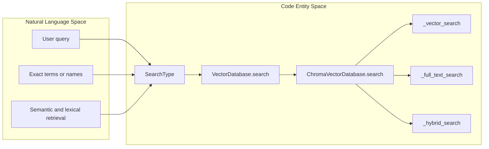
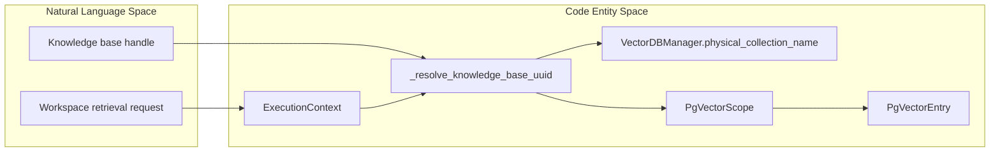
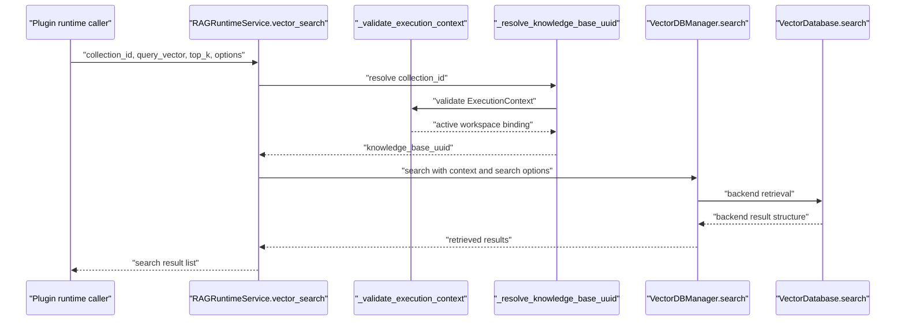
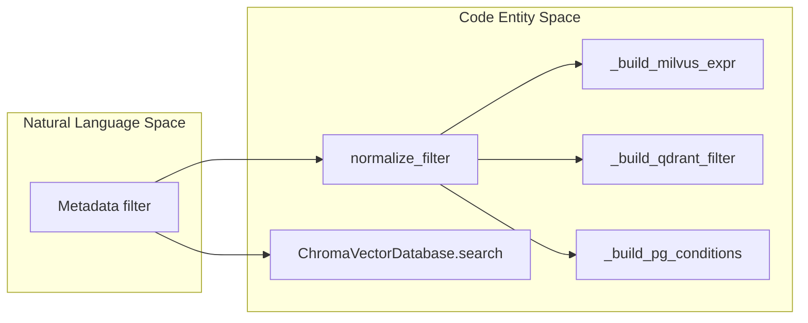
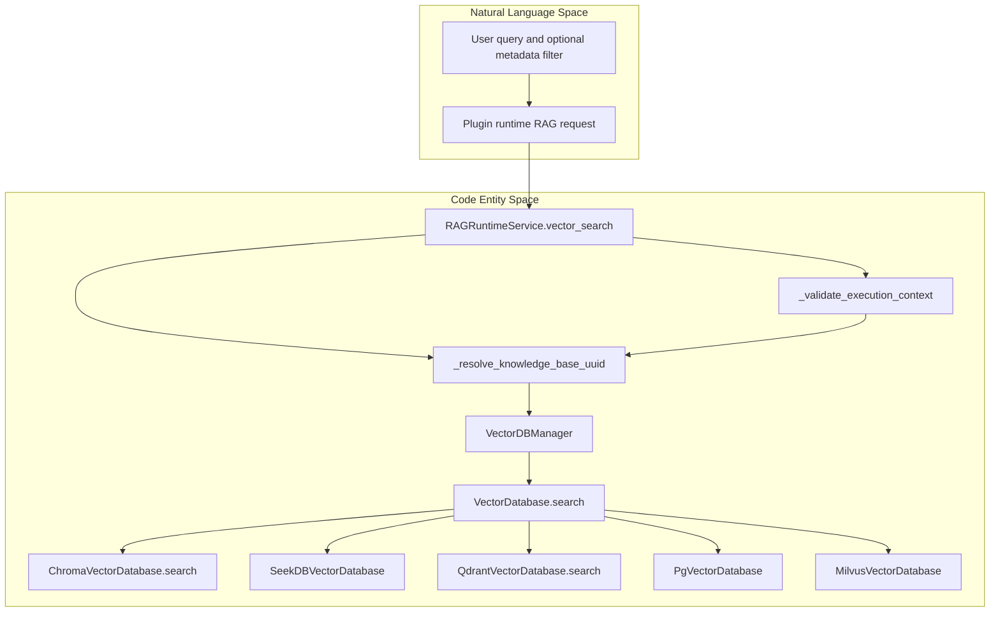

<!-- source: DeepWiki mcp.deepwiki.com · repo langbot-app/LangBot · page 9.4 Semantic Retrieval and Context Augmentation · fetched 2026-10-29 -->

# Semantic Retrieval and Context Augmentation

Relevant source files

The following files were used as context for generating this wiki page:

- [src/langbot/pkg/rag/service/runtime.py](src/langbot/pkg/rag/service/runtime.py)
- [src/langbot/pkg/vector/filter_utils.py](src/langbot/pkg/vector/filter_utils.py)
- [src/langbot/pkg/vector/mgr.py](src/langbot/pkg/vector/mgr.py)
- [src/langbot/pkg/vector/vdb.py](src/langbot/pkg/vector/vdb.py)
- [src/langbot/pkg/vector/vdbs/chroma.py](src/langbot/pkg/vector/vdbs/chroma.py)
- [src/langbot/pkg/vector/vdbs/milvus.py](src/langbot/pkg/vector/vdbs/milvus.py)
- [src/langbot/pkg/vector/vdbs/pgvector_db.py](src/langbot/pkg/vector/vdbs/pgvector_db.py)
- [src/langbot/pkg/vector/vdbs/qdrant.py](src/langbot/pkg/vector/vdbs/qdrant.py)
- [src/langbot/pkg/vector/vdbs/seekdb.py](src/langbot/pkg/vector/vdbs/seekdb.py)
- [tests/unit_tests/rag/test_runtime_service.py](tests/unit_tests/rag/test_runtime_service.py)

## Purpose and Scope

This page describes LangBot’s vector retrieval interface, the vector, full-text, and hybrid search modes exposed by that interface, and how the plugin-facing RAG runtime resolves and forwards operations to it. It also covers backend selection, the visible Chroma hybrid-search flow, metadata-filter translation, and tenant-aware collection scoping. The supplied code does not show a pipeline-stage or LLM prompt-injection implementation, so context injection is limited here to the retrieval results and runtime boundary that the provided files establish. [src/langbot/pkg/vector/vdb.py:36-107]()[src/langbot/pkg/vector/mgr.py:16-156]()[src/langbot/pkg/rag/service/runtime.py:19-123]()

Sources: [src/langbot/pkg/vector/vdb.py:36-107](), [src/langbot/pkg/vector/mgr.py:16-156](), [src/langbot/pkg/rag/service/runtime.py:19-123]()

---

## Search Types and Retrieval Modes

### Supported Search Types

The `SearchType` enum defines `vector`, `full_text`, and `hybrid`. The abstract `VectorDatabase` interface accepts a query embedding, result limit, search type, optional query text, metadata filter, and optional vector weight. Its default `supported_search_types()` advertises vector search only; individual backends can override it. [src/langbot/pkg/vector/vdb.py:36-55]()[src/langbot/pkg/vector/vdb.py:78-107]()

| Search type | Inputs used by the interface | Implementation notes |
|---|---|---|
| `vector` | Query embedding and optional metadata filter | The default search mode in the interface. |
| `full_text` | Query text and optional metadata filter | Requires backend support; the interface documents raw query text as the input. |
| `hybrid` | Query embedding, query text, optional filter, and optional `vector_weight` | `vector_weight` is documented as a 0–1 weight; `None` means equal weights for backward compatibility. |

Sources: [src/langbot/pkg/vector/vdb.py:36-55](), [src/langbot/pkg/vector/vdb.py:78-107]()

### Backend Support and Search Dispatch

`VectorDBManager.initialize()` reads `instance_config.data['vdb']` and selects a backend based on the `use` setting. The shown branches include Chroma, Qdrant, SeekDB, Valkey Search, Milvus, and pgvector. If the VDB configuration is absent or does not match a recognized backend, the manager falls back to Chroma. `get_supported_search_types()` delegates to the active backend, or reports vector search if no backend is initialized. [src/langbot/pkg/vector/mgr.py:16-18]()[src/langbot/pkg/vector/mgr.py:23-114]()[src/langbot/pkg/vector/mgr.py:124-128]()

The base interface allows backend-specific capabilities. Chroma advertises all three search types, and its `search()` dispatches full-text and hybrid requests to dedicated methods, otherwise using vector search. SeekDB also advertises all three types in its class declaration. Qdrant’s shown `search()` implementation builds a vector query; its method accepts the shared search arguments, but the shown implementation does not branch on `search_type`. [src/langbot/pkg/vector/vdb.py:44-55]()[src/langbot/pkg/vector/vdbs/chroma.py:32-34]()[src/langbot/pkg/vector/vdbs/chroma.py:63-83]()[src/langbot/pkg/vector/vdbs/seekdb.py:30-42]()[src/langbot/pkg/vector/vdbs/qdrant.py:100-131]()

**Diagram: Query intent mapped to retrieval code**

Sources: [src/langbot/pkg/vector/vdb.py:36-55](), [src/langbot/pkg/vector/vdb.py:78-107](), [src/langbot/pkg/vector/vdbs/chroma.py:63-83](), [src/langbot/pkg/vector/vdbs/chroma.py:85]()

> **Citation correction:** The Chroma search-method definitions are at lines 85–83 only as a dispatch reference for the vector helper’s call site; the helper’s definition begins at line 85 and continues beyond the supplied excerpt. The dispatch itself is shown at lines 63–83. [src/langbot/pkg/vector/vdbs/chroma.py:63-83]()

### Reciprocal Rank Fusion in Chroma Hybrid Search

Chroma’s `_hybrid_search()` falls back to `_vector_search()` when `query_text` is empty. Otherwise, it starts vector and full-text searches and awaits both with `asyncio.gather`. It then reads the IDs from each result list and returns an empty result structure if both lists are empty. [src/langbot/pkg/vector/vdbs/chroma.py:141-164]()

The shown implementation marks the following section as RRF fusion. It defines `_RRF_K = 60`; when `vector_weight` is provided, the code constructs weights `[vector_weight, 1.0 - vector_weight]`, and logs the configured weights. The supplied excerpt ends at line 172, before the subsequent fusion calculation, so this page does not infer the exact score calculation, ordering, or distance conversion from code that was not provided. [src/langbot/pkg/vector/vdbs/chroma.py:15-16]()[src/langbot/pkg/vector/vdbs/chroma.py:155-172]()

| Hybrid-search behavior | Code evidence |
|---|---|
| Empty query text uses vector-only search | `_hybrid_search()` delegates to `_vector_search()`. |
| Vector and text retrieval run concurrently | The two coroutines are passed to `asyncio.gather`. |
| Optional vector weight sets the two list weights | A supplied weight is paired with `1.0 - vector_weight`; otherwise the logged fallback is `[1.0, 1.0]`. |
| RRF smoothing constant | `_RRF_K` is set to `60`. |

Sources: [src/langbot/pkg/vector/vdbs/chroma.py:15-16](), [src/langbot/pkg/vector/vdbs/chroma.py:141-172]()

---

## Retrieval Configuration and Manager

### `VectorDBManager` Initialization and Backends

`VectorDBManager.initialize()` reads the VDB configuration and creates the selected adapter. The manager supports configuration branches for Chroma, Qdrant, SeekDB, Valkey Search, Milvus, and pgvector. Milvus receives `uri`, `token`, and `db_name` values from its configuration. pgvector accepts a shared-business-database option, allowed dimensions, a connection string, or individual connection parameters. Missing or unrecognized configuration defaults to Chroma. [src/langbot/pkg/vector/mgr.py:16-18]()[src/langbot/pkg/vector/mgr.py:23-114]()

| Backend | Manager configuration key | Configuration behavior visible in the supplied code |
|---|---|---|
| Chroma | `vdb.use: chroma` | Instantiates `ChromaVectorDatabase`; it is also the fallback backend. |
| Qdrant | `vdb.use: qdrant` | Instantiates `QdrantVectorDatabase`. |
| SeekDB | `vdb.use: seekdb` | Instantiates `SeekDBVectorDatabase`. |
| Valkey Search | `vdb.use: valkey_search` | Instantiates `ValkeySearchVectorDatabase`. |
| Milvus | `vdb.use: milvus` | Passes `uri`, `token`, and `db_name`, with defaults shown in the manager. |
| pgvector | `vdb.use: pgvector` | Supports shared business PostgreSQL or standalone connection settings and configurable allowed dimensions. |

Sources: [src/langbot/pkg/vector/mgr.py:23-114]()

The manager exposes backend search capabilities using `get_supported_search_types()`. It returns vector-only if `vector_db` is unset; otherwise it converts the active adapter’s enum values to strings. `shutdown()` clears the manager’s reference and closes the active backend if one exists. [src/langbot/pkg/vector/mgr.py:116-128]()

### Collection Naming and Tenant Scope

`VectorDBManager.physical_collection_name()` requires an `ExecutionContext`, non-empty instance, workspace, and knowledge-base identifiers, and a positive placement generation. The method constructs a UUIDv5 value from the instance, workspace, and knowledge-base identifiers. Its docstring states that placement generation is intentionally excluded from the physical collection name. [src/langbot/pkg/vector/mgr.py:130-156]()

For pgvector, `PgVectorScope` holds workspace UUID, knowledge-base UUID, and an optional embedding dimension; its post-initialization checks that the tenant identifiers are non-empty and that a supplied dimension is a positive integer. `PgVectorEntry` uses workspace UUID, knowledge-base UUID, and vector ID as its primary-key fields. [src/langbot/pkg/vector/vdbs/pgvector_db.py:36-74]()

**Diagram: Tenant identity mapped to physical storage scope**

Sources: [src/langbot/pkg/vector/mgr.py:130-156](), [src/langbot/pkg/rag/service/runtime.py:29-72](), [src/langbot/pkg/vector/vdbs/pgvector_db.py:36-74]()

---

## Context Augmentation Data Flow and Pipeline

### Data Flow: Runtime Query to Retrieved Results

The provided RAG runtime code shows the retrieval boundary used by runtime callers: `RAGRuntimeService.vector_search()` resolves a logical collection handle to a workspace-owned knowledge-base UUID, then forwards the query vector, result limit, filter, search type, query text, and vector weight to `vector_db_mgr.search()`. The supplied files do not show the later assembly of retrieved chunks into an LLM prompt, so prompt injection behavior is not described here. [src/langbot/pkg/rag/service/runtime.py:48-72]()[src/langbot/pkg/rag/service/runtime.py:101-123]()

**Diagram: Runtime search mapped from caller language to code entities**

Sources: [src/langbot/pkg/rag/service/runtime.py:29-72](), [src/langbot/pkg/rag/service/runtime.py:101-123](), [src/langbot/pkg/vector/mgr.py:124-128]()

### Execution Context Validation and Knowledge-Base Resolution

`RAGRuntimeService._validate_execution_context()` requires an `ExecutionContext` with non-empty instance and workspace UUIDs and a positive placement generation. It obtains the workspace execution binding using the expected generation and rejects a binding whose instance UUID differs from the context. `_resolve_knowledge_base_uuid()` invokes that validation, then queries the persistence layer for a knowledge base in the current workspace whose UUID or `collection_id` matches the supplied handle. It raises `WorkspaceNotFoundError` if no match exists. [src/langbot/pkg/rag/service/runtime.py:29-72]()

### Search Request Forwarding

`vector_search()` accepts a context, collection ID, query vector, `top_k`, optional filters, search type, query text, and vector weight. After resolving the canonical knowledge-base UUID, it forwards those values to `vector_db_mgr.search()` as `limit`, `filter`, `search_type`, `query_text`, and `vector_weight`. Tests verify that hybrid options are forwarded and that an unknown or cross-workspace collection is not forwarded to the vector manager. [src/langbot/pkg/rag/service/runtime.py:101-123]()[tests/unit_tests/rag/test_runtime_service.py:88-124]()

Sources: [src/langbot/pkg/rag/service/runtime.py:29-72](), [src/langbot/pkg/rag/service/runtime.py:101-123](), [tests/unit_tests/rag/test_runtime_service.py:88-124]()

---

## Plugin Runtime RAG Services

`RAGRuntimeService` is documented as the bridge between plugin RPC requests and LangBot infrastructure, including embedding models, vector databases, and file storage. The supplied excerpt shows vector upsert, search, delete, and list operations; it also includes execution-context and knowledge-base resolution helpers. [src/langbot/pkg/rag/service/runtime.py:19-27]()[src/langbot/pkg/rag/service/runtime.py:29-72]()

| Operation | Runtime method | Behavior shown |
|---|---|---|
| Vector upsert | `vector_upsert()` | Resolves the knowledge base, checks that vectors and IDs have matching lengths, checks metadata and documents lengths when supplied, then forwards to `vector_db_mgr.upsert()`. |
| Vector search | `vector_search()` | Resolves the knowledge base and forwards the query and search options to `vector_db_mgr.search()`. |
| Vector delete | `vector_delete()` | Deletes by file IDs or, when filters are supplied, delegates filter-based deletion. |
| Vector list | `vector_list()` | Delegates a filtered, paginated listing to `vector_db_mgr.list_by_filter()`. |

[src/langbot/pkg/rag/service/runtime.py:74-123]()[src/langbot/pkg/rag/service/runtime.py:125-159]()[src/langbot/pkg/rag/service/runtime.py:161-171]()

The runtime tests exercise collection resolution, forwarding of trusted execution context, hybrid-search argument forwarding, and rejection of an unknown or cross-workspace collection. [tests/unit_tests/rag/test_runtime_service.py:57-78]()[tests/unit_tests/rag/test_runtime_service.py:88-124]()

Sources: [src/langbot/pkg/rag/service/runtime.py:19-27](), [src/langbot/pkg/rag/service/runtime.py:74-123](), [src/langbot/pkg/rag/service/runtime.py:125-171](), [tests/unit_tests/rag/test_runtime_service.py:57-78](), [tests/unit_tests/rag/test_runtime_service.py:88-124]()

---

## Metadata Filtering and Translation

The shared canonical filter format accepts bare values as implicit `$eq` comparisons and dictionary conditions using `$eq`, `$ne`, `$gt`, `$gte`, `$lt`, `$lte`, `$in`, and `$nin`. `normalize_filter()` converts a filter dictionary into `(field, operator, value)` triples and raises `ValueError` for unsupported operators. Multiple top-level keys are documented as AND-ed predicates. [src/langbot/pkg/vector/filter_utils.py:1-46]()

**Diagram: Filter request mapped to backend translators**

Sources: [src/langbot/pkg/vector/filter_utils.py:1-46](), [src/langbot/pkg/vector/vdbs/chroma.py:93-100](), [src/langbot/pkg/vector/vdbs/milvus.py:19-46](), [src/langbot/pkg/vector/vdbs/qdrant.py:11-38](), [src/langbot/pkg/vector/vdbs/pgvector_db.py:77-102]()

### Backend-Specific Filter Handling

- **Chroma:** The vector-search path passes the supplied filter as Chroma’s `where` argument. The full-text path also passes it as `where` while using `where_document` for the query text. [src/langbot/pkg/vector/vdbs/chroma.py:85-100]()[src/langbot/pkg/vector/vdbs/chroma.py:106-124]()
- **Milvus:** `_build_milvus_expr()` normalizes filters, drops unsupported fields, and translates supported operators into a boolean expression. Its supported metadata fields are `text`, `file_id`, and `chunk_uuid`; `uuid` is aliased to `chunk_uuid`. [src/langbot/pkg/vector/vdbs/milvus.py:11-46]()
- **Qdrant:** `_build_qdrant_filter()` translates equality and membership operators into match conditions and comparison operators into range conditions, separating negative conditions into `must_not`. [src/langbot/pkg/vector/vdbs/qdrant.py:11-38]()
- **pgvector:** `_build_pg_conditions()` normalizes filters, applies the backend’s supported-field list and aliases, and builds SQLAlchemy conditions. The shown supported fields are `text`, `file_id`, and `chunk_uuid`, with `uuid` mapped to `chunk_uuid`. [src/langbot/pkg/vector/vdbs/pgvector_db.py:23-33]()[src/langbot/pkg/vector/vdbs/pgvector_db.py:77-102]()

Sources: [src/langbot/pkg/vector/filter_utils.py:1-46](), [src/langbot/pkg/vector/vdbs/chroma.py:85-124](), [src/langbot/pkg/vector/vdbs/milvus.py:11-46](), [src/langbot/pkg/vector/vdbs/qdrant.py:11-38](), [src/langbot/pkg/vector/vdbs/pgvector_db.py:23-33](), [src/langbot/pkg/vector/vdbs/pgvector_db.py:77-102]()

---

## Summary Diagram: Retrieval Request to RAG Runtime

The diagram summarizes the code path visible in the supplied runtime and vector files: a runtime caller supplies a collection handle and search request; `RAGRuntimeService` validates and resolves the workspace-owned knowledge base; and the vector manager exposes the selected backend’s search capabilities. [src/langbot/pkg/rag/service/runtime.py:29-72]()[src/langbot/pkg/rag/service/runtime.py:101-123]()[src/langbot/pkg/vector/mgr.py:23-114]()

Sources: [src/langbot/pkg/rag/service/runtime.py:29-72](), [src/langbot/pkg/rag/service/runtime.py:101-123](), [src/langbot/pkg/vector/mgr.py:23-114](), [src/langbot/pkg/vector/vdb.py:44-107](), [src/langbot/pkg/vector/vdbs/chroma.py:63-83](), [src/langbot/pkg/vector/vdbs/qdrant.py:100-131](), [src/langbot/pkg/vector/vdbs/pgvector_db.py:105-152](), [src/langbot/pkg/vector/vdbs/milvus.py:57-76](), [src/langbot/pkg/vector/vdbs/seekdb.py:30-42]()

---

## References

The core interface and runtime boundary are defined by `VectorDatabase`, `VectorDBManager`, and `RAGRuntimeService`. The visible backend-specific details covered here come from the Chroma, SeekDB, Qdrant, Milvus, and pgvector adapters, with filter behavior shared through `filter_utils.py`. [src/langbot/pkg/vector/vdb.py:36-107]()[src/langbot/pkg/vector/mgr.py:16-156]()[src/langbot/pkg/rag/service/runtime.py:19-123]()[src/langbot/pkg/vector/filter_utils.py:1-77]()

Sources: [src/langbot/pkg/vector/vdb.py:36-107](), [src/langbot/pkg/vector/mgr.py:16-156](), [src/langbot/pkg/rag/service/runtime.py:19-123](), [src/langbot/pkg/vector/filter_utils.py:1-77](), [src/langbot/pkg/vector/vdbs/chroma.py:15-172](), [src/langbot/pkg/vector/vdbs/seekdb.py:30-42](), [src/langbot/pkg/vector/vdbs/qdrant.py:11-131](), [src/langbot/pkg/vector/vdbs/milvus.py:11-76](), [src/langbot/pkg/vector/vdbs/pgvector_db.py:23-152]()

---

