# Page: LangBot Overview

# LangBot Overview

<details>
<summary>Relevant source files</summary>

The following files were used as context for generating this wiki page:

- [.gitignore](.gitignore)
- [README.md](README.md)
- [README_CN.md](README_CN.md)
- [README_ES.md](README_ES.md)
- [README_FR.md](README_FR.md)
- [README_JP.md](README_JP.md)
- [README_KO.md](README_KO.md)
- [README_RU.md](README_RU.md)
- [README_TW.md](README_TW.md)
- [README_VI.md](README_VI.md)
- [docker/docker-compose.yaml](docker/docker-compose.yaml)
- [main.py](main.py)

</details>


LangBot is a production-grade, open-source platform designed for building agentic instant messaging (IM) bots that connect Large Language Models (LLMs) to global chat platforms [README.md:35-38](). It enables developers and enterprises to build intelligent conversational agents capable of multi-turn dialogue, tool execution, Retrieval-Augmented Generation (RAG), and complex workflow integrations across various messaging networks [README.md:35-38]().

This page provides a high-level introduction to LangBot’s core purpose, value proposition, and positioning in the AI-powered IM bot ecosystem. Detailed information is available in linked child pages covering system architecture, key features, and deployment options.

---

## 1.1. System Architecture and Components

LangBot employs a modular, decoupled architecture enabling seamless integration between platform-specific adapters, runtime processing engines, plugin extensibility, AI model integrations, and persistent storage [README.md:45-48](). Its backend is implemented in Python and supports Python versions 3.10 through 3.13 [README.md:18]().

The runtime architecture processes incoming chat messages via a well-defined flow starting from platform adapters through a sequence of managers and orchestrators that route, aggregate, and process queries using pipelines and agent runners.

Title: System Runtime Execution Flow
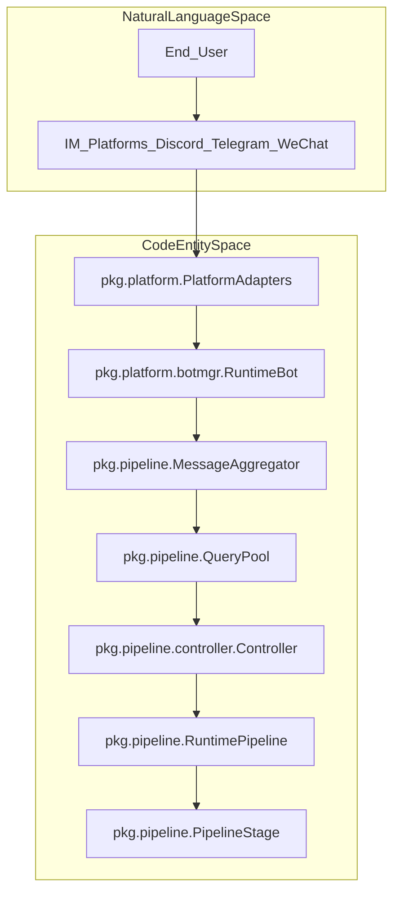

This layered design allows LangBot to cleanly separate concerns: platform-specific message translation belongs in adapters, message orchestration is handled upstream by `RuntimeBot` and `MessageAggregator`, and sophisticated processing such as AI model invocation and tool management happens inside pipeline stages and runners.

For details, see [System Architecture and Components](#1.1).

Sources: [README.md:18](), [README.md:35-48]()

---

## 1.2. Key Features and Capabilities

LangBot offers a suite of comprehensive features engineered for production-grade AI bot deployment across multiple IM platforms [README.md:43-51](). It provides multi-turn dialogues, tool calling, streaming outputs, and native RAG capabilities deeply integrated with leading LLMOps platforms like Dify, Coze, and n8n [README.md:44-45]().

Furthermore, LangBot supports a universal IM adapter layer covering Discord, Telegram, Slack, QQ, WeChat, and more from a single codebase [README.md:46](), [README.md:100-116](). Production features include access control, rate limiting, sensitive word filtering, a rich plugin ecosystem supporting MCP, and an intuitive web management panel [README.md:47-49]().

Title: Feature Integration Architecture
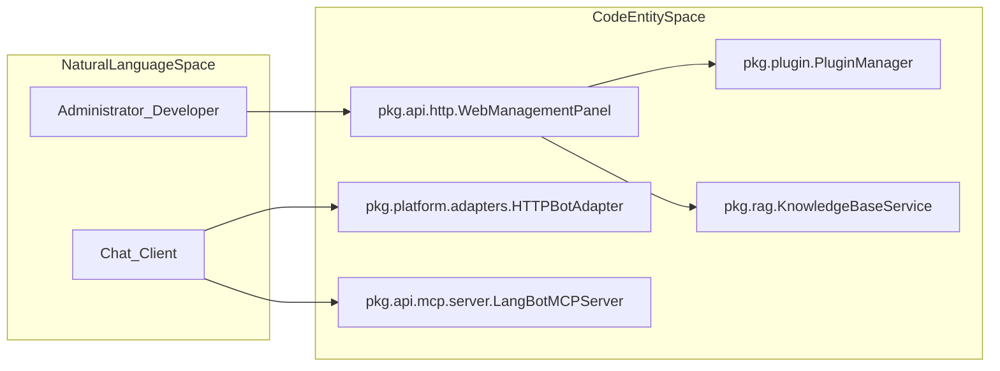

For details, see [Key Features and Capabilities](#1.2).

Sources: [README.md:43-51](), [README.md:100-116]()

---

## 1.3. Deployment Options

LangBot supports flexible deployment methods to suit local development, self-hosted production, and managed cloud environments [README.md:66-92](). Options range from LangBot Cloud zero-configuration hosting to one-line `uvx langbot` execution, Docker Compose setups, and one-click cloud deploys on Zeabur or Railway [README.md:67-95]().

Containerized deployments utilize Docker Compose services spanning the core server, plugin runtime (`langbot_plugin_runtime`), and optional Box sandbox runtime (`langbot_box`) [docker/docker-compose.yaml:6-89](). The main LangBot application (`langbot`) also runs as a Docker service [docker/docker-compose.yaml:90-123]().

Title: Deployment Pathways
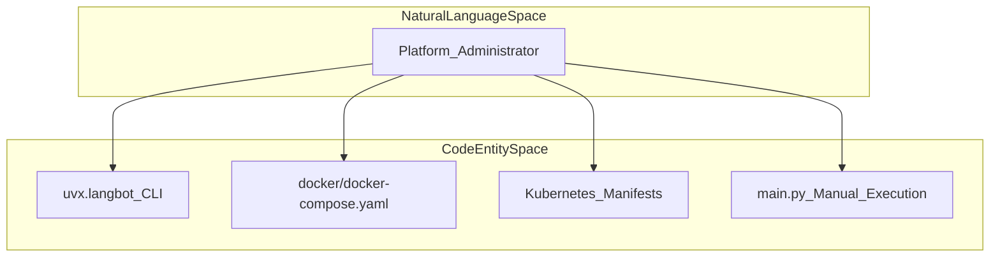

For details, see [Deployment Options](#1.3).

Sources: [README.md:66-92](), [README.md:67-95](), [docker/docker-compose.yaml:6-89](), [docker/docker-compose.yaml:90-123]()

---

# Page: System Architecture and Components

# System Architecture and Components

<details>
<summary>Relevant source files</summary>

The following files were used as context for generating this wiki page:

- [.mcp.json](.mcp.json)
- [AGENTS.md](AGENTS.md)
- [ARCHITECTURE.md](ARCHITECTURE.md)
- [docker/kubernetes.yaml](docker/kubernetes.yaml)
- [docs/MIGRATION_SUMMARY.md](docs/MIGRATION_SUMMARY.md)
- [docs/WEBSOCKET_README.md](docs/WEBSOCKET_README.md)
- [src/langbot/pkg/core/app.py](src/langbot/pkg/core/app.py)
- [src/langbot/pkg/core/stages/build_app.py](src/langbot/pkg/core/stages/build_app.py)
- [src/langbot/pkg/entity/persistence/agent_run.py](src/langbot/pkg/entity/persistence/agent_run.py)
- [src/langbot/pkg/entity/persistence/event_log.py](src/langbot/pkg/entity/persistence/event_log.py)
- [src/langbot/pkg/entity/persistence/monitoring.py](src/langbot/pkg/entity/persistence/monitoring.py)
- [src/langbot/pkg/entity/persistence/transcript.py](src/langbot/pkg/entity/persistence/transcript.py)
- [src/langbot/pkg/operation_trace/service.py](src/langbot/pkg/operation_trace/service.py)
- [src/langbot/pkg/persistence/alembic/versions/0039_execution_lease_indexes.py](src/langbot/pkg/persistence/alembic/versions/0039_execution_lease_indexes.py)
- [src/langbot/pkg/persistence/media.py](src/langbot/pkg/persistence/media.py)
- [src/langbot/pkg/plugin/runner_actions.py](src/langbot/pkg/plugin/runner_actions.py)
- [src/langbot/templates/config.yaml](src/langbot/templates/config.yaml)
- [tests/unit_tests/core/test_app_shutdown.py](tests/unit_tests/core/test_app_shutdown.py)
- [tests/unit_tests/persistence/test_conversation_page_index.py](tests/unit_tests/persistence/test_conversation_page_index.py)
- [tests/unit_tests/persistence/test_execution_lease_indexes.py](tests/unit_tests/persistence/test_execution_lease_indexes.py)
- [tests/unit_tests/persistence/test_partial_history_indexes.py](tests/unit_tests/persistence/test_partial_history_indexes.py)
- [tests/unit_tests/storage/test_inline_media_cleanup.py](tests/unit_tests/storage/test_inline_media_cleanup.py)
- [tests/unit_tests/test_operation_trace_incremental.py](tests/unit_tests/test_operation_trace_incremental.py)
- [tests/unit_tests/test_operation_trace_integrity.py](tests/unit_tests/test_operation_trace_integrity.py)

</details>


## Purpose and Scope

This document details the multi-layered architecture of LangBot, mapping high-level architectural concepts to concrete code entities, services, and modules. It covers the interaction between platform adapters, execution pipelines, agents and runners, the isolated plugin runtime, the AI/LLM layer, and the persistence/storage subsystems. It also defines the repository boundary between the core LangBot platform and the `langbot-plugin-sdk` package.

Sources: [ARCHITECTURE.md](), [AGENTS.md:1-14](), [src/langbot/pkg/core/app.py:67-178]()

---

## High-Level System Architecture and Repository Boundary

LangBot is structured around a core application runtime (`Application` class) in [src/langbot/pkg/core/app.py:67-178]() that orchestrates platform ingestion, message aggregation, query scheduling, pipeline and agent execution, extension/plugin connectivity, and persistent storage.

### Repository Boundary: LangBot vs langbot-plugin-sdk

A strict architectural boundary separates:

- **LangBot Repository (`langbot`)**: Contains the core engine, HTTP API based on Quart/Hypercorn [src/langbot/pkg/api/http/controller/main.py](), platform adapters [src/langbot/pkg/platform/](), database persistence and Alembic migrations [src/langbot/pkg/persistence/](), the frontend (`web/`), and plugin/box bridge components [src/langbot/pkg/plugin/connector.py]().
- **langbot-plugin-sdk Repository (`langbot-plugin-sdk`)**: Published independently and pulled in as a dependency, this includes shared data entities, plugin developer APIs, action protocols, isolated Plugin Runtime (`lbp rt`), and Box sandbox runtime (`lbp box`).

Sources: [AGENTS.md:9-13](), [src/langbot/pkg/core/app.py:67-178](), [ARCHITECTURE.md]()

---

## Runtime Execution Graph and Message Flow

LangBot’s runtime processing follows a well-defined graph that transforms incoming platform-specific data into query execution and response emission.

### Runtime Execution Flow Graph

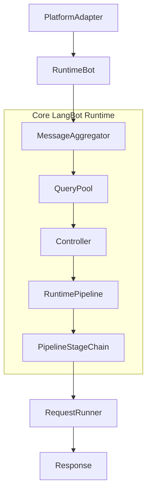

#### Components and Responsibilities:

1.  **Platform Adapter**: Converts platform-specific events into a normalized message format for LangBot. Managed primarily by the `RuntimeBot` entity, defined in [src/langbot/pkg/platform/botmgr.py:55-160]().
2.  **RuntimeBot**: The runtime bot instance encapsulating platform adapter interaction, execution context, and event-to-query conversion. See `RuntimeBot` class [src/langbot/pkg/platform/botmgr.py:55]().
3.  **MessageAggregator**: Buffers and normalizes incoming messages before submitting them to the query pool. Instantiated as `ap.msg_aggregator` [src/langbot/pkg/core/app.py:126]().
4.  **QueryPool**: A concurrency-managed priority queue storing queries awaiting processing. Instantiated as `ap.query_pool` [src/langbot/pkg/core/app.py:124]().
5.  **Controller**: Governs the scheduling and dispatch of queries from the pool to pipeline or agent runners. Instantiated as `ap.ctrl` [src/langbot/pkg/core/app.py:128]().
6.  **RuntimePipeline / Agent runner**: Executes the pipeline stages or agents, controlling the flow of processing. `RuntimePipeline` is defined in [src/langbot/pkg/pipeline/pipelinemgr.py:68-183]().
7.  **Request Runner**: Utilizes the `ToolManager`, `PluginRuntimeConnector`, or `BoxService` to execute tool calls, plugin actions, or sandboxed code.
8.  **Response**: Sends responses back through the original platform adapter to the users.

Sources: [src/langbot/pkg/core/app.py:123-130](), [src/langbot/pkg/platform/botmgr.py:55-160](), [src/langbot/pkg/pipeline/pipelinemgr.py:68-183]()

---

## Natural Language to Code Entity Space Mappings

To link system architecture concepts with concrete codebase entities, the following diagrams map natural language components to their respective code classes, modules, and file paths.

### AI, Storage, and Extension Subsystems Mapping

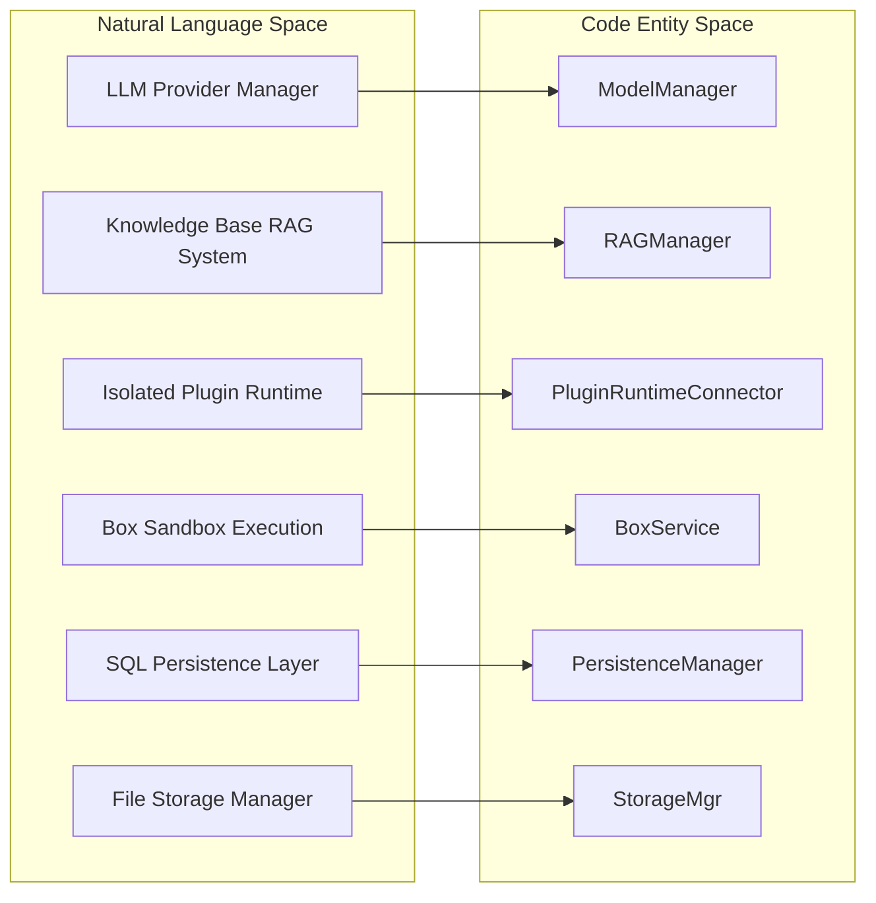

Sources: [src/langbot/pkg/core/app.py:83-166](), [src/langbot/pkg/plugin/connector.py](), [src/langbot/pkg/storage/mgr.py]()

---

### Application Bootstrap and Boot Stages Mapping

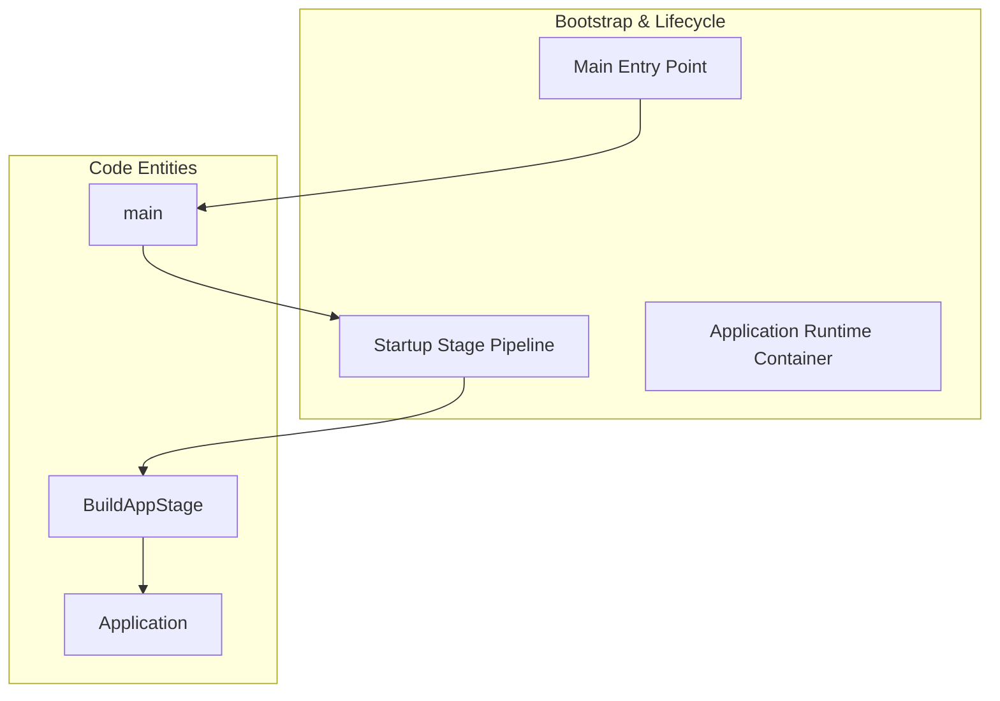

Sources: [src/langbot/pkg/core/stages/build_app.py:58-159](), [src/langbot/pkg/core/app.py:67-178]()

---

## Core Subsystem Integration and Application Lifecycle

LangBot’s initialization and runtime environment are managed as a sequence of boot stages. These stages progressively build the application state and configure all subsystems before accepting requests.

### Boot Stages Overview

1.  **LoadConfigStage**: Loads configuration files and environment variable overrides. The default configuration is in [src/langbot/templates/config.yaml:1-162]().
2.  **GenKeysStage**: Generates or loads cryptographic keys.
3.  **SetupLoggerStage**: Configures logging output and levels.
4.  **BuildAppStage**: Constructs the full `Application` object, initializing all managers and service layers. This stage is defined in [src/langbot/pkg/core/stages/build_app.py:58-159]().
5.  **ShowNotesStage**: Displays startup notes and system information.

### Central Application Object

The `Application` class [src/langbot/pkg/core/app.py:67-178]() centralizes runtime resources and services:

| Subsystem | Corresponding `Application` Attribute | Description |
| :--- | :--- | :--- |
| Platform Manager | `platform_mgr` [src/langbot/pkg/core/app.py:78]() | Manages chat platform adapters, message routing |
| Message Aggregation | `msg_aggregator` [src/langbot/pkg/core/app.py:126]() | Buffers and prepares platform messages |
| Query Pool | `query_pool` [src/langbot/pkg/core/app.py:124]() | Manages concurrency, queues for scheduled query execution |
| Pipeline Controller | `ctrl` [src/langbot/pkg/core/app.py:128]() | Schedules query execution into runtime pipelines |
| Pipeline Manager | `pipeline_mgr` [src/langbot/pkg/core/app.py:130]() | Manages pipeline configurations and lifecycle |
| Plugin Runtime Connector | `plugin_connector` [src/langbot/pkg/core/app.py:121]() | Connects and communicates with isolated plugin runtimes |
| Box Service Sandbox | `box_service` [src/langbot/pkg/core/app.py:93]() | Manages Box sandbox execution environment |
| Persistence Manager | `persistence_mgr` [src/langbot/pkg/core/app.py:138-139]() | Manages database sessions and ORM models |
| Storage Manager | `storage_mgr` [src/langbot/pkg/core/app.py:165]() | Handles file upload and media cache |
| Model Manager | `model_mgr` [src/langbot/pkg/core/app.py:86-87]() | Manages AI LLM/embedding model providers |
| Tool Manager | `tool_mgr` [src/langbot/pkg/core/app.py:92]() | Handles AI tool loading and invocation |
| Workspace Service | `workspace_service` [src/langbot/pkg/core/app.py:142]() | Manages workspace-level operations and multi-tenancy |
| Telemetry | `telemetry_module` [src/langbot/pkg/core/app.py:51]() | Collects and reports operational metrics |
| Operation Trace | `workspace_settings_service` [src/langbot/pkg/core/app.py:39]() | Manages audit logging and traceability of user actions |

Sources: [src/langbot/templates/config.yaml:1-162](), [src/langbot/pkg/core/stages/build_app.py:58-159](), [src/langbot/pkg/core/app.py:67-178](), [src/langbot/pkg/operation_trace/service.py:1-2524]()

---

# Page: Key Features and Capabilities

# Key Features and Capabilities

<details>
<summary>Relevant source files</summary>

The following files were used as context for generating this wiki page:

- [README.md](README.md)
- [README_CN.md](README_CN.md)
- [README_ES.md](README_ES.md)
- [README_FR.md](README_FR.md)
- [README_JP.md](README_JP.md)
- [README_KO.md](README_KO.md)
- [README_RU.md](README_RU.md)
- [README_TW.md](README_TW.md)
- [README_VI.md](README_VI.md)
- [docker/docker-compose.yaml](docker/docker-compose.yaml)

</details>


## Purpose and Scope

This page provides an in-depth explanation of LangBot's key production-grade features and capabilities as a multi-platform AI instant messaging bot platform [README.md:10-50](). It covers technical implementation details of multi-platform universal IM support, agentic runtime with tool calling, integration of RAG and knowledge bases, the extensible plugin ecosystem, advanced production features including access control and monitoring, the web management panel, HTTP Bot adapter usage, and its built-in MCP server exposed at `/mcp`.

These components collectively enable developers to create, deploy, and monitor intelligent conversational agents efficiently across many chat platforms.

Sources: [README.md:10-50]()

---

## Universal IM Platform Support & HTTP Bot Adapter

### Overview

LangBot's core abstraction normalizes inbound chat events from multiple instant messaging platforms into a unified internal message format. This allows seamless multi-platform support with a single runtime codebase [README.md:46]().

The frontend platform adapters handle the platform-specific webhook protocols, WebSocket connections, or long polling, converting raw platform events into LangBot’s internal normalized event objects.

### Supported Platforms

LangBot officially supports over a dozen platforms with first-class platform adapters implementing all required event parsing and outgoing message dispatch [README.md:104-123]():

| Platform | Status | Integration Type / Notes |
|----------|--------|--------------------------|
| Discord  | ✅     | Official Gateway API |
| Telegram | ✅     | Official Bot API |
| Slack    | ✅     | Socket Mode / Events API |
| LINE     | ✅     | Messaging API Webhook |
| QQ       | ✅     | Personal & Official APIs (Channel, DM, Group) |
| WeCom    | ✅     | Enterprise WeChat, External CS, AI Bot |
| WeChat   | ✅     | Personal & Official Account |
| Lark     | ✅     | Official Open Platform |
| DingTalk | ✅     | Official Stream / Webhook |
| KOOK     | ✅     | Official API |
| Satori   | ✅     | Protocol-based adapter |
| Matrix   | ✅     | Bridges Signal, WhatsApp, Messenger, iMessage, and more |
| HTTP Bot | ✅     | Server-to-server webhook |

### HTTP Bot Adapter

The HTTP Bot Adapter supports server-to-server webhook integration without persistent connections:

- **Inbound**: External third-party backends POST JSON payloads to LangBot webhook URLs secured by HMAC-SHA256 signatures.
- **Outbound**: LangBot sends responses back to configured callback URLs with HMAC-SHA256 signed payloads.
- **Session**: Uses a `session_id` to maintain conversation continuity across stateless HTTP requests and responses.

This adapter is implemented as an abstraction within the platform adapter layer, converting webhook events to internal `MessageChain` objects and routing them through the `RuntimeBot` processing stack [README.md:46]().

Sources: [README.md:46]()

---

### Natural Language to Agent Runtime Flow

Diagram: Natural Language to Agent Runtime Flow
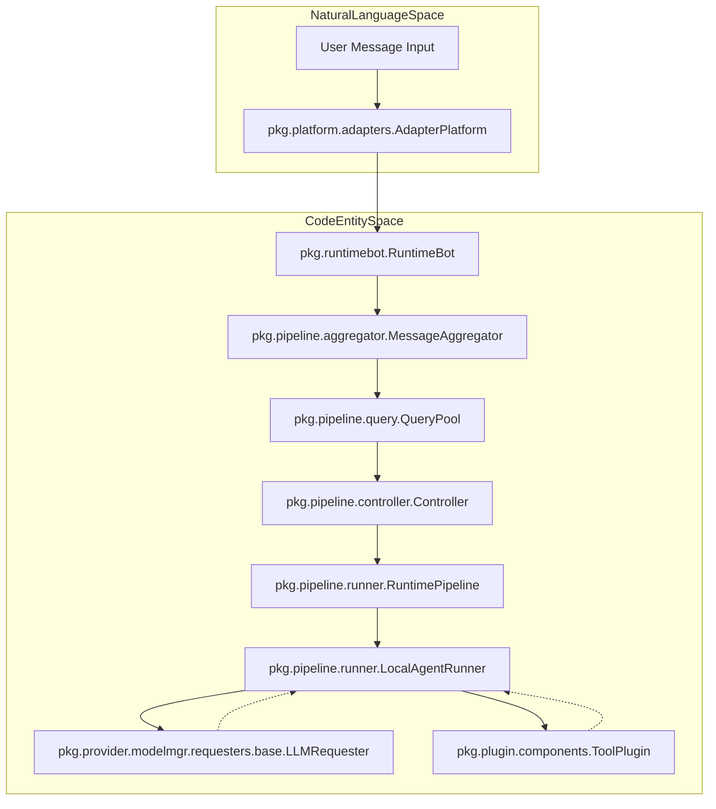

This diagram illustrates the flow from receiving a natural language message from any platform adapter into the LangBot runtime pipeline:

1. The platform adapter converts platform events into normalized message objects.
2. `RuntimeBot` orchestrates message processing and event dispatching.
3. `MessageAggregator` collects conversations and aggregates messages.
4. `QueryPool` manages active conversational queries.
5. `Controller` executes control logic and routing.
6. `RuntimePipeline` encapsulates processing stages.
7. The core multi-turn reasoning happens in `LocalAgentRunner`.
8. The runner calls LLM requesters (e.g., OpenAI, Anthropic) and invokes `ToolPlugin` extensions dynamically.

Sources: [README.md:43-48]()

---

## AI Conversation, Agent Runtime, and Tool Calling

### Multi-turn Dialogue Runtime

LangBot’s `LocalAgentRunner` drives the conversational logic for multi-turn dialogues incorporating LLM inference and tool invocation loops. Each user message gets encapsulated in a `Query` object, tracked in `QueryPool` for session management and concurrency control.

The runner handles:

- Invocation of configured language models through `LLMRequester` instances.
- Tool calling including platform-specific or plugin-injected tools.
- Maintaining dialogue context, turn state, and streaming token generation.

This enables rich agentic behaviors: multi-turn conversations with external tool execution [README.md:43-48](). The `AgentService.debug_agent` method provides a way to execute synthetic events against a configured agent for debugging purposes, supporting both message and non-message event envelopes.

### Tool Ecosystem and Discovery

Tools can originate from:

- **Native platform tools**, embedded in LangBot.
- **Plugin components**, loaded via `PluginManager`.
- **External MCP servers** acting as tool providers.
- **Skills executed in sandboxed Box runtimes**.

The system dynamically discovers all installed tool implementations and their JSON schema for argument validation. Tool execution results feed back into the agent runtime to influence further reasoning or user responses.

Sources: [README.md:43-48]()

---

### Tool Discovery & Execution Logic

Diagram: Tool Discovery and Execution Logic
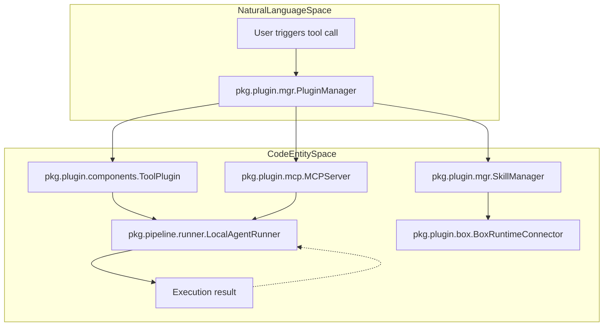

- `PluginManager` manages all plugin and MCP server components.
- Installed tools (native or plugin-based) are exposed to the `LocalAgentRunner`.
- The Box runtime executes skill extensions securely isolated.
- The agent runtime consumes tool results to continue session flows.

Sources: [README.md:45-48]()

---

## RAG and Knowledge Base System

### Overview

LangBot integrates a built-in Retrieval-Augmented Generation system supporting a variety of vector database backends and document parsers for knowledge base construction [README.md:45]().

### KnowledgeBase Entity

The core `KnowledgeBase` model stores:

- Parser plugin selections and ingestion rules.
- Retrieval plugin settings, including vector model selectors.
- Configuration parameters like top-k results, distance thresholds.
- Integration points for LLMOps platforms such as Dify, Coze, and n8n.

RAG engines execute semantic retrieval queries that augment LLM prompts with vector search results.

Sources: [README.md:45]()

---

### RAG Component Interaction

Diagram: RAG Component Interaction
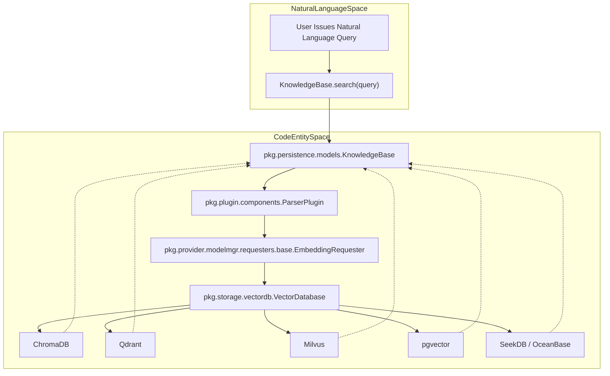

Vector database integration allows LangBot to retrieve semantically relevant documents, enabling enhanced context for LLM generations in tasks like knowledge base Q&A.

Sources: [README.md:45]()

---

## Plugin Ecosystem and Extension Framework

LangBot defines an event-driven plugin runtime architecture that isolates extensions into separate processes with communication via JSON-RPC over stdio or WebSocket [README.md:48](). The `docker-compose.yaml` defines `langbot_plugin_runtime` and `langbot_box` services for this purpose [docker/docker-compose.yaml:7-70]().

Plugins extend LangBot with:

- **Custom tools** exposed to the agent runtime.
- **Event listeners** reacting to lifecycle or platform events.
- **Knowledge engines** for specialized RAG handling.
- **Document parsers** aiding ingestion pipelines.

### Extension Types

- **Plugins** (Python packages) are dynamically loaded with schema-driven configuration.
- **MCP Servers** implement the Model Context Protocol interface for remote tool hosting.
- **Skills** are markdown-scripted agent instructions executed inside sandboxed Box runtimes.

This plugin model supports scalability, security isolation, and seamless extension management.

Sources: [README.md:48](), [docker/docker-compose.yaml:7-70]()

---

## Production-Ready Features, Security, and Monitoring

LangBot is designed to operate safely and reliably in enterprise environments with:

- **Access Control & Multi-tenant Workspaces**: Role-Based Access Control enforced in the tenant `Workspace` context ensures isolated and authorized usage [README.md:47]().
- **Rate Limiting and Content Filtering**: Integration of request occupancy and sensitive word filters prevents abuse and maintains message quality.
- **Comprehensive Monitoring & Telemetry**: Real-time dashboards capture message volumes, LLM call metrics, session states, error rates, and token usage for operational insight.
- **Exception Handling & Retry Policies**: Pipeline stages include robust error handling to maintain stability.

These features are critical for production-scale deployments trusted by enterprises [README.md:47]().

Sources: [README.md:39-47]()

---

## Web Management Panel

LangBot ships with an integrated web management console built with Vite + React Router 7 and shadcn/ui components served via the Quart backend on port 5300 [README.md:49]().

### Capabilities

- Bot, Agent, Pipeline, Knowledge Base CRUD with schema-driven forms.
- Visual event binding and dynamic form editors.
- Real-time pipeline debug and session tracing with WebSocket support.
- Plugin marketplace integration and plugin configuration UIs.
- Monitoring dashboards showing message, session, error, and token stats.

This UI eliminates the need for manual YAML editing and provides operators with powerful bot lifecycle management tools.

Sources: [README.md:39-49](), [docker/docker-compose.yaml:124-125]()

---

## Built-in MCP Server at `/mcp`

LangBot exposes a Model Context Protocol (MCP) server natively under its HTTP service path `/mcp`, providing programmatic management and telemetry for bots, pipelines, LLM models, knowledge bases, MCP servers, and skills.

### Key Features

- Wraps a curated subset of the HTTP service API as MCP tools for AI-agent interoperability without network overhead.
- Supports stateless JSON-over-HTTP transport with API key authentication.
- Implements tools for system info, resource listing, CRUD operations, pipeline execution, and sandbox diagnostics.
- Shares authentication and permission model with the HTTP API, scoped by Workspace/Tenant contexts.

This server enables external MCP clients and agents to control and monitor the LangBot instance programmatically.

Sources: [README.md:48]()

---

### MCP Server Interaction

Diagram: MCP Server Interaction Flow
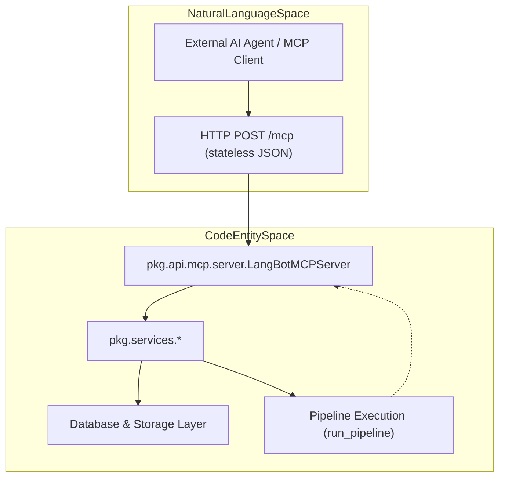

- AI agents use an MCP client library to communicate with `/mcp` endpoint.
- LangBot’s `LangBotMCPServer` handles tool calls locally via direct service layer access.
- Tool results or mutations trigger updates or pipeline executions on demand.

Sources: [README.md:48]()

---

# Summary Table of Key Features

| Feature                     | Description & Key Code Entities                               |
|-----------------------------|--------------------------------------------------------------|
| Multi-platform IM Support   | `pkg.platform.adapters.*` normalizes all platform events      |
| HTTP Bot Adapter            | Stateless webhook server for backend integration              |
| Agent Runtime & Tool Calling| `pkg.pipeline.runner.LocalAgentRunner`, `pkg.plugin.mgr.*`    |
| RAG Knowledge Bases         | `KnowledgeBase` model, vector DB plugins                       |
| Plugin Ecosystem            | Event-driven, isolated plugin runtime, MCP servers, skills    |
| Production Features         | RBAC, rate limiting, filters, telemetry dashboards            |
| Web Management Panel        | Vite+React UI, dynamic forms, debugging, monitoring           |
| Built-in MCP Server         | `pkg.api.mcp.server.LangBotMCPServer` at `/mcp` path          |

Sources: [README.md](), [docker/docker-compose.yaml]()

---

# Page: Deployment Options

# Deployment Options

<details>
<summary>Relevant source files</summary>

The following files were used as context for generating this wiki page:

- [README.md](README.md)
- [README_CN.md](README_CN.md)
- [README_ES.md](README_ES.md)
- [README_FR.md](README_FR.md)
- [README_JP.md](README_JP.md)
- [README_KO.md](README_KO.md)
- [README_RU.md](README_RU.md)
- [README_TW.md](README_TW.md)
- [README_VI.md](README_VI.md)
- [docker/docker-compose.yaml](docker/docker-compose.yaml)
- [packaging/fnos/README.md](packaging/fnos/README.md)
- [packaging/fnos/build.sh](packaging/fnos/build.sh)
- [packaging/fnos/cmd/install_callback](packaging/fnos/cmd/install_callback)
- [packaging/fnos/cmd/install_init](packaging/fnos/cmd/install_init)
- [packaging/fnos/cmd/main](packaging/fnos/cmd/main)
- [packaging/fnos/cmd/uninstall_callback](packaging/fnos/cmd/uninstall_callback)
- [packaging/fnos/cmd/upgrade_callback](packaging/fnos/cmd/upgrade_callback)
- [packaging/fnos/cmd/upgrade_init](packaging/fnos/cmd/upgrade_init)
- [packaging/fnos/config/privilege](packaging/fnos/config/privilege)
- [packaging/fnos/manifest](packaging/fnos/manifest)

</details>


This page documents the various deployment pathways available for LangBot, from managed cloud environments to self-hosted container stacks, manual installations, Kubernetes clusters, and specialized NAS/appliance packaging such as fnOS. It covers infrastructure requirements, container build architectures, vector database extension integration, and underlying code execution entry points.

Sources: [README.md:64-92]()

---

## 1. Deployment Method Overview

LangBot supports multiple deployment configurations to accommodate diverse operational needs, scaling demands, and management preferences.

| Method | Setup Time | Infrastructure Required | Code / Runtime Target |
|---|---|---|---|
| **LangBot Cloud** | < 1 minute | Managed cloud | Hosted multi-tenant backend at `space.langbot.app` |
| **One-line Launch (`uvx`)**| < 2 minutes | Python 3.10 - 3.13 + `uv` | Installs PyPI package `langbot` and launches via `uvx` CLI |
| **Docker Compose** | < 5 minutes | Docker and Docker Compose | Multi-container stack: `langbot`, `langbot_plugin_runtime`, `langbot_box` |
| **One-Click Cloud Deploy** | < 5 minutes | PaaS account | Deploys prebuilt `rockchin/langbot:latest` container image |
| **Kubernetes** | 30+ minutes | Kubernetes cluster | K8s manifests with PVCs and Deployments |
| **BTPanel (宝塔面板)** | 10+ minutes | Linux server with BTPanel | Python environment managed via PM2 or supervisor |
| **fnOS Appliance** | 5+ minutes | fnOS NAS environment | Packaged with fnOS FPK format, integrated with NAS lifecycle callbacks |
| **Manual Installation** | 20+ minutes | Server + Python 3.10 - 3.13 | Source checkout with manual Python launch (`main.py`) |

Sources: [README.md:64-92](), [docker/docker-compose.yaml:1-125]()

---

## 2. Deployment Architecture and Code Mapping

This section bridges natural language deployment paths to concrete code entities, container images, manifests, and runtime entry points within the LangBot codebase.

### Deployment Pathways to Code Entity Mapping

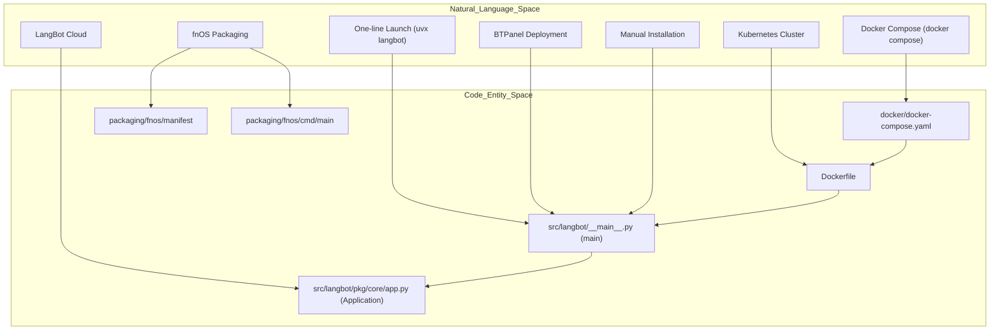

- `src/langbot/__main__.py`: Main CLI entrypoint with async `main()` and application bootstrap stages [src/langbot/pkg/core/boot.py:56-91]().
- `docker/docker-compose.yaml`: Defines multi-service setup with core LangBot, plugin runtime, and optional Box sandbox containers [docker/docker-compose.yaml:1-125]().
- `Dockerfile`: Multi-stage build file producing runtime container images, including frontend build and sandbox compilation [Dockerfile:1-73]().
- `packaging/fnos/manifest`: Manifest file and packaging scripts for fnOS NAS appliance integration [packaging/fnos/manifest:1-16]().
- `packaging/fnos/cmd/main`: Shell script managing LangBot lifecycle for fnOS, including environment setup and port patching [packaging/fnos/cmd/main:1-170]().
- `Application`: Core Python application class handling lifecycle and async event loop [src/langbot/pkg/core/boot.py:56-91]().

Sources: [README.md:64-92](), [docker/docker-compose.yaml:1-125](), [src/langbot/pkg/core/boot.py:56-91](), [Dockerfile:1-73](), [packaging/fnos/manifest:1-16](), [packaging/fnos/cmd/main:1-170]()

---

## 3. Managed Cloud and One-Click Deployments

### LangBot Cloud

LangBot Cloud offers a fully managed, zero-configuration hosting environment at:

- **URL**: `https://cloud.langbot.app` / `https://space.langbot.app/cloud` [README.md:25](), [README_CN.md:27](), [README_JP.md:69](), [README_TW.md:71](), [README_RU.md:69](), [README_VI.md:69](), [README_KO.md:69](), [README_FR.md:69](), [README_ES.md:69]()
- **Features**:
  - No local deployment required; instant onboarding.
  - Multi-tenant cloud backend operated by LangBot maintainers.
  - Integrated plugin marketplace and telemetry.
- **Implementation Notes**:
  - Runs on verified, hardened multi-tenant architecture.
  - Cloud bootstrap and launch services manage tenant isolation and resource assignment.

This option is recommended for users without infrastructure or DevOps expertise who desire immediate testing or production usage.

### One-Click Cloud Deployments (Zeabur & Railway)

These cloud providers offer one-click deploy buttons that pull the official LangBot container image:

- **Container Image**: `rockchin/langbot:latest` [docker/docker-compose.yaml:8]()
- **Environment Configuration**: Customizable via environment variables for database endpoints, authentication tokens, and runtime parameters.
- **Persistence**: Supports mounting persistent volumes for SQLite or connecting to external managed PostgreSQL.
- **Examples**:
  - [Zeabur Deployment Template](https://zeabur.com/en-US/templates/ZKTBDH) [README.md:93]()
  - [Railway Deployment Template](https://railway.app/template/yRrAyL?referralCode=vogKPF) [README.md:94]()

Sources: [README.md:66-96](), [README_JP.md:91-94](), [README_TW.md:92-95](), [README_CN.md:91-94](), [README_RU.md:90-93](), [README_VI.md:90-93](), [README_KO.md:90-93](), [README_FR.md:90-93](), [README_ES.md:90-93](), [docker/docker-compose.yaml:8]()

---

## 4. Local and Containerized Self-Hosting

### One-Line Launch (`uvx`)

The fastest way to locally launch LangBot is using Astral's `uvx` tool, which performs:

- Installation directly from PyPI without virtualenv setup.
- Launches the CLI `main` entrypoint (binding to default `http://localhost:5300`).
- For extended vector search functionality, install with extras:  
  ```bash
  uvx --from 'langbot[seekdb]@latest' langbot
  ```
- This approach relies on:
  - Python 3.10 to 3.13 [README.md:18]().
  - `uv` async runtime installed independently [README.md:74-80]().

### Docker Compose

Docker Compose enables structured container-based deployment suitable for production or development:

- **Key Services**:
  1. `langbot`: The core Quart backend server hosting the web UI & webhook endpoints [docker/docker-compose.yaml:90-125]().
  2. `langbot_plugin_runtime`: Isolates plugin execution in a separate container to protect stability [docker/docker-compose.yaml:7-36]().
  3. `langbot_box` (optional): Sandbox runtime providing a secure environment for skill execution with system call confinement [docker/docker-compose.yaml:43-88]().

- **Networking**: All containers connect via the `langbot_network` bridge for inter-service RPC and WebSocket communication [docker/docker-compose.yaml:34]().

- **Port Bindings**:
  - Port 5300 exposed for UI and webhook callbacks [docker/docker-compose.yaml:124]().
  - Ports 2280-2285 for multi-platform reverse connections [docker/docker-compose.yaml:125]().

#### Docker Compose Service Topology

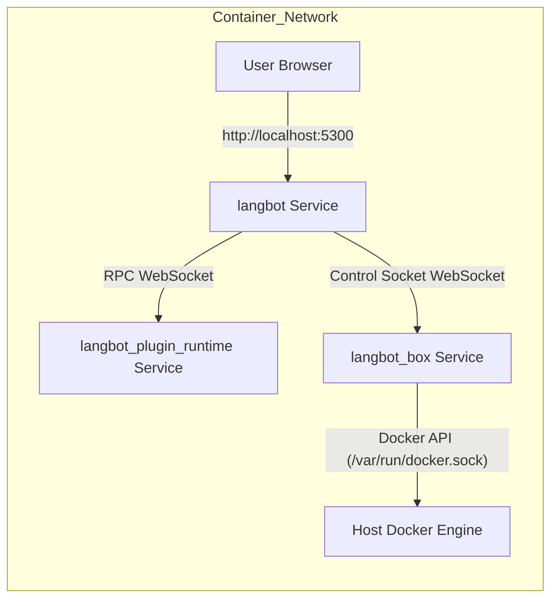

Sources: [README.md:70-84](), [docker/docker-compose.yaml:1-125]()

---

## 5. Docker Image Build Pipeline

The official LangBot container is built via a multi-stage `Dockerfile` combining frontend assets, sandbox infrastructure, and Python runtime.

### Multi-Stage Docker Build Overview

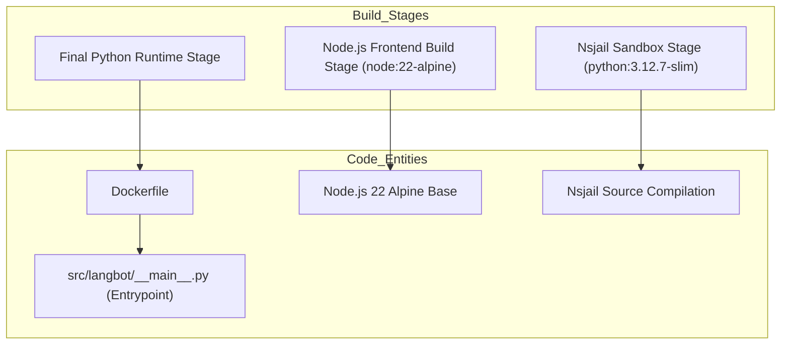

**Stage Details**:

1. **Node Frontend Stage**:
   - Builds the Vite + React frontend located in `web/` [Dockerfile:5-7]().
   - Produces static assets for inclusion in the final image.
   - References: [Dockerfile:1-8]()

2. **Nsjail Sandbox Stage**:
   - Compiles Google's `nsjail` (v3.6) from C source for process-level sandboxing [Dockerfile:14-26]().
   - Avoids dependency on host Docker for sandboxing, though the Docker container can also interface with host Docker.
   - References: [Dockerfile:14-26]()

3. **Final Runtime Stage**:
   - Combines Python dependencies, frontend static files, and sandbox executables [Dockerfile:28-42]().
   - Installs prebuilt CLI support tools such as `docker-ce-cli` and `nodejs` for MCP stdio plugin servers [Dockerfile:43-66]().
   - References: [Dockerfile:28-73]()

Sources: [Dockerfile:1-73]()

---

## 6. Advanced Infrastructure & Appliance Deployments

### Kubernetes Deployment

LangBot provides Kubernetes manifests suitable for production-grade cluster deployments:

- **Features**:
  - Creates dedicated `langbot` namespace.
  - PersistentVolumeClaims (PVCs) for data, plugin storage, and plugin runtime state.
  - Deployments for core `langbot`, `langbot-plugin-runtime`, and optional `langbot-box` sandbox runtime.
  - Services to expose network ports internally and externally.
  - Liveness and readiness probes (`/healthz`, `/readyz`) to ensure container health.
  - Environment configuration via ConfigMaps.
  - Support for external persistent database backends such as PostgreSQL.

- **Usage Notes**:
  - Secrets for plugin runtime and box control tokens should be generated with secure random values (`openssl rand -hex 32`).
  - The Box sandbox requires access to Docker socket `/var/run/docker.sock` on the node.
  - Detailed deployment guide available in documentation.

Sources: [docker/docker-compose.yaml:1-125]()

### BTPanel (宝塔面板) Deployment

For Linux servers managed with BTPanel:

- Clone or upload LangBot repository into a designated BTPanel site directory.
- Use Python 3.10-3.13 to create a virtual environment.
- Install required dependencies manually or via `pip`.
- Manage runtime processes with PM2 or another supervisor referencing `main.py` [src/langbot/__main__.py]().
- Suitable for administrators preferring GUI management for service lifecycle and logs.

### fnOS Appliance Packaging

LangBot supports packaging as a native NAS application using fnOS:

- The `packaging/fnos/` directory contains:
  - `manifest` describing package metadata [packaging/fnos/manifest:1-16]().
  - Build shell scripts [packaging/fnos/build.sh]().
  - Lifecycle command callbacks (`install_init`, `uninstall_callback`, `upgrade_init`, `upgrade_callback`) [packaging/fnos/cmd/install_init](), [packaging/fnos/cmd/uninstall_callback](), [packaging/fnos/cmd/upgrade_init](), [packaging/fnos/cmd/upgrade_callback]().
  - Config files describing settings permissions and hooks [packaging/fnos/config/privilege]().
- The `packaging/fnos/cmd/main` script handles the application's lifecycle, including setting up the Node.js environment for Box sandbox and MCP capabilities, managing persistent data directories, and patching the `config.yaml` to ensure the LangBot's listen port matches the fnOS UI settings [packaging/fnos/cmd/main:1-170]().
- Enables easy network-attached storage appliance deployment without container or Kubernetes knowledge.

Sources: [README.md:92](), [packaging/fnos/manifest:1-16](), [packaging/fnos/build.sh](), [packaging/fnos/cmd/install_init](), [packaging/fnos/cmd/uninstall_callback](), [packaging/fnos/cmd/upgrade_init](), [packaging/fnos/cmd/upgrade_callback](), [packaging/fnos/config/privilege](), [packaging/fnos/cmd/main:1-170]()

---

# Summary

LangBot offers a spectrum of deployment options:

- **Managed Cloud (LangBot Cloud)**: Instant use with no deployment overhead.
- **Local Quick Start (uvx)**: One-liner to get started for development and trial.
- **Docker Compose**: Containerized multi-service deployment for isolated plugin and sandbox execution.
- **One-Click Cloud Deploy**: Easy PaaS deployment with ready container images.
- **Kubernetes**: Production-grade cluster orchestration with PVC support and auto-healing probes.
- **BTPanel**: GUI-managed Linux server environment.
- **fnOS Packaging**: NAS appliance integration supporting lifecycle management scripts.
- **Manual**: Direct Git clone and Python source launch for fine-grained control.

This flexible deployment architecture is supported by the LangBot codebase’s modular and multi-stage build system, allowing both open-source and enterprise users to select deployments matching their operational requirements.

---

Sources:  
[README.md:64-92](), [README_JP.md:91-94](), [README_TW.md:92-95](), [README_CN.md:91-94](), [README_RU.md:90-93](), [README_VI.md:90-93](), [README_KO.md:90-93](), [README_FR.md:90-93](), [README_ES.md:90-93](), [docker/docker-compose.yaml:1-125](), [src/langbot/pkg/core/boot.py:56-91](), [Dockerfile:1-73](), [packaging/fnos/manifest:1-16](), [packaging/fnos/build.sh](), [packaging/fnos/cmd/install_init](), [packaging/fnos/cmd/uninstall_callback](), [packaging/fnos/cmd/upgrade_init](), [packaging/fnos/cmd/upgrade_callback](), [packaging/fnos/config/privilege](), [packaging/fnos/cmd/main:1-170]()

---

# Page: Getting Started

# Getting Started

<details>
<summary>Relevant source files</summary>

The following files were used as context for generating this wiki page:

- [README.md](README.md)
- [README_CN.md](README_CN.md)
- [README_ES.md](README_ES.md)
- [README_FR.md](README_FR.md)
- [README_JP.md](README_JP.md)
- [README_KO.md](README_KO.md)
- [README_RU.md](README_RU.md)
- [README_TW.md](README_TW.md)
- [README_VI.md](README_VI.md)
- [docker/docker-compose.yaml](docker/docker-compose.yaml)

</details>


## Purpose and Scope

This page serves as a high-level quick-start guide for new users to deploy, configure, and access LangBot [README.md:64-80](). As a parent guide, it provides an architectural overview of how installation pathways, configuration options, and the web management interface connect, linking to detailed child pages for deep technical instructions.

For detailed installation steps and system requirements, see [Installation and Setup](#2.1). For comprehensive configuration schemas and environment overrides, see [Initial Configuration](#2.2). For web interface navigation, authentication, and the setup wizard, see [Web Management Panel Access](#2.3).

---

## Installation and Setup

LangBot supports multiple deployment pathways ranging from one-line CLI execution via `uvx langbot` [README.md:74-80]() to containerized orchestration using `docker/docker-compose.yaml` [docker/docker-compose.yaml:71-103]() and pre-built cloud templates [README.md:66-92](). The runtime system bootstraps via standard Python entry points defined in `pyproject.toml` to serve both backend REST/WebSocket APIs and pre-built frontend web assets [pyproject.toml:124-125](), [pyproject.toml:132]().

### Deployment to Code Entity Mapping

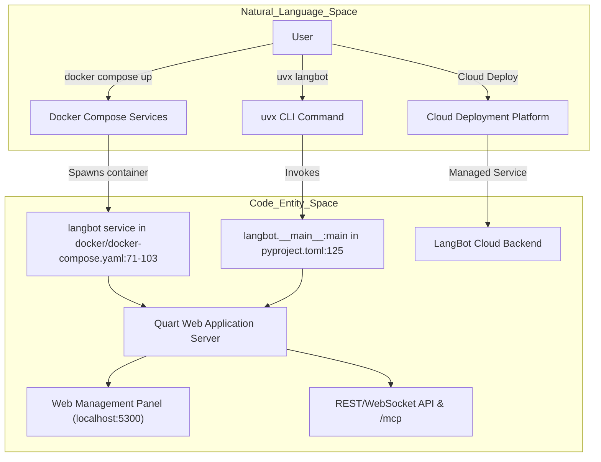
*Figure: Mapping natural language user deployment actions to backend entry points and service entities.*

For detailed installation guides, prerequisites, and system requirements, see [Installation and Setup](#2.1).

Sources: [README.md:66-92](), [pyproject.toml:124-132](), [docker/docker-compose.yaml:71-103]()

---

## Initial Configuration

LangBot behavior is controlled via YAML configuration files (`config.yaml`) and system environment variables using the canonical `SECTION__SUBSECTION__KEY` override convention [docker/docker-compose.yaml:77-103](). During bootstrap, configuration stages parse these inputs to initialize service ports, database backends (SQLite/PostgreSQL), storage providers, and execution workers.

### Configuration to Persistence Mapping

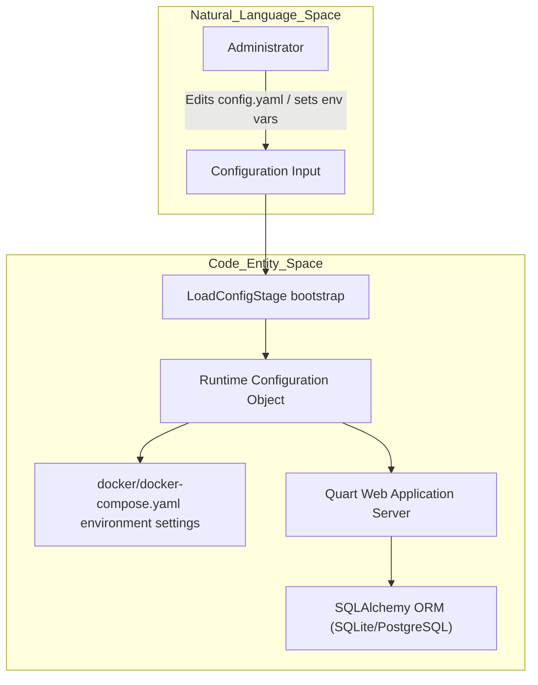
*Figure: Mapping administrator configuration inputs to system bootstrap stages and persistence layers.*

For complete configuration schemas, environment variable precedence rules, and essential settings, see [Initial Configuration](#2.2).

Sources: [README.md:66-92](), [docker/docker-compose.yaml:71-103]()

---

## Web Management Panel Access

The web management panel provides an intuitive browser-based interface hosted locally at `http://localhost:5300` [README.md:80](), [docker/docker-compose.yaml:104-105](). Built using Vite and React Router, it offers access to system monitoring dashboards, an onboarding setup wizard, bot and pipeline configuration workbenches, and plugin marketplace integrations [README.md:39-49](), [web/package.json:93]().

For details on authentication mechanisms, initial setup workflows, and UI navigation, see [Web Management Panel Access](#2.3).

Sources: [README.md:39-80](), [docker/docker-compose.yaml:104-105](), [web/package.json:93]()

---

## Next Steps

- **[Installation and Setup](#2.1)** — Step-by-step deployment instructions and package requirements.
- **[Initial Configuration](#2.2)** — Configuration file hierarchy and environment variable mapping.
- **[Web Management Panel Access](#2.3)** — Accessing and navigating the web interface.

Sources:
[README.md:39-92](), [pyproject.toml:124-132](), [docker/docker-compose.yaml:71-105](), [web/package.json:93]()

---

# Page: Installation and Setup

# Installation and Setup

<details>
<summary>Relevant source files</summary>

The following files were used as context for generating this wiki page:

- [.dockerignore](.dockerignore)
- [.github/workflows/build-dev-image.yaml](.github/workflows/build-dev-image.yaml)
- [.github/workflows/build-docker-image.yml](.github/workflows/build-docker-image.yml)
- [.github/workflows/build-release-artifacts.yaml](.github/workflows/build-release-artifacts.yaml)
- [.github/workflows/publish-to-pypi.yml](.github/workflows/publish-to-pypi.yml)
- [Dockerfile](Dockerfile)
- [pyproject.toml](pyproject.toml)
- [scripts/stamp_build_revision.py](scripts/stamp_build_revision.py)
- [src/langbot/__init__.py](src/langbot/__init__.py)
- [src/langbot/_build_info.py](src/langbot/_build_info.py)
- [uv.lock](uv.lock)
- [web/.env.example](web/.env.example)
- [web/.gitignore](web/.gitignore)
- [web/README.md](web/README.md)
- [web/package-lock.json](web/package-lock.json)
- [web/package.json](web/package.json)
- [web/pnpm-lock.yaml](web/pnpm-lock.yaml)

</details>


This page provides full technical documentation for installing and setting up LangBot across various deployment targets (`uvx`, `pip`/PyPI, Docker, and cloud), covering system requirements, frontend static asset bundling, optional vector database extensions (SeekDB), and core dependencies.

---

## 1. System Requirements and Pre-built Frontend Packaging

LangBot is a production-grade platform for building agentic IM bots, implemented primarily in Python and distributed as a package named `langbot` [src/langbot/__init__.py:1-5]().

### System Requirements
- **Python Version:** Requires Python `>=3.11,<4.0`, as specified in `pyproject.toml` [pyproject.toml:7]().
- **Operating System:** Core runtime is platform-agnostic. However, sandboxing features (for the Box runtime) require Linux or compatible container runtimes because of `nsjail` usage in container-less sandboxing [Dockerfile:14-26]().
- **Hardware:** At least 512 MB of RAM is recommended for core runtime processes, with 2 GB+ recommended when running additional plugin runtimes and isolated Box sandboxes.

### Pre-Built Frontend Package

LangBot includes a web management interface implemented with Vite and React Router. The frontend is built into static assets under `web/dist/**` which are packaged as Python package data to be served by the Quart backend server [pyproject.toml:131-133](), [Dockerfile:37](). This enables immediate UI availability after installation without extra build steps.

- The entry-point CLI script is defined as:
  ```toml
  langbot = "langbot.__main__:main"
  ```  
  [pyproject.toml:124-125]()

- The frontend build occurs via `npm install && npx vite build` executed in the `web` directory prior to packaging [Dockerfile:1-8](), enabling the backend to serve the UI directly from embedded static files.

**Diagram: Installation and Frontend Build Flow**

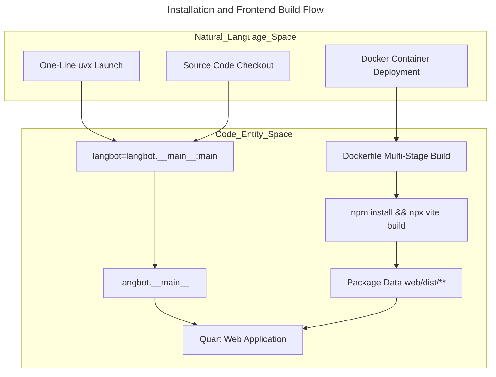

Sources: [pyproject.toml:7](), [pyproject.toml:124-133](), [Dockerfile:1-8](), [Dockerfile:37](), [src/langbot/__init__.py:1-5]()

---

## 2. Deployment Methods

### Method 1: One-Line Launch with `uvx`

`uvx` is a Python environment manager and runner that automatically provisions a consistent environment based on a lock file (`uv.lock`). LangBot can be launched directly via its script entry point registered in `pyproject.toml` [pyproject.toml:124-125]():

```bash
uvx langbot
```

This command:
- Resolves dependencies as locked in `uv.lock`, ensuring reproducible builds with exact versions [uv.lock:1-3]().
- Invokes the registered script entry-point `langbot=langbot.__main__:main` [pyproject.toml:124-125]().
- Makes the web UI available at `http://localhost:5300`.
- Supports extras such as OceanBase SeekDB for enhanced vector database functionality:
  ```bash
  uvx --from 'langbot[seekdb]@latest' langbot
  ```

Sources: [pyproject.toml:113-117](), [pyproject.toml:124-125](), [uv.lock:1-3]()

### Method 2: Docker Container Deployment (Production)

A multi-stage `Dockerfile` builds LangBot with the following key points:
- Frontend React app is built in a Node 22 alpine stage via Vite [Dockerfile:1-8]().
- `nsjail` sandbox executable is built from source in a dedicated stage for secure container-less sandboxing by the Box runtime [Dockerfile:14-26]().
- The final image installs Python 3.12 slim, Node.js LTS, Docker CLI client, and necessary runtime libraries [Dockerfile:28-70]().
- The container exposes the Quart backend, hosting the LangBot app with plugin runtime and Box sandbox.

The Docker images are built and pushed to Docker Hub via GitHub Actions workflows. Release images are tagged with the version and `latest` [Dockerfile:34](), [Dockerfile:44](), [Dockerfile:46]() and pre-release images are tagged with the version and `beta` [Dockerfile:50-53](). Development images are tagged with the branch name and commit SHA [Dockerfile:47-48]().

Run the official container build or deployment steps using `uv sync --extra seekdb` inside the container [Dockerfile:68]().

**Diagram: Container Services and Sandbox Isolation**

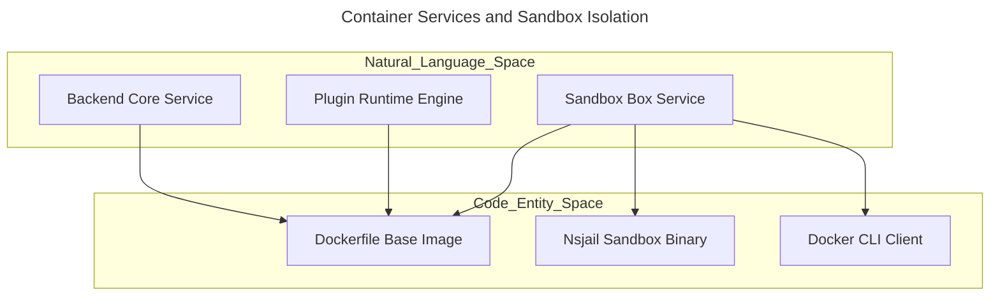

Sources: [Dockerfile:1-73](), [.github/workflows/build-docker-image.yml:44](), [.github/workflows/build-docker-image.yml:46](), [.github/workflows/build-docker-image.yml:50-53](), [.github/workflows/build-dev-image.yaml:47-48]()

### Method 3: Manual Installation from Source

For development or custom setups:
1. Clone the repository and synchronize dependencies with `uv`:
   ```bash
   git clone https://github.com/langbot-app/LangBot
   cd LangBot
   uv sync
   ```
   To include SeekDB support:
   ```bash
   uv sync --extra seekdb
   ```
2. Build the frontend assets manually if doing UI development:
   ```bash
   cd web
   npm install
   npx vite build
   ```
3. Run the application via `uv run`:
   ```bash
   uv run main.py
   ```

Sources: [Dockerfile:1-8](), [Dockerfile:73](), [pyproject.toml:113-117]()

### Method 4: Cloud and One-Click Deployments
- **LangBot Cloud:** Provides a fully managed instance offering instant access without local installation.
- **One-Click Templates:** Deployment buttons for hosting platforms such as Zeabur and Railway facilitate rapid cloud deployment [pyproject.toml:119-122]().

Sources: [pyproject.toml:119-122]()

---

## 3. Optional Vector Database and Embedding Setup (SeekDB)

LangBot optionally integrates OceanBase SeekDB as a vector database backend and embedding model requester to enhance RAG and similarity search capabilities.

### Optional Dependency Declaration
- SeekDB Python client dependencies are declared as an optional extra in `pyproject.toml` [pyproject.toml:113-117]():
  ```toml
  [project.optional-dependencies]
  seekdb = [
      "pyseekdb==1.4.0.post1",
      "pylibseekdb==1.4.0; sys_platform == 'linux' or (sys_platform == 'darwin' and platform_machine == 'arm64')",
  ]
  ```

Sources: [pyproject.toml:113-117]()

---

## 4. Core Dependencies Reference

LangBot depends on a curated set of libraries for networking, persistence, IM platform adapters, AI integrations, and vector databases as declared in `pyproject.toml` [pyproject.toml:8-87]():

| Category          | Key Libraries / Modules                                         | Role in Codebase                                  |
|-------------------|---------------------------------------------------------------|--------------------------------------------------|
| **Web & API**     | `quart`, `quart-cors`, `websockets`, `aiohttp` | Async HTTP server and WebSocket routing [pyproject.toml:11](), [pyproject.toml:39-40](), [pyproject.toml:50](), [pyproject.toml:60]() |
| **Persistence**   | `sqlalchemy[asyncio]`, `sqlmodel`, `aiosqlite`, `asyncpg` | ORM and async DB support with SQLite & PostgreSQL [pyproject.toml:13](), [pyproject.toml:44-46](), [pyproject.toml:75]() |
| **AI & LLM**       | `openai`, `anthropic`, `mcp`, `ollama`, `litellm` | Client integration for LLM providers and MCP [pyproject.toml:14](), [pyproject.toml:26](), [pyproject.toml:28-29](), [pyproject.toml:83]() |
| **IM Platform SDKs** | `discord-py`, `python-telegram-bot`, `slack-sdk`, `lark-oapi`, `line-bot-sdk` | Platform adapters for instant messaging protocols [pyproject.toml:22](), [pyproject.toml:25](), [pyproject.toml:35](), [pyproject.toml:43](), [pyproject.toml:76]() |
| **Vector Indexing / RAG** | `chromadb`, `qdrant-client`, `pymilvus`, `pyseekdb` | Vector database backends and embedding retrieval [pyproject.toml:72-73](), [pyproject.toml:80](), [pyproject.toml:114-116]() |
| **Utilities**     | `pydantic`, `pyjwt`, `colorlog`, `async-lru`, `tiktoken` | Data validation, logging, LRU caching, token counting [pyproject.toml:16](), [pyproject.toml:18](), [pyproject.toml:33-34](), [pyproject.toml:48]() |

Sources: [pyproject.toml:8-87]()

---

## Summary Diagram: LangBot System Installation and Execution

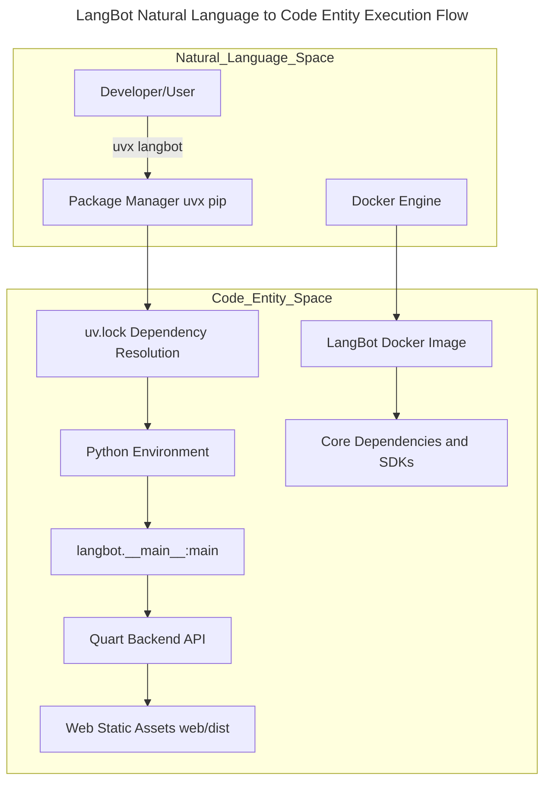

Sources: [pyproject.toml:1-133](), [Dockerfile:1-73](), [src/langbot/__init__.py:1-5]()

---

# Page: Initial Configuration

# Initial Configuration

<details>
<summary>Relevant source files</summary>

The following files were used as context for generating this wiki page:

- [docker/kubernetes.yaml](docker/kubernetes.yaml)
- [src/langbot/pkg/core/app.py](src/langbot/pkg/core/app.py)
- [src/langbot/pkg/core/stages/build_app.py](src/langbot/pkg/core/stages/build_app.py)
- [src/langbot/pkg/core/stages/load_config.py](src/langbot/pkg/core/stages/load_config.py)
- [src/langbot/pkg/core/taskmgr.py](src/langbot/pkg/core/taskmgr.py)
- [src/langbot/pkg/operation_trace/service.py](src/langbot/pkg/operation_trace/service.py)
- [src/langbot/pkg/utils/constants.py](src/langbot/pkg/utils/constants.py)
- [src/langbot/templates/config.yaml](src/langbot/templates/config.yaml)
- [tests/unit_tests/core/test_app_shutdown.py](tests/unit_tests/core/test_app_shutdown.py)
- [tests/unit_tests/core/test_bootutils_deps.py](tests/unit_tests/core/test_bootutils_deps.py)
- [tests/unit_tests/core/test_load_config.py](tests/unit_tests/core/test_load_config.py)
- [tests/unit_tests/core/test_taskmgr.py](tests/unit_tests/core/test_taskmgr.py)
- [tests/unit_tests/plugin/test_connector_static.py](tests/unit_tests/plugin/test_connector_static.py)
- [tests/unit_tests/test_operation_trace_incremental.py](tests/unit_tests/test_operation_trace_incremental.py)
- [tests/unit_tests/test_operation_trace_integrity.py](tests/unit_tests/test_operation_trace_integrity.py)

</details>


This page details the technical implementation of LangBot's initial configuration system. It covers the structure of the primary configuration file `config.yaml`, environment variable overrides and their advanced semantics, essential initial settings required for startup, resource limits for concurrency and safety, and the code entities responsible for processing and applying these configurations during boot.

For installation procedures, see [2.1 Installation and Setup](). For the guided initial setup in the web UI, see [2.3 Web Management Panel Access]().

---

## Configuration File Overview

LangBot centrally manages its instance-wide runtime configuration using a single YAML file at `data/config.yaml`. This file is instantiated automatically at first application startup by copying from the built-in reference template located at:

- `src/langbot/templates/config.yaml`

This template contains default settings and operational ceilings for all core subsystems [src/langbot/templates/config.yaml:1-154]().

The loading and processing of `config.yaml` are handled by the `LoadConfigStage` boot stage, which is one of the earliest lifecycle stages during app initialization [src/langbot/pkg/core/stages/load_config.py:13-14](). This stage:

- Loads the raw YAML file.
- Backfills mandatory typed runtime policy defaults (e.g. cloud directory limits, database pooling).
- Applies environment variable overrides with type-safe conversions.
- Sets instance identity and global constants.

The sequence is summarized below:

```mermaid
graph TB
    Start["ApplicationStartup"]
    LoadStage["LoadConfigStage.run"]
    Template["TemplateFile (src/langbot/templates/config.yaml)"]
    DataFile["UserConfigFile (data/config.yaml)"]
    Defaults["_complete_runtime_policy_defaults()"]
    EnvOverride["_apply_env_overrides_to_config()"]
    InstanceID["InstanceIDResolution"]
    AppConfig["ap.instance_config.data"]

    Start --> LoadStage
    LoadStage --> Template
    Template --> DataFile
    DataFile --> Defaults
    Defaults --> EnvOverride
    EnvOverride --> InstanceID
    InstanceID --> AppConfig

    EnvOverride -.->|"Environment variables override" EnvOverride
```

This boot stage ensures the configuration is complete, valid, and reflective of any runtime environment overrides before the application begins full service.

Sources: [src/langbot/pkg/core/stages/load_config.py:10-112](), [src/langbot/pkg/core/stages/load_config.py:115-193](), [src/langbot/templates/config.yaml:1-154]()

---

## Configuration File Structure

The `config.yaml` file divides configuration into logically grouped top-level sections. The most critical are:

| Section | Purpose | Key Configuration Fields and Notes |
| :------ | :------ | :--------------------------------- |
| **api** | HTTP API server settings, webhook and UI origins | `host`, `port` (default 5300), `webhook_prefix`, `extra_webhook_prefix`, `webui_url`, `global_api_key` (API master key for bypassing session login) [src/langbot/templates/config.yaml:1-17]() |
| **workspace** | Workspace tenancy and invitation service | Invitation public URL, email provider (`resend`, `smtp`), delivery credentials, timeouts [src/langbot/templates/config.yaml:18-41]() |
| **command** | Bot command prefix configuration | `enable` (bool), `prefix` list of command starter tokens (e.g., `"!"`, `"！"`) [src/langbot/templates/config.yaml:42-47]() |
| **concurrency** | Limits for pipeline throughput and task queues | `pipeline` concurrency, `session` concurrency, `pending_queries` total and per workspace [src/langbot/templates/config.yaml:48-53]() |
| **webhooks** | Outbound webhook invocation limits | `max_per_workspace`, `max_inflight_requests` for outbound message fan-out [src/langbot/templates/config.yaml:54-63]() |
| **cloud** | SaaS environment usage caps and directory limits | Directory max active workspaces, snapshot sizes, max JSON response bytes for Cloud [src/langbot/templates/config.yaml:64-79]() |
| **proxy** | Optional HTTP/HTTPS proxy URLs for outbound calls | `http`, `https` proxy URLs to route requests through [src/langbot/templates/config.yaml:113-115]() |
| **system** | Core runtime metadata, edition, retention policies | `instance_id` (string), `edition` (`community`), `recovery_key`, JWT config, blocking executor limits, retention caps for tasks, sessions, websocket connections, and outbound IPs [src/langbot/templates/config.yaml:116-154]() |

This design provides operational safety, extensible plugin runtime controls, multi-tenant readiness, and secure defaults.

Sources: [src/langbot/templates/config.yaml:1-154]()

---

## Essential Initial Settings

### 1. API Port and Webhook Prefix

```yaml
api:
    port: 5300
    webhook_prefix: 'http://127.0.0.1:5300'
    global_api_key: ''
```

- `api.port` configures the HTTP server port for LangBot's Quart API.
- `api.webhook_prefix` is the canonical URL prefix used by platform adapters to register webhooks or callbacks.
- `global_api_key` enables a master API key accepted anywhere without session authentication; should only be set in trusted internal environments.

These settings ensure connectivity for platform adapters, UI, webhook routing, and external API clients [src/langbot/templates/config.yaml:3-5](), [src/langbot/templates/config.yaml:12-17]().

### 2. Database Backend Configuration

```yaml
database:
    use: sqlite
    sqlite:
        path: 'data/langbot.db'
    postgresql:
        url: ''
        host: '127.0.0.1'
        port: 5432
```

- Supports SQLite for light deployments and PostgreSQL for production workloads.
- PostgreSQL connection can be a full SQLAlchemy URL string or components with connection pool sizes and timeouts.
- Provides efficient connection pooling and statement timeouts for multi-tenant stability.

This flexibility allows choosing an appropriate storage backend.

### 3. JWT Secret and Authentication Expiration

```yaml
system:
    jwt:
        expire: 604800
        secret: ''  # MUST be set for production
```

- `system.jwt.secret` sets the signing secret for JWT tokens used in authentication and web sessions.
- `expire` controls token lifetime in seconds (default 7 days).
- Absence of a strong secret disables secure session management and risks unauthorized access.

It is critical to configure this secret before production deployment.

Sources: [src/langbot/templates/config.yaml:3-17]()

---

## Environment Variable Overrides

LangBot supports overriding any configuration setting at runtime through environment variables, parsed and applied during boot in `_apply_env_overrides_to_config()` [src/langbot/pkg/core/stages/load_config.py:118-191]().

### Override Naming Conventions

- Environment variables must be uppercase.
- Nested YAML keys use double underscores `__` as separators.
- Example mappings:
  - `CONCURRENCY__PIPELINE` → `concurrency.pipeline`
  - `DATABASE__POSTGRESQL__POOL_SIZE` → `database.postgresql.pool_size`
- Variables without `__` or non-uppercase keys are ignored [src/langbot/pkg/core/stages/load_config.py:165-168]().
- Variables with empty segments (e.g. `__CF_USER_TEXT_ENCODING`) are skipped to avoid unwanted keys [src/langbot/pkg/core/stages/load_config.py:174-177]().

### Type-aware Conversion

The override applies type normalization based on the existing YAML default's value type [src/langbot/pkg/core/stages/load_config.py:135-161]():

- **Boolean:** Converts `"true"`, `"1"`, `"yes"`, `"on"` (case-insensitive) to `True`, else `False` [src/langbot/pkg/core/stages/load_config.py:145-146]().
- **Integer:** Attempts integer parsing; if fails, retains string [src/langbot/pkg/core/stages/load_config.py:147-152]().
- **Float:** Attempts float parsing; fallback to string [src/langbot/pkg/core/stages/load_config.py:153-158]().
- **List:** Comma-separated strings parsed into list, elements converted to the original list's element type.
- **Dict:** Overrides for maps are not applied (ignored) to avoid partial or inconsistent merges.

### Secret Handling and Logging

Override logging records only the environment key name to ensure secrets are never exposed in logs, for example:

```
apply env override to config: env_key: SYSTEM__JWT__SECRET
```

No secret values are printed or logged [src/langbot/pkg/core/stages/load_config.py:182](), [tests/unit_tests/core/test_load_config.py:38-53]().

### Environment Variable Override Diagram

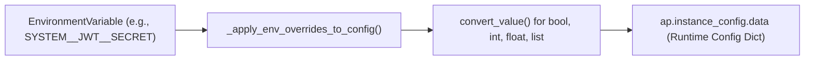

This flexible override mechanism enables dynamic adjustment of runtime behavior without modifying `config.yaml` directly.

Sources: [src/langbot/pkg/core/stages/load_config.py:115-193](), [src/langbot/templates/config.yaml:87-103](), [tests/unit_tests/core/test_load_config.py:38-53]()

---

## Resource Limits and Concurrency Controls

LangBot embeds resource governance parameters to prevent overload and maintain multi-tenant safety:

### Blocking Executor Thread Pool

- Configured via `system.blocking_executor` section [src/langbot/templates/config.yaml:122-130]().
- Controls a bounded thread pool used for blocking async tasks (`asyncio.to_thread`).
- Key parameters:
  - `max_workers` (default: 8): Max total concurrent worker threads [src/langbot/templates/config.yaml:126]().
  - `max_pending` (default: 128): Max queued work [src/langbot/templates/config.yaml:127]().
  - `max_inflight_per_scope` (max concurrent per tenant scope; must not exceed half `max_workers`) [src/langbot/templates/config.yaml:129-130]().
- This avoids unbounded CPU consumption or memory pressure from tenant-triggered bursts [src/langbot/pkg/core/stages/load_config.py:37-43]().

### Pipeline and Query Admission Limits

- `concurrency.pipeline`: max concurrent pipeline runs (default: 20) [src/langbot/templates/config.yaml:49]().
- `concurrency.session`: max concurrently active sessions (default: 1) [src/langbot/templates/config.yaml:50]().
- `concurrency.pending_queries`: hard limit on total queued + running pipeline queries (1000) [src/langbot/templates/config.yaml:52]().
- `concurrency.pending_queries_per_workspace`: similar limit enforced per workspace (100) [src/langbot/templates/config.yaml:53]().
- Prevents query storms and protects service stability [src/langbot/templates/config.yaml:48-53]().

### Task and Session Retention Policies

- `system.task_retention` caps:
  - Completed async task record count (default: 200) [src/langbot/templates/config.yaml:145]().
  - Max log chars per task (default: 200k) [src/langbot/templates/config.yaml:147]().
  - Max active user tasks globally and per workspace [src/langbot/templates/config.yaml:149-150]().
- `system.session_retention` caps:
  - Total cached conversation session entries [src/langbot/templates/config.yaml:153]().
  - Per-workspace session load [src/langbot/templates/config.yaml:154]().
- Controls memory usage and ensures aging of inactive or completed workload [src/langbot/templates/config.yaml:143-154]().

Sources: [src/langbot/templates/config.yaml:48-63](), [src/langbot/templates/config.yaml:122-130](), [src/langbot/templates/config.yaml:143-154](), [src/langbot/pkg/core/stages/load_config.py:37-43]()

---

## Configuration to Code Entity Mapping

The boot-time configuration system stores the final merged config dictionary in `ap.instance_config.data` [src/langbot/pkg/core/app.py:109]() and is instantiated by these components:

- `_complete_runtime_policy_defaults()` — backfills security and policy defaults for runtime components [src/langbot/pkg/core/stages/load_config.py:17-112]().

- `_apply_env_overrides_to_config()` — applies environment overrides with safe type conversions [src/langbot/pkg/core/stages/load_config.py:118-191]().

- `ExecutionContext` objects resolve instance and workspace IDs from config during runtime query and event handling [src/langbot/pkg/api/http/context.py:63-63]().

### High-Level Mapping Diagram: Config to Runtime Application Objects

```mermaid
graph TD
    subgraph NaturalLanguageSpace["NaturalLanguage Config Names"]
        C_API["api (port, webhook_prefix, global_api_key)"]
        C_SYS["system (jwt.secret, blocking_executor, instance_id)"]
    end

    subgraph CodeEntitySpace["Code Entities and Runtime Objects"]
        LoadConfig["_complete_runtime_policy_defaults()"]
        EnvOverride["_apply_env_overrides_to_config()"]
        AppConfig["Application.instance_config.data"]
        ExecCtx["ExecutionContext (runtime exec binding)"]
    end

    C_API --> LoadConfig
    C_SYS --> LoadConfig
    LoadConfig --> EnvOverride
    EnvOverride --> AppConfig
    AppConfig --> ExecCtx
```

### Mapping Config Policies to Runtime Enforcers

```mermaid
graph TD
    subgraph NaturalLanguageSpace["System Config Sections"]
        C_BLOCK["system.blocking_executor"]
        C_CLOUD["cloud.directory (max_active_workspaces)"]
        C_WEBHOOKS["webhooks (max_per_workspace, max_inflight_requests)"]
        C_TASK_RETENTION["system.task_retention"]
        C_CONCURRENCY["concurrency (pipeline, session, pending_queries)"]
    end

    subgraph CodeEntitySpace["Enforcement and Runtime Classes"]
        BOUNDED_EXEC["bounded_executor.BoundedExecutor"]
        DIR_PROJ_SERVICE["cloud.directory_projection.DirectoryProjectionService"]
        WEBHOOK_PUSHER["platform.webhook_pusher.WebhookPusher"]
        ASYNC_TASK_MANAGER["core.taskmgr.AsyncTaskManager"]
        QUERY_POOL["pipeline.pool.QueryPool"]
        LOAD_CFG["_complete_runtime_policy_defaults() initialization"]
    end

    C_BLOCK --> BOUNDED_EXEC
    C_CLOUD --> DIR_PROJ_SERVICE
    C_WEBHOOKS --> WEBHOOK_PUSHER
    C_TASK_RETENTION --> ASYNC_TASK_MANAGER
    C_CONCURRENCY --> QUERY_POOL

    LOAD_CFG --> BOUNDED_EXEC
    LOAD_CFG --> DIR_PROJ_SERVICE
    LOAD_CFG --> WEBHOOK_PUSHER
    LOAD_CFG --> ASYNC_TASK_MANAGER
    LOAD_CFG --> QUERY_POOL
```

This layered architecture ensures that configuration settings are translated faithfully into runtime components enforcing resource limits, security policies, and platform behavior.

Sources: [src/langbot/pkg/core/stages/load_config.py:16-155](), [src/langbot/templates/config.yaml:1-154](), [src/langbot/pkg/core/app.py:109](), [src/langbot/pkg/core/app.py:81](), [src/langbot/pkg/core/app.py:127](), [src/langbot/pkg/core/app.py:45](), [src/langbot/pkg/core/app.py:155]()

---

This completes the detailed exposition of LangBot's initial configuration subsystem, from the YAML schema through boot-stage loading, environment overrides, essential defaults, resource governance, and the runtime code entities.

For practical examples, advanced tuning, and the integration of config with other system layers, see:

- [2.1 Installation and Setup]()
- [2.3 Web Management Panel Access]()
- [3.2 Configuration System]()

---

# Page: Web Management Panel Access

# Web Management Panel Access

<details>
<summary>Relevant source files</summary>

The following files were used as context for generating this wiki page:

- [web/src/app/home/components/home-sidebar/HomeSidebar.tsx](web/src/app/home/components/home-sidebar/HomeSidebar.tsx)
- [web/src/app/home/components/home-sidebar/SidebarDataContext.tsx](web/src/app/home/components/home-sidebar/SidebarDataContext.tsx)
- [web/src/app/home/plugins/components/plugin-install-task/PluginInstallProgressDialog.tsx](web/src/app/home/plugins/components/plugin-install-task/PluginInstallProgressDialog.tsx)
- [web/src/app/home/plugins/components/plugin-install-task/PluginInstallTaskContext.tsx](web/src/app/home/plugins/components/plugin-install-task/PluginInstallTaskContext.tsx)
- [web/src/app/home/plugins/components/plugin-install-task/PluginInstallTaskQueue.tsx](web/src/app/home/plugins/components/plugin-install-task/PluginInstallTaskQueue.tsx)
- [web/src/app/home/plugins/components/plugin-install-task/install-progress.ts](web/src/app/home/plugins/components/plugin-install-task/install-progress.ts)
- [web/src/app/home/plugins/components/plugin-market/marketplace-installed.ts](web/src/app/home/plugins/components/plugin-market/marketplace-installed.ts)
- [web/src/app/home/plugins/components/plugin-market/useMarketplaceInstalledIndex.ts](web/src/app/home/plugins/components/plugin-market/useMarketplaceInstalledIndex.ts)
- [web/src/app/home/plugins/page.tsx](web/src/app/home/plugins/page.tsx)
- [web/src/app/infra/entities/api/index.ts](web/src/app/infra/entities/api/index.ts)
- [web/src/app/infra/http/BackendClient.ts](web/src/app/infra/http/BackendClient.ts)
- [web/src/app/wizard/page.tsx](web/src/app/wizard/page.tsx)
- [web/src/components/ui/dialog.tsx](web/src/components/ui/dialog.tsx)
- [web/src/i18n/locales/en-US.ts](web/src/i18n/locales/en-US.ts)
- [web/src/i18n/locales/es-ES.ts](web/src/i18n/locales/es-ES.ts)
- [web/src/i18n/locales/ja-JP.ts](web/src/i18n/locales/ja-JP.ts)
- [web/src/i18n/locales/ru-RU.ts](web/src/i18n/locales/ru-RU.ts)
- [web/src/i18n/locales/th-TH.ts](web/src/i18n/locales/th-TH.ts)
- [web/src/i18n/locales/vi-VN.ts](web/src/i18n/locales/vi-VN.ts)
- [web/src/i18n/locales/zh-Hans.ts](web/src/i18n/locales/zh-Hans.ts)
- [web/src/i18n/locales/zh-Hant.ts](web/src/i18n/locales/zh-Hant.ts)
- [web/tests/e2e/knowledge-engine-marketplace.spec.ts](web/tests/e2e/knowledge-engine-marketplace.spec.ts)
- [web/tests/e2e/marketplace-likes.spec.ts](web/tests/e2e/marketplace-likes.spec.ts)
- [web/tests/e2e/plugin-upgrade-recovery.spec.ts](web/tests/e2e/plugin-upgrade-recovery.spec.ts)
- [web/tests/e2e/wizard-platform-regressions.spec.ts](web/tests/e2e/wizard-platform-regressions.spec.ts)
- [web/tests/unit/install-progress.test.mjs](web/tests/unit/install-progress.test.mjs)
- [web/tests/unit/knowledge-engine-marketplace.test.mjs](web/tests/unit/knowledge-engine-marketplace.test.mjs)
- [web/tests/unit/marketplace-installed-state.test.mjs](web/tests/unit/marketplace-installed-state.test.mjs)
- [web/tests/unit/marketplace-likes.test.mjs](web/tests/unit/marketplace-likes.test.mjs)
- [web/tests/unit/wizard-page-bot.test.mjs](web/tests/unit/wizard-page-bot.test.mjs)

</details>


## Purpose and Scope

This page documents the detailed technical implementation and access flow for the LangBot Web Management Panel available at default port `5300` on `localhost`. It covers the web UI infrastructure, authentication mechanisms, client-side routing, initial setup via the Setup Wizard (`WizardPage`), as well as onboarding aids such as the Guided Tour and Sidebar Guide (`SidebarGuide`). The documentation delves into key code entities, data flows, and user interaction layers that enable secure access, initialization, and intuitive navigation through the web panel.

Sources: [web/src/app/RootLayout.tsx:1-9](), [web/src/components/ui/sidebar.tsx:1-228](), [web/src/app/wizard/page.tsx:1-191]()

---

## Default Access Endpoint and Port Configuration

LangBot's web management interface is served on the default local address:

- **URL:** `http://localhost:5300`
- **Port:** 5300 (default HTTP port configured in the backend)

The backend is based on a Python Quart server which serves static frontend assets bundled as a Vite-built React SPA. Any route not matched by the backend static assets is redirected to the frontend's `index.html`, enabling client-side routing through React Router.

### Data Flow Diagram: HTTP Request to Web Panel

```mermaid
flowchart TB
    Browser["User Browser"] -->|"HTTP GET http://localhost:5300"| QuartServer["Quart Backend Server"]
    QuartServer -->|"Serve Static Files"| RootLayout["RootLayout (web/src/app/RootLayout.tsx)"]
    RootLayout -->|"Render React Outlet"| Router["React Router (client-side routing)"]

    %% Annotations for clarity
    note right of Browser
        User accesses the web interface\nvia browser at port 5300
    end
    note right of QuartServer
        Python Quart handles requests,\nserves static assets for SPA
    end
    note right of RootLayout
        Root-level React component rendering\nbased on routing config
    end

    classDef backend fill:#f9f,stroke:#333,stroke-width:1px;
    class QuartServer backend;
```

This setup ensures seamless SPA operation behind a consolidated backend service without exposing separate frontend servers.

Sources: [web/src/app/RootLayout.tsx:1-9]()

---

## Routing and Layout Architecture

Routing is organized via `react-router-dom` with a root `router` instance managing the routes under a `RootLayout` component hierarchy [web/src/app/RootLayout.tsx:1-9]().

- **RootLayout Component:** This is the top-level React component that encapsulates the main layout and provides an `<Outlet />` for nested routes [web/src/app/RootLayout.tsx:1-9]().
- **Client-Side Router:** Routes are declared centrally and delegate views based on path patterns, such as `/login`, `/wizard`, `/home/*`.
- **Document Title Management:** The `useDocumentTitle` hook is used to dynamically update `document.title` for user clarity [web/src/app/RootLayout.tsx:7]().

### Routing Flow Diagram

```mermaid
flowchart TD
    RootLayout["RootLayout (web/src/app/RootLayout.tsx)"] --> Outlet["React Router <Outlet>"]
    Outlet --> LoginPage["LoginPage (/login)"]
    Outlet --> WizardPage["WizardPage (web/src/app/wizard/page.tsx)"]
    Outlet --> HomeLayout["HomeLayout (/home)"]

    %% Hook linkage for title management
    useDocumentTitle["useDocumentTitle()"] -.->|Updates document title| Outlet
```

- Top-level routes outside `/home` provide unauthenticated entry points such as login and wizard.
- The `/home` subtree hosts authenticated pages post-login and initialization.

Sources: [web/src/app/RootLayout.tsx:1-9](), [web/src/app/wizard/page.tsx:1-191]()

---

## Setup Wizard and Initial Configuration Flow

For initial setup or when the workspace is uninitialized, the user is redirected to the Setup Wizard UI located at `/wizard`. This UI assists in configuring core system components:

- Primary bot configuration including platform adapters.
- AI model runner selection and setup.
- Installation of marketplace runners or plugins.

Key React component: `WizardPage` in `web/src/app/wizard/page.tsx` handles these steps. It performs workspace session bootstrap and conditionally loads necessary adapters and runner catalogs via the HTTP client interface [web/src/app/wizard/page.tsx:135-191]().

### Setup Wizard Interaction Sequence

```mermaid
sequenceDiagram
    participant User as "User (Browser)"
    participant Wizard as "WizardPage Component (web/src/app/wizard/page.tsx)"
    participant HTTPClient as "httpClient (web/src/app/infra/http/HttpClient.ts)"
    participant Backend as "Quart Backend Server"

    User->>Wizard: Request /wizard page
    Wizard->>HTTPClient: Call bootstrapWorkspaceSession()
    HTTPClient->>Backend: GET /api/workspace/session
    Backend-->>HTTPClient: Workspace session data
    HTTPClient-->>Wizard: Session data
    Wizard->>HTTPClient: Fetch adapters and runner catalog (loadRunnerCatalog)
    HTTPClient->>Backend: GET /api/platform/adapters & /api/plugins/marketplace/search
    Backend-->>Wizard: Adapter and runner data
    Wizard->>HTTPClient: Request to install marketplace runner (installMarketplaceRunner)
    HTTPClient->>Backend: POST /api/plugins/install
    Backend-->>HTTPClient: Installation confirmation
```

- The wizard manages multi-step initialization state locally and persists progress within the React component state [web/src/app/wizard/page.tsx:140-161]().
- Essential APIs support session validation, adapter discovery, and plugin installs.

Sources: [web/src/app/wizard/page.tsx:1-191](), [web/src/app/wizard/page.tsx:31-40]()

---

## Authentication and Session Bootstrapping

The web panel enforces authentication with workspace (tenant) scoping. Key aspects:

- `bootstrapWorkspaceSession()` initiates retrieval of current workspace session context including user authorization and active tenant information [web/src/app/wizard/page.tsx:35]().
- If users belong to multiple workspaces or no workspace context is active, the client handles navigation accordingly.
- The frontend HTTP client (`httpClient`) attaches JWT or OAuth tokens to every request ensuring secure authenticated interactions [web/src/app/wizard/page.tsx:31]().

This mechanism ensures users access protected routes within their designated workspace boundaries.

Sources: [web/src/app/wizard/page.tsx:31-40]()

---

## Sidebar and Navigation Framework (`SidebarProvider`)

To help new users navigate the extensive features of the LangBot panel, the layout relies on a comprehensive sidebar state machine implemented via `SidebarProvider` in `web/src/components/ui/sidebar.tsx`.

Features and Implementation:

- **Sidebar State Persistence:** The sidebar state (`expanded` or `collapsed`) and custom width are stored persistently in browser `localStorage` using keys like `sidebar_state` and `sidebar_width` [web/src/components/ui/sidebar.tsx:26-27]().
- **Context API:** The `SidebarContext` provides sidebar state, expansion toggles, width adjustment handlers, and mobile drawer integration to all child components [web/src/components/ui/sidebar.tsx:36-48]().
- **Keyboard Shortcuts:** Global keyboard shortcut listeners toggle the sidebar dynamically via `Ctrl+B` (or `Cmd+B`) [web/src/components/ui/sidebar.tsx:33]().

### Sidebar Architecture Flow Diagram

```mermaid
flowchart TD
    SidebarProvider["SidebarProvider (web/src/components/ui/sidebar.tsx)"] --> LocalStorage["localStorage: sidebar_state & sidebar_width"]
    SidebarProvider --> SidebarContext["SidebarContextProps (state, open, setOpen, toggleSidebar)"]
    SidebarContext --> SidebarComponent["Sidebar / Mobile Sheet"]
    User -->|Presses Ctrl+B / Cmd+B| KeyListener["Window Keydown Handler"]
    KeyListener -->|Toggles State| SidebarContext
    SidebarContext -->|Persists| LocalStorage
```

- The sidebar manages responsive layouts automatically between desktop resizable sidebars and mobile sheets (`useIsMobile`).
- Width clamping ensures the layout remains usable across different screen bounds [web/src/components/ui/sidebar.tsx:61-68]().

Sources: [web/src/components/ui/sidebar.tsx:1-228]()

---

## Guided Tour and Sidebar Guide (`SidebarGuide`)

To streamline onboarding for first-time users, the panel integrates contextual guidance mechanisms:

- **`SidebarGuide` Component:** Integrated directly within `HomeSidebar` (`web/src/app/home/components/home-sidebar/HomeSidebar.tsx`), the guide walks users through essential configuration stages [web/src/app/home/components/home-sidebar/HomeSidebar.tsx:130]().
- **Localized Steps:** Multi-step tooltips and instructional guides map directly to sidebar features such as monitoring (`monitoring`), bot configuration (`bots`), pipeline setup, and plugins, with string definitions stored across language packs like `zh-Hans.ts`, `en-US.ts`, `ja-JP.ts`, `zh-Hant.ts`, `vi-VN.ts`, `es-ES.ts`, `th-TH.ts`, and `ru-RU.ts` [web/src/i18n/locales/zh-Hans.ts:217-231](), [web/src/i18n/locales/en-US.ts:217-231](), [web/src/i18n/locales/ja-JP.ts:217-231](), [web/src/i18n/locales/zh-Hant.ts:217-231](), [web/src/i18n/locales/vi-VN.ts:217-231](), [web/src/i18n/locales/es-ES.ts:217-231](), [web/src/i18n/locales/th-TH.ts:217-231](), [web/src/i18n/locales/ru-RU.ts:217-231]().

Sources: [web/src/app/home/components/home-sidebar/HomeSidebar.tsx:130](), [web/src/i18n/locales/zh-Hans.ts:217-231](), [web/src/i18n/locales/en-US.ts:217-231](), [web/src/i18n/locales/ja-JP.ts:217-231](), [web/src/i18n/locales/zh-Hant.ts:217-231](), [web/src/i18n/locales/vi-VN.ts:217-231](), [web/src/i18n/locales/es-ES.ts:217-231](), [web/src/i18n/locales/th-TH.ts:217-231](), [web/src/i18n/locales/ru-RU.ts:217-231]()

---

## Code Entity Mapping: Natural Language Concepts to Codebase Components

To bridge the user's conceptual understanding of the web panel features with the actual code entities, the following mappings are outlined.

### Diagram 1: Web Panel Access Flow to Core Code Components

```mermaid
graph LR
    Browser["User Browser"] -->|Access: http://localhost:5300| Quart["Python Quart Backend"]
    Quart -->|Serves| StaticAssets["Frontend static assets"]
    StaticAssets --> RootLayout["React RootLayout (web/src/app/RootLayout.tsx)"]
    RootLayout --> Router["React Router Outlet"]
    Router --> WizardPage["WizardPage Component (web/src/app/wizard/page.tsx)"]

    WizardPage --- httpClient["httpClient (web/src/app/infra/http/HttpClient.ts)"]
    httpClient --> BackendAPI["REST API Endpoints"]
    BackendAPI --> WorkspaceSession["GET /api/workspace/session"]
    BackendAPI --> AdapterData["GET /api/platform/adapters"]
    BackendAPI --> PluginInstall["POST /api/plugins/install"]
```

- The browser sends HTTP requests to the Quart backend, which serves the SPA.
- The SPA root layout component (`RootLayout`) manages views and navigation.
- `WizardPage` initiates backend communication through `httpClient` to retrieve workspace session info and manage setup.

Sources: [web/src/app/RootLayout.tsx:1-9](), [web/src/app/wizard/page.tsx:1-45]()

---

### Diagram 2: Sidebar State and Context Management

```mermaid
graph TD
    User["User Interaction / Shortcut"] --> SidebarProvider["SidebarProvider (web/src/components/ui/sidebar.tsx)"]
    SidebarProvider --> SidebarContext["useSidebar() Context Consumer"]
    SidebarContext --> LocalStorage["localStorage: sidebar_state"]
    SidebarContext --> ResizeHandler["clampSidebarWidth()"]
    ResizeHandler --> DOMStyles["CSS Variable: --sidebar-width"]
```

- The `SidebarProvider` component supplies state to all sidebar children using React context.
- Persistent storage updates whenever the user collapses, expands, or resizes the sidebar panel.

Sources: [web/src/components/ui/sidebar.tsx:26-147]()

---

## Summary

This page elucidates the end-to-end process of accessing and initializing the LangBot Web Management Panel, spanning:

- Default network endpoint and architecture coupling backend with frontend SPA.
- Client-side routing via `RootLayout`.
- Session authentication and workspace setup redirect logic.
- Stepwise onboarding using the Setup Wizard (`WizardPage`).
- Sidebar navigation framework powered by `SidebarProvider` and interactive onboarding via `SidebarGuide`.

Sources:
[web/src/app/RootLayout.tsx:1-9](), [web/src/components/ui/sidebar.tsx:1-228](), [web/src/app/wizard/page.tsx:1-191](), [web/src/app/home/components/home-sidebar/HomeSidebar.tsx:130](), [web/src/i18n/locales/zh-Hans.ts:217-231](), [web/src/i18n/locales/en-US.ts:217-231](), [web/src/i18n/locales/ja-JP.ts:217-231](), [web/src/i18n/locales/zh-Hant.ts:217-231](), [web/src/i18n/locales/vi-VN.ts:217-231](), [web/src/i18n/locales/es-ES.ts:217-231](), [web/src/i18n/locales/th-TH.ts:217-231](), [web/src/i18n/locales/ru-RU.ts:217-231]()

---

# Page: Core Backend System

# Core Backend System

<details>
<summary>Relevant source files</summary>

The following files were used as context for generating this wiki page:

- [docker/kubernetes.yaml](docker/kubernetes.yaml)
- [src/langbot/pkg/core/app.py](src/langbot/pkg/core/app.py)
- [src/langbot/pkg/core/stages/build_app.py](src/langbot/pkg/core/stages/build_app.py)
- [src/langbot/pkg/operation_trace/service.py](src/langbot/pkg/operation_trace/service.py)
- [src/langbot/templates/config.yaml](src/langbot/templates/config.yaml)
- [tests/unit_tests/core/test_app_shutdown.py](tests/unit_tests/core/test_app_shutdown.py)
- [tests/unit_tests/test_operation_trace_incremental.py](tests/unit_tests/test_operation_trace_incremental.py)
- [tests/unit_tests/test_operation_trace_integrity.py](tests/unit_tests/test_operation_trace_integrity.py)

</details>


The Core Backend System is the Python-based server application that powers LangBot. This document provides a high-level overview of the backend architecture, including the application bootstrap process, configuration management, database persistence, HTTP API layer, storage, query processing, and multi-user workspace boundaries.

## Overview

The LangBot backend is a Python 3.11+ asynchronous application built on the **Quart** web framework. It acts as the central orchestrator for AI agents, IM platform integrations, and plugin runtimes.

- **HTTP API**: Implemented using Quart, exposing endpoints for UI and external API consumers with JWT, Space OAuth, and API key-based authentication [src/langbot/pkg/core/app.py:161-177]().
- **Database Persistence**: Uses SQLAlchemy ORM supporting SQLite and PostgreSQL, managed by the `PersistenceManager` service. Alembic handles schema migrations [src/langbot/pkg/core/app.py:138-160](), [src/langbot/pkg/core/stages/build_app.py:148-159]().
- **Configuration Management**: Configuration is loaded hierarchically from `config.yaml` with environment variable overrides during the bootstrap stages [src/langbot/pkg/core/app.py:95-110]().
- **Storage System**: The `StorageMgr` abstracts file storage which can be local or S3-compatible, managing plugin artifacts, media uploads, and RAG documents [src/langbot/pkg/core/app.py:165-166]().
- **AI Model Management**: Central service managing LLM, embedding, and rerank models from multiple providers [src/langbot/pkg/core/app.py:86-92]().
- **Plugin and Sandbox Runtimes**: Managed via `PluginRuntimeConnector` and the `BoxService` for sandboxed skills execution [src/langbot/pkg/core/app.py:122-125]().
- **Workspace and Multi-Tenancy**: Tenant isolation through `WorkspaceService`, enforcing RBAC, membership, quotas, and multi-tenant scopes [src/langbot/pkg/core/app.py:140-145]().
- **Cloud Integration and Telemetry**: Cloud-specific bootstrap, model catalog sync, telemetry, heartbeat, and survey services augment the backend when running in the SaaS cloud environment [src/langbot/pkg/core/app.py:146-160]().
- **Operation Traceability**: Audit logging with append-only tamper-evident records scoped by workspace, enabling precise user operation traceability [src/langbot/pkg/operation_trace/service.py:1-21]().

The main `Application` class acts as a global dependency container and runtime context, holding references to all core managers and services [src/langbot/pkg/core/app.py:68-177]().

Sources: [src/langbot/pkg/core/app.py:68-177](), [src/langbot/pkg/core/stages/build_app.py:58-159](), [src/langbot/pkg/operation_trace/service.py:1-21]()

---

## Application Architecture

Below are diagrams correlating natural language system components to concrete code entities, helping navigate the codebase efficiently.

### System Entity Map

```mermaid
graph TB
    subgraph "Entry & Bootstrap"
        Main["langbot.__main__:main()"]
        Boot["pkg.core.boot:make_app()"]
        LoadStage["LoadConfigStage (boot stage)"]
        BuildStage["BuildAppStage (boot stage)"]
    end
    
    subgraph "Core Application Context"
        direction TB
        App["app.Application instance"]
        TaskMgr["task_mgr: AsyncTaskManager"]
        PersistMgr["persistence_mgr: PersistenceManager"]
        ConfigMgr["instance_config: ConfigManager"]
        HTTPCtrl["http_ctrl: HTTPController"]
        TeleMgr["telemetry: TelemetryManager"]
        MsgAgg["msg_aggregator: MessageAggregator"]
        WorkspaceSvc["workspace_service: WorkspaceService"]
        WorkspaceCollabSvc["workspace_collaboration_service: WorkspaceCollaborationService"]
        InvitationDeliverySvc["invitation_delivery_service: InvitationDeliveryService"]
    end

    subgraph "HTTP Service Layer"
        UserSvc["user_service: UserService"]
        BotSvc["bot_service: BotService"]
        PipeSvc["pipeline_service: PipelineService"]
        ModelSvc["llm_model_service: LLMModelsService"]
        MaintSvc["maintenance_service: MaintenanceService"]
        SkillSvc["skill_service: SkillService"]
        ApiKeySvc["apikey_service: ApiKeyService"]
        WebhookSvc["webhook_service: WebhookService"]
        MonitoringSvc["monitoring_service: MonitoringService"]
        OpTraceSvc["workspace_settings_service: WorkspaceSettingsService"]
    end

    subgraph "Resource Managers & Providers"
        PlatMgr["platform_mgr: PlatformManager"]
        ModelMgr["model_mgr: ModelManager"]
        StorageMgr["storage_mgr: StorageMgr"]
        RagMgr["rag_mgr: RAGManager"]
        SkillMgr["skill_mgr: SkillManager"]
        BoxSvc["box_service: BoxService"]
        PluginConn["plugin_connector: PluginRuntimeConnector"]
        VectorDBMgr["vector_db_mgr: VectorDBManager"]
    end

    Main --> Boot
    Boot --> LoadStage
    LoadStage --> BuildStage
    BuildStage --> App
    App --> TaskMgr
    App --> PersistMgr
    App --> ConfigMgr
    App --> HTTPCtrl
    App --> TeleMgr
    App --> MsgAgg
    App --> WorkspaceSvc
    App --> WorkspaceCollabSvc
    App --> InvitationDeliverySvc
    BuildStage --> UserSvc & BotSvc & PipeSvc & MaintSvc & SkillSvc & ApiKeySvc & WebhookSvc & MonitoringSvc & OpTraceSvc
    BuildStage --> PlatMgr & ModelMgr & StorageMgr & RagMgr & SkillMgr & BoxSvc & PluginConn & VectorDBMgr

    HTTPCtrl --> UserSvc
    PersistMgr --> DB["SQLAlchemy-managed DB"]
```

Sources: [src/langbot/pkg/core/app.py:68-177](), [src/langbot/pkg/core/stages/build_app.py:58-159]()

### Application Bootstrap Sequence

```mermaid
sequenceDiagram
    participant M as "langbot.__main__"
    participant B as "pkg.core.boot"
    participant S as "pkg.core.stages"

    M->>B: "main()"
    B->>B: "make_app()"
    loop Booting stages
        B->>S: "run(stage) (LoadConfigStage)"
        B->>S: "run(stage) (GenKeysStage)"
        B->>S: "run(stage) (SetupLoggerStage)"
        B->>S: "run(stage) (BuildAppStage)"
        B->>S: "run(stage) (ShowNotesStage)"
    end
    B->>B: "app.initialize()"
    B-->>M: "Application instance"
    M->>B: "app.run()"
```

Sources: [src/langbot/pkg/core/boot.py:18-72](), [src/langbot/pkg/core/app.py:173-201](), [src/langbot/pkg/core/stages/build_app.py:58-72]()

---

## Core Backend Subsystems

### 3.1 Application Bootstrap and Entry Point
The backend application begins at `langbot.__main__.main()`. The bootstrap mechanism instantiates an `Application` and executes a structured sequence of boot stages (`LoadConfigStage`, `GenKeysStage`, `SetupLoggerStage`, `BuildAppStage`, and `ShowNotesStage`). 

The process supports command-line flags like `--standalone-runtime` and `--standalone-box` to run minimal runtime modes. Shutdown sequences handle graceful cancellation of async tasks and resource cleanup [tests/unit_tests/core/test_app_shutdown.py:12-44]().

For details, see [Application Bootstrap and Entry Point](#3.1).

Sources: [src/langbot/pkg/core/boot.py:18-72](), [src/langbot/pkg/core/stages/build_app.py:58-159](), [tests/unit_tests/core/test_app_shutdown.py:12-44]()

### 3.2 Configuration System
LangBot applies a hierarchical configuration system where the YAML file `config.yaml` defines default and user settings [src/langbot/templates/config.yaml:1-162](). Environment variables override sections selectively using double-underscore delimiters for nesting (e.g., `SYSTEM__EDITION`). 

Configurations are exposed in the application context via the `instance_config` manager [src/langbot/pkg/core/app.py:109]().

For details, see [Configuration System](#3.2).

Sources: [src/langbot/templates/config.yaml:1-162](), [src/langbot/pkg/core/app.py:95-110]()

### 3.3 Database and Persistence Layer
LangBot uses SQLAlchemy ORM to interact with its primary databases, supporting SQLite and PostgreSQL. The `PersistenceManager` module initializes engines and sessions and manages migrations using Alembic [src/langbot/pkg/core/app.py:138-160](), [src/langbot/pkg/core/stages/build_app.py:148-159]().

Operations apply row-level security (RLS) keyed per workspace tenant for multi-tenant SaaS compatibility.

For details, see [Database and Persistence Layer](#3.3).

Sources: [src/langbot/pkg/core/app.py:138-160](), [src/langbot/pkg/core/stages/build_app.py:148-159]()

### 3.4 HTTP API Architecture
The HTTP API layer is implemented on Quart and governed by `HTTPController` [src/langbot/pkg/core/app.py:161](). Authentication supports JWT bearer tokens, Space OAuth, API keys, and support admin tokens [src/langbot/pkg/api/http/controller/group.py:55-63]().

The built-in MCP server is exposed at the `/mcp` route for managing Model Context Protocol connections [src/langbot/pkg/core/app.py:35]().

For details, see [HTTP API Architecture](#3.4).

Sources: [src/langbot/pkg/core/app.py:35](), [src/langbot/pkg/core/app.py:161-177](), [src/langbot/pkg/api/http/controller/group.py:54-173]()

### 3.5 Query Processing and Agent Runtime
Core to LangBot's AI functionality is the query processing pipeline. Key components include `LocalAgentRunner`, `MessageAggregator` [src/langbot/pkg/core/app.py:128](), `QueryPool` [src/langbot/pkg/core/app.py:126](), and `Controller` [src/langbot/pkg/core/app.py:130](), which coordinate execution flows, content filters, and tool-calling loops.

For details, see [Query Processing and Agent Runtime](#3.5).

Sources: [src/langbot/pkg/core/app.py:126-130]()

### 3.6 Storage System
Managed by `StorageMgr` [src/langbot/pkg/core/app.py:167](), LangBot supports abstracted storage providers for media assets, RAG document storage, plugin artifacts, and file uploads across local filesystem and S3-compatible cloud backends.

For details, see [Storage System](#3.6).

Sources: [src/langbot/pkg/core/app.py:167](), [src/langbot/pkg/core/stages/build_app.py:156-158]()

### 3.7 Workspace and Multi-User System
Workspaces serve as the tenant boundary. Core services managing this include `WorkspaceService` [src/langbot/pkg/core/app.py:142](), `WorkspaceCollaborationService` [src/langbot/pkg/core/app.py:144](), and `InvitationDeliveryService` [src/langbot/pkg/core/app.py:146](), handling RBAC, membership, tenant isolation, and quotas.

For details, see [Workspace and Multi-User System](#3.7).

Sources: [src/langbot/pkg/core/app.py:140-147](), [src/langbot/pkg/core/stages/build_app.py:64-90]()

### 3.8 Cloud Integration and Telemetry
Cloud integration modules provide SaaS-specific bootstrap routines, directory projection, cloud space launch replay, model catalog synchronization, and support admin sessions [src/langbot/pkg/core/app.py:148-160](). Telemetry captures usage metrics, heartbeat signaling, and surveys.

For details, see [Cloud Integration and Telemetry](#3.8).

Sources: [src/langbot/pkg/core/app.py:148-160](), [src/langbot/pkg/core/stages/build_app.py:64-89]()

### 3.9 Operation Traceability and Audit Logging
LangBot maintains an append-only administrative operation log scoped by workspace. This subsystem supports multiple capture levels, detailed change diffs, and tamper-evident chained hashes [src/langbot/pkg/operation_trace/service.py:1-21](), with operations flushed asynchronously [src/langbot/pkg/operation_trace/service.py:158-167](). The `WorkspaceSettingsService` manages these settings and provides read/prune APIs [src/langbot/pkg/operation_trace/service.py:42-49]().

For details, see [Operation Traceability and Audit Logging](#3.9).

Sources: [src/langbot/pkg/operation_trace/service.py:1-21](), [src/langbot/pkg/operation_trace/service.py:42-49](), [src/langbot/pkg/operation_trace/service.py:158-167]()

---

## Appendix: Bridging Natural Language to Code Entity Space

### Backend System Component to Code Entity Mapping

```mermaid
graph TD
    "Natural_Language_Space" --> "Backend_Subsystems"

    subgraph "Backend_Subsystems"
        A("Application Bootstrap and Entry Point"):::system
        B("Configuration System"):::system
        C("Database and Persistence Layer"):::system
        D("HTTP API Architecture"):::system
        E("Query Processing and Agent Runtime"):::system
        F("Storage System"):::system
        G("Workspace and Multi-User System"):::system
        H("Cloud Integration and Telemetry"):::system
        I("Operation Traceability and Audit Logging"):::system
    end

    subgraph "Code_Entity_Space"
        AppMain["langbot.__main__.main()"]
        BootMakeApp["pkg.core.boot.make_app()"]
        LoadConfigStage["pkg.core.stages.LoadConfigStage"]
        BuildAppStage["pkg.core.stages.BuildAppStage"]

        ConfigMgr["config.manager.ConfigManager"]
        PersistenceMgr["persistence.mgr.PersistenceManager"]
        SQLAlchemy["sqlalchemy ORM"]

        HTTPController["api.http.controller.HTTPController"]
        RouterGroups["api.http.controller.group.RouterGroup"]
        AuthModules["api.http.authz"]

        LocalAgentRunner["agent.runner.LocalAgentRunner"]
        MessageAggregator["pipeline.aggregator.MessageAggregator"]
        QueryPool["pipeline.pool.QueryPool"]
        Controller["pipeline.controller.Controller"]

        StorageMgr["storage.mgr.StorageMgr"]

        WorkspaceService["workspace.service.WorkspaceService"]
        WorkspaceCollab["workspace.collaboration.WorkspaceCollaborationService"]
        InvitationDelivery["workspace.invitation_delivery.InvitationDeliveryService"]

        CloudBootstrap["cloud.bootstrap"]
        TelemetrySvc["telemetry.telemetry"]

        OpTraceService["operation_trace.service.WorkspaceSettingsService"]
        OperationLogEnt["entity.persistence.operation_log.WorkspaceOperationLog"]
    end

    A -->|calls| AppMain & BootMakeApp & LoadConfigStage & BuildAppStage
    B -->|uses| ConfigMgr
    C -->|managed by| PersistenceMgr & SQLAlchemy
    D -->|runs on| HTTPController & RouterGroups & AuthModules
    E -->|implemented by| LocalAgentRunner & MessageAggregator & QueryPool & Controller
    F -->|via| StorageMgr
    G -->|via services| WorkspaceService & WorkspaceCollab & InvitationDelivery
    H -->|modules| CloudBootstrap & TelemetrySvc
    I -->|via| OpTraceService & OperationLogEnt
```

Sources: [src/langbot/pkg/core/app.py:68-177](), [src/langbot/pkg/core/stages/build_app.py:58-159](), [src/langbot/pkg/operation_trace/service.py]()

---

# Page: Application Bootstrap and Entry Point

# Application Bootstrap and Entry Point

<details>
<summary>Relevant source files</summary>

The following files were used as context for generating this wiki page:

- [.gitignore](.gitignore)
- [docker/kubernetes.yaml](docker/kubernetes.yaml)
- [main.py](main.py)
- [src/langbot/pkg/core/app.py](src/langbot/pkg/core/app.py)
- [src/langbot/pkg/core/boot.py](src/langbot/pkg/core/boot.py)
- [src/langbot/pkg/core/bootutils/log.py](src/langbot/pkg/core/bootutils/log.py)
- [src/langbot/pkg/core/stages/build_app.py](src/langbot/pkg/core/stages/build_app.py)
- [src/langbot/pkg/operation_trace/service.py](src/langbot/pkg/operation_trace/service.py)
- [src/langbot/pkg/pipeline/controller.py](src/langbot/pkg/pipeline/controller.py)
- [src/langbot/templates/config.yaml](src/langbot/templates/config.yaml)
- [tests/unit_tests/core/test_app_shutdown.py](tests/unit_tests/core/test_app_shutdown.py)
- [tests/unit_tests/core/test_boot.py](tests/unit_tests/core/test_boot.py)
- [tests/unit_tests/core/test_console_logging.py](tests/unit_tests/core/test_console_logging.py)
- [tests/unit_tests/pipeline/test_controller_tenancy.py](tests/unit_tests/pipeline/test_controller_tenancy.py)
- [tests/unit_tests/test_operation_trace_incremental.py](tests/unit_tests/test_operation_trace_incremental.py)
- [tests/unit_tests/test_operation_trace_integrity.py](tests/unit_tests/test_operation_trace_integrity.py)

</details>


## Purpose and Scope
This page documents the detailed application bootstrap and entry point flow in LangBot. It covers the invocation chain from the thin top-level entrypoint script through the staged initialization sequence. The architecture revolves around predefined boot stages (`LoadConfigStage`, `GenKeysStage`, `SetupLoggerStage`, `BuildAppStage`, `ShowNotesStage`) that progressively configure runtime subsystems on the central `Application` object. It also covers command-line flags supporting isolated runtime modes (`--standalone-runtime` and `--standalone-box`) and the graceful shutdown handling for cleanup at process exit.

This page targets a technical audience looking to understand the exact startup logic and runtime wiring of essential LangBot services.

Sources: [main.py:1-3](), [src/langbot/pkg/core/boot.py:18-91](), [src/langbot/pkg/core/app.py:67-178](), [src/langbot/pkg/core/stages/build_app.py:57-161](), [tests/unit_tests/core/test_boot.py:11-102](), [tests/unit_tests/core/test_app_shutdown.py:9-43]()

---

## Entry Point and Execution Modes

LangBot's primary execution entry point is the repository root script `main.py`, which is minimal and delegates execution to `langbot.__main__.main()` [main.py:1-3](). 

This entry supports multiple execution paths:
- Direct script invocation: `python main.py`
- Package module execution: `python -m langbot`
- Container and orchestrator entrypoints
- Specialized CLI flags such as `--standalone-runtime` and `--standalone-box` to boot isolated plugin or sandbox worker processes.

The following diagram maps external execution triggers to concrete code entities in the codebase:

Title: "Entry Point Invocation Flow"
```mermaid
graph TD
    CLI["CLIOrchestrator"] --> MainPy["main.py:1-3"]
    MainPy --> LangBotMain["langbot.__main__.main()"]
    LangBotMain --> BootModule["src/langbot/pkg/core/boot.py:56-92"]
    BootModule --> MakeApp["boot.make_app(loop)"]
```

Sources: [main.py:1-3](), [src/langbot/pkg/core/boot.py:27-81]()

---

## Application Bootstrap Stages

The primary initialization routine resides in `src/langbot/pkg/core/boot.py` via the `make_app()` coroutine [src/langbot/pkg/core/boot.py:27-53](). It instantiates the `Application` object and sequentially runs the boot stages defined in `stage_order` [src/langbot/pkg/core/boot.py:18-24]().

The stages execute in the following order:
1. `LoadConfigStage`: Loads `config.yaml` and parses environment variable overrides [src/langbot/pkg/core/boot.py:19]()
2. `GenKeysStage`: Provisions required cryptographic secrets (e.g., JWT signing keys) [src/langbot/pkg/core/boot.py:20]()
3. `SetupLoggerStage`: Initializes file and console logging handlers [src/langbot/pkg/core/boot.py:21]()
4. `BuildAppStage`: Assembles the core `Application` runtime environment and binds infrastructure services [src/langbot/pkg/core/boot.py:22]()
5. `ShowNotesStage`: Emits startup banners, version metadata, and runtime configuration details to logs [src/langbot/pkg/core/boot.py:23]()

If any startup stage raises an exception, `make_app()` invokes `Application.shutdown()` to perform partial cleanup before re-raising [src/langbot/pkg/core/boot.py:45-51]().

Title: "Application Bootstrap Sequence"
```mermaid
sequenceDiagram
    participant Boot as "boot.main()"
    participant MakeApp as "boot.make_app()"
    participant StageReg as "stage.preregistered_stages"
    participant AppInst as "app.Application"

    Boot->>MakeApp: "make_app(loop)"
    activate MakeApp
    MakeApp->>AppInst: "Application()"
    loop "for stage_name in stage_order"
        MakeApp->>StageReg: "stage_cls().run(ap)"
        StageReg-->>MakeApp: "StageComplete"
    end
    MakeApp->>AppInst: "initialize()"
    MakeApp-->>Boot: "app_inst"
    deactivate MakeApp
    Boot->>AppInst: "create_task(app_inst.run())"
```

Sources: [src/langbot/pkg/core/boot.py:18-91](), [tests/unit_tests/core/test_boot.py:11-33]()

---

## The Application Object and Core Services

The `Application` class (`src/langbot/pkg/core/app.py`) serves as the central runtime context and service registry [src/langbot/pkg/core/app.py:69-70](). It holds references to all core managers, configurations, workers, and HTTP services.

Key fields and components maintained by `Application`:
- **Event & Tasks**: `event_loop`, `task_mgr` (`AsyncTaskManager`) [src/langbot/pkg/core/app.py:72-75]()
- **Platform & Plugins**: `platform_mgr`, `plugin_connector`, `box_service` [src/langbot/pkg/core/app.py:79-94]()
- **Configurations**: `instance_config`, and various structured metadata managers [src/langbot/pkg/core/app.py:109-121]()
- **Persistence & Storage**: `persistence_mgr`, `storage_mgr` [src/langbot/pkg/core/app.py:140-167]()
- **AI & RAG Subsystem**: `model_mgr`, `tool_mgr`, `rag_mgr`, `query_pool`, `ctrl` [src/langbot/pkg/core/app.py:85-131]()
- **HTTP Routing & Services**: `http_ctrl` and various API service instances [src/langbot/pkg/core/app.py:163-176]()

Title: "Application Object Architecture"
```mermaid
classDiagram
    class Application {
        +AsyncTaskManager task_mgr
        +PersistenceManager persistence_mgr
        +ModelManager model_mgr
        +RAGManager rag_mgr
        +HTTPController http_ctrl
        +PlatformManager platform_mgr
        +BoxService box_service
        +SkillService skill_service
        +PluginRuntimeConnector plugin_connector
        +SpaceService space_service
        +DirectoryProjectionService directory_projection_service
        +shutdown()
    }
    
    class BuildAppStage {
        +run(ap: Application)
    }

    BuildAppStage --> Application : "Populates & Instantiates Services"
```

Sources: [src/langbot/pkg/core/app.py:67-178](), [src/langbot/pkg/core/stages/build_app.py:57-161]()

---

## Detailed BuildAppStage Initialization Flow

`BuildAppStage` (`src/langbot/pkg/core/stages/build_app.py`) executes during the fourth bootstrap stage [src/langbot/pkg/core/stages/build_app.py:59-63](). It initializes and binds the core subsystems:
- **Deployment & Admission Guard**: Calls `cloud_bootstrap.resolve_deployment()` and instantiates `DeploymentAdmissionGuard` [src/langbot/pkg/core/stages/build_app.py:67-76]().
- **Task & Component Discovery**: Instantiates `AsyncTaskManager` and `ComponentDiscoveryEngine` with `templates/components.yaml` [src/langbot/pkg/core/stages/build_app.py:96-100]().
- **Service Layer Binding**: Registers API service singletons including `SpaceService`, `LLMModelsService`, `PipelineService`, `AgentService`, `BotService`, `KnowledgeService`, and `MCPService` [src/langbot/pkg/core/stages/build_app.py:102-131]().
- **Infrastructure Initializers**: Initializes `ProxyManager`, `VersionManager`, `StorageMgr`, and `PersistenceManager` [src/langbot/pkg/core/stages/build_app.py:145-159]().

Sources: [src/langbot/pkg/core/stages/build_app.py:57-161]()

---

## Standalone Runtime and Box Flags

LangBot supports launching isolated processes using specific command-line switches or entry points:
- `--standalone-runtime`: Executes the plugin worker runtime via `langbot_plugin.cli.__init__ rt` [docker/kubernetes.yaml:129]()
- `--standalone-box`: Starts the secure sandbox execution environment controlling Docker sockets for tool isolation [docker/kubernetes.yaml:214-220]()

Title: "Standalone Runtime Separation"
```mermaid
graph TD
    subgraph MainProcess ["Application ap"]
        AppPC ["ap.plugin_connector"]
        AppBS ["ap.box_service"]
    end

    subgraph PluginRuntime ["StandalonePluginRuntime"]
        PluginCLI["langbot_plugin.cli.__init__ rt"]
    end

    subgraph BoxRuntime ["StandaloneBoxRuntime"]
        BoxCLI["langbot_box.cli.__init__ rt"]
        DockerSock["Docker Socket /var/run/docker.sock"]
    end

    AppPC -->|"WebSocket Control Channel"| PluginCLI
    AppBS -->|"WebSocket Control Channel"| BoxCLI
    BoxCLI -->|"Controls"| DockerSock
```

Sources: [docker/kubernetes.yaml:129-220](), [src/langbot/pkg/core/app.py:90-121]()

---

## Signal Handling and Graceful Shutdown

The main runtime loop handles process lifecycles and OS signals inside `boot.main()` [src/langbot/pkg/core/boot.py:56-91]().
- Signal handlers for `SIGINT` and `SIGTERM` capture termination requests and trigger an asyncio event (`shutdown_requested.set()`) thread-safely [src/langbot/pkg/core/boot.py:63-71]().
- When triggered, `Application.shutdown()` safely stops background tasks, closes MCP session managers, shuts down platform managers, disposes of database engines, and cleans up storage managers [tests/unit_tests/core/test_app_shutdown.py:13-43]().

Sources: [src/langbot/pkg/core/boot.py:56-91](), [tests/unit_tests/core/test_app_shutdown.py:9-43]()

---

# Page: Configuration System

# Configuration System

<details>
<summary>Relevant source files</summary>

The following files were used as context for generating this wiki page:

- [src/langbot/pkg/core/stages/load_config.py](src/langbot/pkg/core/stages/load_config.py)
- [src/langbot/pkg/core/taskmgr.py](src/langbot/pkg/core/taskmgr.py)
- [src/langbot/pkg/utils/constants.py](src/langbot/pkg/utils/constants.py)
- [tests/unit_tests/core/test_bootutils_deps.py](tests/unit_tests/core/test_bootutils_deps.py)
- [tests/unit_tests/core/test_load_config.py](tests/unit_tests/core/test_load_config.py)
- [tests/unit_tests/core/test_taskmgr.py](tests/unit_tests/core/test_taskmgr.py)
- [tests/unit_tests/plugin/test_connector_static.py](tests/unit_tests/plugin/test_connector_static.py)

</details>


The configuration system in LangBot provides centralized management of all platform settings through the `config.yaml` file and environment variable overrides. This system controls database backends, vector storage, external service integrations, API settings, security parameters, and plugin runtime behavior.

Sources: [src/langbot/templates/config.yaml:1-154](), [src/langbot/pkg/core/stages/load_config.py:12-110]()

---

## Configuration Loading Lifecycle

The configuration is loaded during the application bootstrap sequence by `LoadConfigStage` defined in [src/langbot/pkg/core/stages/load_config.py:12-110](). It serves as the single source of truth, made available throughout the codebase via the `Application.instance_config` object [src/langbot/pkg/core/app.py:109-112]().

`LoadConfigStage` performs the following execution steps:
- Loads the raw YAML data from the persistent user config file (`data/config.yaml`).
- Backfills typed security-policy leaves via `_complete_runtime_policy_defaults(cfg)` to ensure all nested keys and typed values exist [src/langbot/pkg/core/stages/load_config.py:94-115]().
- Applies environment variable overrides via `_apply_env_overrides_to_config(cfg)` [src/langbot/pkg/core/stages/load_config.py:118-201]().
- Ensures the instance ID and creation timestamp are properly initialized and stored in `constants` [src/langbot/pkg/utils/constants.py:1-17]().
- Persists the final merged configuration back to disk.

### Diagram: Configuration Initialization Flow

```mermaid
flowchart TD
    A["BootStageRegistry"] --> B["LoadConfigStage.run()"]
    B --> C["_complete_runtime_policy_defaults(cfg)"]
    C --> D["_apply_env_overrides_to_config(cfg)"]
    D --> E["GenerateLoadInstanceID(cfg)"]
    E --> F["Application.instance_config"]

    subgraph "Code Entity Space"
        direction RL
        F --> G["PluginRuntimeConnector"]
        F --> H["BuildAppStage"]
        F --> I["BoxService"]
    end
```
*Figure 3.2.1: Configuration initialization flow linking bootstrap stages to runtime code entities.*

Sources: [src/langbot/pkg/core/stages/load_config.py:16-115](), [src/langbot/pkg/core/app.py:109-112](), [src/langbot/pkg/utils/constants.py:1-17]()

---

## Environment Variable Overrides

LangBot supports runtime overrides through environment variables to satisfy 12-factor application patterns.

### Override Rules and Behavior

- **Format**: Environment variable keys must be uppercase with nested keys joined by double underscores `__` matching the YAML hierarchy (e.g., `CONCURRENCY__PIPELINE` overrides `concurrency.pipeline`) [src/langbot/pkg/core/stages/load_config.py:163-172]().
- **Type Conversion**: `convert_value` casts environment string values to match the original config item type [src/langbot/pkg/core/stages/load_config.py:135-161]():
  - Boolean strings (`'true', '1', 'yes', 'on'`) → `bool` [src/langbot/pkg/core/stages/load_config.py:145-146]()
  - Integer strings → `int` [src/langbot/pkg/core/stages/load_config.py:147-151]()
  - Float strings → `float` [src/langbot/pkg/core/stages/load_config.py:153-157]()
  - Comma-separated strings → `list` (if the original value is a list, otherwise it remains a string) [tests/unit_tests/core/test_load_config.py:143-166]()
- **Security Consideration**: Override application logs the override keys without printing sensitive values to prevent credential leaks [src/langbot/pkg/core/stages/load_config.py:179-183](), [tests/unit_tests/core/test_load_config.py:38-53]().

### Examples of Environment Variable Overrides

| YAML Path                         | Environment Variable                    | Example Value                 |
|----------------------------------|--------------------------------------|------------------------------|
| `concurrency.pipeline`            | `CONCURRENCY__PIPELINE`               | `20`                         |
| `api.global_api_key`              | `API__GLOBAL_API_KEY`                 | `secret_token`                |
| `system.outbound_ips`             | `SYSTEM__OUTBOUND_IPS`                | `1.1.1.1,2.2.2.2`             |
| `workspace.invitations.public_web_url` | `WORKSPACE__INVITATIONS__PUBLIC_WEB_URL` | `https://bot.example.com`     |
| `box.runtime.endpoint`            | `BOX__RUNTIME__ENDPOINT`              | `ws://langbot-box:5410`       |

Sources: [src/langbot/pkg/core/stages/load_config.py:118-201](), [src/langbot/templates/config.yaml:1-154](), [tests/unit_tests/core/test_load_config.py:26-176]()

---

## Configuration Structure

The template file in [src/langbot/templates/config.yaml:1-154]() defines the default hierarchical schema.

| Section        | Purpose                                | Key Fields & Notes                                                                   |
|----------------|--------------------------------------|-------------------------------------------------------------------------------------|
| `api`          | Web server and global API keys       | `host`, `port`, `webhook_prefix`, `global_api_key`, `webui_url` [src/langbot/templates/config.yaml:1-17]() |
| `workspace`    | Invitation and email                  | Invitation links, email provider, SMTP settings [src/langbot/templates/config.yaml:18-41]() |
| `command`      | Command prefix and privilege control | Command enable flag, prefix list [src/langbot/templates/config.yaml:42-47]() |
| `concurrency`  | Resource admission control            | Limits for pipeline concurrency, sessions, queued queries [src/langbot/templates/config.yaml:48-53]() |
| `webhooks`     | Outbound webhook limits               | Per-workspace max, max inflight requests [src/langbot/templates/config.yaml:54-63]() |
| `cloud`        | Cloud platform limits                 | Directory quota limits like max active workspaces [src/langbot/templates/config.yaml:64-112]() |
| `proxy`        | Optional HTTP/HTTPS proxies           | `http`, `https` [src/langbot/templates/config.yaml:113-115]() |
| `system`       | Core settings and limits              | `instance_id`, `edition`, blocking executor worker pools, IP whitelist [src/langbot/templates/config.yaml:116-154]() |

Sources: [src/langbot/templates/config.yaml:1-154]()

---

## Configuration Precedence

LangBot resolves configuration values with the following precedence order (highest to lowest):

1.  **Environment Variables**: Applied dynamically at runtime via `_apply_env_overrides_to_config` [src/langbot/pkg/core/stages/load_config.py:118-201]().
2.  **`data/config.yaml` File**: Persistent user configuration file.
3.  **Hardcoded Runtime Defaults**: Critical fallback policies defined in `_RUNTIME_POLICY_DEFAULTS` [src/langbot/pkg/core/stages/load_config.py:17-91](). These defaults are merged into the configuration before environment variables are applied, ensuring that typed fields exist for correct type conversion [src/langbot/pkg/core/stages/load_config.py:94-115](), [tests/unit_tests/core/test_load_config.py:67-79]().
4.  **Template Defaults**: Base hierarchical YAML defaults defined in [src/langbot/templates/config.yaml:1-154]().

Sources: [src/langbot/pkg/core/stages/load_config.py:17-201](), [src/langbot/templates/config.yaml:1-154](), [tests/unit_tests/core/test_load_config.py:67-79]()

---

## Usage in Runtime Services

Configuration values are accessed across various backend subsystems via `Application.instance_config.data` [src/langbot/pkg/core/app.py:109-112]() and `constants` [src/langbot/pkg/utils/constants.py:1-17]().

### Diagram: Config-to-Service Mapping

```mermaid
flowchart TD
    ENV["EnvironmentVariables"] -.-> LC["LoadConfigStage"]
    YAML["data/config.yaml"] -.-> LC
    DEFAULTS["_RUNTIME_POLICY_DEFAULTS"] -.-> LC
    LC --> INST_CFG["Application.instance_config"]
    
    INST_CFG --> BAS["BuildAppStage"]
    INST_CFG --> BRC["BoxService"]
    INST_CFG --> PM["PersistenceManager"]
    INST_CFG --> PRUN["PluginRuntimeConnector"]
    INST_CFG --> TM["AsyncTaskManager"]

    subgraph "Code Entity Space"
        direction LR
        BAS
        BRC
        PM
        PRUN
        TM
    end
```
*Figure 3.2.2: Mapping configuration sources to core runtime components.*

Sources: [src/langbot/pkg/core/stages/load_config.py:118-201](), [src/langbot/pkg/core/stages/build_app.py:68-76](), [src/langbot/pkg/core/app.py:109-112](), [src/langbot/pkg/plugin/connector.py:66-74](), [src/langbot/pkg/core/taskmgr.py:113-120]()

---

# Summary

The LangBot configuration system orchestrates loading, backfilling, environment overriding, and persistence of all application settings. By combining YAML templates with typed default policies and environment variable expansion, it ensures stable and configurable deployments across local and containerized environments.

Sources: [src/langbot/pkg/core/stages/load_config.py:12-201](), [src/langbot/templates/config.yaml:1-154]()

---

# Page: Database and Persistence Layer

# Database and Persistence Layer

<details>
<summary>Relevant source files</summary>

The following files were used as context for generating this wiki page:

- [src/langbot/pkg/api/http/context.py](src/langbot/pkg/api/http/context.py)
- [src/langbot/pkg/cloud/launch.py](src/langbot/pkg/cloud/launch.py)
- [src/langbot/pkg/cloud/support_admin.py](src/langbot/pkg/cloud/support_admin.py)
- [src/langbot/pkg/entity/persistence/agent_interaction.py](src/langbot/pkg/entity/persistence/agent_interaction.py)
- [src/langbot/pkg/entity/persistence/assistant.py](src/langbot/pkg/entity/persistence/assistant.py)
- [src/langbot/pkg/entity/persistence/cloud_directory.py](src/langbot/pkg/entity/persistence/cloud_directory.py)
- [src/langbot/pkg/entity/persistence/pipeline.py](src/langbot/pkg/entity/persistence/pipeline.py)
- [src/langbot/pkg/entity/persistence/resource_url.py](src/langbot/pkg/entity/persistence/resource_url.py)
- [src/langbot/pkg/persistence/alembic/versions/0016_space_launch_replay.py](src/langbot/pkg/persistence/alembic/versions/0016_space_launch_replay.py)
- [src/langbot/pkg/persistence/alembic/versions/0018_merge_launch_replay.py](src/langbot/pkg/persistence/alembic/versions/0018_merge_launch_replay.py)
- [src/langbot/pkg/persistence/alembic/versions/0040_session_summaries.py](src/langbot/pkg/persistence/alembic/versions/0040_session_summaries.py)
- [src/langbot/pkg/persistence/alembic/versions/0041_resource_urls.py](src/langbot/pkg/persistence/alembic/versions/0041_resource_urls.py)
- [src/langbot/pkg/persistence/alembic/versions/0042_sqlite_incremental_vacuum.py](src/langbot/pkg/persistence/alembic/versions/0042_sqlite_incremental_vacuum.py)
- [src/langbot/pkg/persistence/alembic_runner.py](src/langbot/pkg/persistence/alembic_runner.py)
- [src/langbot/pkg/persistence/databases/sqlite.py](src/langbot/pkg/persistence/databases/sqlite.py)
- [src/langbot/pkg/persistence/mgr.py](src/langbot/pkg/persistence/mgr.py)
- [src/langbot/pkg/persistence/resource_urls.py](src/langbot/pkg/persistence/resource_urls.py)
- [src/langbot/pkg/persistence/sqlite_reclamation.py](src/langbot/pkg/persistence/sqlite_reclamation.py)
- [src/langbot/pkg/persistence/tenant_uow.py](src/langbot/pkg/persistence/tenant_uow.py)
- [tests/integration/persistence/test_migration_branch_convergence.py](tests/integration/persistence/test_migration_branch_convergence.py)
- [tests/integration/persistence/test_migrations.py](tests/integration/persistence/test_migrations.py)
- [tests/integration/persistence/test_migrations_postgres.py](tests/integration/persistence/test_migrations_postgres.py)
- [tests/integration/persistence/test_sqlite_migration_backup.py](tests/integration/persistence/test_sqlite_migration_backup.py)
- [tests/integration/persistence/test_sqlite_reclamation.py](tests/integration/persistence/test_sqlite_reclamation.py)
- [tests/unit_tests/api/service/test_monitoring_sessions.py](tests/unit_tests/api/service/test_monitoring_sessions.py)
- [tests/unit_tests/api/service/test_monitoring_tenancy.py](tests/unit_tests/api/service/test_monitoring_tenancy.py)
- [tests/unit_tests/cloud/test_space_launch.py](tests/unit_tests/cloud/test_space_launch.py)
- [tests/unit_tests/persistence/test_resource_urls.py](tests/unit_tests/persistence/test_resource_urls.py)
- [tests/unit_tests/persistence/test_tenant_uow.py](tests/unit_tests/persistence/test_tenant_uow.py)
- [web/src/app/auth/space/callback/page.tsx](web/src/app/auth/space/callback/page.tsx)

</details>


This page documents the database and ORM stack, the persistence manager, the migration systems (Alembic), sqlite backup, core tables, and core database architecture used to manage schema evolution and persistence in LangBot [src/langbot/pkg/persistence/mgr.py:117]().

---

## Purpose and Scope

The persistence and database layer provides an asynchronous, reliable storage backend for LangBot. It abstracts database drivers via SQLAlchemy ORM [src/langbot/pkg/entity/persistence/base.py:5](), supports both SQLite (for local/standalone deployments) and PostgreSQL (for production and multi-tenant cloud runtimes) [src/langbot/pkg/persistence/mgr.py:141-164](), manages transactional boundaries with tenant isolation through `TenantUnitOfWork` [src/langbot/pkg/persistence/mgr.py:23-45](), and coordinates schema evolution via Alembic migrations [tests/integration/persistence/test_migrations.py:22-28]().

Sources: [src/langbot/pkg/entity/persistence/base.py:5](), [src/langbot/pkg/persistence/mgr.py:23-45](), [src/langbot/pkg/persistence/mgr.py:117](), [src/langbot/pkg/persistence/mgr.py:141-164](), [tests/integration/persistence/test_migrations.py:22-28]()

---

## Technology Stack

LangBot utilizes **SQLAlchemy** as its primary Object-Relational Mapping (ORM) framework, paired with `asyncio` drivers for fully asynchronous database operations [src/langbot/pkg/persistence/mgr.py:13-16]().

| Component | Package / Module | Role |
|---|---|---|
| ORM Base & Models | `sqlalchemy` | Object definitions, metadata tracking, and schema declaration [src/langbot/pkg/entity/persistence/base.py:5]() |
| Async Engine | `sqlalchemy.ext.asyncio` | Asynchronous session management and connection pooling [src/langbot/pkg/persistence/mgr.py:13-16]() |
| SQLite Driver | `aiosqlite` | Async adapter for SQLite storage [tests/integration/persistence/test_migrations.py:17]() |
| PostgreSQL Driver | `asyncpg` | High-performance async adapter for PostgreSQL [src/langbot/pkg/persistence/mgr.py:148-150]() |
| Migration Runner | `alembic` | Modern database schema migration framework [tests/integration/persistence/test_migrations.py:22-28]() |

Sources: [src/langbot/pkg/entity/persistence/base.py:5](), [src/langbot/pkg/persistence/mgr.py:13-16](), [src/langbot/pkg/persistence/mgr.py:148-150](), [tests/integration/persistence/test_migrations.py:17](), [tests/integration/persistence/test_migrations.py:22-28]()

---

## Supported Databases

LangBot supports two distinct database backends, selected via the `database.use` key in configuration [src/langbot/pkg/persistence/mgr.py:164-169]():

1. **SQLite (`aiosqlite`)**: The default engine for standalone, single-user, and local development environments [tests/integration/persistence/test_migrations.py:55-56](). SQLite initialization automatically configures WAL journal mode and incremental auto-vacuum [src/langbot/pkg/persistence/databases/sqlite.py:13-23]().
2. **PostgreSQL (`asyncpg`)**: Required for production environments, multi-tenant cloud operations, and features relying on Row-Level Security (RLS) [src/langbot/pkg/persistence/mgr.py:179-182]().

Extensive integration tests validate schema migrations across both backends, ensuring upgrade paths remain consistent and reliable [tests/integration/persistence/test_migrations.py:1-8]().

Sources: [src/langbot/pkg/persistence/mgr.py:164-169](), [src/langbot/pkg/persistence/mgr.py:179-182](), [src/langbot/pkg/persistence/databases/sqlite.py:13-23](), [tests/integration/persistence/test_migrations.py:1-8](), [tests/integration/persistence/test_migrations.py:55-56]()

---

## Persistence Manager and Multi-Tenancy

The persistence layer is anchored by the `PersistenceManager` class in `src/langbot/pkg/persistence/mgr.py` [src/langbot/pkg/persistence/mgr.py:124-195](). This manager abstracts the database backend choice, configuration, initialization, and concurrency boundaries.

### Persistence Modes
`PersistenceManager` operates in one of three trusted modes defined by the `PersistenceMode` enum [src/langbot/pkg/persistence/mgr.py:116-123]():

- `OSS_COMPAT`: Default open-source mode using SQLite or PostgreSQL.
- `CLOUD_RUNTIME`: Multi-tenant production mode requiring PostgreSQL, enabling strict Row-Level Security (RLS).
- `RELEASE_MIGRATION`: Special mode for running schema migrations with elevated permissions and separate database URL override.

### Tenant Isolation and Unit of Work
Tenancy isolation is provided by `TenantUnitOfWork` (defined in `tenant_uow.py`), which manages PostgreSQL session context including workspace scoping and tenant policies to enforce strict data isolation by workspace UUID [src/langbot/pkg/persistence/mgr.py:23-45]().

The `PersistenceManager` tracks active persistence scopes and scoped transactions using `contextvars.ContextVar` to ensure context propagation across async tasks safely [src/langbot/pkg/persistence/mgr.py:154-160]().

Title: "Persistence Manager and Scoped Tenant Unit of Work Architecture"
```mermaid
graph TB
    subgraph "NaturalLanguageSpace"
        UserRequest["User API Request"]
        TenantBoundary["Tenant Workspace Boundary"]
        GlobalDiscovery["Cross-Workspace Discovery"]
    end

    subgraph "CodeEntitySpace"
        App["Application"] --> PM["PersistenceManager"]
        PM -- "tenant_uow(workspace_uuid)" --> TUOW["TenantUnitOfWork"]
        PM -- "account_discovery_uow()" --> ADUOW["TenantUnitOfWork_AccountDiscovery"]
        PM -- "api_key_discovery_uow()" --> AKDUOW["TenantUnitOfWork_ApiKeyDiscovery"]
        
        TUOW --> AsyncSession["TenantScopedAsyncSession"]
        AsyncSession -- "executes with RLS" --> DBEngine["AsyncEngine"]
    end

    subgraph "DatabaseSpace"
        DBEngine -.-> PGTable["PostgreSQL Tables (RLS Enabled)"]
    end

    UserRequest --> TenantBoundary --> TUOW
    GlobalDiscovery --> ADUOW
    GlobalDiscovery --> AKDUOW
```
Sources: [src/langbot/pkg/persistence/mgr.py:23-45](), [src/langbot/pkg/persistence/mgr.py:116-123](), [src/langbot/pkg/persistence/mgr.py:124-195]()

---

## Core Tables and Entities

LangBot uses SQLAlchemy declarative base classes (`Base`) to define ORM mapped entities [src/langbot/pkg/entity/persistence/base.py:5](). These models represent core business concepts stored in the database, including tenancy, user accounts, API keys, bots, plugins, knowledge bases, and monitoring logs.

The set of tenant-scoped core tables is enumerated in `_ALEMBIC_TENANT_TABLES` in `mgr.py` [src/langbot/pkg/persistence/mgr.py:51-92]().

### Workspace and Membership

| Table Name | Entity Name | Description |
|---|---|---|
| `workspaces` | `Workspace` | Tenant workspace container, tenancy boundary [src/langbot/pkg/entity/persistence/workspace.py:72]() |
| `workspace_memberships` | `WorkspaceMembership` | Associates users with workspaces, defines roles [src/langbot/pkg/entity/persistence/workspace.py:133]() |
| `workspace_invitations` | `WorkspaceInvitation` | Pending workspace invitations [src/langbot/pkg/entity/persistence/workspace.py:198]() |
| `workspace_execution_states` | `WorkspaceExecutionState` | Tracks execution generation, fencing [src/langbot/pkg/entity/persistence/workspace.py:222]() |

Sources: [src/langbot/pkg/entity/persistence/base.py:5](), [src/langbot/pkg/entity/persistence/workspace.py:72-222](), [src/langbot/pkg/persistence/mgr.py:51-92]()

---

## Migration Systems (Alembic) and SQLite Backups

LangBot employs Alembic, a powerful database migration framework integrated with SQLAlchemy ORM, to manage database schema evolution. Migration scripts reside in `src/langbot/pkg/persistence/alembic/versions/` [tests/integration/persistence/test_migrations.py:22-28]().

### Migration Workflow & SQLite Backup Highlights
- **Baseline Migration (`0001_baseline`)** establishes the initial schema and is stamped on newly created databases [tests/integration/persistence/test_migrations.py:98-106]().
- **Multi-Tenancy (`0009_workspace_tenancy`)** introduces workspace tenancy and RLS policies [src/langbot/pkg/persistence/mgr.py:105]().
- **SQLite Migration Backups**: For SQLite databases, migration workflows automatically create verified boundary backups (`sqlite_migration_backup`) prior to running destructive or major structural updates, restoring from backup automatically if an upgrade fails [tests/integration/persistence/test_sqlite_migration_backup.py:72-136]().
- **Resource URLs (`0041_resource_urls`)**: Normalizes retained resource URLs behind stable shared references across metadata tables [src/langbot/pkg/persistence/alembic/versions/0041_resource_urls.py:1-25]().

Title: "Migration Pipeline and Execution Flow"
```mermaid
graph TD
    subgraph "NaturalLanguageSpace"
        DatabaseUpgrade["Schema Upgrade Request"]
        FailureRecovery["Automatic Backup Restoration"]
    end

    subgraph "CodeEntitySpace"
        CLIEntryPoint["PersistenceManager.initialize()"]
        CLIEntryPoint --> Runner["alembic_runner"]
        Runner -- "runs version scripts" --> AlembicVersions["Alembic Version Scripts"]
        Runner -- "captures backup on destructive migrations" --> BackupMgr["sqlite_migration_backup"]
    end

    subgraph "DatabaseSpace"
        AlembicVersions --> VersionTable["alembic_version"]
        BackupMgr -.-> SQLiteFile["SQLite DB File Backup"]
    end

    DatabaseUpgrade --> CLIEntryPoint
    FailureRecovery --> BackupMgr
```
Sources: [src/langbot/pkg/persistence/alembic/versions/0041_resource_urls.py:1-25](), [src/langbot/pkg/persistence/mgr.py:105-195](), [tests/integration/persistence/test_migrations.py:22-28](), [tests/integration/persistence/test_migrations.py:98-106](), [tests/integration/persistence/test_sqlite_migration_backup.py:72-136]()

---

## Vector Database Integration

LangBot's vector storage, critical for semantic search and embeddings, is separated from the relational persistence layer. Different vector DB backends are supported, including Chroma, Qdrant, Milvus, pgvector, SeekDB, and Valkey Search.

Within the `CLOUD_RUNTIME` persistence mode, the `pgvector` extension on PostgreSQL is mandatory. The core table `langbot_vectors` stores vectors with strict dimensionality checks enforcing allowed embedding dimensions (384, 512, 768, 1024, 1536, 3072), ensuring compatibility with various embedding models [src/langbot/pkg/persistence/mgr.py:89-109]().

Sources: [src/langbot/pkg/persistence/mgr.py:89-109]()

---

## Datetime Utilities and Data Flow

Throughout `src/langbot/pkg/persistence/mgr.py` and entity definitions, UTC-aware `datetime` objects are consistently used for all timestamp columns, with defaults populated by `sqlalchemy.func.now()` ensuring database-side time consistency.

Transactional workflows utilize async context managers for `TenantUnitOfWork` and `ActiveScopedTransaction` to provide atomic and tenant-isolated unit-of-work boundaries around runtime operations [src/langbot/pkg/persistence/mgr.py:23-45]().

Sources: [src/langbot/pkg/persistence/mgr.py:23-45](), [src/langbot/pkg/persistence/mgr.py:1-195]()

---

# Summary

LangBot’s database and persistence layer leverages Python’s asynchronous SQLAlchemy ORM with SQLite and PostgreSQL engines, managed via a `PersistenceManager` singleton. It supports robust multi-tenancy with tenant-scoped units of work enforcing PostgreSQL Row-Level Security for cloud deployments. The system is governed by a rich migration framework using Alembic with durable SQLite backup/restore safety wrappers.

Sources: [src/langbot/pkg/persistence/mgr.py:1-195](), [src/langbot/pkg/entity/persistence/base.py:5](), [tests/integration/persistence/test_migrations.py:22-188]()

---

# Page: HTTP API Architecture

# HTTP API Architecture

<details>
<summary>Relevant source files</summary>

The following files were used as context for generating this wiki page:

- [src/langbot/pkg/api/http/controller/groups/knowledge/base.py](src/langbot/pkg/api/http/controller/groups/knowledge/base.py)
- [src/langbot/pkg/api/http/controller/groups/pipelines/pipelines.py](src/langbot/pkg/api/http/controller/groups/pipelines/pipelines.py)
- [src/langbot/pkg/api/http/controller/groups/provider/models.py](src/langbot/pkg/api/http/controller/groups/provider/models.py)
- [src/langbot/pkg/api/http/controller/groups/provider/providers.py](src/langbot/pkg/api/http/controller/groups/provider/providers.py)
- [src/langbot/pkg/api/http/controller/groups/provider/query.py](src/langbot/pkg/api/http/controller/groups/provider/query.py)
- [src/langbot/pkg/api/http/controller/groups/resources/mcp.py](src/langbot/pkg/api/http/controller/groups/resources/mcp.py)
- [src/langbot/pkg/api/http/controller/groups/skills.py](src/langbot/pkg/api/http/controller/groups/skills.py)
- [src/langbot/pkg/api/http/controller/groups/system.py](src/langbot/pkg/api/http/controller/groups/system.py)
- [src/langbot/pkg/api/http/controller/main.py](src/langbot/pkg/api/http/controller/main.py)
- [src/langbot/pkg/api/http/controller/social_preview.py](src/langbot/pkg/api/http/controller/social_preview.py)
- [src/langbot/pkg/api/http/service/model.py](src/langbot/pkg/api/http/service/model.py)
- [src/langbot/pkg/api/http/service/pipeline.py](src/langbot/pkg/api/http/service/pipeline.py)
- [src/langbot/pkg/api/http/service/skill.py](src/langbot/pkg/api/http/service/skill.py)
- [src/langbot/pkg/persistence/alembic/versions/0033_operation_traceability.py](src/langbot/pkg/persistence/alembic/versions/0033_operation_traceability.py)
- [tests/integration/api/test_knowledge.py](tests/integration/api/test_knowledge.py)
- [tests/integration/api/test_pipelines.py](tests/integration/api/test_pipelines.py)
- [tests/integration/api/test_providers.py](tests/integration/api/test_providers.py)
- [tests/integration/api/test_support_admin_launch.py](tests/integration/api/test_support_admin_launch.py)
- [tests/integration/api/test_workspaces.py](tests/integration/api/test_workspaces.py)
- [tests/unit_tests/api/service/test_mcp_service.py](tests/unit_tests/api/service/test_mcp_service.py)
- [tests/unit_tests/api/service/test_model_default_pipeline_binding.py](tests/unit_tests/api/service/test_model_default_pipeline_binding.py)
- [tests/unit_tests/api/service/test_pipeline_create_description.py](tests/unit_tests/api/service/test_pipeline_create_description.py)
- [tests/unit_tests/api/service/test_user_service.py](tests/unit_tests/api/service/test_user_service.py)
- [tests/unit_tests/api/service/test_webhook_service.py](tests/unit_tests/api/service/test_webhook_service.py)
- [tests/unit_tests/persistence/test_dedicated_space_provider.py](tests/unit_tests/persistence/test_dedicated_space_provider.py)
- [tests/unit_tests/test_skill_service.py](tests/unit_tests/test_skill_service.py)
- [tests/unit_tests/test_social_preview.py](tests/unit_tests/test_social_preview.py)
- [tests/unit_tests/utils/test_logcache.py](tests/unit_tests/utils/test_logcache.py)
- [tests/unit_tests/vector/test_vdb_base.py](tests/unit_tests/vector/test_vdb_base.py)
- [web/public/social/cloud-v3.png](web/public/social/cloud-v3.png)
- [web/src/app/home/components/workspace-settings/WorkspaceSettingsPanel.tsx](web/src/app/home/components/workspace-settings/WorkspaceSettingsPanel.tsx)
- [web/src/app/infra/http/index.ts](web/src/app/infra/http/index.ts)

</details>


This page documents the server-side HTTP API layer of LangBot: the Quart-based web framework configuration, router group organization, authentication model (JWT, Space OAuth, API key, and Support Admin), the service layer pattern, API versioning, asynchronous task manager, webhook endpoints, and the built-in Model Context Protocol (MCP) server at `/mcp`. This API serves the web management panel as well as external programmatic integrations.

For documentation on the frontend client that consumes this API, see [8.3. HTTP and WebSocket Client System](). For the WebSocket-based pipeline debug interface, see [4.4. Pipeline Debug and WebSocket Interface]().

---

## Framework and Server Configuration

LangBot's HTTP API is built upon the asynchronous Python web framework [Quart](https://quart.palletsprojects.com/). The HTTP server is managed by the `HTTPController` class, which is responsible for configuring the Quart app, applying middleware, registering routes, and running the server asynchronously [src/langbot/pkg/api/http/controller/main.py:70-105]().

Key configurations in `config.yaml` that affect the HTTP API layer include:

| Key | Default | Description |
|---|---|---|
| `api.port` | `5300` | TCP port on which the Quart server listens |
| `system.jwt.expire` | `3600` | JWT token lifetime in seconds (1 hour) [tests/integration/api/test_workspaces.py:55-56]() |
| `api.global_api_key` | `''` | Global API key used for external or agent integrations |

The `HTTPController` configures the maximum content length for file uploads (10MB) and installs a custom request class `BoundedJSONRequest` that offloads JSON body parsing to a thread pool (`asyncio.to_thread`), preventing the main event loop from blocking during large JSON decoding [src/langbot/pkg/api/http/controller/main.py:39-67]().

Cross-Origin Resource Sharing (CORS) policy is set via `quart_cors.cors` to allow all origins by default [src/langbot/pkg/api/http/controller/main.py:79](). The server also includes a SPA fallback strategy where requests not matching API paths serve the frontend's `index.html`, enabling client-side routing [src/langbot/pkg/api/http/controller/main.py:173-186]().

Sources:
- [src/langbot/pkg/api/http/controller/main.py:39-186]()
- [tests/integration/api/test_workspaces.py:55-56]()

---

## Overall Architecture

The HTTP API layer is organized with a central `HTTPController` that initializes the Quart app and mounts a collection of router groups, each representing a segment of the API grouped by resource type or domain responsibility. The API groups serve RESTful endpoints for users, pipelines, systems, bots, plugins, and more.

A built-in MCP server is mounted at the endpoint `/mcp` and is integrated at the ASGI layer via `MCPMount.wrap`, allowing direct, authenticated agent access to LangBot services without traversing the full HTTP API router [src/langbot/pkg/api/http/controller/main.py:88-151]().

### Component Diagram: HTTP API Architecture and Interactions

```mermaid
graph TD
    subgraph "frontend [web/src/app/infra/http]"
        FE["ViteReactFrontend"]
        BackendClient["BackendClient (index.ts)"]
    end

    subgraph "http_api [src/langbot/pkg/api/http/controller]"
        HTTPController["HTTPController (main.py)"]
        MCPServer["LangBotMCPServer (/mcp)"]
        
        subgraph "router_groups [api/http/controller/groups]"
            UserRouter["UserRouterGroup"]
            PipelineRouter["PipelinesRouterGroup"]
            SystemRouter["SystemRouterGroup"]
            ApiKeysRouter["ApiKeysRouterGroup"]
            PluginsRouter["PluginsRouterGroup"]
            ProviderRouter["ModelProvidersRouterGroup"]
            MCPRouter["MCPRouterGroup"]
            SkillsRouter["SkillsRouterGroup"]
            KnowledgeRouter["KnowledgeRouterGroup"]
        end
    end

    subgraph "service_layer [src/langbot/pkg/api/http/service]"
        UserService["UserService"]
        PipelineService["PipelineService"]
        BotService["BotService"]
        ApiKeyService["ApiKeyService"]
        PluginService["PluginService"]
        ProviderService["ProviderService"]
        MCPService["MCPService"]
        SkillService["SkillService"]
        KnowledgeService["KnowledgeBaseService"]
    end

    subgraph "persistence [src/langbot/pkg/persistence]"
        DB["SQLAlchemyDB"]
        PersistenceManager["PersistenceManager"]
    end

    FE --> BackendClient
    BackendClient -- "JWT / API-Key" --> HTTPController
    HTTPController --> UserRouter
    HTTPController --> PipelineRouter
    HTTPController --> SystemRouter
    HTTPController --> ApiKeysRouter
    HTTPController --> PluginsRouter
    HTTPController --> ProviderRouter
    HTTPController --> MCPRouter
    HTTPController --> SkillsRouter
    HTTPController --> KnowledgeRouter
    HTTPController -- "ASGI Middleware Wrap" --> MCPServer

    UserRouter --> UserService
    PipelineRouter --> PipelineService
    ApiKeysRouter --> ApiKeyService
    PluginsRouter --> PluginService
    ProviderRouter --> ProviderService
    MCPRouter --> MCPService
    SkillsRouter --> SkillService
    KnowledgeRouter --> KnowledgeService
    SystemRouter --> PersistenceManager
    MCPServer --> UserService
    
    UserService --> PersistenceManager
    PipelineService --> PersistenceManager
    BotService --> PersistenceManager
    ApiKeyService --> PersistenceManager
    PluginService --> PersistenceManager
    ProviderService --> PersistenceManager
    MCPService --> PersistenceManager
    SkillService --> PersistenceManager
    KnowledgeService --> PersistenceManager
    PersistenceManager --> DB
```

This structure enables clear separation between HTTP routing (including authentication), business logic in service classes, and persistence via SQLAlchemy.

Sources:
- [src/langbot/pkg/api/http/controller/main.py:31-186]()
- [src/langbot/pkg/api/http/controller/groups/system.py:115-116]()
- [src/langbot/pkg/api/http/controller/groups/pipelines/pipelines.py:17-18]()
- [tests/integration/api/test_workspaces.py:75-79]()
- [web/src/app/infra/http/index.ts:66-68]()
- [src/langbot/pkg/api/http/controller/groups/skills.py]()
- [src/langbot/pkg/api/http/controller/groups/knowledge/base.py]()

---

## Authentication Methods

LangBot supports multiple authentication mechanisms to secure the HTTP API requests. The implemented authentication types are enumerated in the `group.AuthType` enum and enforced on router group endpoints by the route decorators [src/langbot/pkg/api/http/controller/group.py:53-170]().

### 1. JWT (User Token, Bearer Token)
- Used primarily for authenticating human users on the web management UI.
- Workflow:
  - Login via `POST /api/v1/user/auth` issues JWT tokens [src/langbot/pkg/api/http/controller/groups/user.py:61-74]().
  - `UserService` validates credentials, issues and verifies tokens [tests/unit_tests/api/service/test_user_service.py:165-184]().
  - Frontend stores tokens in `localStorage` and attaches them to API requests under `Authorization: Bearer` header [web/src/app/infra/http/index.ts:211-223]().

### 2. Space OAuth (Redirect Flow)
- Enables integration with LangBot Space for single sign-on and account linking.
- Client fetches the OAuth authorize URL via `GET /api/v1/user/space/authorize-url`.
- `UserService` issues single-use opaque states with monotonic expiry heaps for CSRF and replay protection [tests/unit_tests/api/service/test_user_service.py:58-114]().
- Redirect flow ends with the web UI posting the authorization code and state to `POST /api/v1/user/space/callback` which exchanges for a JWT session token [web/src/app/infra/http/index.ts:209-223]().

### 3. API Key (X-API-Key or Bearer Token)
- Intended for programmatic access, integrations, and automated agents.
- API keys are generated via the web UI with prefix `lbk_...` and stored securely as hashed secrets [src/langbot/pkg/api/http/service/apikey.py:26-70]().
- A global static key can be optionally configured in `api.global_api_key` for single-tenant OSS instances [src/langbot/pkg/api/http/service/apikey.py:67-69]().
- Router groups specify routes that accept API keys via `AuthType.API_KEY` or combined JWT/API key semantics via `AuthType.USER_TOKEN_OR_API_KEY`.
- Authentication inspects either `X-API-Key` header or `Authorization: Bearer` token for API keys [src/langbot/pkg/api/http/controller/group.py:152-170]().

### 4. Support Admin Sessions
- Special, restricted sessions for support admins authenticated via Ed25519-signed JWTs issued by the LangBot control plane.
- Used for troubleshooting specific workspaces in SaaS deployments.
- Support admin tokens are blocked from accessing account-level and membership management endpoints to enforce security policies [src/langbot/pkg/cloud/support_admin.py:48-96](), [src/langbot/pkg/api/http/controller/group.py:63-71, 117-120]().

Sources:
- [src/langbot/pkg/api/http/controller/group.py:53-170]()
- [src/langbot/pkg/api/http/controller/groups/user.py:61-74]()
- [tests/unit_tests/api/service/test_user_service.py:58-184]()
- [web/src/app/infra/http/index.ts:211-223]()
- [src/langbot/pkg/api/http/service/apikey.py:26-70]()
- [src/langbot/pkg/cloud/support_admin.py:48-96]()

---

## Service Layer Pattern

The HTTP controller layer delegates complex business logic and data access to service classes beneath it, implementing a Service Layer pattern for better separation and testability.

### UserService
- Handles account lifecycle, authentication flows, and Space OAuth state management.
- Key functions: `issue_space_oauth_state()`, `consume_space_oauth_state_details()`.
- Implements atomic consumption of OAuth states to prevent replay [tests/unit_tests/api/service/test_user_service.py:58-114]().

### PipelineService
- Manages CRUD for pipelines, including configurations and extensions preferences.
- Supports returning metadata schemas for dynamic UI generation.
- Supports secret redaction for safe API exposure via `redact_secrets()` [src/langbot/pkg/api/http/service/pipeline.py:35-171]().

### BotService
- Provides management of bot entities with secure masking of adapter config secrets.
- Resolves runtime bot information including platform webhook URLs.
- Serves inbound webhook events for bots, dispatching directly into pipeline runtime [src/langbot/pkg/api/http/service/bot.py:76-95]().

### ApiKeyService
- CRUD for API keys with scopes, expiry, and workspace binding.
- Handles secret hashing and permissions evaluation.
- Integrated with the HTTP API controller for authentication and authorization [tests/integration/api/test_workspaces.py:72-73]().

### MCPService
- Manages MCP server entities, including creation, update, deletion, and connection testing.
- Provides runtime information about MCP server sessions and resource templates [tests/unit_tests/api/service/test_mcp_service.py:117-203]().

### SkillService
- Manages skills, including listing, getting, creating, updating, and deleting skills.
- Handles skill file operations like reading and writing [src/langbot/pkg/api/http/service/skill.py:30-100]().

### PersistenceManager
- Centralized management of SQLAlchemy engine, tenant-scoped transactions, and database execution helpers [src/langbot/pkg/persistence/mgr.py:117-199]().

Sources:
- [tests/unit_tests/api/service/test_user_service.py:58-114]()
- [src/langbot/pkg/api/http/service/pipeline.py:35-171]()
- [src/langbot/pkg/api/http/service/bot.py:76-95]()
- [tests/integration/api/test_workspaces.py:72-73]()
- [tests/unit_tests/api/service/test_mcp_service.py:117-203]()
- [src/langbot/pkg/api/http/service/skill.py:30-100]()
- [src/langbot/pkg/persistence/mgr.py:117-199]()

---

## API Versioning, Router Groups, and Endpoints

Routes are organized as subclasses of `RouterGroup` decorated with `@group.group_class(name, path)` and are mounted under the URI prefix `/api/v1/`. Each router group corresponds to a coherent domain and contains endpoint route handlers using an async Quart framework.

### Space OAuth Redirect and Session Bootstrap Flow

```mermaid
sequenceDiagram
    participant Browser as "BrowserOrUI"
    participant UserRouterGroup as "UserRouterGroup"
    participant UserService as "UserService"
    participant Space as "LangBotSpace"

    Browser->>UserRouterGroup: "GET /api/v1/user/space/authorize-url"
    UserRouterGroup->>UserService: "issue_space_oauth_state(purpose='login')"
    UserService-->>UserRouterGroup: "opaque_state_value"
    UserRouterGroup-->>Browser: "200 OK authorize_url"

    Browser->>Space: "User authenticates via OAuth"
    Space-->>Browser: "302 Redirect to /auth/space/callback"

    Browser->>UserRouterGroup: "POST /api/v1/user/space/callback"
    UserRouterGroup->>UserService: "consume_space_oauth_state(state)"
    UserService-->>UserRouterGroup: "validated_token"
    UserRouterGroup-->>Browser: "200 OK token: JWT"
```

### Key Router Groups and Services

| Router Group | Prefix | Purpose | Service Layer |
|---|---|---|---|
| User | `/api/v1/user` | User auth, password, Space OAuth | `UserRouterGroup`, `UserService` |
| System | `/api/v1/system` | System info, capabilities, wizard status | `SystemRouterGroup` |
| Pipelines | `/api/v1/pipelines` | Pipeline lifecycle and extensions | `PipelinesRouterGroup`, `PipelineService` |
| ApiKeys | `/api/v1/apikeys` | API key management | `ApiKeysRouterGroup`, `ApiKeyService` |
| Plugins | `/api/v1/plugins` | Plugin lifecycle and configuration | `PluginsRouterGroup`, `PluginService` |
| Providers | `/api/v1/provider` | Model providers and model config | `ModelProvidersRouterGroup`, `ProviderService` |
| MCP | `/api/v1/mcp` | MCP server management | `MCPRouterGroup`, `MCPService` |
| Skills | `/api/v1/skills` | Skill management | `SkillsRouterGroup`, `SkillService` |
| Knowledge | `/api/v1/knowledge` | Knowledge base management | `KnowledgeRouterGroup`, `KnowledgeBaseService` |
| Webhook | `/api/v1/webhook` | Webhook registrations and delivery | `WebhookRouterGroup`, `WebhookService` |

Sources:
- [src/langbot/pkg/api/http/controller/groups/user.py:15-162]()
- [src/langbot/pkg/api/http/controller/groups/system.py:15-130]()
- [src/langbot/pkg/api/http/controller/groups/pipelines/pipelines.py:11-156]()
- [tests/integration/api/test_workspaces.py:75-79]()
- [src/langbot/pkg/api/http/controller/groups/skills.py]()
- [src/langbot/pkg/api/http/controller/groups/knowledge/base.py]()
- [tests/unit_tests/api/service/test_webhook_service.py:26-27]()

---

## Task Manager and Background Tasks

LangBot employs an asynchronous task manager to coordinate long-running operations such as plugin installation, ingestion jobs, and resource synchronization.

- The core task manager classes `AsyncTaskManager`, `TaskContext`, and `TaskWrapper` reside in `src/langbot/pkg/core/taskmgr.py`.
- `TaskContext` tracks operational state, log lines with automatic truncation, and progress metadata.
- `TaskWrapper` wraps detached asyncio tasks, preserving tenancy context and lifecycle control, and exposing error stack traces for debugging [src/langbot/pkg/core/taskmgr.py:15-217]().

The task manager integrates tightly with API calls that initiate asynchronous workflows, providing progress tracking via the API. For example, plugin installation routes use `taskmgr.create_task` to run the installation in the background [src/langbot/pkg/api/http/controller/groups/plugins.py:290-295]().

Sources:
- [src/langbot/pkg/core/taskmgr.py:15-217]()
- [src/langbot/pkg/api/http/controller/groups/plugins.py:290-295]()

---

## API Key Management and Webhook Endpoints

### API Key Management
API keys are managed by the `ApiKeysRouterGroup` and `ApiKeyService`. These keys support:
- Per-workspace binding and scoped permissions.
- Secret key material revealed only once, stored as secure hashes.
- Multiple authentication headers supported (`X-API-Key`, `Authorization: Bearer`) [tests/integration/api/test_workspaces.py:72-73]().

### Webhook Endpoints and Pusher
- LangBot supports webhook adapters for diverse platforms (WeCom, DingTalk, HTTP Bot, etc).
- Inbound webhook routes are bound to specific bots, allowing direct integration with runtime pipelines upon receiving platform events [src/langbot/pkg/api/http/service/bot.py:76-95]().
- Outbound notification delivery utilizes the `WebhookPusher`, which manages rate-limit slots, push concurrency, and error handling [src/langbot/pkg/platform/webhook_pusher.py:22-178]().
- The `WebhookService` provides CRUD operations for webhook entities [tests/unit_tests/api/service/test_webhook_service.py:71-126]().

Sources:
- [tests/integration/api/test_workspaces.py:72-73]()
- [src/langbot/pkg/api/http/service/bot.py:76-95]()
- [src/langbot/pkg/platform/webhook_pusher.py:22-178]()
- [tests/unit_tests/api/service/test_webhook_service.py:71-126]()

---

## Built-in MCP Server (`/mcp` Endpoint)

LangBot includes a built-in Model Context Protocol (MCP) server exposed at `/mcp`. The MCP server provides a lightweight, curated subset of the HTTP service API surfaced to AI agents for programmatic control [src/langbot/pkg/api/mcp/server.py:58-157](), [skills/skills/langbot-mcp-ops/SKILL.md:7-131]().

- **Transport:** Stateless streamable HTTP, served via the same host and port as the main API.
- **Authentication:** Uses the same API key scheme as HTTP API (`X-API-Key` or `Authorization: Bearer`).
- **Tool Surface:** Exposes tools for system info retrieval, bot and pipeline management, knowledge base access, skill listing, and runtime operations.
- **Implementation:** MCP tools directly invoke service layer functions, bypassing HTTP to ensure tight integration and consistent authorization.
- **Security:** Each MCP tool enforces RBAC permissions consistent with HTTP API rules.
- **Lifecycle:** The `MCPMount` is built lazily when the `HTTPController` initializes and runs its session manager asynchronously during server startup [src/langbot/pkg/api/http/controller/main.py:88-105]().

Sources:
- [src/langbot/pkg/api/mcp/server.py:58-157]()
- [skills/skills/langbot-mcp-ops/SKILL.md:7-131]()
- [src/langbot/pkg/api/http/controller/main.py:88-105]()

---

## Natural Language API Concepts to Code Entities

```mermaid
graph TD
    subgraph "APIConcepts"
        A1["UserAuthentication"]
        A2["PipelineManagement"]
        A3["BotAndWebhookHandling"]
        A4["TaskManagement"]
        A5["MCPServerIntegration"]
        A6["PluginManagement"]
        A7["ModelProviderManagement"]
        A8["SystemInformation"]
        A9["SkillManagement"]
        A10["KnowledgeBaseManagement"]
    end

    subgraph "CodeEntities"
        C1["UserRouterGroup"]
        C2["UserService"]
        C3["PipelinesRouterGroup"]
        C4["PipelineService"]
        C5["BotService"]
        C6["WebhookPusher"]
        C7["AsyncTaskManager"]
        C8["LangBotMCPServer"]
        C9["MCPMount"]
        C10["PluginsRouterGroup"]
        C11["PluginService"]
        C12["LLMModelsRouterGroup"]
        C13["ProviderService"]
        C14["SystemRouterGroup"]
        C15["SkillsRouterGroup"]
        C16["SkillService"]
        C17["KnowledgeRouterGroup"]
        C18["KnowledgeBaseService"]
    end

    A1 --> C1
    A1 --> C2
    A2 --> C3
    A2 --> C4
    A3 --> C5
    A3 --> C6
    A4 --> C7
    A5 --> C8
    A5 --> C9
    A6 --> C10
    A6 --> C11
    A7 --> C12
    A7 --> C13
    A8 --> C14
    A9 --> C15
    A9 --> C16
    A10 --> C17
    A10 --> C18
```

Sources:
- [src/langbot/pkg/api/http/controller/groups/user.py]()
- [src/langbot/pkg/api/http/service/user.py]()
- [src/langbot/pkg/api/http/controller/groups/pipelines/pipelines.py]()
- [src/langbot/pkg/api/http/service/pipeline.py]()
- [src/langbot/pkg/api/http/service/bot.py]()
- [src/langbot/pkg/platform/webhook_pusher.py]()
- [src/langbot/pkg/core/taskmgr.py]()
- [src/langbot/pkg/api/mcp/server.py]()
- [src/langbot/pkg/api/http/controller/main.py]()
- [src/langbot/pkg/api/http/controller/groups/plugins.py]()
- [src/langbot/pkg/api/http/controller/groups/system.py]()
- [src/langbot/pkg/api/http/controller/groups/provider/models.py:14-15]()
- [src/langbot/pkg/api/http/controller/groups/provider/providers.py]()
- [src/langbot/pkg/api/http/service/skill.py]()
- [src/langbot/pkg/api/http/controller/groups/skills.py]()
- [src/langbot/pkg/api/http/controller/groups/knowledge/base.py]()

---

## HTTP Router Groups and Service Layer Interaction with Persistence

```mermaid
graph TD
    subgraph "RouterGroups"
        UserGroup["UserRouterGroup"]
        PipelineGroup["PipelinesRouterGroup"]
        SystemGroup["SystemRouterGroup"]
        ApiKeysGroup["ApiKeysRouterGroup"]
        PluginsGroup["PluginsRouterGroup"]
        ProviderGroup["ModelProvidersRouterGroup"]
        MCPGroup["MCPRouterGroup"]
        SkillsGroup["SkillsRouterGroup"]
        KnowledgeGroup["KnowledgeRouterGroup"]
        WebhookGroup["WebhookRouterGroup"]
    end

    subgraph "ServiceLayer"
        UserSvc["UserService"]
        PipelineSvc["PipelineService"]
        ApiKeySvc["ApiKeyService"]
        PluginSvc["PluginService"]
        ProviderSvc["ProviderService"]
        MCPSvc["MCPService"]
        SkillSvc["SkillService"]
        KnowledgeSvc["KnowledgeBaseService"]
        WebhookSvc["WebhookService"]
    end

    subgraph "PersistenceLayer"
        PersistenceMgr["PersistenceManager"]
        DBLayer["SQLAlchemyDB"]
    end

    UserGroup --> UserSvc
    PipelineGroup --> PipelineSvc
    ApiKeysGroup --> ApiKeySvc
    PluginsGroup --> PluginSvc
    ProviderGroup --> ProviderSvc
    MCPGroup --> MCPSvc
    SkillsGroup --> SkillSvc
    KnowledgeGroup --> KnowledgeSvc
    WebhookGroup --> WebhookSvc
    SystemGroup --> PersistenceMgr

    UserSvc --> PersistenceMgr
    PipelineSvc --> PersistenceMgr
    ApiKeySvc --> PersistenceMgr
    PluginSvc --> PersistenceMgr
    ProviderSvc --> PersistenceMgr
    MCPSvc --> PersistenceMgr
    SkillSvc --> PersistenceMgr
    KnowledgeSvc --> PersistenceMgr
    WebhookSvc --> PersistenceMgr

    PersistenceMgr --> DBLayer
```

Sources:
- [src/langbot/pkg/api/http/controller/groups/user.py]()
- [src/langbot/pkg/api/http/controller/groups/pipelines/pipelines.py]()
- [src/langbot/pkg/api/http/controller/groups/system.py]()
- [src/langbot/pkg/api/http/controller/groups/apikeys.py]()
- [src/langbot/pkg/api/http/controller/groups/plugins.py]()
- [src/langbot/pkg/api/http/controller/groups/provider/providers.py]()
- [src/langbot/pkg/api/http/controller/groups/resources/mcp.py]()
- [src/langbot/pkg/api/http/controller/groups/skills.py]()
- [src/langbot/pkg/api/http/controller/groups/knowledge/base.py]()
- [src/langbot/pkg/api/http/controller/groups/webhook.py]()
- [src/langbot/pkg/api/http/service/user.py]()
- [src/langbot/pkg/api/http/service/pipeline.py]()
- [src/langbot/pkg/api/http/service/skill.py]()
- [src/langbot/pkg/api/http/service/webhook.py]()
- [src/langbot/pkg/persistence/mgr.py]()

---

# Page: Query Processing and Agent Runtime

# Query Processing and Agent Runtime

<details>
<summary>Relevant source files</summary>

The following files were used as context for generating this wiki page:

- [scripts/build_dingtalk_card_template.py](scripts/build_dingtalk_card_template.py)
- [src/langbot/libs/dify_service_api/v1/client.py](src/langbot/libs/dify_service_api/v1/client.py)
- [src/langbot/libs/dingtalk_api/card_callback.py](src/langbot/libs/dingtalk_api/card_callback.py)
- [src/langbot/libs/wecom_ai_bot_api/ws_client.py](src/langbot/libs/wecom_ai_bot_api/ws_client.py)
- [src/langbot/pkg/agent/runner/run_journal.py](src/langbot/pkg/agent/runner/run_journal.py)
- [src/langbot/pkg/agent/runner/run_ledger_store.py](src/langbot/pkg/agent/runner/run_ledger_store.py)
- [src/langbot/pkg/persistence/sqlite_migration_backup.py](src/langbot/pkg/persistence/sqlite_migration_backup.py)
- [src/langbot/pkg/pipeline/aggregator.py](src/langbot/pkg/pipeline/aggregator.py)
- [src/langbot/pkg/pipeline/resprule/resprule.py](src/langbot/pkg/pipeline/resprule/resprule.py)
- [src/langbot/pkg/pipeline/wrapper/wrapper.py](src/langbot/pkg/pipeline/wrapper/wrapper.py)
- [tests/unit_tests/agent/test_event_first_protocol.py](tests/unit_tests/agent/test_event_first_protocol.py)
- [tests/unit_tests/agent/test_orchestrator_integration.py](tests/unit_tests/agent/test_orchestrator_integration.py)
- [tests/unit_tests/agent/test_registry.py](tests/unit_tests/agent/test_registry.py)
- [tests/unit_tests/agent/test_result_normalizer.py](tests/unit_tests/agent/test_result_normalizer.py)
- [tests/unit_tests/agent/test_run_ledger_store.py](tests/unit_tests/agent/test_run_ledger_store.py)
- [tests/unit_tests/agent/test_state_store.py](tests/unit_tests/agent/test_state_store.py)
- [tests/unit_tests/pipeline/test_aggregator.py](tests/unit_tests/pipeline/test_aggregator.py)
- [tests/unit_tests/pipeline/test_chat_handler.py](tests/unit_tests/pipeline/test_chat_handler.py)
- [tests/unit_tests/pipeline/test_command_handler.py](tests/unit_tests/pipeline/test_command_handler.py)
- [tests/unit_tests/pipeline/test_longtext.py](tests/unit_tests/pipeline/test_longtext.py)
- [tests/unit_tests/pipeline/test_preproc.py](tests/unit_tests/pipeline/test_preproc.py)
- [tests/unit_tests/pipeline/test_ratelimit.py](tests/unit_tests/pipeline/test_ratelimit.py)
- [tests/unit_tests/pipeline/test_resprule.py](tests/unit_tests/pipeline/test_resprule.py)
- [tests/unit_tests/pipeline/test_wrapper.py](tests/unit_tests/pipeline/test_wrapper.py)
- [tests/unit_tests/pipeline/test_wrapper_outbound_attachments.py](tests/unit_tests/pipeline/test_wrapper_outbound_attachments.py)
- [tests/unit_tests/platform/test_wecombot_stream_empty_final.py](tests/unit_tests/platform/test_wecombot_stream_empty_final.py)
- [tests/unit_tests/platform/test_wecombot_template_card.py](tests/unit_tests/platform/test_wecombot_template_card.py)
- [tests/unit_tests/plugin/conftest.py](tests/unit_tests/plugin/conftest.py)
- [tests/unit_tests/plugin/test_connector_pure.py](tests/unit_tests/plugin/test_connector_pure.py)
- [tests/unit_tests/provider/test_litellm_convert_messages.py](tests/unit_tests/provider/test_litellm_convert_messages.py)
- [tests/unit_tests/provider/test_session_manager.py](tests/unit_tests/provider/test_session_manager.py)
- [tests/unit_tests/vector/test_filter_utils.py](tests/unit_tests/vector/test_filter_utils.py)

</details>


## Purpose and Scope

This page documents the query processing pipeline and agent runtime execution in LangBot's backend. It details the lifecycle of a message from ingestion through the `Controller`, stage-based pipeline execution (via `RuntimePipeline` and `PipelineManager`), and the agentic loop involving `AgentRunOrchestrator`, model invocation, tool calling, and run ledger/transcript stores. The runtime architecture is designed to handle high-concurrency IM environments with strict workspace isolation, resource authorization, and telemetry integration.

Sources: [src/langbot/pkg/pipeline/pipelinemgr.py:69-115](), [src/langbot/pkg/agent/runner/orchestrator.py:46-65]()

---

## Query Ingestion and Scheduling

Query processing begins when an incoming message event is received from a platform adapter. The message is ingested and scheduled through several key components to efficiently manage concurrency and resource isolation.

### Message Aggregation and Debounce

To avoid overwhelming large language models (LLMs) with multiple consecutive short messages, LangBot uses the `MessageAggregator` to debounce incoming messages.

- **Triggering**: When a message arrives, `MessageAggregator.add_message()` [src/langbot/pkg/pipeline/aggregator.py:230-230]() buffers the message if aggregation is enabled for the pipeline trigger.
- **Session Buffers**: Messages are buffered per session, keyed by workspace, bot, launcher, and pipeline identifiers in `SessionBuffer` instances [src/langbot/pkg/pipeline/aggregator.py:177-186]().
- **Flush Timing**: After a delay (configurable via pipeline triggers) clamped between 1 and 10 seconds, the aggregated message chain is dispatched as a single `Query` to the `QueryPool` [src/langbot/pkg/pipeline/aggregator.py:300-300]().

This mechanism ensures natural conversation turns are grouped, reducing LLM calls and costs.

### QueryPool and Controller Coordination

- `QueryPool` implements a per-workspace concurrent queue with hard admission limits (`concurrency.pending_queries` and `concurrency.pending_queries_per_workspace` from `config.yaml`) to manage resource contention and prevent overload [src/langbot/templates/config.yaml:51-52]().

- The `Controller` is responsible for selecting runnable queries from the `QueryPool` and acquiring the proper `ExecutionContext`, which includes the workspace and instance placement generation for strong isolation and consistency [src/langbot/pkg/pipeline/controller.py:26-39]().

- After validation, queries are dispatched through `RuntimePipeline` for stage processing [src/langbot/pkg/pipeline/controller.py:87-92]().

### Architecture Diagram: Query Ingestion and Scheduling

```mermaid
graph TD
    subgraph "Code Entity Space"
        AGG["MessageAggregator<br/>src/langbot/pkg/pipeline/aggregator.py"]
        QP["QueryPool"]
        CTL["Controller<br/>src/langbot/pkg/pipeline/controller.py"]
        RP["RuntimePipeline<br/>src/langbot/pkg/pipeline/pipelinemgr.py"]
        WSS["WorkspaceService"]
    end

    subgraph "Natural Language Space"
        Msg["Incoming Message Event"]
        Sess["User/Group Session Context"]
        Wksp["Workspace Context"]
    end

    Msg -->|add_message()| AGG
    AGG -->|add_query()| QP
    CTL -- "select query" --> QP
    CTL -- "acquire execution context" --> WSS
    WSS -- "validate placement" --> CTL
    CTL -- "pipeline.run(query)" --> RP
    RP -->|process_query()| Stages["Pipeline Stages"]
```

Sources: [src/langbot/templates/config.yaml:51-52](), [src/langbot/pkg/pipeline/controller.py:26-39](), [src/langbot/pkg/pipeline/controller.py:87-92](), [src/langbot/pkg/pipeline/pipelinemgr.py:69-125](), [src/langbot/pkg/pipeline/aggregator.py:230-230](), [src/langbot/pkg/pipeline/aggregator.py:177-186](), [src/langbot/pkg/pipeline/aggregator.py:300-300]()

---

## Pipeline Execution Flow and PreProcessing

Once a query is dispatched to a pipeline, `RuntimePipeline` orchestrates stage execution with strict workspace and instance scope invariants.

### Core Pipeline Runtime

- `RuntimePipeline` loads pipeline entity and instantiates `StageInstContainer`s for each configured stage [src/langbot/pkg/pipeline/pipelinemgr.py:68-125]().

- At runtime, it asserts execution context alignment to prevent stale or cross-workspace execution [src/langbot/pkg/pipeline/pipelinemgr.py:160-174]().

- The pipeline runs each stage sequentially; stages yield `StageProcessResult` objects indicating whether to continue, interrupt, or finalize execution. For example, the `ResponseWrapper` stage processes the final `resp_messages` into a `resp_message_chain` for platform delivery, handling plugin events and tool call hints [src/langbot/pkg/pipeline/wrapper/wrapper.py:29-112]().

- Bound plugins and MCP (Model Context Protocol) servers are selectively activated per pipeline extension preferences [src/langbot/pkg/pipeline/pipelinemgr.py:125-159]().

### PreProcessor Stage and Content Filters

- `PreProcessor` is a critical pipeline stage responsible for input sanitation, model selection setups, and constructing tool environments for downstream runner invocation [src/langbot/pkg/pipeline/preproc/preproc.py:27-40]().

- Content filtering leverages content filters to apply tenant-configured rules safely, preventing injection and boundary violations.

- The preprocessor validates user input for disallowed content or tokens and may interrupt the pipeline if forbidden patterns are detected.

- The `GroupRespondRuleCheckStage` is another example of a pre-processing stage that can interrupt or modify the query based on configured rules, such as `@bot` mentions or prefixes [src/langbot/pkg/pipeline/resprule/resprule.py:16-67]().

### Pipeline Stage Flow Snippet

```python
async def run(self, query: pipeline_query.Query):
    await self._assert_execution_active(query)
    current_query = query
    for stage in self.stage_containers:
        result = await stage.inst.handle(current_query)
        if result.result_type == ResultType.INTERRUPT:
            break
        if result.new_query is not None:
            current_query = result.new_query
    return current_query
```

Sources: [src/langbot/pkg/pipeline/pipelinemgr.py:69-183](), [src/langbot/pkg/pipeline/pipelinemgr.py:125-159](), [src/langbot/pkg/pipeline/preproc/preproc.py:27-40](), [src/langbot/pkg/pipeline/wrapper/wrapper.py:29-112](), [src/langbot/pkg/pipeline/resprule/resprule.py:16-67]()

---

## Agent Runtime and AgentRunOrchestrator

The agent runtime is embodied primarily by the `AgentRunOrchestrator`, which executes agent runners that produce LLM-powered outputs and call out to tools dynamically.

### Orchestrator Design and Key Components

- `AgentRunOrchestrator` coordinates runner execution from an event-first perspective: it accepts an `AgentEventEnvelope` plus an `AgentBinding` which includes runner configuration and authorization policies [src/langbot/pkg/agent/runner/orchestrator.py:87-93](). The `QueryEntryAdapter` converts the internal `Query` object into an `AgentEventEnvelope` for the orchestrator [src/langbot/pkg/agent/runner/query_entry_adapter.py:40-42]().

- The orchestrator resolves runner descriptors from the `RunnerRegistry`, ensuring the runner supports the intended usage mode (e.g., `agent` vs. `event_processor`) [src/langbot/pkg/agent/runner/orchestrator.py:107-114]().

- Resources are projected via the `AgentResourceBuilder`, which constructs a secure snapshot of authorized plugins, models, knowledge bases, and storage buckets [src/langbot/pkg/agent/runner/orchestrator.py:78-78]().

- If the event represents a structured interaction (e.g. a UI form submission), the identity restoration mechanism in `InteractionManager` aids mapping legacy session state [src/langbot/pkg/agent/runner/orchestrator.py:123-128]().

- The orchestrator prepares the execution event by appending MCP resource context additions to the event before building the invocation context [src/langbot/pkg/agent/runner/orchestrator.py:133-139]().

### Run Process and Session Management

- The orchestrator invokes the runner through the `RunnerInvoker`, awaiting streaming or batch results which are normalized and yielded to consumers [src/langbot/pkg/agent/runner/orchestrator.py:82-82]().

- Active runs are registered in `AgentRunSessionRegistry`, a host-owned registry that tracks in-progress agent runs, manages runtime proxy permissions, and guards concurrency [src/langbot/pkg/agent/runner/orchestrator.py:85-85]().

- `AgentRunJournal` maintains an execution ledger that records turn-by-turn transcripts, state changes, and inbound/outbound messages. This supports debug, audit, and replay modes [src/langbot/pkg/agent/runner/orchestrator.py:84-84]().

### Agent Execution Flow Diagram

```mermaid
graph TD
    subgraph "Code Entity Space"
        ORC["AgentRunOrchestrator<br/>src/langbot/pkg/agent/runner/orchestrator.py"]
        QEA["QueryEntryAdapter<br/>src/langbot/pkg/agent/runner/query_entry_adapter.py"]
        REG["RunnerRegistry"]
        RB["AgentResourceBuilder<br/>src/langbot/pkg/agent/runner/resource_builder.py"]
        SESS["AgentRunSessionRegistry"]
        INV["RunnerInvoker"]
        JOUR["AgentRunJournal<br/>src/langbot/pkg/agent/runner/run_journal.py"]
    end

    subgraph "Natural Language Space"
        Evt["Agent Event Envelope"]
        Auth["Authorized Resource Snapshot"]
        Run["Active Agent Run & Session"]
        Transcript["Run Ledger/Transcript Store"]
    end

    Query["Query"] -->|query_to_event()| QEA
    QEA --> Evt
    Evt -->|run()| ORC
    ORC -->|get()| REG
    ORC -->|build_resources_from_binding()| RB
    RB --> Auth
    Auth -->|register()| SESS
    SESS --> Run
    Run -->|invoke()| INV
    INV -->|stream results| ORC
    ORC -->|record run events| JOUR
    JOUR --> Transcript
```

Sources: [src/langbot/pkg/agent/runner/orchestrator.py:46-161](), [src/langbot/pkg/agent/runner/orchestrator.py:78-78](), [src/langbot/pkg/agent/runner/orchestrator.py:82-82](), [src/langbot/pkg/agent/runner/orchestrator.py:84-84](), [src/langbot/pkg/agent/runner/orchestrator.py:85-85](), [src/langbot/pkg/agent/runner/query_entry_adapter.py:40-42]()

---

## Run Ledger and Transcript Stores

- The `AgentRunJournal` maintains stateful records of each run, capturing both side-effect API calls and the conversation transcript. This enables reliable diagnostics, audit tracing, and replay support [src/langbot/pkg/agent/runner/orchestrator.py:84-84](). It uses `RunLedgerStore` to persist `AgentRun` and `AgentRunEvent` records to the database [src/langbot/pkg/agent/runner/run_ledger_store.py:95-103](). The `RunLedgerStore` handles creation, claiming, renewing, and releasing of runs, along with appending events and results [src/langbot/pkg/agent/runner/run_ledger_store.py:104-171](). It also sanitizes metadata to redact sensitive information like inline images before persistence [src/langbot/pkg/agent/runner/run_journal.py:43-92]().

- LangBot's telemetry and trace system augment runtime observability with bounded per-execution traces implemented in `src/langbot/pkg/telemetry/trace.py` and `src/langbot/pkg/telemetry/execution.py`. Execution identities bind lifecycle events and stages, capped by sane limits to prevent resource exhaustion [src/langbot/pkg/telemetry/trace.py:59-130](), [src/langbot/pkg/telemetry/execution.py:135-172]().

- The lifecycle management protects against stale or mis-scoped resources using `ExecutionContext` constraints propagated through the pipeline and agent runtime stacks.

Sources: [src/langbot/pkg/agent/runner/orchestrator.py:84-84](), [src/langbot/pkg/telemetry/trace.py:59-130](), [src/langbot/pkg/telemetry/execution.py:135-172](), [src/langbot/pkg/agent/runner/run_ledger_store.py:95-103](), [src/langbot/pkg/agent/runner/run_ledger_store.py:104-171](), [src/langbot/pkg/agent/runner/run_journal.py:43-92]()

---

## Summary of Key Classes and Modules

| Class / Module | File Path | Primary Responsibility |
|---|---|---|
| `QueryPool` | `src/langbot/pkg/pipeline/pool.py` | Workspace-scoped request queue enforcing capacity and scope validation |
| `MessageAggregator` | `src/langbot/pkg/pipeline/aggregator.py` | Debounces sequential messages grouped by session and workspace |
| `Controller` | `src/langbot/pkg/pipeline/controller.py` | Scheduler that selects queries from the pool and dispatches them with context validation [src/langbot/pkg/pipeline/controller.py:138-165]() |
| `RuntimePipeline` | `src/langbot/pkg/pipeline/pipelinemgr.py` | Pipeline runtime container that sequentially runs configured stages with execution context checks [src/langbot/pkg/pipeline/pipelinemgr.py:68-125]() |
| `PreProcessor` | `src/langbot/pkg/pipeline/preproc/preproc.py` | Pipeline stage for input sanitation, model selection, and tool environment setup [src/langbot/pkg/pipeline/preproc/preproc.py:27-40]() |
| `GroupRespondRuleCheckStage` | `src/langbot/pkg/pipeline/resprule/resprule.py` | Pipeline stage for checking and applying group response rules [src/langbot/pkg/pipeline/resprule/resprule.py:16-67]() |
| `ResponseWrapper` | `src/langbot/pkg/pipeline/wrapper/wrapper.py` | Pipeline stage for formatting and wrapping bot responses [src/langbot/pkg/pipeline/wrapper/wrapper.py:17-24]() |
| `AgentRunOrchestrator` | `src/langbot/pkg/agent/runner/orchestrator.py` | Coordinates event-first runner executions including descriptor resolution, resource building, invocation [src/langbot/pkg/agent/runner/orchestrator.py:87-93]() |
| `QueryEntryAdapter` | `src/langbot/pkg/agent/runner/query_entry_adapter.py` | Adapts internal `Query` objects to `AgentEventEnvelope` for agent runtime [src/langbot/pkg/agent/runner/query_entry_adapter.py:28-30]() |
| `AgentRunSessionRegistry` | `src/langbot/pkg/agent/runner/session_registry.py` | Tracks active agent runs and runtime proxy permissions |
| `AgentRunJournal` | `src/langbot/pkg/agent/runner/run_journal.py` | Maintains run ledger including interaction history and transcripts [src/langbot/pkg/agent/runner/orchestrator.py:84-84]() |
| `RunLedgerStore` | `src/langbot/pkg/agent/runner/run_ledger_store.py` | Persistence layer for `AgentRun` and `AgentRunEvent` records [src/langbot/pkg/agent/runner/run_ledger_store.py:95-103]() |
| `PlatformToolDefinition` | `src/langbot/pkg/agent/runner/platform_tools.py` | Defines platform-specific tools available to agents [src/langbot/pkg/agent/runner/platform_tools.py:20-32]() |
| `ExecutionContext` | `src/langbot/pkg/api/http/context.py` | Encapsulates trusted placement and workspace identity for request lifecycles |

Sources: [src/langbot/pkg/pipeline/controller.py:138-165](), [src/langbot/pkg/pipeline/pipelinemgr.py:68-125](), [src/langbot/pkg/agent/runner/orchestrator.py:87-93](), [src/langbot/pkg/agent/runner/platform_tools.py:20-32](), [src/langbot/pkg/pipeline/preproc/preproc.py:27-40](), [src/langbot/pkg/pipeline/resprule/resprule.py:16-67](), [src/langbot/pkg/pipeline/wrapper/wrapper.py:17-24](), [src/langbot/pkg/agent/runner/query_entry_adapter.py:28-30](), [src/langbot/pkg/agent/runner/run_ledger_store.py:95-103]()

---

## Bridging Natural Language System Names to Code Entities

### Bridge: Message Pipeline and Runtime Components

```mermaid
graph TD
    NL["Natural Language"] -->|"Incoming messages"| AGG["MessageAggregator<br/>src/langbot/pkg/pipeline/aggregator.py"]
    AGG -->|Buffers & debounces| QP["QueryPool"]
    QP -->|Schedules| CTL["Controller<br/>src/langbot/pkg/pipeline/controller.py"]
    CTL -->|Executes| RP["RuntimePipeline<br/>src/langbot/pkg/pipeline/pipelinemgr.py"]
    RP -->|Triggers stages (incl. PreProcessor, GroupRespondRuleCheckStage, ResponseWrapper)| STG["Pipeline Stages"]
    STG -->|May invoke| ARO["AgentRunOrchestrator<br/>src/langbot/pkg/agent/runner/orchestrator.py"]
    ARO -->|Manages| RUN["Agent Runner & Session"]
    RUN -->|Records| JRN["AgentRunJournal<br/>src/langbot/pkg/agent/runner/run_journal.py"]

    style AGG fill:none,stroke-dashed,stroke-width:1px
    style QP fill:none,stroke-dashed,stroke-width:1px
    style CTL fill:none,stroke-dashed,stroke-width:1px
    style RP fill:none,stroke-dashed,stroke-width:1px
    style ARO fill:none,stroke-dashed,stroke-width:1px
    style RUN fill:none,stroke-dashed,stroke-width:1px
    style JRN fill:none,stroke-dashed,stroke-width:1px
```

Sources: [src/langbot/pkg/pipeline/controller.py](), [src/langbot/pkg/pipeline/pipelinemgr.py](), [src/langbot/pkg/agent/runner/orchestrator.py](), [src/langbot/pkg/pipeline/aggregator.py](), [src/langbot/pkg/pipeline/preproc/preproc.py](), [src/langbot/pkg/pipeline/resprule/resprule.py](), [src/langbot/pkg/pipeline/wrapper/wrapper.py]()

---

### Bridge: Agent Execution Lifecycle and Tool Calling

```mermaid
graph TD
    "Agent Event" -->|Wrapped into| ENV["AgentEventEnvelope"]
    ENV --> BIN["AgentBinding: runner id & config"]
    BIN --> REG["RunnerRegistry"]
    BIN --> RES["AgentResourceBuilder<br/>src/langbot/pkg/agent/runner/resource_builder.py"]
    RES --> CTX["RunnerContextBuilder<br/>src/langbot/pkg/agent/runner/context_builder.py"]
    CTX --> INV["RunnerInvoker"]
    INV --> RNM["AgentResultNormalizer"]
    RNM --> OUT["Output to consumer and transcript store"]
    INV --> TLM["Telemetry tracing and interaction manager"]
    INV --> PT["PlatformToolDefinition<br/>src/langbot/pkg/agent/runner/platform_tools.py"]

    style RES fill:none,stroke-dashed,stroke-width:1px
    style CTX fill:none,stroke-dashed,stroke-width:1px
    style PT fill:none,stroke-dashed,stroke-width:1px
```

Sources: [src/langbot/pkg/agent/runner/orchestrator.py](), [src/langbot/pkg/agent/runner/resource_builder.py](), [src/langbot/pkg/agent/runner/context_builder.py](), [src/langbot/pkg/agent/runner/platform_tools.py]()

---

# References

- `src/langbot/templates/config.yaml` [51-52]()
- `src/langbot/pkg/pipeline/pipelinemgr.py` [68-183]()
- `src/langbot/pkg/pipeline/preproc/preproc.py` [27-40]()
- `src/langbot/pkg/telemetry/execution.py` [135-172]()
- `src/langbot/pkg/agent/runner/orchestrator.py` [46-161]()
- `src/langbot/pkg/agent/runner/platform_tools.py` [20-32]()
- `src/langbot/pkg/telemetry/trace.py` [59-130]()
- `src/langbot/pkg/pipeline/controller.py` [26-92]()
- `src/langbot/pkg/pipeline/aggregator.py` [177-300]()
- `src/langbot/pkg/pipeline/resprule/resprule.py` [16-67]()
- `src/langbot/pkg/pipeline/wrapper/wrapper.py` [17-112]()
- `src/langbot/pkg/agent/runner/query_entry_adapter.py` [28-42]()
- `src/langbot/pkg/agent/runner/run_ledger_store.py` [95-171]()
- `src/langbot/pkg/agent/runner/run_journal.py` [43-92]()

---

# Page: Storage System

# Storage System

<details>
<summary>Relevant source files</summary>

The following files were used as context for generating this wiki page:

- [src/langbot/pkg/api/http/controller/groups/files.py](src/langbot/pkg/api/http/controller/groups/files.py)
- [src/langbot/pkg/api/http/service/maintenance.py](src/langbot/pkg/api/http/service/maintenance.py)
- [src/langbot/pkg/pipeline/monitoring_helper.py](src/langbot/pkg/pipeline/monitoring_helper.py)
- [src/langbot/pkg/storage/media.py](src/langbot/pkg/storage/media.py)
- [src/langbot/pkg/storage/mgr.py](src/langbot/pkg/storage/mgr.py)
- [tests/unit_tests/agent/test_run_journal.py](tests/unit_tests/agent/test_run_journal.py)
- [tests/unit_tests/api/service/test_maintenance_service.py](tests/unit_tests/api/service/test_maintenance_service.py)
- [tests/unit_tests/api/test_file_upload_scoping.py](tests/unit_tests/api/test_file_upload_scoping.py)
- [tests/unit_tests/pipeline/test_monitoring_failure.py](tests/unit_tests/pipeline/test_monitoring_failure.py)
- [tests/unit_tests/pipeline/test_terminal_monitoring.py](tests/unit_tests/pipeline/test_terminal_monitoring.py)
- [tests/unit_tests/storage/test_media_cache.py](tests/unit_tests/storage/test_media_cache.py)

</details>


## Purpose and Scope

The Storage System provides a unified abstraction layer for managing binary data, uploaded files, media payloads, and workspace-scoped artifacts in LangBot. It coordinates file-based storage for documents, knowledge base attachments, image payloads, and plugin distribution packages (`.lbpkg`) through pluggable storage providers. The system supports both local filesystem storage and cloud-scale S3-compatible object storage, incorporating content-addressable caching, deduplication, bounded read limits, and automated retention cleanup.

Sources: [src/langbot/pkg/storage/mgr.py:28-36](), [src/langbot/pkg/storage/media.py:24-30]()

## Storage System Architecture and `StorageMgr`

The storage system follows a provider pattern coordinated by `StorageMgr` [src/langbot/pkg/storage/mgr.py:28-36](). `StorageMgr` is instantiated during bootstrap and exposes methods for scoped object storage (`scoped_object_key`, `canonical_binary_storage_key`) [src/langbot/pkg/storage/mgr.py:113-158](), bounded loading (`_load_object_bounded`) [src/langbot/pkg/storage/mgr.py:54-68](), and media management via `MediaCache` [src/langbot/pkg/storage/media.py:24-35]().

### Storage Architecture Overview
```mermaid
graph TB
    subgraph "Natural_Language_Space"
        UserUpload["User uploads image/document via UI/IM"]
    end

    subgraph "Code_Entity_Space"
        Router["FilesRouterGroup<br/>src/langbot/pkg/api/http/controller/groups/files.py"]
        StorageMgr["StorageMgr<br/>src/langbot/pkg/storage/mgr.py"]
        MediaCache["MediaCache<br/>src/langbot/pkg/storage/media.py"]
        Provider["StorageProvider<br/>src/langbot/pkg/storage/provider.py"]
        LocalStorage["LocalStorageProvider<br/>src/langbot/pkg/storage/providers/localstorage.py"]
        S3Storage["S3StorageProvider<br/>src/langbot/pkg/storage/providers/s3storage.py"]

        UserUpload -->|"POST /api/v1/files/images"| Router
        Router -->|"save_scoped()"| StorageMgr
        Router -->|"get_media()"| MediaCache
        StorageMgr -->|"storage_provider"| Provider
        Provider --> LocalStorage
        Provider --> S3Storage
    end
```

Sources: [src/langbot/pkg/storage/mgr.py:28-36](), [src/langbot/pkg/storage/media.py:24-35](), [src/langbot/pkg/api/http/controller/groups/files.py:65-123]()

## Local vs S3 Storage Providers

LangBot abstracts physical backends behind the `StorageProvider` interface, allowing seamless switching between local filesystem and S3 object storage.

*   **LocalStorageProvider**: Stores binary objects directly on the local filesystem under the designated data directory. It enforces path traversal checks and asynchronous file reading/writing.
*   **S3StorageProvider**: Interfaces with S3-compatible object storage APIs (AWS S3, MinIO, etc.) using `boto3`. It maps logical storage keys to object keys in the configured bucket.
*   **Bounded Reads**: `StorageMgr._load_object_bounded` enforces a strict memory guard (defaulting to 10 MiB, bounded by `config.storage.max_object_read_bytes`) to prevent memory exhaustion when loading large binary objects. It tries to use the provider's `load_bounded` method if available, else manually checks object size before loading [src/langbot/pkg/storage/mgr.py:41-68]().

Sources: [src/langbot/pkg/storage/mgr.py:41-68](), [src/langbot/pkg/storage/mgr.py:28-36]()

## Media Cache and Content-Addressable Storage (`MediaCache`)

The `MediaCache` class manages content-addressable storage for images and media attachments [src/langbot/pkg/storage/media.py:24-30]().

*   **Deduplication**: Media payloads are hashed using xxHash3-128 (`hash_bytes`) to compute a content-addressable fingerprint [src/langbot/pkg/storage/media.py:38-41](). If an identical object already exists in storage, duplicate saves are bypassed [src/langbot/pkg/storage/media.py:158-160]().
*   **Data URL Parsing**: `parse_data_url` extracts binary buffers and MIME types from data URIs or base64 strings [src/langbot/pkg/storage/media.py:44-59]().
*   **Guessing Extensions**: MIME types are heuristically mapped to file extensions with fallbacks [src/langbot/pkg/storage/media.py:129-146]().
*   **Media Access**: `get_media` enforces filename safety using regex (`SAFE_MEDIA_FILENAME`), retrieves media bytes from the content addressable store, guesses MIME type, and updates file timestamps for LRU [src/langbot/pkg/storage/media.py:165-179]().
*   **LRU and Retention Cleanup**: `MediaCache.cleanup()` scans stored media cache files, pruning aged files older than retention days, and additionally enforces a max total size by LRU deleting oldest files when size exceeds max size in MB [src/langbot/pkg/storage/media.py:24-35]().
*   **Inline Image Redaction**: `redact_inline_images` and `_clear_inline_image` methods are used to remove base64 encoded image data from message payloads before persistence, replacing them with metadata or `None` to avoid duplicating binary payloads in the database [src/langbot/pkg/storage/media.py:114-127](), [src/langbot/pkg/storage/media.py:101-112](). This is crucial for monitoring and run journals to keep useful input without duplicating binary payloads [tests/unit_tests/agent/test_run_journal.py:18-55]().

### Media Caching and Deduplication Flow
```mermaid
graph TD
    subgraph "Code_Entity_Space"
        Input["Binary Data / Data URL"]
        Hash["MediaCache.hash_bytes<br/>src/langbot/pkg/storage/media.py:38"]
        Exists["provider.exists<br/>src/langbot/pkg/storage/media.py:158"]
        Save["provider.save<br/>src/langbot/pkg/storage/media.py:159"]
        Touch["MediaCache.touch<br/>src/langbot/pkg/storage/media.py:161"]
        Return["Return hash_str, storage_key, size<br/>src/langbot/pkg/storage/media.py:163"]

        Input --> Hash
        Hash --> Exists
        Exists -->|No| Save
        Exists -->|Yes| Touch
        Save --> Return
        Touch --> Return
    end
```

Sources: [src/langbot/pkg/storage/media.py:24-180](), [tests/unit_tests/storage/test_media_cache.py:38-75](), [src/langbot/pkg/storage/media.py:114-127](), [src/langbot/pkg/storage/media.py:101-112](), [tests/unit_tests/agent/test_run_journal.py:18-55]()

## File Upload Handling and API Routes (`FilesRouterGroup`)

The HTTP API provides dedicated endpoints for uploading and resolving images and documents under `/api/v1/files` [src/langbot/pkg/api/http/controller/groups/files.py:23-179]().

*   **Image Uploads (`POST /api/v1/files/images`)**:
    - Checks content-length and actual loaded size against the 10 MiB max [src/langbot/pkg/api/http/controller/groups/files.py:75-77](), [src/langbot/pkg/api/http/controller/groups/files.py:89-91]().
    - Validates allowed extensions (`jpg`, `jpeg`, `png`, `gif`, `webp`) [src/langbot/pkg/api/http/controller/groups/files.py:94-102]().
    - Sanitizes filenames (rejects '/' or '\\' characters) [src/langbot/pkg/api/http/controller/groups/files.py:104-106]().
    - Generates a UUID-based logical key with proper extension [src/langbot/pkg/api/http/controller/groups/files.py:108]().
    - Saves the file scoped under `owner_type='upload_image'` using `storage_mgr.save_scoped` [src/langbot/pkg/api/http/controller/groups/files.py:111-117]().
*   **Document Uploads (`POST /api/v1/files/documents`)**:
    - Similar file size checks [src/langbot/pkg/api/http/controller/groups/files.py:134-136](), [src/langbot/pkg/api/http/controller/groups/files.py:148-150]().
    - Allows any file extension, careful filename checks [src/langbot/pkg/api/http/controller/groups/files.py:153-157]().
    - Uses `owner_type='upload_document'` [src/langbot/pkg/api/http/controller/groups/files.py:168-174](). This dedicated owner type ensures proper scoping and management for documents [tests/unit_tests/api/test_file_upload_scoping.py:18-67]().
*   **Image and Media Retrieval**:
    - `GET /api/v1/files/image/<image_key>` resolves images with possible fallback to `bot_log` owner type [src/langbot/pkg/api/http/controller/groups/files.py:32-41]().
    - `GET /api/v1/files/media/<filename>` retrieves media cache objects from `MediaCache`, with HTTP caching headers for 30 days (immutable) [src/langbot/pkg/api/http/controller/groups/files.py:55-63]().
*   **Storage Ownership**:
    - Uploads attribute ownership by either user account UUID, API key UUID, or the principal's type string to track uploaded files per entity [src/langbot/pkg/api/http/controller/groups/files.py:15-21]().

### Media Retrieval and Resolution Flow
```mermaid
graph TD
    subgraph "Natural_Language_Space"
        ClientRequest["Client requests cached media file via HTTP GET"]
    end

    subgraph "Code_Entity_Space"
        FilesRouter["FilesRouterGroup<br/>src/langbot/pkg/api/http/controller/groups/files.py"]
        MediaCache["MediaCache<br/>src/langbot/pkg/storage/media.py"]
        StorageMgr["StorageMgr<br/>src/langbot/pkg/storage/mgr.py"]
        LocalStorage["LocalStorageProvider<br/>src/langbot/pkg/storage/providers/localstorage.py"]

        ClientRequest -->|"GET /api/v1/files/media/filename"| FilesRouter
        FilesRouter -->|"get_media()"| MediaCache
        MediaCache -->|"_load_object_bounded()"| StorageMgr
        StorageMgr -->|"load()"| LocalStorage
    end
```

Sources: [src/langbot/pkg/api/http/controller/groups/files.py:23-179](), [src/langbot/pkg/storage/media.py:165-179](), [tests/unit_tests/api/test_file_upload_scoping.py:18-67]()

## Storage Maintenance, Retention, and Analysis (`MaintenanceService`)

The `MaintenanceService` encapsulates asynchronous cleanup and diagnostics related to storage files, logs, and media cache [src/langbot/pkg/api/http/service/maintenance.py:49-171]().

*   **Workspace-Scoped Execution**: Methods requiring workspace authorization are decorated with `_workspace_scope` to ensure tenant scoping, especially in cloud runtime mode [src/langbot/pkg/api/http/service/maintenance.py:30-46]().
*   **Cleanup of Expired Files (`cleanup_expired_files`)**:
    - Removes uploaded files older than configured retention days [src/langbot/pkg/api/http/service/maintenance.py:107]().
    - Removes rotated log files matching `langbot-YYYY-MM-DD.log` older than configured retention [src/langbot/pkg/api/http/service/maintenance.py:108-111]().
    - Cleans media cache using `MediaCache.cleanup()` [src/langbot/pkg/api/http/service/maintenance.py:98-101]().
    - Limits the number of files processed per run, with configurable max capping [src/langbot/pkg/api/http/service/maintenance.py:57-66]().
    - Handles different storage providers (e.g., `S3StorageProvider`) for cleanup operations [tests/unit_tests/api/service/test_maintenance_service.py:141-174]().
*   **Storage Analysis (`get_storage_analysis`)**:
    - Collects various storage usage metrics across database files, logs, storage objects, vector store files, and temporary data [src/langbot/pkg/api/http/service/maintenance.py:139-158]().
    - Obtains binary storage counts and monitoring counts [src/langbot/pkg/api/http/service/maintenance.py:166-167]().
*   **Configuration Driven**: Retention days and max items are read from the `instance_config.yaml` under `storage.cleanup` and `storage.media_cache` sections [src/langbot/pkg/api/http/service/maintenance.py:73-94](). Invalid or zero retention days default to sensible values [tests/unit_tests/api/service/test_maintenance_service.py:70-103](), [tests/unit_tests/api/service/test_maintenance_service.py:175-189]().
*   **Supports Singleton OSS Mode**: Performs comprehensive local storage analysis when running in OSS singleton mode; otherwise scoped cleanup/storage paths are used [src/langbot/pkg/api/http/service/maintenance.py:96](), [src/langbot/pkg/api/http/service/maintenance.py:142-153]().

### Maintenance Service and Storage Cleanup Flow
```mermaid
graph LR
    subgraph "Code_Entity_Space"
        Maintenance["MaintenanceService<br/>src/langbot/pkg/api/http/service/maintenance.py"]
        MediaCache["MediaCache<br/>src/langbot/pkg/storage/media.py"]
        StorageMgr["StorageMgr<br/>src/langbot/pkg/storage/mgr.py"]
        FileSystem["Local FS / S3 Storage"]
        LogFiles["Log Files<br/>langbot-YYYY-MM-DD.log"]
        
        Maintenance -->|"cleanup_expired_files()"| MediaCache
        Maintenance -->|"_cleanup_expired_uploaded_files()"| StorageMgr
        Maintenance -->|"_cleanup_expired_log_files()"| LogFiles
        MediaCache --> FileSystem
        StorageMgr --> FileSystem
    end
```

Sources: [src/langbot/pkg/api/http/service/maintenance.py:49-171](), [src/langbot/pkg/storage/media.py:24-35](), [tests/unit_tests/api/service/test_maintenance_service.py:70-103](), [tests/unit_tests/api/service/test_maintenance_service.py:141-174](), [tests/unit_tests/api/service/test_maintenance_service.py:175-189]()

---

# Page: Workspace and Multi-User System

# Workspace and Multi-User System

<details>
<summary>Relevant source files</summary>

The following files were used as context for generating this wiki page:

- [skills/skills/langbot-testing/references/langrag-knowledge-base.md](skills/skills/langbot-testing/references/langrag-knowledge-base.md)
- [src/langbot/pkg/agent/runner/orchestrator.py](src/langbot/pkg/agent/runner/orchestrator.py)
- [src/langbot/pkg/agent/runner/resource_builder.py](src/langbot/pkg/agent/runner/resource_builder.py)
- [src/langbot/pkg/api/http/controller/group.py](src/langbot/pkg/api/http/controller/group.py)
- [src/langbot/pkg/api/http/controller/groups/workspaces.py](src/langbot/pkg/api/http/controller/groups/workspaces.py)
- [src/langbot/pkg/api/http/service/knowledge.py](src/langbot/pkg/api/http/service/knowledge.py)
- [src/langbot/pkg/api/http/service/workspace_limits.py](src/langbot/pkg/api/http/service/workspace_limits.py)
- [src/langbot/pkg/entity/persistence/operation_log.py](src/langbot/pkg/entity/persistence/operation_log.py)
- [src/langbot/pkg/entity/persistence/rag.py](src/langbot/pkg/entity/persistence/rag.py)
- [src/langbot/pkg/persistence/alembic/versions/0025_rag_document_identity.py](src/langbot/pkg/persistence/alembic/versions/0025_rag_document_identity.py)
- [src/langbot/pkg/pipeline/pipelinemgr.py](src/langbot/pkg/pipeline/pipelinemgr.py)
- [src/langbot/pkg/plugin/connector.py](src/langbot/pkg/plugin/connector.py)
- [src/langbot/pkg/provider/tools/toolmgr.py](src/langbot/pkg/provider/tools/toolmgr.py)
- [src/langbot/pkg/rag/knowledge/kbmgr.py](src/langbot/pkg/rag/knowledge/kbmgr.py)
- [src/langbot/pkg/workspace/invitation_delivery.py](src/langbot/pkg/workspace/invitation_delivery.py)
- [src/langbot/pkg/workspace/repository.py](src/langbot/pkg/workspace/repository.py)
- [src/langbot/pkg/workspace/service.py](src/langbot/pkg/workspace/service.py)
- [tests/integration/persistence/test_codex_auth.py](tests/integration/persistence/test_codex_auth.py)
- [tests/integration/persistence/test_workspace_migration.py](tests/integration/persistence/test_workspace_migration.py)
- [tests/integration/plugin/test_rag_cancellation_protocol.py](tests/integration/plugin/test_rag_cancellation_protocol.py)
- [tests/unit_tests/agent/test_resource_builder.py](tests/unit_tests/agent/test_resource_builder.py)
- [tests/unit_tests/api/service/test_apikey_service.py](tests/unit_tests/api/service/test_apikey_service.py)
- [tests/unit_tests/command/test_cmdmgr.py](tests/unit_tests/command/test_cmdmgr.py)
- [tests/unit_tests/core/test_bootutils_log.py](tests/unit_tests/core/test_bootutils_log.py)
- [tests/unit_tests/core/test_stage.py](tests/unit_tests/core/test_stage.py)
- [tests/unit_tests/persistence/test_bot_plugin_processor_migration.py](tests/unit_tests/persistence/test_bot_plugin_processor_migration.py)
- [tests/unit_tests/persistence/test_database_decorator.py](tests/unit_tests/persistence/test_database_decorator.py)
- [tests/unit_tests/persistence/test_mgr_methods.py](tests/unit_tests/persistence/test_mgr_methods.py)
- [tests/unit_tests/persistence/test_runner_state_migration.py](tests/unit_tests/persistence/test_runner_state_migration.py)
- [tests/unit_tests/persistence/test_serialize_model.py](tests/unit_tests/persistence/test_serialize_model.py)
- [tests/unit_tests/pipeline/test_pipelinemgr.py](tests/unit_tests/pipeline/test_pipelinemgr.py)
- [tests/unit_tests/plugin/test_connector_methods.py](tests/unit_tests/plugin/test_connector_methods.py)
- [tests/unit_tests/plugin/test_connector_reconcile.py](tests/unit_tests/plugin/test_connector_reconcile.py)
- [tests/unit_tests/rag/test_file_storage.py](tests/unit_tests/rag/test_file_storage.py)
- [tests/unit_tests/rag/test_kbmgr.py](tests/unit_tests/rag/test_kbmgr.py)
- [tests/unit_tests/storage/test_storage_manager.py](tests/unit_tests/storage/test_storage_manager.py)
- [tests/unit_tests/survey/test_survey_manager.py](tests/unit_tests/survey/test_survey_manager.py)
- [tests/unit_tests/telemetry/test_telemetry.py](tests/unit_tests/telemetry/test_telemetry.py)
- [tests/unit_tests/test_workspace_subscription_limits.py](tests/unit_tests/test_workspace_subscription_limits.py)
- [tests/unit_tests/workspace/test_invitation_delivery.py](tests/unit_tests/workspace/test_invitation_delivery.py)
- [tests/unit_tests/workspace/test_workspace_service.py](tests/unit_tests/workspace/test_workspace_service.py)
- [web/src/app/home/components/workspace-quota/useWorkspaceQuotaStatus.ts](web/src/app/home/components/workspace-quota/useWorkspaceQuotaStatus.ts)
- [web/src/app/infra/entities/workspace.ts](web/src/app/infra/entities/workspace.ts)

</details>


This page documents the Workspace entity in LangBot, which serves as the fundamental tenant boundary for data, members, permissions, and execution. It covers the core services (`WorkspaceService`, `WorkspaceCollaborationService`), the Role-Based Access Control (RBAC) system with fixed roles, the invitation mechanism and delivery system (`InvitationDeliveryService`), tenant isolation via `TenantUnitOfWork`, quotas, OSS vs SaaS modes, workspace identity derivation, and the multi-tenant database migration sequence (`0009`–`0020`).

---

## Workspace as a Tenant Boundary & Persistence Scopes

The `Workspace` is the primary isolation unit within LangBot. All data, configurations, bots, pipelines, and user activities are scoped to a specific workspace, providing multi-tenancy in SaaS deployments while maintaining a structured single-instance design in OSS deployments.

The `Workspace` entity is defined in `[src/langbot/pkg/entity/persistence/workspace.py:72-130]()`. It includes fields such as `uuid`, `name`, `status`, `instance_uuid`, and `source` (`local` or `cloud_projection`).

In multi-tenant environments, the `workspace_uuid` is propagated through the execution context. Database isolation is enforced via SQLAlchemy's unit of work pattern and Row-Level Security (RLS) policies, managed by `TenantUnitOfWork` `[src/langbot/pkg/persistence/tenant_uow.py:30-174]()` and governed by the `TENANT_TABLE_COLUMNS` mapping `[src/langbot/pkg/persistence/tenant_uow.py:41-81]()`.

Persistence scopes are classified via `PersistenceScopeKind` and instantiated through `PersistenceScope` `[src/langbot/pkg/persistence/tenant_uow.py:97-159]()`, ensuring that database visibility is strictly bounded to the active transaction context (`TENANT_SETTING = 'langbot.workspace_uuid'`) `[src/langbot/pkg/persistence/tenant_uow.py:23]()`.

### Diagram: Tenant Isolation & Persistence Scope Mapping
```mermaid
graph TD
    UserReq["User HTTP Request"] --> AuthContext["ResolvedWorkspaceAccess"]
    AuthContext --> ScopeClass["PersistenceScope.workspace(workspace_uuid)"]
    ScopeClass --> UoW["TenantUnitOfWork(engine, workspace_uuid)"]
    UoW --> SetSetting["Set DB SESSION variable langbot.workspace_uuid"]
    SetSetting --> TableMap["TENANT_TABLE_COLUMNS (workspaces, bots, pipelines, etc.)"]
    TableMap --> DBExec["Database Row-Level Security / Filter Enforcement"]
```
Sources:
- `[src/langbot/pkg/persistence/tenant_uow.py:23-81]()`
- `[src/langbot/pkg/persistence/tenant_uow.py:97-159]()`
- `[src/langbot/pkg/entity/persistence/workspace.py:72-130]()`

### Diagram: Natural Language Space to Code Entity Space (Tenancy Mapping)
```mermaid
graph TD
    NL_Tenant["Tenant Request Boundary"] --> CE_AuthRoute["langbot.pkg.api.http.controller.groups"]
    CE_AuthRoute --> CE_Collab["langbot.pkg.workspace.collaboration.WorkspaceCollaborationService"]
    CE_Collab --> CE_UoW["langbot.pkg.persistence.tenant_uow.TenantUnitOfWork"]
    CE_UoW --> CE_Session["sqlalchemy.ext.asyncio.AsyncSession"]
    CE_Session --> CE_TableMap["langbot.pkg.persistence.tenant_uow.TENANT_TABLE_COLUMNS"]
```
Sources:
- `[src/langbot/pkg/persistence/tenant_uow.py:23-81]()`
- `[src/langbot/pkg/persistence/tenant_uow.py:97-159]()`

---

## Workspace Services (`WorkspaceService` and `WorkspaceCollaborationService`)

Two primary services manage workspaces, execution bindings, and membership collaboration.

### WorkspaceService

The `WorkspaceService` handles core workspace lifecycle management, creation, retrieval, and identity resolution `[src/langbot/pkg/workspace/service.py:45-176]()`. It coordinates `WorkspaceExecutionBinding` entities to determine execution properties.

Key methods include:

- `get_workspace(workspace_uuid, session=None)`: Loads a workspace by UUID, validating instance UUID and status. This method uses a tenant unit of work when a session is not provided `[src/langbot/pkg/workspace/service.py:73-92]()`.

- `get_singleton_workspace(session=None)`: Retrieves the single workspace in OSS mode, enforcing exactly one local workspace per instance `[src/langbot/pkg/workspace/service.py:94-105]()`.

- `get_execution_state(workspace_uuid, session=None)`: Loads a workspace execution state and validates its instance binding. Uses tenant unit of work if no session is passed `[src/langbot/pkg/workspace/service.py:107-130]()`.

- `list_active_execution_bindings()`: Discovers active workspaces for the current instance by querying execution states with status active and not fenced. Returns a list of `WorkspaceExecutionBinding` structures `[src/langbot/pkg/workspace/service.py:132-145]()`.

- `prime_startup_execution_bindings()`: Freezes and caches a validated snapshot of active execution bindings during app startup to avoid redundant resolution during runtime `[src/langbot/pkg/workspace/service.py:147-163]()`.

- `release_startup_execution_bindings()`: Clears the cached startup snapshot `[src/langbot/pkg/workspace/service.py:165-168]()`.

Internally, this service enforces deployment admission and requires directory projections before listing bindings, ensuring that the instance is authorized and synchronized to manage multiple workspaces.

### WorkspaceCollaborationService

The `WorkspaceCollaborationService` manages memberships, access resolution, roles, and invitations, enforcing workspace security policies `[src/langbot/pkg/workspace/collaboration.py:128-380]()`.

Key concepts and methods include:

- **Access Resolution**: `resolve_account_workspace(account_uuid, requested_workspace_uuid, session=None)` resolves which workspace and membership an account can access, enforcing the workspace selection policy. It raises errors if the workspace is not found or the membership is inactive `[src/langbot/pkg/workspace/collaboration.py:150-201]()`.

- **Membership Listing**: `list_account_workspaces(account_uuid, session=None)` lists all active workspace memberships for a user `[src/langbot/pkg/workspace/collaboration.py:203-213]()`.

- **Invitation Management**:
  - `create_invitation(email, role, sender_uuid, session=None)` creates a time-limited invitation with a bearer token hashed via `hash_invitation_token()` for secure storage `[src/langbot/pkg/workspace/collaboration.py:231-279]()`.
  - `accept_invitation(token, current_account, session=None)` verifies invitation validity (checks expiration, revocation, usage, email match) and provisions the user as a workspace member `[src/langbot/pkg/workspace/collaboration.py:309-379]()`.

- **Email normalization & token hashing**:
  - `normalize_email(email: str)` enforces canonical lowercase email format for invitation matching `[src/langbot/pkg/workspace/collaboration.py:111-119]()`.
  - `hash_invitation_token(token: str)` implements SHA-256 hashing of tokens for secure lookup `[src/langbot/pkg/workspace/collaboration.py:122-126]()`.

The service maintains concurrency-safe internal locking for invitation token issuance to avoid race conditions during invitation creation.

### Diagram: Collaboration & Execution Resolution Flow
```mermaid
graph TD
    API["API Controller Request"] --> Collab["WorkspaceCollaborationService.resolve_account_workspace()"]
    Collab --> CheckMulti{"CloudWorkspacePolicy.multi_workspace_enabled?"}
    CheckMulti -- False --> Singleton["WorkspaceService.get_singleton_workspace()"]
    CheckMulti -- True --> MultiLookup["Active Session Workspace Lookup"]
    Singleton --> Binding["WorkspaceService.get_execution_binding()"]
    MultiLookup --> Binding
    Binding --> Result["ResolvedWorkspaceAccess(workspace, membership, execution)"]
```
Sources:
- `[src/langbot/pkg/workspace/service.py:45-176]()`
- `[src/langbot/pkg/workspace/collaboration.py:128-380]()`
- `[src/langbot/pkg/workspace/entities.py:16]()`

---

## Role-Based Access Control (RBAC)

LangBot defines fixed workspace roles via the `MembershipRole` enumeration `[src/langbot/pkg/entity/persistence/workspace.py:29-35]()`:

| Role | Description |
|---|---|
| OWNER | Full administrative control. Must have at least one owner per workspace. Last owner cannot be removed or demoted to maintain ownership invariant. |
| ADMIN | Manage members and resources; elevated management permissions. |
| DEVELOPER| Bot, pipeline, and runtime configuration access. |
| OPERATOR | Operational monitoring and maintenance access. |
| VIEWER | Read-only access to workspace resources. |

The `WorkspaceMembership` entity stores user memberships linked to a workspace and enforces unique active owner constraints `[src/langbot/pkg/entity/persistence/workspace.py:133-196]()`.

These RBAC roles define the permission levels in collaboration operations, invitations, and resource access within a workspace. The `RouterGroup` `[src/langbot/pkg/api/http/controller/group.py:77-89]()` and its `route` decorator `[src/langbot/pkg/api/http/controller/group.py:94-116]()` are used to define API endpoints and enforce permissions. The `require_permission` function `[src/langbot/pkg/api/http/authz.py:29]()` is called within the route handler to check if the `RequestContext` has the necessary permissions.

Sources:
- `[src/langbot/pkg/entity/persistence/workspace.py:29-35]()`
- `[src/langbot/pkg/entity/persistence/workspace.py:133-196]()`
- `[src/langbot/pkg/workspace/collaboration.py:150-201]()`
- `[src/langbot/pkg/api/http/controller/group.py:77-89]()`
- `[src/langbot/pkg/api/http/controller/group.py:94-116]()`
- `[src/langbot/pkg/api/http/authz.py:29]()`

---

## Invitations and Delivery Mechanism

Users join workspaces via time-limited invitation tokens managed by the invitation subsystem.

### Invitation Creation

Authorized users create workspace invitations specifying the target email and role. The service generates a secure bearer token prefixed with `"lbi_"`, and stores the token hash using `hash_invitation_token()` for secure database lookup `[src/langbot/pkg/workspace/collaboration.py:231-279]()`.

### Invitation Delivery

The `InvitationDeliveryService` handles sending email invitations and supports two providers:

- **Resend API**: Sends invitations via the Resend email service API.
- **SMTP**: Sends via SMTP server with configurable TLS and SSL options.

When no provider is configured, the service falls back to returning the invitation link directly for manual sharing. Delivery failures do not revoke or invalidate pending invitations; failures are reported non-secretly to the caller `[src/langbot/pkg/workspace/invitation_delivery.py:47-156]()`.

Invitation emails include brand-neutral but informative messaging with workspace names, expiration notices (7 days), and accept links. The system respects environment variable overrides for SMTP and Resend credentials and endpoints.

### Invitation Acceptance

The acceptance flow verifies the invitation token by:

- Checking token validity, expiration, revocation, and prior usage.
- Matching the invitation email to the authenticated user (to prevent misuse).
- Enforcing invitation role validity.

Accepted invitations create active workspace memberships and invalidate the invitation to prevent re-use.

Frontend acceptance UI holds the bearer token secret in `sessionStorage` throughout the multi-step acceptance workflow, preventing leakage in headers, query strings, or logs `[web/src/app/invitations/accept/page.tsx:28-29]()`. Terminal invitation errors (e.g., `invitation_revoked`, `invitation_used`, `invitation_email_mismatch`) are handled by the frontend, allowing for refreshing on new fragments and account switching `[web/tests/e2e/invitations.spec.ts:5-57]()`. If an email mismatch occurs, the user is redirected to the login page with an error parameter `[web/tests/e2e/invitations.spec.ts:97-105]()`. For OAuth-only OSS instances, the invitation acceptance flow can register the invited email with a local password `[web/tests/e2e/invitations.spec.ts:114-201]()`.

### Diagram: Natural Language Space to Code Entity Space (Invitation Flow)
```mermaid
graph TD
    NL_Invite["Invitation Dispatch Request"] --> CE_Create["WorkspaceCollaborationService.create_invitation()"]
    CE_Create --> CE_Hash["hash_invitation_token(token)"]
    CE_Create --> CE_Deliver["InvitationDeliveryService.deliver_invitation()"]
    CE_Deliver --> CE_Send["_send_resend() / _send_smtp()"]
    CE_Send --> CE_Result["InvitationDeliveryResult(status)"]
```
Sources:
- `[src/langbot/pkg/workspace/collaboration.py:122-279]()`
- `[src/langbot/pkg/workspace/invitation_delivery.py:47-156]()`
- `[web/src/app/invitations/accept/page.tsx:28-29]()`
- `[web/tests/e2e/invitations.spec.ts:5-57]()`
- `[web/tests/e2e/invitations.spec.ts:97-105]()`
- `[web/tests/e2e/invitations.spec.ts:114-201]()`

---

## Tenant Unit-of-Work Implementation

Tenant isolation is enforced at the SQLAlchemy unit-of-work level through `TenantUnitOfWork` and related classes in `[src/langbot/pkg/persistence/tenant_uow.py:30-174]()`.

- `TenantUnitOfWork` manages asynchronous transactions and enforces that all database requests are scoped by a trusted `PersistenceScope`.
- `TenantUnitOfWork` is a single-use context manager; attempting to reuse it or access its session outside an active scope will raise an error `[tests/unit_tests/persistence/test_tenant_uow.py:137-149]()`.
- `PersistenceScopeKind` enumerates different scope types; the `WORKSPACE` kind binds `langbot.workspace_uuid` as the tenant setting, used as a session-level parameter in transactions.
- The tenant unit-of-work sets a session variable in PostgreSQL (e.g., `SET SESSION langbot.workspace_uuid = '...'`) so that RLS policies filter data consistently and securely inside each transaction.
- The `TENANT_TABLE_COLUMNS` dictionary explicitly lists all tables containing a tenant foreign key column such as `workspace_uuid`. This list ensures that RLS policies and migrations stay in sync.
- Attempts to cross or change tenant scope inside an active transaction are rejected with errors (e.g. `CrossScopeTransactionError`) `[tests/unit_tests/persistence/test_tenant_uow.py:185]()`.
- This design guarantees strict tenant data isolation at the database level for all business operations.

Sources:
- `[src/langbot/pkg/persistence/tenant_uow.py:23-174]()`
- `[tests/unit_tests/persistence/test_tenant_uow.py:137-149]()`
- `[tests/unit_tests/persistence/test_tenant_uow.py:185]()`

---

## OSS Single-Workspace vs. SaaS Multi-Workspace Modes & Identity

LangBot supports both open source (OSS) and cloud SaaS deployment modes with different workspace tenancy designs:

- **OSS Single-Workspace Mode** enforces exactly one workspace tied to the instance. The workspace UUID is deterministically derived from the instance UUID using the helper `workspace_uuid_from_instance_id()` in `[src/langbot/pkg/workspace/identity.py:10-20]()`, creating a stable identity aligned to the installation.

- **SaaS Multi-Workspace Mode** with `CloudWorkspacePolicy` supports multiple workspaces per instance, synchronized via directory projection states and execution bindings. The `PluginRuntimeConnector` `[src/langbot/pkg/plugin/connector.py:18]()` and `AgentRunOrchestrator` `[src/langbot/pkg/agent/runner/orchestrator.py:52]()` are examples of components that leverage the `ExecutionContext` `[src/langbot/pkg/api/http/context.py:76]()` to ensure operations are performed within the correct workspace context. The `PluginRuntimeConnector`'s `_prepare_connected_runtime` method `[src/langbot/pkg/plugin/connector.py:1049]()` and `_load_workspace_settings` `[src/langbot/pkg/plugin/connector.py:1060]()` are crucial for reconciling plugin installations across multiple workspaces in a shared runtime `[tests/unit_tests/plugin/test_connector_reconcile.py:153-176]()`. Similarly, the `AgentRunOrchestrator` validates the `ExecutionContext` against the event's workspace ID to prevent cross-workspace data access `[src/langbot/pkg/agent/runner/orchestrator.py:103-108]()`. The `KnowledgeService` also uses `require_workspace_uuid` `[src/langbot/pkg/api/http/service/knowledge.py:35]()` and `_assert_execution_context` `[src/langbot/pkg/rag/knowledge/kbmgr.py:84-96]()` to ensure knowledge base operations are workspace-scoped.

Telemetry and runtime tracking consolidate tenant identity using `workspace_identity()` from `[src/langbot/pkg/telemetry/identity.py:14-22]()`, bundling instance and workspace identifiers for analytics payloads.

Sources:
- `[src/langbot/pkg/workspace/identity.py:10-20]()`
- `[src/langbot/pkg/telemetry/identity.py:14-22]()`
- `[src/langbot/pkg/plugin/connector.py:18]()`
- `[src/langbot/pkg/agent/runner/orchestrator.py:52]()`
- `[src/langbot/pkg/api/http/context.py:76]()`
- `[src/langbot/pkg/plugin/connector.py:1049]()`
- `[src/langbot/pkg/plugin/connector.py:1060]()`
- `[tests/unit_tests/plugin/test_connector_reconcile.py:153-176]()`
- `[src/langbot/pkg/agent/runner/orchestrator.py:103-108]()`
- `[src/langbot/pkg/api/http/service/knowledge.py:35]()`
- `[src/langbot/pkg/rag/knowledge/kbmgr.py:84-96]()`

---

## Multi-Tenant Database Migration Sequence (0009–0020)

The multi-tenant architecture is established via a series of Alembic migrations modifying schema and data for workspace tenancy:

- **0009_workspace_tenancy_kernel**: Introduces the `workspaces` table and adds `workspace_uuid` foreign keys to tenant tables as defined in `TENANT_TABLE_COLUMNS` `[src/langbot/pkg/persistence/tenant_uow.py:41-81]()`.

- **0017_oss_workspace_identity**: Implements stable workspace identity in OSS mode by deriving the canonical Workspace UUID from the instance UUID. This migration suspends PostgreSQL RLS and defers foreign key constraints during atomic rekeying of tenant tables and restores constraints afterward, ensuring no downtime and data integrity during isolation upgrade `[src/langbot/pkg/persistence/alembic/versions/0017_oss_workspace_identity.py:25-90]()`.

- **0017_local_owner_repair**: Repairs ownerless local workspaces post-tenancy migration, ensuring there is one active owner membership and setting the `created_by_account_uuid` if missing. This enforces the invariant that a workspace must have an owner `[src/langbot/pkg/persistence/alembic/versions/0017_repair_local_workspace_owner.py:27-145]()`. This migration is idempotent and preserves identifiers if run multiple times `[tests/integration/persistence/test_workspace_migration.py:135-152]()`. It also handles cases where an ownerless workspace needs repair `[tests/integration/persistence/test_workspace_migration.py:154-160]()`.

- **0018_merge_workspace_heads**: Merges parallel Alembic migration branches for Runner and OSS tenancy changes `[src/langbot/pkg/persistence/alembic/versions/0018_merge_workspace_heads.py:8-15]()`.

- **0020_workspace_membership_source**: Adds a `source` column to `workspace_memberships` to differentiate whether membership is local or comes from cloud-projected directories `[src/langbot/pkg/persistence/alembic/versions/0020_workspace_membership_source.py]()`.

- **0025_rag_document_identity**: This migration adds `workspace_uuid` to the `rag_files` table, ensuring that RAG documents are correctly scoped to a workspace `[src/langbot/pkg/persistence/alembic/versions/0025_rag_document_identity.py:10-20]()`. This is critical for multi-tenant RAG systems, as it prevents documents from one workspace from being accessible or visible to another.

### Diagram: Migration Re-Keying & Identity Mapping
```mermaid
graph TD
    Migration["Alembic Migration: 0017_oss_workspace_identity"] --> Inspect["Inspect Existing Local Workspace"]
    Inspect --> DeriveUUID["_workspace_uuid_from_instance_id(instance_uuid)"]
    DeriveUUID --> SuspendRLS["_suspend_postgres_rls() & _defer_foreign_keys()"]
    SuspendRLS --> ReKey["Insert Canonical Workspace & Update tenant_tables Foreign Keys"]
    ReKey --> RestoreRLS["Restore PostgreSQL RLS and Constraints"]
    RestoreRLS --> TenantUoW["TenantUnitOfWork ready for multi-tenant isolation"]
```
Sources:
- `[src/langbot/pkg/persistence/alembic/versions/0017_oss_workspace_identity.py:25-90]()`
- `[src/langbot/pkg/workspace/identity.py:10-20]()`
- `[src/langbot/pkg/persistence/tenant_uow.py:41-81]()`
- `[src/langbot/pkg/persistence/alembic/versions/0017_repair_local_workspace_owner.py:27-145]()`
- `[tests/integration/persistence/test_workspace_migration.py:135-152]()`
- `[tests/integration/persistence/test_workspace_migration.py:154-160]()`
- `[src/langbot/pkg/persistence/alembic/versions/0018_merge_workspace_heads.py:8-15]()`
- `[src/langbot/pkg/persistence/alembic/versions/0020_workspace_membership_source.py]()`
- `[src/langbot/pkg/persistence/alembic/versions/0025_rag_document_identity.py:10-20]()`

---

## Quotas and Multi-Tenant Operation

Workspace tenancy enables resource quota enforcement at the workspace level by associating usage and execution counts with the active `workspace_uuid` in tenant-scoped queries. This abstraction permits SaaS operators and OSS administrators to impose resource limits on individual tenants cleanly (e.g., maximum knowledge bases, storage bounds).

The `workspace_limits` service `[src/langbot/pkg/api/http/service/workspace_limits.py:10-20]()` provides a mechanism to retrieve and enforce these limits. For example, when creating a knowledge base, the `KnowledgeService` checks `max_knowledge_bases` against the current count for the workspace `[src/langbot/pkg/api/http/service/knowledge.py:61-74]()`.

Multi-tenant isolation also facilitates logging, telemetry, and auditing scoped by workspace, ensuring precise traceability for usage monitoring.

Sources:
- `[src/langbot/pkg/api/http/service/knowledge.py:61-74]()`
- `[src/langbot/pkg/persistence/tenant_uow.py:23-174]()`
- `[src/langbot/pkg/api/http/service/workspace_limits.py:10-20]()`

---

# Summary

LangBot’s Workspace and Multi-User System implements a robust multi-tenant architecture centered around the `Workspace` entity as the tenant boundary. Tenant isolation is achieved through:

- Tenant-scoped unit-of-work (`TenantUnitOfWork`) enforcing SQL-level tenant filtering.
- Dedicated lifecycle and membership services (`WorkspaceService` and `WorkspaceCollaborationService`) managing workspace data, members, and invitations.
- Role-based access control with fixed workspace roles guarding resource access and collaboration primitives.
- Secure invitation generation and delivery with provider-configurable email sending and token hashing.
- Dual OSS single-workspace and SaaS multi-workspace deployment modes with stable workspace identity derivation.
- Progressive database migration sequence establishing tenancy and repairing tenancy invariants post-factum.

This design ensures LangBot can operate securely as a multi-user SaaS platform or as a single-workspace local OSS instance with clear tenancy and collaboration semantics.

Sources:
- `[src/langbot/pkg/persistence/tenant_uow.py:23-174]()`
- `[src/langbot/pkg/entity/persistence/workspace.py:29-35, 72-130, 133-196]()`
- `[src/langbot/pkg/workspace/service.py:45-176]()`
- `[src/langbot/pkg/workspace/collaboration.py:111-203, 231-379]()`
- `[src/langbot/pkg/workspace/invitation_delivery.py:47-156]()`
- `[src/langbot/pkg/persistence/alembic/versions/0017_repair_local_workspace_owner.py:27-145]()`
- `[src/langbot/pkg/persistence/alembic/versions/0017_oss_workspace_identity.py:25-90]()`
- `[src/langbot/pkg/persistence/alembic/versions/0018_merge_workspace_heads.py:8-15]()`
- `[src/langbot/pkg/persistence/alembic/versions/0020_workspace_membership_source.py]()`
- `[src/langbot/pkg/persistence/alembic/versions/0025_rag_document_identity.py:10-20]()`
- `[src/langbot/pkg/workspace/identity.py:10-20]()`
- `[src/langbot/pkg/telemetry/identity.py:14-22]()`
- `[web/src/app/invitations/accept/page.tsx:28-29]()`
- `[web/tests/e2e/invitations.spec.ts:5-57]()`
- `[web/tests/e2e/invitations.spec.ts:97-105]()`
- `[web/tests/e2e/invitations.spec.ts:114-201]()`
- `[tests/unit_tests/persistence/test_tenant_uow.py:137-149]()`
- `[tests/unit_tests/persistence/test_tenant_uow.py:185]()`
- `[tests/integration/persistence/test_workspace_migration.py:135-152]()`
- `[tests/integration/persistence/test_workspace_migration.py:154-160]()`

---

# Page: Cloud Integration and Telemetry

# Cloud Integration and Telemetry

<details>
<summary>Relevant source files</summary>

The following files were used as context for generating this wiki page:

- [res/announcement.json](res/announcement.json)
- [res/scripts/publish_announcement.py](res/scripts/publish_announcement.py)
- [src/langbot/pkg/api/http/authz.py](src/langbot/pkg/api/http/authz.py)
- [src/langbot/pkg/cloud/directory_projection.py](src/langbot/pkg/cloud/directory_projection.py)
- [src/langbot/pkg/cloud/model_catalog.py](src/langbot/pkg/cloud/model_catalog.py)
- [src/langbot/pkg/persistence/alembic/versions/0009_workspace_tenancy_kernel.py](src/langbot/pkg/persistence/alembic/versions/0009_workspace_tenancy_kernel.py)
- [src/langbot/pkg/persistence/alembic/versions/0017_oss_workspace_identity.py](src/langbot/pkg/persistence/alembic/versions/0017_oss_workspace_identity.py)
- [src/langbot/pkg/persistence/alembic/versions/0019_single_workspace_owner.py](src/langbot/pkg/persistence/alembic/versions/0019_single_workspace_owner.py)
- [src/langbot/pkg/pipeline/process/handlers/chat.py](src/langbot/pkg/pipeline/process/handlers/chat.py)
- [src/langbot/pkg/telemetry/execution.py](src/langbot/pkg/telemetry/execution.py)
- [src/langbot/pkg/telemetry/heartbeat.py](src/langbot/pkg/telemetry/heartbeat.py)
- [src/langbot/pkg/telemetry/identity.py](src/langbot/pkg/telemetry/identity.py)
- [src/langbot/pkg/telemetry/platform.py](src/langbot/pkg/telemetry/platform.py)
- [src/langbot/pkg/telemetry/resources.py](src/langbot/pkg/telemetry/resources.py)
- [src/langbot/pkg/telemetry/telemetry.py](src/langbot/pkg/telemetry/telemetry.py)
- [src/langbot/pkg/telemetry/trace.py](src/langbot/pkg/telemetry/trace.py)
- [src/langbot/pkg/workspace/identity.py](src/langbot/pkg/workspace/identity.py)
- [tests/unit_tests/cloud/test_directory_projection.py](tests/unit_tests/cloud/test_directory_projection.py)
- [tests/unit_tests/cloud/test_model_catalog.py](tests/unit_tests/cloud/test_model_catalog.py)
- [tests/unit_tests/telemetry/test_batch_ack.py](tests/unit_tests/telemetry/test_batch_ack.py)
- [tests/unit_tests/telemetry/test_cloud_sampling.py](tests/unit_tests/telemetry/test_cloud_sampling.py)
- [tests/unit_tests/telemetry/test_heartbeat.py](tests/unit_tests/telemetry/test_heartbeat.py)
- [tests/unit_tests/telemetry/test_platform_model.py](tests/unit_tests/telemetry/test_platform_model.py)
- [tests/unit_tests/telemetry/test_trace.py](tests/unit_tests/telemetry/test_trace.py)
- [tests/unit_tests/telemetry/test_workspace_identity.py](tests/unit_tests/telemetry/test_workspace_identity.py)

</details>


## Purpose and Scope
This page documents LangBot's architectural integration with LangBot Cloud (Space), covering the core cloud bootstrap process, directory projection, model catalog synchronization, support admin protocols, telemetry emission including point-wise execution tracing, heartbeat profiling, and survey/feedback collection mechanisms.

---

## 1. Cloud Bootstrap and Deployment Admission

LangBot operates in two core modes controlled by cloud bootstrap verification: 

- **Open-source mode (`oss`)**: Default fallback operation with single-tenant workspace policy and OSS entitlement provider.
- **Cloud runtime mode (`cloud_runtime`)**: Activated when a verified closed bootstrap provider is installed, ensuring strong runtime invariants and configuration validation.

The bootstrap entry point discovery occurs via entry points under `langbot.cloud_bootstrap` inspected by `resolve_deployment()`. If no verified closed bootstrap provider is present, an `OpenSourceDeployment` instance is returned, setting default workspace policies and entitlement providers. If a closed deployment manifest is found, it returns a `VerifiedCloudDeployment` object which:

- Verifies the deployment manifest's JSON Web Signature (JWS) receipt.
- Enforces runtime invariants:
  - Instance UUID must match the expected one `[src/langbot/pkg/cloud/bootstrap.py:98-99]()`.
  - Manifest expiration timestamp must be in the future `[src/langbot/pkg/cloud/bootstrap.py:104]()`.
  - Tenant isolation version must meet or exceed the required minimum `[src/langbot/pkg/cloud/bootstrap.py:106]()`.
  - Required capabilities such as `multi_workspace_v2` must be granted `[src/langbot/pkg/cloud/bootstrap.py:108]()`.
  - The entitlement, directory, manifest, and model catalog providers must be properly instantiated `[src/langbot/pkg/cloud/bootstrap.py:110-117]()`.
- Validates instance configuration to enforce cloud runtime constraints `[src/langbot/pkg/cloud/bootstrap.py:119-143]()`:
  - PostgreSQL is required (`database.use=postgresql`) `[src/langbot/pkg/cloud/bootstrap.py:125]()`.
  - Use of `pgvector` vector database backend, with required sub-settings `[src/langbot/pkg/cloud/bootstrap.py:127-139]()`.
  - The MCP stdio transport is disabled (`mcp.stdio.enabled=false`) `[src/langbot/pkg/cloud/bootstrap.py:140-141]()`.
  - Plugin worker requires hard resource limits `[src/langbot/pkg/cloud/bootstrap.py:142-143]()`.
  - Directory projection limits must be valid `[src/langbot/pkg/cloud/bootstrap.py:120-124]()`.

Violation of any constraint raises a fail-closed `CloudBootstrapError`, preventing unsafe or incompatible runtimes.

Diagram: Cloud Bootstrap Verification Flow
```mermaid
graph TD
    CLI["cli_entry"] --> RESOLVE["resolve_deployment()"]
    RESOLVE --> CHECK_EP{"Entry Point Found?"}
    CHECK_EP -->|No| OSS["OpenSourceDeployment()"]
    CHECK_EP -->|Yes| VERIFIED["VerifiedCloudDeployment()"]
    VERIFIED --> VERIFY_JWS["verify_jws_receipt()"]
    VERIFY_JWS --> VALID_CFG["validate_instance_config()"]
    VALID_CFG -->|Fail| ERROR["raise CloudBootstrapError"]
    VALID_CFG -->|Pass| ACTIVE["cloud_runtime_active"]
```

Sources: `src/langbot/pkg/cloud/bootstrap.py:1-420`, `tests/unit_tests/cloud/test_bootstrap.py:1-398`

---

## 2. Directory Projection and Model Catalog Synchronization

Cloud mode syncs workspace, user, and entitlement directory data into runtime tenant database tables via `DirectoryProjectionService` and synchronizes model catalogs via `CloudModelCatalogSyncService`.

### Directory Projection (`DirectoryProjectionService`)

- Implements incremental projection of directory data from a signed publisher (Space) into locked tenant tables `[src/langbot/pkg/cloud/directory_projection.py:78]()`.
- Runs continuous synchronization with rate-limiting and retry/backoff on failure `[src/langbot/pkg/cloud/directory_projection.py:160-171]()`.
- Consumes snapshots and event batches from a verified external directory provider `[src/langbot/pkg/cloud/directory_projection.py:144-156]()`.
- Tracks consumer cursor position to achieve eventual consistency without race conditions `[src/langbot/pkg/cloud/directory_projection.py:125-127]()`.
- Validates and maps directory states (workspaces, memberships, accounts) including role/status conversions and internal metadata `[src/langbot/pkg/cloud/directory_projection.py:46-68]()`.
- Designed for multi-instance deployment ensuring each runtime independently consumes event streams safely `[src/langbot/pkg/cloud/directory_projection.py:123-127]()`.
- Provides `initialize()`, `run()`, and `sync_once()` coroutine APIs to control sync lifecycle `[src/langbot/pkg/cloud/directory_projection.py:130-175]()`.

Sources: `src/langbot/pkg/cloud/directory_projection.py:77-175`, `tests/unit_tests/cloud/test_directory_projection.py:1-202`

### Model Catalog (`CloudModelCatalogSyncService`)

- Reconciles complete workspace-scoped model catalogs owned by Space `[src/langbot/pkg/cloud/model_catalog.py:131]()`.
- Uses `CloudModelCatalogSnapshot` Pydantic models for strict validation `[src/langbot/pkg/cloud/model_catalog.py:69-106]()`:
  - Limits max 500 models to synchronize `[src/langbot/pkg/cloud/model_catalog.py:89]()`.
  - Limits max 10,000 workspaces `[src/langbot/pkg/cloud/model_catalog.py:101]()`.
  - Requires secure HTTPS base URLs `[src/langbot/pkg/cloud/model_catalog.py:81-83]()`.
- Derives deterministic UUIDs for system providers and models scoped to workspace namespaces (UUIDv5) `[src/langbot/pkg/cloud/model_catalog.py:116-127]()`.
- Tracks workspace credits (owner billing tokens) in-memory for quick retrieval `[src/langbot/pkg/cloud/model_catalog.py:157-158]()`.
- Supports explicit sync trigger (`request_sync()`) and scheduled periodic sync `[src/langbot/pkg/cloud/model_catalog.py:163-175]()`.
- Updates persistence-layer tables with model and provider information, initializing custom and system-default entries `[src/langbot/pkg/cloud/model_catalog.py:190-290]()`.
- Notifies runtime model management about catalog reloads for in-memory updates `[src/langbot/pkg/cloud/model_catalog.py:180]()`.

Diagram: Model Catalog Synchronization Pipeline
```mermaid
graph TD
    ModelSync["CloudModelCatalogSyncService"] --> FetchCat["fetch_model_catalog()"]
    FetchCat --> Snapshot["CloudModelCatalogSnapshot"]
    Snapshot --> SysProvUUID["system_provider_uuid(workspace_uuid)"]
    Snapshot --> SysModelUUID["system_model_uuid(workspace_uuid, category, upstream_uuid)"]
    SysProvUUID --> ProviderEntity["persistence_model.ModelProvider"]
    SysModelUUID --> ModelEntities["persistence_model.LLMModel / EmbeddingModel / RerankModel"]
    ProviderEntity --> RuntimeReload["load_models_from_db()"]
    ModelEntities --> RuntimeReload
```

Sources: `src/langbot/pkg/cloud/model_catalog.py:1-338`, `tests/unit_tests/cloud/test_model_catalog.py:1-467`

---

## 3. Space Launch Replay and Support Admin

Space administrators and support agents interact with LangBot instances via authenticated support admin tokens issued by Space. These tokens authorize a scoped set of operations but explicitly deny sensitive actions related to membership and permission management.

- The HTTP API controllers inspect support admin tokens.
- Sensitive permissions explicitly forbidden in support admin context `[src/langbot/pkg/api/http/authz.py:100-103]()`:
  - `Permission.MEMBER_VIEW`
  - `Permission.MEMBER_INVITE`
  - `Permission.MEMBER_UPDATE_ROLE`
  - `Permission.MEMBER_REMOVE`
- This ensures support admins cannot escalate privileges or modify critical membership assignments during troubleshooting.
- Support admin token authentication is seamlessly integrated with standard user authentication but with scoped denial of privilege escalation.

Sources: `src/langbot/pkg/api/http/authz.py:100-103`, `tests/integration/api/test_support_admin_launch.py:1-80`

---

## 4. Telemetry, Execution Tracing, and Heartbeat System

LangBot provides asynchronous telemetry reporting, point-wise execution tracing, platform adapter observation, and periodic heartbeat snapshots to monitor platform adoption and runtime state in privacy-preserving ways.

### TelemetryManager

- Manages outbound telemetry via asynchronous tasks with concurrency bounds `[src/langbot/pkg/telemetry/telemetry.py:23-28]()`.
- Sanitizes telemetry fields such as query IDs, timestamps, and duration fields to standardize and truncate values `[src/langbot/pkg/telemetry/telemetry.py:81-121]()`.
- Attaches authentication headers dynamically based on workspace UUID and configured user/instance tokens `[src/langbot/pkg/telemetry/telemetry.py:126-150]()`.
- Uses `httpx.AsyncClient` to POST telemetry data to configured Space telemetry endpoints `[src/langbot/pkg/telemetry/telemetry.py:151-154]()`.

### Execution Tracing (`pkg.telemetry.execution` & `trace`)

- One execution is reported as a chain of independent records carrying the same `event_id`: one `execution_node` per workflow node emitted upon completion, plus exactly one `execution_chain` emitted when the execution closes `[src/langbot/pkg/telemetry/execution.py:1-9]()`.
- Sampling is determined stably at ingress based on execution identity hashes `[src/langbot/pkg/telemetry/execution.py:15-19]()`. Broken chains are always emitted even if sampled out.
- `ExecutionCounters` manages record buffering, retry policies, batching, and health metrics (`sent`, `dropped`) `[src/langbot/pkg/telemetry/execution.py:135-151]()`.
- Bounded error formatting preserves error classes and short machine-readable prefixes while scrubbing arbitrary payload strings `[src/langbot/pkg/telemetry/execution.py:103-124]()`.

### Platform Adapter Observation (`pkg.telemetry.platform`)

- Wraps concrete bot adapter API methods instance-locally to monitor execution outcome, duration, and error codes without recording raw arguments or sensitive content `[src/langbot/pkg/telemetry/platform.py:63-123]()`.
- Evaluates API outcomes (`success`, `failed`, `cancelled`, `timeout`, `unknown`) and extracts error details safely `[src/langbot/pkg/telemetry/platform.py:14-60]()`.

### Heartbeat Profiling (`pkg.telemetry.heartbeat`)

- Sends periodic snapshots once daily, starting at runtime launch `[src/langbot/pkg/telemetry/heartbeat.py:28]()`.
- Snapshots gather anonymized instance configuration counts: number of enabled bots, pipelines, plugins, knowledge bases, MCP servers, skills, adapters, and extensions `[src/langbot/pkg/telemetry/heartbeat.py:31-46]()`.
- Counts originate from:
  - Direct database counting in OSS mode (SQLite/Postgres) `[src/langbot/pkg/telemetry/heartbeat.py:118-120]()`.
  - In cloud runtime, counts are collected from already-loaded registries without issuing per-tenant SQL queries for efficiency `[src/langbot/pkg/telemetry/heartbeat.py:125-161]()`.
- Does not include any PII, message content, or credentials — only aggregate configuration metadata and adapter type names `[src/langbot/pkg/telemetry/heartbeat.py:7-10]()`.

Diagram: Telemetry and Heartbeat Flow
```mermaid
graph TD
    TelemetryMgr["TelemetryManager"]
    TelemetryMgr --> Init["initialize()"]
    TelemetryMgr --> Send["send()"]
    Send --> Sanitize["sanitize_payload()"]
    Sanitize --> AuthHeaders["resolve_auth_headers(workspace_uuid)"]
    AuthHeaders --> HTTPClient["httpx.AsyncClient.post()"]
    
    Heartbeat["HeartbeatScheduler"]
    Heartbeat --> BuildPayloads["build_heartbeat_payloads()"]
    BuildPayloads --> IsCloud{"cloud_runtime mode?"}
    IsCloud -->|Yes| CloudCounts["_cloud_workspace_resource_counts()"]
    IsCloud -->|No| SQLCounts["SQL COUNT queries"]
    CloudCounts --> Payload["instance_heartbeat_payload"]
    SQLCounts --> Payload
```

Sources: `src/langbot/pkg/telemetry/telemetry.py:1-202`, `src/langbot/pkg/telemetry/execution.py:1-172`, `src/langbot/pkg/telemetry/heartbeat.py:1-171`, `src/langbot/pkg/telemetry/platform.py:1-124`, `tests/unit_tests/telemetry/test_heartbeat.py:1-174`, `tests/unit_tests/telemetry/test_trace.py:1-219`

---

## 5. Announcements and Survey/Feedback Collection

LangBot integrates announcements and user feedback surveys leveraging Space backend synchronization.

- Announcements are maintained in `res/announcement.json` `[res/announcement.json:1]()`.
- Surveys are managed by `SurveyManager` and triggered by usage milestones `[src/langbot/pkg/survey/manager.py:1-293]()`.
- Milestone example: after 100 successful bot responses, a milestone event triggers a survey prompt.
- Surveys are fetched from and submitted to configured Space endpoints via HTTP during triggered events.
- Frontend UI integrates a feedback popover offering ratings and comments, sending results back to Space `web/src/app/home/components/home-sidebar/FeedbackPopover.tsx`.

Sources: `src/langbot/pkg/survey/manager.py:1-294`, `src/langbot/pkg/pipeline/process/handlers/chat.py:136-153`, `res/announcement.json:1-2`

---

# Summary Diagrams Bridging Natural Language Space to Code Entities

Diagram: Natural Language Space to Code Entity Mapping for Cloud & Telemetry
```mermaid
graph LR
    subgraph Natural_Language_Space
        NLCloudBootstrap["Cloud Bootstrap & Deployment Admission"]
        NLDirectorySync["Directory Projection & Model Catalog Sync"]
        NLSupportAdmin["Space Launch Replay & Support Admin"]
        NLTelemetry["Telemetry & Heartbeat Profiling"]
        NLSurveys["Announcements & Surveys"]
    end

    subgraph Code_Entity_Space
        CEBootstrap["resolve_deployment() (src/langbot/pkg/cloud/bootstrap.py)"]
        CEDirectory["DirectoryProjectionService (src/langbot/pkg/cloud/directory_projection.py)"]
        CEModelCatalog["CloudModelCatalogSyncService (src/langbot/pkg/cloud/model_catalog.py)"]
        CESupportAdmin["API Controller (src/langbot/pkg/api/http/authz.py)"]
        CETelemetry["TelemetryManager (src/langbot/pkg/telemetry/telemetry.py)"]
        CEExecution["ExecutionCounters (src/langbot/pkg/telemetry/execution.py)"]
        CEPlatform["observe_adapter (src/langbot/pkg/telemetry/platform.py)"]
        CEHeartbeat["Heartbeat (src/langbot/pkg/telemetry/heartbeat.py)"]
        CESurveyMgr["SurveyManager (src/langbot/pkg/survey/manager.py)"]
    end

    NLCloudBootstrap --> CEBootstrap
    NLDirectorySync --> CEDirectory
    NLDirectorySync --> CEModelCatalog
    NLSupportAdmin --> CESupportAdmin
    NLTelemetry --> CETelemetry
    NLTelemetry --> CEExecution
    NLTelemetry --> CEPlatform
    NLTelemetry --> CEHeartbeat
    NLSurveys --> CESurveyMgr
```

Diagram: Directory Projection and Model Catalog Detail Architecture
```mermaid
graph TD
    subgraph Directory_Projection & Model_Catalog_Detail
        ModelSubsystem["CloudModelCatalogSyncService"]
        DirectorySubsystem["DirectoryProjectionService"]
        ModelValidation["CloudModelCatalogSnapshot (Pydantic validation)"]
        DirectoryEntities["Workspace, Membership, Account Entities"]
        ProviderFetch["fetch_model_catalog()"]
        DirectoryFetch["fetch_snapshot(), fetch_events()"]
        ModelPersistence["Persists ModelProvider, LLMModel, EmbeddingModel"]
        DirectoryPersistence["Tenant tables for Workspaces and Memberships"]
        RuntimeReload["load_models_from_db()"]
    end

    ModelSubsystem --> ProviderFetch
    ProviderFetch --> ModelValidation
    ModelValidation --> ModelPersistence
    ModelPersistence --> RuntimeReload

    DirectorySubsystem --> DirectoryFetch
    DirectoryFetch --> DirectoryEntities
    DirectoryEntities --> DirectoryPersistence
```

Sources: `src/langbot/pkg/cloud/bootstrap.py`, `src/langbot/pkg/cloud/directory_projection.py`, `src/langbot/pkg/cloud/model_catalog.py`, `src/langbot/pkg/telemetry/telemetry.py`, `src/langbot/pkg/telemetry/execution.py`, `src/langbot/pkg/telemetry/platform.py`, `src/langbot/pkg/telemetry/heartbeat.py`

---

# References and Sources

- `src/langbot/pkg/cloud/bootstrap.py:1-420`
- `src/langbot/pkg/cloud/directory_projection.py:1-175`
- `src/langbot/pkg/cloud/model_catalog.py:1-338`
- `src/langbot/pkg/api/http/authz.py:100-103`
- `src/langbot/pkg/telemetry/telemetry.py:1-202`
- `src/langbot/pkg/telemetry/execution.py:1-172`
- `src/langbot/pkg/telemetry/platform.py:1-124`
- `src/langbot/pkg/telemetry/heartbeat.py:1-171`
- `src/langbot/pkg/survey/manager.py:1-294`
- `src/langbot/pkg/pipeline/process/handlers/chat.py:136-153`
- `res/announcement.json:1-2`
- `web/src/app/home/components/home-sidebar/FeedbackPopover.tsx`
- `tests/unit_tests/cloud/test_bootstrap.py:1-398`
- `tests/unit_tests/cloud/test_directory_projection.py:1-202`
- `tests/unit_tests/cloud/test_model_catalog.py:1-182`
- `tests/unit_tests/telemetry/test_heartbeat.py:1-174`
- `tests/unit_tests/telemetry/test_trace.py:1-219`
- `tests/integration/api/test_support_admin_launch.py:1-80`

---

# Page: Operation Traceability and Audit Logging

# Operation Traceability and Audit Logging

<details>
<summary>Relevant source files</summary>

The following files were used as context for generating this wiki page:

- [docker/kubernetes.yaml](docker/kubernetes.yaml)
- [src/langbot/pkg/core/app.py](src/langbot/pkg/core/app.py)
- [src/langbot/pkg/core/stages/build_app.py](src/langbot/pkg/core/stages/build_app.py)
- [src/langbot/pkg/operation_trace/service.py](src/langbot/pkg/operation_trace/service.py)
- [src/langbot/templates/config.yaml](src/langbot/templates/config.yaml)
- [tests/unit_tests/core/test_app_shutdown.py](tests/unit_tests/core/test_app_shutdown.py)
- [tests/unit_tests/test_operation_trace_incremental.py](tests/unit_tests/test_operation_trace_incremental.py)
- [tests/unit_tests/test_operation_trace_integrity.py](tests/unit_tests/test_operation_trace_integrity.py)
- [web/src/app/home/components/workspace-settings/OperationTracePanel.tsx](web/src/app/home/components/workspace-settings/OperationTracePanel.tsx)
- [web/src/app/infra/entities/operation-log.ts](web/src/app/infra/entities/operation-log.ts)

</details>


## Purpose and Scope

The `operation_trace` subsystem provides audit logging, operation traceability, and workspace governance for LangBot [src/langbot/pkg/operation_trace/service.py:1-21](). It captures administrative actions and data accesses, maintains tamper-evident append-only logs via cryptographic HMAC chains, enforces deduplication windows and retention limits, and exposes controls through the `OperationTracePanel` frontend UI [web/src/app/home/components/workspace-settings/OperationTracePanel.tsx:1-46]().

Sources:
- [src/langbot/pkg/operation_trace/service.py:1-21]()
- [web/src/app/home/components/workspace-settings/OperationTracePanel.tsx:1-46]()

---

## Capture Levels and Governance

The subsystem supports three explicit capture levels, ordered by scope and configured per workspace [web/src/app/infra/entities/operation-log.ts:10-36]():

- `0` (`OPERATION_LEVEL_NONE` / `OFF`): Tracing is disabled; no operation logs are recorded [src/langbot/pkg/operation_trace/service.py:45-49, src/langbot/pkg/operation_trace/service.py:89-92]().
- `1` (`OPERATION_LEVEL_READ`): Records read-type operations and data observations [src/langbot/pkg/operation_trace/service.py:45-49]().
- `2` (`OPERATION_LEVEL_MUTATION`): Records both read and mutation (write, update, delete) operations [src/langbot/pkg/operation_trace/service.py:45-49]().

Tracing is strictly opt-in per workspace to prevent audit overhead on default deployments [src/langbot/pkg/operation_trace/service.py:89-92](). A process-wide boolean flag `_global_enabled` governed by `is_globally_enabled()` and `enable_globally()` ensures that if no workspace has tracing enabled, route wrappers bypass the subsystem entirely with zero hot-path overhead [src/langbot/pkg/operation_trace/service.py:55-78]().

Configurable governance parameters include:
- Retention period (`retention_days`), bounded between `MIN_RETENTION_DAYS` (1) and `MAX_RETENTION_DAYS` (3650) [src/langbot/pkg/operation_trace/service.py:101-103]().
- Maximum row count (`max_rows`), bounded between `MIN_MAX_ROWS` (100) and `MAX_MAX_ROWS` (500,000) [src/langbot/pkg/operation_trace/service.py:104-105]().
- Deduplication window (`dedupe_window_seconds`), bounded between `MIN_DEDUPE_WINDOW_SECONDS` (0) and `MAX_DEDUPE_WINDOW_SECONDS` (3600) [src/langbot/pkg/operation_trace/service.py:106-107]().

Sources:
- [src/langbot/pkg/operation_trace/service.py:55-107]()
- [web/src/app/infra/entities/operation-log.ts:10-36]()

---

## Route-to-Action Classification and Asynchronous Writer

Incoming HTTP API requests dispatched across Core controllers are mapped to normalized action keys and resource types [src/langbot/pkg/operation_trace/service.py:7-10]().

To ensure auditing never blocks business traffic, trace writes are best-effort and delegated to a bounded asynchronous queue (`_QUEUE_MAX_SIZE = 2048`) [src/langbot/pkg/operation_trace/service.py:158-162](). If the writer falls behind, oldest pending traces are dropped rather than stalling client requests [src/langbot/pkg/operation_trace/service.py:158-162](). Batch writing uses a drain timeout (`_WRITER_DRAIN_TIMEOUT = 0.2`) to aggregate inserts and defer row-budget checks (`_ROW_BUDGET_CHECK_STRIDE = 64`) [src/langbot/pkg/operation_trace/service.py:153-166]().

Sources:
- [src/langbot/pkg/operation_trace/service.py:7-10]()
- [src/langbot/pkg/operation_trace/service.py:153-166]()

---

## Tamper-Evident HMAC Chain and Integrity Verifier

Operation logs are structured as an append-only cryptographic chain [src/langbot/pkg/operation_trace/service.py:9-11](). Each record contains a `record_hash` computed via HMAC over its core fields, along with `prev_hash` pointing to the cryptographic hash of the preceding record [tests/unit_tests/test_operation_trace_incremental.py:44-71, tests/unit_tests/test_operation_trace_integrity.py:52-55]().

### Integrity Scanning and Caching
- **Optimized Scan Projection**: The integrity checker (`_integrity_scan_select`) selects exclusively the hash-relevant columns rather than loading full row payloads, avoiding memory bloat during scans up to `MAX_INTEGRITY_SCAN_ROWS` (20,000) [src/langbot/pkg/operation_trace/service.py:115-118, tests/unit_tests/test_operation_trace_integrity.py:61-81]().
- **Verification Cache**: Integrity results are cached per workspace for `INTEGRITY_CACHE_TTL_SECONDS` (30.0s) to shield the database from rapid page turns and UI refreshes [src/langbot/pkg/operation_trace/service.py:130-130](). On a cache miss, the service re-verifies the window to catch any silent in-place edits to historical rows [src/langbot/pkg/operation_trace/service.py:126-130]().
- **Failure Filtering**: Queries support verification filters (`all`, `issues`, `hash_mismatch`, `chain_broken`) to isolate content tampering from broken chain links [src/langbot/pkg/operation_trace/service.py:135-146, web/src/app/infra/entities/operation-log.ts:75-76]().

Sources:
- [src/langbot/pkg/operation_trace/service.py:115-146]()
- [tests/unit_tests/test_operation_trace_incremental.py:44-71]()
- [tests/unit_tests/test_operation_trace_integrity.py:52-81]()

---

## Natural Language to Code Entity Mapping (Subsystem Architecture)

```mermaid
graph TD
  subgraph NaturalLanguageSpace["Natural Language Space"]
  NL_Levels["Capture Levels OFF/READ/MUTATION"]
  NL_Classification["Route-to-Action Classification"]
  NL_HMAC["Tamper-Evident HMAC Chain"]
  NL_Dedupe["Deduplication Window"]
  NL_Retention["Retention Limits & Budgets"]
  NL_Tenant["Tenant Scoping"]
  NL_Panel["OperationTracePanel UI"]
  end

  subgraph CodeEntitySpace["Code Entity Space"]
  CE_Service["WorkspaceSettingsService src/langbot/pkg/operation_trace/service.py"]
  CE_Model["WorkspaceOperationLog src/langbot/pkg/entity/persistence/operation_log.py"]
  CE_Types["OperationLogRecord web/src/app/infra/entities/operation-log.ts"]
  CE_UI["OperationTracePanel web/src/app/home/components/workspace-settings/OperationTracePanel.tsx"]
  end

  NL_Levels --> CE_Service
  NL_Classification --> CE_Service
  NL_HMAC --> CE_Service
  NL_Dedupe --> CE_Service
  NL_Retention --> CE_Service
  NL_Tenant --> CE_Model
  NL_Panel --> CE_UI

  CE_Service --> CE_Model
  CE_UI --> CE_Types
```

Sources:
- [src/langbot/pkg/operation_trace/service.py:1-175]()
- [web/src/app/infra/entities/operation-log.ts:1-119]()
- [web/src/app/home/components/workspace-settings/OperationTracePanel.tsx:1-46]()

---

## Data Flow and Verification Sequence

```mermaid
sequenceDiagram
  participant Client as HTTPClient
  participant Router as CoreRouteWrapper
  participant Svc as WorkspaceSettingsService
  participant DB as WorkspaceOperationLogTable

  Client->>Router: HTTPRequestWithTenantContext
  Router->>Svc: is_globally_enabled() and check capture level
  alt Tracing Enabled & Allowed
    Router->>Svc: capture_operation(...)
    Svc->>Svc: Compute HMAC & Link prev_hash
    Svc->>DB: Append Async to Queue / Database
  end
  Router-->>Client: HTTPResponse

  Client->>OperationTracePanel: OpenTracePanel(WorkspaceId)
  OperationTracePanel->>Svc: GET /api/v1/workspaces/{id}/operation-logs?integrity=issues
  Svc->>DB: _integrity_scan_select() with TTL Cache
  DB-->>Svc: Hash Columns Projection
  Svc->>Svc: Verify HMAC Chain & Hashes
  Svc-->>OperationTracePanel: OperationLogPage (tampered_count, records, changes)
  OperationTracePanel-->>Client: Render Filtered & Grouped Audit Rows
```

Sources:
- [src/langbot/pkg/operation_trace/service.py:55-146]()
- [web/src/app/home/components/workspace-settings/OperationTracePanel.tsx:1-210]()
- [web/src/app/infra/entities/operation-log.ts:78-119]()

---

## Frontend UI: `OperationTracePanel`

The `OperationTracePanel` component (`web/src/app/home/components/workspace-settings/OperationTracePanel.tsx`) renders the audit history interface [web/src/app/home/components/workspace-settings/OperationTracePanel.tsx:44-46](). Key interface behaviors include:

- **Row Grouping**: Consecutive identical observations are collapsed via `groupRecords()` to eliminate polling and WebUI heartbeat noise [web/src/app/home/components/workspace-settings/OperationTracePanel.tsx:186-210]().
- **Field Diffs**: Changes between before/after payloads are parsed and displayed using `ChangeList` and `ChangeRow` with truncation rules (`COLLAPSED_VALUE_CHARS = 64`, `COLLAPSED_CHANGE_LIMIT = 3`) [web/src/app/home/components/workspace-settings/OperationTracePanel.tsx:64-184]().
- **Integrity Badges**: Rows flagged with hash mismatches or broken chains display verification warnings (`tampered: boolean`, `integrity_ok`, `chain_ok`) [web/src/app/infra/entities/operation-log.ts:44-52]().
- **Export and Filtering**: Operators can filter logs by action, resource type, actor, level, and verification status, as well as export bounded record sets (`MAX_EXPORT_ROWS = 10000`) [src/langbot/pkg/operation_trace/service.py:148-149, web/src/app/infra/entities/operation-log.ts:102-120]().

Sources:
- [src/langbot/pkg/operation_trace/service.py:148-149]()
- [web/src/app/home/components/workspace-settings/OperationTracePanel.tsx:44-210]()
- [web/src/app/infra/entities/operation-log.ts:44-119]()

---

# Page: Bot and Pipeline Management

# Bot and Pipeline Management

<details>
<summary>Relevant source files</summary>

The following files were used as context for generating this wiki page:

- [src/langbot/pkg/api/http/controller/groups/platform/bots.py](src/langbot/pkg/api/http/controller/groups/platform/bots.py)
- [src/langbot/pkg/api/http/service/bot.py](src/langbot/pkg/api/http/service/bot.py)
- [src/langbot/pkg/platform/botmgr.py](src/langbot/pkg/platform/botmgr.py)
- [tests/integration/api/test_bots.py](tests/integration/api/test_bots.py)
- [tests/unit_tests/api/service/test_bot_service.py](tests/unit_tests/api/service/test_bot_service.py)
- [web/src/app/home/bots/components/bot-form/EventBindingsEditor.tsx](web/src/app/home/bots/components/bot-form/EventBindingsEditor.tsx)
- [web/tests/e2e/crud-smoke.spec.ts](web/tests/e2e/crud-smoke.spec.ts)
- [web/tests/e2e/fixtures/langbot-api.ts](web/tests/e2e/fixtures/langbot-api.ts)

</details>


This page provides a high-level overview of LangBot's bot configuration system, processor abstractions (`agent`, `pipeline`, and `event_processor`), and pipeline execution architecture. LangBot decouples chat platform identities (`Bot`) from execution logic (`Pipeline`, `Agent`, or `Event Processor`), enabling flexible event routing and multi-processor deployments [src/langbot/pkg/api/http/service/bot.py:33-43]().

For deep technical details, refer to the child pages linked below:
- [Agents, Pipelines, and Event Processors](#4.1) — The processor abstraction: AgentKind, AgentService, runner registry and descriptors, runner_config, supported_event_patterns, and debugging panels.
- [Bot Configuration and Platform Adapters](#4.2) — Bot entity structure, adapter selection, adapter_config dynamic forms, webhook URLs, and `RuntimeBot`.
- [Pipeline Configuration and Stages](#4.3) — Pipeline tabs, stage settings, extensions, dynamic form metadata, and legacy config migration.
- [Pipeline Debug and WebSocket Interface](#4.4) — DebugDialog, WebSocket debugging, streaming, image upload, and embeddable widget.js.
- [Event Routing and Multi-Processor Deployment](#4.5) — Event bindings, priority evaluation, filter conditions, dry-run route diagnostics, and multi-pipeline routing scenarios.

---

## 4.1. Agents, Pipelines, and Event Processors

LangBot defines a unified processor abstraction represented by the `AgentKind` enumeration with values `agent`, `pipeline`, and `event_processor` [web/tests/e2e/fixtures/langbot-api.ts:19-20](). These processor kinds represent different types of message/event handlers within a LangBot workspace. The `BotService` manages these processors, which are executed via registered runners identified by runner descriptors and configured using `runner_config` data [src/langbot/pkg/api/http/service/bot.py:33-42](). Each processor declares `supported_event_patterns` to indicate which event types it handles in incoming telemetry.

The user interface components such as `ProcessorDetailWorkbench` and `AgentDebugPanel` allow real-time inspection and debugging of running processors. The runtime pluginization protocol enables custom runner implementations (agent-runners) for extensibility. For details, see [Agents, Pipelines, and Event Processors](#4.1).

**Diagram: Processor Kind Dispatch**
```mermaid
graph TD
    subgraph "Natural_Language_Space"
        USER_INT[""User Interaction""]
        CREATE_AGENT_FLOW[""Create Agent Flow""]
    end
    subgraph "Code_Entity_Space"
        AGENT_CREATE_CONTENT["AgentCreateContent.tsx"]
        AGENT_KIND_TOGGLE["ToggleGroupItem[data-processor-kind]"]
        AGENT_KIND_ENUM["AgentKind (agent, pipeline, event_processor)"]
        HTTP_CLIENT_CREATE_AGENT["httpClient.createAgent()"]
        AGENT_SERVICE["BotService (src/langbot/pkg/api/http/service/bot.py)"]
    end

    USER_INT --> CREATE_AGENT_FLOW
    CREATE_AGENT_FLOW --> AGENT_CREATE_CONTENT
    AGENT_CREATE_CONTENT --> AGENT_KIND_TOGGLE
    AGENT_KIND_TOGGLE --> AGENT_KIND_ENUM
    AGENT_KIND_ENUM --> HTTP_CLIENT_CREATE_AGENT
    HTTP_CLIENT_CREATE_AGENT --> AGENT_SERVICE
```
Sources: [web/src/app/home/agents/components/AgentCreateContent.tsx:1-90](), [src/langbot/pkg/api/http/service/bot.py:33-42](), [web/tests/e2e/crud-smoke.spec.ts:106-114]()

---

## 4.2. Bot Configuration and Platform Adapters

A `Bot` entity represents an instance of a message platform bot equipped to handle events via one or more processors [src/langbot/pkg/api/http/service/bot.py:33-43](). Bots specify the platform adapter (e.g., Discord, Telegram) they use and provide adapter-specific credential configurations through dynamic forms (`adapter_config`) [src/langbot/pkg/api/http/service/bot.py:33-43](). The `BotService` implements lifecycle operations for bots, including creation, updating, deletion, and retrieval [src/langbot/pkg/api/http/service/bot.py:23-44](). It also supports automatic webhook URL provisioning if the platform adapter declares such a configuration [src/langbot/pkg/api/http/service/bot.py:55-64]().

On the runtime side, `RuntimeBot` encapsulates a bot's execution environment, integrates with platform adapters, manages event routing, lifecycle, and logging [src/langbot/pkg/platform/botmgr.py:61-118](). The platform adapter layer normalizes IM platform specifics into a consistent event model to pass up to processor runners [src/langbot/pkg/platform/botmgr.py:133-155](). For details, see [Bot Configuration and Platform Adapters](#4.2).

**Diagram: Bot and Platform Runtime Architecture**
```mermaid
graph TD
    subgraph "Natural_Language_Space"
        IM_PLATFORM[""IM Platform (e.g., Telegram, Discord)""]
        BOT_CONFIG_UI[""Bot Configuration UI""]
    end
    subgraph "Code_Entity_Space"
        ADAPTER_COMPONENT["Component[kind=MessagePlatformAdapter]"]
        BOT_SERVICE["BotService (src/langbot/pkg/api/http/service/bot.py)"]
        BOT_ENTITY["Bot (src/langbot/pkg/entity/persistence/bot.py)"]
        RUNTIME_BOT["RuntimeBot (src/langbot/pkg/platform/botmgr.py)"]
        ADAPTER_CONFIG_FORM["adapter_config (Dynamic Form)"]
        WEBHOOK_URL_TYPE["config_item[type=webhook-url]"]
    end

    IM_PLATFORM --> ADAPTER_COMPONENT
    BOT_CONFIG_UI --> BOT_SERVICE
    BOT_SERVICE --> BOT_ENTITY
    BOT_ENTITY --> RUNTIME_BOT
    ADAPTER_COMPONENT --> ADAPTER_CONFIG_FORM
    ADAPTER_CONFIG_FORM --> WEBHOOK_URL_TYPE
    WEBHOOK_URL_TYPE --> BOT_SERVICE
    RUNTIME_BOT --> ADAPTER_COMPONENT
```
Sources: [src/langbot/pkg/api/http/service/bot.py:47-64](), [src/langbot/pkg/platform/botmgr.py:61-118]()

---

## 4.3. Pipeline Configuration and Stages

Pipelines define multi-stage processing workflows that operate on events routed from bots. Configuration covers basic settings, AI parameters defining model and tool usage, trigger conditions, safety rules, and output formatting.

These stages can be extended via plugin extensions and support dynamic form metadata for rich configuration UIs. Utilities exist for migration from legacy pipeline schemas to the current runtime container format. For details, see [Pipeline Configuration and Stages](#4.3).

Sources: [web/tests/e2e/fixtures/langbot-api.ts:18-23]()

---

## 4.4. Pipeline Debug and WebSocket Interface

LangBot supports interactive debugging of pipelines through a specialized `DebugDialog` UI and a WebSocket debug interface. Developers can review message histories, observe streaming output tokens, and upload images. The WebSocket adapter supports live communication, and embeddable `widget.js` enables integration of bot widgets in web pages.

This subsystem facilitates iterative development and troubleshooting of pipelines and processor behavior in real time. For details, see [Pipeline Debug and WebSocket Interface](#4.4).

Sources: [web/src/app/home/agents/components/AgentDebugPanel.tsx:1-200]() (example of a debug panel)

---

## 4.5. Event Routing and Multi-Processor Deployment

Event routing in LangBot is based on declarative event bindings configured per bot. Bindings specify event patterns, priority orders, filter conditions, and target processors (`agent`, `pipeline`, or `event_processor`) [src/langbot/pkg/api/http/service/bot.py:33-43](). This supports complex scenarios including multi-pipeline deployment per bot and plugin processor bindings [src/langbot/pkg/api/http/service/bot.py:153-160]().

The user interface includes dry-run diagnostics to evaluate routing decisions before deployment, plus real-time monitoring of event route statuses [src/langbot/pkg/api/http/service/bot.py:65-150](). Event pattern pickers streamline route configurability with semantic grouping of event types. For details, see [Event Routing and Multi-Processor Deployment](#4.5).

**Diagram: Event Routing and Processor Dispatch**
```mermaid
graph TD
    subgraph "Natural_Language_Space"
        INCOMING_EVENT[""Incoming Platform Event""]
        BOT_UI[""Bot Configuration UI""]
        DRY_RUN_TEST[""Dry Run Event Route Test""]
    end
    subgraph "Code_Entity_Space"
        EVENT_BINDINGS_EDITOR["EventBindingsEditor.tsx"]
        EVENT_BINDING_ENTITY["EventBinding (web/src/app/infra/entities/api.ts)"]
        BOT_SERVICE_DRY_RUN["BotService.dry_run_event_route (src/langbot/pkg/api/http/service/bot.py)"]
        BOT_SERVICE_LIST_STATUSES["BotService.list_event_route_statuses (src/langbot/pkg/api/http/service/bot.py)"]
        BOT_ROUTER_GROUP["BotsRouterGroup (src/langbot/pkg/api/http/controller/groups/platform/bots.py)"]
        ROUTE_CONFLICT_GUIDANCE["findRouteConflicts() (web/src/app/home/bots/components/bot-form/EventBindingsEditor.tsx)"]
        EVENT_PATTERN_COVERS["BotService._event_pattern_covers() (src/langbot/pkg/api/http/service/bot.py)"]
        TARGET_PROCESSOR["AgentKind (agent/pipeline/event_processor)"]
    end

    INCOMING_EVENT --> EVENT_BINDINGS_EDITOR
    BOT_UI --> EVENT_BINDINGS_EDITOR
    EVENT_BINDINGS_EDITOR --> EVENT_BINDING_ENTITY
    EVENT_BINDING_ENTITY --> BOT_SERVICE_DRY_RUN
    EVENT_BINDING_ENTITY --> BOT_SERVICE_LIST_STATUSES
    DRY_RUN_TEST --> BOT_ROUTER_GROUP
    BOT_ROUTER_GROUP --> BOT_SERVICE_DRY_RUN
    BOT_SERVICE_DRY_RUN --> EVENT_BINDING_ENTITY
    BOT_SERVICE_LIST_STATUSES --> EVENT_BINDING_ENTITY
    EVENT_BINDINGS_EDITOR --> ROUTE_CONFLICT_GUIDANCE
    EVENT_BINDINGS_EDITOR --> EVENT_PATTERN_COVERS
    EVENT_BINDING_ENTITY --> TARGET_PROCESSOR
```
Sources: [src/langbot/pkg/api/http/service/bot.py:65-150](), [web/src/app/home/bots/components/bot-form/EventBindingsEditor.tsx:118-122](), [web/src/app/infra/entities/api.ts:1-100]() (for `EventBinding` definition), [src/langbot/pkg/api/http/controller/groups/platform/bots.py:118-146]()

---

This page serves as an introductory map to the comprehensive Bot and Pipeline Management system in LangBot. Detailed explanations, API references, and UI guides are available in the child pages:

- [Agents, Pipelines, and Event Processors](#4.1)
- [Bot Configuration and Platform Adapters](#4.2)
- [Pipeline Configuration and Stages](#4.3)
- [Pipeline Debug and WebSocket Interface](#4.4)
- [Event Routing and Multi-Processor Deployment](#4.5)

---

# Page: Agents, Pipelines, and Event Processors

# Agents, Pipelines, and Event Processors

<details>
<summary>Relevant source files</summary>

The following files were used as context for generating this wiki page:

- [docs/agent-runner-pluginization/AGENT_CONTEXT_PROTOCOL.md](docs/agent-runner-pluginization/AGENT_CONTEXT_PROTOCOL.md)
- [docs/agent-runner-pluginization/HOST_SDK_INFRASTRUCTURE.md](docs/agent-runner-pluginization/HOST_SDK_INFRASTRUCTURE.md)
- [docs/agent-runner-pluginization/PROTOCOL_V1.md](docs/agent-runner-pluginization/PROTOCOL_V1.md)
- [docs/agent-runner-pluginization/SECURITY_HARDENING.md](docs/agent-runner-pluginization/SECURITY_HARDENING.md)
- [docs/agent-runner-pluginization/STATUS.md](docs/agent-runner-pluginization/STATUS.md)
- [skills/skills/langbot-testing/cases/acp-agent-runner-debug-chat.yaml](skills/skills/langbot-testing/cases/acp-agent-runner-debug-chat.yaml)
- [src/langbot/pkg/api/http/service/agent.py](src/langbot/pkg/api/http/service/agent.py)
- [tests/unit_tests/agent/test_debug_prompt.py](tests/unit_tests/agent/test_debug_prompt.py)
- [tests/unit_tests/api/service/test_agent_service.py](tests/unit_tests/api/service/test_agent_service.py)
- [tests/unit_tests/api/service/test_knowledge_service.py](tests/unit_tests/api/service/test_knowledge_service.py)
- [tests/unit_tests/api/service/test_provider_service.py](tests/unit_tests/api/service/test_provider_service.py)
- [tests/unit_tests/api/test_provider_controller_secrets.py](tests/unit_tests/api/test_provider_controller_secrets.py)
- [tests/unit_tests/provider/test_model_manager.py](tests/unit_tests/provider/test_model_manager.py)
- [web/src/app/home/agents/components/AgentCreateContent.tsx](web/src/app/home/agents/components/AgentCreateContent.tsx)
- [web/src/app/home/agents/components/ProcessorTypeDiagram.tsx](web/src/app/home/agents/components/ProcessorTypeDiagram.tsx)

</details>


This page details LangBot's processor abstraction encompassing three main types of processors—agents, pipelines, and event processors. It explains the `AgentKind` taxonomy, the central `AgentService` facade, the runner registry and descriptors, runner configuration schemas, supported event patterns, debugging UIs (`ProcessorDetailWorkbench` and `AgentDebugPanel`), and the agent-runner pluginization protocol.

---

## 1. Processor Abstraction and AgentKind

LangBot unifies various processing paradigms—autonomous agents, multi-stage pipelines, and event-driven handlers—under a single abstraction managed by the `AgentService` class [src/langbot/pkg/api/http/service/agent.py:56-57](). Each processor entity in a workspace maps to one of three `AgentKind` values [src/langbot/pkg/api/http/service/agent.py:49-51]():

- **`agent`**: Autonomous plugin-based agents driven by runners (e.g., LocalAgent or ACP runners) that handle arbitrary event envelopes with model-driven tool calling loops. Supports broad event patterns (`'*'`) and non-message events [src/langbot/pkg/api/http/service/agent.py:95-98]().

- **`pipeline`**: Sequential pipelines configured with stages (basic, ai, trigger, safety, output). These primarily process message-related events limited to `message.*` patterns [src/langbot/pkg/api/http/service/agent.py:52, 99-102]().

- **`event_processor`**: Lightweight, standalone plugin runners for handling background IM platform lifecycle events such as group joins or reactions without requiring chat message context. They support all event patterns (`'*'`) [src/langbot/pkg/api/http/service/agent.py:103-106]().

The `AgentService.get_agent_metadata()` method exposes this capability metadata along with runner config schemas and platform tool catalogs to the UI [src/langbot/pkg/api/http/service/agent.py:64-108]().

```mermaid
graph TD
  sub5["AgentServiceMetadataFacade"] -->|"AGENT_KIND_AGENT"| K1["agent (\"Kind\")\nSupported Events: '*' (all)\nsrc/langbot/pkg/api/http/service/agent.py:95"]
  sub5 -->|"AGENT_KIND_PIPELINE"| K2["pipeline (\"Kind\")\nSupported Events: 'message.*'\nsrc/langbot/pkg/api/http/service/agent.py:99"]
  sub5 -->|"AGENT_KIND_EVENT_PROCESSOR"| K3["event_processor (\"Kind\")\nSupported Events: '*'\nsrc/langbot/pkg/api/http/service/agent.py:103"]
  
  K1 --> R1["Plugin Runner Discovery via RunnerRegistry"]
  K2 --> R2["PipelineService: multi-stage config & execution"]
  K3 --> R3["Plugin Event Bindings for IM lifecycle events"]

  classDef default fill:#fff,stroke:#333,stroke-width:1px;
```
*Diagram 1: Natural language space mapping to `AgentService` and `AgentKind` code entities.*

Sources: [src/langbot/pkg/api/http/service/agent.py:47-108]()

---

## 2. Runner Registry, Descriptors, and Pluginization Protocol

Runners are self-contained plugin extensions implementing the Agent-Runner Protocol [docs/agent-runner-pluginization/PROTOCOL_V1.md](). The LangBot host manages runners via the `RunnerRegistry` abstraction [src/langbot/pkg/api/http/service/agent.py:80]().

### Runner Descriptor

Each runner is described by a descriptor specifying its:

- **Usages:** whether it supports `agent`, `event`, or both [src/langbot/pkg/api/http/service/agent.py:84]()
- **Capabilities:** e.g., streaming output, tool calls, knowledge base usage, skill authoring [docs/agent-runner-pluginization/PROTOCOL_V1.md:96-119]()
- **Required Resource Permissions:** categories such as `models`, `tools`, `knowledge_bases`, `history`, `events`, `storage` [docs/agent-runner-pluginization/PROTOCOL_V1.md:125-134]()
- **Config Schema:** JSON schema describing configuration UI components for the runner [docs/agent-runner-pluginization/PROTOCOL_V1.md:85]()

### runner_config Schema

The runner's `config_schema` defines UI form fields used to configure the runner's behavior (e.g., model selectors and prompt settings). These configurations are stored in the processor entity’s `config.runner_config` map [tests/unit_tests/api/service/test_agent_service.py:48](). The `AgentService.get_agent_metadata()` method provides `runner_config` metadata to the frontend [src/langbot/pkg/api/http/service/agent.py:92]().

```mermaid
graph LR
  subGraphCode["CodeEntitySpace"] --> A["RunnerRegistry"]
  subGraphCode --> B["RunnerDescriptor\n(langbot.pkg.agent.runner.descriptor.RunnerDescriptor)"]
  subGraphCode --> C["runner_config Schema\n(RunnerManifest.config_schema)"]
  
  A -- "Discovers & Lists" --> B
  B -- "Defines Capabilities & Permissions" --> C
  C -- "Stored in Processor.config.runner_config" --> D["AgentRow Entity"]

  classDef default fill:#fff,stroke:#333,stroke-width:1px;
```
*Diagram 2: Code entity space mapping for runner registry and descriptor storage.*

Sources: [src/langbot/pkg/api/http/service/agent.py:64-92](), [tests/unit_tests/api/service/test_agent_service.py:48](), [docs/agent-runner-pluginization/PROTOCOL_V1.md:85, 96-119, 125-134]()

---

## 3. Event Patterns and Tool Authorization

Each processor declares `supported_event_patterns`, a list of glob-style filters that specify which event types it receives and processes [src/langbot/pkg/api/http/service/agent.py:162-166]().

- **Pattern Matching:** Wildcards like `*`, `message.*`, `group.*` are matched against runtime event envelope types using matching utilities, allowing flexible event subscription [src/langbot/pkg/api/http/service/agent.py:162-166]().

- **Tools Authorization:**
  - `allowed_platform_tools`: Whitelist of built-in platform tools (e.g., `event_reply`, `event_get_actor`) that can be invoked by the processor [tests/unit_tests/api/service/test_agent_service.py:173]().
  - `allowed_tools`: Whitelist of external or host-executed tools (e.g., `exec`, `weather`, MCP tools) allowed for use [tests/unit_tests/api/service/test_agent_service.py:178]().

```mermaid
graph TD
  subFlow["EventRoutingAndToolAuthorization"] --> E1["Incoming Event Envelope\nAgentEventEnvelope\nsrc/langbot/pkg/agent/runner/host_models.py:71"]
  E1 --> E2{"Match against supported_event_patterns?"}
  E2 -- No --> E3["Discard Event"]
  E2 -- Yes --> E4["Apply Resource & Tool Policies\nResourcePolicyProjector\nsrc/langbot/pkg/agent/runner/resource_policy.py:16"]
  E4 --> E5["Invoke AgentRunOrchestrator for Execution"]

  classDef default fill:#fff,stroke:#333,stroke-width:1px;
```

Sources: [src/langbot/pkg/agent/runner/host_models.py:71](), [src/langbot/pkg/agent/runner/resource_policy.py:16](), [src/langbot/pkg/api/http/service/agent.py:162-166](), [tests/unit_tests/api/service/test_agent_service.py:173, 178]()

---

## 4. Debugging Workbenches (`ProcessorDetailWorkbench` & `AgentDebugPanel`)

The React frontend offers detailed debugging and configuration UIs for processors:

- **`ProcessorDetailWorkbench`**: Provides a split or tabbed interface that integrates configuration panels (Runner settings, Events/Tools binding editors) with real-time debugging and monitoring views for agents and pipelines. The frontend test `processor-detail-workbench.test.mjs` specifically checks the layout for Agent's sections [docs/agent-runner-pluginization/STATUS.md:18]().
- **`AgentDebugPanel`**: Enables developers to simulate synthetic events using preset or custom event types (e.g., `message.received`, `group.member_joined`), modify structured event payloads on the fly, submit them to the debug API, and view detailed execution traces streamed back in real time [web/src/app/home/agents/components/AgentDebugPanel.tsx:94-222](). The `AgentService.debug_agent()` method handles the backend logic for these debug runs [src/langbot/pkg/api/http/service/agent.py:141-174]().

```mermaid
graph TD
  subUI["NaturalLanguageToCodeEntitySpace"] --> W["ProcessorDetailWorkbench.tsx"]
  W --> D["AgentDebugPanel.tsx"]
  W --> F["AgentCreateContent.tsx (Agent/Pipeline Config Form)"]
  
  D -->|"POST /agents/{id}/debug"| API["AgentService.debug_agent()\nsrc/langbot/pkg/api/http/service/agent.py:141"]
  API -->|"Runs Synthetic Event"| O["AgentRunOrchestrator.run()"]
  O -->|"Yields Trace Events"| D

  classDef default fill:#fff,stroke:#333,stroke-width:1px;
```

Sources: [web/src/app/home/agents/components/AgentDebugPanel.tsx:94-222](), [src/langbot/pkg/api/http/service/agent.py:141-174](), [docs/agent-runner-pluginization/STATUS.md:18]()

---

## 5. AgentService: Central Facade for Agents and Pipelines

The `AgentService` class acts as a unified facade to manage agents, pipelines, and event processors uniformly [src/langbot/pkg/api/http/service/agent.py:56-57](), supporting:

- Metadata retrieval for available runners, kinds, platform tools, and host tools for UI consumption (`get_agent_metadata`) [src/langbot/pkg/api/http/service/agent.py:64-108]()
- CRUD operations and data hydration for agents and pipelines (`get_agents`, `get_agent`, etc.) [src/langbot/pkg/api/http/service/agent.py:110-139]()
- Debugging runs with synthetic event input, coordinating with lower layers to execute a debug run and stream telemetry (`debug_agent`) [src/langbot/pkg/api/http/service/agent.py:141-174]()

`AgentService` also defines the canonical event patterns per kind:

| AgentKind | Default Supported Event Patterns | Message Only |
| :---------------- | :------------------------------- | :----------- |
| `agent` | `['*']` | No |
| `pipeline` | `['message.received']` | Yes |
| `event_processor` | `['*']` | No |

Sources: [src/langbot/pkg/api/http/service/agent.py:49-108](), [src/langbot/pkg/api/http/service/agent.py:52]()

---

## 6. AgentRunOrchestrator and Execution Flow

The execution of agents and pipelines is coordinated by the orchestrator subsystem. When an event triggers execution (including debug events), the orchestrator:

- Validates execution context including workspace tenancy [src/langbot/pkg/api/http/service/agent.py:141-157]()
- Resolves the runner descriptor from the `RunnerRegistry` [docs/agent-runner-pluginization/HOST_SDK_INFRASTRUCTURE.md:167]()
- Checks runner capabilities and event support [src/langbot/pkg/api/http/service/agent.py:162-166]()
- Engages the runner plugin connector to execute runtime steps [docs/agent-runner-pluginization/HOST_SDK_INFRASTRUCTURE.md:171]()
- Streams normalized runtime events and output back to the host/console/UI [src/langbot/pkg/api/http/service/agent.py:147-148]()

```mermaid
sequenceDiagram
  participant Client as AgentDebugPanel / RuntimeBot
  participant Service as AgentService.debug_agent()
  participant Orch as AgentRunOrchestrator.run()
  participant Registry as RunnerRegistry

  Client->>Service: POST /agents/{id}/debug (synthetic event)
  Service->>Orch: run(event, binding, context)
  Orch->>Registry: get(runner_id)
  Registry-->>Orch: RunnerDescriptor
  Orch->>Orch: Build resources, context, permissions
  Orch->>RunnerPlugin: execute event handling
  Orch-->>Service: Yield trace and result events
  Service-->>Client: Stream debug transcript and telemetry
```

Sources: [src/langbot/pkg/api/http/service/agent.py:141-174](), [docs/agent-runner-pluginization/HOST_SDK_INFRASTRUCTURE.md:167, 171]()

---

# Page: Bot Configuration and Platform Adapters

# Bot Configuration and Platform Adapters

<details>
<summary>Relevant source files</summary>

The following files were used as context for generating this wiki page:

- [src/langbot/pkg/api/http/controller/groups/platform/adapters.py](src/langbot/pkg/api/http/controller/groups/platform/adapters.py)
- [src/langbot/pkg/api/http/controller/groups/platform/bots.py](src/langbot/pkg/api/http/controller/groups/platform/bots.py)
- [src/langbot/pkg/api/http/service/bot.py](src/langbot/pkg/api/http/service/bot.py)
- [src/langbot/pkg/platform/botmgr.py](src/langbot/pkg/platform/botmgr.py)
- [tests/integration/api/test_bots.py](tests/integration/api/test_bots.py)
- [tests/unit_tests/api/service/test_bot_service.py](tests/unit_tests/api/service/test_bot_service.py)
- [tests/unit_tests/api/test_credential_session_ttl.py](tests/unit_tests/api/test_credential_session_ttl.py)
- [web/src/app/home/bots/components/bot-form/EventBindingsEditor.tsx](web/src/app/home/bots/components/bot-form/EventBindingsEditor.tsx)
- [web/src/app/home/components/qrcode-login/QrCodeLoginDialog.tsx](web/src/app/home/components/qrcode-login/QrCodeLoginDialog.tsx)
- [web/tests/e2e/crud-smoke.spec.ts](web/tests/e2e/crud-smoke.spec.ts)
- [web/tests/e2e/fixtures/langbot-api.ts](web/tests/e2e/fixtures/langbot-api.ts)

</details>


This page documents the **Bot entity** structure, platform adapter selection, dynamic form configuration (`adapter_config`), webhook URL provisioning, event bindings, bot admins, bot logs, and runtime bot management (`botmgr/RuntimeBot`) within LangBot.

For abstract adapter interfaces and supported IM platforms, see [5.1 Platform Adapter Architecture]() and [5.2 Supported IM Platforms](). For processor workbench details, see [4.1 Agents, Pipelines, and Event Processors]().

---

## Bot Entity Data Model and Service Layer

A **Bot** is a central entity that connects LangBot's external messaging platform adapters with its internal processing units (agents, pipelines, event processors). Each bot is persisted in a tenant-aware workspace-scoped database and managed via the Python `BotService` class.

### Structure and Fields

The `BotService` manages essential fields for each bot entity:

| Field | Description |
|---|---|
| `uuid` | Unique bot identifier |
| `name` | Bot's human-readable display name |
| `description` | Optional textual description |
| `adapter` | Canonical name (ID) of the platform adapter bound to the bot |
| `adapter_config` | Dictionary of platform-specific configuration and credentials |
| `enable` | Boolean flag to enable or disable the bot's runtime |
| `event_bindings` | List of routing rules mapping event patterns to processors |
| `plugin_processors` | Plugin processor hooks attached to the bot |

These fields are defined and exposed by `BotService` at the API and persistence layers with tenant and workspace scoping [src/langbot/pkg/api/http/service/bot.py:35-44](), [tests/unit_tests/api/service/test_bot_service.py:18-48]().

### BotService Key Responsibilities

- Discovery of platform adapter components via `_get_adapter_component()` to validate and fetch adapter manifests [src/langbot/pkg/api/http/service/bot.py:50-56]().
- Identifying whether an adapter declares a webhook URL field via `_adapter_declares_webhook_url()` [src/langbot/pkg/api/http/service/bot.py:58-67]().
- Utilities for event pattern validation, coverage checking, and diagnostic formatting for event route matching logic [src/langbot/pkg/api/http/service/bot.py:70-118]().

```mermaid
%% Title: Code Entity to Natural Language Adapter Configuration Map
graph TD
    subgraph "Code_Entity_Space"
        BotService["BotService"] --> GetAdapterComponent["_get_adapter_component"]
        BotForm["BotForm"] --> FormSchema["getFormSchema"]
        DynFormComp["DynamicFormComponent"] --> DynFormItemComp["DynamicFormItemComponent"]
        RuntimeBot["RuntimeBot"] --> AdapterInterface["AbstractMessagePlatformAdapter"]
    end

    subgraph "Natural_Language_Space"
        UIBotForm["Bot Creation Form UI"]
        AdapterGallery["Adapter Manifest Gallery"]
        CredentialInput["Credential and Secret Input"]
        ActiveGateway["Active IM Gateway"]
    end

    FormSchema -- "Validates input" --> UIBotForm
    GetAdapterComponent -- "Discovers adapter manifest" --> AdapterGallery
    DynFormItemComp -- "Renders dynamic config fields" --> CredentialInput
    AdapterInterface -- "Runs connection" --> ActiveGateway
```

Sources: [src/langbot/pkg/api/http/service/bot.py:35-118](), [tests/unit_tests/api/service/test_bot_service.py:18-88]()

---

## Adapter Selection and Dynamic Configuration

Platform adapters define YAML manifests declaring configuration items required for bot setup, such as credentials, connection modes, and webhook URLs.

### Dynamic Form Rendering and Validation

- The frontend `BotForm` component manages the bot configuration form, rendering adapter selection and parsing dynamic form schemas through `getFormSchema()` [web/src/app/home/bots/components/bot-form/BotForm.tsx:167-197]().
- Field inputs are validated against strict Zod schemas for basic metadata while leaving `adapter_config` as an arbitrary key-value record [web/src/app/home/bots/components/bot-form/BotForm.tsx:167-197]().
- Dynamic form fields for adapter configurations are rendered by `DynamicFormComponent` and `DynamicFormItemComponent`, which interpret the adapter manifest schema to provide appropriate widgets, model selectors, and secret fields [web/src/app/home/components/dynamic-form/DynamicFormComponent.tsx:1-58](), [web/src/app/home/components/dynamic-form/DynamicFormItemComponent.tsx:1-125]().

### Connection Modes: Webhook vs Persistent

Adapters may support distinct connection topologies evaluated by `supportsConnectionMode()` and `detectConnectionMode()` [web/src/app/home/bots/components/bot-form/BotForm.tsx:90-165]():
- **Webhook mode**: LangBot exposes a unique public webhook URL (`webhook_url`) to which the external platform pushes events.
- **Persistent mode**: Long-lived persistent connections (e.g., WebSocket or long-polling) initiated from LangBot to the platform.

Credential binding also supports QR code authentication flows via `QrCodeLoginDialog` [web/src/app/home/components/qrcode-login/QrCodeLoginDialog.tsx:1-40]().

```mermaid
%% Title: Dynamic Form and Connection Mode Resolution Flow
graph TD
    subgraph "Code_Entity_Space"
        BotForm["BotForm"] --> DetectMode["detectConnectionMode"]
        BotForm --> ApplyMode["applyConnectionMode"]
        DynForm["DynamicFormComponent"] --> ItemSchema["IDynamicFormItemSchema"]
        ItemSchema --> FormItemComp["DynamicFormItemComponent"]
    end

    subgraph "Natural_Language_Space"
        ConnectionToggle["Connection Mode Toggle"]
        WebhookInput["Webhook URL Generator"]
        PersistentGateway["Persistent Gateway Link"]
    end

    DetectMode -- "Inspects schema" --> ConnectionToggle
    ApplyMode -- "Updates form values" --> ConnectionToggle
    FormItemComp -- "Renders URL field" --> WebhookInput
    FormItemComp -- "Renders socket config" --> PersistentGateway
```

Sources: [web/src/app/home/bots/components/bot-form/BotForm.tsx:90-165](), [web/src/app/home/components/dynamic-form/DynamicFormComponent.tsx:1-58](), [web/src/app/home/components/dynamic-form/DynamicFormItemComponent.tsx:1-125]()

---

## Webhook URLs and Runtime Bot Information

For webhook-driven adapters, the system auto-generates webhook receiver URLs managed by `BotService` and platform controllers [src/langbot/pkg/api/http/service/bot.py:58-68]().

- Each webhook URL integrates the system ingress endpoint with the bot's UUID, allowing external platforms to route events directly to the correct bot instance within its workspace context [src/langbot/pkg/api/http/service/bot.py:58-68]().
- Webhook URLs are rendered via `WebhookUrlField` as read-only form items with copy-to-clipboard functionality [web/src/app/home/components/dynamic-form/DynamicFormComponent.tsx:202-225]().
- Dry-run validation endpoints (`dry_run_event_route`) allow operators to verify configuration validity and test event dispatching [src/langbot/pkg/api/http/service/bot.py:166-170]().

```mermaid
%% Title: Webhook Routing Architecture
graph TD
    subgraph "Code_Entity_Space"
        BotService["BotService"] --> CheckWebhook["_adapter_declares_webhook_url"]
        WebhookComponent["WebhookUrlField"] --> CopyHandler["copyToClipboard"]
        RouteEngine["BotsRouterGroup"] --> DryRun["_dry_run_event_route"]
    end

    subgraph "Natural_Language_Space"
        ExternalPlatform["External IM Platform"]
        WebhookPush["HTTP POST Event Push"]
        UIClipboard["Clipboard Copy Action"]
    end

    ExternalPlatform -- "Triggers webhook" --> WebhookPush
    UIClipboard -- "Copies URL" --> WebhookComponent
    CheckWebhook -- "Validates requirement" --> RouteEngine
```

Sources: [src/langbot/pkg/api/http/service/bot.py:58-68](), [src/langbot/pkg/api/http/controller/groups/platform/bots.py:118-146](), [web/src/app/home/components/dynamic-form/DynamicFormComponent.tsx:202-225]()

---

## Event Routing, Event Bindings, and Diagnostics

LangBot uses an event-driven routing architecture to dispatch incoming platform events to designated target processors (agents, pipelines, event processors).

### Data Model for Event Bindings

Each bot configuration includes an ordered list of `event_bindings`:
- `event_pattern`: Glob-style string pattern matching event namespaces (e.g., `message.received`, `group.*`) [web/src/app/home/bots/components/bot-form/EventBindingsEditor.tsx:138-195]().
- `target_type`: Target processor category (`agent`, `pipeline`, `event_processor`, or `discard`) [web/src/app/home/bots/components/bot-form/EventBindingsEditor.tsx:177-187]().
- `target_uuid`: UUID identifying the target processor instance [web/src/app/home/bots/components/bot-form/EventBindingsEditor.tsx:188]().
- `filters`: Array of conditional field rules (e.g., checking `chat_type`, `message_text`, or `is_at_bot`) [web/src/app/home/bots/components/bot-form/EventBindingsEditor.tsx:147-175]().
- `priority`: Integer weight determining evaluation precedence [web/src/app/home/bots/components/bot-form/EventBindingsEditor.tsx:191]().

### Route Diagnostics and Tracing

- `BotService` formats step-by-step diagnostic traces via `_format_diagnostic_step()` and `_event_route_status_from_log()` to analyze route matching outcomes and failures like `route_not_found` or `processor_not_found` [src/langbot/pkg/api/http/service/bot.py:90-153]().
- The `EventBindingsEditor` frontend component provides drag-and-drop sorting via `@dnd-kit`, conflict detection, and behavior presets [web/src/app/home/bots/components/bot-form/EventBindingsEditor.tsx:96-114]().

Sources: [src/langbot/pkg/api/http/service/bot.py:90-153](), [web/src/app/home/bots/components/bot-form/EventBindingsEditor.tsx:96-224]()

---

## RuntimeBot Management and Execution Context

The `RuntimeBot` class represents the active execution instance of a bot within the backend runtime (`botmgr`), bridging incoming platform events with pipeline and processor invocation [src/langbot/pkg/platform/botmgr.py:62-84]().

### Key RuntimeBot Responsibilities

- **Execution Verification**: Validates active workspace constraints, instance UUIDs, and placement generations through `assert_execution_active()` [src/langbot/pkg/platform/botmgr.py:120-128]().
- **Event Translation**: Maps platform EBA events (`platform_events.EBAEvent`) to plugin event models (`plugin_events.BaseEventModel`) via `_eba_event_to_plugin_event()` [src/langbot/pkg/platform/botmgr.py:134-156]().
- **Pattern Matching**: Evaluates wildcard and namespace patterns using `_match_event_pattern()` [src/langbot/pkg/platform/botmgr.py:158-166]().

Sources: [src/langbot/pkg/platform/botmgr.py:62-166]()

---

## Bot Logging and Event Management

LangBot records bot telemetry, session interactions, and event routing traces.

- `BotService` queries stored logs and execution traces associated with tenant bot instances [src/langbot/pkg/api/http/service/bot.py:120-153]().
- Frontend views display route activity, historical logs, and error states to assist administrators with troubleshooting [web/tests/e2e/crud-smoke.spec.ts:150-161]().

Sources: [src/langbot/pkg/api/http/service/bot.py:120-153](), [web/tests/e2e/crud-smoke.spec.ts:150-161]()

---

# Page: Pipeline Configuration and Stages

# Pipeline Configuration and Stages

<details>
<summary>Relevant source files</summary>

The following files were used as context for generating this wiki page:

- [docs/pipeline-migration-config-map.zh-CN.md](docs/pipeline-migration-config-map.zh-CN.md)
- [src/langbot/pkg/api/http/service/pipeline_migration.py](src/langbot/pkg/api/http/service/pipeline_migration.py)
- [src/langbot/pkg/pipeline/legacy_config_migration.py](src/langbot/pkg/pipeline/legacy_config_migration.py)
- [src/langbot/templates/default-pipeline-config.json](src/langbot/templates/default-pipeline-config.json)
- [src/langbot/templates/metadata/pipeline/ai.yaml](src/langbot/templates/metadata/pipeline/ai.yaml)
- [src/langbot/templates/metadata/pipeline/output.yaml](src/langbot/templates/metadata/pipeline/output.yaml)
- [tests/unit_tests/api/service/test_pipeline_migration.py](tests/unit_tests/api/service/test_pipeline_migration.py)
- [tests/unit_tests/pipeline/conftest.py](tests/unit_tests/pipeline/conftest.py)
- [tests/unit_tests/pipeline/test_legacy_config_migration.py](tests/unit_tests/pipeline/test_legacy_config_migration.py)
- [tests/unit_tests/pipeline/test_migration_current_shape.py](tests/unit_tests/pipeline/test_migration_current_shape.py)
- [web/src/app/home/pipelines/PipelineMigration.tsx](web/src/app/home/pipelines/PipelineMigration.tsx)
- [web/src/app/home/pipelines/pipeline-migration-issues.ts](web/src/app/home/pipelines/pipeline-migration-issues.ts)
- [web/src/app/infra/entities/api/pipeline-migration.ts](web/src/app/infra/entities/api/pipeline-migration.ts)
- [web/src/app/infra/http/BaseHttpClient.ts](web/src/app/infra/http/BaseHttpClient.ts)
- [web/src/i18n/locales/pipeline-migration/en-US.ts](web/src/i18n/locales/pipeline-migration/en-US.ts)
- [web/src/i18n/locales/pipeline-migration/es-ES.ts](web/src/i18n/locales/pipeline-migration/es-ES.ts)
- [web/src/i18n/locales/pipeline-migration/ja-JP.ts](web/src/i18n/locales/pipeline-migration/ja-JP.ts)
- [web/src/i18n/locales/pipeline-migration/ru-RU.ts](web/src/i18n/locales/pipeline-migration/ru-RU.ts)
- [web/src/i18n/locales/pipeline-migration/th-TH.ts](web/src/i18n/locales/pipeline-migration/th-TH.ts)
- [web/src/i18n/locales/pipeline-migration/vi-VN.ts](web/src/i18n/locales/pipeline-migration/vi-VN.ts)
- [web/src/i18n/locales/pipeline-migration/zh-Hans.ts](web/src/i18n/locales/pipeline-migration/zh-Hans.ts)
- [web/src/i18n/locales/pipeline-migration/zh-Hant.ts](web/src/i18n/locales/pipeline-migration/zh-Hant.ts)
- [web/tests/e2e/fixtures/runner-migration-contract.json](web/tests/e2e/fixtures/runner-migration-contract.json)
- [web/tests/unit/migration-network-diagnostics.test.mjs](web/tests/unit/migration-network-diagnostics.test.mjs)

</details>


## Purpose and Scope

This document details the pipeline configuration architecture, stage-specific settings, pipeline extensions, dynamic form metadata systems, and the legacy configuration migration framework in LangBot. A pipeline defines message processing behaviors, AI runner selection, triggers, safety controls, and output formatting.

Sources: [src/langbot/pkg/entity/persistence/pipeline.py:1-42](), [src/langbot/pkg/api/http/service/pipeline.py:1-151](), [src/langbot/pkg/pipeline/legacy_config_migration.py:1-12]()

---

## Pipeline Entity Structure and Persistence

Pipelines are persisted using the `LegacyPipeline` ORM model defined in `src/langbot/pkg/entity/persistence/pipeline.py` [tests/unit_tests/api/service/test_pipeline_migration.py:18-18](). Each pipeline entity stores hierarchical settings and extension preferences.

| Field | Type | Description |
|---|---|---|
| `uuid` | string | Unique primary key identifying the pipeline |
| `name` | string | User-facing display name |
| `description` | string | Text describing the pipeline's purpose |
| `emoji` | string | Emoji representing the pipeline in UI (default: "⚙️") |
| `config` | JSON object | Hierarchical configuration covering `ai`, `trigger`, `safety`, and `output` |
| `is_default` | boolean | Indicates if this is the default fallback pipeline |
| `stages` | list[string]| Ordered array of stage class names defining execution sequence |
| `extensions_preferences` | JSON object | Preferences mapping bound plugins, MCP servers, and skills |

Default pipeline configurations are provisioned using the template `src/langbot/templates/default-pipeline-config.json` when pipelines are created via `PipelineService.create_pipeline` [src/langbot/pkg/api/http/service/pipeline.py:103-125](), [src/langbot/templates/default-pipeline-config.json:1-65](). The `config` field in the `LegacyPipeline` model stores the structured settings for different pipeline aspects [tests/unit_tests/api/service/test_pipeline_migration.py:119-121]().

Sources: [src/langbot/pkg/entity/persistence/pipeline.py:6-42](), [src/langbot/pkg/api/http/service/pipeline.py:103-125](), [src/langbot/templates/default-pipeline-config.json:1-65](), [tests/unit_tests/api/service/test_pipeline_migration.py:18-18](), [tests/unit_tests/api/service/test_pipeline_migration.py:119-121]()

---

## Configuration Tabs and Metadata-Driven Architecture

The frontend pipeline management UI uses `PipelineFormComponent` and `PipelineDetailContent` to organize settings across five main tabs (basic, AI, trigger, safety, output) and an extensions tab [web/src/app/home/pipelines/PipelineDetailContent.tsx:108-186](), [src/langbot/pkg/api/http/controller/groups/pipelines/pipelines.py:46-58]().

### Pipeline Configuration and Metadata Data Flow

```mermaid
graph TB
    subgraph "NaturalLanguageSpace"
        PipelineForm["PipelineFormComponent.tsx"]
        DynamicForm["DynamicFormComponent.tsx"]
        ZodSchema["formSchema (zod)"]
        
        BasicTab["Basic Info Section"]
        AITab["AI Capabilities Section"]
        TriggerTab["Trigger Conditions Section"]
        SafetyTab["Safety Controls Section"]
        OutputTab["Output Processing Section"]
        ExtensionTab["PipelineExtension.tsx"]
    end

    subgraph "CodeEntitySpace"
        HttpClient["BaseHttpClient (web/src/app/infra/http/BaseHttpClient.ts)"]
        MetadataAPI["PipelinesRouterGroup: /api/v1/pipelines/_/metadata"]
        PipelineAPI["PipelinesRouterGroup: /api/v1/pipelines/:pipeline_uuid"]
        ExtensionAPI["PipelinesRouterGroup: /api/v1/pipelines/:pipeline_uuid/extensions"]
        PipelineService["PipelineService (src/langbot/pkg/api/http/service/pipeline.py)"]
    end

    PipelineForm -->|"fetches metadata"| HttpClient
    HttpClient -->|"GET"| MetadataAPI
    PipelineForm -->|"fetches data"| HttpClient
    HttpClient -->|"GET"| PipelineAPI
    
    PipelineForm -->|"renders"| BasicTab
    PipelineForm -->|"renders via DynamicForm"| AITab
    PipelineForm -->|"renders via DynamicForm"| TriggerTab
    PipelineForm -->|"renders via DynamicForm"| SafetyTab
    PipelineForm -->|"renders via DynamicForm"| OutputTab
    PipelineForm -->|"mounts"| ExtensionTab
    
    ExtensionTab -->|"GET/PUT"| ExtensionAPI
    MetadataAPI -->|"calls"| PipelineService
    DynamicForm -->|"validates"| ZodSchema
```
Diagram Title: Pipeline Metadata and Configuration Data Flow

**Description:**
- The frontend `PipelineFormComponent` requests metadata and pipeline instance data via `BaseHttpClient` [web/src/app/infra/http/BaseHttpClient.ts:39-106]().
- The backend routes `/pipelines/_/metadata` and `/pipelines/:uuid` are handled by `PipelineService` [src/langbot/pkg/api/http/controller/groups/pipelines/pipelines.py:46-58]().
- The dynamic form renders tab contents based on backend metadata schemas, such as `src/langbot/templates/metadata/pipeline/ai.yaml` [src/langbot/templates/metadata/pipeline/ai.yaml:1-43]().
- User input is validated against `zod` schemas.

Sources: [web/src/app/home/pipelines/PipelineDetailContent.tsx:108-186](), [src/langbot/pkg/api/http/controller/groups/pipelines/pipelines.py:46-58](), [web/src/app/infra/http/BaseHttpClient.ts:39-106](), [src/langbot/templates/metadata/pipeline/ai.yaml:1-43]()

---

## Stage-Specific Settings and Pipeline Runtime Stages

Pipeline execution follows an ordered sequence of runtime stages configured via the pipeline's `stages` list [src/langbot/pkg/api/http/service/pipeline.py:14-27]():

- `GroupRespondRuleCheckStage`: Evaluates prefixes, mentions, and regex patterns to decide message processing eligibility.
- `PreProcessor`: Normalizes incoming message events, handles conversation expiration timeout (`expire-time`) as defined in `src/langbot/templates/metadata/pipeline/ai.yaml`, and injects context before AI invocation [src/langbot/templates/metadata/pipeline/ai.yaml:21-40]().
- `MessageProcessor`: Dispatches AI processing via runner implementations such as `LocalAgentRunner` or API-based runners (`N8nServiceAPIRunner`, `DifyAgent`, etc.).
- `SendResponseBackStage`: Transforms and routes the AI response back to the target IM platform adapter.

### AI Runner Configuration Highlights
- **LocalAgentRunner**: Supports primary and fallback models, system prompt editors, knowledge bases, and reranking parameters.
- **Sandbox Scope Template**: The `box-session-id-template` field controls sandbox reuse scope using variables like `{launcher_type}_{launcher_id}`.
- **API-based Runners**: Supported runners include `n8n-service-api`, `dify-service-api`, `dashscope-app-api`, `coze-api`, `tbox-app-api`, and `weknora-api`.
- **N8n Authentication**: Uses specialized components for rendering dynamic subforms based on authentication type.

The `ai.yaml` metadata defines the `runner` stage, allowing dynamic population of options from the `RunnerRegistry` and adding runner-specific configuration stages [src/langbot/templates/metadata/pipeline/ai.yaml:5-43](). The `expire-time` setting for conversations is crucial for managing session state [src/langbot/templates/metadata/pipeline/ai.yaml:21-40]().

Sources: [src/langbot/pkg/api/http/service/pipeline.py:14-27](), [src/langbot/templates/metadata/pipeline/ai.yaml:5-43](), [src/langbot/templates/default-pipeline-config.json:39-44]()

---

## Pipeline Extensions and Bindings

Pipelines can bind to multiple extension types managed through the `PipelineExtension` component [web/src/app/home/pipelines/components/pipeline-extensions/PipelineExtension.tsx:76-156]().

### Extension Types Managed
- **Plugins**: Contribute commands, event listeners, or tools selectively bound per pipeline. Icons are resolved and cached via the `useInstalledPluginIcon` hook [web/src/app/infra/hooks/useInstalledPluginIcon.ts:1-118]().
- **MCP Servers**: Remote contexts providing injectable tools and resources.
- **Skills**: Markdown instruction packages for specialized agent workflows.

### Extension Management Flow

```mermaid
graph LR
    subgraph "NaturalLanguageSpace"
        PipelineExtension["PipelineExtension.tsx"]
        Plugins["Plugins[]"]
        MCPServers["MCPServers[]"]
        Skills["Skills[]"]
    end

    subgraph "CodeEntitySpace"
        BackendAPI["backendClient API: getPipelineExtensions / updatePipelineExtensions"]
    end

    PipelineExtension -->|"Fetch extensions"| BackendAPI
    BackendAPI -->|"Return"| Plugins & MCPServers & Skills
    PipelineExtension -->|"User toggles enable"| Plugins & MCPServers & Skills
    PipelineExtension -->|"Save bindings"| BackendAPI
```
Diagram Title: Pipeline Extension Management Data Flow

Sources: [web/src/app/home/pipelines/components/pipeline-extensions/PipelineExtension.tsx:76-186](), [src/langbot/pkg/api/http/controller/groups/pipelines/pipelines.py:120-151](), [web/src/app/infra/hooks/useInstalledPluginIcon.ts:1-118]()

---

## Legacy Configuration Migration Architecture

LangBot incorporates a fail-safe legacy pipeline migration planner (`legacy_config_migration.py`) and migration service (`pipeline_migration.py`) to convert old builtin AI runner configurations into official plugin-based models without runtime side effects [src/langbot/pkg/pipeline/legacy_config_migration.py:1-12](), [src/langbot/pkg/api/http/service/pipeline_migration.py:1-165](). The migration process is designed to be robust, handling various scenarios including network diagnostics and installation errors [web/src/i18n/locales/pipeline-migration/en-US.ts:2-9](), [web/src/i18n/locales/pipeline-migration/en-US.ts:18-31]().

### Migration Planner Data Flow and Code Mapping

```mermaid
graph TB
    subgraph "NaturalLanguageSpace"
        LegacyPayload["Legacy pipeline JSON payload"]
        MigrationUI["PipelineMigration.tsx preview screen"]
    end

    subgraph "CodeEntitySpace"
        Planner["legacy_config_migration.py: plan_legacy_pipeline()"]
        StrictJSON["_strict_json() validation"]
        TargetMap["_TARGETS Official Runner Mapping"]
        MigrationService["PipelineMigrationService (src/langbot/pkg/api/http/service/pipeline_migration.py)"]
    end

    LegacyPayload --> MigrationUI
    MigrationUI --> MigrationService
    MigrationService --> Planner
    Planner --> StrictJSON
    StrictJSON --> TargetMap
    TargetMap -->|"ready / blocked / already_current"| Planner
```
Diagram Title: Legacy Migration Planning and Execution Flow

The `plan_legacy_pipeline` function is mocked in tests to simulate migration planning [tests/unit_tests/api/service/test_pipeline_migration.py:81-81](). The `PipelineMigrationService` orchestrates the migration, including previewing and executing the migration task [tests/unit_tests/api/service/test_pipeline_migration.py:172-184]().

### Supported Official Legacy Runner Targets

| Legacy ID | Plugin Name | Min Version |
|---|---|---|
| `local-agent` | `LocalAgent` | 0.2.1 |
| `dify-service-api` | `DifyAgent` | 0.2.3 |
| `coze-api` | `CozeAgent` | 0.2.0 |
| `dashscope-app-api`| `DashScopeAgent` | 0.2.2 |
| `n8n-service-api` | `N8nAgent` | 0.2.0 |
| `langflow-api` | `LangflowAgent` | 0.2.2 |
| `deerflow-api` | `DeerFlowAgent` | 0.2.1 |
| `tbox-app-api` | `TboxAgent` | 0.2.1 |
| `weknora-api` | `WeKnoraAgent` | 0.2.1 |

### Planner Safety Rules (Planner v5)
- **Strict Validation**: Rejects cycles, custom objects, non-finite numbers, and non-string keys via `_strict_json` [src/langbot/pkg/pipeline/legacy_config_migration.py:200-201]().
- **Automatic Repair**: Coerces stringified numbers/booleans, fills missing fields with defaults from schemas, and archives unknown fields.
- **Authorization Scoping**: Preserves tool, knowledge base, and MCP resource authorizations constrained by tenant preferences.
- **Migration Notices**: The frontend displays various notices during migration, such as `fieldDropped`, `valueRepaired`, `pluginRequired`, and `legacyArchive`, to inform users about changes and potential issues [web/src/i18n/locales/pipeline-migration/en-US.ts:48-105]().

Sources: [src/langbot/pkg/pipeline/legacy_config_migration.py:1-210](), [tests/unit_tests/pipeline/test_legacy_config_migration.py:1-161](), [docs/pipeline-migration-config-map.zh-CN.md:1-40](), [src/langbot/pkg/api/http/service/pipeline_migration.py:1-165](), [web/src/i18n/locales/pipeline-migration/en-US.ts:2-9](), [web/src/i18n/locales/pipeline-migration/en-US.ts:18-31](), [tests/unit_tests/api/service/test_pipeline_migration.py:81-81](), [tests/unit_tests/api/service/test_pipeline_migration.py:172-184](), [web/src/i18n/locales/pipeline-migration/en-US.ts:48-105]()

---

# Summary

This section covered the full lifecycle of pipeline configuration in LangBot, including ORM persistence, UI configuration tabs, runtime execution stages, pipeline extensions, metadata-driven dynamic form rendering, and the migration framework.

Sources: [src/langbot/pkg/entity/persistence/pipeline.py:1-42](), [src/langbot/pkg/api/http/service/pipeline.py:1-151](), [src/langbot/pkg/pipeline/legacy_config_migration.py:1-12]()

---

# Page: Pipeline Debug and WebSocket Interface

# Pipeline Debug and WebSocket Interface

<details>
<summary>Relevant source files</summary>

The following files were used as context for generating this wiki page:

- [src/langbot/pkg/api/http/controller/groups/pipelines/embed.py](src/langbot/pkg/api/http/controller/groups/pipelines/embed.py)
- [src/langbot/pkg/platform/sources/websocket_adapter.py](src/langbot/pkg/platform/sources/websocket_adapter.py)
- [src/langbot/templates/embed/widget.js](src/langbot/templates/embed/widget.js)
- [tests/integration/api/test_embed.py](tests/integration/api/test_embed.py)
- [tests/integration/api/test_monitoring.py](tests/integration/api/test_monitoring.py)
- [tests/unit_tests/platform/test_websocket_session_isolation.py](tests/unit_tests/platform/test_websocket_session_isolation.py)
- [web/src/app/home/agents/AgentDetailContent.tsx](web/src/app/home/agents/AgentDetailContent.tsx)
- [web/src/app/home/agents/components/AgentDebugPanel.tsx](web/src/app/home/agents/components/AgentDebugPanel.tsx)
- [web/src/app/home/agents/components/AgentFormComponent.tsx](web/src/app/home/agents/components/AgentFormComponent.tsx)
- [web/src/app/home/bots/BotDetailContent.tsx](web/src/app/home/bots/BotDetailContent.tsx)
- [web/src/app/home/components/processor-detail/ProcessorDetailWorkbench.tsx](web/src/app/home/components/processor-detail/ProcessorDetailWorkbench.tsx)
- [web/src/app/home/knowledge/KBDetailContent.tsx](web/src/app/home/knowledge/KBDetailContent.tsx)
- [web/src/app/home/pipelines/PipelineDetailContent.tsx](web/src/app/home/pipelines/PipelineDetailContent.tsx)
- [web/src/app/home/pipelines/components/debug-dialog/DebugDialog.tsx](web/src/app/home/pipelines/components/debug-dialog/DebugDialog.tsx)
- [web/src/app/infra/http/HttpClient.ts](web/src/app/infra/http/HttpClient.ts)
- [web/src/app/infra/websocket/WebSocketClient.ts](web/src/app/infra/websocket/WebSocketClient.ts)
- [web/src/app/infra/websocket/url.ts](web/src/app/infra/websocket/url.ts)
- [web/tests/e2e/processor-detail-workbench.spec.ts](web/tests/e2e/processor-detail-workbench.spec.ts)
- [web/tests/unit/embed-widget-assistant-dedupe.test.mjs](web/tests/unit/embed-widget-assistant-dedupe.test.mjs)
- [web/tests/unit/websocket-client.test.mjs](web/tests/unit/websocket-client.test.mjs)

</details>


This page covers the real-time pipeline debugging system, including the in-browser chat interface (`DebugDialog`), the frontend `WebSocketClient`, the backend `WebSocketAdapter`, `WebPageBotAdapter`, and the `WebSocketConnectionManager`. The debug interface uses a dedicated WebSocket adapter that acts as a synthetic IM platform, routing messages through the full pipeline processing stack. This system completely replaced the legacy SSE (Server-Sent Events) and WebChat implementation to provide true bi-directional communication.

For information on pipeline configuration stages (AI, Trigger, Safety, Output), see [4.3. Pipeline Configuration and Stages](). For the broader pipeline and bot architecture, see [1.1. System Architecture and Components](). For the HTTP API layer, see [3.4. HTTP API Architecture]().

---

## Overview

When a user navigates to the "Debug Chat" tab inside the pipeline editor, the frontend opens a persistent WebSocket connection to the backend endpoint `/api/v1/pipelines/{pipelineId}/ws/connect` implemented in the `WebSocketClient` [web/src/app/home/pipelines/components/debug-dialog/DebugDialog.tsx:208-210](), [web/src/app/infra/websocket/WebSocketClient.ts:93-101]().

Messages sent through this UI flow through the same pipeline processing code as messages from a real IM platform. The platform adapter in this context is `WebSocketAdapter` which implements the interface `AbstractMessagePlatformAdapter`. This adapter maintains per-session message histories and implements streaming and chunked message reply semantics on the backend [src/langbot/pkg/platform/sources/websocket_adapter.py:137-182]().

Two `WebSocketSession` instances are used internally within `WebSocketAdapter`—one for private one-to-one chat (`person`) and one for group mode (`group`). They maintain message history dictionaries keyed by `pipeline_uuid` [src/langbot/pkg/platform/sources/websocket_adapter.py:51-135]().

The backend also uses a module-level singleton `ws_connection_manager` (type `WebSocketConnectionManager`) to keep track of all active WebSocket connections. It manages routing of incoming and outgoing messages by pipeline, session type, and session ID [src/langbot/pkg/platform/sources/websocket_adapter.py:20-20](), [src/langbot/pkg/platform/sources/websocket_manager.py:51-188]().

### Key Components Summary

| Component | File | Description |
| - | - | - |
| `DebugDialog` | web/src/app/home/pipelines/components/debug-dialog/DebugDialog.tsx | React component UI for pipeline debugging: shows message history, sends/receives messages on WS. |
| `WebSocketClient` | web/src/app/infra/websocket/WebSocketClient.ts | Frontend WebSocket client managing connection lifecycle, heartbeat, message parsing, and callbacks. |
| `WebSocketAdapter` | src/langbot/pkg/platform/sources/websocket_adapter.py | Backend platform adapter implementing bidirectional WebSocket messaging, message history, streaming. |
| `WebSocketSession` | src/langbot/pkg/platform/sources/websocket_adapter.py | Manages per-session, per-pipeline message lists and stream indexing in-memory. |
| `WebSocketConnectionManager` | src/langbot/pkg/platform/sources/websocket_manager.py | Tracks all active WebSocketConnection instances and routes messages. |
| `EmbedRouterGroup` | src/langbot/pkg/api/http/controller/groups/pipelines/embed.py | HTTP API routes for serving embeddable widget.js, authentication, token verification. |
| `widget.js` | src/langbot/templates/embed/widget.js | Embeddable standalone JavaScript chat widget for external websites with i18n and connection management. |
| `debug_stream_response` | src/langbot/pkg/api/http/controller/groups/agent_debug_stream.py | Bounded, cancellable NDJSON transport for Agent debug execution. |

Sources: [web/src/app/home/pipelines/components/debug-dialog/DebugDialog.tsx:208-210](), [web/src/app/infra/websocket/WebSocketClient.ts:8-198](), [src/langbot/pkg/platform/sources/websocket_adapter.py:38-182](), [src/langbot/pkg/platform/sources/websocket_manager.py:51-188](), [src/langbot/pkg/api/http/controller/groups/pipelines/embed.py:64-163](), [src/langbot/templates/embed/widget.js:1-179]()

---

## End-to-End Data Flow

The debug system avoids using standard webhook platforms by instantiating a special `RuntimeBot` via the platform manager acting as the "WebSocket Bot". This synthetic bot uses the `WebSocketAdapter` to handle message receipt and delivery over WebSockets. The runtime pipeline processing is reused completely, providing a seamless debugging experience.

### Diagram: Debug Message Lifecycle and Components

```mermaid
sequenceDiagram
    participant User as "User (Browser)"
    participant DebugDialog as "DebugDialog (React)"
    participant WSClient as "WebSocketClient (frontend)"
    participant EmbedAPI as "EmbedRouterGroup (backend HTTP/WS API)"
    participant WSManager as "WebSocketConnectionManager"
    participant WSAdapter as "WebSocketAdapter (platform adapter)"

    User->>DebugDialog: "Open Debug Chat Tab"
    DebugDialog->>WSClient: "create new WebSocketClient(pipelineId, sessionType)"
    WSClient->>EmbedAPI: "WebSocket Upgrade to /pipelines/{pipelineId}/ws/connect"
    EmbedAPI->>WSManager: "add_connection(pipeline_uuid, session_type)"
    WSManager-->>WSClient: "send connected message with connection_id"
    WSClient-->>DebugDialog: "onConnectedCallback -> show status connected"

    User->>DebugDialog: "Enter message text + send"
    DebugDialog->>WSClient: "sendMessage(message_chain, stream_option)"
    WSClient->>EmbedAPI: "send WS message {type: 'message', ...}"
    EmbedAPI->>WSAdapter: "handle_websocket_message(connection, data)"
    WSAdapter->>WSManager: "broadcast_to_pipeline(pipeline_uuid, user_message, session_type)"
    WSManager-->>WSClient: "send user_message echo"
    WSClient-->>DebugDialog: "onMessageCallback -> append user message to UI"

    WSAdapter->>WSManager: "broadcast_to_pipeline(pipeline_uuid, response_message, session_type)"
    WSManager-->>WSClient: "send response messages (streaming chunks or final)"
    WSClient-->>DebugDialog: "onMessageCallback -> update UI with bot reply (stream or final)"
```

This flow preserves message IDs and incremental streaming flags to support UI updates and history accumulation.

Sources: [web/src/app/home/pipelines/components/debug-dialog/DebugDialog.tsx:208-210](), [web/src/app/infra/websocket/WebSocketClient.ts:93-151](), [src/langbot/pkg/platform/sources/websocket_adapter.py:224-291]()

---

## WebSocket Protocol Reference

Communication between frontend and backend is JSON-over-WebSocket, with an explicit `type` field and usage of rich message chains.

### Client → Server Messages

| Type | Payload Fields | Description |
|-------|----------------|-------------|
| `authenticate` | `token`: string, `workspace_uuid`: string | Sent immediately after opening WS for session authentication [web/src/app/infra/websocket/WebSocketClient.ts:121-126]() |
| `message` | `message: MessageChainComponent[]`, `stream: boolean` | User sends composed message chain for pipeline processing [web/src/app/infra/websocket/WebSocketClient.ts:231-237]() |
| `ping` | None | Heartbeat message for connection liveness [web/src/app/infra/websocket/WebSocketClient.ts:243-247]() |

### Server → Client Messages

| Type | Payload Fields | Description |
|-------|----------------|-------------|
| `connected` | `connection_id`: string, `pipeline_uuid`: string, `session_type`: string, `timestamp`: string | Acknowledges successful connection and authentication [web/src/app/infra/websocket/WebSocketClient.ts:143-151]() |
| `user_message` | `session_type`: string, `data`: WebSocketMessage | Echo back of user message with server-assigned ID, for UI rendering consistency [web/src/app/infra/websocket/WebSocketClient.ts:213-218]() |
| `response` | `session_type`: string, `data`: WebSocketMessage | Bot response messages; supports streaming tokens via multiple chunks [web/src/app/infra/websocket/WebSocketClient.ts:208-211]() |
| `pong` | None | Reply to client's `ping` heartbeat [web/src/app/infra/websocket/WebSocketClient.ts:220-222]() |
| `broadcast` | `message`: string | Server-initiated broadcast info messages, usually displayed as notifications [web/src/app/infra/websocket/WebSocketClient.ts:224-228]() |
| `error` | `message`: string | Error notification message from the server [web/src/app/infra/websocket/WebSocketClient.ts:230-233]() |

### `WebSocketMessage` Structure

```typescript
interface WebSocketMessage {
  id: number;                   // unique incremental message ID within session
  role: 'user' | 'assistant';   // sender role
  content: string;              // plain text fallback content
  message_chain: MessageChainComponent[]; // rich structured message parts
  timestamp: string;            // ISO8601 timestamp
  is_final?: boolean;           // true if this is the final chunk
  connection_id?: string;       // backend connection identifier
}
```

Message chains support multiple component types such as `Plain`, `At`, `Image`, `Voice`, `File`, supporting rich conversations [web/src/app/infra/entities/message/index.ts:2-20]().

Sources: [web/src/app/infra/websocket/WebSocketClient.ts:8-195](), [src/langbot/pkg/platform/sources/websocket_adapter.py:38-47](), [web/src/app/infra/entities/message/index.ts:2-20]()

---

## WebSocketConnectionManager (Backend)

`WebSocketConnectionManager` tracks all active WebSocket connections per pipeline, session type, workspace, and session ID.

### Diagram: WebSocketConnectionManager and Related Entities

```mermaid
classDiagram
    class WebSocketConnectionManager {
        +dict connections
        +dict pipeline_connections
        +dict session_connections
        +add_connection()
        +remove_connection()
        +broadcast_to_pipeline()
    }

    class WebSocketConnection {
        +str connection_id
        +str pipeline_uuid
        +str session_type
        +str session_id
        +Any websocket
        +asyncio.Queue send_queue
        +bool is_active
        +datetime last_active
    }

    WebSocketConnectionManager "1" --> "*" WebSocketConnection : "manages connections"
```

Each connection object holds a send queue to process outbound messages asynchronously, enabling concurrent message delivery and backpressure handling.

Broadcast to pipeline messages filter connections by pipeline UUID, session type, and also session ID for embed widgets to isolate separate browser conversations [tests/unit_tests/platform/test_websocket_session_isolation.py:38-71]().

Sources: [src/langbot/pkg/platform/sources/websocket_manager.py:51-188](), [src/langbot/pkg/platform/sources/websocket_adapter.py:20-20]()

---

## WebSocketAdapter and WebPageBotAdapter — The Synthetic IM Platforms

The `WebSocketAdapter` class implements the abstract platform adapter interface (`AbstractMessagePlatformAdapter`), allowing the debug system to operate like a proper IM platform with full message sending, receiving, and streaming support [src/langbot/pkg/platform/sources/websocket_adapter.py:137-182]().

The adapter maintains separate `WebSocketSession` instances for person and group message contexts, enabling independent message histories and output flows.

### Diagram: WebSocketAdapter and Related Classes

```mermaid
classDiagram
    class AbstractMessagePlatformAdapter {
        <<abstract>>
        +send_message()
        +reply_message()
        +on_event()
    }

    class WebSocketAdapter {
        +WebSocketSession websocket_person_session
        +WebSocketSession websocket_group_session
        +asyncio.Queue outbound_message_queue
        +bool stream_enabled
        +str bot_account_id
        +reply_message()
        +reply_message_chunk()
        +handle_websocket_message()
    }

    class WebSocketSession {
        +str id
        +dict message_lists
        +dict stream_message_indexes
        +get_message_list()
        +append_message()
        +reset()
    }

    class WebSocketMessage {
        +int id
        +str role
        +str content
        +list message_chain
        +string timestamp
        +bool is_final
        +string connection_id
    }

    AbstractMessagePlatformAdapter <|-- WebSocketAdapter
    WebSocketAdapter "1" --> "2" WebSocketSession : "manages for person and group"
    WebSocketSession "1" --> "*" WebSocketMessage : "stores messages"
```

### Message Reply: Streaming vs. Non-Streaming

The adapter implements two main methods for replies:

- `reply_message`: For non-streaming final responses; creates an immutable new message with `is_final=True` and broadcasts once.
- `reply_message_chunk`: For streaming output; updates existing messages or appends new ones with intermediate chunks (`is_final=False`), broadcasting each update for live UI refresh. Only the final chunk writes permanently to history.

This design supports low-latency token streaming in the debug UI [src/langbot/pkg/platform/sources/websocket_adapter.py:224-291]().

Sources: [src/langbot/pkg/platform/sources/websocket_adapter.py:137-291]()

---

## Embed Interface (External Widget)

LangBot provides an embeddable chat widget `widget.js` for usage on external websites. This widget offers chat capabilities backed by a `web_page_bot` RuntimeBot which delegates to `WebSocketAdapter` [src/langbot/templates/embed/widget.js:1-179](), [src/langbot/pkg/api/http/controller/groups/pipelines/embed.py:63-163]().

Key points for the embed widget:

- **URLs use** `bot_uuid` **to prevent exposure of internal pipeline IDs.** The backend resolves the `bot_uuid` to a runtime bot entity and its bound pipeline ID internally.
- **Session isolation:** Embeds use a stable `session_id` (UUID) generated client-side to maintain independent conversations and message histories per visitor session. The backend isolates message histories and connection routing by this session ID [src/langbot/pkg/platform/sources/websocket_manager.py:42-48](), [tests/unit_tests/platform/test_websocket_session_isolation.py:30-67]().
- **Turnstile CAPTCHA verification support:** The embed controller supports seamless verification with Turnstile tokens to prevent bot abuse [src/langbot/pkg/api/http/controller/groups/pipelines/embed.py:145-177]().
- **Dynamic JS template:** The backend reads and caches the embed widget JavaScript from `templates/embed/widget.js`. On every request, it replaces placeholders such as `__LANGBOT_BOT_UUID__`, `__LANGBOT_BASE_URL__`, and localization settings dynamically before serving [src/langbot/pkg/api/http/controller/groups/pipelines/embed.py:31-51]().
- **Feature-rich UI:** The widget implements connection management, message sending, image uploads, conversation reset, and localized UI strings to support multiple user languages.

Sources: [src/langbot/pkg/api/http/controller/groups/pipelines/embed.py:63-163](), [src/langbot/templates/embed/widget.js:1-179](), [src/langbot/pkg/platform/sources/websocket_manager.py:40-48](), [tests/unit_tests/platform/test_websocket_session_isolation.py:20-65]()

---

## Debug Interface Features

### Real-time Streaming Output

The `DebugDialog` React component subscribes to the messages from `WebSocketClient` which receives streaming bot response chunks via WebSocket messages of type `"response"` with `is_final` flags. The component updates UI messages in-place as partial data arrives, creating a smooth streaming experience [web/src/app/home/pipelines/components/debug-dialog/DebugDialog.tsx:151-152]().

### Rich Content and Markdown Rendering

Assistant messages are rendered using `react-markdown` with several rehype plugins for:

- GitHub Flavored Markdown (`remark-gfm`)
- Code syntax highlight (`rehype-highlight`)
- Safe HTML rendering (`rehype-raw`, `rehype-sanitize`)
- Linked headings and slugs (`rehype-autolink-headings`, `rehype-slug`)

This enables messages with formatted text, code blocks, and embedded images to appear as expected [web/src/app/home/pipelines/components/debug-dialog/DebugDialog.tsx:25-32]().

### Image Upload and Component Processing

The `DebugDialog` UI supports image, voice, and file uploads that are managed with React state. Uploaded files are previewed locally and sent as part of the message chain on send [web/src/app/home/pipelines/components/debug-dialog/DebugDialog.tsx:135-142]().

On the backend, the `WebSocketAdapter` processes these uploaded media components by resolving storage keys into base64 data URIs or URLs. Images are retained in history with their storage path, while other media types may be deleted after consumption to avoid storage bloat [tests/unit_tests/platform/test_websocket_adapter_attachments.py:55-139]().

### Conversation History and Reset Support

History messages are stored in-memory per session inside `WebSocketSession.message_lists`. The API exposes endpoints for the frontend to fetch recent history on load or after reset. Resetting a conversation clears the history and forces the UI to refresh cleanly [web/src/app/home/pipelines/components/debug-dialog/DebugDialog.tsx:176-205]().

### Connection Reliability

`WebSocketClient` manages reconnections with an exponential backoff strategy, retrying up to 5 times by default. Heartbeat messages (`ping`/`pong`) are exchanged every 30 seconds to maintain the connection. The client handles errors and notifies the UI on connection state changes [web/src/app/infra/websocket/WebSocketClient.ts:34-180]().

Sources: [web/src/app/home/pipelines/components/debug-dialog/DebugDialog.tsx:118-190](), [web/src/app/infra/websocket/WebSocketClient.ts:34-160](), [tests/unit_tests/platform/test_websocket_adapter_attachments.py:55-139]()

---

## Natural Language Space to Code Entity Mapping

### Diagram: System Concepts to Code Implementation

```mermaid
graph TD
  subgraph "Natural Language Space"
    UI["Debug Chat UI"]
    Client["WebSocket Client Browser"]
    ServerAPI["WebSocket API Endpoint"]
    Adapter["WebSocket Platform Adapter"]
    Manager["WebSocket Connection Manager"]
    EmbedWidget["Embed Widget on External Site"]
  end

  subgraph "Code Entity Space"
    DebugDialog["DebugDialog (web/src/app/home/pipelines/components/debug-dialog/DebugDialog.tsx)"]
    WebSocketClient["WebSocketClient (web/src/app/infra/websocket/WebSocketClient.ts)"]
    EmbedRouter["EmbedRouterGroup (src/langbot/pkg/api/http/controller/groups/pipelines/embed.py)"]
    WSConnectionManager["WebSocketConnectionManager (src/langbot/pkg/platform/sources/websocket_manager.py)"]
    WebSocketAdapter["WebSocketAdapter (src/langbot/pkg/platform/sources/websocket_adapter.py)"]
    WidgetJS["widget.js (src/langbot/templates/embed/widget.js)"]
  end

  UI --> DebugDialog
  Client --> WebSocketClient
  ServerAPI --> EmbedRouter
  Adapter --> WebSocketAdapter
  Manager --> WSConnectionManager
  EmbedWidget --> WidgetJS

  DebugDialog --> WebSocketClient
  WebSocketClient --> EmbedRouter
  EmbedRouter --> WSConnectionManager
  WSConnectionManager --> WebSocketAdapter
  EmbedRouter --> WidgetJS
```

Sources: [web/src/app/home/pipelines/components/debug-dialog/DebugDialog.tsx:208-210](), [web/src/app/infra/websocket/WebSocketClient.ts:8-198](), [src/langbot/pkg/api/http/controller/groups/pipelines/embed.py:63-163](), [src/langbot/pkg/platform/sources/websocket_manager.py:51-188](), [src/langbot/pkg/platform/sources/websocket_adapter.py:137-182](), [src/langbot/templates/embed/widget.js:1-179]()

---

## Summary

Section 4.4 elaborates on LangBot's production-grade pipeline debugging and WebSocket-based messaging interface. The unified real-time pipeline debugging approach uses the synthetic `WebSocketAdapter` platform to unify dev/debug access with real pipeline execution and supports rich multimedia, streaming, and history persistence. The `WebSocketClient` complements this on the frontend with lifecycle management and protocol compliance.

Additionally, LangBot supports embeddable chat widgets for external sites backed by the same adapter technology, enabling isolated, multi-tenant, verified chat sessions.

This architecture exemplifies how LangBot achieves deep runtime visibility and seamless message routing for both internal debugging and public-facing chat widget use cases.

Sources: [web/src/app/home/pipelines/components/debug-dialog/DebugDialog.tsx:208-210](), [web/src/app/infra/websocket/WebSocketClient.ts:8-198](), [src/langbot/pkg/platform/sources/websocket_adapter.py:38-291](), [src/langbot/pkg/platform/sources/websocket_manager.py:51-188](), [src/langbot/pkg/api/http/controller/groups/pipelines/embed.py:63-163](), [src/langbot/templates/embed/widget.js:1-179](), [web/src/app/infra/entities/message/index.ts:2-20](), [tests/unit_tests/platform/test_websocket_session_isolation.py:20-67](), [tests/unit_tests/platform/test_websocket_adapter_attachments.py:55-139]()

---

# Page: Event Routing and Multi-Processor Deployment

# Event Routing and Multi-Processor Deployment

<details>
<summary>Relevant source files</summary>

The following files were used as context for generating this wiki page:

- [skills/scripts/e2e/bot-event-routing-product-flow.mjs](skills/scripts/e2e/bot-event-routing-product-flow.mjs)
- [skills/skills/langbot-testing/cases/bot-event-routing-product-flow.yaml](skills/skills/langbot-testing/cases/bot-event-routing-product-flow.yaml)
- [src/langbot/pkg/api/http/controller/groups/platform/bots.py](src/langbot/pkg/api/http/controller/groups/platform/bots.py)
- [src/langbot/pkg/api/http/service/bot.py](src/langbot/pkg/api/http/service/bot.py)
- [src/langbot/pkg/platform/botmgr.py](src/langbot/pkg/platform/botmgr.py)
- [tests/integration/api/test_bots.py](tests/integration/api/test_bots.py)
- [tests/unit_tests/api/http/service/test_tenant_resource_isolation.py](tests/unit_tests/api/http/service/test_tenant_resource_isolation.py)
- [tests/unit_tests/api/service/test_bot_service.py](tests/unit_tests/api/service/test_bot_service.py)
- [tests/unit_tests/api/test_bots_controller_errors.py](tests/unit_tests/api/test_bots_controller_errors.py)
- [tests/unit_tests/api/test_pipeline_service_defaults.py](tests/unit_tests/api/test_pipeline_service_defaults.py)
- [tests/unit_tests/core/test_app_resource_maintenance.py](tests/unit_tests/core/test_app_resource_maintenance.py)
- [tests/unit_tests/platform/test_dingtalk_api.py](tests/unit_tests/platform/test_dingtalk_api.py)
- [tests/unit_tests/platform/test_native_stream_completion.py](tests/unit_tests/platform/test_native_stream_completion.py)
- [tests/unit_tests/platform/test_plugin_subscriptions.py](tests/unit_tests/platform/test_plugin_subscriptions.py)
- [tests/unit_tests/platform/test_routing_rules.py](tests/unit_tests/platform/test_routing_rules.py)
- [tests/unit_tests/provider/test_requester_base.py](tests/unit_tests/provider/test_requester_base.py)
- [web/src/app/home/bots/components/bot-form/EventBindingsEditor.tsx](web/src/app/home/bots/components/bot-form/EventBindingsEditor.tsx)
- [web/tests/e2e/crud-smoke.spec.ts](web/tests/e2e/crud-smoke.spec.ts)
- [web/tests/e2e/fixtures/langbot-api.ts](web/tests/e2e/fixtures/langbot-api.ts)

</details>


## Purpose and Scope

This document specifies the event routing subsystem and multi-processor deployment architecture in LangBot. LangBot decouples message ingestion from processing by routing normalized platform events through configurable `event_bindings` [src/langbot/pkg/api/http/service/bot.py:42]() and `plugin_processors` [src/langbot/pkg/api/http/service/bot.py:43]() attached to each `Bot` entity [src/langbot/pkg/entity/persistence/bot.py:39-68]().

Multi-processor deployment enables a single bot instance to delegate different event types (such as messages, group membership changes, or friend requests) to specialized agents, pipelines, or plugin event processors based on matching patterns, priorities, and runtime filter conditions.

**Key Technical Capabilities:**
- **Event Bindings & Pattern Matching**: Namespace-aware event routing using wildcard patterns (`message.*`, `platform.*`, `*`) [src/langbot/pkg/api/http/service/bot.py:76-79]().
- **Priority Evaluation & Conflict Detection**: Deterministic sorting and conflict warnings via `routePrecedes` and `findRouteConflicts` [web/src/app/home/bots/components/bot-form/EventBindingsEditor.tsx:246-260]().
- **Filter Conditions**: Fine-grained filtering by `chat_type`, `chat_id`, `message_text`, and `message_element_types` [web/src/app/home/bots/components/bot-form/EventBindingsEditor.tsx:148-175]().
- **Dry-Run Route Diagnostics**: Simulated event execution trace via `dry_run_event_route` and `_diagnostic_result` [src/langbot/pkg/api/http/controller/groups/platform/bots.py:123-131]().
- **Event Route Statuses**: Structured log inspection (`ROUTE_TRACE_KIND`) to track success, failure codes, and route hits [src/langbot/pkg/api/http/service/bot.py:33]().
- **Plugin Processor Bindings**: Binding event-driven plugin handlers (`event_processor`) with capability and schema validation [web/src/app/home/bots/components/bot-form/PluginProcessorBindings.tsx:105-187]().

Sources: [src/langbot/pkg/api/http/service/bot.py:33-43](), [web/src/app/home/bots/components/bot-form/EventBindingsEditor.tsx:148-260](), [web/src/app/home/bots/components/bot-form/PluginProcessorBindings.tsx:105-187](), [src/langbot/pkg/entity/persistence/bot.py:39-68](), [src/langbot/pkg/api/http/controller/groups/platform/bots.py:123-131]()

---

## Event Bindings and Pattern Matching

Platform adapters emit normalized events routed by `RuntimeBot` through `_dispatch_eba_event_to_processor()` [src/langbot/pkg/platform/botmgr.py:200-201](). Each event has a structured `event_type` string identifier like `message.received`, `group.member_joined`, or `friend.request_received`.

### Event Pattern Matching

Event bindings are configured per bot as a list of `EventBinding` references [web/src/app/infra/entities/api.ts:118-127]() which specify:
- `event_pattern`: Strings supporting exact matches (e.g., `message.received`), namespace wildcards (e.g., `group.*`), or global wildcards `*` [src/langbot/pkg/api/http/service/bot.py:76-79]().
- `target_type`: The processor type to dispatch to (`pipeline`, `agent`, or `discard`) [web/src/app/infra/entities/api.ts:120]().
- `target_uuid`: UUID reference to the destination processor [web/src/app/infra/entities/api.ts:121]().
- `priority`: Integer priority used for sorting match precedence [web/src/app/infra/entities/api.ts:124]().
- `filters`: Structured conditions to further narrow event scope [web/src/app/infra/entities/api.ts:123]().

Pattern matching logic in `BotService` evaluates incoming events against these bindings supporting:
- Exact match: `event_type == pattern`
- Global wildcard: `pattern == '*'` matches all events
- Namespace wildcard: `pattern` ending with `.*` matches any event starting with that namespace prefix

See `_event_pattern_covers` in [src/langbot/pkg/api/http/service/bot.py:70-80]().

### Event Pattern Pickers and UI Helpers

The web UI includes user-friendly components such as `AgentEventPatternPicker` [web/src/app/home/agents/components/AgentEventPatternPicker.tsx]() that allow users to select event patterns. These pickers group events by namespace using utilities in `event-pattern-groups.ts` [web/src/app/home/components/event-patterns/event-pattern-groups.ts]() which implement:

- `groupEventPatterns` to cluster patterns by namespace [web/src/app/home/components/event-patterns/event-pattern-groups.ts:61-85]()
- `eventNamespaces` to extract namespace counts [web/src/app/home/components/event-patterns/event-pattern-groups.ts:48-59]()
- `eventPatternCovers` to check coverage relations between patterns [web/src/app/home/components/event-patterns/event-pattern-groups.ts:8-13]()

These utilities help present patterns in an organized way for user selection and validation, improving management of complex pattern sets.

Sources: [src/langbot/pkg/api/http/service/bot.py:70-80](), [web/src/app/home/components/event-patterns/event-pattern-groups.ts:8-85](), [web/src/app/home/agents/components/AgentEventPatternPicker.tsx](), [web/src/app/infra/entities/api.ts:118-127](), [src/langbot/pkg/platform/botmgr.py:200-201]()

---

## Priority Evaluation and Conflict Detection

When multiple bindings match an incoming event, LangBot resolves which processor should handle the event based on priority and declaration order.

### Priority Sorting Rules

Bindings are sorted by:
1. **Priority Field** (`priority` integer, default `0`): Higher values take precedence.
2. **Declaration Order**: Among equal priority, earlier declared routes take precedence.

This deterministic sort ensures consistent event routing [web/src/app/home/bots/components/bot-form/EventBindingsEditor.tsx:253-254]().

### Conflict Detection (`findRouteConflicts`)

The frontend editor `EventBindingsEditor` runs the `findRouteConflicts` function [web/src/app/home/bots/components/bot-form/EventBindingsEditor.tsx:258-260]() to detect shadowing — where a high-priority route's pattern covers a lower-priority route's pattern, making it unreachable.

If conflicts are detected, user interface warnings inform the bot administrator, ensuring no binding silently obscures another [skills/scripts/e2e/bot-event-routing-product-flow.mjs:197-199]().

Sources: [web/src/app/home/bots/components/bot-form/EventBindingsEditor.tsx:246-260](), [skills/scripts/e2e/bot-event-routing-product-flow.mjs:197-199]()

---

## Filter Conditions and Scoping

Event bindings support fine-grained filtering via `filters` arrays defined per binding [web/src/app/home/bots/components/bot-form/EventBindingsEditor.tsx:148-175]().

### Supported Filter Fields and Operators

| Field                 | Operators                                              | Description                                  |
|-----------------------|--------------------------------------------------------|----------------------------------------------|
| `is_at_bot`           | `eq`, `neq`                                            | Whether the bot was @-mentioned in a group chat |
| `chat_type`           | `eq`, `neq`                                            | Filters event scope by chat type (e.g., private, group) |
| `chat_id`             | `eq`, `neq`, `contains`, `not_contains`, `regex`      | Matches specific target chats or IDs         |
| `message_text`        | `contains`, `not_contains`, `eq`, `neq`, `starts_with`, `regex` | Text matching over message content           |
| `message_element_types`| `contains`, `not_contains`                             | Matches attachment types like `Image`, `Voice`, `File`, `At` |

These filters allow event routes to restrict their scope to relevant conversations or contexts dynamically.

Sources: [web/src/app/home/bots/components/bot-form/EventBindingsEditor.tsx:148-175]()

---

## Dry-Run Route Diagnostics and Status Tracking

### Dry-Run Implementation

To assist administrators in verifying route configurations without executing live bot logic, LangBot provides a dry-run diagnostics endpoint at:

```
POST /api/v1/platform/bots/<bot_uuid>/event-routes/dry-run
```

Implemented in the HTTP API controller [src/langbot/pkg/api/http/controller/groups/platform/bots.py:134-146](), this method triggers `BotService.dry_run_event_route()`, which evaluates the candidate event against all bindings and filter conditions. It returns a detailed step-by-step log of route matching decisions via the `_format_diagnostic_step()` helper in `BotService` [src/langbot/pkg/api/http/service/bot.py:91-114]().

This allows debugging shadowed routes, filter mismatches, and priority ordering [skills/scripts/e2e/bot-event-routing-product-flow.mjs:216-221]().

### Route Status Tracking

Event routing emits structured telemetry logs with the `ROUTE_TRACE_KIND` tag `"event_route_trace"` [src/langbot/pkg/api/http/service/bot.py:33](). These logs record route evaluation outcomes:

- Success states when routes are matched and processed.
- Failure states like `route_not_found`, `processor_not_found`, or `processor_incompatible` [src/langbot/pkg/api/http/service/bot.py:29-31]().

Route statuses can be queried at:

```
GET /api/v1/platform/bots/<bot_uuid>/event-routes/status
```

implemented in [src/langbot/pkg/api/http/controller/groups/platform/bots.py:110-117]().

This produces real-time health and conflict indicators in the web UI.

Sources: [src/langbot/pkg/api/http/controller/groups/platform/bots.py:110-146](), [src/langbot/pkg/api/http/service/bot.py:29-150](), [skills/scripts/e2e/bot-event-routing-product-flow.mjs:216-221]()

---

## Plugin Processor Bindings and Multi-Processor Deployment

Beyond routing to core Pipelines or standalone Agents, LangBot supports event-driven plugin processors via `plugin_processors` attached to each Bot [src/langbot/pkg/api/http/service/bot.py:43]().

### Processor Binding UI and Validation

The React component `PluginProcessorBindings` [web/src/app/home/bots/components/bot-form/PluginProcessorBindings.tsx]() shows:

- A list of currently bound plugin event processors.
- Integration with the plugin registry to fetch available `event_processor` components.
- Compatibility checks using `processorEventCompatibility` to compare selected processor’s supported event patterns with the adapter's supported events [web/src/app/home/bots/components/bot-form/PluginProcessorBindings.tsx:48-103]().

### Adding and Creating Plugin Processors

Users may:

- Bind existing event processors installed in the system.
- Create new event processors by selecting runner components and editing their runner config dynamically in a dialog [web/src/app/home/bots/components/bot-form/PluginProcessorBindings.tsx:169-178]().

Once bound, these processors asynchronously handle matching events dispatched from the platform adapter through `RuntimeBot`'s event routing flow.

Sources: [src/langbot/pkg/api/http/service/bot.py:43](), [web/src/app/home/bots/components/bot-form/PluginProcessorBindings.tsx]()

---

## Architecture and Data Flow

### Diagram: Event Routing and Diagnostic Flow
```mermaid
graph TB
    subgraph "Natural Language Space"
        EditorUI["Event Bindings Editor<br/>(web/src/app/home/bots/components/bot-form/EventBindingsEditor.tsx)"]
        DryRunUI["Dry-Run Dialog<br/>(web/src/app/home/bots/components/bot-form/EventBindingsEditor.tsx)"]
    end

    subgraph "Code Entity Space"
        RouterGroup["BotsRouterGroup<br/>(src/langbot/pkg/api/http/controller/groups/platform/bots.py)"]
        BotService["BotService<br/>(src/langbot/pkg/api/http/service/bot.py)"]
        RuntimeBot["RuntimeBot<br/>(src/langbot/pkg/platform/botmgr.py)"]
    end

    EditorUI -- "POST /api/v1/platform/bots" --> RouterGroup
    DryRunUI -- "POST /event-routes/dry-run" --> RouterGroup
    RouterGroup -- "dry_run_event_route" --> BotService
    BotService -- "_event_pattern_covers" --> RuntimeBot
    BotService -- "_format_diagnostic_step" --> DryRunUI
```
This diagram shows how the Web UI initiates route edits and diagnostics, sending requests to backend HTTP controllers, which delegate routing evaluation logic to `BotService` and finally `RuntimeBot`'s routing engine.

Sources: [src/langbot/pkg/api/http/controller/groups/platform/bots.py:40-146](), [src/langbot/pkg/api/http/service/bot.py:70-132](), [web/src/app/home/bots/components/bot-form/EventBindingsEditor.tsx:112-116]()

---

### Diagram: Multi-Processor Event Dispatch Sequence

```mermaid
graph LR
    subgraph "Natural Language Space"
        Adapter["Platform Adapter<br/>(e.g., Telegram, HTTP Bot)"]
    end

    subgraph "Code Entity Space"
        RuntimeBot["RuntimeBot<br/>(src/langbot/pkg/platform/botmgr.py)"]
        EventBinding["EventBinding<br/>(web/src/app/infra/entities/api.ts)"]
        PluginProcessorBinding["PluginProcessorBinding<br/>(web/src/app/home/bots/components/bot-form/PluginProcessorBindings.tsx)"]
        PipelineTarget["Pipeline Target<br/>(RuntimePipeline)"]
        AgentTarget["Agent Target<br/>(Runner Host orchestrator)"]
        DiscardTarget["Discard Target<br/>(stop processing)"]
        PluginProcessorTarget["Plugin Event Processor Target<br/>(plugin Runner)"]
    end

    Adapter -- "Normalized event" --> RuntimeBot
    RuntimeBot -- "Evaluates event_bindings" --> EventBinding
    EventBinding -- "Matches event_pattern" --> PipelineTarget
    EventBinding -- "Matches event_pattern" --> AgentTarget
    EventBinding -- "Matches event_pattern" --> DiscardTarget
    RuntimeBot -- "Evaluates plugin_processors" --> PluginProcessorBinding
    PluginProcessorBinding -- "Matches event_pattern" --> PluginProcessorTarget

    PipelineTarget -- "Full Pipeline stage chain" --> Output
    AgentTarget -- "Runner Host orchestrator" --> Output
    PluginProcessorTarget -- "Asynchronous processing" --> Output
```

This diagram illustrates dispatching a single inbound platform event: the adapter normalizes it, then `RuntimeBot` routes the event to exactly one configured target among Pipelines or Agents, while also launching asynchronous plugin processor invocations. All routing respects event pattern matching, priority, filters, and compatibility.

Sources: [src/langbot/pkg/platform/botmgr.py:127-160](), [web/src/app/home/bots/components/bot-form/PluginProcessorBindings.tsx:105-187](), [web/src/app/infra/entities/api.ts:118-127]()

---

## Summary

LangBot’s flexible event routing and multi-processor deployment architecture separate ingestion from processing using a configurable event binding map and plugin processor subscriptions. This system supports:

- Namespace and wildcard pattern-based event routing,
- Priority and shadowing detection,
- Rich filter capabilities by chat context and message content,
- Dry-run diagnostics for safe testing,
- Fine-grained route health tracking via telemetry logs, and
- Plugin processor lifecycle and compatibility management.

This enables deployment of bots that dynamically route different event types to specialized pipeline or agent runners with observability and safety, integrating legacy pipelines with new event processors in a unified event-driven agent platform.

Sources: [src/langbot/pkg/api/http/service/bot.py:29-150](), [src/langbot/pkg/api/http/controller/groups/platform/bots.py:110-146](), [web/src/app/home/bots/components/bot-form/EventBindingsEditor.tsx:148-260](), [web/src/app/home/bots/components/bot-form/PluginProcessorBindings.tsx:105-187](), [web/src/app/home/components/event-patterns/event-pattern-groups.ts:8-85](), [web/src/app/home/agents/components/AgentEventPatternPicker.tsx]()

---

# Page: Platform Adapter System

# Platform Adapter System

<details>
<summary>Relevant source files</summary>

The following files were used as context for generating this wiki page:

- [src/langbot/pkg/discover/engine.py](src/langbot/pkg/discover/engine.py)
- [src/langbot/pkg/platform/sources/line.yaml](src/langbot/pkg/platform/sources/line.yaml)
- [src/langbot/pkg/platform/sources/satori.png](src/langbot/pkg/platform/sources/satori.png)
- [src/langbot/pkg/platform/sources/satori.py](src/langbot/pkg/platform/sources/satori.py)
- [src/langbot/pkg/platform/sources/satori.yaml](src/langbot/pkg/platform/sources/satori.yaml)
- [src/langbot/pkg/utils/importutil.py](src/langbot/pkg/utils/importutil.py)
- [src/langbot/templates/components.yaml](src/langbot/templates/components.yaml)

</details>


## Purpose and Scope

The Platform Adapter System provides a unified abstraction layer that normalizes messages and events from over 10 instant messaging platforms into a common internal format. This enables LangBot to operate with a single codebase across diverse platforms such as Discord, Telegram, Slack, LINE, QQ, WeChat, WeCom, Lark, DingTalk, KOOK, Satori, Matrix, and Mattermost.

This page offers a high-level overview of the platform abstraction layer, message normalization, the unified bot interface, and the `RuntimeBot` execution model `[src/langbot/pkg/platform/botmgr.py:35-65]()`.

As a parent page, detailed technical aspects of the adapter architecture, WebSocket/WebPage/HTTP Bot adapters, HMAC signing, and callback routing are covered in **[Platform Adapter Architecture](#5.1)**. Specifics of platform implementations and YAML manifest configurations are documented in **[Supported IM Platforms](#5.2)**. The modern Event-Based Adapters (EBA) approach, including migration from legacy adapters, is described in **[Event-Based Adapters (EBA)](#5.3)**.

Sources: `[src/langbot/pkg/platform/botmgr.py:35-65]()`

---

## Architecture Overview

The Platform Adapter System acts as the intermediary layer between external IM platforms and LangBot's core runtime pipeline. Each supported platform has a dedicated adapter implementing a common interface, abstracting platform-specific communication protocols, message events, and authentication mechanisms. `RuntimeBot` instances manage the lifecycle and runtime interaction of these adapters with LangBot's internal components `[src/langbot/pkg/platform/botmgr.py:35-87]()`.

### System Components Spanning Natural Language to Code Entity Space

```mermaid
graph TB
    subgraph "NaturalLanguageSpace"
        TelegramPlatform["TelegramMsg (telegram.py)"]
        DiscordPlatform["DiscordEvent (discord.py)"]
        SatoriPlatform["SatoriMessage (satori.py)"]
        LinePlatform["LINEEvent (line.py)"]
    end

    subgraph "CodeEntitySpace"
        TelegramConv["TelegramMessageConverter (telegram.py)"]
        DiscordConv["DiscordAdapter (discord.py)"]
        SatoriConv["SatoriMessageConverter (satori.py)"]
        LineAdapter["LINEAdapter (line.py)"]
    end

    subgraph "InternalUnifiedSpace"
        RuntimeBot["RuntimeBot (botmgr.py)"]
        MessageChain["MessageChain (langbot_plugin.api.entities.builtin.platform.message.MessageChain)"]
        MessageAggregator["MessageAggregator"]
    end

    TelegramPlatform --> TelegramConv
    DiscordPlatform --> DiscordConv
    SatoriPlatform --> SatoriConv
    LinePlatform --> LineAdapter

    TelegramConv --> RuntimeBot
    DiscordConv --> RuntimeBot
    SatoriConv --> RuntimeBot
    LineAdapter --> RuntimeBot

    RuntimeBot --> MessageChain
    MessageChain --> MessageAggregator
```

This diagram illustrates how natural language inputs or platform-native payloads are converted by adapters (e.g., `TelegramMessageConverter`, `DiscordAdapter`, `SatoriMessageConverter`, `LINEAdapter`) into the unified `MessageChain` internal format `[src/langbot/pkg/platform/sources/satori.py:26-112]()` processed by `RuntimeBot`. This unification enables LangBot to run consistent logic and pipelines regardless of originating platform.

Sources:
`[src/langbot/pkg/platform/botmgr.py:35-87]()`,
`[src/langbot/pkg/platform/sources/telegram.yaml:1-79]()`,
`[src/langbot/pkg/platform/sources/discord.yaml:1-59]()`,
`[src/langbot/pkg/platform/sources/satori.yaml:1-111]()`,
`[src/langbot/pkg/platform/sources/line.yaml:1-84]()`,
`[src/langbot/pkg/platform/sources/satori.py:26-112]()`

---

## Supported IM Platforms

LangBot supports a broad range of IM platforms, each with a dedicated adapter implementation and YAML manifest specifying configuration schemas, help links, and metadata. Representative platforms include:

- **Discord & Telegram**: Reliable adapters supporting rich message content, streaming replies, and webhook integrations `[src/langbot/pkg/platform/sources/telegram.py:107-146]()`.
- **Satori**: A protocol adapter `[src/langbot/pkg/platform/sources/satori.yaml:1-111]()` that supports various platforms by converting messages to and from the `MessageChain` format `[src/langbot/pkg/platform/sources/satori.py:26-112]()`.
- **LINE**: An adapter that requires a public URL for receiving message pushes `[src/langbot/pkg/platform/sources/line.yaml:1-84]()`.
- **OneBot v11 (aiocqhttp)**: Protocol-compatible adapter for QQ bots supporting reverse WebSocket connections.
- **Enterprise Platforms**: WeCom, WeCom Customer Service, DingTalk, Lark/Feishu, Official Account (WeChat Official Accounts).
- **Messaging and Collaboration Tools**: Slack, KOOK `[src/langbot/pkg/platform/sources/kook.py:56-96]()`, Matrix, Mattermost.
- **HTTP Bot & Web Page Bot**: Custom webhook-based integration and embeddable browser chat widgets.

These platforms are managed through configuration manifests under `src/langbot/pkg/platform/sources/`, each exposing adapter configuration parameters like tokens, webhook URLs, IP whitelists, and API base URLs. The `ComponentDiscoveryEngine` `[src/langbot/pkg/discover/engine.py:203-209]()` is responsible for loading these manifests `[src/langbot/pkg/discover/engine.py:216-228]()`.

| Platform             | Manifest File                 | Adapter Class      |
|----------------------|-------------------------------|--------------------|
| Telegram             | `telegram.yaml`               | `TelegramAdapter` (`telegram.py`) `[src/langbot/pkg/platform/sources/telegram.py:107-146]()` |
| Discord              | `discord.yaml`                | `DiscordAdapter` (`discord.py`) `[src/langbot/pkg/platform/sources/discord.py:1-40]()` |
| Satori               | `satori.yaml`                 | `SatoriAdapter` (`satori.py`) `[src/langbot/pkg/platform/sources/satori.py:26-112]()` |
| LINE                 | `line.yaml`                   | `LINEAdapter` (`line.py`) `[src/langbot/pkg/platform/sources/line.yaml:83-85]()` |
| OneBot v11 (QQ)      | `aiocqhttp.yaml`              | `AiocqhttpAdapter` (`aiocqhttp.py`)|
| WeCom                | `wecom.yaml`                  | `WecomAdapter` (`wecom.py`)        |
| WeCom CustomerService| `wecomcs.yaml`                | `WecomCSAdapter` (`wecomcs.py`)    |
| Official Account (WeChat) | `officialaccount.yaml`    | `OfficialAccountAdapter` (`officialaccount.py`)|
| Slack                | `slack.yaml`                  | `SlackAdapter` (`slack.py`)         |

For full details on each platform’s capabilities, setup steps, and config parameters, see **[Supported IM Platforms](#5.2)**.

Sources:
`[src/langbot/pkg/platform/sources/telegram.yaml:1-79]()`,
`[src/langbot/pkg/platform/sources/discord.yaml:1-59]()`,
`[src/langbot/pkg/platform/sources/satori.yaml:1-111]()`,
`[src/langbot/pkg/platform/sources/line.yaml:1-84]()`,
`[src/langbot/pkg/platform/sources/satori.py:26-112]()`,
`[src/langbot/pkg/discover/engine.py:203-209]()`,
`[src/langbot/pkg/discover/engine.py:216-228]()`,
`[src/langbot/pkg/platform/sources/line.yaml:83-85]()`

---

## Platform Adapter Architecture and Webhooks

All platform adapters implement an abstraction layer consistent with the `AbstractMessagePlatformAdapter` interface `[src/langbot/pkg/platform/sources/satori.py:16-20]()`. This abstraction enables support for diverse communication patterns:

- **Bidirectional WebSocket connections:** For platforms supporting persistent connections.
- **HTTP callback endpoints:** For platforms pushing messages via webhooks.
- **Long polling and reverse WebSocket:** Such as used in OneBot v11 (aiocqhttp).

Inbound platform events, after adapter-specific conversion, are normalized into the internal `MessageChain` format `[src/langbot/pkg/platform/sources/satori.py:114-117]()`. Outbound messages from LangBot pipelines are translated back into platform-specific formats by the adapters `[src/langbot/pkg/platform/sources/satori.py:29-112]()`.

Additionally, LangBot supports pushing inbound events to external HTTP endpoints via the `WebhookPusher` component `[src/langbot/pkg/platform/webhook_pusher.py:22-123]()`. This includes controls for maximum inflight requests, request capacity limits, and a `skip_pipeline` flag to bypass LangBot’s message processing pipeline if desired `[src/langbot/pkg/platform/webhook_pusher.py:117-123]()`.

### Event-Based Adapter Conversion Flow Spanning Natural Language to Code Entity Space

```mermaid
graph TB
    subgraph "NaturalLanguageSpace"
        RawTelegramChat["TelegramTextMsg (telegram.py)"]
        RawSlackChannel["SlackChannelMsg (slack.py)"]
        RawDiscordGuild["DiscordGuildMsg (discord.py)"]
    end

    subgraph "CodeEntitySpace"
        TelegramConv["TelegramMessageConverter (telegram.py)"]
        SlackConv["SlackMessageConverter (slack.py)"]
        DiscordConv["DiscordMessageConverter (discord.py)"]
    end

    subgraph "InternalUnifiedSpace"
        EventBus["EventBusDispatcher"]
        MessageChain["MessageChain (langbot_plugin.api.entities.builtin.platform.message.MessageChain)"]
    end

    RawTelegramChat --> TelegramConv
    RawSlackChannel --> SlackConv
    RawDiscordGuild --> DiscordConv

    TelegramConv --> MessageChain
    SlackConv --> MessageChain
    DiscordConv --> MessageChain

    MessageChain --> EventBus
```

For comprehensive technical details, system diagrams, the discovery engine, and QR-code login workflows, see **[Platform Adapter Architecture](#5.1)**.

Sources:
`[src/langbot/pkg/platform/botmgr.py:35-65]()`,
`[src/langbot/pkg/platform/webhook_pusher.py:22-123]()`,
`[src/langbot/pkg/platform/sources/satori.py:16-20]()`,
`[src/langbot/pkg/platform/sources/satori.py:29-112]()`,
`[src/langbot/pkg/platform/sources/satori.py:114-117]()`

---

## Event-Based Adapters (EBA) Migration

LangBot’s modern adapter strategy uses Event-Based Adapters (EBA) located under `src/langbot/pkg/platform/adapters/`. This architecture improves modularity and extensibility by separating:

- **`manifest.yaml`**: Defines adapter metadata, configuration fields, and supported event types.
- **`event_converter.py`**: Translates native platform events into LangBot's canonical event bus format.
- **`message_converter.py`**: Handles normalization between platform-specific message formats and the shared `MessageChain`.
- **`adapter.py`**: Manages the adapter’s connection lifecycle, including reverse WebSocket servers or webhook HTTP servers.

The `ComponentDiscoveryEngine` `[src/langbot/pkg/discover/engine.py:203-209]()` loads these manifests from both `pkg/platform/sources/` and `pkg/platform/adapters/` directories `[src/langbot/templates/components.yaml:10-13]()`. EBA packages also maintain detailed acceptance test checklists and migration records from legacy adapters in `sources/`. This greatly simplifies adding new platforms or updating existing ones with minimal impact on the core runtime.

For deep details on EBA internals, platform-specific implementations, and migration guidance, see **[Event-Based Adapters (EBA)](#5.3)**.

Sources:
`[src/langbot/pkg/platform/adapters/aiocqhttp/manifest.yaml:1-60]()`,
`[docs/event-based-agents/adapters/00-index.md:1-30]()`,
`[src/langbot/pkg/discover/engine.py:203-209]()`,
`[src/langbot/templates/components.yaml:10-13]()`

---

# Page: Platform Adapter Architecture

# Platform Adapter Architecture

<details>
<summary>Relevant source files</summary>

The following files were used as context for generating this wiki page:

- [docs/platforms/http-bot.md](docs/platforms/http-bot.md)
- [src/langbot/libs/wechatpad_api/util/http_util.py](src/langbot/libs/wechatpad_api/util/http_util.py)
- [src/langbot/pkg/agent/runner/context_builder.py](src/langbot/pkg/agent/runner/context_builder.py)
- [src/langbot/pkg/agent/runner/session_registry.py](src/langbot/pkg/agent/runner/session_registry.py)
- [src/langbot/pkg/api/http/controller/groups/webhook_mgmt.py](src/langbot/pkg/api/http/controller/groups/webhook_mgmt.py)
- [src/langbot/pkg/box/runner.py](src/langbot/pkg/box/runner.py)
- [src/langbot/pkg/core/bootutils/deps.py](src/langbot/pkg/core/bootutils/deps.py)
- [src/langbot/pkg/discover/engine.py](src/langbot/pkg/discover/engine.py)
- [src/langbot/pkg/pipeline/cntfilter/filters/baiduexamine.py](src/langbot/pkg/pipeline/cntfilter/filters/baiduexamine.py)
- [src/langbot/pkg/platform/sources/discord.py](src/langbot/pkg/platform/sources/discord.py)
- [src/langbot/pkg/platform/sources/http_bot.py](src/langbot/pkg/platform/sources/http_bot.py)
- [src/langbot/pkg/platform/sources/kook.py](src/langbot/pkg/platform/sources/kook.py)
- [src/langbot/pkg/platform/sources/legacy/gewechat.py](src/langbot/pkg/platform/sources/legacy/gewechat.py)
- [src/langbot/pkg/platform/sources/line.py](src/langbot/pkg/platform/sources/line.py)
- [src/langbot/pkg/platform/sources/line.yaml](src/langbot/pkg/platform/sources/line.yaml)
- [src/langbot/pkg/platform/sources/satori.png](src/langbot/pkg/platform/sources/satori.png)
- [src/langbot/pkg/platform/sources/satori.py](src/langbot/pkg/platform/sources/satori.py)
- [src/langbot/pkg/platform/sources/satori.yaml](src/langbot/pkg/platform/sources/satori.yaml)
- [src/langbot/pkg/platform/sources/slack.py](src/langbot/pkg/platform/sources/slack.py)
- [src/langbot/pkg/platform/sources/telegram.py](src/langbot/pkg/platform/sources/telegram.py)
- [src/langbot/pkg/platform/webhook_pusher.py](src/langbot/pkg/platform/webhook_pusher.py)
- [src/langbot/pkg/provider/modelmgr/requester.py](src/langbot/pkg/provider/modelmgr/requester.py)
- [src/langbot/pkg/provider/modelmgr/requesters/litellmchat.py](src/langbot/pkg/provider/modelmgr/requesters/litellmchat.py)
- [src/langbot/pkg/utils/image.py](src/langbot/pkg/utils/image.py)
- [src/langbot/pkg/utils/importutil.py](src/langbot/pkg/utils/importutil.py)
- [src/langbot/templates/components.yaml](src/langbot/templates/components.yaml)
- [tests/unit_tests/agent/conftest.py](tests/unit_tests/agent/conftest.py)
- [tests/unit_tests/box/test_runner_box.py](tests/unit_tests/box/test_runner_box.py)
- [tests/unit_tests/platform/test_http_bot_agent_boundary.py](tests/unit_tests/platform/test_http_bot_agent_boundary.py)
- [tests/unit_tests/platform/test_line_session_identity.py](tests/unit_tests/platform/test_line_session_identity.py)
- [tests/unit_tests/platform/test_telegram_adapter.py](tests/unit_tests/platform/test_telegram_adapter.py)
- [tests/unit_tests/provider/test_image_base64_normalization.py](tests/unit_tests/provider/test_image_base64_normalization.py)
- [tests/unit_tests/provider/test_litellmchat.py](tests/unit_tests/provider/test_litellmchat.py)
- [tests/unit_tests/provider/test_provider_specific_fields.py](tests/unit_tests/provider/test_provider_specific_fields.py)

</details>


## Purpose and Scope

The Platform Adapter System in LangBot serves as a comprehensive abstraction layer that standardizes and normalizes messages and events from over ten instant messaging (IM) platforms. These platforms include Discord, Telegram, Slack, LINE, QQ, WeChat, WeCom, Lark, DingTalk, KOOK, Satori, Matrix, Mattermost, HTTP Bot, and Web Page Bot. This unified abstraction enables LangBot to operate a single, common codebase to handle diverse messaging sources seamlessly.

This page details the architecture of the platform adapters, the message normalization process into a unified internal format, the unified bot interface encapsulated in `RuntimeBot`, specialized adapters such as WebSocket, WebPageBot, HTTP Bot adapters, the QR-code login flow, webhook pushing mechanism, and the discovery engine.

Key implementations and components discussed here can be found in the following locations:

- Adapter base and orchestration: `RuntimeBot` in `[src/langbot/pkg/platform/botmgr.py:35-65]()`
- WebSocket Bot adapter: `[src/langbot/pkg/platform/sources/websocket_adapter.py:137-160]()`
- WebPage Bot adapter: `[src/langbot/pkg/platform/sources/web_page_bot_adapter.py:13-25]()`
- Telegram adapter as an example of platform adapter: `[src/langbot/pkg/platform/sources/telegram.py:107-146]()`
- QR-code login dialog frontend: `[web/src/app/home/components/qrcode-login/QrCodeLoginDialog.tsx:1-208]()`
- Webhook pusher implementation: `[src/langbot/pkg/platform/webhook_pusher.py:22-180]()`
- Platform API endpoints & credential exchange: `[src/langbot/pkg/api/http/controller/groups/platform/adapters.py:128-188]()`

---

## Architecture Overview & Platform Abstraction Layer

The platform adapter system is the core bridge between external IM platforms and LangBot's internal processing architecture. Each supported platform exposes one or more adapters implementing the common interface `AbstractMessagePlatformAdapter` defined in the plugin API `[src/langbot/pkg/platform/sources/telegram.py:20-23]()`.

The lifecycle and message dispatch of all platform adapters are managed by `RuntimeBot` instances which map platform-specific events into LangBot's internal pipeline processing.

### Core System Components and Entity Mapping

```mermaid
graph TB
    subgraph "ExternalIMPlatforms"
        Discord["Discord"]
        Telegram["Telegram"]
        Slack["Slack"]
        LINE["LINE"]
        QQ["QQ"]
        WeChat["WeChat"]
        WeCom["WeCom"]
        Lark["Lark"]
        DingTalk["DingTalk"]
        KOOK["KOOK"]
        Satori["Satori"]
        Matrix["Matrix"]
        Mattermost["Mattermost"]
        HTTPBot["HTTPBot"]
        WebPageBot["WebPageBot"]
    end

    subgraph "PlatformAbstractionLayer"
        AbstractAdapter["AbstractMessagePlatformAdapter\n(langbot_plugin.api.definition.abstract.platform.adapter)"]
        TelegramAdapter["TelegramAdapter\n(src/langbot/pkg/platform/sources/telegram.py)"]
        DiscordAdapter["DiscordAdapter\n(src/langbot/pkg/platform/sources/discord.py)"]
        WebSocketAdapter["WebSocketAdapter\n(src/langbot/pkg/platform/sources/websocket_adapter.py)"]
        WebPageBotAdapter["WebPageBotAdapter\n(src/langbot/pkg/platform/sources/web_page_bot_adapter.py)"]
        SatoriAdapter["SatoriAdapter\n(src/langbot/pkg/platform/sources/satori.py)"]
        LINEAdapter["LINEAdapter\n(src/langbot/pkg/platform/sources/line.py)"]
        HTTPBotAdapter["HttpBotAdapter\n(src/langbot/pkg/platform/sources/http_bot.py)"]
        SlackAdapter["SlackAdapter\n(src/langbot/pkg/platform/sources/slack.py)"]
    end

    subgraph "RuntimeExecution"
        RuntimeBot["RuntimeBot\n(src/langbot/pkg/platform/botmgr.py:35)"]
        PipelineRouter["resolve_pipeline_uuid()\n(src/langbot/pkg/platform/botmgr.py:122)"]
    end

    subgraph "PipelineAndWebhook"
        RuntimePipeline["RuntimePipeline"]
        WebhookPusher["WebhookPusher\n(src/langbot/pkg/platform/webhook_pusher.py)"]
    end

    Discord & Telegram & Slack & LINE & QQ & WeChat & WeCom & Lark & DingTalk & KOOK & Satori & Matrix & Mattermost & HTTPBot & WebPageBot --> AbstractAdapter
    AbstractAdapter --> TelegramAdapter & DiscordAdapter & WebSocketAdapter & WebPageBotAdapter & SatoriAdapter & LINEAdapter & HTTPBotAdapter & SlackAdapter
    RuntimeBot --> AbstractAdapter
    RuntimeBot --> PipelineRouter
    RuntimeBot --> WebhookPusher
    PipelineRouter --> RuntimePipeline
```

Sources: `[src/langbot/pkg/platform/botmgr.py:35-65]()`, `[src/langbot/pkg/platform/botmgr.py:122-150]()`, `[src/langbot/pkg/platform/sources/websocket_adapter.py:137-160]()`, `[src/langbot/pkg/platform/sources/web_page_bot_adapter.py:13-25]()`, `[src/langbot/pkg/platform/webhook_pusher.py:22-31]()`, `[src/langbot/pkg/platform/sources/telegram.py:107-146]()`, `[src/langbot/pkg/platform/sources/discord.py:23-27]()`, `[src/langbot/pkg/platform/sources/satori.py:26-28]()`, `[src/langbot/pkg/platform/sources/line.py:45-60]()`, `[src/langbot/pkg/platform/sources/http_bot.py:31-33]()`, `[src/langbot/pkg/platform/sources/slack.py:92-122]()`.

---

## RuntimeBot and Pipeline Routing

### RuntimeBot — Unified Bot Execution Wrapper

`RuntimeBot` wraps platform adapters and handles the lifecycle of the bot at runtime. It manages:
- Registration of event listeners.
- Routing of incoming platform events to internal pipelines.
- Invoking platform API methods to send or reply with messages.
- Managing streamable responses and interaction buttons `[src/langbot/pkg/platform/botmgr.py:35-65]()`.

### Pipeline Routing Logic

When a new event arrives, `RuntimeBot` evaluates configurable routing rules to determine which internal pipeline handles the message via `resolve_pipeline_uuid()`:

| Rule Type | Description | Code Reference |
|---|---|---|
| `launcher_type` | Filters by session type (`person` or `group`) | `[src/langbot/pkg/platform/botmgr.py:162-164]()` |
| `launcher_id` | Filters on specific user or group IDs | `[src/langbot/pkg/platform/botmgr.py:165-167]()` |
| `message_content` | Matches message text with operators like eq, regex, contains | `[src/langbot/pkg/platform/botmgr.py:100-117]()` |

Sources: `[src/langbot/pkg/platform/botmgr.py:35-65]()`, `[src/langbot/pkg/platform/botmgr.py:100-120]()`, `[src/langbot/pkg/platform/botmgr.py:162-176]()`.

---

## Message Normalization and Internal Format

Adapter implementations normalize messages from platform-specific formats into LangBot's unified internal format, `MessageChain`.

### Message Normalization Process and Code Entity Mapping

```mermaid
graph LR
    subgraph "ExternalFormats"
        TelegramMsg["telegram.Message\n(telegram.Message)"]
        DiscordMsg["discord.Message\n(discord.Message)"]
        SatoriMsg["Satori Message JSON\n(dict)"]
        LINEMsg["LINE MessageEvent\n(linebot.v3.webhooks.MessageEvent)"]
        SlackMsg["SlackEvent\n(langbot.libs.slack_api.slackevent.SlackEvent)"]
        HTTPBotMsg["HTTP Bot Inbound JSON\n(dict)"]
    end
    
    subgraph "MessageConverterComponents"
        TelegramConv["TelegramMessageConverter.target2yiri()\n(src/langbot/pkg/platform/sources/telegram.py:149)"]
        DiscordConv["DiscordMessageConverter.target2yiri()\n(src/langbot/pkg/platform/sources/discord.py:100)"]
        SatoriConv["SatoriMessageConverter.target2yiri()\n(src/langbot/pkg/platform/sources/satori.py:114)"]
        LINEConv["LINEMessageConverter.target2yiri()\n(src/langbot/pkg/platform/sources/line.py:65)"]
        SlackConv["SlackMessageConverter.target2yiri()\n(src/langbot/pkg/platform/sources/slack.py:46)"]
        HTTPBotConv["HttpBotAdapter._legacy_message_to_eba_event()\n(src/langbot/pkg/platform/sources/http_bot.py:190)"]
    end

    subgraph "InternalMessageEntities"
        MessageChain["platform_message.MessageChain\n(langbot_plugin.api.entities.builtin.platform.message)"]
        Plain["platform_message.Plain"]
        Image["platform_message.Image"]
        File["platform_message.File"]
        At["platform_message.At"]
        Voice["platform_message.Voice"]
    end

    TelegramMsg --> TelegramConv
    DiscordMsg --> DiscordConv
    SatoriMsg --> SatoriConv
    LINEMsg --> LINEConv
    SlackMsg --> SlackConv
    HTTPBotMsg --> HTTPBotConv

    TelegramConv & DiscordConv & SatoriConv & LINEConv & SlackConv & HTTPBotConv --> MessageChain
    MessageChain --> Plain & Image & File & At & Voice
```

Sources: `[src/langbot/pkg/platform/sources/telegram.py:149-170]()`, `[src/langbot/pkg/platform/sources/discord.py:100-120]()`, `[src/langbot/pkg/platform/sources/satori.py:114-138]()`, `[src/langbot/pkg/platform/sources/line.py:65-92]()`, `[src/langbot/pkg/platform/sources/slack.py:46-56]()`, `[src/langbot/pkg/platform/sources/http_bot.py:190-200]()`, `[langbot_plugin.api.entities.builtin.platform.message]()`.

---

## Specialized Adapters and Features

- **WebSocket Adapter and WebPageBotAdapter**: The `WebSocketAdapter` implements real-time bidirectional communication for internal debug panels and chat widgets `[src/langbot/pkg/platform/sources/websocket_adapter.py:137-160]()`. Sessions manage message history and streaming indices `[src/langbot/pkg/platform/sources/websocket_adapter.py:51-66]()`. `WebSocketConnectionManager` controls scope isolation `[tests/unit_tests/platform/test_websocket_session_isolation.py:21-57]()`. The `WebPageBotAdapter` is designed for embedding LangBot into web pages, allowing direct interaction via a JavaScript widget `[src/langbot/pkg/platform/sources/web_page_bot_adapter.py:13-25]()`.
- **HTTP Bot Adapter**: The `HttpBotAdapter` provides a generic HTTP endpoint for receiving and sending messages, often used for custom integrations or testing. It supports message signing for security `[src/langbot/pkg/platform/sources/http_bot_signing.py:1-10]()` and handles file attachments, including their transfer to the Box sandbox for processing `[tests/unit_tests/platform/test_http_bot_agent_boundary.py:53-121]()`.
- **QR-Code Login Flow**: LangBot supports interactive QR-code login/credential binding flows for platforms like `qqofficial`, `lark`, `weixin`, `dingtalk`, and `wecombot` `[web/src/app/home/components/qrcode-login/QrCodeLoginDialog.tsx:1-208]()`, `[src/langbot/pkg/api/http/controller/groups/platform/adapters.py:81-156]()`.

Sources: `[src/langbot/pkg/platform/sources/websocket_adapter.py:51-160]()`, `[src/langbot/pkg/platform/sources/web_page_bot_adapter.py:13-58]()`, `[web/src/app/home/components/qrcode-login/QrCodeLoginDialog.tsx:1-210]()`, `[src/langbot/pkg/api/http/controller/groups/platform/adapters.py:81-156]()`, `[src/langbot/pkg/platform/sources/http_bot_signing.py:1-10]()`, `[tests/unit_tests/platform/test_http_bot_agent_boundary.py:53-121]()`.

---

## Webhook Pusher

The `WebhookPusher` handles dispatching of bot events to configured external HTTP webhook URLs `[src/langbot/pkg/platform/webhook_pusher.py:22-180]()`. It supports person and group message event types, concurrency throttling via inflight limits, and respects `skip_pipeline=true` responses from downstream endpoints to bypass AI pipeline processing.

Sources: `[src/langbot/pkg/platform/webhook_pusher.py:22-180]()`.

---

## Discovery Engine

The discovery engine, implemented by `Component` in `[src/langbot/pkg/discover/engine.py:1-10]()`, is responsible for locating and loading platform adapters. Adapters are defined by YAML manifests (e.g., `[src/langbot/pkg/platform/sources/satori.yaml:1-111]()`) which specify metadata, configuration fields, and the Python class to be loaded. This allows for dynamic extension and management of supported platforms.

Sources: `[src/langbot/pkg/discover/engine.py:1-10]()`, `[src/langbot/pkg/platform/sources/satori.yaml:1-111]()`.

---

## References

- `RuntimeBot`: `[src/langbot/pkg/platform/botmgr.py:35-65]()`
- Telegram Adapter: `[src/langbot/pkg/platform/sources/telegram.py:107-146]()`
- WebSocket Adapter: `[src/langbot/pkg/platform/sources/websocket_adapter.py:1-182]()`
- WebPage Bot Adapter: `[src/langbot/pkg/platform/sources/web_page_bot_adapter.py:1-58]()`
- Webhook Pusher: `[src/langbot/pkg/platform/webhook_pusher.py:22-180]()`
- QRCode Login Dialog: `[web/src/app/home/components/qrcode-login/QrCodeLoginDialog.tsx:1-208]()`
- Platform API controller: `[src/langbot/pkg/api/http/controller/groups/platform/adapters.py:128-188]()`
- Satori Adapter: `[src/langbot/pkg/platform/sources/satori.py:26-28]()`
- LINE Adapter: `[src/langbot/pkg/platform/sources/line.py:45-60]()`
- HTTP Bot Adapter: `[src/langbot/pkg/platform/sources/http_bot.py:31-33]()`
- Slack Adapter: `[src/langbot/pkg/platform/sources/slack.py:92-122]()`
- Discovery Engine Component: `[src/langbot/pkg/discover/engine.py:1-10]()`

---

# Page: Supported IM Platforms

# Supported IM Platforms

<details>
<summary>Relevant source files</summary>

The following files were used as context for generating this wiki page:

- [docs/event-based-agents/adapters/lark.md](docs/event-based-agents/adapters/lark.md)
- [docs/event-based-agents/adapters/slack.md](docs/event-based-agents/adapters/slack.md)
- [src/langbot/libs/dingtalk_api/api.py](src/langbot/libs/dingtalk_api/api.py)
- [src/langbot/libs/dingtalk_api/dingtalkevent.py](src/langbot/libs/dingtalk_api/dingtalkevent.py)
- [src/langbot/libs/dingtalk_api/thinking.py](src/langbot/libs/dingtalk_api/thinking.py)
- [src/langbot/libs/qq_official_api/api.py](src/langbot/libs/qq_official_api/api.py)
- [src/langbot/libs/slack_api/api.py](src/langbot/libs/slack_api/api.py)
- [src/langbot/libs/slack_api/media.py](src/langbot/libs/slack_api/media.py)
- [src/langbot/libs/slack_api/slackevent.py](src/langbot/libs/slack_api/slackevent.py)
- [src/langbot/libs/wecom_ai_bot_api/api.py](src/langbot/libs/wecom_ai_bot_api/api.py)
- [src/langbot/libs/wecom_ai_bot_api/wecombotevent.py](src/langbot/libs/wecom_ai_bot_api/wecombotevent.py)
- [src/langbot/libs/wecom_api/api.py](src/langbot/libs/wecom_api/api.py)
- [src/langbot/libs/wecom_customer_service_api/api.py](src/langbot/libs/wecom_customer_service_api/api.py)
- [src/langbot/pkg/api/http/service/slack_setup.py](src/langbot/pkg/api/http/service/slack_setup.py)
- [src/langbot/pkg/pipeline/preproc/preproc.py](src/langbot/pkg/pipeline/preproc/preproc.py)
- [src/langbot/pkg/platform/adapters/dingtalk/adapter.py](src/langbot/pkg/platform/adapters/dingtalk/adapter.py)
- [src/langbot/pkg/platform/adapters/dingtalk/event_converter.py](src/langbot/pkg/platform/adapters/dingtalk/event_converter.py)
- [src/langbot/pkg/platform/adapters/dingtalk/manifest.yaml](src/langbot/pkg/platform/adapters/dingtalk/manifest.yaml)
- [src/langbot/pkg/platform/adapters/dingtalk/message_converter.py](src/langbot/pkg/platform/adapters/dingtalk/message_converter.py)
- [src/langbot/pkg/platform/adapters/dingtalk/types.py](src/langbot/pkg/platform/adapters/dingtalk/types.py)
- [src/langbot/pkg/platform/adapters/lark/__init__.py](src/langbot/pkg/platform/adapters/lark/__init__.py)
- [src/langbot/pkg/platform/adapters/lark/adapter.py](src/langbot/pkg/platform/adapters/lark/adapter.py)
- [src/langbot/pkg/platform/adapters/lark/api_impl.py](src/langbot/pkg/platform/adapters/lark/api_impl.py)
- [src/langbot/pkg/platform/adapters/lark/event_converter.py](src/langbot/pkg/platform/adapters/lark/event_converter.py)
- [src/langbot/pkg/platform/adapters/lark/lark.svg](src/langbot/pkg/platform/adapters/lark/lark.svg)
- [src/langbot/pkg/platform/adapters/lark/manifest.yaml](src/langbot/pkg/platform/adapters/lark/manifest.yaml)
- [src/langbot/pkg/platform/adapters/lark/message_converter.py](src/langbot/pkg/platform/adapters/lark/message_converter.py)
- [src/langbot/pkg/platform/adapters/lark/platform_api.py](src/langbot/pkg/platform/adapters/lark/platform_api.py)
- [src/langbot/pkg/platform/adapters/lark/stream_card.py](src/langbot/pkg/platform/adapters/lark/stream_card.py)
- [src/langbot/pkg/platform/adapters/slack/__init__.py](src/langbot/pkg/platform/adapters/slack/__init__.py)
- [src/langbot/pkg/platform/adapters/slack/adapter.py](src/langbot/pkg/platform/adapters/slack/adapter.py)
- [src/langbot/pkg/platform/adapters/slack/api_impl.py](src/langbot/pkg/platform/adapters/slack/api_impl.py)
- [src/langbot/pkg/platform/adapters/slack/errors.py](src/langbot/pkg/platform/adapters/slack/errors.py)
- [src/langbot/pkg/platform/adapters/slack/event_converter.py](src/langbot/pkg/platform/adapters/slack/event_converter.py)
- [src/langbot/pkg/platform/adapters/slack/manifest.yaml](src/langbot/pkg/platform/adapters/slack/manifest.yaml)
- [src/langbot/pkg/platform/adapters/slack/message_converter.py](src/langbot/pkg/platform/adapters/slack/message_converter.py)
- [src/langbot/pkg/platform/adapters/slack/platform_api.py](src/langbot/pkg/platform/adapters/slack/platform_api.py)
- [src/langbot/pkg/platform/adapters/wecomcs/adapter.py](src/langbot/pkg/platform/adapters/wecomcs/adapter.py)
- [src/langbot/pkg/platform/adapters/wecomcs/event_converter.py](src/langbot/pkg/platform/adapters/wecomcs/event_converter.py)
- [src/langbot/pkg/platform/adapters/wecomcs/manifest.yaml](src/langbot/pkg/platform/adapters/wecomcs/manifest.yaml)
- [src/langbot/pkg/platform/sources/aiocqhttp.yaml](src/langbot/pkg/platform/sources/aiocqhttp.yaml)
- [src/langbot/pkg/platform/sources/dingtalk.py](src/langbot/pkg/platform/sources/dingtalk.py)
- [src/langbot/pkg/platform/sources/dingtalk.yaml](src/langbot/pkg/platform/sources/dingtalk.yaml)
- [src/langbot/pkg/platform/sources/discord.yaml](src/langbot/pkg/platform/sources/discord.yaml)
- [src/langbot/pkg/platform/sources/lark.py](src/langbot/pkg/platform/sources/lark.py)
- [src/langbot/pkg/platform/sources/lark.yaml](src/langbot/pkg/platform/sources/lark.yaml)
- [src/langbot/pkg/platform/sources/officialaccount.py](src/langbot/pkg/platform/sources/officialaccount.py)
- [src/langbot/pkg/platform/sources/officialaccount.yaml](src/langbot/pkg/platform/sources/officialaccount.yaml)
- [src/langbot/pkg/platform/sources/qqofficial.py](src/langbot/pkg/platform/sources/qqofficial.py)
- [src/langbot/pkg/platform/sources/qqofficial.yaml](src/langbot/pkg/platform/sources/qqofficial.yaml)
- [src/langbot/pkg/platform/sources/slack.yaml](src/langbot/pkg/platform/sources/slack.yaml)
- [src/langbot/pkg/platform/sources/telegram.yaml](src/langbot/pkg/platform/sources/telegram.yaml)
- [src/langbot/pkg/platform/sources/wecom.py](src/langbot/pkg/platform/sources/wecom.py)
- [src/langbot/pkg/platform/sources/wecom.yaml](src/langbot/pkg/platform/sources/wecom.yaml)
- [src/langbot/pkg/platform/sources/wecombot.py](src/langbot/pkg/platform/sources/wecombot.py)
- [src/langbot/pkg/platform/sources/wecombot.yaml](src/langbot/pkg/platform/sources/wecombot.yaml)
- [src/langbot/pkg/platform/sources/wecomcs.py](src/langbot/pkg/platform/sources/wecomcs.py)
- [src/langbot/pkg/platform/sources/wecomcs.yaml](src/langbot/pkg/platform/sources/wecomcs.yaml)
- [src/langbot/pkg/utils/outbound_url.py](src/langbot/pkg/utils/outbound_url.py)
- [src/langbot/templates/dingtalk_stream_card.json](src/langbot/templates/dingtalk_stream_card.json)
- [tests/unit_tests/platform/test_dingtalk_eba_adapter.py](tests/unit_tests/platform/test_dingtalk_eba_adapter.py)
- [tests/unit_tests/platform/test_lark_eba_adapter.py](tests/unit_tests/platform/test_lark_eba_adapter.py)
- [tests/unit_tests/platform/test_lark_inbound_code_blocks.py](tests/unit_tests/platform/test_lark_inbound_code_blocks.py)
- [tests/unit_tests/platform/test_lark_webhook_auth.py](tests/unit_tests/platform/test_lark_webhook_auth.py)
- [tests/unit_tests/platform/test_qqofficial_api.py](tests/unit_tests/platform/test_qqofficial_api.py)
- [tests/unit_tests/platform/test_slack_eba_adapter.py](tests/unit_tests/platform/test_slack_eba_adapter.py)
- [tests/unit_tests/platform/test_slack_events.py](tests/unit_tests/platform/test_slack_events.py)
- [tests/unit_tests/platform/test_slack_media.py](tests/unit_tests/platform/test_slack_media.py)
- [tests/unit_tests/platform/test_wecom_send_message.py](tests/unit_tests/platform/test_wecom_send_message.py)
- [tests/unit_tests/platform/test_wecomcs_adapter.py](tests/unit_tests/platform/test_wecomcs_adapter.py)
- [tests/unit_tests/platform/test_wecomcs_api.py](tests/unit_tests/platform/test_wecomcs_api.py)
- [tests/unit_tests/utils/test_outbound_url_guard.py](tests/unit_tests/utils/test_outbound_url_guard.py)
- [web/src/app/home/components/qrcode-login/SlackSetupDialog.tsx](web/src/app/home/components/qrcode-login/SlackSetupDialog.tsx)
- [web/src/app/home/monitoring/hooks/useFeedbackData.ts](web/src/app/home/monitoring/hooks/useFeedbackData.ts)
- [web/src/i18n/locales/slack-setup/en-US.ts](web/src/i18n/locales/slack-setup/en-US.ts)
- [web/src/i18n/locales/slack-setup/ja-JP.ts](web/src/i18n/locales/slack-setup/ja-JP.ts)
- [web/src/i18n/locales/slack-setup/zh-Hans.ts](web/src/i18n/locales/slack-setup/zh-Hans.ts)
- [web/src/i18n/locales/slack-setup/zh-Hant.ts](web/src/i18n/locales/slack-setup/zh-Hant.ts)

</details>


This page provides an in-depth technical reference of all instant messaging (IM) platforms supported by LangBot, detailing each platform's adapter, YAML manifest configuration, message conversion processes, implementation details, and data flow within the platform adapter system. LangBot's architecture relies on platform adapters to normalize heterogeneous platform protocols into a consistent internal representation.

---

## 1. Platform Architecture & Overview

Each IM platform is integrated via a dedicated adapter class implementing the `AbstractMessagePlatformAdapter` interface, responsible for:

- Receiving raw inbound events from the platform.
- Converting them into LangBot's internal `MessageChain` and `MessageEvent` entities using platform-specific `MessageConverter` and `EventConverter`.
- Handling outgoing messages by serializing LangBot's `MessageChain` back to the platform's message format.
- Managing connection protocols such as WebSocket, REST webhook, or other custom modes.
- Offering plugin configuration schemas via YAML manifests.

All adapters interact with the `RuntimeBot` instance, which manages lifecycle, workspace tenancy, and orchestration [src/langbot/pkg/platform/botmgr.py:35-128]().

Sources: [src/langbot/pkg/platform/botmgr.py:35-128]()

---

## 2. Comprehensive Platform Matrix

| Platform | Adapter Name | Adapter Class | YAML Manifest | Message/Event Converters | Deployment Notes |
|---|---|---|---|---|---|
| Discord | `discord` | `DiscordAdapter` | `discord.yaml` | `DiscordMessageConverter` | Standard gateway via `discord.py`. |
| Telegram | `telegram` | `TelegramAdapter` | `telegram.yaml` | `TelegramMessageConverter` | Uses python-telegram-bot SDK with 10MB media limit. |
| Slack | `slack` | `SlackAdapter` | `slack.yaml` | `SlackMessageConverter` | Uses Slack Event Subscription/webhooks [src/langbot/pkg/platform/adapters/slack/adapter.py:116-120](). |
| LINE | `line` | `LINEAdapter` | `line.yaml` | `LINEMessageConverter` | HMAC signature verification, webhook-based. |
| KOOK | `kook` | `KookAdapter` | `kook.yaml` | `KookMessageConverter` | Gaming platform popular in China. |
| Satori | `satori` | `SatoriAdapter` | `satori.yaml` | `SatoriMessageConverter` | XML-like markup messages; supports image uploads [src/langbot/pkg/platform/sources/satori.py:26-138](). |
| Matrix | `matrix` | `MatrixAdapter` | `matrix.yaml` | `MatrixMessageConverter` | Decentralized communication protocol. |
| Mattermost | `mattermost` | `MattermostAdapter` | `mattermost.yaml` | `MattermostMessageConverter` | Webhook and REST API integration. |
| HTTP Bot | `http_bot` | `HttpBotAdapter` | `http_bot.yaml` | `HttpBotMessageConverter` | Secure webhook with signed callbacks. |
| Web Page Bot | `web_page_bot` | `WebPageBotAdapter` | `web_page_bot.yaml` | N/A (WebSocket native) | Embeddable in web pages for conversational UI. |
| Lark (Feishu) | `lark` | `LarkAdapter` | `lark.yaml` | `LarkMessageConverter` | Supports WebSocket & Webhook; advanced Dify forms [src/langbot/pkg/platform/sources/lark.py:1-185](). |
| WeChat Official | `officialaccount` | `OfficialAccountAdapter` | `officialaccount.yaml` | `OfficialAccountMessageConverter` | XML-based, requires message decryption. |
| QQ Official | `qqofficial` | `QQOfficialAdapter` | `qqofficial.yaml` | `QQOfficialMessageConverter` | Supports media and interaction buttons [src/langbot/pkg/platform/sources/qqofficial.py:40-96](). |
| aiocqhttp (QQ Bot) | `aiocqhttp` | `AiocqhttpAdapter` | `aiocqhttp.yaml` | `AiocqhttpMessageConverter` | Old-style CQHTTP bot, supports rich messaging [src/langbot/pkg/platform/sources/aiocqhttp.py:52-113](). |
| WeCom Internal | `wecom` | `WecomAdapter` | `wecom.yaml` | `WecomMessageConverter` | Enterprise WeCom integration with media chunking [src/langbot/pkg/platform/sources/wecom.py:18-67](). |
| WeCom Bot (WecomBot)| `wecombot` | `WecomBotAdapter` | `wecombot.yaml` | `WecomBotMessageConverter` | Bot mode with both Webhook and WebSocket options [src/langbot/pkg/platform/sources/wecombot.yaml:1-154](). |
| DingTalk | `dingtalk` | `DingTalkAdapter` | `dingtalk.yaml` | `DingTalkMessageConverter` | Supports streaming replies and card actions [src/langbot/libs/dingtalk_api/api.py:77-176](). |

Sources: [src/langbot/pkg/platform/sources/wecombot.yaml:1-154](), [src/langbot/pkg/platform/sources/lark.yaml:1-202](), [src/langbot/pkg/platform/sources/wecombot.py:26-153](), [src/langbot/pkg/platform/sources/lark.py:1-185](), [src/langbot/libs/dingtalk_api/api.py:77-176](), [src/langbot/pkg/platform/sources/aiocqhttp.py:52-113](), [src/langbot/pkg/platform/sources/satori.py:26-138](), [src/langbot/pkg/platform/adapters/slack/adapter.py:116-120](), [src/langbot/pkg/platform/sources/wecom.py:18-67](), [src/langbot/pkg/platform/sources/qqofficial.py:40-96]()

---

## 3. Message and Event Conversion: Inbound Data Flow

Each platform receives platform-specific raw data (payload or WebSocket messages) which pass through the `MessageConverter` and `EventConverter` classes to normalize upstream data into the uniform `MessageChain` and `MessageEvent` objects.

These converters implement two main functions:
- `target2yiri`: Converts platform native format to LangBot internal representation.
- `yiri2target`: Converts LangBot message chains back into platform format for sending.

For example:
- `LarkMessageConverter.target2yiri()` captures Lark event payloads with rich content blocks including images, audio, and cards to LangBot objects [src/langbot/pkg/platform/sources/lark.py:1-185]().
- `DingTalkMessageConverter.target2yiri()` captures DingTalk event payloads with rich content blocks [src/langbot/libs/dingtalk_api/api.py:77-176]().
- `WecomMessageConverter.target2yiri()` creates friend messages from WeCom events, handling text chunking per byte limits [src/langbot/pkg/platform/sources/wecom.py:18-67]().
- `WecomBotMessageConverter.target2yiri()` converts WeComBot events into LangBot message chains [src/langbot/pkg/platform/sources/wecombot.py:26-153]().
- `AiocqhttpMessageConverter.target2yiri()` converts CQHttp message segments into internal chains [src/langbot/pkg/platform/sources/aiocqhttp.py:52-113]().
- `QQOfficialMessageConverter.target2yiri()` converts QQ Official messages into LangBot message chains [src/langbot/pkg/platform/sources/qqofficial.py:40-96]().

### Diagram: Inbound Message Normalization Flow (Natural Language Space to Code Entity Space)

```mermaid
graph TD
    subgraph Natural_Language_Space
        P_LK["LarkEventPayload"]
        P_DT["DingTalkEventPayload"]
        P_WC["WeComEvent"]
        P_WB["WecomBotEvent"]
        P_CQ["aiocqhttpMessageSegment"]
        P_QQ["QQOfficialEvent"]
    end

    subgraph Code_Entity_Space
        MC_LK["LarkMessageConverter.target2yiri()"]
        MC_DT["DingTalkMessageConverter.target2yiri()"]
        MC_WC["WecomMessageConverter.target2yiri()"]
        MC_WB["WecomBotMessageConverter.target2yiri()"]
        MC_CQ["AiocqhttpMessageConverter.target2yiri()"]
        MC_QQ["QQOfficialMessageConverter.target2yiri()"]
        
        LC_MSG_CHAIN["platform_message.MessageChain"]
        LC_MSG_EVENT["platform_events.MessageEvent"]
    end

    subgraph Pipeline_Space
        PIPELINE["PreProcessor"]
    end

    P_LK --> MC_LK
    P_DT --> MC_DT
    P_WC --> MC_WC
    P_WB --> MC_WB
    P_CQ --> MC_CQ
    P_QQ --> MC_QQ

    MC_LK --> LC_MSG_CHAIN
    MC_DT --> LC_MSG_CHAIN
    MC_WC --> LC_MSG_CHAIN
    MC_WB --> LC_MSG_CHAIN
    MC_CQ --> LC_MSG_CHAIN
    MC_QQ --> LC_MSG_CHAIN

    LC_MSG_CHAIN --> LC_MSG_EVENT
    LC_MSG_EVENT --> PIPELINE
```

Sources: [src/langbot/pkg/platform/sources/lark.py:1-185](), [src/langbot/libs/dingtalk_api/api.py:77-176](), [src/langbot/pkg/platform/sources/wecom.py:18-67](), [src/langbot/pkg/platform/sources/wecombot.py:26-153](), [src/langbot/pkg/platform/sources/aiocqhttp.py:52-113](), [src/langbot/pkg/platform/sources/qqofficial.py:40-96]()

---

## 4. Platform-Specific Adapter Highlights and Implementation Details

### 4.1 Lark (Feishu)

- Adapter: `LarkAdapter` [src/langbot/pkg/platform/adapters/lark/adapter.py:116]()
- Major files: `src/langbot/pkg/platform/sources/lark.py`
- YAML: `lark.yaml` [src/langbot/pkg/platform/sources/lark.yaml:1-202]()
- Connectivity: Supports both webhook and WebSocket long connection modes.
- Message conversion:
  - Handles Dify interactive forms by parsing input fields and reacts to runtime human input loops [src/langbot/pkg/platform/sources/lark.py:1-185]().
  - Media size limited to 10MB [src/langbot/pkg/platform/sources/lark.py:39]().
- Uses `lark_oapi` Python SDK for API and WebSocket operations [src/langbot/pkg/platform/sources/lark.py:5-30]().
- Supports streaming replies with incremental text updates.

Sources: [src/langbot/pkg/platform/sources/lark.py:1-185](), [src/langbot/pkg/platform/sources/lark.yaml:1-202](), [src/langbot/pkg/platform/adapters/lark/adapter.py:116]()

---

### 4.2 WeCom (Internal and Bot variants)

- **Wecom (`wecom`):**
  - Adapter: `WecomAdapter`
  - Uses `WecomClient` from `libs/wecom_api/api.py` [src/langbot/pkg/platform/sources/wecom.py:8]().
  - Implements message chunk splitting due to 2048-byte content limit with `split_string_by_bytes()` function [src/langbot/pkg/platform/sources/wecom.py:18-67]().
  - YAML manifest: `wecom.yaml` [src/langbot/pkg/platform/sources/wecom.yaml]().

- **WecomBot (`wecombot`):**
  - Adapter: `WecomBotAdapter` [src/langbot/pkg/platform/sources/wecombot.py:26]()
  - YAML manifest: `wecombot.yaml` [src/langbot/pkg/platform/sources/wecombot.yaml:1-154]().
  - Uses `WecomBotClient` from `libs/wecom_ai_bot_api/api.py` [src/langbot/libs/wecom_ai_bot_api/api.py:16-23]().
  - Supports Webhook mode and WebSocket persistent connection [src/langbot/pkg/platform/sources/wecombot.yaml:51-62]().
  - Manages stream sessions with queue buffers to support stream replies [src/langbot/libs/wecom_ai_bot_api/api.py:30-74]().

Sources: [src/langbot/pkg/platform/sources/wecom.py:18-67](), [src/langbot/pkg/platform/sources/wecombot.py:26-153](), [src/langbot/pkg/platform/sources/wecombot.yaml:1-154](), [src/langbot/libs/wecom_ai_bot_api/api.py:16-74](), [src/langbot/pkg/platform/sources/wecom.yaml]()

---

### 4.3 DingTalk

- Adapter: `DingTalkAdapter` [src/langbot/pkg/platform/adapters/dingtalk/adapter.py:100]()
- Client: `DingTalkClient` from `libs/dingtalk_api/api.py` [src/langbot/libs/dingtalk_api/api.py:77-176]().
- Features:
  - Uses DingTalk streaming connection mode via `dingtalk_stream` SDK.
  - Maintains task queue size and OAuth2 access token auto-refresh.
- YAML manifest: `dingtalk.yaml` [src/langbot/pkg/platform/sources/dingtalk.yaml]().

Sources: [src/langbot/libs/dingtalk_api/api.py:77-176](), [src/langbot/pkg/platform/adapters/dingtalk/adapter.py:100](), [src/langbot/pkg/platform/sources/dingtalk.yaml]()

---

### 4.4 QQ Platforms

- **QQ Official (`qqofficial`):**
  - Adapter converts LangBot message chains with base64 or URL media handling [src/langbot/pkg/platform/sources/qqofficial.py:40-96]().
  - Event conversion to `FriendMessage` or `GroupMessage` depending on event type [src/langbot/pkg/platform/sources/qqofficial.py:112-169]().
  - YAML: `qqofficial.yaml` [src/langbot/pkg/platform/sources/qqofficial.yaml]().

- **aiocqhttp:**
  - Converter supports rich message segments including face emojis, rps/dice games, at/atAll segments [src/langbot/pkg/platform/sources/aiocqhttp.py:52-113]().
  - YAML manifest: `aiocqhttp.yaml`.

Sources: [src/langbot/pkg/platform/sources/qqofficial.py:40-169](), [src/langbot/pkg/platform/sources/aiocqhttp.py:52-113](), [src/langbot/pkg/platform/sources/qqofficial.yaml]()

---

### 4.5 Other Platforms (Slack, Satori, etc.)

- **Slack:** Uses `SlackAdapter` [src/langbot/pkg/platform/adapters/slack/adapter.py:116]() and `SlackMessageConverter` supporting socket mode or signing secrets [src/langbot/pkg/platform/adapters/slack/adapter.py:116-120]().
- **Satori:** Uses `SatoriMessageConverter` parsing XML-like markup tags [src/langbot/pkg/platform/sources/satori.py:26-138]().

Sources: [src/langbot/pkg/platform/adapters/slack/adapter.py:116-120](), [src/langbot/pkg/platform/sources/satori.py:26-138]()

---

## 5. Outbound Data Flow & Platform Serialization

LangBot internal `MessageChain` instances are converted back to platform-specific message formats before sending using their respective `yiri2target()` methods.

### Diagram: Outbound Message Conversion Flow (Natural Language Space to Code Entity Space)

```mermaid
graph TD
    subgraph Core_Engine
        PIPELINE_OUT["Pipeline OutputRunner"]
    end

    subgraph Adapter_Layer
        RUNTIME_BOT["RuntimeBot.send_message()"]
        MC_LK["LarkMessageConverter.yiri2target()"]
        MC_DT["DingTalkMessageConverter.yiri2target()"]
        MC_WC["WecomMessageConverter.yiri2target()"]
        MC_WB["WecomBotMessageConverter.yiri2target()"]
        MC_CQ["AiocqhttpMessageConverter.yiri2target()"]
        MC_QQ["QQOfficialMessageConverter.yiri2target()"]
    end

    subgraph Platform_APIs
        API_LK["Lark OpenAPI"]
        API_DT["DingTalk OpenAPI"]
        API_WC["WeCom API"]
        API_WB["WecomBot API"]
        API_CQ["CQHTTP WebSocket"]
        API_QQ["QQ Official API"]
    end

    PIPELINE_OUT --> RUNTIME_BOT
    RUNTIME_BOT --> MC_LK
    RUNTIME_BOT --> MC_DT
    RUNTIME_BOT --> MC_WC
    RUNTIME_BOT --> MC_WB
    RUNTIME_BOT --> MC_CQ
    RUNTIME_BOT --> MC_QQ

    MC_LK --> API_LK
    MC_DT --> API_DT
    MC_WC --> API_WC
    MC_WB --> API_WB
    MC_CQ --> API_CQ
    MC_QQ --> API_QQ
```

Sources: [src/langbot/pkg/platform/sources/lark.py:1-185](), [src/langbot/libs/dingtalk_api/api.py:77-176](), [src/langbot/pkg/platform/sources/wecom.py:18-67](), [src/langbot/pkg/platform/sources/wecombot.py:26-153](), [src/langbot/pkg/platform/sources/aiocqhttp.py:52-113](), [src/langbot/pkg/platform/sources/qqofficial.py:40-96]()

---

## 6. Key Classes and File References

| Class / Object Name | File Path | Description / Role |
|---|---|---|
| `RuntimeBot` | [src/langbot/pkg/platform/botmgr.py:35-128]() | Core orchestrator that manages adapter lifecycles and execution contexts. |
| `LarkAdapter` | [src/langbot/pkg/platform/adapters/lark/adapter.py:116]() | Adapter implementation for Lark platform with rich forms and streaming. |
| `WecomBotAdapter` | [src/langbot/pkg/platform/sources/wecombot.py:26]() | Adapter for WeCom Bot platform managing sessions and interactive cards. |
| `WecomMessageConverter` | [src/langbot/pkg/platform/sources/wecom.py:18-67]() | Converts LangBot messages to/from WeCom message format with chunking. |
| `DingTalkClient` | [src/langbot/libs/dingtalk_api/api.py:77-176]() | Handles DingTalk Stream client, card action callbacks, and token refresh. |
| `AiocqhttpMessageConverter` | [src/langbot/pkg/platform/sources/aiocqhttp.py:52-113]() | Converts CQHTTP message segments and emojis to LangBot objects. |
| `QQOfficialMessageConverter` | [src/langbot/pkg/platform/sources/qqofficial.py:40-96]() | Handles QQ Official platform message serialization and events. |
| `SlackAdapter` | [src/langbot/pkg/platform/adapters/slack/adapter.py:116]() | Adapter implementation for Slack. |
| `SatoriMessageConverter` | [src/langbot/pkg/platform/sources/satori.py:26-138]() | Converts Satori messages. |

Sources: Individual platform source files as cited.

---

# Page: Event-Based Adapters (EBA)

# Event-Based Adapters (EBA)

<details>
<summary>Relevant source files</summary>

The following files were used as context for generating this wiki page:

- [docs/assets/pr-2336/after.png](docs/assets/pr-2336/after.png)
- [docs/assets/pr-2336/before.png](docs/assets/pr-2336/before.png)
- [docs/event-based-agents/adapters/00-index.md](docs/event-based-agents/adapters/00-index.md)
- [docs/event-based-agents/adapters/acceptance-checklist.md](docs/event-based-agents/adapters/acceptance-checklist.md)
- [docs/event-based-agents/adapters/acceptance-report.md](docs/event-based-agents/adapters/acceptance-report.md)
- [docs/event-based-agents/adapters/aiocqhttp.md](docs/event-based-agents/adapters/aiocqhttp.md)
- [docs/event-based-agents/adapters/dingtalk.md](docs/event-based-agents/adapters/dingtalk.md)
- [docs/event-based-agents/adapters/discord.md](docs/event-based-agents/adapters/discord.md)
- [docs/event-based-agents/adapters/telegram.md](docs/event-based-agents/adapters/telegram.md)
- [docs/review/telegram-4.11-acceptance.md](docs/review/telegram-4.11-acceptance.md)
- [skills/scripts/e2e/onebot-runtime-probe.py](skills/scripts/e2e/onebot-runtime-probe.py)
- [skills/scripts/e2e/wizard-onebot-agent-runtime.mjs](skills/scripts/e2e/wizard-onebot-agent-runtime.mjs)
- [skills/skills/langbot-testing/cases/wizard-onebot-agent-runtime.yaml](skills/skills/langbot-testing/cases/wizard-onebot-agent-runtime.yaml)
- [src/langbot/pkg/agent/runner/query_entry_adapter.py](src/langbot/pkg/agent/runner/query_entry_adapter.py)
- [src/langbot/pkg/api/http/controller/groups/webhooks.py](src/langbot/pkg/api/http/controller/groups/webhooks.py)
- [src/langbot/pkg/platform/adapter_names.py](src/langbot/pkg/platform/adapter_names.py)
- [src/langbot/pkg/platform/adapters/aiocqhttp/adapter.py](src/langbot/pkg/platform/adapters/aiocqhttp/adapter.py)
- [src/langbot/pkg/platform/adapters/aiocqhttp/event_converter.py](src/langbot/pkg/platform/adapters/aiocqhttp/event_converter.py)
- [src/langbot/pkg/platform/adapters/aiocqhttp/image_urls.py](src/langbot/pkg/platform/adapters/aiocqhttp/image_urls.py)
- [src/langbot/pkg/platform/adapters/aiocqhttp/manifest.yaml](src/langbot/pkg/platform/adapters/aiocqhttp/manifest.yaml)
- [src/langbot/pkg/platform/adapters/aiocqhttp/message_converter.py](src/langbot/pkg/platform/adapters/aiocqhttp/message_converter.py)
- [src/langbot/pkg/platform/adapters/aiocqhttp/onebot.png](src/langbot/pkg/platform/adapters/aiocqhttp/onebot.png)
- [src/langbot/pkg/platform/adapters/aiocqhttp/transport.py](src/langbot/pkg/platform/adapters/aiocqhttp/transport.py)
- [src/langbot/pkg/platform/adapters/dingtalk/__init__.py](src/langbot/pkg/platform/adapters/dingtalk/__init__.py)
- [src/langbot/pkg/platform/adapters/dingtalk/api_impl.py](src/langbot/pkg/platform/adapters/dingtalk/api_impl.py)
- [src/langbot/pkg/platform/adapters/telegram/adapter.py](src/langbot/pkg/platform/adapters/telegram/adapter.py)
- [src/langbot/pkg/platform/adapters/telegram/api_impl.py](src/langbot/pkg/platform/adapters/telegram/api_impl.py)
- [src/langbot/pkg/platform/adapters/telegram/event_converter.py](src/langbot/pkg/platform/adapters/telegram/event_converter.py)
- [src/langbot/pkg/platform/adapters/telegram/manifest.yaml](src/langbot/pkg/platform/adapters/telegram/manifest.yaml)
- [src/langbot/pkg/platform/adapters/telegram/message_converter.py](src/langbot/pkg/platform/adapters/telegram/message_converter.py)
- [src/langbot/pkg/platform/image_urls.py](src/langbot/pkg/platform/image_urls.py)
- [src/langbot/pkg/platform/sources/aiocqhttp.py](src/langbot/pkg/platform/sources/aiocqhttp.py)
- [src/langbot/pkg/plugin/agent_pull_actions.py](src/langbot/pkg/plugin/agent_pull_actions.py)
- [tests/e2e/live_aiocqhttp_eba_probe.py](tests/e2e/live_aiocqhttp_eba_probe.py)
- [tests/e2e/live_telegram_eba_probe.py](tests/e2e/live_telegram_eba_probe.py)
- [tests/unit_tests/platform/test_aiocqhttp_eba_adapter.py](tests/unit_tests/platform/test_aiocqhttp_eba_adapter.py)
- [tests/unit_tests/platform/test_aiocqhttp_message_converter.py](tests/unit_tests/platform/test_aiocqhttp_message_converter.py)
- [tests/unit_tests/platform/test_onebot_image_urls.py](tests/unit_tests/platform/test_onebot_image_urls.py)
- [tests/unit_tests/platform/test_telegram_eba_adapter.py](tests/unit_tests/platform/test_telegram_eba_adapter.py)
- [tests/unit_tests/provider/test_request_policy.py](tests/unit_tests/provider/test_request_policy.py)
- [web/src/app/home/bots/components/bot-form/AdapterEventDebugDialog.tsx](web/src/app/home/bots/components/bot-form/AdapterEventDebugDialog.tsx)

</details>


### Purpose and Scope
The Event-Based Adapters (EBA) subsystem under `pkg/platform/adapters/` transitions LangBot from a single-scene message-processing platform into a fully event-driven agent platform [docs/event-based-agents/adapters/00-index.md:1-15](). EBA replaces monolithic legacy source files in `src/langbot/pkg/platform/sources/` with well-structured adapter packages [docs/event-based-agents/adapters/00-index.md:1-15](). These packages enable multi-event ingestion (such as `message.received`, `group.member_joined`, `bot.invited_to_group`), provide unified platform APIs, and facilitate fine-grained event routing across different instant messaging platforms [docs/event-based-agents/adapters/00-index.md:1-15]().

Sources: [docs/event-based-agents/adapters/00-index.md:1-15]()

---

## Adapter Package Structure and `manifest.yaml`

Each EBA adapter resides in its own directory under `src/langbot/pkg/platform/adapters/{platform_name}/` [src/langbot/pkg/platform/adapters/telegram/manifest.yaml:1-106]() with a consistent modular layout:

- **`manifest.yaml`**: Declarative metadata describing adapter capabilities, user configuration schema (`spec.config`), declared supported events (`spec.supported_events`), common APIs, and platform-specific APIs [src/langbot/pkg/platform/adapters/telegram/manifest.yaml:1-106]().
- **`adapter.py`**: The core adapter runtime class subclassing `AbstractPlatformAdapter` [src/langbot/pkg/platform/adapters/telegram/adapter.py:44-48](), responsible for initialization, connection management, and event dispatch.
- **`event_converter.py`**: Implements event normalization inheriting from `AbstractEventConverter` [src/langbot/pkg/platform/adapters/telegram/event_converter.py:54-56]().
- **`message_converter.py`**: Implements bidirectional serialization inheriting from `AbstractMessageConverter` [src/langbot/pkg/platform/adapters/telegram/message_converter.py:1-1()]().
- **`api_impl.py` and `platform_api.py`**: Implementations of common platform APIs and platform-specific extensions exposed via `call_platform_api(action, params)` [src/langbot/pkg/platform/adapters/telegram/adapter.py:188-193]().

Diagram 1: Adapter Module Architecture bridging Natural Language concepts to Code Entity Space.
```mermaid
graph TD
    subgraph NaturalLanguageSpace["Natural Language Space: Adapter Responsibilities"]
        ManifestDesc["Declarative Metadata & UI Config"]
        AdapterCore["Core Connection & Event Dispatch"]
        EventConv["Platform Event Normalizer"]
        MsgConv["Rich Message Serializer"]
    end

    subgraph CodeEntitySpace["Code Entity Space: pkg/platform/adapters/{platform}/"]
        ManifestFile["manifest.yaml<br/>spec.config & supported_events"] --> ManifestDesc
        AdapterPy["adapter.py<br/>class TelegramAdapter"] --> AdapterCore
        EventConvPy["event_converter.py<br/>class TelegramEventConverter"] --> EventConv
        MsgConvPy["message_converter.py<br/>class TelegramMessageConverter"] --> MsgConv
    end
```
Sources: [src/langbot/pkg/platform/adapters/telegram/manifest.yaml:1-106](), [src/langbot/pkg/platform/adapters/telegram/adapter.py:44-52](), [src/langbot/pkg/platform/adapters/telegram/event_converter.py:54-56](), [src/langbot/pkg/platform/adapters/telegram/message_converter.py:1-1]()

---

## Event Conversion Engine (`event_converter.py`)

The event converter normalizes platform-specific payloads into unified EBA event models. Adapters implement `AbstractEventConverter` subclasses such as `TelegramEventConverter` [src/langbot/pkg/platform/adapters/telegram/event_converter.py:54-56](), mapping native updates (e.g., `Update` objects in python-telegram-bot [src/langbot/pkg/platform/adapters/telegram/event_converter.py:65-70]()) into standard plugin SDK events like `MessageReceivedEvent`, `MessageEditedEvent`, or `PlatformSpecificEvent` [src/langbot/pkg/platform/adapters/telegram/event_converter.py:146-177]().

For example, the `AiocqhttpEventConverter` handles events from the OneBot v11 protocol, converting them into LangBot's internal event types. It includes logic for caching group names and member information to reduce API calls [src/langbot/pkg/platform/adapters/aiocqhttp/event_converter.py:20-25](). The `_prune_caches` method ensures these caches remain bounded [tests/unit_tests/platform/test_aiocqhttp_message_converter.py:82-88]().

Sources: [src/langbot/pkg/platform/adapters/telegram/event_converter.py:54-177](), [tests/unit_tests/platform/test_telegram_eba_adapter.py:14-15](), [src/langbot/pkg/platform/adapters/aiocqhttp/event_converter.py:20-25](), [tests/unit_tests/platform/test_aiocqhttp_message_converter.py:82-88]()

---

## Message Chain Conversion (`message_converter.py`)

LangBot utilizes `MessageChain` to represent rich messages systematically. Converters handle bidirectional serialization between platform payloads and LangBot components (`Plain`, `At`, `Image`, `Voice`, `File`, `Quote`) [docs/event-based-agents/adapters/discord.md:146](). For instance, `AiocqhttpMessageConverter` [src/langbot/pkg/platform/sources/aiocqhttp.py:52-53]() converts `MessageChain` objects to `aiocqhttp.Message` segments and vice-versa, handling various message types including text, images (with base64 normalization [src/langbot/pkg/platform/sources/aiocqhttp.py:69-78]()), voice, and files [src/langbot/pkg/platform/sources/aiocqhttp.py:83-101](). It also includes logic for handling specific face types and forward messages [src/langbot/pkg/platform/sources/aiocqhttp.py:103-108]().

Sources: [docs/event-based-agents/adapters/discord.md:146](), [src/langbot/pkg/platform/adapters/telegram/message_converter.py:1-1()](), [src/langbot/pkg/platform/sources/aiocqhttp.py:52-108](), [tests/unit_tests/platform/test_aiocqhttp_message_converter.py:113-154]()

---

## Per-Platform EBA Documentation and Acceptance Status

LangBot tracks migration status and acceptance testing under `docs/event-based-agents/adapters/` [docs/event-based-agents/adapters/00-index.md:1-15](). The acceptance framework evaluates configuration, event coverage, API completeness, and live test evidence across adapters such as Telegram, Discord, OneBot v11, DingTalk, Lark, WeCom, Slack, and others [docs/event-based-agents/adapters/acceptance-report.md:1-43](). Each adapter has a dedicated document (e.g., `telegram.md` [docs/event-based-agents/adapters/telegram.md:1-131](), `discord.md` [docs/event-based-agents/adapters/discord.md:1-138](), `aiocqhttp.md` [docs/event-based-agents/adapters/aiocqhttp.md:1-108]()) detailing its configuration, supported events, common APIs, platform-specific APIs, and live test records [docs/event-based-agents/adapters/00-index.md:31-41](). The `acceptance-report.md` provides a summary of the acceptance status for each adapter, including evidence levels like `plugin-e2e-ui` and `unit` [docs/event-based-agents/adapters/acceptance-report.md:19-25]().

Diagram 2: Runtime Event Flow bridging Natural Language execution concepts to Code Entity Space.
```mermaid
graph TD
    subgraph NaturalLanguageSpace["Natural Language Space: Live Event Processing"]
        PlatformWebhook["Inbound Platform Webhook / WebSocket Event"]
        Normalizer["Event & Message Normalizer"]
        PipelineDispatcher["Agent Pipeline Execution"]
    end

    subgraph CodeEntitySpace["Code Entity Space: Execution Classes & Methods"]
        ClientRuntime["TelegramAdapter application handler<br/>src/langbot/pkg/platform/adapters/telegram/adapter.py"] -->|"dispatches"| ConvTarget["TelegramEventConverter.target2yiri()<br/>src/langbot/pkg/platform/adapters/telegram/event_converter.py"]
        ConvTarget -->|"produces"| MsgEvent["MessageReceivedEvent<br/>platform_events"]
        MsgEvent -->|"emitted to"| EventDispatcher["AbstractPlatformAdapter._dispatch_eba_event()<br/>src/langbot/pkg/platform/adapters/telegram/adapter.py"]
    end
```
Sources: [src/langbot/pkg/platform/adapters/telegram/adapter.py:70-118](), [src/langbot/pkg/platform/adapters/telegram/event_converter.py:65-75](), [docs/event-based-agents/adapters/00-index.md:1-41](), [docs/event-based-agents/adapters/acceptance-report.md:1-43](), [docs/event-based-agents/adapters/telegram.md:1-131](), [docs/event-based-agents/adapters/discord.md:1-138](), [docs/event-based-agents/adapters/aiocqhttp.md:1-108]()

---

## Migration from Legacy Single-File Sources to EBA Packages

Legacy platform adapters implemented as single source files under `src/langbot/pkg/platform/sources/{platform}.py` [docs/event-based-agents/adapters/acceptance-report.md:37-42]() are refactored into modular EBA packages in `pkg/platform/adapters/` [docs/event-based-agents/adapters/00-index.md:1-15](). This transition decouples event handling, expands API coverage via `call_platform_api` [src/langbot/pkg/platform/adapters/telegram/adapter.py:188-193](), and establishes declarative schemas in `manifest.yaml` [src/langbot/pkg/platform/adapters/telegram/manifest.yaml:1-106](). For example, the `aiocqhttp` adapter was migrated from `src/langbot/pkg/platform/sources/aiocqhttp.py` to `src/langbot/pkg/platform/adapters/aiocqhttp/` [docs/event-based-agents/adapters/aiocqhttp.md:1-108](). The `OneBotConnection` class in `transport.py` handles the duplex communication for OneBot v11, managing pending actions and event queues [src/langbot/pkg/platform/adapters/aiocqhttp/transport.py:15-26]().

Sources: [docs/event-based-agents/adapters/00-index.md:1-15](), [src/langbot/pkg/platform/adapters/telegram/adapter.py:188-193](), [src/langbot/pkg/platform/adapters/telegram/manifest.yaml:1-106](), [docs/event-based-agents/adapters/aiocqhttp.md:1-108](), [src/langbot/pkg/platform/adapters/aiocqhttp/transport.py:15-26]()

---

# Summary

The Event-Based Adapter (EBA) architecture modernizes LangBot's platform abstraction by modularizing platform support, enabling multi-event processing, unifying API models, and consolidating adapter lifecycle management [docs/event-based-agents/adapters/00-index.md:1-15](). This structure enhances maintainability and cross-platform interoperability for production deployments [docs/event-based-agents/adapters/00-index.md:1-15]().

Sources:
- [docs/event-based-agents/adapters/00-index.md:1-15]()
- [docs/event-based-agents/adapters/acceptance-report.md:30-43]()
- [src/langbot/pkg/platform/adapters/telegram/manifest.yaml:1-106]()
- [docs/event-based-agents/adapters/discord.md:15-24]()
- [docs/event-based-agents/adapters/aiocqhttp.md:1-108]()
- [src/langbot/pkg/platform/adapters/telegram/adapter.py:44-118]()

---

# Page: AI and LLM Integration

# AI and LLM Integration

<details>
<summary>Relevant source files</summary>

The following files were used as context for generating this wiki page:

- [src/langbot/pkg/api/http/service/provider.py](src/langbot/pkg/api/http/service/provider.py)
- [src/langbot/pkg/pipeline/plugin_diagnostics.py](src/langbot/pkg/pipeline/plugin_diagnostics.py)
- [src/langbot/pkg/pipeline/process/handlers/command.py](src/langbot/pkg/pipeline/process/handlers/command.py)
- [src/langbot/pkg/pipeline/respback/respback.py](src/langbot/pkg/pipeline/respback/respback.py)
- [src/langbot/pkg/platform/sources/web_page_bot_adapter.py](src/langbot/pkg/platform/sources/web_page_bot_adapter.py)
- [src/langbot/pkg/provider/modelmgr/modelmgr.py](src/langbot/pkg/provider/modelmgr/modelmgr.py)
- [src/langbot/pkg/provider/modelmgr/token.py](src/langbot/pkg/provider/modelmgr/token.py)
- [tests/unit_tests/provider/__init__.py](tests/unit_tests/provider/__init__.py)
- [tests/unit_tests/provider/test_model_service.py](tests/unit_tests/provider/test_model_service.py)

</details>


This section provides a high-level overview of the AI layer in LangBot, which serves as the core intelligence engine for processing natural language queries. The system abstracts various LLM providers, embedding models, tool execution protocols, and streaming responses into a unified interface utilized by the pipeline execution engine.

As a PARENT page, this document outlines the high-level architecture and relationships of the AI layer. For deep technical details, see the child pages:
- [LLM and Embedding Model Configuration](#6.1) — LLMModel/EmbeddingModel entities, selectors, abilities, model testing, token accounting, requesters (LiteLLM, Ollama, embeddings), provider controllers and secrets.
- [Tool Calling and Function Execution](#6.2) — ToolManager and loaders (native, plugin, skill, skill_authoring, mcp), platform tools and host tools, invocation during LLM calls, agentic loops, resource builder.
- [MCP (Model Context Protocol) Integration](#6.3) — LangBot as MCP client (stdio via Box, SSE, Streamable HTTP, OAuth, resources) and as MCP server (/mcp endpoint).
- [Streaming and Advanced LLM Features](#6.4) — Streaming output, token-by-token delivery, WebSocket updates, context management, system prompts, LLMOps integrations (Dify, Coze, n8n, Langflow, DashScope).

---

## AI Layer Architecture

The AI layer is coordinated by the `ModelManager`, which manages the lifecycle of model providers and specific model instances [src/langbot/pkg/provider/modelmgr/modelmgr.py:34-54](). It bridges raw API requesters and high-level execution runners such as `LocalAgentRunner` during query processing. The `Application` instance (`ap`) acts as the central hub holding references to the `ModelManager`, `ToolManager`, and services like sandbox (`BoxService`) used for running skills or sandboxed code [src/langbot/pkg/provider/modelmgr/modelmgr.py:47-54]().

### Natural Language to Code Entity Mapping: AI Layer

The following diagram bridges natural language concepts to specific classes and modules within the codebase, illustrating how user interactions and context flow into runtime components.

**AI Layer Entity Mapping**
```mermaid
graph TD
    subgraph "NaturalLanguageSpace" ["Natural Language Space"]
        UserQuery["User Query"]
        ConversationContext["Conversation Context"]
        Tools["Available Tools"]
        RAGContext["RAG Context"]
        SandboxData["Sandbox Files / Attachments"]
    end

    subgraph "CodeEntitySpace" ["Code Entity Space"]
        direction TB
        LocalAgentRunner["LocalAgentRunner"]
        ModelManager["ModelManager"]
        ToolManager["ToolManager"]
        LLMModel["LLMModel"]
        RuntimeLLMModel["RuntimeLLMModel"]
        ProviderAPIRequester["ProviderAPIRequester"]
        BoxService["BoxService"]
        RAGContextEntity["rag_context"]
    end

    UserQuery --> LocalAgentRunner
    ConversationContext --> LocalAgentRunner
    Tools --> ToolManager
    RAGContext --> LocalAgentRunner
    SandboxData --> BoxService
    LocalAgentRunner --> ModelManager
    LocalAgentRunner --> ToolManager
    LocalAgentRunner --> RAGContextEntity
    LocalAgentRunner --> BoxService
    ModelManager --> RuntimeLLMModel
    RuntimeLLMModel --> LLMModel
    RuntimeLLMModel --> ProviderAPIRequester
```

Sources: [src/langbot/pkg/provider/modelmgr/modelmgr.py:34-54]()

---

## Model Management and Configuration

LangBot supports various LLM, Embedding, and Rerank model providers via the `ModelManager`, which maintains workspace-scoped runtime caches of providers and models [src/langbot/pkg/provider/modelmgr/modelmgr.py:34-42](). This manager ensures workspace isolation, generation awareness [src/langbot/pkg/provider/modelmgr/modelmgr.py:97-122](), and cloud runtime protections where specific providers are immutable [src/langbot/pkg/api/http/service/provider.py:29-42]().

Model providers, credentials, and metadata are managed by `ModelProviderService`, which enforces validation, secret masking, and runtime caching [src/langbot/pkg/api/http/service/provider.py:19-159](). The `TokenManager` handles API key rotation and tracking [src/langbot/pkg/provider/modelmgr/token.py:6-27]().

For detailed configuration parameters, provider controllers, token accounting, and embedding models, see [LLM and Embedding Model Configuration](#6.1).

Sources: [src/langbot/pkg/provider/modelmgr/modelmgr.py:34-46](), [src/langbot/pkg/api/http/service/provider.py:19-42](), [src/langbot/pkg/provider/modelmgr/token.py:6-27]()

---

## Tool Calling and Function Execution

LangBot’s AI layer supports robust tool calling, enabling LLMs to execute native functions, plugin features, skills, and platform actions within sandboxed environments. The `ToolManager` loads tools from multiple sources while agentic loops handle multi-turn execution and feedback loops.

For comprehensive details on tool loaders, host tools, and resource builders, see [Tool Calling and Function Execution](#6.2).

Sources: [src/langbot/pkg/api/http/service/provider.py:19-35]()

---

## MCP (Model Context Protocol) Integration

LangBot implements the Model Context Protocol (MCP) to standardize communication between intelligent agents and external tool sources. LangBot can operate both as an **MCP Client** (connecting to external servers via stdio, SSE, streamable HTTP, or OAuth) and as an **MCP Server** (exposing endpoints at `/mcp` for external agent management).

For implementation details and configuration modes, see [MCP (Model Context Protocol) Integration](#6.3).

Sources: [src/langbot/pkg/provider/modelmgr/modelmgr.py:34-46]()

---

## Streaming and Advanced LLM Features

LangBot supports low-latency token-by-token streaming responses across platforms. The `WebPageBotAdapter` delegates streaming output to underlying WebSocket adapters [src/langbot/pkg/platform/sources/web_page_bot_adapter.py:60-71](), while `SendResponseBackStage` manages chunk delivery in the pipeline execution flow [src/langbot/pkg/pipeline/respback/respback.py:48-58]().

For deep dives into streaming, context management, prompt engineering, and LLMOps integrations (such as Dify, Coze, and n8n), see [Streaming and Advanced LLM Features](#6.4).

Sources: [src/langbot/pkg/provider/modelmgr/modelmgr.py:34-54](), [src/langbot/pkg/platform/sources/web_page_bot_adapter.py:60-71](), [src/langbot/pkg/pipeline/respback/respback.py:48-58]()

---

## Natural Language to Code Entity Mapping: Execution & Streaming

This diagram maps natural language streaming, token tracking, and tool invocation concepts to their respective code entities during the runtime of the AI pipeline.

**Execution Flow Entity Mapping**
```mermaid
graph TD
    subgraph "NaturalLanguageSpace" ["Natural Language Space"]
        StreamTokens["Streaming Token Output"]
        ToolInvocation["Model Tool Request"]
        ThoughtProcess["Model Reasoning / Thinking"]
        TokenUsage["Token Consumption Tracking"]
    end

    subgraph "CodeEntitySpace" ["Code Entity Space"]
        direction TB
        StreamAccumulator["Stream Handler"]
        LocalAgentRunner["LocalAgentRunner"]
        ProviderAPIRequester["ProviderAPIRequester"]
        TokenManager["TokenManager"]
        ToolManager["ToolManager"]
        SendResponseBackStage["SendResponseBackStage"]
        WebPageBotAdapter["WebPageBotAdapter"]
    end

    StreamTokens --> StreamAccumulator
    StreamAccumulator --> SendResponseBackStage
    SendResponseBackStage --> WebPageBotAdapter
    ThoughtProcess --> StreamAccumulator
    ToolInvocation --> ToolManager
    ToolManager --> LocalAgentRunner
    TokenUsage --> TokenManager
    ProviderAPIRequester --> StreamAccumulator
```

Sources: [src/langbot/pkg/provider/modelmgr/modelmgr.py:34-54](), [src/langbot/pkg/pipeline/respback/respback.py:16-95](), [src/langbot/pkg/platform/sources/web_page_bot_adapter.py:60-71]()

---

This completes the top-level overview of LangBot’s AI and LLM integration layer. For comprehensive implementation details, please navigate to the respective child pages.

---

# Page: LLM and Embedding Model Configuration

# LLM and Embedding Model Configuration

<details>
<summary>Relevant source files</summary>

The following files were used as context for generating this wiki page:

- [docs/platforms/http-bot.md](docs/platforms/http-bot.md)
- [src/langbot/pkg/agent/runner/context_builder.py](src/langbot/pkg/agent/runner/context_builder.py)
- [src/langbot/pkg/agent/runner/session_registry.py](src/langbot/pkg/agent/runner/session_registry.py)
- [src/langbot/pkg/api/http/service/provider.py](src/langbot/pkg/api/http/service/provider.py)
- [src/langbot/pkg/box/runner.py](src/langbot/pkg/box/runner.py)
- [src/langbot/pkg/pipeline/plugin_diagnostics.py](src/langbot/pkg/pipeline/plugin_diagnostics.py)
- [src/langbot/pkg/pipeline/process/handlers/command.py](src/langbot/pkg/pipeline/process/handlers/command.py)
- [src/langbot/pkg/pipeline/respback/respback.py](src/langbot/pkg/pipeline/respback/respback.py)
- [src/langbot/pkg/platform/sources/http_bot.py](src/langbot/pkg/platform/sources/http_bot.py)
- [src/langbot/pkg/platform/sources/web_page_bot_adapter.py](src/langbot/pkg/platform/sources/web_page_bot_adapter.py)
- [src/langbot/pkg/provider/modelmgr/modelmgr.py](src/langbot/pkg/provider/modelmgr/modelmgr.py)
- [src/langbot/pkg/provider/modelmgr/requester.py](src/langbot/pkg/provider/modelmgr/requester.py)
- [src/langbot/pkg/provider/modelmgr/requesters/litellmchat.py](src/langbot/pkg/provider/modelmgr/requesters/litellmchat.py)
- [src/langbot/pkg/provider/modelmgr/token.py](src/langbot/pkg/provider/modelmgr/token.py)
- [src/langbot/pkg/utils/image.py](src/langbot/pkg/utils/image.py)
- [tests/unit_tests/agent/conftest.py](tests/unit_tests/agent/conftest.py)
- [tests/unit_tests/box/test_runner_box.py](tests/unit_tests/box/test_runner_box.py)
- [tests/unit_tests/platform/test_http_bot_agent_boundary.py](tests/unit_tests/platform/test_http_bot_agent_boundary.py)
- [tests/unit_tests/provider/__init__.py](tests/unit_tests/provider/__init__.py)
- [tests/unit_tests/provider/test_image_base64_normalization.py](tests/unit_tests/provider/test_image_base64_normalization.py)
- [tests/unit_tests/provider/test_litellmchat.py](tests/unit_tests/provider/test_litellmchat.py)
- [tests/unit_tests/provider/test_model_service.py](tests/unit_tests/provider/test_model_service.py)
- [tests/unit_tests/provider/test_provider_specific_fields.py](tests/unit_tests/provider/test_provider_specific_fields.py)

</details>


This leaf wiki page details the technical architecture, configuration schemas, entity definitions, and runtime management of Language Models (LLMs), Embedding models, and Rerank models within LangBot. It covers the two-tier entity model, provider requester protocols, token accounting, reasoning/thinking strategies, runtime caching via `ModelManager`, placement generation enforcement, workspace-scoped model validation, and request policies.

---

## 1. Model and Provider Entity Architecture

LangBot decouples raw API connectivity parameters from model-specific metadata by adopting a two-tier persistence model:
1. **`ModelProvider`**: Encapsulates base URLs, authentication keys, and backend requester driver identifiers (`persistence_model.ModelProvider`) [src/langbot/pkg/api/http/service/provider.py:61-85]().
2. **Models (`LLMModel`, `EmbeddingModel`, `RerankModel`)**: Represent distinct model instances, extra arguments, context limits, and operational capability tags bound to a parent provider [src/langbot/pkg/entity/persistence/model.py]().

### Model Management & Code Entity Flow
The following diagram bridges the natural language conceptual view of model provisioning to the underlying Python classes and SQLAlchemy persistence entities.

Title: "Model Management Code Entity Mapping"
```mermaid
graph TB
    subgraph "NaturalLanguageSpace"
        UIModelConfig[""Model Management UI & Add Provider Form""]
    end

    subgraph "CodeEntitySpace [src/langbot/pkg/api/http/service/]"
        PS["ModelProviderService<br/>create_provider() / update_provider()"]
        MS["LLMModelsService<br/>_serialize_llm_model()"]
    end

    subgraph "CodeEntitySpace [src/langbot/pkg/provider/modelmgr/]"
        MM["ModelManager<br/>load_models_from_db()<br/>sync_new_models_from_space()"]
        RP["RuntimeProvider<br/>RuntimeLLMModel"]
    end

    subgraph "CodeEntitySpace [src/langbot/pkg/entity/persistence/]"
        MPT["persistence_model.ModelProvider"]
        LMT["persistence_model.LLMModel"]
    end

    UIModelConfig -->|"HTTP POST/PUT"| PS
    UIModelConfig -->|"HTTP POST/PUT"| MS
    PS -->|"SQLAlchemy Insert/Update"| MPT
    MS -->|"SQLAlchemy Insert/Update"| LMT
    MPT -->|"Loaded at Startup"| MM
    LMT -->|"Loaded at Startup"| MM
    MM -->|"Instantiates"| RP
```

**Sources:**
- [src/langbot/pkg/api/http/service/provider.py:61-85]()
- [src/langbot/pkg/api/http/service/model.py:99-103]()
- [src/langbot/pkg/provider/modelmgr/modelmgr.py:34-54]()

---

## 2. ModelProvider and Requesters

The `ModelProvider` entity maps to a specific backend driver interface termed a **requester**. Requesters govern how internal LangBot request payloads are translated into target API wire protocols.

### Supported Requesters and Protocols
LangBot integrates providers via unified adapters (such as `LiteLLMRequester` [src/langbot/pkg/provider/modelmgr/requesters/litellmchat.py:17-178]()) or native driver classes:
- **Global Leaders**: `openai`, `anthropic`, `gemini-chat-completions`
- **Local & Open Source**: `ollama`, `localai`, `vllm`
- **Aggregators**: `openrouter`, `302ai`, `newapi`, `compshare`, `ppio`, `tokenpony`, `shengsuanyun`, `jiekouai`, `qhaigc`
- **Cloud & Enterprise**: `volcark`, `qiniu`, `giteeai`, `zhipuai`, `bailian`, `siliconflow`, `moonshot`
- **Specialized / Rerank**: Cohere, Jina, and VoyageAI rerankers
- **Built-in / Space**: `space-chat-completions` (managed via LangBot Cloud), local embedding via `seekdb-embedding` (`SeekDBEmbedding`) [src/langbot/pkg/provider/modelmgr/requesters/seekdbembed.py:10-15](), and Chroma embedding integrations [src/langbot/pkg/provider/modelmgr/requesters/chromaembed.py]().

### Provider Controllers, Secrets, and Token Management
Authentication tokens are stored within `api_keys`. The `TokenManager` class normalizes token inputs, strips whitespace, and discards empty or duplicate keys to enable round-robin rotation [tests/unit_tests/provider/test_model_service.py:71-76](). Secret masking utilities (`mask_secret_value`, `redact_secrets`) ensure credentials are protected during API serialization [src/langbot/pkg/api/http/service/model.py:17-58](). The `ModelProviderService._normalize_api_keys` static method handles the cleaning of API keys, removing blank entries and duplicates [src/langbot/pkg/api/http/service/provider.py:43-60]().

**Sources:**
- [tests/unit_tests/provider/test_model_service.py:71-76]()
- [src/langbot/pkg/api/http/service/provider.py:43-60]()
- [src/langbot/pkg/api/http/service/model.py:17-58]()
- [src/langbot/pkg/provider/modelmgr/requesters/seekdbembed.py:10-15]()
- [src/langbot/pkg/provider/modelmgr/requesters/litellmchat.py:17-178]()
- [src/langbot/pkg/provider/modelmgr/token.py:16-25]()

---

## 3. LLMModel Configuration & Reasoning Control

Models configured in the `LLMModel` persistence table feature explicit capability flags (`abilities`) and reasoning configurations [src/langbot/pkg/api/http/service/model.py:59-82]().

### Model Abilities and Selectors
Abilities dictate runtime pipeline behavior:
- `vision`: Enables multi-modal image conversion and validation [src/langbot/pkg/utils/image.py:20-42]().
- `func_call`: Activates tool calling and execution loops via tool managers [tests/unit_tests/provider/test_provider_specific_fields.py:66-104]().
- `reasoning`: Signals support for chain-of-thought outputs.

### Reasoning Control (Thinking Strategy)
For reasoning-capable models, LangBot parses and manages reasoning configurations via `reasoning_config` [src/langbot/pkg/api/http/service/model.py:59-65]() alongside stateful stream strippers (`_ThinkStripState`) [src/langbot/pkg/provider/modelmgr/requesters/litellmchat.py:64-175]() to filter raw thinking tokens (`<think>` blocks) from end-user visibility.

Title: "Streaming Reasoning and Code Entity Flow"
```mermaid
graph TD
    subgraph "NaturalLanguageSpace"
        UserChat[""User prompt requesting deep thinking""]
    end

    subgraph "CodeEntitySpace [src/langbot/pkg/provider/modelmgr/requesters/]"
        LLMC["LiteLLMRequester.acompletion()"]
        TSS["_ThinkStripState.feed()<br/>Filters <think> tags"]
    end

    subgraph "CodeEntitySpace [src/langbot/pkg/agent/runner/]"
        LAR["LocalAgentRunner<br/>_StreamAccumulator"]
    end

    UserChat --> LLMC
    LLMC -->|"Stream Chunks"| TSS
    TSS -->|"Visible Content"| LAR
    LAR -->|"MessageChunk"| Client["IM Platform / Web Chat"]
```

Reasoning token budgets for provider families like Qwen and Anthropic are mapped via effort tiers:
- `low`: `1024` tokens
- `medium`: `4096` tokens
- `high`: `8192` tokens

**Sources:**
- [src/langbot/pkg/provider/modelmgr/requesters/litellmchat.py:64-195]()
- [src/langbot/pkg/api/http/service/model.py:59-82]()
- [tests/unit_tests/provider/test_provider_specific_fields.py:66-104]()
- [src/langbot/pkg/utils/image.py:20-42]()

---

## 4. Embedding and Rerank Models

### Embedding Models
`EmbeddingModel` entities link to providers (such as OpenAI, Ollama, Chroma, or SeekDB) to supply vector embedding generation for RAG knowledge bases [src/langbot/pkg/provider/modelmgr/modelmgr.py:41](). Local vector embedding is supported via the `SeekDBEmbedding` requester, which utilizes `pyseekdb`'s built-in embedding function (`all-MiniLM-L6-v2`) when installed with the `seekdb` extra [src/langbot/pkg/provider/modelmgr/requesters/seekdbembed.py:10-32](), and Chroma embedding adapters [src/langbot/pkg/provider/modelmgr/requesters/chromaembed.py](). During runtime updates, `_runtime_model_data` ensures entities preserve stable UUIDs without requiring process restarts [src/langbot/pkg/api/http/service/model.py:33-41]().

### Rerank Models
`RerankModel` entities handle post-retrieval document re-scoring using cross-encoder providers like Cohere or Jina [src/langbot/pkg/provider/modelmgr/modelmgr.py:42]() to optimize context relevance before injection into prompts.

**Sources:**
- [src/langbot/pkg/provider/modelmgr/modelmgr.py:41-42]()
- [src/langbot/pkg/api/http/service/model.py:33-41]()
- [src/langbot/pkg/provider/modelmgr/requesters/seekdbembed.py:10-32]()

---

## 5. Token Accounting and Usage Normalization

LangBot tracks token consumption via `LiteLLMRequester._extract_usage` and `_normalize_usage` [tests/unit_tests/provider/test_litellmchat.py:115-181](). Usage data captures granular provider metrics, including prompt, completion, cache counters (`prompt_tokens_details`), and reasoning tokens (`completion_tokens_details`). The `_store_llm_usage` function stores this information on the `pipeline_query.Query` object for upstream handlers [src/langbot/pkg/provider/modelmgr/requester.py:41-49]().

| Field | Description |
|---|---|
| `prompt_tokens` | Tokens consumed by the input message history, system prompt, and RAG context. |
| `completion_tokens` | Tokens generated by the model response (including thinking tokens if unstripped). |
| `total_tokens` | Derived or reported total (`prompt_tokens` + `completion_tokens`). |
| `prompt_tokens_details` | Provider sub-metrics such as `cached_tokens`. |
| `completion_tokens_details` | Provider sub-metrics such as `reasoning_tokens`. |

**Sources:**
- [tests/unit_tests/provider/test_litellmchat.py:115-181]()
- [src/langbot/pkg/provider/modelmgr/requesters/litellmchat.py:1-25]()
- [src/langbot/pkg/provider/modelmgr/requester.py:41-49]()

---

## 6. Fallback, Runtime Caching, and Placement Generations

Model runtimes are cached in `ModelManager` per workspace and execution instance [src/langbot/pkg/provider/modelmgr/modelmgr.py:34-55]().

### Placement Generations
To handle tenant updates and dynamic model reconfigurations safely without race conditions, `ModelManager` observes `ExecutionContext` placement generations [src/langbot/pkg/provider/modelmgr/modelmgr.py:97-122](). When a workspace generation advances, superseded providers are safely evicted and their connections closed via `_close_runtime_providers` [src/langbot/pkg/provider/modelmgr/modelmgr.py:124-142](). The `_ensure_same_execution_scope` function validates that resources belong to the expected execution context, preventing cross-workspace or stale resource access [src/langbot/pkg/provider/modelmgr/requester.py:27-39]().

Title: "ModelManager Runtime Caching and Generation Flow"
```mermaid
graph TD
    subgraph "NaturalLanguageSpace"
        WorkspaceUpdate[""Workspace model/provider updates""]
        ExecutionContext[""ExecutionContext with PlacementGeneration""]
    end

    subgraph "CodeEntitySpace [src/langbot/pkg/provider/modelmgr/]"
        MM["ModelManager"]
        Observe["_observe_execution_context()"]
        Close["_close_runtime_providers()"]
        ProviderCache["provider_dict"]
        LLMCache["llm_model_dict"]
        EmbeddingCache["embedding_model_dict"]
        RerankCache["rerank_model_dict"]
    end

    WorkspaceUpdate --> ExecutionContext
    ExecutionContext --> Observe
    Observe --> Close
    Observe --> ProviderCache
    Observe --> LLMCache
    Observe --> EmbeddingCache
    Observe --> RerankCache
```

**Sources:**
- [src/langbot/pkg/provider/modelmgr/modelmgr.py:34-142]()
- [src/langbot/pkg/provider/modelmgr/requester.py:27-39]()

---

## 7. Model Testing, Synchronization, and Validation

### Validation Guardrails & Model Testing
The backend guards against invalid attachments using `_validate_provider_supports`, ensuring models are only attached to providers whose manifest specifies the correct support type (`llm`, `text-embedding`, or `rerank`) [src/langbot/pkg/api/http/service/model.py:108-158](). These actions are exposed via Quart-based router groups under `/api/v1/provider/models/llm` and related paths [src/langbot/pkg/api/http/controller/groups/provider/models.py](). Models can be live-tested via management panels to verify connectivity, latency, and auth token validity.

### Space Synchronization
During startup, `ModelManager` can synchronize models from LangBot Space [tests/unit_tests/provider/test_model_service.py:88-118](). This process respects a strict timeout (`models_sync_timeout`) to prevent blocking boot sequences if cloud endpoints are unreachable [tests/unit_tests/provider/test_model_service.py:117]().

**Sources:**
- [src/langbot/pkg/api/http/service/model.py:108-158]()
- [tests/unit_tests/provider/test_model_service.py:88-118]()

---

# Page: Tool Calling and Function Execution

# Tool Calling and Function Execution

<details>
<summary>Relevant source files</summary>

The following files were used as context for generating this wiki page:

- [docs/review/box-architecture.md](docs/review/box-architecture.md)
- [src/langbot/pkg/agent/runner/context_reset.py](src/langbot/pkg/agent/runner/context_reset.py)
- [src/langbot/pkg/agent/runner/orchestrator.py](src/langbot/pkg/agent/runner/orchestrator.py)
- [src/langbot/pkg/agent/runner/platform_tools.py](src/langbot/pkg/agent/runner/platform_tools.py)
- [src/langbot/pkg/agent/runner/resource_builder.py](src/langbot/pkg/agent/runner/resource_builder.py)
- [src/langbot/pkg/pipeline/pipelinemgr.py](src/langbot/pkg/pipeline/pipelinemgr.py)
- [src/langbot/pkg/platform/adapters/discord/adapter.py](src/langbot/pkg/platform/adapters/discord/adapter.py)
- [src/langbot/pkg/platform/adapters/discord/event_converter.py](src/langbot/pkg/platform/adapters/discord/event_converter.py)
- [src/langbot/pkg/plugin/connector.py](src/langbot/pkg/plugin/connector.py)
- [src/langbot/pkg/provider/tools/loaders/native.py](src/langbot/pkg/provider/tools/loaders/native.py)
- [src/langbot/pkg/provider/tools/loaders/skill.py](src/langbot/pkg/provider/tools/loaders/skill.py)
- [src/langbot/pkg/provider/tools/loaders/skill_authoring.py](src/langbot/pkg/provider/tools/loaders/skill_authoring.py)
- [src/langbot/pkg/provider/tools/toolmgr.py](src/langbot/pkg/provider/tools/toolmgr.py)
- [src/langbot/pkg/skill/repository.py](src/langbot/pkg/skill/repository.py)
- [src/langbot/pkg/workspace/repository.py](src/langbot/pkg/workspace/repository.py)
- [src/langbot/pkg/workspace/service.py](src/langbot/pkg/workspace/service.py)
- [tests/integration_tests/box/test_cloud_box_admission_integration.py](tests/integration_tests/box/test_cloud_box_admission_integration.py)
- [tests/unit_tests/agent/test_platform_tools.py](tests/unit_tests/agent/test_platform_tools.py)
- [tests/unit_tests/agent/test_resource_builder.py](tests/unit_tests/agent/test_resource_builder.py)
- [tests/unit_tests/pipeline/test_pipelinemgr.py](tests/unit_tests/pipeline/test_pipelinemgr.py)
- [tests/unit_tests/platform/test_botmgr_execution_trace.py](tests/unit_tests/platform/test_botmgr_execution_trace.py)
- [tests/unit_tests/platform/test_discord_eba_adapter.py](tests/unit_tests/platform/test_discord_eba_adapter.py)
- [tests/unit_tests/plugin/test_connector_methods.py](tests/unit_tests/plugin/test_connector_methods.py)
- [tests/unit_tests/plugin/test_connector_reconcile.py](tests/unit_tests/plugin/test_connector_reconcile.py)
- [tests/unit_tests/provider/test_skill_tools.py](tests/unit_tests/provider/test_skill_tools.py)
- [tests/unit_tests/provider/test_tool_manager_native.py](tests/unit_tests/provider/test_tool_manager_native.py)
- [tests/unit_tests/test_skill_repository.py](tests/unit_tests/test_skill_repository.py)
- [tests/unit_tests/workspace/test_workspace_service.py](tests/unit_tests/workspace/test_workspace_service.py)

</details>


This page documents LangBot's comprehensive tool calling and function execution subsystem, enabling LLMs to invoke external functions (tools) as part of agentic workflows. When an LLM requires capabilities or data beyond its inherent knowledge, it uses tool calls; LangBot intercepts these, routes execution to appropriate implementations (native, plugin, skill, MCP), and returns the result for continued reasoning.

---

## 1. Tool Loading and Discovery

The core orchestrator for tool management is the `ToolManager`, which aggregates tools from multiple loaders, each corresponding to a tool source type [src/langbot/pkg/provider/tools/toolmgr.py:42-46]().

### Tool Sources and Loaders

LangBot supports these main tool sources, each with a dedicated loader implementing the `ToolLoader` abstract interface [src/langbot/pkg/provider/tools/loader.py:31-69]():

- **Native Tools**: These are built-in host functionality tools implemented in LangBot's native runtime, such as file operations (`read`, `write`, `edit`, `glob`, `grep`) and command execution (`exec`). Managed by `NativeToolLoader` [src/langbot/pkg/provider/tools/loaders/native.py:29-36]().

- **Plugin Tools**: Extensions supplied by installed plugins, accessed through LangBot's plugin runtime connector. Managed by `PluginToolLoader`, which retrieves tool metadata and calls through plugin APIs [src/langbot/pkg/provider/tools/toolmgr.py:43-43]().

- **MCP Tools**: Tools exposed through Model Context Protocol (MCP) servers. MCP servers may run remotely and provide functions accessible via LangBot's MCP client loader `MCPLoader`. These can be accessed through multiple transport layers such as `stdio`, HTTP streaming, or SSE [src/langbot/pkg/provider/tools/toolmgr.py:44-44]().

- **Skill Authoring Tools**: Special tools for skill activation and registration aligned with Claude Code's skill design, including `activate` to enable a skill context and `register_skill` to add skills to user storage. Managed by `SkillToolLoader` [src/langbot/pkg/provider/tools/loaders/skill_authoring.py:16-20]().

### Tool Discovery Workflow

The `ToolManager.get_all_tools()` asynchronously invokes `get_tools()` on each loader, respecting workspace entitlements for exposure of potentially sensitive tools (e.g., sandbox or skill-authoring tools) [src/langbot/pkg/provider/tools/toolmgr.py:111-136](). Sandbox tools are only included if the workspace has the corresponding sanctioned capability (checked via `BoxService.is_workspace_sandbox_available`) [src/langbot/pkg/provider/tools/toolmgr.py:66-79]().

#### Tool Discovery and Natural Language Mapping

```mermaid
graph TB
    subgraph "Code Entity Space"
        TM["ToolManager.get_all_tools()"]
        NTL["NativeToolLoader.get_tools()"]
        PTL["PluginToolLoader.get_tools()"]
        MCPL["MCPLoader.get_tools()"]
        STL["SkillToolLoader.get_tools()"]
    end
    
    subgraph "Natural Language Space"
        LLMPrompt["LLM System Instructions & Tool Schemas"]
    end

    TM -->|"Queries Built-in Native and Sandbox Tools"| NTL
    TM -->|"Queries Plugin Tools via plugin_connector"| PTL
    TM -->|"Queries MCP Servers"| MCPL
    TM -->|"Queries Skill Authoring Tools"| STL
    NTL -->|"Returns LLMTool Schemas"| LLMPrompt
    PTL -->|"Returns LLMTool Schemas"| LLMPrompt
    MCPL -->|"Returns LLMTool Schemas"| LLMPrompt
    STL -->|"Returns LLMTool Schemas"| LLMPrompt
    
    style TM fill:#fff,stroke:#000,stroke-width:2px
    style NTL fill:#fff,stroke:#000,stroke-width:2px
    style PTL fill:#fff,stroke:#000,stroke-width:2px
    style MCPL fill:#fff,stroke:#000,stroke-width:2px
    style STL fill:#fff,stroke:#000,stroke-width:2px
```

*Diagram 1: Mapping tool definitions from system code entities to LLM prompt schemas.*

Sources:  
[src/langbot/pkg/provider/tools/toolmgr.py:42-46](),  
[src/langbot/pkg/provider/tools/toolmgr.py:66-79](),  
[src/langbot/pkg/provider/tools/toolmgr.py:111-136](),  
[src/langbot/pkg/provider/tools/loader.py:31-69](),  
[src/langbot/pkg/provider/tools/loaders/native.py:29-36](),  
[src/langbot/pkg/provider/tools/toolmgr.py:43-43](),  
[src/langbot/pkg/provider/tools/toolmgr.py:44-44](),  
[src/langbot/pkg/provider/tools/loaders/skill_authoring.py:16-20]()

---

## 2. Platform Tools and Host Tools

LangBot differentiates **platform tools**, which interact with the IM platform or event context, from host tools (native/sandbox) and plugin/MCP tools. These platform-level tools are only usable with explicit permissions and provide safe, controlled access to platform-side operations [src/langbot/pkg/agent/runner/platform_tools.py:1-16]().

### Platform Tool Overview

Platform tools encapsulate common event-level actions like replying, deleting messages, fetching actors, and moderation operations. These tools are declared centrally as `PlatformToolDefinition` objects and bundled during agent resource building [src/langbot/pkg/agent/runner/platform_tools.py:21-32]().

Their invocation is restricted by the execution environment and validation checks enforced during resource build and at runtime [src/langbot/pkg/agent/runner/platform_tools.py:1-16]().

Sources:  
[src/langbot/pkg/agent/runner/platform_tools.py:1-16](),  
[src/langbot/pkg/agent/runner/platform_tools.py:21-32]()

---

## 3. Tool Execution and Function Calling Flow

When an LLM response includes function calls, the agent runtime routes these calls to the `ToolManager`, which delegates invocation to the correct loader depending on tool origin [src/langbot/pkg/provider/tools/toolmgr.py:183-200]().

### Execution Sequence Flow

```mermaid
sequenceDiagram
    participant LLM as "LLM Provider"
    participant Runner as "LocalAgentRunner"
    participant ToolMgr as "ToolManager"
    participant Loader as "ToolLoader (Native/Plugin/MCP/Skill)"
    participant Box as "BoxService"

    LLM->>Runner: Response with tool_calls
    loop For each tool call
        Runner->>ToolMgr: execute_func_call(name, params, query)
        ToolMgr->>Loader: invoke_tool(name, params, query)
        alt Native / Skill / Sandbox Tool
            Loader->>Box: require_workspace_sandbox(context)
            Box-->>Loader: Sandbox Ready
        else Plugin Tool
            Loader->>PluginConnector: call_tool(name, params, ...)
        else MCP Tool
            Loader->>MCPServerClient: call_tool(name, params, ...)
        end
        Loader-->>ToolMgr: Tool Execution Result
        ToolMgr-->>Runner: Result Object
        Runner->>Runner: Add Tool Result Message to Transcript
    end
    Runner->>LLM: Continue Processing with Tool Results
```

*Diagram 2: Agent loop invocation flow for function calls and sandbox routing.*

### Tool Invocation Details

- **Native/Sandbox Tools**: Confirm sandbox availability before execution to prevent accidental unsafe host operations [src/langbot/pkg/provider/tools/toolmgr.py:66-79]().
- **Plugin Tools**: Calls proceed via the plugin connector protocol, with error handling and logging [src/langbot/pkg/plugin/connector.py:2000-2009]().
- **Skill Tools**: `activate` and `register_skill` tools implement skill lifecycle in sandboxed environments, returning skill markdown content or registration results [src/langbot/pkg/provider/tools/loaders/skill_authoring.py:96-113]().
- **MCP Tools**: Invoked through the MCP client infrastructure supporting multiple transport protocols.

Each tool call typically returns a JSON-compatible result or a tool message injected into the LLM context for downstream consumption.

Sources:  
[src/langbot/pkg/provider/tools/toolmgr.py:66-79](),  
[src/langbot/pkg/provider/tools/toolmgr.py:183-200](),  
[src/langbot/pkg/plugin/connector.py:2000-2009](),  
[src/langbot/pkg/provider/tools/loaders/skill_authoring.py:96-113]()

---

## 4. MCP Protocol Integration and Tool Exposure

Model Context Protocol (MCP) servers allow LangBot to consume externally hosted tools securely. The `MCPLoader` handles the MCP server integration, discovering tools and resources provided by MCP servers registered with LangBot [src/langbot/pkg/provider/tools/toolmgr.py:44-44]().

### Key MCP Considerations

- **Box Sandbox Execution**: For `stdio` MCP servers, LangBot can coordinate execution inside a Box-managed sandbox. This isolates arbitrary MCP code execution from the host system, enhances security, and supports resource isolation.
- **Resource and Tool Catalog**: MCP tools include those declared explicitly by the server plus resource-proxy tools (e.g., file read access). The loader retrieves MCP tool catalogs and merges them into the global tool registry.
- **Invocation Protocol**: MCP tool calls proxy through the MCP connection, which abstracts several transport protocols (stdio pipes, SSE, HTTP stream, OAuth).

This MCP tooling integration extends LangBot's tool invocation surface while maintaining tenant scoping and secure execution guarantees.

Sources:  
[src/langbot/pkg/provider/tools/toolmgr.py:44-44]()

---

## 5. Native Tool File Path Resolution and Virtual Skill Mounts

Native tools like `read`, `write`, `edit`, `glob`, and `grep` operate with strict filesystem boundary checks to constrain operations within the workspace. With Skill activation, skills are virtually mounted into the workspace at `/workspace/.skills/{skill-name}`, enabling native tools to access skill files in an isolated namespace [src/langbot/pkg/provider/tools/loaders/native.py:72-180](), [src/langbot/pkg/provider/tools/loaders/skill.py:1-200]().

### Path Resolution Details

- Functions `_relative_workspace_parts` [src/langbot/pkg/provider/tools/loaders/native.py:87-97]() and `_open_host_root` [src/langbot/pkg/provider/tools/loaders/native.py:140-179]() resolve and safely open directories within the workspace, preventing symlink escapes or access outside sandbox boundaries.
- The `_HostLocation` dataclass [src/langbot/pkg/provider/tools/loaders/native.py:72-78]() represents resolved host filesystem paths with relative parts and optional workspace anchor to enforce these constraints.
- Native tools open file descriptors for operations with strict `O_NOFOLLOW` and `O_DIRECTORY` flags to avoid accidental symlink or path attacks [src/langbot/pkg/provider/tools/loaders/native.py:58-61]().
  
### Virtual Skill Mounts

Skill packages activated via `activate` are mounted virtually under `/workspace/.skills/{skill-name}`. Native tools receive these virtual paths and translate operations accordingly, enabling secure file navigation and manipulation inside the skill context [src/langbot/pkg/provider/tools/loaders/skill.py:1-200]().

#### Sandbox to Host Path Mapping and Tool Routing

```mermaid
graph LR
    subgraph "Code Entity Space"
        VP["Virtual Path: /workspace/.skills/{skill_name}"] --> RVP["_relative_workspace_parts()"]
        RVP --> HL["_HostLocation Object"]
        NTL["NativeToolLoader"] --> RHP["_open_host_root() to open workspace root safely"]
        BS["BoxService: Sandbox Host API"]
    end
    
    subgraph "Natural Language Space"
        LLM["LLM (Intents: tool_call read/exec/write)"]
    end

    LLM -->|"tool_call with virtual or workspace paths"| NTL
    RHP -->|"Performs secure FD opens preventing escapes"| HL
    NTL -->|"Delegates native commands to BoxService when sandboxed"| BS
    
    style NTL stroke-width:2px
    style BS stroke-width:2px
```

*Diagram 3: Bridging natural language tool calls to secure code entity file path resolution.*

Sources:  
[src/langbot/pkg/provider/tools/loaders/native.py:58-61](),  
[src/langbot/pkg/provider/tools/loaders/native.py:72-180](),  
[src/langbot/pkg/provider/tools/loaders/native.py:72-78](),  
[src/langbot/pkg/provider/tools/loaders/native.py:87-97](),  
[src/langbot/pkg/provider/tools/loaders/native.py:140-179](),  
[src/langbot/pkg/provider/tools/loaders/skill.py:1-200]()

---

## 6. Agent Resource Builder and Run Context

LangBot agents run with resource scoping that includes authorized tools. The `AgentResourceBuilder` compiles tools, platform tools, models, knowledge bases, skills, and storage permissions into resource descriptors from the runner descriptor and binding policies [src/langbot/pkg/agent/runner/resource_builder.py:95-106]().

- It filters tools based on manifest permissions (`detail`, `call`), intersection with binding policies for allowed names and sources [src/langbot/pkg/agent/runner/resource_builder.py:95-106]().
- The builder adds **platform tools** for authorized runs if the runner requires host tool usage [src/langbot/pkg/agent/runner/resource_builder.py:95-106]().
- It merges resolved plugin and MCP tools as well as skill tools visible in the context.
- Models are resolved from the runner config, viewer manifest permissions, and declared authorized model UUIDs [src/langbot/pkg/agent/runner/resource_builder.py:123-181]().

This resource summary governs what tools are exposed at runtime and what operations they may perform. The runtime enforces these constraints during tool calls.

Sources:  
[src/langbot/pkg/agent/runner/resource_builder.py:95-106](),  
[src/langbot/pkg/agent/runner/resource_builder.py:123-181]()

---

# Summary

LangBot's tool calling system is architected as a layered integration of multiple tool loaders—native, skill, plugin, and MCP—all orchestrated by a unified `ToolManager`. Tools are discovered dynamically, scoped by workspace and tenant entitlements, and exposed as schemas to LLMs to enable precise function call generation. Runtime tool execution routes calls through the trusted loader boundaries, integrating sandbox isolation via `BoxService` and platform tools under guarded permissions. The system ensures security, extensibility, and comprehensive capability coverage within LangBot's multi-platform agent framework.

---

# Page: MCP (Model Context Protocol) Integration

# MCP (Model Context Protocol) Integration

<details>
<summary>Relevant source files</summary>

The following files were used as context for generating this wiki page:

- [src/langbot/pkg/api/http/service/mcp.py](src/langbot/pkg/api/http/service/mcp.py)
- [src/langbot/pkg/box/connector.py](src/langbot/pkg/box/connector.py)
- [src/langbot/pkg/box/service.py](src/langbot/pkg/box/service.py)
- [src/langbot/pkg/provider/tools/loaders/mcp.py](src/langbot/pkg/provider/tools/loaders/mcp.py)
- [src/langbot/pkg/provider/tools/loaders/mcp_stdio.py](src/langbot/pkg/provider/tools/loaders/mcp_stdio.py)
- [tests/unit_tests/box/test_box_connector.py](tests/unit_tests/box/test_box_connector.py)
- [tests/unit_tests/box/test_box_service.py](tests/unit_tests/box/test_box_service.py)
- [tests/unit_tests/plugin/test_connector_ping.py](tests/unit_tests/plugin/test_connector_ping.py)
- [tests/unit_tests/provider/test_mcp_box_integration.py](tests/unit_tests/provider/test_mcp_box_integration.py)
- [tests/unit_tests/provider/test_mcp_remote_transport.py](tests/unit_tests/provider/test_mcp_remote_transport.py)
- [tests/unit_tests/provider/test_mcp_resources.py](tests/unit_tests/provider/test_mcp_resources.py)
- [web/src/app/home/mcp/MCPDetailContent.tsx](web/src/app/home/mcp/MCPDetailContent.tsx)
- [web/src/app/home/mcp/components/mcp-form/MCPForm.tsx](web/src/app/home/mcp/components/mcp-form/MCPForm.tsx)
- [web/src/app/home/mcp/page.tsx](web/src/app/home/mcp/page.tsx)

</details>


This page details LangBot's dual-role integration with the Model Context Protocol (MCP). LangBot operates both as an **MCP Client**, connecting external tool servers, resources, and sandboxed stdio processes into agent pipelines, and as an **MCP Server**, exposing its internal management APIs, resources, and services at a built-in endpoint (`/mcp`) for external AI agents like Claude Code, Cursor, and Windsurf [src/langbot/pkg/provider/tools/loaders/mcp.py:21-44]().

---

## 1. LangBot as MCP Client Architecture and Transports

LangBot's MCP client integration enables it to connect to external MCP servers, treating them as tool providers within agent pipelines. This functionality is primarily implemented in the `MCPLoader` class, which manages sessions represented by `RuntimeMCPSession` instances [src/langbot/pkg/provider/tools/loaders/mcp.py:21-44]().

### Connection Modes and Transports

LangBot supports multiple transport protocols for MCP client communication:

- **`stdio` (Local Sandbox Processes)**:
  LangBot spawns MCP servers as sandboxed local processes inside Box containers using the `BoxStdioSessionRuntime` class. This runtime manages the lifecycle, dependency installation, and environment setup (e.g., host path mounts, memory limits) using configuration encapsulated in `MCPServerBoxConfig` [src/langbot/pkg/provider/tools/loaders/mcp_stdio.py:79-95](), [src/langbot/pkg/provider/tools/loaders/mcp_stdio.py:179-190]().
  The system handles cold start delays (e.g., `npx -y` installs) via an internal `_ColdStartRetry` exception to avoid premature session failures [src/langbot/pkg/provider/tools/loaders/mcp_stdio.py:170-178]().

- **`remote` (Streamable HTTP and SSE)**:
  For remote MCP servers accessible over HTTP, the client uses the `streamable_http_client` transport, which allows streaming responses. Legacy servers that only support Server-Sent Events (SSE) are accessed with `sse_client` as a fallback to maintain backward compatibility [src/langbot/pkg/provider/tools/loaders/mcp.py:23-27]().

- **`websocket` (Authenticated WebSocket Relay)**:
  Some MCP servers, especially those backed by Box runtime sandbox containers, expose a WebSocket relay endpoint. The `authenticated_websocket_client` async context manager establishes this connection, injecting Box control tokens securely in headers while avoiding secret leakages in URLs or logs [src/langbot/pkg/provider/tools/loaders/mcp_stdio.py:100-152]().

### Execution and Tool Invocation Flow

When a user query triggers an agent, the pipeline invokes `MCPLoader` to dispatch tool calls through one of these transport-backed `RuntimeMCPSession` instances, which handle connection lifecycle, error states, and tool catalog discovery.

**Diagram: MCP Client Execution and Transport Topology**

```mermaid
graph TD
    subgraph "NaturalLanguageSpace"
        UserQuery["AgentQueryExecution"]
    end

    subgraph "CodeEntitySpaceAgentRuntime"
        LocalAgentRunner["LocalAgentRunner"]
        ToolManager["ToolManager"]
        MCPLoader["MCPLoader"]
    end

    subgraph "CodeEntitySpaceSessionAndTransport"
        RuntimeMCPSession["RuntimeMCPSession"]
        BoxStdioSessionRuntime["BoxStdioSessionRuntime"]
        StreamableHttpClient["streamable_http_client"]
        SseClient["sse_client"]
        AuthenticatedWebSocketClient["authenticated_websocket_client"]
    end

    subgraph "CodeEntitySpacePersistenceAndStorage"
        MCPServer["persistence_mcp.MCPServer"]
    end

    UserQuery -->|"triggers"| LocalAgentRunner
    LocalAgentRunner -->|"invokes"| ToolManager
    ToolManager -->|"dispatches"| MCPLoader
    MCPLoader -->|"queries"| MCPServer
    MCPLoader -->|"instantiates"| RuntimeMCPSession
    RuntimeMCPSession -->|"mode: stdio"| BoxStdioSessionRuntime
    RuntimeMCPSession -->|"mode: remote HTTP"| StreamableHttpClient
    StreamableHttpClient -.->|"fallback"| SseClient
    RuntimeMCPSession -->|"mode: remote WebSocket"| AuthenticatedWebSocketClient
```

Sources: [src/langbot/pkg/provider/tools/loaders/mcp.py:21-44](), [src/langbot/pkg/provider/tools/loaders/mcp_stdio.py:79-95](), [src/langbot/pkg/provider/tools/loaders/mcp_stdio.py:100-152](), [src/langbot/pkg/provider/tools/loaders/mcp_stdio.py:170-190]()

---

## 2. MCP Resources and Tool Synthesis

LangBot extends the basic MCP tool catalog by synthesizing special LLM-accessible resource tools, allowing agent programs to discover and read server-hosted resources, such as files or API endpoints, directly from MCP servers.

### Synthesized Tools and Schemas

- **`langbot_mcp_list_resources`**:
  A tool to list available resources and resource templates on a specified MCP server. Its input parameter requires a `server_name` (the MCP server configured in LangBot) validated by the `MCP_LIST_RESOURCES_SCHEMA` JSON schema [src/langbot/pkg/provider/tools/loaders/mcp.py:53-92]().

- **`langbot_mcp_read_resource`**:
  A tool to read the contents of a resource specified by a `uri` on the MCP server. It accepts a JSON object containing `server_name` and `uri`, validated by `MCP_READ_RESOURCE_SCHEMA` [src/langbot/pkg/provider/tools/loaders/mcp.py:54-107]().

### Implementations and Safeguards

- Discovered resources and templates are cached for 30 seconds (TTL) with a limited number of cached entries to avoid overloading MCP servers [src/langbot/pkg/provider/tools/loaders/mcp.py:56-58]().

- Resource content is truncated before use to avoid excessive memory or token usage, with maximum byte and token limits configurable (`MCP_RESOURCE_AGENT_READ_MAX_BYTES` and `MCP_RESOURCE_AGENT_READ_MAX_TOKENS`) [src/langbot/pkg/provider/tools/loaders/mcp.py:59-62](), [src/langbot/pkg/provider/tools/loaders/mcp.py:124-140]().

- Content MIME types are inspected to determine if they are "text-like", controlling how reading and parsing occurs [src/langbot/pkg/provider/tools/loaders/mcp.py:70-184]().

- Tool execution enforces a configurable timeout duration (`tool_call_timeout_sec`, default 300 seconds), raising timeout exceptions on expiration, which the client treats gracefully without poisoning sessions [src/langbot/pkg/provider/tools/loaders/mcp.py:68]().

Sources: [src/langbot/pkg/provider/tools/loaders/mcp.py:53-184]()

---

## 3. LangBot as MCP Server (`/mcp` Endpoint)

LangBot ships a built-in MCP server, exposing a curated subset of its HTTP service API as MCP tools. This allows external AI agents and automation frameworks to programmatically manage the LangBot instance over the `/mcp` endpoint.

### Service Facade and Execution Fencing

The MCP server delegates calls to `MCPService`, which enforces workspace-scoped execution contexts (`ExecutionContext`) tied to the authenticated API key and tenant identity. This fencing guarantees secure, multi-tenant operation and authorization enforcement [src/langbot/pkg/api/http/service/mcp.py:168-187]().

### Authentication and Access Control

- The `/mcp` endpoint reuses the existing API key authentication infrastructure for the HTTP API. Accepted headers are `X-API-Key` or `Authorization: Bearer <token>`.
- Two API key types are supported:
  1. **Web-UI-generated keys** (`lbk_...` prefix), scoped to single Workspace tenants with explicit scopes and expirations.
  2. **Global API keys**, configured in `data/config.yaml` as `api.global_api_key` for single-Workspace community instances.

### Secrets Redaction and Masking

To prevent sensitive information leakage, LangBot applies recursive redaction over configuration data before sending results to MCP clients. Sensitive keys (like API keys, passwords, and tokens) are masked with a fixed string (`***`), using heuristics around key names. On write/update operations, masked fields are restored from the existing stored secrets to preserve credentials transparently [src/langbot/pkg/api/http/service/mcp.py:23-157]().

**Diagram: Natural Language Space to Code Entity Space for MCP Server Operations**

```mermaid
graph TD
    subgraph "NaturalLanguageSpace"
        AgentGoal["ExternalAgentRequestsWorkspaceBotList"]
    end

    subgraph "CodeEntitySpaceEndpointAndService"
        MCPRouterGroup["MCPRouterGroup"]
        LangBotMCPServer["LangBotMCPServer"]
        MCPService["MCPService"]
        ExecutionContext["ExecutionContext"]
    end

    subgraph "CodeEntitySpacePersistenceAndSecrets"
        MCPServerEntity["persistence_mcp.MCPServer"]
        RedactFunc["redact_mcp_secrets"]
    end

    AgentGoal -->|"JSON-RPC over REST"| LangBotMCPServer
    AgentGoal -->|"HTTP Request to /mcp"| MCPRouterGroup
    MCPRouterGroup -->|"calls"| MCPService
    LangBotMCPServer -->|"validates"| ExecutionContext
    MCPService -->|"queries"| MCPServerEntity
    MCPService -->|"sanitizes"| RedactFunc
```

Sources: [src/langbot/pkg/api/http/service/mcp.py:23-157](), [src/langbot/pkg/api/http/service/mcp.py:168-187]()

---

## 4. Management API and Frontend Integration

LangBot exposes full CRUD management for MCP server configurations and runtime-related queries via workspace-scoped REST API endpoints, integrated with the web management panel for administrative convenience.

### REST API Endpoints for MCP Servers

| Method | Endpoint | Description |
| --- | --- | --- |
| `GET` | `/api/v1/mcp/servers` | List all configured MCP servers with live runtime status |
| `POST` | `/api/v1/mcp/servers` | Register a new MCP server configuration |
| `GET` | `/api/v1/mcp/servers/<path:server_name>` | Retrieve MCP server definition by name |
| `PUT` / `DELETE` | `/api/v1/mcp/servers/<path:server_name>` | Modify or remove an MCP server |
| `POST` | `/api/v1/mcp/servers/<path:server_name>/test` | Launch an asynchronous connection test task targeting the server |
| `GET` | `/api/v1/mcp/servers/<path:server_name>/resources` | Fetch cached/discovered resource and template lists from the server |
| `POST` | `/api/v1/mcp/servers/<path:server_name>/resources/read` | Read a remote resource's contents by URI |

These endpoints are implemented leveraging `MCPService` and extend to runtime status retrieval and resource discovery, enabling management of MCP servers without needing direct database interaction [src/langbot/pkg/api/http/service/mcp.py:160-536]().

### Frontend Management Panel

The MCP server configuration and status management is integrated into LangBot's React-based web UI, supporting creation, editing, and real-time status visualization of configured MCP servers [web/src/app/home/mcp/MCPDetailContent.tsx:36-116](). The frontend includes real-time Box runtime availability checks, stdio MCP enablement policies, and status error rendering for codes like `box_unavailable` and `oauth_required` [web/src/app/home/mcp/components/mcp-form/MCPForm.tsx:89-140]().

### Persistence and Migration

MCP server entities persist in the database via the `persistence_mcp.MCPServer` ORM model [src/langbot/pkg/entity/persistence/mcp.py:1-1](). Alembic migration scripts extend pipeline configuration preferences to support fine-grained MCP resource bindings per pipeline, enhancing runtime resolution.

Sources: [src/langbot/pkg/entity/persistence/mcp.py:1-1](), [src/langbot/pkg/api/http/service/mcp.py:160-536](), [web/src/app/home/mcp/MCPDetailContent.tsx:36-116](), [web/src/app/home/mcp/components/mcp-form/MCPForm.tsx:89-140]()

---

# Page: Streaming and Advanced LLM Features

# Streaming and Advanced LLM Features

<details>
<summary>Relevant source files</summary>

The following files were used as context for generating this wiki page:

- [scripts/build_dingtalk_card_template.py](scripts/build_dingtalk_card_template.py)
- [src/langbot/libs/dify_service_api/v1/client.py](src/langbot/libs/dify_service_api/v1/client.py)
- [src/langbot/libs/dingtalk_api/card_callback.py](src/langbot/libs/dingtalk_api/card_callback.py)
- [src/langbot/libs/wecom_ai_bot_api/ws_client.py](src/langbot/libs/wecom_ai_bot_api/ws_client.py)
- [src/langbot/pkg/persistence/sqlite_migration_backup.py](src/langbot/pkg/persistence/sqlite_migration_backup.py)
- [src/langbot/pkg/pipeline/aggregator.py](src/langbot/pkg/pipeline/aggregator.py)
- [src/langbot/pkg/pipeline/wrapper/wrapper.py](src/langbot/pkg/pipeline/wrapper/wrapper.py)
- [tests/unit_tests/pipeline/test_aggregator.py](tests/unit_tests/pipeline/test_aggregator.py)
- [tests/unit_tests/pipeline/test_chat_handler.py](tests/unit_tests/pipeline/test_chat_handler.py)
- [tests/unit_tests/pipeline/test_command_handler.py](tests/unit_tests/pipeline/test_command_handler.py)
- [tests/unit_tests/pipeline/test_longtext.py](tests/unit_tests/pipeline/test_longtext.py)
- [tests/unit_tests/pipeline/test_preproc.py](tests/unit_tests/pipeline/test_preproc.py)
- [tests/unit_tests/pipeline/test_ratelimit.py](tests/unit_tests/pipeline/test_ratelimit.py)
- [tests/unit_tests/pipeline/test_wrapper.py](tests/unit_tests/pipeline/test_wrapper.py)
- [tests/unit_tests/pipeline/test_wrapper_outbound_attachments.py](tests/unit_tests/pipeline/test_wrapper_outbound_attachments.py)
- [tests/unit_tests/platform/test_wecombot_stream_empty_final.py](tests/unit_tests/platform/test_wecombot_stream_empty_final.py)
- [tests/unit_tests/platform/test_wecombot_template_card.py](tests/unit_tests/platform/test_wecombot_template_card.py)
- [tests/unit_tests/provider/test_litellm_convert_messages.py](tests/unit_tests/provider/test_litellm_convert_messages.py)
- [tests/unit_tests/provider/test_session_manager.py](tests/unit_tests/provider/test_session_manager.py)
- [tests/unit_tests/vector/test_filter_utils.py](tests/unit_tests/vector/test_filter_utils.py)

</details>


LangBot supports progressive response delivery through streaming output, token-by-token delivery, multi-modal content handling, and advanced LLM features including sequential model fallback, request policies, context management, system prompts, and LLMOps integrations (`dify-service-api`, `coze-api`, `n8n-service-api`, `langflow-api`, `dashscope-app-api`, `deerflow-api`, `weknora-api`). This page documents the streaming architecture, runner implementations, request policies, and integration patterns for advanced LLM capabilities.

---

## Purpose and Scope

This page provides full technical documentation for streaming output delivery, WebSocket message updates, LLM context management, system prompts, LLM request policies, and LLMOps integrations. It is targeted at developers building or extending the AI execution pipeline in LangBot.

Sources: [src/langbot/templates/metadata/pipeline/ai.yaml:1-43](), [src/langbot/templates/default-pipeline-config.json:39-65](), [docs/LLM_REQUEST_POLICY.md:1-40]()

---

## Runner Architecture

LangBot's AI processing is abstracted through a **runner** system. Each runner implements logic to interact with AI providers and is selected per pipeline configuration [src/langbot/templates/metadata/pipeline/ai.yaml:19-43](). Runners are registered and selected based on the `ai.runner.runner` key in the pipeline's configuration.

The `ChatMessageHandler` dynamically instantiates the configured runner and executes it, supporting both standard and streaming delivery modes [tests/unit_tests/pipeline/test_chat_handler.py:56-63](). Specific runners handle the nuances of their respective upstream APIs:

-   **LocalAgentRunner**:
    The core engine supporting sequential model fallback and RAG integration. It utilizes streaming accumulators to manage fragmented OpenAI-style tool calls and content chunks, ensuring accurate reassembly of streamed data. It includes logic to strip internal "think" blocks from output for clearer user messages.

-   **DifyServiceAPIRunner**:
    Manages file uploads with enforced size limits, file type detection mapped to Dify categories (Image, Document, Video, Voice), and paused workflows requiring human input via `AsyncDifyServiceClient` [src/langbot/libs/dify_service_api/v1/client.py:118-198](). Pending human input forms are tracked in a process-local store keyed by a pending form key, expiring after a TTL.

-   **N8nServiceAPIRunner**:
    Offers workflow automation integration with robust, partial JSON stream parsing tailored for n8n webhook responses. Supports multiple authentication methods (`none`, `basic`, `jwt`, `header`). Frontend dynamic form component dynamically renders fields based on selected auth type for user-friendly configuration.

-   **DeerFlowAPIRunner**:
    Integrates LangGraph-based queries via asynchronous clients with SSE streaming. It manages sessions with automatic thread ID generation and tracks stream state for value, message-tuples, and task failures. It extracts multi-modal inputs, converting base64 images to DataURIs for LangGraph compatibility.

-   **WeKnoraAPIRunner**:
    Supports both RAG-style knowledge chat and agentic agent chat with SSE streaming through asynchronous clients. Handles session persistence, web search integration, and tool call decoding to yield structured tool calls and assistant answer chunks.

### Runner Selection Diagram

```mermaid
graph TD
  subgraph "NaturalLanguageSpace"
    PipelineConfig["Pipeline AI Configuration"] --> RunnerSelection["Runner Selection Logic"]
    RunnerSelection --> StreamingExec["Streaming Execution & Parsing"]
  end

  subgraph "CodeEntitySpace"
    MetadataAI["ai.yaml\n[src/langbot/templates/metadata/pipeline/ai.yaml:1-43]()"] --> ChatHandler["ChatMessageHandler\n[tests/unit_tests/pipeline/test_chat_handler.py:147-151]()"]
    ChatHandler --> N8nRunner["N8nServiceAPIRunner"]
    ChatHandler --> DifyRunner["DifyServiceAPIRunner\n[src/langbot/libs/dify_service_api/v1/client.py:109-115]()"]
    ChatHandler --> DeerFlowRunner["DeerFlowAPIRunner"]
    ChatHandler --> WeKnoraRunner["WeKnoraAPIRunner"]
  end

  PipelineConfig --> MetadataAI
  RunnerSelection --> ChatHandler
  StreamingExec --> N8nRunner
```

Sources: [src/langbot/templates/metadata/pipeline/ai.yaml:1-43](), [tests/unit_tests/pipeline/test_chat_handler.py:56-63](), [src/langbot/libs/dify_service_api/v1/client.py:118-198]()

---

## Streaming and Context Management

### Streaming Path and Message Delivery

When streaming is enabled (`is_stream` is `True`), typically detected via the platform adapter's capability check `query.adapter.is_stream_output_supported()`, the core message handler (`ChatMessageHandler`) runs the configured agent asynchronously and processes streamed message chunks:

1.  **Initialization**: The handler initializes messaging UI cards or channels on the platform as chunks arrive.
2.  **Chunk Handling**: Partial messages (`MessageChunk` entities) arrive and are appended to `query.resp_messages` for incremental user display. Each chunk may carry flags like `is_final` to indicate the completion of the stream.
    -   The `ResponseWrapper` stage in the pipeline also plays a role in handling `MessageChunk` entities, specifically checking `result.is_final` to determine if outbound attachments should be collected [src/langbot/pkg/pipeline/wrapper/wrapper.py:48-53]().
    -   The `WecomBotWsClient` manages stream IDs, last sent content, and completed stream content to handle streaming responses over WebSocket, ensuring deduplication and proper completion [src/langbot/libs/wecom_ai_bot_api/ws_client.py:135-141]().
3.  **Safety Checks**: The handler enforces limits on total message length using `_check_response_size` methods to prevent runaway memory or abuse.

Sources: [src/langbot/pkg/pipeline/wrapper/wrapper.py:30-73](), [src/langbot/libs/wecom_ai_bot_api/ws_client.py:135-141]()

### LLM Context Management, System Prompts, and Request Policy

LangBot manages conversation context and system prompts with configurable pipelines:

-   **System Prompt**: Defined in the pipeline configuration, typically under AI settings, with defaults available in `DEFAULT_PROMPT_CONFIG` [tests/unit_tests/pipeline/test_preproc.py:101-104](). System prompts set the initial assistant persona and instructions.
-   **RAG Context Injection**: When Retrieval Augmented Generation is enabled, context documents are prepended to the message list to enrich the LLM input [src/langbot/templates/default-pipeline-config.json:39-65]().
-   **Request Policy and Timeouts**: Core owns chat-call deadlines, retries, and transport timeouts as configured under `llm_request_policy` [docs/LLM_REQUEST_POLICY.md:16-40](). Precedence flows from instance defaults to model extra arguments and call-level arguments. Supported parameters include retries, total timeout, first-event timeout, stream idle timeout, and backoff settings [docs/LLM_REQUEST_POLICY.md:24-46]().

Sources: [tests/unit_tests/pipeline/test_preproc.py:101-104](), [src/langbot/templates/default-pipeline-config.json:39-65](), [docs/LLM_REQUEST_POLICY.md:1-50]()

### Streaming Data Flow Diagram

```mermaid
graph LR
  subgraph "NaturalLanguageSpace"
    AIStream["AI Stream Response"] --> MsgDelivery["Message Delivery & Chunk Processing"]
  end

  subgraph "CodeEntitySpace"
    ClientAPI["WecomBotWsClient\n[src/langbot/libs/wecom_ai_bot_api/ws_client.py:84-89]()"] --> StreamState["_stream_ids, _stream_last_content, _completed_stream_content\n[src/langbot/libs/wecom_ai_bot_api/ws_client.py:135-141]()"]
    StreamState --> MessageChunk["MessageChunk"]
    MessageChunk --> ResponseWrapper["ResponseWrapper.process()\n[src/langbot/pkg/pipeline/wrapper/wrapper.py:30-73]()"]
    ResponseWrapper --> PlatformMessageChain["platform_message.MessageChain"]
  end

  AIStream --> ClientAPI
  MsgDelivery --> ResponseWrapper
```

Sources: [src/langbot/pkg/pipeline/wrapper/wrapper.py:30-73](), [src/langbot/libs/wecom_ai_bot_api/ws_client.py:84-89](), [src/langbot/libs/wecom_ai_bot_api/ws_client.py:135-141]()

---

## Advanced LLM Features

### LLMOps Integrations

LangBot supports direct integration with popular LLMOps platforms through specialized runners, configurable via pipeline settings:

| Provider | Runner Name | Key Features | Configuration Location |
| :------- | :---------- | :----------- | :--------------------- |
| **Dify** | `dify-service-api` | Supports Chat, Agent, and Workflow types; file uploads; human-in-the-loop paused workflows. | `ai.dify-service-api` in [src/langbot/templates/default-pipeline-config.json:61-65]() |
| **Coze** | `coze-api` | Integrates with the Coze platform workflows and conversational bots. | Configured via `ai.coze-api` in pipeline metadata |
| **n8n** | `n8n-service-api` | Workflow automation; robust JSON stream parsing; multiple auth types (`none`, `basic`, `jwt`, `header`). | `ai.n8n-service-api` in [src/langbot/templates/default-pipeline-config.json:65]() |
| **Langflow** | `langflow-api` | Integrates with Langflow flows; supports flexible input/output types and tweaks. | `ai.langflow-api` in pipeline config |
| **DashScope** | `dashscope-app-api` | Aliyun Dashscope App integration; supports agents and quoting references. | `ai.dashscope-app-api` in pipeline config |
| **DeerFlow** | `deerflow-api` | LangGraph integration; SSE stream tracking; automatic thread ID management. | `ai.deerflow-api` in pipeline metadata |
| **WeKnora** | `weknora-api` | Session-based RAG and Agent chat; web search; tool calls via SSE streaming. | `ai.weknora-api` in pipeline metadata |

Sources: [src/langbot/templates/default-pipeline-config.json:39-65](), [src/langbot/templates/metadata/pipeline/ai.yaml:1-43]()

### Telemetry and Bound Resources

LangBot incorporates telemetry for operational awareness and resource tracing:

-   **TelemetryManager** handles asynchronous, non-blocking sending of telemetry payloads as background tasks to a configured telemetry server.
-   **Heartbeat Snapshots** send periodic anonymous snapshots of configuration profiles and resource counts (bots, pipelines, KBs, MCP servers, skills) via `heartbeat.py`.
-   **Bound-Resource Reporting** via execution execution counters records which plugins, MCP servers, knowledge bases, tools, and models were bound or granted to a pipeline lane or agent run without recording user content.

Sources: [src/langbot/pkg/telemetry/telemetry.py:15-61](), [src/langbot/pkg/telemetry/heartbeat.py:31-47]()

### Entity Space Mapping Diagram

```mermaid
erDiagram
  Query ||--o{ Message : "generates"
  ChatHandler ||--o{ Runner : "instantiates"
  TelemetryManager ||--o{ TelemetryTask : "spawns"
  ResourceSnapshot ||--o{ PipelineLane : "bounds"

  Query : "pipeline_query.Query"
  Message : "provider_message.MessageChunk"
  ChatHandler : "ChatMessageHandler\n[tests/unit_tests/pipeline/test_chat_handler.py:147-151]()"
  Runner : "RequestRunner"
  TelemetryManager : "TelemetryManager"
  TelemetryTask : "asyncio.Task"
  ResourceSnapshot : "WorkspaceResourceSnapshot\n[src/langbot/pkg/telemetry/heartbeat.py:31-47]()"
  PipelineLane : "PipelineStage"
```

Sources: [tests/unit_tests/pipeline/test_chat_handler.py:147-151](), [src/langbot/pkg/telemetry/telemetry.py:15-21](), [src/langbot/pkg/telemetry/heartbeat.py:31-47]()

---

# Page: Plugin and Extension System

# Plugin and Extension System

<details>
<summary>Relevant source files</summary>

The following files were used as context for generating this wiki page:

- [src/langbot/pkg/agent/runner/orchestrator.py](src/langbot/pkg/agent/runner/orchestrator.py)
- [src/langbot/pkg/agent/runner/resource_builder.py](src/langbot/pkg/agent/runner/resource_builder.py)
- [src/langbot/pkg/pipeline/pipelinemgr.py](src/langbot/pkg/pipeline/pipelinemgr.py)
- [src/langbot/pkg/plugin/connector.py](src/langbot/pkg/plugin/connector.py)
- [src/langbot/pkg/provider/tools/toolmgr.py](src/langbot/pkg/provider/tools/toolmgr.py)
- [src/langbot/pkg/workspace/repository.py](src/langbot/pkg/workspace/repository.py)
- [src/langbot/pkg/workspace/service.py](src/langbot/pkg/workspace/service.py)
- [tests/unit_tests/agent/test_resource_builder.py](tests/unit_tests/agent/test_resource_builder.py)
- [tests/unit_tests/pipeline/test_pipelinemgr.py](tests/unit_tests/pipeline/test_pipelinemgr.py)
- [tests/unit_tests/plugin/test_connector_methods.py](tests/unit_tests/plugin/test_connector_methods.py)
- [tests/unit_tests/plugin/test_connector_reconcile.py](tests/unit_tests/plugin/test_connector_reconcile.py)
- [tests/unit_tests/workspace/test_workspace_service.py](tests/unit_tests/workspace/test_workspace_service.py)

</details>


This wiki page documents LangBot's extensible architecture, covering the three primary extension types: **Plugins**, **MCP Servers**, and **Skills**. It describes how these systems interface with the core backend (`PluginRuntimeConnector` [src/langbot/pkg/plugin/connector.py:10-65](), `ToolManager` [src/langbot/pkg/provider/tools/toolmgr.py:37-48]()) to provide tools, event listeners, specialized RAG engines, and AI behaviors.

For details on individual sub-topics, see the respective child pages:
- [Plugin Architecture and Runtime](#7.1) — Plugin runtime separation (stdio/WebSocket), `RuntimeConnectionHandler`, `PluginRuntimeConnector` [src/langbot/pkg/plugin/connector.py:1-190](), desired-state reconciliation, `lbpkg` storage, component types.
- [Plugin Installation and Lifecycle](#7.2) — Installation from GitHub/local/marketplace, async task tracking, progress dialogs, plugin ID parsing, upgrade, deletion, sorting.
- [Plugin Configuration and Settings](#7.3) — Plugin config schemas, dynamic form rendering, file uploads, config persistence via `persistence_plugin.PluginSetting`.
- [Plugin Marketplace Integration](#7.4) — Marketplace, search/filter by component type and tags, recommendation lists, discovery, install count, `CloudServiceClient`.
- [MCP Server Management](#7.5) — MCP server CRUD, connection modes, secret masking, status monitoring, tool discovery, server testing.
- [Skills and Box Sandbox Runtime](#7.6) — Skills extension type, `SkillManager`, Box sandbox runtime, `BoxService`, `BoxRuntimeConnector`, quotas, in-repo `skills/` directory, `lbs` CLI.
- [Plugin Certification and Admission Policy](#7.7) — Ed25519-signed `.lbpkg` archives, `verify_plugin_archive_certificate`, `decide_plugin_admission`, `AdmissionDisposition`, `AdmissionCode`, dedicated vs shared-certified execution modes, cloud vs OSS fail-closed policy, trusted key ring config.

---

## Extension Type Overview

LangBot supports three distinct extension mechanisms. The backend manages these through dedicated runtime connectors and services to maintain security, tenant isolation, and failure containment.

| Extension Type | Execution Environment | Primary Purpose | Backend Service / Connector |
|---|---|---|---|
| **Plugins** | Separate Process (stdio/WebSocket) | System hooks, custom tools, RAG engines, parsers, UI pages | `PluginRuntimeConnector` [src/langbot/pkg/plugin/connector.py:10-65]() |
| **MCP Servers**| Local Subprocess / Remote HTTP | Standardized tool and context sharing via Model Context Protocol | `ToolManager` [src/langbot/pkg/provider/tools/toolmgr.py:37-48]() / `MCPLoader` |
| **Skills** | Markdown + Box Sandbox | Instruction-heavy agentic behaviors with isolated code execution | `BoxRuntimeConnector` [src/langbot/pkg/box/connector.py:45-57]() |

Sources: [src/langbot/pkg/plugin/connector.py:1-190](), [src/langbot/pkg/provider/tools/toolmgr.py:37-48]()

---

## 7.1 Plugin Architecture and Runtime

Plugins run as external processes to isolate dependencies and protect the core application from crashes. Communication relies on stdio or WebSocket for IPC, mediated by `PluginRuntimeConnector` [src/langbot/pkg/plugin/connector.py:10-190]() in the main process, and the runtime `RuntimeConnectionHandler` which manages lifecycle events and message dispatch.

The runtime architecture involves desired-state reconciliation to keep installed plugins in sync, with plugin artifacts stored using the `lbpkg` binary packaging format [src/langbot/pkg/plugin/connector.py:81-83](). Plugins can contribute component types such as Tools, Commands, Event Listeners, Knowledge Engines, Parsers, and UI Pages defined in plugin manifests.

For details, see [Plugin Architecture and Runtime](#7.1).

### Plugin and Extension Runtime Map

```mermaid
graph TD
    PRC["PluginRuntimeConnector\n(src/langbot/pkg/plugin/connector.py)"]
    RCH["RuntimeConnectionHandler"]
    BRC["BoxRuntimeConnector"]
    SM["StorageMgr"]
    PS["PluginSetting Persistence"]
    LBP_RT["Plugin Runtime\n(langbot_plugin)"]
    BOX_RT["Box Runtime (Skills Sandbox)"]
    MCP_EXT["MCP Servers\n(stdio/SSE/HTTP)"]

    PRC <--- "WebSocket or stdio IPC" --> LBP_RT
    RCH -->|"DB ops"| PS
    RCH -->|"Uses"| SM
    BRC <--- "ActionRPC Box Client" --> BOX_RT
    PRC -->|"Heartbeat / Control"| LBP_RT
    MCP_EXT <--- "MCP Protocol Connections" --> PRC
```

Sources: [src/langbot/pkg/plugin/connector.py:18-70](), [src/langbot/pkg/provider/tools/toolmgr.py:37-48]()

---

## 7.2 Plugin Installation and Lifecycle

Plugins can be installed from local files, GitHub repositories, or the online marketplace. Installation processes track progress via asynchronous tasks (`taskmgr`) and ensure artifact integrity by verifying content length and file size limits [src/langbot/pkg/plugin/connector.py:84-88]().

The `PluginRuntimeConnector` [src/langbot/pkg/plugin/connector.py:10-65]() handles installation commands, including validating GitHub URLs and release assets against allowed hosts with redirection limits. Plugin archives are stored durably in tenant-scoped binary storage pools and indexed in persistent plugin setting entities.

For the complete workflow and details on progress dialogs, async task tracking, parsing plugin IDs, upgrades, and deletions, see [Plugin Installation and Lifecycle](#7.2).

Sources: [src/langbot/pkg/plugin/connector.py:40-88](), [src/langbot/pkg/plugin/connector.py:108-190]()

---

## 7.3 Plugin Configuration and Settings

Plugins expose configuration schemas which are rendered dynamically in LangBot's web UI. Schemas may include sensitive fields (processed via `_is_sensitive_config_key` [src/langbot/pkg/api/http/controller/groups/plugins.py:79-87]()) that are redacted before being sent to the frontend (`redact_plugin_secrets` [src/langbot/pkg/api/http/controller/groups/plugins.py:103-116]()) and restored transparently on updates (`restore_plugin_secret_placeholders` [src/langbot/pkg/api/http/controller/groups/plugins.py:118-156]()).

Configuration persistence is handled through the `PluginSetting` database model which stores plugin settings scoped by workspace and installation, allowing each tenant to customize plugin behavior independently.

For more on config schemas, dynamic form rendering, file upload handling for attachments, and persistence strategies, see [Plugin Configuration and Settings](#7.3).

Sources: [src/langbot/pkg/api/http/controller/groups/plugins.py:79-156]()

---

## 7.4 Plugin Marketplace Integration

LangBot integrates with its plugin marketplace to enable users to discover, search, and install community-published plugins. This integration uses `CloudServiceClient` to fetch metadata and package files, observing size limits such as `_MARKETPLACE_METADATA_MAX_BYTES` [src/langbot/pkg/plugin/connector.py:85]() and `_MARKETPLACE_PLUGIN_DOWNLOAD_MAX_BYTES` [src/langbot/pkg/plugin/connector.py:86]().

Marketplace listings support filtering by component types, tags, and search queries. The system matches versions and manages downloads with safeguards on redirects and maximum download size.

See [Plugin Marketplace Integration](#7.4) for detailed handling of marketplace search, filtering, recommendation lists, and install count tracking.

Sources: [src/langbot/pkg/plugin/connector.py:83-185]()

---

## 7.5 MCP Server Management

Model Context Protocol (MCP) servers provide a standard interface to share tools and context models between LangBot and external services. LangBot can act as both an MCP client, connecting through stdio, SSE, or HTTP streaming, and as an MCP server exposing resources at the `/mcp` HTTP endpoint.

The `ToolManager` [src/langbot/pkg/provider/tools/toolmgr.py:37-48]() integrates `MCPLoader` to manage server creation, connection modes, status monitoring, and tool discovery.

For full details on CRUD interfaces, connection management, secret masking, and tool lifecycle, see [MCP Server Management](#7.5).

Sources: [src/langbot/pkg/provider/tools/toolmgr.py:37-48]()

---

## 7.6 Skills and Box Sandbox Runtime

Skills are a special extension type characterized by instruction-heavy markdown packages executed inside isolated Box sandboxes. They provide agentic behaviors, safe code evaluation, and scripted workflows.

The sandbox lifecycle is managed by connectors that communicate with the isolated runtime. The `ToolManager` coordinates skill tool loaders alongside plugin and MCP tools [src/langbot/pkg/provider/tools/toolmgr.py:42-46]().

### Tool Execution and Sandbox Flow

```mermaid
sequenceDiagram
    participant LLM as "LocalAgentRunner"
    participant TM as "ToolManager"
    participant BOX_CONN as "BoxRuntimeConnector"
    participant PLUG_CONN as "PluginRuntimeConnector"

    LLM->>TM: "Invoke Tool"
    alt Invoking Skill/Box Sandbox Tool
        TM->>BOX_CONN: execute()
        BOX_CONN-->>TM: BoxExecutionResult
    else Invoking Plugin Tool
        TM->>PLUG_CONN: call_tool()
        PLUG_CONN-->>TM: ActionResponse
    end
    TM-->>LLM: "Observation"
```

Skills are typically stored in a `skills/` directory within LangBot repositories and managed through the `lbs` CLI tool.

For full documentation on `SkillManager`, sandbox quotas, box visibility, built-in skills, and CLI tooling, see [Skills and Box Sandbox Runtime](#7.6).

Sources: [src/langbot/pkg/provider/tools/toolmgr.py:37-48](), [src/langbot/pkg/plugin/connector.py:10-65]()

---

## 7.7 Plugin Certification and Admission Policy

LangBot supports a certification and admission policy for plugin archives to ensure security and trusted execution, particularly important for multi-tenant cloud deployments.

The system uses Ed25519 cryptography to verify plugin archives `.lbpkg` through functions like `verify_plugin_archive_certificate` [src/langbot/pkg/plugin/connector.py:38](), which validates the signed normalized ZIP digest against a configured trusted public key ring.

After verification, admission decisions are made by `decide_plugin_admission` [src/langbot/pkg/plugin/connector.py:36]() based on deployment mode (Cloud or OSS), certificate validity, and administrator override flags. These decisions produce an `AdmissionDisposition` and `AdmissionCode` [src/langbot/pkg/plugin/connector.py:33-36]() which determine if a plugin runs in shared-certified, dedicated, or rejected modes.

For detailed explanation of cryptographic verification, admission matrices, execution mode selection, and cloud vs OSS policy distinctions, see [Plugin Certification and Admission Policy](#7.7).

Sources: [src/langbot/pkg/plugin/connector.py:31-39]()

---

# Additional Diagrams

## Natural Language Concepts to Code Entities

```mermaid
flowchart TD
    NL_Plugin["Plugin"]
    NL_MCPServer["MCP Server"]
    NL_Skill["Skills"]

    Code_PRConnector["PluginRuntimeConnector\n(src/langbot/pkg/plugin/connector.py)"]
    Code_ToolMgr["ToolManager\n(src/langbot/pkg/provider/tools/toolmgr.py)"]
    Code_BoxConnector["BoxRuntimeConnector"]

    NL_Plugin --> Code_PRConnector
    NL_MCPServer --> Code_ToolMgr
    NL_Skill --> Code_BoxConnector
```

Sources: [src/langbot/pkg/plugin/connector.py:10-65](), [src/langbot/pkg/provider/tools/toolmgr.py:37-48]()

## Certification and Admission Code Mapping

```mermaid
flowchart TD
    Cert_Verify["verify_plugin_archive_certificate\n(src/langbot/pkg/plugin/connector.py:38)"]
    Cert_Decide["decide_plugin_admission\n(src/langbot/pkg/plugin/connector.py:36)"]
    AdmissionDisposition["AdmissionDisposition\n(src/langbot/pkg/plugin/connector.py:33)"]
    AdmissionCode["AdmissionCode\n(src/langbot/pkg/plugin/connector.py:36)"]

    Cert_Verify --> Cert_Decide
    Cert_Decide --> AdmissionDisposition
    Cert_Decide --> AdmissionCode
```

Sources: [src/langbot/pkg/plugin/connector.py:31-39]()

---

# Page: Plugin Architecture and Runtime

# Plugin Architecture and Runtime

<details>
<summary>Relevant source files</summary>

The following files were used as context for generating this wiki page:

- [scripts/test-complexity.py](scripts/test-complexity.py)
- [src/langbot/pkg/agent/runner/orchestrator.py](src/langbot/pkg/agent/runner/orchestrator.py)
- [src/langbot/pkg/agent/runner/resource_builder.py](src/langbot/pkg/agent/runner/resource_builder.py)
- [src/langbot/pkg/pipeline/pipelinemgr.py](src/langbot/pkg/pipeline/pipelinemgr.py)
- [src/langbot/pkg/plugin/connector.py](src/langbot/pkg/plugin/connector.py)
- [src/langbot/pkg/plugin/handler.py](src/langbot/pkg/plugin/handler.py)
- [src/langbot/pkg/provider/tools/toolmgr.py](src/langbot/pkg/provider/tools/toolmgr.py)
- [src/langbot/pkg/workspace/repository.py](src/langbot/pkg/workspace/repository.py)
- [src/langbot/pkg/workspace/service.py](src/langbot/pkg/workspace/service.py)
- [tests/README.md](tests/README.md)
- [tests/unit_tests/agent/test_chat_handler.py](tests/unit_tests/agent/test_chat_handler.py)
- [tests/unit_tests/agent/test_event_log_transcript.py](tests/unit_tests/agent/test_event_log_transcript.py)
- [tests/unit_tests/agent/test_handler_auth.py](tests/unit_tests/agent/test_handler_auth.py)
- [tests/unit_tests/agent/test_history_event_api_auth.py](tests/unit_tests/agent/test_history_event_api_auth.py)
- [tests/unit_tests/agent/test_resource_builder.py](tests/unit_tests/agent/test_resource_builder.py)
- [tests/unit_tests/pipeline/test_pipelinemgr.py](tests/unit_tests/pipeline/test_pipelinemgr.py)
- [tests/unit_tests/plugin/test_connector_methods.py](tests/unit_tests/plugin/test_connector_methods.py)
- [tests/unit_tests/plugin/test_connector_reconcile.py](tests/unit_tests/plugin/test_connector_reconcile.py)
- [tests/unit_tests/plugin/test_extract_deps.py](tests/unit_tests/plugin/test_extract_deps.py)
- [tests/unit_tests/plugin/test_handler.py](tests/unit_tests/plugin/test_handler.py)
- [tests/unit_tests/plugin/test_handler_actions.py](tests/unit_tests/plugin/test_handler_actions.py)
- [tests/unit_tests/plugin/test_handler_helpers.py](tests/unit_tests/plugin/test_handler_helpers.py)
- [tests/unit_tests/test_complexity_report.py](tests/unit_tests/test_complexity_report.py)
- [tests/unit_tests/workspace/test_workspace_service.py](tests/unit_tests/workspace/test_workspace_service.py)

</details>


## Purpose and Scope
This page details LangBot's plugin architecture and runtime separation. It covers process-level isolation via stdio and WebSocket transports, the `PluginRuntimeConnector` and `RuntimeConnectionHandler` RPC bridge, desired-state reconciliation, `.lbpkg` binary storage persistence, and component types.

Sources:
[src/langbot/pkg/plugin/connector.py:45-49](), [src/langbot/pkg/plugin/handler.py:21-39]()

---

## Architecture and Transport Layer

LangBot separates core execution from plugins using **process-level isolation**. Plugins run in an isolated environment called the **Plugin Runtime**, communicating via a bidirectional RPC mechanism over stdio pipes or WebSockets [src/langbot/pkg/plugin/connector.py:1-49]().

The transport is managed by `PluginRuntimeConnector` [src/langbot/pkg/plugin/connector.py:229-230](), which inherits from `ManagedRuntimeConnector` [src/langbot/pkg/plugin/connector.py:45]() to supervise subprocess lifecycles. Depending on the environment, it selects:
- `stdio_client_controller` for Unix-like systems using standard input/output pipes [src/langbot/pkg/plugin/connector.py:47-48]().
- `ws_client_controller` for Windows, Docker, or Kubernetes using WebSockets [src/langbot/pkg/plugin/connector.py:49]().

The connector monitors connection health by sending a periodic `ping` every 20 seconds [src/langbot/pkg/plugin/connector.py:99](). If disconnected, it invokes a configurable `runtime_disconnect_callback` [src/langbot/pkg/plugin/connector.py:230]().

### Diagram: Plugin System Runtime Bridge

This diagram illustrates the bridge between LangBot's Python core and the isolated Plugin Runtime process.

```mermaid
graph LR
    subgraph "LangBotCore"
        AP["Application"]
        PRC["PluginRuntimeConnector"]
        RCH["RuntimeConnectionHandler"]
    end

    subgraph "TransportLayer"
        IO["Connection\n(stdio/WebSocket)"]
    end

    subgraph "PluginRuntime"
        RT["langbot_plugin.cli"]
        PM["PluginManager"]
        PL["Plugins"]
    end

    AP --> PRC
    PRC --> RCH
    RCH <--- "LangBotToRuntimeAction" ---> IO
    IO <--- "RuntimeToLangBotAction" ---> RT
    RT --> PM
    PM --> PL
```
Sources:
[src/langbot/pkg/plugin/connector.py:45-49](), [src/langbot/pkg/plugin/connector.py:99](), [src/langbot/pkg/plugin/connector.py:229-230](), [src/langbot/pkg/plugin/handler.py:21-39]()

---

## RuntimeConnectionHandler and RPC Protocol

The `RuntimeConnectionHandler` processes incoming RPC messages from the runtime worker, enforcing tenant boundaries using `ActionContext` and `InstallationBinding` [src/langbot/pkg/plugin/handler.py:21-27]().

### Core-to-Runtime and Runtime-to-Core Actions
- **Tool Invocation**: Executes plugin tools via `CALL_TOOL` actions [tests/unit_tests/plugin/test_handler_actions.py:166]() to support LLM tool calling.
- **State Storage**: Plugins store binary state in `persistence_bstorage.BinaryStorage`, bounded by `max_value_bytes` (default 10 MiB, hard-capped at 64 MiB) [src/langbot/pkg/plugin/handler.py:90-108]().
- **RAG Operations**: Knowledge engines and parsers interact with LangBot's RAG subsystem, formatting errors via `_make_rag_error_response()` [src/langbot/pkg/plugin/handler.py:134-145]().

Sources:
[src/langbot/pkg/plugin/handler.py:21-29](), [src/langbot/pkg/plugin/handler.py:90-108](), [src/langbot/pkg/plugin/handler.py:134-145](), [tests/unit_tests/plugin/test_handler_actions.py:166-174]()

---

## Desired-State Reconciliation and lbpkg Binary Storage

LangBot uses a **desired-state reconciliation** model to synchronize plugin installations:
- `PluginInstallationDesiredState` defines the target configuration snapshot [src/langbot/pkg/plugin/connector.py:69]().
- `PluginRuntimeConnector._prepare_connected_runtime()` invokes `RuntimeConnectionHandler.reconcile_plugin_installations()` to push the desired state to the runtime [tests/unit_tests/plugin/test_connector_reconcile.py:148]().
- The `reconcile_plugin_installations` method in `RuntimeConnectionHandler` accepts a `timeout` parameter, which defaults to 300 seconds but can be configured, for example, to 900 seconds for cold starts [tests/unit_tests/plugin/test_handler.py:109-132]().

### Binary Storage
Plugin distribution archives (`.lbpkg`) are stored as durable binary objects in `persistence_bstorage` [src/langbot/pkg/plugin/connector.py:74]() using:
- Owner type: `_PLUGIN_ARTIFACT_OWNER_TYPE` [src/langbot/pkg/plugin/connector.py:81]()
- Storage key: `_PLUGIN_ARTIFACT_KEY` [src/langbot/pkg/plugin/connector.py:82]()
- Storage marker: `_PLUGIN_ARTIFACT_STORAGE_MARKER` [src/langbot/pkg/plugin/connector.py:83]()

Sources:
[src/langbot/pkg/plugin/connector.py:69](), [src/langbot/pkg/plugin/connector.py:74](), [src/langbot/pkg/plugin/connector.py:81-83](), [tests/unit_tests/plugin/test_connector_reconcile.py:148](), [tests/unit_tests/plugin/test_handler.py:109-132]()

---

## Certified Plugins and Admission Policy

Plugin archives undergo cryptographic verification before installation:
- `verify_plugin_archive_certificate()` validates Ed25519 signatures stored in the archive ZIP comment [src/langbot/pkg/plugin/connector.py:38]().
- `decide_plugin_admission()` evaluates facts against tenant deployment modes (`oss` vs `cloud`), returning an `AdmissionDisposition` and `AdmissionCode` [src/langbot/pkg/plugin/connector.py:36]().
- Admitted packages run under `PluginExecutionMode.SHARED_CERTIFIED`, while uncertified plugins default to `PluginExecutionMode.DEDICATED` [src/langbot/pkg/plugin/connector.py:68](). The `apply_plugin_installation` method serializes the `PluginExecutionMode` to a string like 'shared-runtime-v1' for the runtime [tests/unit_tests/plugin/test_handler.py:135-150]().

Sources:
[src/langbot/pkg/plugin/connector.py:36](), [src/langbot/pkg/plugin/connector.py:38](), [src/langbot/pkg/plugin/connector.py:68](), [tests/unit_tests/plugin/test_handler.py:135-150]()

---

## Plugin Component Types

Plugins register modular components defined in their `ComponentManifest` [src/langbot/pkg/plugin/connector.py:53]():

| Component Kind | Description | Core Caller / Interface |
|---|---|---|
| `Tool` | LLM-callable functions | `PluginRuntimeConnector.call_tool()` |
| `Command` | Slash or explicit user commands | `PluginRuntimeConnector.execute_command()` |
| `EventListener` | IM platform event listeners | `PluginRuntimeConnector.emit_event()` |
| `KnowledgeEngine` | RAG retrieval engines | `persistence_plugin.KnowledgeEngine` |
| `Parser` | Ingestion document parsers | `PluginRuntimeConnector.call_parser()` |
| `Page` | Web management panel UI integrations | Managed via `PluginsRouterGroup` |

Sources:
[src/langbot/pkg/plugin/connector.py:53]()

---

## Event-Driven Architecture and Response Handling

Plugins integrate with the query-response pipeline while maintaining strict boundary separation:
- **Query Variable Protection**: Ephemeral query variables can be set or read via `SET_QUERY_VAR` / `GET_QUERY_VAR`. Host-reserved keys and prefixes (`_host_`, `_pipeline_bound_`, `_activated_skills`) prevent external plugin tampering [src/langbot/pkg/plugin/handler.py:69-84]().
- **Delivery Failures**: Outgoing message failures notify the runtime via `notify_response_delivery_failure` to trigger reactive handling.

### Diagram: Tool Discovery and Invocation Flow

This diagram bridges natural language query evaluation in the AI layer to the code entities managing plugin tool execution.

```mermaid
graph TD
    subgraph "CodeEntitySpace"
        LAR["LocalAgentRunner"]
        TM["ToolManager"]
        PRC["PluginRuntimeConnector"]
        RCH["RuntimeConnectionHandler"]
    end

    subgraph "NaturalLanguageSpace"
        LLM["LLMToolCall"]
    end

    LLM --> LAR
    LAR -- "get_all_tools()" --> TM
    TM -- "Query Plugins" --> PRC
    LAR -- "execute_tool()" --> TM
    TM -- "LangBotToRuntimeAction.CALL_TOOL" --> RCH
    RCH -- "RPC Transport" --> PR["PluginRuntimeWorker"]
```
Sources:
[src/langbot/pkg/plugin/connector.py:229-230](), [src/langbot/pkg/plugin/handler.py:21-39](), [src/langbot/pkg/plugin/handler.py:69-84](), [src/langbot/pkg/provider/tools/toolmgr.py:37-136]()

---

# Page: Plugin Installation and Lifecycle

# Plugin Installation and Lifecycle

<details>
<summary>Relevant source files</summary>

The following files were used as context for generating this wiki page:

- [src/langbot/pkg/api/http/controller/groups/plugins.py](src/langbot/pkg/api/http/controller/groups/plugins.py)
- [web/src/app/home/plugins/components/plugin-install-task/PluginInstallProgressDialog.tsx](web/src/app/home/plugins/components/plugin-install-task/PluginInstallProgressDialog.tsx)
- [web/src/app/home/plugins/components/plugin-install-task/PluginInstallTaskContext.tsx](web/src/app/home/plugins/components/plugin-install-task/PluginInstallTaskContext.tsx)
- [web/src/app/home/plugins/components/plugin-install-task/PluginInstallTaskQueue.tsx](web/src/app/home/plugins/components/plugin-install-task/PluginInstallTaskQueue.tsx)
- [web/src/app/home/plugins/components/plugin-install-task/install-progress.ts](web/src/app/home/plugins/components/plugin-install-task/install-progress.ts)
- [web/src/app/home/plugins/components/plugin-market/marketplace-installed.ts](web/src/app/home/plugins/components/plugin-market/marketplace-installed.ts)
- [web/src/app/home/plugins/components/plugin-market/useMarketplaceInstalledIndex.ts](web/src/app/home/plugins/components/plugin-market/useMarketplaceInstalledIndex.ts)
- [web/src/components/ui/dialog.tsx](web/src/components/ui/dialog.tsx)
- [web/tests/e2e/knowledge-engine-marketplace.spec.ts](web/tests/e2e/knowledge-engine-marketplace.spec.ts)
- [web/tests/e2e/marketplace-likes.spec.ts](web/tests/e2e/marketplace-likes.spec.ts)
- [web/tests/e2e/plugin-upgrade-recovery.spec.ts](web/tests/e2e/plugin-upgrade-recovery.spec.ts)
- [web/tests/e2e/wizard-platform-regressions.spec.ts](web/tests/e2e/wizard-platform-regressions.spec.ts)
- [web/tests/unit/install-progress.test.mjs](web/tests/unit/install-progress.test.mjs)
- [web/tests/unit/knowledge-engine-marketplace.test.mjs](web/tests/unit/knowledge-engine-marketplace.test.mjs)
- [web/tests/unit/marketplace-installed-state.test.mjs](web/tests/unit/marketplace-installed-state.test.mjs)
- [web/tests/unit/marketplace-likes.test.mjs](web/tests/unit/marketplace-likes.test.mjs)
- [web/tests/unit/wizard-page-bot.test.mjs](web/tests/unit/wizard-page-bot.test.mjs)

</details>


This document details the plugin installation, ID parsing, asynchronous task tracking, upgrade, deletion, and sorting mechanisms in LangBot. For architectural details about plugin components and structure, see page [7.1. Plugin Architecture and Runtime](). For plugin configuration schemas and settings, see page [7.3. Plugin Configuration and Settings](). For marketplace integration, see page [7.4. Plugin Marketplace Integration]().

---

## Installation Sources and ID Parsing

LangBot supports installing extensions from multiple sources: GitHub repositories, local archives or folders, and the official marketplace. Installation requests flow through REST endpoints, coordinated by backend connector classes that enforce strict validation and handle the installation lifecycle.

### Plugin ID Validation

The core method parsing and validating plugin IDs for installation is `PluginRuntimeConnector._parse_plugin_id` ([src/langbot/pkg/plugin/connector.py:1700-1723]()). It requires IDs to strictly be in the `author/name` format. Rules enforced:

- **Accepted**: Two segments separated by a single slash, e.g., "langbot/rag-engine".
- **Rejected Cases**: Empty strings, only single segment (e.g. "langbot"), leading/trailing slashes, or more than two segments (e.g. "langbot/rag/extra").

This guarantees uniformity in plugin identification across the system.

#### Installation ID Parsing Flow

```mermaid
graph TD
    UIRequest["User Interface / API Request for Install"] -->|POST /api/v1/plugins/install| PluginsRouterGroup["PluginsRouterGroup (src/langbot/pkg/api/http/controller/groups/plugins.py)"]
    PluginsRouterGroup -->|Calls| ParseID["PluginRuntimeConnector._parse_plugin_id()"]
    ParseID -->|Valid ID| ArchiveInspection["inspect_plugin_archive_metadata() (src/langbot/pkg/plugin/archive.py)"]
    ArchiveInspection -->|Passes Metadata| RuntimeHandler["RuntimeConnectionHandler (src/langbot/pkg/plugin/handler.py)"]
    RuntimeHandler -->|Persist| PluginSettingDB["PluginSetting DB Entity"]
```

Sources: [src/langbot/pkg/api/http/controller/groups/plugins.py:1-208](), [src/langbot/pkg/plugin/connector.py:1680-1725](), [src/langbot/pkg/plugin/archive.py:20-80](), [src/langbot/pkg/plugin/handler.py:50-100](), [tests/unit_tests/plugin/test_plugin_id_parsing.py:5-21]()

---

### Installation Sources Comparison

| Source | Identifier Format | Processing Handler | Validation Mechanism |
| :------------- | :----------------------------------- | :--------------------------- | :--------------------------------------------------------------------------------------------------------------------------------------------------------------------------------------------------------------------------------------------------------------------------------------------------------------------------------------------------------------------------------------------------------------------------------------------------------------------------------------------------------------------------------------------------------------------------------------------------------------------------------------------------------------------------------------------------------------------------------------------------------------------------------------------------------------------------------------------------------------------------------------------------------------------------------------------------------------------------------------------------------------------------------------------------------------------------------------------------------------------------------------------------------------------------------------------------------------------------------------------------------------------------------------------------------------------------------------------------------------------------------------------------------------------------------------------------------------------------------------------------------------------------------------------------------------------------------------------------------------------------------------------------------------------------------------------------------------------------------------------------------------------------------------------------------------------------------------------------------------------------------------------------------------------------------------------------------------------------------------------------------------------------------------------------------------------------------------------------------------------------------------------------------------------------------------------------------------------------------------------------------------------------------------------------------------------------------------------------------------------------------------------------------------------------------------------------------------------------------------------------------------------------------------------------------------------------------------------------------------------------------------------------------------------------------------------------------------------------------------------------------------------------------------------------------------------------------------------------------------------------------------------------------------------------------------------------------------------------------------------------------------------------------------------------------------------------------------------------------------------------------------------------------------------------------------------------------------------------------------------------------------------------------------------------------------------------------------------------------------------------------------------------------------------------------------------------------------------------------------------------------------------------------------------------------------------------------------------------------------------------------------------------------------------------------------------------------------------------------------------------------------------------------------------------------------------------------------------------------------------------------------------------------------------------------------------------------------------------------------------------------------------------------------------------------------------------------------------------------------------------------------------------------------------------------------------------------------------------------------------------------------------------------------------------------------------------------------------------------------------------------------------------------------------------------------------------------------------------------------------------------------------------------------------------------------------------------------------------------------------------------------------------------------------------------------------------------------------------------------------------------------------------------------------------------------------------------------------------------------------------------------------------------------------------------------------------------------------------------------------------------------------------------------------------------------------------------------------------------------------------------------------------------------------------------------------------------------------------------------------------------------------------------------------------------------------------------------------------------------------------------------------------------------------------------------------------------------------------------------------------------------------------------------------------------------------------------------------------------------------------------------------------------------------------------------------------------------------------------------------------------------------------------------------------------------------------------------------------------------------------------------------------------------------------------------------------------------------------------------------------------------------------------------------------------------------------------------------------------------------------------------------------------------------------------------------------------------------------------------------------------------------------------------------------------------------------------------------------------------------------------------------------------------------------------------------------------------------------------------------------------------------------------------------------------------------------------------------------------------------------------------------------------------------------------------------------------------------------------------------------------------------------------------------------------------------------------------------------------------------------------------------------------------------------------------------------------------------------------------------------------------------------------------------------------------------------------------------------------------------------------------------------------------------------------------------------------------------------------------------------------------------------------------------------------------------------------------------------------------------------------------------------------------------------------------------------------------------------------------------------------------------------------------------------------------------------------------------------------------------------------------------------------------------------------------------------------------------------------------------------------------------------------------------------------------------------------------------------------------------------------------------------------------------------------------------------------------------------------------------------------------------------------------------------------------------------------------------------------------------------------------------------------------------------------------------------------------------------------------------------------------------------------------------------------------------------------------------------------------------------------------------------------------------------------------------------------------------------------------------------------------------------------------------------------------------------------------------------------------------------------------------------------------------------------------------------------------------------------------------------------------------------------------------------------------------------------------------------------------------------------------------------------------------------------------------------------------------------------------------------------------------------------------------------------------------------------------------------------------------------------------------------------------------------------------------------------------------------------------------------------------------------------------------------------------------------------------------------------------------------------------------------------------------------------------------------------------------------------------------------------------------------------------------------------------------------------------------------------------------------------------------------------------------------------------------------------------------------------------------------------------------------------------------------------------------------------------------------------------------------------------------------------------------------------------------------------------------------------------------------------------------------------------------------------------------------------------------------------------------------------------------------------------------------------------------------------------------------------------------------------------------------------------------------------------------------------------------------------------------------------------------------------------------------------------------------------------------------------------------------------------------------------------------------------------------------------------------------------------------------------------------------------------------------------------------------------------------------------------------------------------------------------------------------------------------------------------------------------------------------------------------------------------------------------------------------------------------------------------------------------------------------------------------------------------------------------------------------------------------------------------------------------------------------------------------------------------------------------------------------------------------------------------------------------------------------------------------------------------------------------------------------------------------------------------------------------------------------------------------------------------------------------------------------------------------------------------------------------------------------------------------------------------------------------------------------------------------------------------------------------------------------------------------------------------------------------------------------------------------------------------------------------------------------------------------------------------------------------------------------------------------------------------------------------------------------------------------------------------------------------------------------------------------------------------------------------------------------------------------------------------------------------------------------------------------------------------------------------------------------------------------------------------------------------------------------------------------------------------------------------------------------------------------------------------------------------------------------------------------------------------------------------------------------------------------------------------------------------------------------------------------------------------------------------------------------------------------------------------------------------------------------------------------------------------------------------------------------------------------------------------------------------------------------------------------------------------------------------------------------------------------------------------------------------------------------------------------------------------------------------------------------------------------------------------------------------------------------------------------------------------------------------------------------------------------------------------------------------------------------------------------------------------------------------------------------------------------------------------------------------------------------------------------------------------------------------------------------------------------------------------------------------------------------------------------------------------------------------------------------------------------------------------------------------------------------------------------------------------------------------------------------------------------------------------------------------------------------------------------------------------------------------------------------------------------------------------------------------------------------------------------------------------------------------------------------------------------------------------------------------------------------------------------------------------------------------------------------------------------------------------------------------------------------------------------------------------------------------------------------------------------------------------------------------------------------------------------------------------------------------------------------------------------------------------------------------------------------------------------------------------------------------------------------------------------------------------------------------------------------------------------------------------------------------------------------------------------------------------------------------------------------------------------------------------------------------------------------------------------------------------------------------------------------------------------------------------------------------------------------------------------------------------------------------------------------------------------------------------------------------------------------------------------------------------------------------------------------------------------------------------------------------------------------------------------------------------------------------------------------------------------------------------------------------------------------------------------------------------------------------------------------------------------------------------------------------------------------------------------------------------------------------------------------------------------------------------------------------------------------------------------------------------------------------------------------------------------------------------------------------------------------------------------------------------------------------------------------------------------------------------------------------------------------------------------------------------------------------------------------------------------------------------------------------------------------------------------------------------------------------------------------------------------------------------------------------------------------------------------------------------------------------------------------------------------------------------------------------------------------------------------------------------------------------------------------------------------------------------------------------------------------------------------------------------------------------------------------------------------------------------------------------------------------------------------------------------------------------------------------------------------------------------------------------------------------------------------------------------------------------------------------------------------------------------------------------------------------------------------------------------------------------------------------------------------------------------------------------------------------------------------------------------------------------------------------------------------------------------------------------------------------------------------------------------------------------------------------------------------------------------------------------------------------------------------------------------------------------------------------------------------------------------------------------------------------------------------------------------------------------------------------------------------------------------------------------------------------------------------------------------------------------------------------------------------------------------------------------------------------------------------------------------------------------------------------------------------------------------------------------------------------------------------------------------------------------------------------------------------------------------------------------------------------------------------------------------------------------------------------------------------------------------------------------------------------------------------------------------------------------------------------------------------------------------------------------------------------------------------------------------------------------------------------------------------------------------------------------------------------------------------------------------------------------------------------------------------------------------------------------------------------------------------------------------------------------------------------------------------------------------------------------------------------------------------------------------------------------------------------------------------------------------------------------------------------------------------------------------------------------------------------------------------------------------------------------------------------------------------------------------------------------------------------------------------------------------------------------------------------------------------------------------------------------------------------------------------------------------------------------------------------------------------------------------------------------------------------------------------------------------------------------------------------------------------------------------------------------------------------------------------------------------------------------------------------------------------------------------------------------------------------------------------------------------------------------------------------------------------------------------------------------------------------------------------------------------------------------------------------------------------------------------------------------------------------------------------------------------------------------------------------------------------------------------------------------------------------------------------------------------------------------------------------------------------------------------------------------------------------------------------------------------------------------------------------------------------------------------------------------------------------------------------------------------------------------------------------------------------------------------------------------------------------------------------------------------------------------------------------------------------------------------------------------------------------------------------------------------------------------------------------------------------------------------------------------------------------------------------------------------------------------------------------------------------------------------------------------------------------------------------------------------------------------------------------------------------------------------------------------------------------------------------------------------------------------------------------------------------------------------------------------------------------------------------------------------------------------------------------------------------------------------------------------------------------------------------------------------------------------------------------------------------------------------------------------------------------------------------------------------------------------------------------------------------------------------------------------------------------------------------------------------------------------------------------------------------------------------------------------------------------------------------------------------------------------------------------------------------------------------------------------------------------------------------------------------------------------------------------------------------------------------------------------------------------------------------------------------------------------------------------------------------------------------------------------------------------------------------------------------------------------------------------------------------------------------------------------------------------------------------------------------------------------------------------------------------------------------------------------------------------------------------------------------------------------------------------------------------------------------------------------------------------------------------------------------------------------------------------------------------------------------------------------------------------------------------------------------------------------------------------------------------------------------------------------------------------------------------------------------------------------------------------------------------------------------------------------------------------------------------------------------------------------------------------------------------------------------------------------------------------------------------------------------------------------------------------------------------------------------------------------------------------------------------------------------------------------------------------------------------------------------------------------------------------------------------------------------------------------------------------------------------------------------------------------------------------------------------------------------------------------------------------------------------------------------------------------------------------------------------------------------------------------------------------------------------------------------------------------------------------------------------------------------------------------------------------------------------------------------------------------------------------------------------------------------------------------------------------------------------------------------------------------------------------------------------------------------------------------------------------------------------------------------------------------------------------------------------------------------------------------------------------------------------------------------------------------------------------------------------------------------------------------------------------------------------------------------------------------------------------------------------------------------------------------------------------------------------------------------------------------------------------------------------------------------------------------------------------------------------------------------------------------------------------------------------------------------------------------------------------------------------------------------------------------------------------------------------------------------------------------------------------------------------------------------------------------------------------------------------------------------------------------------------------------------------------------------------------------------------------------------------------------------------------------------------------------------------------------------------------------------------------------------------------------------------------------------------------------------------------------------------------------------------------------------------------------------------------------------------------------------------------------------------------------------------------------------------------------------------------------------------------------------------------------------------------------------------------------------------------------------------------------------------------------------------------------------------------------------------------------------------------------------------------------------------------------------------------------------------------------------------------------------------------------------------------------------------------------------------------------------------------------------------------------------------------------------------------------------------------------------------------------------------------------------------------------------------------------------------------------------------------------------------------------------------------------------------------------------------------------------------------------------------------------------------------------------------------------------------------------------------------------------------------------------------------------------------------------------------------------------------------------------------------------------------------------------------------------------------------------------------------------------------------------------------------------------------------------------------------------------------------------------------------------------------------------------------------------------------------------------------------------------------------------------------------------------------------------------------------------------------------------------------------------------------------------------------------------------------------------------------------------------------------------------------------------------------------------------------------------------------------------------------------------------------------------------------------------------------------------------------------------------------------------------------------------------------------------------------------------------------------------------------------------------------------------------------------------------------------------------------------------------------------------------------------------------------------------------------------------------------------------------------------------------------------------------------------------------------------------------------------------------------------------------------------------------------------------------------------------------------------------------------------------------------------------------------------------------------------------------------------------------------------------------------------------------------------------------------------------------------------------------------------------------------------------------------------------------------------------------------------------------------------------------------------------------------------------------------------------------------------------------------------------------------------------------------------------------------------------------------------------------------------------------------------------------------------------------------------------------------------------------------------------------------------------------------------------------------------------------------------------------------------------------------------------------------------------------------------------------------------------------------------------------------------------------------------------------------------------------------------------------------------------------------------------------------------------------------------------------------------------------------------------------------------------------------------------------------------------------------------------------------------------------------------------------------------------------------------------------------------------------------------------------------------------------------------------------------------------------------------------------------------------------------------------------------------------------------------------------------------------------------------------------------------------------------------------------------------------------------------------------------------------------------------------------------------------------------------------------------------------------------------------------------------------------------------------------------------------------------------------------------------------------------------------------------------------------------------------------------------------------------------------------------------------------------------------------------------------------------------------------------------------------------------------------------------------------------------------------------------------------------------------------------------------------------------------------------------------------------------------------------------------------------------------------------------------------------------------------------------------------------------------------------------------------------------------------------------------------------------------------------------------------------------------------------------------------------------------------------------------------------------------------------------------------------------------------------------------------------------------------------------------------------------------------------------------------------------------------------------------------------------------------------------------------------------------------------------------------------------------------------------------------------------------------------------------------------------------|
| **GitHub**    | Repository references or release asset URL | `PluginsRouterGroup` ([src/langbot/pkg/api/http/controller/groups/plugins.py:205-208]()) | `validate_github_plugin_install_info()` ([src/langbot/pkg/plugin/github.py]()) |
| **Local**     | Local file paths or `.lbpkg` archives | `PluginInstallSource.LOCAL` | Local archive file inspection |
| **Marketplace** | Plugin IDs as `author/name` strings | `PluginsRouterGroup` ([src/langbot/pkg/api/http/controller/groups/plugins.py:205-208]()) | Marketplace catalog and cloud client |

Each source triggers a specific subflow for installation, including remote asset download, local file inspection, or synchronous installation from the marketplace catalog.

Sources: [src/langbot/pkg/plugin/connector.py:38-190](), [src/langbot/pkg/api/http/controller/groups/plugins.py:23-53](), [tests/unit_tests/plugin/test_plugin_id_parsing.py:5-21]()

---

## Asynchronous Task Tracking and Progress Dialogs

Plugin installation involves asynchronous steps like network downloads, archive validation, dependency installation, and runtime activation. LangBot tracks these as background tasks with fine-grained progress updates surfaced to the frontend.

### Backend Async Installation Task Management

- The primary async task orchestrator is `taskmgr.AsyncTaskManager` ([src/langbot/pkg/core/taskmgr.py]()) managing `TaskWrapper` instances for install workflows.
- Each task context includes metadata on current install stage, bytes downloaded, download speed, and the plugin name.
- The HTTP API exposes these with `SystemRouterGroup.get_tasks()` ([src/langbot/pkg/api/http/controller/groups/system.py:16-94]()) to feed frontend progress indicators.

### Frontend Task State Management with `PluginInstallTaskContext`

- The React context `PluginInstallTaskContext` ([web/src/app/home/plugins/components/plugin-install-task/PluginInstallTaskContext.tsx:70-81]()) manages a list of active install tasks, keyed by a combination of source, backend task ID, and operation.
- It handles adding, updating, and removing tasks based on Axios/polling feedback from the backend.
- Callbacks support notifying when tasks complete successfully or fail.

### Installation Lifecycle Stages and Progress Computation

Stages of plugin installation are enumerated as `InstallStage` in `web/src/app/home/plugins/components/plugin-install-task/install-progress.ts`:

```typescript
export enum InstallStage {
  CHECKING = 'checking',           // For upgrades only: checking for new version
  DOWNLOADING = 'downloading',     // Downloading archive
  VALIDATING = 'validating',       // Validating downloaded package
  INSTALLING_DEPS = 'installing_deps', // Installing dependencies (pip)
  INITIALIZING = 'initializing',   // Initial configuration phase
  LAUNCHING = 'launching',         // Plugin activation
  DONE = 'done',                   // Completed successfully
  ERROR = 'error',                 // Installation error state
}
```

- Backend action strings map precisely to these stages using `mapActionToStage()` ([web/src/app/home/plugins/components/plugin-install-task/install-progress.ts:29-79]()) for frontend UI synchronization.
- Progress percentage is computed by `computeStageProgress()` ([web/src/app/home/plugins/components/plugin-install-task/install-progress.ts:124-157]()) blending download progress or estimated time-based completion.
- Install progress caps at 99% until completion for a smooth UI experience ([web/src/app/home/plugins/components/plugin-install-task/install-progress.ts:99-99]()).

### Task Data Conversion Logic

Conversion of backend `AsyncTask` to frontend `PluginInstallTask` includes the following:

- **Source extraction:** Via substring matching on task name (e.g., "github", "marketplace", or "local") ([web/src/app/home/plugins/components/plugin-install-task/PluginInstallTaskContext.tsx:86-93]()).
- **Plugin name parsing:** Uses task metadata or falls back to `source extension`.
- **Operation type:** Differentiates 'install' vs 'upgrade' from either metadata or name prefix ([web/src/app/home/plugins/components/plugin-install-task/PluginInstallTaskContext.tsx:126-130]()).
- **Stage decoding:** Translates backend action string into install stage (checked/error/done).
- **Progress and error handling:** Computes overall progress and captures errors or failed install stages.

---

#### Task Progress Tracking Flow

```mermaid
graph TD
    AsyncTaskMgr["taskmgr.AsyncTaskManager (src/langbot/pkg/core/taskmgr.py)"] -->|Manages| TaskWrapper["TaskWrapper Instances"]
    TaskWrapper -->|Stores| TaskContext["TaskContext - metadata & current_action"]
    TaskContext -->|Exposed by| SystemAPI["SystemRouterGroup.get_tasks() (src/langbot/pkg/api/http/controller/groups/system.py)"]
    SystemAPI -->|HTTP JSON response| HttpClient["HttpClient.getTasks()"]
    HttpClient -->|Converts to| PluginInstallTaskContext["PluginInstallTaskContext (web/src/app/home/plugins/components/plugin-install-task/PluginInstallTaskContext.tsx)"]
    PluginInstallTaskContext -->|Feeds| PluginInstallProgressDialog["PluginInstallProgressDialog (web/src/app/home/plugins/components/plugin-install-task/PluginInstallProgressDialog.tsx)"]
    PluginInstallProgressDialog -->|Utilizes| Helpers["mapActionToStage() & computeStageProgress() (web/src/app/home/plugins/components/plugin-install-task/install-progress.ts)"]
```

Sources: [src/langbot/pkg/core/taskmgr.py](), [src/langbot/pkg/api/http/controller/groups/system.py:16-94](), [web/src/app/infra/http/HttpClient.ts](), [web/src/app/home/plugins/components/plugin-install-task/PluginInstallTaskContext.tsx:1-215](), [web/src/app/home/plugins/components/plugin-install-task/install-progress.ts:11-157](), [web/src/app/home/plugins/components/plugin-install-task/PluginInstallProgressDialog.tsx:36-222]()

---

## Plugin Upgrades, Deletion, and Sorting

LangBot provides full lifecycle management for plugins including upgrades, removal, and curated listing display order.

### Upgrades

- Recognized as a specialized install operation. Task names start with `"plugin-upgrade-"`, parsed accordingly on frontend as `operation='upgrade'` ([web/src/app/home/plugins/components/plugin-install-task/PluginInstallTaskContext.tsx:126-130]()).
- The install task UI shows an initial `CHECKING` stage to verify update availability ([web/src/app/home/plugins/components/plugin-install-task/PluginInstallProgressDialog.tsx:38-46]()).
- Upgrade steps overwrite existing plugin binaries, dependencies, and runtime state.
- Upon completion, the connector reconciles the runtime state to ensure the new version is activated.

### Deletion

- Deleting a plugin involves:
  - Removing persistent settings entries in the `PluginSetting` storage entity.
  - Cleaning up binary storage relevant to the plugin.
  - Invoking runtime cleanup to deregister commands, event listeners, and worker components.
- Deletion APIs are exposed by `PluginsRouterGroup` ([src/langbot/pkg/api/http/controller/groups/plugins.py:390-400]()) with connector invocations.

### Sorting in Plugin Listings

Plugins returned by `PluginRuntimeConnector.list_plugins()` are sorted by:

1.  **Debug flag:** Plugins with `debug=True` are listed first to highlight active debug sessions.
2.  **Installation timestamp:** Remaining plugins are sorted descending by their `created_at` timestamp (newest first).
3.  The sorted lists are merged for the final result delivered to frontend lists.

---

#### Plugin Sorting Logic Flow

```mermaid
flowchart TD
    ListPluginsCall["PluginRuntimeConnector.list_plugins()"] --> DBFetch["Fetch Plugin Settings with created_at"]
    DBFetch --> PartitionDebug["Partition plugins by debug=True / debug=False"]
    PartitionDebug -->|Debug=True| DebugTop["Place debug plugins at top"]
    PartitionDebug -->|Debug=False| SortByCreatedAt["Sort non-debug plugins descending by created_at"]
    DebugTop --> MergeList["Merge debug and others into final list"]
    SortByCreatedAt --> MergeList
```

Sources: [tests/unit_tests/plugin/test_connector_methods.py:186-240](), [web/src/app/home/plugins/components/plugin-install-task/PluginInstallTaskContext.tsx:50-90](), [web/src/app/home/plugins/components/plugin-install-task/PluginInstallProgressDialog.tsx:36-70]()

---

# Summary

This page has explained the comprehensive plugin installation and lifecycle management in LangBot, including:

- Supported plugin installation sources with strict plugin ID parsing.
- Backend asynchronous task management supporting staged progress tracking.
- Frontend React-based install task context and progress dialogs.
- Upgrade flows with pre-checking and runtime reconciliation.
- Plugin deletion procedures ensuring runtime and persistent cleanup.
- Deterministic sorting of plugins prioritizing debug sessions and recency.

These mechanisms provide a robust, user-friendly foundation for managing extensions in LangBot's extensible platform.

---

# References

- `src/langbot/pkg/api/http/controller/groups/plugins.py`
- `src/langbot/pkg/plugin/connector.py`
- `src/langbot/pkg/plugin/handler.py`
- `src/langbot/pkg/plugin/archive.py`
- `src/langbot/pkg/core/taskmgr.py`
- `src/langbot/pkg/api/http/controller/groups/system.py`
- `web/src/app/home/plugins/components/plugin-install-task/PluginInstallTaskContext.tsx`
- `web/src/app/home/plugins/components/plugin-install-task/install-progress.ts`
- `web/src/app/home/plugins/components/plugin-install-task/PluginInstallProgressDialog.tsx`
- `web/src/app/infra/http/HttpClient.ts`
- `tests/unit_tests/plugin/test_plugin_id_parsing.py`
- `tests/unit_tests/plugin/test_connector_methods.py`

---

# Page: Plugin Configuration and Settings

# Plugin Configuration and Settings

<details>
<summary>Relevant source files</summary>

The following files were used as context for generating this wiki page:

- [web/src/app/home/pipelines/components/pipeline-extensions/PipelineExtension.tsx](web/src/app/home/pipelines/components/pipeline-extensions/PipelineExtension.tsx)
- [web/src/app/home/plugins/components/plugin-installed/ExtensionCardComponent.tsx](web/src/app/home/plugins/components/plugin-installed/ExtensionCardComponent.tsx)
- [web/src/app/home/plugins/components/plugin-installed/PluginCardVO.ts](web/src/app/home/plugins/components/plugin-installed/PluginCardVO.ts)
- [web/src/app/home/plugins/components/plugin-installed/PluginComponentList.tsx](web/src/app/home/plugins/components/plugin-installed/PluginComponentList.tsx)
- [web/src/app/home/plugins/components/plugin-installed/PluginInstalledComponent.tsx](web/src/app/home/plugins/components/plugin-installed/PluginInstalledComponent.tsx)
- [web/src/app/home/plugins/components/plugin-installed/plugin-card/PluginCardComponent.tsx](web/src/app/home/plugins/components/plugin-installed/plugin-card/PluginCardComponent.tsx)
- [web/src/app/home/plugins/components/plugin-installed/plugin-form/PluginForm.tsx](web/src/app/home/plugins/components/plugin-installed/plugin-form/PluginForm.tsx)
- [web/src/app/home/plugins/components/plugin-market/PluginComponentIcons.ts](web/src/app/home/plugins/components/plugin-market/PluginComponentIcons.ts)
- [web/src/app/home/plugins/components/plugin-market/PluginComponentList.tsx](web/src/app/home/plugins/components/plugin-market/PluginComponentList.tsx)
- [web/src/app/home/plugins/components/plugin-market/PluginMarketComponent.tsx](web/src/app/home/plugins/components/plugin-market/PluginMarketComponent.tsx)
- [web/src/app/home/plugins/components/plugin-market/RecommendationLists.tsx](web/src/app/home/plugins/components/plugin-market/RecommendationLists.tsx)
- [web/src/app/home/plugins/components/plugin-market/plugin-market-card/PluginMarketCardComponent.tsx](web/src/app/home/plugins/components/plugin-market/plugin-market-card/PluginMarketCardComponent.tsx)
- [web/src/app/home/plugins/components/plugin-market/plugin-market-card/PluginMarketCardVO.ts](web/src/app/home/plugins/components/plugin-market/plugin-market-card/PluginMarketCardVO.ts)
- [web/src/app/infra/hooks/useInstalledPluginIcon.ts](web/src/app/infra/hooks/useInstalledPluginIcon.ts)
- [web/src/app/infra/http/CloudServiceClient.ts](web/src/app/infra/http/CloudServiceClient.ts)
- [web/src/hooks/useAuthenticatedPluginResource.ts](web/src/hooks/useAuthenticatedPluginResource.ts)
- [web/tests/unit/installed-plugin-icon-cache.test.mjs](web/tests/unit/installed-plugin-icon-cache.test.mjs)
- [web/tests/unit/plugin-component-icons.test.mjs](web/tests/unit/plugin-component-icons.test.mjs)

</details>


## Purpose and Scope

This page describes the plugin-configuration flow visible in the supplied frontend code: loading plugin metadata and saved configuration, rendering a schema-driven form, saving values, and removing configuration files that are no longer referenced. It also identifies what the supplied files do—and do not—show about plugin logs and README display. [web/src/app/home/plugins/components/plugin-installed/plugin-form/PluginForm.tsx:19-35]()

**Sources:** [web/src/app/home/plugins/components/plugin-installed/plugin-form/PluginForm.tsx:19-35]()

---

## Configuration Flow

`PluginForm` coordinates two asynchronous reads: `httpClient.getPlugin` loads plugin metadata, and `httpClient.getPluginConfig` loads the current configuration. Once both are available, the component passes the plugin’s `manifest.manifest.spec.config` schema and the saved `pluginConfig.config` values to `DynamicFormComponent`. [web/src/app/home/plugins/components/plugin-installed/plugin-form/PluginForm.tsx:38-87] [web/src/app/home/plugins/components/plugin-installed/plugin-form/PluginForm.tsx:157-183]()

The form’s `onSubmit` callback stores the latest values in `currentFormValues.current`; the Save button invokes `handleSubmit`, which sends those values to `httpClient.updatePluginConfig`. This separates form-value capture from the explicit persistence action. [web/src/app/home/plugins/components/plugin-installed/plugin-form/PluginForm.tsx:89-99] [web/src/app/home/plugins/components/plugin-installed/plugin-form/PluginForm.tsx:190-199]()

### Natural-language actions mapped to code entities

**Diagram: Opening and editing plugin settings**

```mermaid
flowchart LR
    User["User opens plugin settings"] --> PluginForm["PluginForm"]
    PluginForm --> GetPlugin["httpClient.getPlugin"]
    PluginForm --> GetConfig["httpClient.getPluginConfig"]
    GetPlugin --> Manifest["pluginInfo.manifest.manifest.spec.config"]
    GetConfig --> SavedValues["pluginConfig.config"]
    Manifest --> DynamicForm["DynamicFormComponent"]
    SavedValues --> DynamicForm
    User --> Edit["User edits settings"]
    Edit --> DynamicForm
    DynamicForm --> CurrentValues["currentFormValues.current"]
    User --> Save["User selects Save"]
    Save --> HandleSubmit["handleSubmit"]
    HandleSubmit --> UpdateConfig["httpClient.updatePluginConfig"]
    CurrentValues --> UpdateConfig
```

**Sources:** [web/src/app/home/plugins/components/plugin-installed/plugin-form/PluginForm.tsx:38-87] [web/src/app/home/plugins/components/plugin-installed/plugin-form/PluginForm.tsx:89-99] [web/src/app/home/plugins/components/plugin-installed/plugin-form/PluginForm.tsx:163-199]()

### Load, error, and retry behavior

The loading effect clears previous plugin and configuration state, starts both reads, and uses a cancellation flag to avoid applying results after cleanup. A failure from either request sets `loadFailed`; the component then renders `EntityLoadState` with a retry action that increments `loadAttempt`, causing the effect to run again. Until both the plugin information and config response are available, it renders the loading state. [web/src/app/home/plugins/components/plugin-installed/plugin-form/PluginForm.tsx:29-32] [web/src/app/home/plugins/components/plugin-installed/plugin-form/PluginForm.tsx:38-87] [web/src/app/home/plugins/components/plugin-installed/plugin-form/PluginForm.tsx:157-162]()

**Sources:** [web/src/app/home/plugins/components/plugin-installed/plugin-form/PluginForm.tsx:29-32] [web/src/app/home/plugins/components/plugin-installed/plugin-form/PluginForm.tsx:38-87] [web/src/app/home/plugins/components/plugin-installed/plugin-form/PluginForm.tsx:157-162]()

---

## Schema-driven Form Rendering

`PluginForm` obtains the form schema from `pluginInfo.manifest.manifest.spec.config` and supplies it as `itemConfigList` to `DynamicFormComponent`. It supplies the stored config as `initialValues`. The available source shows this integration point, but does not include the definitions of the schema types or the dynamic-form field-rendering implementation; details such as supported field types, conditional visibility, and validation rules cannot be established from this file alone. [web/src/app/home/plugins/components/plugin-installed/plugin-form/PluginForm.tsx:163-183]()

When the schema has no entries, the form displays the “plugin has no config” message and omits the Save button. When it has entries, the component renders the dynamic form and a Save button, which is disabled while a save is in progress. [web/src/app/home/plugins/components/plugin-installed/plugin-form/PluginForm.tsx:171-199]()

**Diagram: Schema and value flow across named code entities**

```mermaid
flowchart TB
    PluginManifest["pluginInfo.manifest.manifest"] --> ConfigSchema["spec.config"]
    ConfigResponse["httpClient.getPluginConfig response"] --> ConfigValues["pluginConfig.config"]
    ConfigSchema --> PluginForm["PluginForm"]
    ConfigValues --> PluginForm
    PluginForm --> DynamicFormComponent["DynamicFormComponent"]
    DynamicFormComponent --> FormCallback["onSubmit values"]
    FormCallback --> CurrentValues["currentFormValues.current"]
    CurrentValues --> HandleSubmit["handleSubmit"]
    HandleSubmit --> Persistence["httpClient.updatePluginConfig"]
```

**Sources:** [web/src/app/home/plugins/components/plugin-installed/plugin-form/PluginForm.tsx:53-80] [web/src/app/home/plugins/components/plugin-installed/plugin-form/PluginForm.tsx:163-183] [web/src/app/home/plugins/components/plugin-installed/plugin-form/PluginForm.tsx:89-99]()

---

## Configuration Persistence

The Save handler sets the saving state before attempting persistence. It passes `pluginAuthor`, `pluginName`, and the current form values to `httpClient.updatePluginConfig`. On success, it performs file-reference cleanup, shows a success toast, and invokes `onFormSubmit(1000)`. On error, it shows an error toast containing the error message. The saving state is reset in `finally`, regardless of outcome. [web/src/app/home/plugins/components/plugin-installed/plugin-form/PluginForm.tsx:89-99] [web/src/app/home/plugins/components/plugin-installed/plugin-form/PluginForm.tsx:139-154]()

The supplied file shows the client method invocation, not the method definition, request route, backend persistence implementation, or storage transaction semantics. [web/src/app/home/plugins/components/plugin-installed/plugin-form/PluginForm.tsx:89-99]()

**Sources:** [web/src/app/home/plugins/components/plugin-installed/plugin-form/PluginForm.tsx:89-99] [web/src/app/home/plugins/components/plugin-installed/plugin-form/PluginForm.tsx:139-154]()

---

## Configuration File Uploads and Cleanup

`PluginForm` tracks newly uploaded file keys in `uploadedFileKeys` through the dynamic form’s `onFileUploaded` callback. It also scans the initially loaded configuration and stores the discovered file keys in `initialFileKeys`. Both scans recursively traverse nested objects and arrays, collecting string-valued `file_key` properties. [web/src/app/home/plugins/components/plugin-installed/plugin-form/PluginForm.tsx:34-35] [web/src/app/home/plugins/components/plugin-installed/plugin-form/PluginForm.tsx:60-80] [web/src/app/home/plugins/components/plugin-installed/plugin-form/PluginForm.tsx:179-182]()

After configuration persistence succeeds, the handler scans the final form values to build `finalFileKeys`. It schedules deletion for newly uploaded files absent from the final values and for initially configured files that are no longer present. Deletions use `httpClient.deletePluginConfigFile`; individual deletion errors are caught and logged with `console.warn`, and the handler waits for all deletion attempts before showing the save-success notification. [web/src/app/home/plugins/components/plugin-installed/plugin-form/PluginForm.tsx:100-146]()

The cleanup comparison is based on `file_key` references found in the submitted values. The supplied file does not establish the upload endpoint, backend file-storage implementation, or whether file deletion errors affect server-side persistence. [web/src/app/home/plugins/components/plugin-installed/plugin-form/PluginForm.tsx:100-146]()

**Diagram: File-key lifecycle during a configuration edit**

```mermaid
flowchart LR
    InitialConfig["pluginConfig.config"] --> InitialScan["extractFileKeys"]
    InitialScan --> InitialKeys["initialFileKeys.current"]
    FileUpload["DynamicFormComponent onFileUploaded"] --> UploadedKeys["uploadedFileKeys.current"]
    FormSubmit["currentFormValues.current"] --> SaveConfig["httpClient.updatePluginConfig"]
    SaveConfig --> FinalScan["extractFileKeys"]
    FinalScan --> FinalKeys["finalFileKeys"]
    UploadedKeys --> Compare["Compare keys"]
    InitialKeys --> Compare
    FinalKeys --> Compare
    Compare --> DeleteUnused["httpClient.deletePluginConfigFile"]
    DeleteUnused --> Wait["Promise.all"]
    Wait --> Success["Success toast and onFormSubmit"]
```

**Sources:** [web/src/app/home/plugins/components/plugin-installed/plugin-form/PluginForm.tsx:34-35] [web/src/app/home/plugins/components/plugin-installed/plugin-form/PluginForm.tsx:60-80] [web/src/app/home/plugins/components/plugin-installed/plugin-form/PluginForm.tsx:89-146] [web/src/app/home/plugins/components/plugin-installed/plugin-form/PluginForm.tsx:179-182]()

---

## Plugin Logs and README

The supplied `PluginForm.tsx` establishes configuration loading, editing, saving, and file cleanup; it does not show plugin log retrieval or README rendering. The supplied plugin-card files show installed-plugin metadata and component summaries, but the excerpts do not establish how logs or README content are fetched or displayed. Those behaviors therefore cannot be documented reliably from the available file contents. [web/src/app/home/plugins/components/plugin-installed/plugin-form/PluginForm.tsx:19-204] [web/src/app/home/plugins/components/plugin-installed/plugin-card/PluginCardComponent.tsx:24-159]()

**Sources:** [web/src/app/home/plugins/components/plugin-installed/plugin-form/PluginForm.tsx:19-204] [web/src/app/home/plugins/components/plugin-installed/plugin-card/PluginCardComponent.tsx:24-159]()

---

## Related Installed-Extension UI

`PluginInstalledComponent` fetches installed extensions using `httpClient.getExtensions()` and separately requests marketplace plugin metadata through `getMarketplacePlugins`. For plugin entries, it reads metadata from the installed plugin manifest and constructs an `ExtensionCardVO`; when a marketplace record is available, it compares versions to determine whether an update is available. [web/src/app/home/plugins/components/plugin-installed/PluginInstalledComponent.tsx:111-169]()

This is installed-extension listing and marketplace enrichment, not the configuration persistence path. The configuration editor is the `PluginForm` flow described above. [web/src/app/home/plugins/components/plugin-installed/PluginInstalledComponent.tsx:111-169] [web/src/app/home/plugins/components/plugin-installed/plugin-form/PluginForm.tsx:38-99]()

**Sources:** [web/src/app/home/plugins/components/plugin-installed/PluginInstalledComponent.tsx:111-169] [web/src/app/home/plugins/components/plugin-installed/plugin-form/PluginForm.tsx:38-99]()

---

## Key Code Entities

| Code entity | Role established by the supplied files |
|---|---|
| `PluginForm` | Loads plugin metadata and config, wires the schema and initial values into the dynamic form, and coordinates saving and file-key cleanup. [web/src/app/home/plugins/components/plugin-installed/plugin-form/PluginForm.tsx:19-35] [web/src/app/home/plugins/components/plugin-installed/plugin-form/PluginForm.tsx:38-204]() |
| `DynamicFormComponent` | Receives `itemConfigList`, `initialValues`, `onSubmit`, and `onFileUploaded` from `PluginForm`. Its internal rendering behavior is not included in the supplied contents. [web/src/app/home/plugins/components/plugin-installed/plugin-form/PluginForm.tsx:171-183]() |
| `httpClient.getPlugin` | Called to load plugin metadata. [web/src/app/home/plugins/components/plugin-installed/plugin-form/PluginForm.tsx:43-52]() |
| `httpClient.getPluginConfig` | Called to load saved configuration. [web/src/app/home/plugins/components/plugin-installed/plugin-form/PluginForm.tsx:53-83]() |
| `httpClient.updatePluginConfig` | Called to persist submitted form values. [web/src/app/home/plugins/components/plugin-installed/plugin-form/PluginForm.tsx:89-99]() |
| `httpClient.deletePluginConfigFile` | Called to remove file keys absent from the final configuration. [web/src/app/home/plugins/components/plugin-installed/plugin-form/PluginForm.tsx:139-146]() |
| `PluginInstalledComponent` | Builds installed-extension cards from backend extension data and marketplace metadata. [web/src/app/home/plugins/components/plugin-installed/PluginInstalledComponent.tsx:111-169]() |

**Sources:** [web/src/app/home/plugins/components/plugin-installed/plugin-form/PluginForm.tsx:19-204] [web/src/app/home/plugins/components/plugin-installed/PluginInstalledComponent.tsx:111-169]()

---

## Summary

The supplied configuration editor uses plugin-manifest configuration metadata to drive `DynamicFormComponent`, while `PluginForm` owns loading, save orchestration, and tracking of file references. Configuration values are persisted through `httpClient.updatePluginConfig`; afterward, file keys no longer referenced by the submitted values are passed to `httpClient.deletePluginConfigFile`. The available files do not establish dynamic-form internals, backend persistence details, or plugin log and README display behavior. [web/src/app/home/plugins/components/plugin-installed/plugin-form/PluginForm.tsx:38-204]()

**Sources:** [web/src/app/home/plugins/components/plugin-installed/plugin-form/PluginForm.tsx:38-204]()

---

# Page: Plugin Marketplace Integration

# Plugin Marketplace Integration

<details>
<summary>Relevant source files</summary>

The following files were used as context for generating this wiki page:

- [web/src/app/home/plugins/components/plugin-installed/PluginCardVO.ts](web/src/app/home/plugins/components/plugin-installed/PluginCardVO.ts)
- [web/src/app/home/plugins/components/plugin-installed/PluginComponentList.tsx](web/src/app/home/plugins/components/plugin-installed/PluginComponentList.tsx)
- [web/src/app/home/plugins/components/plugin-installed/PluginInstalledComponent.tsx](web/src/app/home/plugins/components/plugin-installed/PluginInstalledComponent.tsx)
- [web/src/app/home/plugins/components/plugin-installed/plugin-card/PluginCardComponent.tsx](web/src/app/home/plugins/components/plugin-installed/plugin-card/PluginCardComponent.tsx)
- [web/src/app/home/plugins/components/plugin-installed/plugin-form/PluginForm.tsx](web/src/app/home/plugins/components/plugin-installed/plugin-form/PluginForm.tsx)
- [web/src/app/home/plugins/components/plugin-market/PluginComponentIcons.ts](web/src/app/home/plugins/components/plugin-market/PluginComponentIcons.ts)
- [web/src/app/home/plugins/components/plugin-market/PluginComponentList.tsx](web/src/app/home/plugins/components/plugin-market/PluginComponentList.tsx)
- [web/src/app/home/plugins/components/plugin-market/PluginMarketComponent.tsx](web/src/app/home/plugins/components/plugin-market/PluginMarketComponent.tsx)
- [web/src/app/home/plugins/components/plugin-market/RecommendationLists.tsx](web/src/app/home/plugins/components/plugin-market/RecommendationLists.tsx)
- [web/src/app/home/plugins/components/plugin-market/plugin-market-card/PluginMarketCardComponent.tsx](web/src/app/home/plugins/components/plugin-market/plugin-market-card/PluginMarketCardComponent.tsx)
- [web/src/app/home/plugins/components/plugin-market/plugin-market-card/PluginMarketCardVO.ts](web/src/app/home/plugins/components/plugin-market/plugin-market-card/PluginMarketCardVO.ts)
- [web/src/app/infra/http/CloudServiceClient.ts](web/src/app/infra/http/CloudServiceClient.ts)
- [web/tests/unit/plugin-component-icons.test.mjs](web/tests/unit/plugin-component-icons.test.mjs)

</details>


## Purpose and Scope
This page documents the plugin marketplace browser within LangBot. It details how the frontend discovers extensions (Plugins, MCP Servers, and Skills) from an external cloud service via `CloudServiceClient`, implements search and filtering by component type and tags, manages recommendation lists, tracks install counts, and coordinates installation with the backend.

---

## 1. CloudServiceClient Architecture & API Operations

The `CloudServiceClient` [web/src/app/infra/http/CloudServiceClient.ts:17]() serves as the primary communication bridge between the LangBot frontend and the public cloud extension registry (`space.langbot.app`). Unlike the internal backend client (`BaseHttpClient`), `CloudServiceClient` operates without requiring local JWT tokens [web/src/app/infra/http/CloudServiceClient.ts:19-20]().

### Core Methods
- `getMarketplacePlugins(...)`: Fetches paginated marketplace lists [web/src/app/infra/http/CloudServiceClient.ts:23-34]().
- `searchMarketplacePlugins(...)`: Dispatches queries based on extension type (`plugin`, `mcp`, or `skill`) [web/src/app/infra/http/CloudServiceClient.ts:37-103]().
- `searchMarketplaceExtensions(...)`: Provides a unified search interface across all formats with automatic fallback to legacy endpoints if necessary [web/src/app/infra/http/CloudServiceClient.ts:105-144]().
- `getMarketplaceLikedExtensions(...)` & `setMarketplaceExtensionLike(...)`: Manages community engagement metrics (likes) via client fingerprints [web/src/app/infra/http/CloudServiceClient.ts:146-170]().

### System Interaction Diagram
```mermaid
sequenceDiagram
    participant UI as "MarketPageContent (PluginMarketComponent.tsx)"
    participant CSC as "CloudServiceClient (CloudServiceClient.ts)"
    participant Cloud as "Cloud Service API (/api/v1/marketplace/*)"
    participant BC as "BackendClient (HttpClient.ts)"

    UI->>CSC: searchMarketplaceExtensions(data)
    CSC->>Cloud: POST /api/v1/marketplace/extensions/search
    Cloud-->>UI: ApiRespMarketplacePlugins (PluginV4[])

    Note over UI: User clicks install action on PluginMarketCardComponent.tsx
    UI->>BC: installPluginFromMarketplace(author, name, version)
    BC-->>UI: Async task ID for tracking
```
Sources: [web/src/app/infra/http/CloudServiceClient.ts:17-170](), [web/src/app/home/plugins/components/plugin-market/PluginMarketComponent.tsx:110-120]()

---

## 2. Marketplace UI Discovery, Filtering, and State Persistence

Managed by `MarketPageContent` within `PluginMarketComponent.tsx` [web/src/app/home/plugins/components/plugin-market/PluginMarketComponent.tsx:110-120](), the marketplace UI provides multi-dimensional filtering and discovery tools.

### Filtering Dimensions
1. **Extension Format/Type**: Filters between `plugin`, `mcp`, and `skill` [web/src/app/home/plugins/components/plugin-market/PluginMarketComponent.tsx:124-129]().
2. **Component Type**: Filters by sub-components such as `Tool`, `Command`, `EventListener`, `KnowledgeEngine`, `Parser`, `Page`, and `Runner` [web/src/app/home/plugins/components/plugin-market/PluginMarketComponent.tsx:76-84]().
3. **Tags & Runner Usage**: Supports multi-tag filtration and runner usage refinement (`agent` vs `event`) [web/src/app/home/plugins/components/plugin-market/PluginMarketComponent.tsx:98-145]().
4. **Sorting**: Orders results by hot score (`hot_score_desc`), install count, or creation date [web/src/app/home/plugins/components/plugin-market/PluginMarketComponent.tsx:206-213]().

### State Persistence
Filter states (type, component, selected tags, and sort options) are serialized and persisted to browser `localStorage` under the key `langbot_market_filters` [web/src/app/home/plugins/components/plugin-market/PluginMarketComponent.tsx:72-107](), [web/src/app/home/plugins/components/plugin-market/PluginMarketComponent.tsx:184-199]().

Sources: [web/src/app/home/plugins/components/plugin-market/PluginMarketComponent.tsx:72-213]()

---

## 3. Recommendation Lists and Carousel Dynamics

Curated extension recommendations are rendered via `RecommendationLists` [web/src/app/home/plugins/components/plugin-market/RecommendationLists.tsx:1-195]().

### Carousel Lifecycle & Auto-Advance
- **VO Conversion**: Raw `PluginV4` entities are converted to `PluginMarketCardVO` instances using `pluginToVO()` [web/src/app/home/plugins/components/plugin-market/RecommendationLists.tsx:25-67]().
- **Progress Timer**: An active interval ticks every 50ms, accumulating delta time in `elapsedRef` and driving a smooth countdown ring over `AUTO_ADVANCE_MS` (10,000ms) [web/src/app/home/plugins/components/plugin-market/RecommendationLists.tsx:87-166]().
- **Resize Handling**: A `ResizeObserver` monitors the CSS grid container to dynamically calculate column capacity (`perPage`) [web/src/app/home/plugins/components/plugin-market/RecommendationLists.tsx:108-121]().

### Recommendation Data and Carousel Architecture
```mermaid
graph TD
    CloudAPI["Cloud Service Recommendation API"] -->|RecommendationList[]| RecComp["RecommendationLists.tsx"]
    RecComp -->|pluginToVO()| VO["PluginMarketCardVO.ts"]
    VO --> Card["PluginMarketCardComponent.tsx"]

    Resize["ResizeObserver (gridRef)"] -->|Calculates columns| Grid["CSS Grid Container"]
    Timer["setInterval (50ms)"] -->|Updates elapsedRef| Progress["Progress Ring State"]
    Progress -->|Reaches 10000ms| Advance["setPage(p => p + 1)"]
    UserNav["Manual Prev/Next / Pause"] -->|resetCountdown()| Timer
```
Sources: [web/src/app/home/plugins/components/plugin-market/RecommendationLists.tsx:1-195](), [web/src/app/home/plugins/components/plugin-market/plugin-market-card/PluginMarketCardVO.ts:1-58]()

---

## 4. Plugin Market Cards, Social Engagement, and Deprecation Handling

Individual marketplace cards are implemented by `PluginMarketCardComponent` [web/src/app/home/plugins/components/plugin-market/plugin-market-card/PluginMarketCardComponent.tsx:30-42]().

### Key Features
- **Visual Badges**: Distinguishes types (`mcp` in sky blue, `skill` in emerald, `plugin` in violet) [web/src/app/home/plugins/components/plugin-market/plugin-market-card/PluginMarketCardComponent.tsx:62-74]().
- **Social Likes**: Fetches viewer like status via `getMarketplaceExtensionLiked()` and syncs state globally using `subscribeMarketplaceLikeChanges()` [web/src/app/home/plugins/components/plugin-market/plugin-market-card/PluginMarketCardComponent.tsx:84-108]().
- **Adaptive Tags**: Measures available card width via `ResizeObserver` to truncate overflowing tags into a `+N` badge [web/src/app/home/plugins/components/plugin-market/plugin-market-card/PluginMarketCardComponent.tsx:111-140]().
- **Deprecation Detection**: Automatically flags extensions whose sole component is `KnowledgeRetriever` [web/src/app/home/plugins/components/plugin-market/plugin-market-card/PluginMarketCardComponent.tsx:53-57]().
- **Component Icons**: Icons for various plugin component types (e.g., `Tool`, `EventListener`, `Command`, `KnowledgeEngine`, `Parser`, `Page`, `Runner`) are mapped in `pluginComponentIconMap` [web/src/app/home/plugins/components/plugin-market/PluginComponentIcons.ts:12-20](). These icons are used in `PluginComponentList` [web/src/app/home/plugins/components/plugin-installed/PluginComponentList.tsx:28-36]() to visually represent the components provided by a plugin.

Sources: [web/src/app/home/plugins/components/plugin-market/plugin-market-card/PluginMarketCardComponent.tsx:30-211](), [web/src/app/home/plugins/components/plugin-market/PluginComponentIcons.ts:12-20](), [web/src/app/home/plugins/components/plugin-installed/PluginComponentList.tsx:28-36]()

---

## 5. Installation Lifecycle and Configuration Management

Installed extensions are managed via `PluginInstalledComponent` and configured through `PluginForm` [web/src/app/home/plugins/components/plugin-installed/PluginInstalledComponent.tsx:73-76](), [web/src/app/home/plugins/components/plugin-installed/plugin-form/PluginForm.tsx:19-27]().

### Update Checks and File Cleanup
- **Version Comparison**: Compares installed versions against registry metadata using `isNewerVersion()` [web/src/app/home/plugins/components/plugin-installed/PluginInstalledComponent.tsx:138-146]().
- **Orphan File Garbage Collection**: During configuration updates in `PluginForm`, uploaded file keys are tracked; unreferenced or deleted files trigger cleanup calls to `httpClient.deletePluginConfigFile()` [web/src/app/home/plugins/components/plugin-installed/plugin-form/PluginForm.tsx:34-146]().

Sources: [web/src/app/home/plugins/components/plugin-installed/PluginInstalledComponent.tsx:73-194](), [web/src/app/home/plugins/components/plugin-installed/plugin-form/PluginForm.tsx:19-204]()

---

## 6. Natural Language to Code Entity Mapping

### Mapping Diagram: Marketplace Discovery & Search
```mermaid
graph LR
  NL_Search["User Search & Filters (Natural Language)"] --> UI_Market["MarketPageContent (PluginMarketComponent.tsx)"]
  UI_Market --> CSC["CloudServiceClient (CloudServiceClient.ts)"]
  CSC --> CloudAPI["Cloud Service API (/api/v1/marketplace/*)"]

  subgraph "Code Entity Space"
    UI_Market
    CSC
    CloudAPI
  end
```
Sources: [web/src/app/home/plugins/components/plugin-market/PluginMarketComponent.tsx:110-120](), [web/src/app/infra/http/CloudServiceClient.ts:17-103]()

### Mapping Diagram: Installation & Configuration Workflow
```mermaid
graph LR
  NL_Install["Install Marketplace Extension (Natural Language)"] --> Card["PluginMarketCardComponent.tsx"]
  Card --> Backend["HttpClient (BackendClient)"]
  Backend --> Form["PluginForm.tsx"]
  Form --> Cleanup["deletePluginConfigFile()"]

  subgraph "Code Entity Space"
    Card
    Backend
    Form
    Cleanup
  end
```
Sources: [web/src/app/home/plugins/components/plugin-market/plugin-market-card/PluginMarketCardComponent.tsx:30-42](), [web/src/app/home/plugins/components/plugin-installed/plugin-form/PluginForm.tsx:89-155]()

---

# Page: MCP Server Management

# MCP Server Management

<details>
<summary>Relevant source files</summary>

The following files were used as context for generating this wiki page:

- [src/langbot/pkg/api/http/service/mcp.py](src/langbot/pkg/api/http/service/mcp.py)
- [src/langbot/pkg/box/connector.py](src/langbot/pkg/box/connector.py)
- [src/langbot/pkg/box/service.py](src/langbot/pkg/box/service.py)
- [src/langbot/pkg/provider/tools/loaders/mcp.py](src/langbot/pkg/provider/tools/loaders/mcp.py)
- [src/langbot/pkg/provider/tools/loaders/mcp_stdio.py](src/langbot/pkg/provider/tools/loaders/mcp_stdio.py)
- [tests/unit_tests/box/test_box_connector.py](tests/unit_tests/box/test_box_connector.py)
- [tests/unit_tests/box/test_box_service.py](tests/unit_tests/box/test_box_service.py)
- [tests/unit_tests/plugin/test_connector_ping.py](tests/unit_tests/plugin/test_connector_ping.py)
- [tests/unit_tests/provider/test_mcp_box_integration.py](tests/unit_tests/provider/test_mcp_box_integration.py)
- [tests/unit_tests/provider/test_mcp_remote_transport.py](tests/unit_tests/provider/test_mcp_remote_transport.py)
- [tests/unit_tests/provider/test_mcp_resources.py](tests/unit_tests/provider/test_mcp_resources.py)
- [web/src/app/home/mcp/MCPDetailContent.tsx](web/src/app/home/mcp/MCPDetailContent.tsx)
- [web/src/app/home/mcp/components/mcp-form/MCPForm.tsx](web/src/app/home/mcp/components/mcp-form/MCPForm.tsx)
- [web/src/app/home/mcp/page.tsx](web/src/app/home/mcp/page.tsx)

</details>


This page details the Model Context Protocol (MCP) server management architecture in LangBot. It covers MCP server CRUD operations, connection modes (`stdio` and `remote`), secret masking and restoration, status monitoring, tool and resource discovery, server testing, and the MCP readme feature in the web UI.

---

## 1. Entity Model and Persistence Layer

MCP server configurations are stored relationally per workspace using the `MCPServer` SQLAlchemy ORM entity [src/langbot/pkg/entity/persistence/mcp.py:15-30](). This entity manages:

- **Unique server identity:**
  - `uuid` (primary key)
  - `name` (workspace-scoped unique display name)

- **Operational flags and modes:**
  - `enable` boolean to activate or deactivate the connection
  - `mode` string to specify connection type: `'stdio'` (local process via Box) or `'remote'` (network endpoint)

- **Connection parameters:**
  - `extra_args` JSON dictionary storing arbitrary mode-specific configuration like command lines, environment variables, URLs, and HTTP headers.

| Attribute | Type | Description |
|---|---|---|
| `uuid` | `str` | Primary key identifier for MCP server entity [src/langbot/pkg/entity/persistence/mcp.py:19]() |
| `name` | `str` | Workspace-unique server display name [src/langbot/pkg/entity/persistence/mcp.py:20]() |
| `enable` | `bool` | Whether this server is activated and loaded by the tool loader [src/langbot/pkg/entity/persistence/mcp.py:21]() |
| `mode` | `str` | Transport mode, e.g. `'stdio'` or `'remote'` [src/langbot/pkg/entity/persistence/mcp.py:22]() |
| `extra_args` | `dict` | JSON blob containing command line arguments, environment variables, URLs, headers [src/langbot/pkg/entity/persistence/mcp.py:23]()

Sources: [src/langbot/pkg/entity/persistence/mcp.py:15-30]()

---

## 2. Backend Service Layer and Secret Management

The `MCPService` class in `src/langbot/pkg/api/http/service/mcp.py` manages workspace-scoped MCP server configuration, runtime session binding, and CRUD lifecycle operations. It abstracts the complexity of securely storing and restoring sensitive MCP configuration settings associated with servers [src/langbot/pkg/api/http/service/mcp.py:158-185]().

### Secret Masking and Restoration

MCP configurations commonly contain sensitive information such as API keys, passwords, tokens, DSNs, and authorization headers. To prevent accidental exposure:

- Outgoing MCP server config payloads are sanitized with `redact_mcp_secrets(value)` which:
  - Recursively masks sensitive config keys (e.g., `api_key`, `password`, `token`) by replacing their values with a placeholder `"***"`.
  - Handles nested dictionaries, lists, and tuples properly [src/langbot/pkg/api/http/service/mcp.py:90-108]().

- On update writes, placeholder secret keys in the payload are restored back to their previous unmasked values via `restore_mcp_secret_placeholders(value, current_value)` which:
  - Recursively restores secret leaves from existing database state.
  - Validates masked secrets are present in current config or errors if missing [src/langbot/pkg/api/http/service/mcp.py:111-155]().

Title: Secret Masking Data Flow Mapping

```mermaid
graph TD
    subgraph NaturalLanguageSpace
      UI["Frontend UI (MCP Server Config Form)"]
      DB["Database Storage (MCPServer Table)"]
    end

    subgraph CodeEntitySpace
      API["MCPService.update_mcp_server()"]
      Restore["restore_mcp_secret_placeholders()"]
      Model["MCPServer ORM Entity"]
      Redact["redact_mcp_secrets()"]
    end

    UI -->|"Submit MCP Server Config JSON"| API
    API --> Restore
    Restore --> Model
    Model --> Redact
    Redact -->|"Send MCP Server Config JSON to Frontend"| UI
```

Sources: [src/langbot/pkg/api/http/service/mcp.py:90-155]()

---

## 3. Connection Modes and Session Runtime

LangBot supports two primary MCP server connection modes, both managed by the `RuntimeMCPSession` class in `src/langbot/pkg/provider/tools/loaders/mcp.py`:

### 3.1 Stdio Mode (`stdio`)

- Launches MCP servers locally as subprocesses or sandboxed containers leveraging the Box sandbox runtime.
- Managed by `BoxStdioSessionRuntime` [src/langbot/pkg/provider/tools/loaders/mcp_stdio.py:180-190]() which:
  - Handles process lifecycle, environment setup, mounting, network access, and resource limits.
  - Performs cold start detection and retry to await dependencies installation [src/langbot/pkg/provider/tools/loaders/mcp_stdio.py:170-177]().
  - Reports error phases such as `BOX_UNAVAILABLE` if Box is disabled or unreachable [src/langbot/pkg/provider/tools/loaders/mcp_stdio.py:54-60]().
  - Default memory limits controlled by `_get_default_memory_mb()` [src/langbot/pkg/provider/tools/loaders/mcp_stdio.py:62-77]().

### 3.2 Remote Mode (`remote`)

- Uses network protocols to connect to remote MCP servers via HTTP or WebSocket.
- Implements multiple fallback transports:
  - **Streamable HTTP** (preferred modern transport) [src/langbot/pkg/provider/tools/loaders/mcp.py:27]()
  - **Server-Sent Events (SSE)** (legacy fallback) [src/langbot/pkg/provider/tools/loaders/mcp.py:26]()
  - **WebSocket** (for Box relay) [src/langbot/pkg/provider/tools/loaders/mcp_stdio.py:100-151]()
- Selection and probing managed automatically by `RuntimeMCPSession`.
- Connects with optional authorization, URL parsing, and long-lived client sessions [tests/unit_tests/provider/test_mcp_remote_transport.py:30-160]().

Title: MCP Session Runtime and Transport Architecture

```mermaid
graph TB
    subgraph NaturalLanguageSpace
      LocalProcess["Local Stdio Process (Box Container)"]
      RemoteEndpoint["Remote Network Endpoint (HTTP/SSE/WebSocket)"]
    end

    subgraph CodeEntitySpace
      StdioRuntime["BoxStdioSessionRuntime"]
      WSClient["authenticated_websocket_client()"]
      RuntimeSession["RuntimeMCPSession"]
      StdioClient["stdio_client"]
      SSEClient["sse_client"]
      StreamableHTTPClient["streamable_http_client"]
    end

    LocalProcess --> StdioRuntime
    StdioClient --> RuntimeSession
    SSEClient --> RuntimeSession
    StreamableHTTPClient --> RuntimeSession
    WSClient --> RuntimeSession
    StdioRuntime --> RuntimeSession
```

Sources: [src/langbot/pkg/provider/tools/loaders/mcp_stdio.py:80-151](), [tests/unit_tests/provider/test_mcp_remote_transport.py:30-160](), [src/langbot/pkg/provider/tools/loaders/mcp.py:24-27]()

---

## 4. Tool and Resource Discovery

Once connected, `RuntimeMCPSession` queries MCP servers for registered tools and available resources:

- **Tool Discovery:**
  The server exposes tools via the `tools/list` MCP method and their parameters, descriptions, and capabilities are aggregated by `MCPLoader`.

- **Resource Discovery:**
  MCP supports listing data resources (`resources/list`) and resource templates which may represent generic URI patterns.

- **Synthesized LLM Tools for MCP Resources:**
  LangBot injects synthesized tools to enable LLM agents to:
  - List MCP resources on a server: tool name `langbot_mcp_list_resources` [src/langbot/pkg/provider/tools/loaders/mcp.py:53]()
  - Read resource contents from a URI: tool name `langbot_mcp_read_resource` [src/langbot/pkg/provider/tools/loaders/mcp.py:54]()

- **Resource size and context window safeguards:**
  To prevent overly large context payloads, resource reads are strictly truncated by configured byte and token limits (default 64 KB, 12k tokens) [src/langbot/pkg/provider/tools/loaders/mcp.py:59-61]().

Sources: [src/langbot/pkg/provider/tools/loaders/mcp.py:47-107](), [tests/unit_tests/provider/test_mcp_resources.py:10-50]()

---

## 5. Web Management UI and Lifecycle Integration

The React-based frontend in `web/src/app/home/mcp/MCPDetailContent.tsx` and subcomponents provide a full-featured UI for MCP server CRUD and runtime interaction.

### 5.1 Core UI Features

- **Server CRUD & Enable Toggle:**
  - Create, edit, and delete MCP server configurations by workspace-scoped server `id`.
  - Toggle enable/disable state, triggering backend `toggleMCPServer` API calls [web/src/app/home/mcp/MCPDetailContent.tsx:135-147]().

- **Connection Status Monitoring:**
  - Displays live runtime connection states such as `connected`, `connecting`, `error`, `disabled`, and `disconnected` with localized labels and colors [web/src/app/home/mcp/MCPDetailContent.tsx:33-116]().

- **Save Blocking on Box Unavailability:**
  - When `stdio` mode is selected but Box sandbox is disabled/unreachable, saving a server is blocked to prevent creating unusable configurations [web/src/app/home/mcp/MCPDetailContent.tsx:64-66]().

- **Server Delete Confirmation and Workflow Integration:**
  - Confirm delete dialogs, toast notifications, page navigation, and server list refresh using Sidebar context [web/src/app/home/mcp/MCPDetailContent.tsx:173-183]().

### 5.2 Status Display Component

- The `StatusDisplay` React component from `web/src/app/home/mcp/components/mcp-form/MCPForm.tsx` renders runtime connection health indicators, including spinners for `connecting` and descriptive error messages for errors such as `box_unavailable` or `oauth_required`.

- It deciphers backend reported `error_phase` and `error_code` to provide actionable frontend messaging [web/src/app/home/mcp/components/mcp-form/MCPForm.tsx:69-167]().

### 5.3 Tools Listing UI

- The `ToolsList` component presents all discovered MCP tools with their parameters based on JSON Schema properties.

- Parameter metadata such as name, type, description, and required flag are extracted by the helper `getToolParameters()` [web/src/app/home/mcp/components/mcp-form/MCPForm.tsx:170-198]().

### 5.4 MCP README Display

- The `MCPReadme` component (referenced in the MCP form UI) fetches and displays server README content to inform users about server purpose and usage [web/src/app/home/mcp/components/mcp-form/MCPReadme.tsx]().

Title: MCP Server Frontend and Backend Integration Mapping

```mermaid
graph TD
    subgraph NaturalLanguageSpace
        UI["React MCP Management UI"]
        User["Operator / Admin"]
    end

    subgraph CodeEntitySpace
        MCPDetail["MCPDetailContent.tsx"]
        MCPForm["MCPForm.tsx (StatusDisplay & ToolsList)"]
        BackendAPI["MCP HTTP API Routes (src/langbot/pkg/api/http/service/mcp.py)"]
        BackendService["MCPService"]
        MCPModel["MCPServer ORM Entity"]
    end

    User --> UI
    UI --> MCPDetail
    MCPDetail --> MCPForm
    MCPDetail -->|Fetch / Update / Delete | BackendAPI
    MCPForm -->|Render Status / Tools| BackendAPI
    BackendAPI --> BackendService
    BackendService --> MCPModel
    BackendService --> BackendAPI
```

Sources:
[web/src/app/home/mcp/MCPDetailContent.tsx:1-190](),
[web/src/app/home/mcp/components/mcp-form/MCPForm.tsx:69-213](),
[src/langbot/pkg/api/http/service/mcp.py:158-191](),
[src/langbot/pkg/entity/persistence/mcp.py:15-30]()

---

# Summary

LangBot's MCP Server Management subsystem provides a robust framework for:

- Defining workspace-scoped MCP server configurations with secure secret handling.
- Supporting flexible connection modes: local stdio via Box sandbox and remote network endpoints.
- Dynamically discovering tools and resources exposed by MCP servers.
- Presenting rich frontend UI integration for CRUD, enablement, status monitoring, server testing, and README viewing.
- Ensuring sensitive configuration secrets are automatically masked/redacted from UIs and logs.

This layered architecture spanning persistence, runtime sessions, transport protocols, and frontend components allows LangBot operators to manage distributed MCP servers safely and effectively within their bot deployment environments.

---

# References and Sources

- MCP persistence, service, and secret handling:
  [src/langbot/pkg/api/http/service/mcp.py:15-191](), [src/langbot/pkg/entity/persistence/mcp.py:15-30]()

- MCP runtime connection modes and sessions:
  [src/langbot/pkg/provider/tools/loaders/mcp.py:20-92](), [src/langbot/pkg/provider/tools/loaders/mcp_stdio.py:10-153](), [tests/unit_tests/provider/test_mcp_remote_transport.py:20-160]()

- Frontend UI for MCP management:
  [web/src/app/home/mcp/MCPDetailContent.tsx:1-190](), [web/src/app/home/mcp/components/mcp-form/MCPForm.tsx:60-213](), [web/src/app/home/mcp/components/mcp-form/MCPReadme.tsx]()

- MCP synthesized resource tools and truncation policies:
  [src/langbot/pkg/provider/tools/loaders/mcp.py:48-110](), [tests/unit_tests/provider/test_mcp_resources.py:10-70]()

- Box sandbox runtime and MCP stdio mode:
  [src/langbot/pkg/provider/tools/loaders/mcp_stdio.py:30-153]()

This concludes the "7.5 MCP Server Management" wiki page.

---

# Page: Skills and Box Sandbox Runtime

# Skills and Box Sandbox Runtime

<details>
<summary>Relevant source files</summary>

The following files were used as context for generating this wiki page:

- [docs/review/box-architecture.md](docs/review/box-architecture.md)
- [skills/scripts/e2e/agent-run-ledger-audit.mjs](skills/scripts/e2e/agent-run-ledger-audit.mjs)
- [skills/scripts/e2e/agent-run-ledger-audit.py](skills/scripts/e2e/agent-run-ledger-audit.py)
- [skills/scripts/e2e/agent_run_ledger_policy.py](skills/scripts/e2e/agent_run_ledger_policy.py)
- [skills/scripts/e2e/lib/debug-chat.mjs](skills/scripts/e2e/lib/debug-chat.mjs)
- [skills/scripts/e2e/lib/langbot-e2e.mjs](skills/scripts/e2e/lib/langbot-e2e.mjs)
- [skills/scripts/e2e/local-agent-steering-debug-chat.mjs](skills/scripts/e2e/local-agent-steering-debug-chat.mjs)
- [skills/scripts/e2e/pipeline-debug-chat.mjs](skills/scripts/e2e/pipeline-debug-chat.mjs)
- [skills/skills.index.json](skills/skills.index.json)
- [skills/skills/langbot-testing/cases/agent-run-ledger-audit.yaml](skills/skills/langbot-testing/cases/agent-run-ledger-audit.yaml)
- [skills/test/lbs-cli.test.ts](skills/test/lbs-cli.test.ts)
- [skills/test/test_agent_run_ledger_policy.py](skills/test/test_agent_run_ledger_policy.py)
- [src/langbot/pkg/api/http/service/mcp.py](src/langbot/pkg/api/http/service/mcp.py)
- [src/langbot/pkg/box/connector.py](src/langbot/pkg/box/connector.py)
- [src/langbot/pkg/box/service.py](src/langbot/pkg/box/service.py)
- [src/langbot/pkg/provider/tools/loaders/mcp.py](src/langbot/pkg/provider/tools/loaders/mcp.py)
- [src/langbot/pkg/provider/tools/loaders/mcp_stdio.py](src/langbot/pkg/provider/tools/loaders/mcp_stdio.py)
- [src/langbot/pkg/provider/tools/loaders/native.py](src/langbot/pkg/provider/tools/loaders/native.py)
- [src/langbot/pkg/provider/tools/loaders/skill.py](src/langbot/pkg/provider/tools/loaders/skill.py)
- [src/langbot/pkg/provider/tools/loaders/skill_authoring.py](src/langbot/pkg/provider/tools/loaders/skill_authoring.py)
- [src/langbot/pkg/skill/repository.py](src/langbot/pkg/skill/repository.py)
- [tests/integration_tests/box/test_cloud_box_admission_integration.py](tests/integration_tests/box/test_cloud_box_admission_integration.py)
- [tests/unit_tests/box/test_box_connector.py](tests/unit_tests/box/test_box_connector.py)
- [tests/unit_tests/box/test_box_service.py](tests/unit_tests/box/test_box_service.py)
- [tests/unit_tests/plugin/test_connector_ping.py](tests/unit_tests/plugin/test_connector_ping.py)
- [tests/unit_tests/provider/test_mcp_box_integration.py](tests/unit_tests/provider/test_mcp_box_integration.py)
- [tests/unit_tests/provider/test_mcp_remote_transport.py](tests/unit_tests/provider/test_mcp_remote_transport.py)
- [tests/unit_tests/provider/test_mcp_resources.py](tests/unit_tests/provider/test_mcp_resources.py)
- [tests/unit_tests/provider/test_skill_tools.py](tests/unit_tests/provider/test_skill_tools.py)
- [tests/unit_tests/provider/test_tool_manager_native.py](tests/unit_tests/provider/test_tool_manager_native.py)
- [tests/unit_tests/test_skill_repository.py](tests/unit_tests/test_skill_repository.py)

</details>


This page documents the **Skills** extension type and the **Box** sandbox runtime environment. Skills are instruction-based packages (Markdown) that leverage the Box runtime for isolated code execution, enabling LangBot to perform complex tasks safely without compromising the host system.

---

## Overview of Skills

Skills in LangBot are a specialized extension type distinct from full Python plugins or MCP servers. They are primarily instruction sets packaged in Markdown that can include executable code blocks or reference specialized sandbox tools.

### Key Characteristics

- **Instruction-Based**: Skills are defined via `SKILL.md` files containing system instructions guiding AI behavior and tool usage. They often reside under a package root directory as identified by the Box runtime [skills/skills/langbot-testing/references/skill-all-tool-acceptance.md:37-37]().

- **Activation and Tool-Driven Execution**: Skills are activated through specific tool calls during pipeline execution. The LangBot `LocalAgentRunner` manages the agentic loop where the `activate` tool invocation loads skill instructions. Activated skills allow agents to use sandbox tools such as `exec`, `read`, `write`, and `edit` to interact with underlying skill package files within the isolated filesystem [src/langbot/pkg/provider/tools/loaders/skill_authoring.py:110-152](), [src/langbot/pkg/provider/tools/loaders/native.py:29-34]().

- **Management via SkillManager**: The `SkillManager` holds a cache of skills synchronized from the `SkillRepository`. It serves skills metadata and content for active pipelines and agents. Reloading of skills fetches updated skill data, respecting whether the LangBot process shares the filesystem with Box (local mode) or uses remote Box runtimes (separated mode) [tests/unit_tests/provider/test_skill_tools.py:76-163]().

- **In-Repo Skills Directory**: The **`skills/`** directory within the LangBot repository is the canonical source for all agent skills. It contains curated skill sets, including:

  - `langbot-dev`: Core backend and frontend development skills.
  - `langbot-testing`: Web UI and end-to-end QA skills and test harness, integrating the `lbs` CLI [skills/skills/langbot-testing/cases/skill-discovery-via-mcp-gateway.yaml:1-1]().
  - `langbot-deploy`: Skills describing deployment, configuration, the Box sandbox, and plugin runtime.

- **`lbs` CLI**: The `lbs` tool is a Node.js command-line utility for skill indexing, validation, and test running. It processes the `skills/` directory, regenerates `skills.index.json`, and executes skill-associated test plans. It is bootstrapped via `scripts/bootstrap-lbs.mjs` inside the LangBot repo [skills/scripts/e2e/reset-sandbox-skill.mjs:1-1](). The `lbs` CLI also includes commands for managing cases, environments, fixtures, logs, suites, tests, and troubleshooting [skills/test/lbs-cli.test.ts:18-51]().

Sources:
[skills/scripts/e2e/reset-sandbox-skill.mjs:1-1]()
[skills/skills/langbot-testing/cases/skill-discovery-via-mcp-gateway.yaml:1-1]()
[skills/skills/langbot-testing/references/skill-all-tool-acceptance.md:37-37]()
[skills/test/lbs-cli.test.ts:18-51]()
[src/langbot/pkg/provider/tools/loaders/native.py:29-34]()
[src/langbot/pkg/provider/tools/loaders/skill_authoring.py:110-152]()
[tests/unit_tests/provider/test_skill_tools.py:76-163]()

---

## Box Sandbox Runtime

The **Box** runtime subsystem provides isolated code execution environments tailored for running arbitrary code safely on behalf of LangBot's AI agents. The Box runtime supports backends like Docker containers, nsjail sandboxes, or Enterprise-to-Box (E2B) setups. It is the runtime environment that native sandbox tools interface with.

### BoxService Class

The `BoxService` component ([src/langbot/pkg/box/service.py:104-175]()) is the LangBot backend's gateway to the Box sandbox runtime.

- **Configuration Loading**: On initialization, `BoxService` reads config keys such as `box.enabled`, `box.profile`, `box.default_workspace`, and quota settings ([src/langbot/pkg/box/service.py:111-126]()). It determines if Box support is enabled.

- **Available Property**: The `available` property signals whether sandbox features are usable. If Box is disabled (e.g., `box.enabled = false`), this returns false and disables `exec`, file tools, and the stdio MCP server ([src/langbot/pkg/box/service.py:150-158]()).

- **Runtime Connection via Connector**: It instantiates and manages a `BoxRuntimeConnector` ([src/langbot/pkg/box/connector.py:103-177]()), which handles the actual connection and communication with the Box runtime process via stdio pipes or WebSocket ([src/langbot/pkg/box/service.py:112-119]()).

- **Error and Reconnections**: `BoxService` maintains recent error logs with bounded queue storage and launches background reconnect tasks on disconnection events ([src/langbot/pkg/box/service.py:139-141]()).

- **Quotas**: The Box runtime enforces workspace quotas via `workspace_quota_mb` and limits on workspace entries to prevent resource exhaustion ([src/langbot/pkg/box/service.py:125-126]()). The `_create_shared_workspace_probe` and `_remove_shared_workspace_probe` functions are used to verify shared workspace access and manage probes ([src/langbot/pkg/box/service.py:46-91]()).

- **Box Visibility Controller**: The `box_visibility` controller group in the HTTP API provides endpoints to check the status and availability of the Box runtime ([src/langbot/pkg/api/http/controller/groups/box_visibility.py]()).

### BoxRuntimeConnector

The `BoxRuntimeConnector` manages the communication channel to the Box runtime ([src/langbot/pkg/box/connector.py:103-177]()).

- **Transport Selection**: The connector automatically picks between:
  - **stdio transport** if running locally on Unix-like systems without Docker or explicit endpoint, sharing filesystem with LangBot.
  - **WebSocket transport** if configured with `box.runtime.endpoint`, running inside Docker container environments, or when `--standalone-box` CLI flag is specified ([src/langbot/pkg/box/connector.py:141-159]()).

- **WebSocket Relay URL**: The `resolve_box_ws_relay_url` function derives the base URL for WebSocket connections to the Box relay, considering explicit config, Docker environment, or default localhost with port 5410 ([src/langbot/pkg/box/connector.py:74-100]()).

- **Lifecycle Management**: Connector handles startup, reconnection, and graceful shutdown mechanics. It can launch a Box runtime subprocess on Windows to compensate for the lack of async pipes ([src/langbot/pkg/box/connector.py:173-177]()).

Sources:
[src/langbot/pkg/api/http/controller/groups/box_visibility.py]()
[src/langbot/pkg/box/connector.py:103-177]()
[src/langbot/pkg/box/connector.py:74-100]()
[src/langbot/pkg/box/service.py:103-175]()
[src/langbot/pkg/box/service.py:111-126]()
[src/langbot/pkg/box/service.py:125-126]()
[src/langbot/pkg/box/service.py:139-141]()
[src/langbot/pkg/box/service.py:150-158]()
[src/langbot/pkg/box/service.py:46-91]()
[tests/unit_tests/box/test_box_service.py:202-210]()

---

## System Flow: From Natural Language Input to Box Sandbox Execution

The following diagram illustrates the high-level interaction between LangBot's core components and the Box sandbox runtime when processing a user request that involves skills and sandbox tools.

### Diagram: LangBot to Box Sandbox Execution Flow

```mermaid
sequenceDiagram
    participant User as "User / Platform Adapter"
    participant LA as "LocalAgentRunner\n(src/langbot/pkg/agent/runner/local.py)"
    participant TM as "ToolManager\n(src/langbot/pkg/provider/tools/toolmgr.py)"
    participant NTL as "NativeToolLoader\n(src/langbot/pkg/provider/tools/loaders/native.py)"
    participant STL as "SkillToolLoader\n(src/langbot/pkg/provider/tools/loaders/skill_authoring.py)"
    participant SM as "SkillManager\n(src/langbot/pkg/skill/manager.py)"
    participant SR as "SkillRepository\n(src/langbot/pkg/skill/repository.py)"
    participant BS as "BoxService\n(src/langbot/pkg/box/service.py)"
    participant BRC as "BoxRuntimeConnector\n(src/langbot/pkg/box/connector.py)"
    participant BR as "BoxRuntime (Sandbox)\n(Container, nsjail, E2B)"
    participant WS as "/workspace filesystem\n(Box mounted workspace)"

    User->>LA: "User message (e.g., 'Analyze this CSV')"
    LA->>TM: "Determine tools to use (including skills)"
    TM->>NTL: "Invoke 'exec', 'read', 'write', 'edit', 'glob', 'grep'"
    TM->>STL: "Invoke 'activate' or 'register_skill'"

    STL->>SM: "1. Request skill details/status"
    SM->>SR: "2. Get skill data (list_skills, get_skill)"
    SR-->>SM: "3. Skill data"
    SM-->>STL: "4. Skill data"
    STL->>LA: "5. Skill instructions for LLM prompt"

    NTL->>BS: "Execute tool commands in sandbox (execute_tool)"
    BS->>BRC: "Send execution requests (BoxSpec)"
    BRC->>BR: "Run code/process within container/jail"
    BR->>WS: "Accesses files in /workspace"
    WS-->>BR: "File content"
    BR-->>BRC: "Return execution results (stdout/stderr, exit_code)"
    BRC-->>BS: "Pass back BoxExecutionResult"
    BS-->>NTL: "Provide normalized output"
    NTL-->>TM: "Return tool output"
    TM-->>LA: "Return tool output"
    LA-->>User: "Final bot response with results/files"
```

This flow shows how a user request through the platform adapter results in LLM pipelines executing commands or scripts inside the isolated Box runtime, with results fed back to LangBot for response.

Sources:
[src/langbot/pkg/box/connector.py:103-159]()
[src/langbot/pkg/box/service.py:101-120]()
[src/langbot/pkg/provider/tools/loaders/native.py:29-34]()
[src/langbot/pkg/provider/tools/loaders/skill_authoring.py:110-152]()
[src/langbot/pkg/skill/manager.py:1-1]()
[src/langbot/pkg/skill/repository.py:1-1]()
[tests/unit_tests/provider/test_skill_tools.py:76-163]()
[tests/unit_tests/provider/test_tool_manager_native.py:81-125]()

---

## Technical Implementation Details

### SkillManager and Skill Lifecycle

The `SkillManager` maintains the authoritative in-memory cache of skills, which originates from the `SkillRepository` ([tests/unit_tests/provider/test_skill_tools.py:76-156]()).

- **SkillRepository**: The `SkillRepository` ([src/langbot/pkg/skill/repository.py:20-262]()) provides an asynchronous, workspace-scoped adapter around the SDK's `SkillStore`. It handles CRUD operations for skills, ensuring workspace isolation and managing skill revisions using `asyncio.Lock` for concurrency safety ([src/langbot/pkg/skill/repository.py:31-36]()).

- **Reloading Skills**: The `reload_skills` method asynchronously fetches skill metadata from the `SkillRepository` via `ap.skill_repository.list_skills()`. If the Box runtime shares a filesystem with LangBot (stdio transport), the manager verifies that the skill's `package_root` directory exists on the host to avoid stale mount points ([tests/unit_tests/provider/test_skill_tools.py:102-163]()).

- **Refreshing Skills**: The method `refresh_skill_from_disk` checks cache presence keyed by context and skill name ([tests/unit_tests/provider/test_skill_tools.py:80-99]()).

### Skill Activation via Tool Calls

Skills are activated through the `activate` tool, which is part of the `SkillToolLoader` tool set ([src/langbot/pkg/provider/tools/loaders/skill_authoring.py:16-29]()):

- On invocation, `_invoke_activate_skill` registers the skill internally by name and scope for use in the current agent context, returning the skill's `SKILL.md` instructions for injection into the assistant's prompt context ([src/langbot/pkg/provider/tools/loaders/skill_authoring.py:157-166]()).

- `register_skill` tool call allows skills to be promoted or stored into the LangBot skills data directory from within sandboxed environments ([src/langbot/pkg/provider/tools/loaders/skill_authoring.py:103-112]()), checking for sandbox availability ([src/langbot/pkg/provider/tools/loaders/skill_authoring.py:108-111]()).

### Native Sandbox Tools

The `NativeToolLoader` exports a set of core file and execution tools that interface directly with the Box sandbox runtime ([src/langbot/pkg/provider/tools/loaders/native.py:29-34]()):

- `exec`: Runs shell commands or Python scripts inside the sandboxed `/workspace` environment ([src/langbot/pkg/provider/tools/loaders/native.py:29-29]()).

- `read` / `write` / `edit`: Perform file I/O operations constrained to `/workspace` mount ([src/langbot/pkg/provider/tools/loaders/native.py:30-32]()). Secure host file operations are available if the OS supports `O_NOFOLLOW` and `dir_fd` for `os.open`, `os.stat`, `os.mkdir`, `os.listdir`, and `os.scandir` ([src/langbot/pkg/provider/tools/loaders/native.py:62-69]()).

- `glob` / `grep`: File system search and content matching across sandbox directories with configured limits ([src/langbot/pkg/provider/tools/loaders/native.py:33-34]()). These operations use secure directory and file opening mechanisms to prevent path traversal and symlink attacks ([src/langbot/pkg/provider/tools/loaders/native.py:107-179]()).

Sources:
[src/langbot/pkg/provider/tools/loaders/native.py:107-179]()
[src/langbot/pkg/provider/tools/loaders/native.py:29-34]()
[src/langbot/pkg/provider/tools/loaders/native.py:62-69]()
[src/langbot/pkg/provider/tools/loaders/skill_authoring.py:103-112]()
[src/langbot/pkg/provider/tools/loaders/skill_authoring.py:157-166]()
[src/langbot/pkg/provider/tools/loaders/skill_authoring.py:16-29]()
[src/langbot/pkg/skill/repository.py:20-262]()
[src/langbot/pkg/skill/repository.py:31-36]()
[tests/unit_tests/provider/test_skill_tools.py:76-163]()

---

## Entity Association Map

The diagram below maps natural language and UI concepts in LangBot to their corresponding runtime and code entities related to skills and Box runtime.

### Diagram: Natural Language to Code Entity Mapping

```mermaid
graph TD
    subgraph NaturalLanguageSpace
        UserMsg["User message (e.g., 'Analyze this CSV')"]
        SkillDoc["Skill Instructions (SKILL.md)"]
        SandboxToolCall["Tool Call (e.g., exec, read, activate)"]
        InRepoSkillsDir["In-repo skills/ directory"]
        LBSCLI["lbs CLI"]
    end

    subgraph CodeEntitySpace
        LAR["LocalAgentRunner\n(src/langbot/pkg/agent/runner/local.py)"]
        TM["ToolManager\n(src/langbot/pkg/provider/tools/toolmgr.py)"]
        NTL["NativeToolLoader\n(src/langbot/pkg/provider/tools/loaders/native.py)"]
        STL["SkillToolLoader\n(src/langbot/pkg/provider/tools/loaders/skill_authoring.py)"]
        SM["SkillManager\n(src/langbot/pkg/skill/manager.py)"]
        SR["SkillRepository\n(src/langbot/pkg/skill/repository.py)"]
        BS["BoxService\n(src/langbot/pkg/box/service.py)"]
        BRC["BoxRuntimeConnector\n(src/langbot/pkg/box/connector.py)"]
        BoxVisibilityController["Box Visibility Controller\n(src/langbot/pkg/api/http/controller/groups/box_visibility.py)"]
    end

    subgraph SandboxAndFS
        BR["BoxRuntime (Sandbox)\n(Container, nsjail, E2B)"]
        WS["/workspace filesystem\n(Box mounted workspace)"]
        Outbox["/workspace/outbox\n(Output files)"]
    end

    UserMsg -->|Triggers AI pipelines| LAR
    LAR -->|Generates Tool Calls| TM
    TM -->|Routes to| NTL
    TM -->|Routes to| STL
    STL -->|Registers/Activates skill with| SM
    SM -->|Fetches/Updates skills from| SR
    SR -->|Manages persistence of skills from| InRepoSkillsDir
    NTL -->|Requests sandbox execution from| BS
    BS -->|Communicates via RPC| BRC
    BRC -->|Manages| BR
    BR -->|Accesses files in| WS
    WS -->|Contains skill package files, e.g.,| SkillDoc
    BR -->|Writes output to| Outbox
    Outbox -->|Results returned to| LAR
    LAR -->|Forms bot response| UserMsg
    LBSCLI -->|Manages and indexes| InRepoSkillsDir
    BoxVisibilityController -->|Provides status of| BS
```

This mapping clarifies the interactions between front-facing user events, LangBot runtime components, skill management, and the isolated Box runtime.

Sources:
[skills/test/lbs-cli.test.ts:18-51]()
[src/langbot/pkg/api/http/controller/groups/box_visibility.py]()
[src/langbot/pkg/box/connector.py:103-124]()
[src/langbot/pkg/box/service.py:101-120]()
[src/langbot/pkg/provider/tools/loaders/native.py:29-34]()
[src/langbot/pkg/provider/tools/loaders/skill_authoring.py:110-152]()
[src/langbot/pkg/provider/tools/toolmgr.py:1-1]()
[src/langbot/pkg/skill/manager.py:1-1]()
[src/langbot/pkg/skill/repository.py:1-1]()
[tests/unit_tests/provider/test_skill_tools.py:76-156]()

---

## Resource Summary

| Component | Class / Entity | Responsibility |
|---|---|---|
| **Sandbox Service** | `BoxService` | High-level API for managing sandbox lifecycle, executing commands, file materialization, and quota enforcement [src/langbot/pkg/box/service.py:101]() |
| **Sandbox Connector** | `BoxRuntimeConnector` | Manages communication and protocol with Box runtime via stdio or WebSocket transports [src/langbot/pkg/box/connector.py:103-177]() |
| **Native Tools** | `NativeToolLoader` | Provides sandboxed native tools: `exec`, `read`, `write`, `edit`, `glob`, and `grep` [src/langbot/pkg/provider/tools/loaders/native.py:29-34]() |
| **Skill Authoring Tools** | `SkillToolLoader` | Handles skill activation and registration as tool calls, integrating skill content into LLM prompts [src/langbot/pkg/provider/tools/loaders/skill_authoring.py:26-171]() |
| **Skill Management** | `SkillManager` | Caches and synchronizes skill data between `SkillRepository` and LangBot backend, sensitive to filesystem sharing [tests/unit_tests/provider/test_skill_tools.py:76-156]() |
| **Skill Persistence** | `SkillRepository` | Provides workspace-scoped CRUD operations for skills, managing revisions and file content [src/langbot/pkg/skill/repository.py:20-262]() |
| **Box Visibility** | `BoxVisibilityController` | HTTP API controller for checking Box runtime status and availability [src/langbot/pkg/api/http/controller/groups/box_visibility.py]() |
| **CLI Tool** | `lbs` | Node.js CLI tool for skill repository indexing, validation, and testing [skills/scripts/e2e/reset-sandbox-skill.mjs:1-1]() |

Sources:
[skills/scripts/e2e/reset-sandbox-skill.mjs:1-1]()
[src/langbot/pkg/api/http/controller/groups/box_visibility.py]()
[src/langbot/pkg/box/connector.py:103-177]()
[src/langbot/pkg/box/service.py:101]()
[src/langbot/pkg/provider/tools/loaders/native.py:29-34]()
[src/langbot/pkg/provider/tools/loaders/skill_authoring.py:26-171]()
[src/langbot/pkg/skill/repository.py:20-262]()
[tests/unit_tests/provider/test_skill_tools.py:76-156]()

---

# Page: Plugin Certification and Admission Policy

# Plugin Certification and Admission Policy

<details>
<summary>Relevant source files</summary>

The following files were used as context for generating this wiki page:

- [docs/architecture/certified-plugins.md](docs/architecture/certified-plugins.md)
- [src/langbot/pkg/plugin/certification.py](src/langbot/pkg/plugin/certification.py)
- [tests/integration/plugin/test_certified_plugin_admission.py](tests/integration/plugin/test_certified_plugin_admission.py)
- [tests/unit_tests/plugin/test_certified_plugin_policy.py](tests/unit_tests/plugin/test_certified_plugin_policy.py)

</details>


This page details LangBot's plugin certification and admission policy, focusing on the use of Ed25519-signed `.lbpkg` archives. It covers the verification process, admission decision logic, execution modes, policy differences between Cloud and OSS deployments, and trusted key ring configuration [docs/architecture/certified-plugins.md:1-122]().

---

## Ed25519-Signed .lbpkg Archives

LangBot plugins are packaged as `.lbpkg` archives. These archives can be cryptographically signed using Ed25519 signatures embedded in the ZIP comment, protecting the integrity and authenticity of the plugin and its metadata [docs/architecture/certified-plugins.md:5-9]().

The signature is over a normalized ZIP digest computed by ignoring non-functional differences (like comment variations), ensuring deterministic verification [docs/architecture/certified-plugins.md:5-9](). The SDK function `verify_archive()` from the `langbot_plugin.certification` package performs the low-level verification and returns the detailed verification state and embedded certificate envelope without extracting the payload [src/langbot/pkg/plugin/certification.py:150-175]().

Sources:
- [docs/architecture/certified-plugins.md:5-9]()
- [src/langbot/pkg/plugin/certification.py:150-175]()

---

## Trusted Key Ring Configuration

To verify the signatures of certified plugins, LangBot maintains a configured trusted public key ring. This ring is a mapping from key IDs to Ed25519 public keys, represented as base64-encoded 32-byte keys [src/langbot/pkg/plugin/certification.py:115-121]().

The key ring is configured in the instance configuration under the key path `plugin.certification.trusted_public_keys` [docs/architecture/certified-plugins.md:26-30](). The `trusted_public_key_ring()` function:

- Validates that configuration is a mapping [src/langbot/pkg/plugin/certification.py:125-126]().
- Parses and base64-decodes each public key [src/langbot/pkg/plugin/certification.py:133-135]().
- Builds a dictionary of verifier functions that check Ed25519 signatures [src/langbot/pkg/plugin/certification.py:128-146]().
- Fails closed by raising explicit errors if any key is invalid, preventing silent weakening of trust policies [src/langbot/pkg/plugin/certification.py:115-147]().

Example configuration snippet:
```yaml
plugin:
  certification:
    trusted_public_keys:
      issuer-2026-q3: "<base64 encoded 32-byte Ed25519 public key>"
```

The ring may also be supplied out-of-band via environment variables, for example:
```bash
PLUGIN__CERTIFICATION__TRUSTED_PUBLIC_KEYS_JSON='{"ed25519:issuer":"<base64>"}'
```
An empty ring is a supported state, not a misconfiguration. OSS defaults to an empty ring, and configuring certification keys on OSS is not a supported way to enable cross-tenant sharing [docs/architecture/certified-plugins.md:44-49]().

Sources:
- [src/langbot/pkg/plugin/certification.py:115-147]()
- [docs/architecture/certified-plugins.md:25-30]()
- [docs/architecture/certified-plugins.md:44-49]()

---

## `verify_plugin_archive_certificate`

This core function validates a `.lbpkg` archive's certificate and signature using the configured trusted key ring [src/langbot/pkg/plugin/certification.py:150-154]():

```python
verify_plugin_archive_certificate(archive: bytes, *, trusted_public_keys: object) -> VerifiedArchiveCertificate
```

**Workflow:**

1. Constructs the trusted key ring from the provided configuration using `trusted_public_key_ring()` [src/langbot/pkg/plugin/certification.py:157]().

2. Calls the SDK's `verify_archive()` passing the archive bytes and a key-lookup function from the ring [src/langbot/pkg/plugin/certification.py:158]().

3. Extracts verification status and the embedded certificate envelope (which includes `runtime_profile`, `component_model`, and `key_id`) from the SDK verification result [src/langbot/pkg/plugin/certification.py:159-168]().

4. Determines `CertificateVerification` status (`ABSENT`, `MALFORMED`, `INVALID`, `VALID`) based on the SDK verifier output [src/langbot/pkg/plugin/certification.py:170-173]().

5. Only records `certificate_id` if the key ring resolves the issuer key ID, allowing flexible OSS fallback behavior [src/langbot/pkg/plugin/certification.py:157-168]().

6. Returns a `VerifiedArchiveCertificate` object containing the normalized archive digest and certificate facts [src/langbot/pkg/plugin/certification.py:174-177]().

Sources:
- [src/langbot/pkg/plugin/certification.py:150-177]()

---

### Certificate Facts and Types

- `CertificateFacts`: Immutable data describing verification outcome, declared runtime profile, component model, and resolved certificate ID [src/langbot/pkg/plugin/certification.py:60-79]().
- `PluginCertificationFacts`: Immutable Core-side facts for one plugin installation artifact, including the installation UUID, artifact digest, and certificate facts [src/langbot/pkg/plugin/certification.py:85-97]().
- `VerifiedArchiveCertificate`: Binds `CertificateFacts` to the normalized ZIP digest, supports creating stable `PluginCertificationFacts` records for installation [src/langbot/pkg/plugin/certification.py:101-112]().

Sources:
- [src/langbot/pkg/plugin/certification.py:60-112]()

---

## `decide_plugin_admission`

Determines if a plugin archive is admitted for installation and its allowed execution mode based on [src/langbot/pkg/plugin/certification.py:178-307]():

- LangBot deployment mode (`cloud` or `oss`),
- The `PluginCertificationFacts` (verification status, profile, issuer presence),
- Whether an administrator has explicitly forced installation (bool flag).

It outputs a `PluginAdmissionDecision`, consisting of:

- `disposition` from `AdmissionDisposition` enum [src/langbot/pkg/plugin/certification.py:37-41]():
  - `SHARED_ELIGIBLE`: Allowed shared-certified runtime.
  - `DEDICATED_ALLOWED`: Allowed dedicated-only runtime.
  - `REJECTED`: Denied installation.
  - `ADMINISTRATOR_FORCE_REQUIRED`: Requires administrator override to proceed.

- `code` from `AdmissionCode` enum [src/langbot/pkg/plugin/certification.py:44-51](): Detailed reason code for tracking and errors.

Sources:
- [src/langbot/pkg/plugin/certification.py:37-51]()
- [src/langbot/pkg/plugin/certification.py:178-307]()

---

### Admission Policy Matrix

Below is the condensed admission logic implemented in `decide_plugin_admission()` [src/langbot/pkg/plugin/certification.py:178-307]().

```mermaid
graph TD
    A["decide_plugin_admission()"] --> B{"Deployment Mode?"};
    B -- "cloud" --> C{"Certificate Verification?"};
    B -- "oss" --> D{"Certificate Verification?"};

    C -- "Valid & Shared Runtime & Key Resolved" --> C1["SHARED_ELIGIBLE"];
    C -- "Absent" --> C2["DEDICATED_ALLOWED: CERTIFIED_PLUGIN_UNSIGNED_DEDICATED"];
    C -- "Malformed / Invalid" --> C3["REJECTED: CERTIFIED_PLUGIN_CLOUD_CERTIFICATE_INVALID"];

    D -- "Valid & Shared Runtime & Key Resolved" --> D1["DEDICATED_ALLOWED: CERTIFIED_PLUGIN_OSS_UNTRUSTED_DEDICATED"];
    D -- "Absent" --> D2["DEDICATED_ALLOWED: CERTIFIED_PLUGIN_OSS_LEGACY_DEDICATED"];
    D -- "Invalid & Key Resolved" --> D3{"Administrator Force?"};
    D3 -- "Yes" --> D4["DEDICATED_ALLOWED: CERTIFIED_PLUGIN_OSS_FORCED_DEDICATED"];
    D3 -- "No" --> D5["ADMINISTRATOR_FORCE_REQUIRED: CERTIFIED_PLUGIN_OSS_FORCE_REQUIRED"];
    D -- "Declaration Unresolvable" --> D6["DEDICATED_ALLOWED: CERTIFIED_PLUGIN_OSS_UNTRUSTED_DEDICATED"];
    D -- "Malformed" --> D7["DEDICATED_ALLOWED: CERTIFIED_PLUGIN_OSS_UNTRUSTED_DEDICATED"];

    C1 --> E["End"];
    C2 --> E;
    C3 --> E;
    D1 --> E;
    D2 --> E;
    D4 --> E;
    D5 --> E;
    D6 --> E;
    D7 --> E;
```
**Diagram: Plugin Admission Decision Flow**

### Explanation

- **Cloud Deployment** is strict and requires valid certification signed by a trusted issuer. Any invalid or malformed certificate leads to immediate rejection before storage or runtime application. Administrator force does NOT override this [src/langbot/pkg/plugin/certification.py:200-211]().
- **OSS Deployment** is more flexible, allowing legacy unsigned plugins but forbidding invalid declared certificates unless overridden by explicit administrator force. Importantly, OSS without a trusted key ring configured admits certified archives in dedicated mode to avoid lockout [src/langbot/pkg/plugin/certification.py:212-236]().
- The `shared-runtime-v1` runtime profile and `stateless-v1` component model are required for shared-certified placement eligibility. Legacy certificates without these are not admitted for shared runtime [src/langbot/pkg/plugin/certification.py:74-78]().
- The presence and resolution of the issuer key ID in the trusted ring distinguishes between rejected (known bad signature) and untrusted but accepted (unknown issuer, fallback) plugins [src/langbot/pkg/plugin/certification.py:168-168]().

Sources:
- [src/langbot/pkg/plugin/certification.py:74-78]()
- [src/langbot/pkg/plugin/certification.py:168-168]()
- [src/langbot/pkg/plugin/certification.py:178-307]()
- [tests/unit_tests/plugin/test_certified_plugin_policy.py:12-120]()
- [docs/architecture/certified-plugins.md:52-62]()

---

## Dedicated vs. Shared-Certified Execution Modes

LangBot distinguishes two main plugin execution modes based on certification admission [src/langbot/pkg/plugin/certification.py:20-22]():

| Mode | Description |
|---|---|
| `DEDICATED` | Each plugin runs isolated in its own runtime environment (e.g., process sandbox). |
| `SHARED_CERTIFIED` | Multiple certified plugins share a single runtime environment, optimizing resource use but requiring trust. |

The runtime mode is selected based on admission decision [src/langbot/pkg/plugin/certification.py:290-307]():

```mermaid
graph TD
    A["PluginRuntimeConnector.install_plugin()"] --> B{"PluginAdmissionDecision"};
    B -- "SHARED_ELIGIBLE" --> C["PluginExecutionMode.SHARED_CERTIFIED"];
    B -- "DEDICATED_ALLOWED" --> D["PluginExecutionMode.DEDICATED"];
    B -- "REJECTED / ADMINISTRATOR_FORCE_REQUIRED" --> E["Installation Blocked"];

    C --> F["Shared Runtime Environment"];
    D --> G["Dedicated Runtime Environment"];
```
**Diagram: Plugin Execution Mode Selection**

The function `execution_mode_for_persisted_installation()` returns the current effective mode for an already installed plugin from its persisted certification facts, ensuring consistent enforcement across restarts [src/langbot/pkg/plugin/certification.py:292-307]().

Sources:
- [src/langbot/pkg/plugin/certification.py:20-22]()
- [src/langbot/pkg/plugin/certification.py:290-307]()

---

## Cloud vs. OSS Fail-Closed Policy

LangBot enforces a fail-closed security posture but differs between Cloud and OSS [docs/architecture/certified-plugins.md:52-62]():

| Deployment | Policy Summary |
|---|---|
| **Cloud** | Rejects any plugin archive with missing, invalid, malformed certificate for shared runtime placement.<br>Only valid certified plugins allowed shared runtime.<br>Admin force cannot override invalid signature rejections.<br>Ensures multi-tenant safety and trust. |
| **OSS** | Allows legacy unsigned plugins to run dedicated.<br>Blocks invalid declared certificates unless `administrator_force` is `true`.<br>Unknown issuer keys cause fallback to dedicated mode without blocking (no forced rejection).<br>Balances security with usability for self-hosted. |

This policy avoids compromising security while allowing smooth operation and upgrades for diverse deployment scenarios [docs/architecture/certified-plugins.md:52-62]().

Sources:
- [docs/architecture/certified-plugins.md:52-62]()
- [tests/integration/plugin/test_certified_plugin_admission.py:78-90]()
- [tests/integration/plugin/test_certified_plugin_admission.py:141-151]()

---

## Core Data Flow Overview in Certification and Admission

```mermaid
flowchart LR
    subgraph "Natural Language Space"
        cert["Plugin Certificate (Ed25519-signed)"]
        keyring["Trusted Key Ring Config"]
        admForce["Administrator Force Flag"]
        deploy["Deployment Mode (Cloud/OSS)"]
    end

    subgraph "Plugin Archive Verification"
        verify["verify_plugin_archive_certificate()"]
        ringBuilder["trusted_public_key_ring()"]
        skdVerifier["verify_archive()"]
        certFacts["CertificateFacts / VerifiedArchiveCertificate"]
    end

    subgraph "Admission Decision"
        decide["decide_plugin_admission()"]
        decision["PluginAdmissionDecision (Disposition + Code)"]
    end

    subgraph "Execution Mode Selection"
        execMode["execution_mode_for_persisted_installation()"]
        mode["PluginExecutionMode (DEDICATED or SHARED_CERTIFIED)"]
    end

    cert --> verify
    keyring --> ringBuilder --> verify
    verify --> certFacts
    certFacts --> decide
    admForce --> decide
    deploy --> decide
    decide --> decision
    decision --> execMode --> mode
```
**Diagram: From Certificate and Config to Admission Decision and Execution Mode**

Sources:
- [src/langbot/pkg/plugin/certification.py:1-178]()
- [src/langbot/pkg/plugin/certification.py:179-314]()
- [tests/unit_tests/plugin/test_certified_plugin_policy.py:12-120]()
- [tests/integration/plugin/test_certified_plugin_admission.py:1-162]()

---

## Summary

- LangBot plugins distributed as `.lbpkg` archives can be Ed25519 signed to prove authenticity [docs/architecture/certified-plugins.md:5-9]().
- The instance configuration supplies a trusted public key ring mapping key IDs to Ed25519 public keys [src/langbot/pkg/plugin/certification.py:115-121]().
- `verify_plugin_archive_certificate()` checks the signature and extracts facts without unpacking the plugin [src/langbot/pkg/plugin/certification.py:150-177]().
- `decide_plugin_admission()` applies a policy matrix considering deployment mode, certification facts, and admin override [src/langbot/pkg/plugin/certification.py:178-307]().
- Cloud deployment enforces strict fail-closed criteria, OSS is more flexible with fallback [docs/architecture/certified-plugins.md:52-62]().
- Admission decision determines whether a plugin runs in a dedicated isolated runtime or a shared-certified runtime [src/langbot/pkg/plugin/certification.py:20-22]() [src/langbot/pkg/plugin/certification.py:290-307]().
- Persistent certification records ensure reliable enforcement across plugin lifecycle [docs/architecture/certified-plugins.md:11-16]().

---

## Appendix: Key Classes and Enums

| Name | Type | Description | Source Lines |
|---|---|---|---|
| `CertificateFacts` | dataclass | Immutable cert verification facts and metadata | [src/langbot/pkg/plugin/certification.py:60-84]() |
| `PluginCertificationFacts` | dataclass | Core facts per plugin installation | [src/langbot/pkg/plugin/certification.py:85-97]() |
| `VerifiedArchiveCertificate` | dataclass | Verified certificate bound to normalized archive digest | [src/langbot/pkg/plugin/certification.py:98-113]() |
| `CertificateVerification` | Enum | Verification status: ABSENT, MALFORMED, INVALID, VALID | [src/langbot/pkg/plugin/certification.py:24-29]() |
| `AdmissionDisposition` | Enum | Admission disposition: SHARED_ELIGIBLE, DEDICATED_ALLOWED, REJECTED, ADMINISTRATOR_FORCE_REQUIRED | [src/langbot/pkg/plugin/certification.py:37-41]() |
| `AdmissionCode` | Enum | Detailed reason codes for admission outcomes | [src/langbot/pkg/plugin/certification.py:44-51]() |
| `PluginAdmissionDecision` | dataclass | Encapsulates admission disposition, code, and runtime profile | [src/langbot/pkg/plugin/certification.py:178-181]() |

Sources:
- [src/langbot/pkg/plugin/certification.py:24-181]()

---

## References

- Certified Plugins Architecture Doc: [docs/architecture/certified-plugins.md]()
- `langbot_plugin.certification` SDK types and utilities
- Integration tests ensuring compliance: [tests/integration/plugin/test_certified_plugin_admission.py]()
- Unit tests covering admission policy matrix: [tests/unit_tests/plugin/test_certified_plugin_policy.py]()

Sources:
- [docs/architecture/certified-plugins.md:1-122]()
- [tests/integration/plugin/test_certified_plugin_admission.py:1-162]()
- [tests/unit_tests/plugin/test_certified_plugin_policy.py:1-120]()

---

# Page: Web Management Interface

# Web Management Interface

<details>
<summary>Relevant source files</summary>

The following files were used as context for generating this wiki page:

- [web/src/app/home/components/home-sidebar/HomeSidebar.tsx](web/src/app/home/components/home-sidebar/HomeSidebar.tsx)
- [web/src/app/home/components/home-sidebar/SidebarDataContext.tsx](web/src/app/home/components/home-sidebar/SidebarDataContext.tsx)
- [web/src/app/home/plugins/page.tsx](web/src/app/home/plugins/page.tsx)
- [web/src/app/infra/entities/api/index.ts](web/src/app/infra/entities/api/index.ts)
- [web/src/app/infra/http/BackendClient.ts](web/src/app/infra/http/BackendClient.ts)
- [web/src/app/wizard/page.tsx](web/src/app/wizard/page.tsx)
- [web/src/i18n/locales/en-US.ts](web/src/i18n/locales/en-US.ts)
- [web/src/i18n/locales/es-ES.ts](web/src/i18n/locales/es-ES.ts)
- [web/src/i18n/locales/ja-JP.ts](web/src/i18n/locales/ja-JP.ts)
- [web/src/i18n/locales/ru-RU.ts](web/src/i18n/locales/ru-RU.ts)
- [web/src/i18n/locales/th-TH.ts](web/src/i18n/locales/th-TH.ts)
- [web/src/i18n/locales/vi-VN.ts](web/src/i18n/locales/vi-VN.ts)
- [web/src/i18n/locales/zh-Hans.ts](web/src/i18n/locales/zh-Hans.ts)
- [web/src/i18n/locales/zh-Hant.ts](web/src/i18n/locales/zh-Hant.ts)

</details>


The **Web Management Interface** is the primary administrative Single Page Application (SPA) for LangBot. It is developed using the **Vite** build tool in combination with **React Router 7**, providing a modern frontend framework with streamlined routing, fast development experience, and client-side page navigation. This SPA is served as static assets embedded within the Quart backend and enables a full-featured graphical interface for managing all of LangBot's administrative and operational domains:

- Bot and pipeline setup and control
- Model provider management
- Plugin installation and configuration
- Knowledge base and document ingestion
- Workspace and user management
- Monitoring, telemetry, and session feedback

The frontend uses schema-driven dynamic forms, internationalization powered by i18next, and real-time updates via WebSockets, encompassing a rich, extensible, and global SaaS-style control panel. The UI components primarily build on Radix UI primitives combined with the shadcn/ui library and are styled using Tailwind CSS.

This page provides a high-level overview of the frontend architecture, main system components, and natural language to code mappings. Detailed implementation information is covered in dedicated child wiki pages.

Sources: [web/src/app/home/components/home-sidebar/HomeSidebar.tsx:1-46]()

---

## Routing and Root Layout Architecture

Routing is implemented declaratively in React Router 7 via `createBrowserRouter` in `web/router.tsx`. The entire application is encapsulated within a top-level `RootLayout` component, which handles global page setup such as setting the document title through the custom hook `useDocumentTitle()`.

Routes bifurcate into two major groups:

- **Public Routes:** Handle unauthenticated pages like login, registration, password resets, initial workspace selection, and setup wizards. These are defined in `web/src/app/wizard/page.tsx` for the setup wizard.
- **Protected Routes:** All under the `/home` base path, accessible only after authentication and workspace selection. Managed by the `HomeLayout` component, this layout sets workspace context, enforces permissions, and manages sidebar navigation.

The router structure ensures clear separation of concerns for security and usability.

### Diagram: Router and Root Layout Architecture

```mermaid
graph TD
  subgraph "Code_Entity_Space"
    "router"["router.tsx"]
    "RootLayout"["RootLayout.tsx"]
    "useDocumentTitle"["useDocumentTitle.ts"]
    "HomeLayout"["home/layout.tsx"]
    "Outlet"["Outlet"]
    "WizardPage"["wizard/page.tsx"]
  end

  subgraph "Natural_Language_Space"
    "PublicRoutes"["Public Authentication and Setup Routes"]
    "HomeRoutes"["Protected Administrative /home Routes"]
  end

  "router" -- "defines" --> "RootLayout"
  "RootLayout" -- "invokes" --> "useDocumentTitle"
  "RootLayout" -- "renders" --> "Outlet"
  "Outlet" -- "renders" --> "PublicRoutes"
  "PublicRoutes" -- "includes" --> "WizardPage"
  "Outlet" -- "renders" --> "HomeLayout"
  "HomeLayout" -- "renders" --> "HomeRoutes"
```

Sources: [web/src/app/wizard/page.tsx:1](), [web/src/app/home/components/home-sidebar/HomeSidebar.tsx:1-46]()

---

## Frontend Module Organization and Sidebar Navigation

The administration UI is functionally divided into feature modules surfaced through a sidebar menu scoped within `/home`. The sidebar configuration relies on modules like `HomeSidebar` [web/src/app/home/components/home-sidebar/HomeSidebar.tsx:1-46]() and list definitions where each menu item specifies its ID, icon, route, description, and optional help links. The `sidebarConfigList` [web/src/app/home/components/home-sidebar/HomeSidebar.tsx:4]() defines the structure, and `SidebarDataContext` [web/src/app/home/components/home-sidebar/SidebarDataContext.tsx:1]() manages the state for sidebar entities.

Key sidebar sections and their route mappings include:

| Section | Sidebar ID Example | Representative Routes | Functionality |
|---|---|---|---|
| Home Section | `home.monitoring` | `/home/monitoring`, `/home/bots`, `/home/agents`, `/home/knowledge` | Monitoring dashboards, bot and processor management, knowledge base pages |
| Extensions Section | `home.extensions` | `/home/extensions`, `/home/add-extension`, `/home/mcp`, `/home/skills`, `/home/plugin-pages` | Plugin marketplace, MCP servers, skill management, plugin pages |

This modular structure maps closely to backend domain services and supports lazy loading of routes for performance.

### Diagram: Feature Modules to Code Mapping

```mermaid
graph TD
  subgraph "Code_Entity_Space"
    "HomeLayout"["home/layout.tsx"]
    "HomeSidebar"["HomeSidebar.tsx"]
    "sidbarConfigList"["sidbarConfigList.tsx"]
    "MonitoringPage"["monitoring/page.tsx"]
    "BotsPage"["bots/page.tsx"]
    "PluginsPage"["plugins/page.tsx"]
    "SidebarDataContext"["SidebarDataContext.tsx"]
  end

  subgraph "Natural_Language_Space"
    "HomeSection"["Home Section"]
    "ExtensionsSection"["Extensions Section"]
    "Monitoring"["Monitoring and Telemetry UI"]
    "Bots"["Bot Management UI"]
    "InstalledPlugins"["Installed Plugins UI"]
  end

  "HomeLayout" -- "uses" --> "HomeSidebar"
  "HomeSidebar" -- "configured by" --> "sidbarConfigList"
  "HomeSidebar" -- "manages state via" --> "SidebarDataContext"
  "sidbarConfigList" -- "routes to" --> "MonitoringPage"
  "sidbarConfigList" -- "routes to" --> "BotsPage"
  "sidbarConfigList" -- "routes to" --> "PluginsPage"

  "MonitoringPage" --> "Monitoring"
  "BotsPage" --> "Bots"
  "PluginsPage" --> "InstalledPlugins"
```

Sources: [web/src/app/home/components/home-sidebar/HomeSidebar.tsx:1-46](), [web/src/app/home/components/home-sidebar/SidebarDataContext.tsx:1]()

---

## Client Communication and State Management

The frontend API interaction uses strongly-typed client classes for HTTP and WebSocket:

- `BaseHttpClient`, `BackendClient`, `CloudServiceClient`: Wrap REST API calls, handle authentication, error states, and interceptors [web/src/app/infra/http/BackendClient.ts:113-127](). The `BackendClient` specifically handles interactions with the LangBot backend API [web/src/app/infra/http/BackendClient.ts:113-127]().
- `WebSocketClient`: Manages WebSocket connection lifecycles, streaming logs, telemetry data, and real-time session updates.

These clients provide typed method calls matching backend endpoints and support cross-cutting concerns like authorization and retries.

The UI extensively employs schema-driven dynamic form components (`DynamicFormComponent`, `DynamicFormItemComponent`) using React Hook Form for flexible rendering of configuration fields, support for conditional fields (`show_if`, `disable_if`), and integration with domain-specific value handlers (e.g., API keys, plugin configs, OAuth).

Internationalization (i18n) support is integrated via i18next and related utilities, enabling language detection, locale resource loading, and switching within the UI, scaling for global deployments. Examples of locale files include `en-US.ts` [web/src/i18n/locales/en-US.ts:1](), `zh-Hans.ts` [web/src/i18n/locales/zh-Hans.ts:1](), `zh-Hant.ts` [web/src/i18n/locales/zh-Hant.ts:1](), `ja-JP.ts` [web/src/i18n/locales/ja-JP.ts:1](), `es-ES.ts` [web/src/i18n/locales/es-ES.ts:1](), `ru-RU.ts` [web/src/i18n/locales/ru-RU.ts:1](), and `th-TH.ts` [web/src/i18n/locales/th-TH.ts:1](), `vi-VN.ts` [web/src/i18n/locales/vi-VN.ts:1]().

For more details, consult:
- [HTTP and WebSocket Client System](#8.3)
- [Dynamic Form System](#8.8)
- [Internationalization (i18n)](#8.9)

Sources: [web/src/app/infra/http/BackendClient.ts:113-127](), [web/src/i18n/locales/en-US.ts:1](), [web/src/i18n/locales/zh-Hans.ts:1](), [web/src/i18n/locales/zh-Hant.ts:1](), [web/src/i18n/locales/ja-JP.ts:1](), [web/src/i18n/locales/es-ES.ts:1](), [web/src/i18n/locales/ru-RU.ts:1](), [web/src/i18n/locales/th-TH.ts:1](), [web/src/i18n/locales/vi-VN.ts:1]()

---

## Summary of Subsystem Coverage in Child Pages

The Web Management Interface is broken down into comprehensive modular subsystems, each covered in separate child wiki pages:

| Child Page Title | Description |
|---|---|
| [Frontend Architecture and Technology Stack](#8.1) | Vite + React Router 7 integration, component libraries (shadcn/ui, Radix UI), Tailwind styling, routing structure, layouts, sidebar config, and build process. |
| [Authentication and User Management](#8.2) | User login, registration, password reset, TOTP MFA and recovery codes, WebAuthn passkeys, Space OAuth, JWT sessions, and API key management. |
| [HTTP and WebSocket Client System](#8.3) | Typed client wrappers for REST and WebSocket backend communication, interceptors, and error handling. |
| [Bot and Processor Management UI](#8.4) | Bot and processor CRUD pages, event bindings editor, processor detail workbench, diagram rendering, and dynamic form usage. |
| [Model Provider Management UI](#8.5) | Management of LLM and embedding models, provider cards, argument editors, model testing UIs, and Space credit display. |
| [Plugin Management UI](#8.6) | Plugin marketplace browsing, installed plugin overview, configuration dialogs, plugin page authorization, local preview panels, and README display. |
| [Knowledge Base Management UI](#8.7) | Knowledge base CRUD, document upload and ingestion, retrieval testing, and RAG migration dialogs. |
| [Dynamic Form System](#8.8) | Schema-driven form rendering, conditional elements, specialized auth fields, value saving, and custom field types. |
| [Internationalization (i18n)](#8.9) | i18next integration, supported languages, language selector, structured translation objects, extraction, and CI enforcement. |
| [Monitoring and Telemetry UI](#8.10) | Metrics overview, traffic charts, message and session logs, token usage monitoring, export features, and pipeline health monitoring. |
| [Bot Session Monitor and Feedback](#8.11) | Real-time session monitoring, backend integration, user feedback and survey collection. |
| [Workspace, Quota, and Invitation UI](#8.12) | Workspace switching and settings, member and email management, quota information, invitations, and privacy model distinctions. |
| [Workspace Assistant](#8.13) | Embedded AI assistant UI panels, result rendering, conversation history persistence, and backend assistant tooling support. |

Sources: [web/src/app/home/components/home-sidebar/HomeSidebar.tsx:1-46]()

---

## Natural Language to Code Entity Bridge Diagrams

### Diagram 1: Core Frontend System Mapping

This diagram illustrates how major natural-language UI concepts relate to key code entities and files.

```mermaid
graph TD
  subgraph "Natural_Language_Space"
    "RoutingLayer"["Routing Layer"]
    "PluginManagementUI"["Plugin Management UI"]
    "BackendClientLayer"["HTTP Client System"]
    "Internationalization"["Internationalization (i18n)"]
  end

  subgraph "Code_Entity_Space"
    "routerFile"["router.tsx"]
    "PluginsPage"["plugins/page.tsx"]
    "BackendClient"["BackendClient.ts"]
    "i18nLocales"["i18n/locales/*.ts"]
  end

  "RoutingLayer" --> "routerFile"
  "PluginManagementUI" --> "PluginsPage"
  "BackendClientLayer" --> "BackendClient"
  "Internationalization" --> "i18nLocales"
```

Sources: [web/src/app/home/plugins/page.tsx:35-44](), [web/src/app/infra/http/BackendClient.ts:113-127](), [web/src/i18n/locales/en-US.ts:1]()

---

### Diagram 2: Sidebar to Routes to Pages Mapping

This diagram clarifies the linkage between the sidebar configuration, routes, and the rendered pages.

```mermaid
graph TD
  subgraph "Natural_Language_Space"
    "SidebarNav"["Sidebar Navigation Items"]
    "PageViews"["Plugin & Home Views"]
  end

  subgraph "Code_Entity_Space"
    "HomeSidebar"["HomeSidebar.tsx"]
    "sidebarConfigList"["sidbarConfigList.tsx"]
    "PluginConfigPage"["plugins/page.tsx"]
    "SidebarDataContext"["SidebarDataContext.tsx"]
  end

  "SidebarNav" --> "HomeSidebar"
  "HomeSidebar" -- "uses" --> "sidebarConfigList"
  "HomeSidebar" -- "manages state via" --> "SidebarDataContext"
  "HomeSidebar" --> "PluginConfigPage"
  "PageViews" --> "PluginConfigPage"
```

Sources: [web/src/app/home/components/home-sidebar/HomeSidebar.tsx:1-46](), [web/src/app/home/plugins/page.tsx:35-44](), [web/src/app/home/components/home-sidebar/SidebarDataContext.tsx:1]()

---

## Links to Child Pages

- [Frontend Architecture and Technology Stack](#8.1)
- [Authentication and User Management](#8.2)
- [HTTP and WebSocket Client System](#8.3)
- [Bot and Processor Management UI](#8.4)
- [Model Provider Management UI](#8.5)
- [Plugin Management UI](#8.6)
- [Knowledge Base Management UI](#8.7)
- [Dynamic Form System](#8.8)
- [Internationalization (i18n)](#8.9)
- [Monitoring and Telemetry UI](#8.10)
- [Bot Session Monitor and Feedback](#8.11)
- [Workspace, Quota, and Invitation UI](#8.12)
- [Workspace Assistant](#8.13)

---

# Page: Frontend Architecture and Technology Stack

# Frontend Architecture and Technology Stack

<details>
<summary>Relevant source files</summary>

The following files were used as context for generating this wiki page:

- [web/index.html](web/index.html)
- [web/src/app/RootLayout.tsx](web/src/app/RootLayout.tsx)
- [web/src/app/global.css](web/src/app/global.css)
- [web/src/app/home/components/home-sidebar/HomeSidebarChild.tsx](web/src/app/home/components/home-sidebar/HomeSidebarChild.tsx)
- [web/src/app/home/components/home-sidebar/sidbarConfigList.tsx](web/src/app/home/components/home-sidebar/sidbarConfigList.tsx)
- [web/src/app/home/components/new-version-dialog/NewVersionDialog.tsx](web/src/app/home/components/new-version-dialog/NewVersionDialog.tsx)
- [web/src/app/home/knowledge/knowledgeBase.module.css](web/src/app/home/knowledge/knowledgeBase.module.css)
- [web/src/app/home/layout.tsx](web/src/app/home/layout.tsx)
- [web/src/app/home/monitoring/components/ExportDropdown.tsx](web/src/app/home/monitoring/components/ExportDropdown.tsx)
- [web/src/components/ui/sidebar.tsx](web/src/components/ui/sidebar.tsx)
- [web/tsconfig.json](web/tsconfig.json)

</details>


## Purpose and Scope

This document describes the frontend web application architecture for LangBot, covering its Vite, React Router 7, shadcn/ui, and Tailwind CSS technology stack, project structure, routing, `RootLayout`, home layout and sidebar configuration, key component primitives, dynamic form value normalization, and build/serving lifecycle. The frontend operates as a Vite Single Page Application (SPA) compiled into static assets and served directly by the Quart backend on port `5300`.

Sources:
- [web/src/app/home/layout.tsx:88-174]()
- [web/package.json:5-13]()

---

## Technology Stack

The frontend leverages a suite of modern and proven frontend tools and libraries chosen for performance, developer ergonomics, and UI/UX accessibility.

| Technology | Version | Purpose |
|---|---|---|
| **Vite** | 8.3.4 | Next-generation frontend build tool offering fast hot module replacement (HMR) and optimized builds [web/package.json:106-106]() |
| **React** | 19.2.1 | Primary UI library enabling declarative, component-based user interfaces [web/package.json:87-88]() |
| **React Router** | 7.18.4 | Client-side routing for SPA navigation using declarative route definitions and `createBrowserRouter` [web/package.json:93-93]() |
| **TypeScript** | 5.8.3 | Static typing support enhancing code quality and maintainability [web/package.json:132-132]() |
| **Radix UI** | 1.x | Accessible, unstyled UI primitives forming the base of shadcn/ui components [web/package.json:48-68]() |
| **shadcn/ui** | N/A | Custom reusable component library built on Radix UI + Tailwind CSS, e.g., `Button` and `Badge` [web/src/components/ui/sidebar.tsx:1-8]() |
| **Tailwind CSS** | 4.1.5 | Utility-first CSS framework for rapid and consistent styling, integrated with PostCSS [web/package.json:104-104]() |
| **Lucide React** | 0.507.0 | Iconography library supplying scalable SVG icons [web/package.json:83-83]() |

Sources:
- [web/package.json:42-108]()
- [web/src/components/ui/sidebar.tsx:1-8]()

---

## Project Structure and Directory Organization

The frontend source code is organized to separate routing logic, feature layouts, common utilities, and infrastructure layers for modularity and scalability.

| Directory / File | Purpose |
|---|---|
| `web/src/app/` | Main application routes, including global layouts and feature subfolders such as `home`, `wizard`, `login`, and `register`. |
| `web/src/app/home/` | Core management interface feature pages for bots, pipelines, plugins, monitoring, skills, knowledge bases. |
| `web/src/app/infra/` | Fundamental entities, type definitions, HTTP/WebSocket client wrappers, authentication and session helpers. |
| `web/src/components/` | Globally reusable UI components such as error pages and shared widget primitives [web/src/components/ui/sidebar.tsx:1-25](). |
| `web/src/components/ui/` | shadcn/ui components built on Radix UI primitives and styled with Tailwind CSS. |
| `web/src/hooks/` | Custom React hooks, e.g., for document title management, mobile detection [web/src/components/ui/sidebar.tsx:6](). |
| `web/tsconfig.json` | TypeScript compiler configuration targeting ESNext and moduleResolution bundler [web/tsconfig.json:1-22](). |

This structure supports clean separation between feature logic and UI rendering with React, facilitating maintainability and extensibility.

Sources:
- [web/src/components/ui/sidebar.tsx:1-25]()
- [web/tsconfig.json:1-22]()

---

## Routing, Navigation, and Layout Hierarchy

The frontend employs React Router 7 to declare routes and manage in-app navigation. 

### Root and Home Layouts

- **RootLayout** (`web/src/app/RootLayout.tsx`): The very top-level layout component wrapping the entire app UI. It handles authentication checks and provides contexts for global state and error boundary rendering. The `CloudBanner` component is rendered here to ensure it's present on every route, including login, and publishes its height via CSS variables for other elements to offset themselves [web/src/app/RootLayout.tsx:9-17]().
- **HomeLayout** (`web/src/app/home/layout.tsx`): Mounted at the `/home` route, this component handles workspace bootstrap and permission gating:
  - Calls `bootstrapWorkspaceSession()` to ensure account and workspace identities are initialized [web/src/app/home/layout.tsx:105](). Redirects happen if workspace selection is required [web/src/app/home/layout.tsx:109-112]().
  - On successful workspace initialization, it loads `systemInfo` containing workspace wizard statuses [web/src/app/home/layout.tsx:118]().
  - It applies permission-based guarding to restrict mutation-only routes for read-only members [web/src/app/home/layout.tsx:134-150]().
  - If the workspace wizard status is incomplete (`none`), it redirects users to the setup wizard (except for support admins) [web/src/app/home/layout.tsx:161-166]().
  - Provides `SidebarDataProvider` context and renders the sidebar and main content area [web/src/app/home/layout.tsx:170-174]().

Sidebar navigation is constructed from a fixed set of routes defined as instances of `SidebarChildVO` capturing route path, icon, display name, description, and optional help links.

### Sidebar Configuration

- Defined in `web/src/app/home/components/home-sidebar/sidbarConfigList.tsx` [web/src/app/home/components/home-sidebar/sidbarConfigList.tsx:17-111]().
- Sidebar items are grouped into logical sections: Quick Start, Home, Extensions [web/src/app/home/components/home-sidebar/sidbarConfigList.tsx:17-111]().
- Each sidebar item is typed via the `SidebarChildVO` class [web/src/app/home/components/home-sidebar/HomeSidebarChild.tsx:15-33]().

### Document Title Management

The layout dynamically sets the browser document title based on the current route and sidebar selection state using title management helpers. The `HOME_TITLE_KEYS` constant in `HomeLayout` provides a robust fallback for document titles on direct page loads [web/src/app/home/layout.tsx:63-80]().

---

### Diagram: Frontend Routing and Layout Architecture

```mermaid
graph TD
    subgraph "Code Entity Space"
        RootLayout["RootLayout (web/src/app/RootLayout.tsx)"]
        HomeLayout["HomeLayout (web/src/app/home/layout.tsx)"]
        SidebarConfig["sidebarConfigList (web/src/app/home/components/home-sidebar/sidbarConfigList.tsx)"]
        SidebarChildVO["SidebarChildVO (web/src/app/home/components/home-sidebar/HomeSidebarChild.tsx)"]
        SidebarProvider["SidebarProvider (web/src/components/ui/sidebar.tsx)"]
        CloudBanner["CloudBanner (web/src/components/CloudBanner.tsx)"]
    end

    subgraph "Natural Language Space"
        AppRouting["Application Routing Hierarchy"]
        WorkspaceBoot["Workspace Bootstrap & Auth Check"]
        SidebarNav["Sidebar Navigation & Config"]
        GlobalLayout["Global Layout"]
        CloudNotice["Cloud Instance Notice"]
    end

    AppRouting --> RootLayout
    RootLayout --> HomeLayout
    RootLayout --> CloudBanner
    HomeLayout --> WorkspaceBoot
    HomeLayout --> SidebarConfig
    SidebarConfig --> SidebarChildVO
    GlobalLayout --> SidebarProvider
    CloudNotice --> CloudBanner
```

Sources:
- [web/src/app/home/layout.tsx:88-174]()
- [web/src/app/home/components/home-sidebar/sidbarConfigList.tsx:17-111]()
- [web/src/app/home/components/home-sidebar/HomeSidebarChild.tsx:15-33]()
- [web/src/components/ui/sidebar.tsx:79-110]()
- [web/src/app/RootLayout.tsx:9-17]()

---

## Home Layout and Sidebar Configuration

### Home Layout Details

The `HomeLayout` component performs critical initialization and authorization logic before displaying any workspace-owned pages:

- It asynchronously boots the workspace session using `bootstrapWorkspaceSession()` [web/src/app/home/layout.tsx:105](). Redirects happen if workspace selection is required [web/src/app/home/layout.tsx:109-112]().
- On successful workspace initialization, it loads `systemInfo` containing workspace wizard statuses [web/src/app/home/layout.tsx:118]().
- It applies permission-based guarding to restrict mutation-only routes for read-only members [web/src/app/home/layout.tsx:134-150]().
- If the workspace wizard status is incomplete (`none`), it redirects users to the setup wizard (except for support admins) [web/src/app/home/layout.tsx:161-166]().
- Finally, it renders the sidebar and children nodes inside `SidebarDataProvider` for state sharing [web/src/app/home/layout.tsx:170-174]().

### Sidebar Configuration Listing (`sidebarConfigList`)

- Sidebar entries are constructed as `SidebarChildVO` instances [web/src/app/home/components/home-sidebar/sidbarConfigList.tsx:17-111]().
- Each entry provides:
  - `id`: Unique identifier [web/src/app/home/components/home-sidebar/HomeSidebarChild.tsx:16]().
  - `name`: Localized display name [web/src/app/home/components/home-sidebar/HomeSidebarChild.tsx:18]().
  - `icon`: React icon component (Lucide React) [web/src/app/home/components/home-sidebar/HomeSidebarChild.tsx:17]().
  - `route`: App route path for navigation [web/src/app/home/components/home-sidebar/HomeSidebarChild.tsx:19]().
  - `description`: Localized description string [web/src/app/home/components/home-sidebar/HomeSidebarChild.tsx:20]().
  - `helpLink`: i18n map of external documentation URLs [web/src/app/home/components/home-sidebar/HomeSidebarChild.tsx:21]().
  - `section`: Logical grouping (`home`, `extensions`, `standalone`) [web/src/app/home/components/home-sidebar/HomeSidebarChild.tsx:22]().

Common sidebar sections:
- Quick Start (e.g., wizard page) [web/src/app/home/components/home-sidebar/sidbarConfigList.tsx:19-30]()
- Home (monitoring, bots, agents, knowledge) [web/src/app/home/components/home-sidebar/sidbarConfigList.tsx:33-83]()
- Extensions (plugins, MCP servers, skills) [web/src/app/home/components/home-sidebar/sidbarConfigList.tsx:85-110]()

Sources:
- [web/src/app/home/layout.tsx:88-174]()
- [web/src/app/home/components/home-sidebar/sidbarConfigList.tsx:17-111]()
- [web/src/app/home/components/home-sidebar/HomeSidebarChild.tsx:15-33]()

---

## Radix UI and Component Primitives

The UI layer combines unstyled Radix UI primitives with Tailwind CSS utilities through the `shadcn/ui` component set, yielding accessible, composable, and themeable components. State management helpers such as `useSidebar` handle sidebar resizing, collapsing, and persistence in `localStorage` (`sidebar_state`, `sidebar_width`) [web/src/components/ui/sidebar.tsx:26-59](). The `SidebarProvider` component manages the sidebar's open/collapsed state, width, and responsiveness, persisting these settings in `localStorage` [web/src/components/ui/sidebar.tsx:79-141](). It also provides a keyboard shortcut (`Ctrl/Cmd + b`) to toggle the sidebar [web/src/components/ui/sidebar.tsx:149-162]().

Sources:
- [web/src/components/ui/sidebar.tsx:26-59]()
- [web/src/components/ui/sidebar.tsx:79-141]()
- [web/src/components/ui/sidebar.tsx:149-162]()

---

## Dynamic Form State and Value Normalization

The frontend includes normalization utilities to properly initialize and sanitize dynamic form data when rendering and saving form-based configurations:
- Handling array defaults, boolean checkboxes, and model selector fallbacks.
- Preparing form values before saving to backend by trimming extraneous whitespace and preserving multiline content or object metadata.

### Diagram: Dynamic Form Value Normalization Architecture

```mermaid
graph TD
    subgraph "Code Entity Space"
        ExportDropdown["ExportDropdown (web/src/app/home/monitoring/components/ExportDropdown.tsx)"]
        SidebarProvider["SidebarProvider (web/src/components/ui/sidebar.tsx)"]
        SidebarChildVO["SidebarChildVO (web/src/app/home/components/home-sidebar/HomeSidebarChild.tsx)"]
    end

    subgraph "Natural Language Space"
        DataExport["Monitoring Data Export"]
        SidebarStateManagement["Sidebar State & Resizing"]
        FormDefinition["Form Configuration Models"]
    end

    DataExport --> ExportDropdown
    SidebarStateManagement --> SidebarProvider
    FormDefinition --> SidebarChildVO
```

Sources:
- [web/src/app/home/monitoring/components/ExportDropdown.tsx:38-179]()
- [web/src/components/ui/sidebar.tsx:36-48]()
- [web/src/app/home/components/home-sidebar/HomeSidebarChild.tsx:5-13]()

---

## Build Process and Backend Serving

### Development

- The frontend uses `pnpm` for managing dependencies and scripts [web/package.json:135-135]().
- To run the development server with hot module replacement, execute:

  ```sh
  pnpm run dev
  ```
  [web/package.json:6-6]()

### Production Build

- To build the frontend for production, including TypeScript compilation and bundling:

  ```sh
  pnpm run build
  ```
  [web/package.json:7-7]()

- This produces statically optimized files in the output directory.

### Serving

- During production execution (Docker, standalone mode), the Python Quart backend serves these static assets directly on port `5300`.

Sources:
- [web/package.json:5-13]()

---

# Summary Diagram: From Natural Language UI Concepts to Code Entities

```mermaid
graph TD
    subgraph "Natural Language Space"
      UIComponents["UI Components"]
      Routes["Routes & Layouts"]
      Sidebar["Sidebar Navigation"]
      Auth["Authentication & Workspace"]
      API["API Interaction"]
      BuildProcess["Build Process"]
      Theming["Theming & Styling"]
    end

    subgraph "Code Entity Space"
      RootLayout["RootLayout (web/src/app/RootLayout.tsx)"]
      HomeLayout["HomeLayout (web/src/app/home/layout.tsx)"]
      SidebarConfig["sidebarConfigList (web/src/app/home/components/home-sidebar/sidbarConfigList.tsx)"]
      SidebarVO["SidebarChildVO (web/src/app/home/components/home-sidebar/HomeSidebarChild.tsx)"]
      SidebarProvider["SidebarProvider (web/src/components/ui/sidebar.tsx)"]
      PackageJSON["package.json scripts (web/package.json)"]
      GlobalCSS["global.css (web/src/app/global.css)"]
    end

    UIComponents --> SidebarProvider
    Routes --> RootLayout
    Routes --> HomeLayout
    Sidebar --> SidebarConfig
    SidebarConfig --> SidebarVO
    Auth --> HomeLayout
    BuildProcess --> PackageJSON
    Theming --> GlobalCSS
```

Sources:
- [web/src/app/home/layout.tsx:88-174]()
- [web/src/app/home/components/home-sidebar/sidbarConfigList.tsx:17-111]()
- [web/src/app/home/components/home-sidebar/HomeSidebarChild.tsx:15-33]()
- [web/src/components/ui/sidebar.tsx:79-110]()
- [web/package.json:5-13]()
- [web/src/app/global.css:1-192]()

---

# Page: Authentication and User Management

# Authentication and User Management

<details>
<summary>Relevant source files</summary>

The following files were used as context for generating this wiki page:

- [src/langbot/pkg/api/http/controller/groups/user.py](src/langbot/pkg/api/http/controller/groups/user.py)
- [src/langbot/pkg/api/http/service/apikey.py](src/langbot/pkg/api/http/service/apikey.py)
- [src/langbot/pkg/api/http/service/space.py](src/langbot/pkg/api/http/service/space.py)
- [src/langbot/pkg/api/http/service/user.py](src/langbot/pkg/api/http/service/user.py)
- [src/langbot/pkg/core/stages/genkeys.py](src/langbot/pkg/core/stages/genkeys.py)
- [src/langbot/pkg/entity/dto/space_model.py](src/langbot/pkg/entity/dto/space_model.py)
- [src/langbot/pkg/entity/persistence/passkey.py](src/langbot/pkg/entity/persistence/passkey.py)
- [src/langbot/pkg/persistence/alembic/versions/0024_passkey_credentials.py](src/langbot/pkg/persistence/alembic/versions/0024_passkey_credentials.py)
- [tests/integration/api/test_recovery_password_journey.py](tests/integration/api/test_recovery_password_journey.py)
- [tests/integration/api/test_smoke.py](tests/integration/api/test_smoke.py)
- [tests/integration/api/test_user_passkey_api.py](tests/integration/api/test_user_passkey_api.py)
- [tests/integration/api/test_user_space_oauth.py](tests/integration/api/test_user_space_oauth.py)
- [tests/unit_tests/api/service/test_space_service.py](tests/unit_tests/api/service/test_space_service.py)
- [tests/unit_tests/api/service/test_user_passkey.py](tests/unit_tests/api/service/test_user_passkey.py)
- [tests/unit_tests/api/test_apikey_service.py](tests/unit_tests/api/test_apikey_service.py)
- [tests/unit_tests/api/test_passkey_edition_gate.py](tests/unit_tests/api/test_passkey_edition_gate.py)
- [tests/unit_tests/api/test_user_reset_password.py](tests/unit_tests/api/test_user_reset_password.py)
- [web/src/app/home/components/account-settings-dialog/AccountSettingsPanel.tsx](web/src/app/home/components/account-settings-dialog/AccountSettingsPanel.tsx)
- [web/src/app/home/components/model-availability/useLangBotModelAvailability.ts](web/src/app/home/components/model-availability/useLangBotModelAvailability.ts)
- [web/src/app/login/page.tsx](web/src/app/login/page.tsx)
- [web/src/app/register/page.tsx](web/src/app/register/page.tsx)
- [web/tests/e2e/reset-password.spec.ts](web/tests/e2e/reset-password.spec.ts)

</details>


## Purpose and Scope

This document details LangBot's authentication and user management architecture (`[src/langbot/pkg/api/http/controller/groups/user.py:48-49]()`, `[src/langbot/pkg/api/http/service/user.py:85-86]()`). It covers local user registration and credential login, password reset mechanisms with fixed-window admission quotas and recovery keys, Time-based One-Time Password (TOTP) multi-factor authentication, WebAuthn passkey registration/authentication flows, LangBot Space OAuth federation, JWT session management, and workspace-scoped API key verification.

Sources: `[src/langbot/pkg/api/http/controller/groups/user.py:48-49]()`, `[src/langbot/pkg/api/http/service/user.py:85-86]()`

---

## Architecture and Control Flow

The authentication system bridges HTTP routing controllers (`UserRouterGroup`), business logic services (`UserService`, `SpaceService`, `ApiKeyService`), and persistence entities (`User`, `Passkey`, `ApiKey`, `WorkspaceMembership`).

### System Component Mapping Diagram

The following diagram bridges natural language functional concepts to concrete code entities within the backend and frontend packages.

```mermaid
graph TB
    subgraph "NaturalLanguageSpace"
        LoginFlow["Local and Space Login"]
        MFAFlow["TOTP & Recovery Code MFA"]
        PasskeyFlow["WebAuthn Passkey Registration & Auth"]
        ApiKeyFlow["Workspace API Key Verification"]
        AccountSettings["Account Settings UI"]
    end

    subgraph "CodeEntitySpace"
        UserRouter["UserRouterGroup<br/>src/langbot/pkg/api/http/controller/groups/user.py"]
        UserService["UserService<br/>src/langbot/pkg/api/http/service/user.py"]
        SpaceService["SpaceService<br/>src/langbot/pkg/api/http/service/space.py"]
        ApiKeyService["ApiKeyService<br/>src/langbot/pkg/api/http/service/apikey.py"]
        UserEntity["User<br/>src/langbot/pkg/entity/persistence/user.py"]
        PasskeyEntity["Passkey<br/>src/langbot/pkg/entity/persistence/passkey.py"]
        AccountSettingsPanel["AccountSettingsPanel<br/>web/src/app/home/components/account-settings-dialog/AccountSettingsPanel.tsx"]
        LoginFrontend["Login<br/>web/src/app/login/page.tsx"]
        RegisterFrontend["Register<br/>web/src/app/register/page.tsx"]
    end

    LoginFlow -->|"POST /api/v1/user/auth"| UserRouter
    LoginFlow -->|"POST /api/v1/user/space/exchange-code"| UserRouter
    LoginFlow --> LoginFrontend
    UserRouter -->|"authenticate()"| UserService
    UserRouter -->|"exchange_oauth_code()"| SpaceService
    
    MFAFlow -->|"totp_code verify"| UserService
    MFAFlow --> AccountSettingsPanel
    
    PasskeyFlow -->|"getPasskeyAuthOptions()"| UserRouter
    PasskeyFlow --> AccountSettingsPanel
    UserRouter -->|"generate_passkey_authentication_options()"| UserService
    
    ApiKeyFlow -->|"verify_api_key()"| ApiKeyService
    
    AccountSettings --> AccountSettingsPanel
    AccountSettingsPanel --> UserRouter
    AccountSettingsPanel --> UserService

    UserService --> UserEntity
    UserService --> PasskeyEntity
    RegisterFrontend --> UserRouter
```
Sources: `[src/langbot/pkg/api/http/controller/groups/user.py:48-156]()`, `[src/langbot/pkg/api/http/service/user.py:85-180]()`, `[src/langbot/pkg/api/http/service/space.py:23-35]()`, `[src/langbot/pkg/api/http/service/apikey.py:10-15]()`, `[web/src/app/home/components/account-settings-dialog/AccountSettingsPanel.tsx:58-91]()`, `[web/src/app/login/page.tsx:65-81]()`, `[web/src/app/register/page.tsx:43-55]()`

---

## Local Account Authentication and Registration

Local accounts use email and password verification through Argon2 hashing. CPU exhaustion during concurrent authentication attempts is mitigated by internal locks (`_password_hash_lock`) inside `UserService` (`[src/langbot/pkg/api/http/service/user.py:92-93]()`).

### Authentication Data Flow

```mermaid
sequenceDiagram
    participant Frontend as "Login<br/>web/src/app/login/page.tsx"
    participant Router as "UserRouterGroup<br/>src/langbot/pkg/api/http/controller/groups/user.py"
    participant Service as "UserService<br/>src/langbot/pkg/api/http/service/user.py"
    participant DB as "User<br/>src/langbot/pkg/entity/persistence/user.py"

    Frontend->>Router: "POST /api/v1/user/auth (email, password)"
    Router->>Service: "authenticate(email, password, totp_code)"
    Service->>DB: "Query User entity by email"
    DB-->>Service: "User record with Argon2 hash"
    Service->>Service: "Verify hash under _password_hash_lock"
    alt TOTP Required
        Service-->>Router: "TotpRequiredError"
        Router-->>Frontend: "HTTP 401/403 {code: 'totp_required', challenge_token}"
        Frontend->>Router: "POST /api/v1/user/auth (email, password, totp_code)"
        Router->>Service: "authenticate(email, password, totp_code, challenge_token)"
    end
    Service-->>Router: "JWT Token string"
    Router-->>Frontend: "JSON {token: jwt_token}"
```
Sources: `[src/langbot/pkg/api/http/controller/groups/user.py:138-156]()`, `[src/langbot/pkg/api/http/service/user.py:92-93]()`, `[web/src/app/login/page.tsx:140-199]()`

Initial system setup is governed by `UserService.is_initialized()` and `UserService.create_user()` (`[src/langbot/pkg/api/http/controller/groups/user.py:116-137]()`). If the instance is uninitialized, requests to `GET /api/v1/user/init` report initialization status, and requests to `POST /api/v1/user/init` instantiate the initial admin account (`[src/langbot/pkg/api/http/controller/groups/user.py:116-137]()`).

Sources: `[src/langbot/pkg/api/http/controller/groups/user.py:116-137]()`, `[src/langbot/pkg/api/http/service/user.py:92-93]()`, `[web/src/app/login/page.tsx:98-114]()`, `[web/src/app/register/page.tsx:58-93]()`

---

## Password Reset, Recovery Keys, and Rate-Limiting

Password reset requests via `POST /api/v1/user/reset-password` are protected against brute-force attacks and key exhaustion (`[src/langbot/pkg/api/http/controller/groups/user.py:20-45]()`).

- **Admission Quota**: `_admit_reset_attempt(now)` implements a fixed-window limiter (`_MAX_RESET_ATTEMPTS_PER_WINDOW = 5`, `_RESET_WINDOW_SECONDS = 15 * 60`) that runs synchronously without `await` points to ensure atomicity within the event loop (`[src/langbot/pkg/api/http/controller/groups/user.py:20-45]()`).
- **Constant-Time Comparison**: Recovery keys are compared using `hmac.compare_digest` against the system recovery key (`[src/langbot/pkg/api/http/controller/groups/user.py:995-1030]()`).
- **Recovery Key Generation**: `GenKeysStage` initializes high-entropy eight-character base32 recovery keys (`[src/langbot/pkg/core/stages/genkeys.py:1-43]()`), preserving legacy keys with warnings (`[tests/unit_tests/api/test_user_reset_password.py:84-93]()`).

Sources: `[src/langbot/pkg/api/http/controller/groups/user.py:20-45]()`, `[src/langbot/pkg/core/stages/genkeys.py:1-43]()`, `[tests/unit_tests/api/test_user_reset_password.py:1-175]()`

---

## TOTP MFA and Recovery Codes

Time-based One-Time Password (TOTP) multi-factor authentication is handled by `TotpService` and exposed via endpoints in `UserRouterGroup` (`[src/langbot/pkg/api/http/service/user.py:31-32]()`).

- **Enrollment & Verification**: Users configure TOTP in `AccountSettingsPanel` using `TotpEnrollDialog` (`[web/src/app/home/components/account-settings-dialog/AccountSettingsPanel.tsx:75-91]()`).
- **Recovery Codes**: Each TOTP setup generates fallback recovery codes stored with the account entity.
- **Admin Oversight**: Workspace owners and administrators can inspect and reset second factors for other workspace accounts (`[web/src/app/home/components/account-settings-dialog/AccountSettingsPanel.tsx:134-153]()`).

Sources: `[src/langbot/pkg/api/http/service/user.py:31-32]()`, `[src/langbot/pkg/api/http/controller/groups/user.py:150-160]()`, `[web/src/app/home/components/account-settings-dialog/AccountSettingsPanel.tsx:75-153]()`

---

## WebAuthn Passkey Registration and Authentication

Passkeys provide hardware-backed passwordless authentication in OSS/community editions (`[src/langbot/pkg/api/http/controller/groups/user.py:95-108]()`, `[src/langbot/pkg/entity/persistence/passkey.py]()`).

- **Capability Gates**: `_passkey_supported()` ensures passkeys are restricted to community/OSS non-cloud editions (`[src/langbot/pkg/api/http/controller/groups/user.py:95-108]()`).
- **Challenge Store**: `UserService` maintains bounded in-memory challenge maps (`_passkey_challenges`) with expiry heaps (`[src/langbot/pkg/api/http/service/user.py:46-48]()`).
- **Anti-Phishing Origin Enforcement**: RP IDs and expected origins are derived strictly from server configuration (`webui_url`, `webhook_prefix`, or loopback), ignoring client-supplied headers or JSON bodies (`[src/langbot/pkg/api/http/controller/groups/user.py:71-94]()`, `[tests/integration/api/test_user_passkey_api.py:132-185]()`).

Sources: `[src/langbot/pkg/api/http/controller/groups/user.py:71-114]()`, `[src/langbot/pkg/api/http/service/user.py:42-99]()`, `[web/src/app/home/components/account-settings-dialog/AccountSettingsPanel.tsx:171-203]()`, `[tests/integration/api/test_user_passkey_api.py:73-185]()`

---

## Space Account Authentication and OAuth Integration

LangBot Space integration allows cloud identity federation and workspace launching via OAuth 2.0 (`[src/langbot/pkg/api/http/service/space.py:23-56]()`).

### OAuth Code Exchange and State Verification Flow

```mermaid
sequenceDiagram
    participant Client as "Browser Client"
    participant Router as "UserRouterGroup<br/>src/langbot/pkg/api/http/controller/groups/user.py"
    participant UserService as "UserService<br/>src/langbot/pkg/api/http/service/user.py"
    participant SpaceService as "SpaceService<br/>src/langbot/pkg/api/http/service/space.py"

    Client->>Router: "GET /api/v1/user/space/authorize-url"
    Router->>Router: "_validate_space_redirect_uri(redirect_uri)"
    Router->>UserService: "issue_space_oauth_state('login')"
    UserService-->>Router: "opaque_state"
    Router->>SpaceService: "get_oauth_authorize_url(redirect_uri, opaque_state)"
    SpaceService-->>Router: "Authorize URL with server state"
    Router-->>Client: "{code: 0, data: {authorize_url}}"
    Client->>SpaceService: "User authorizes on Space"
    SpaceService-->>Client: "Callback with code & state"
    Client->>Router: "POST /api/v1/user/space/exchange-code"
    Router->>UserService: "consume_space_oauth_state_details(state, 'login')"
    Router->>SpaceService: "exchange_oauth_code(code, redirect_uri)"
    SpaceService-->>Router: "Space Access & Refresh Tokens"
    Router->>UserService: "authenticate_space_user(...)"
    UserService-->>Router: "JWT Token"
    Router-->>Client: "{token: ...}"
```
Sources: `[src/langbot/pkg/api/http/controller/groups/user.py:50-70]()`, `[src/langbot/pkg/api/http/service/user.py:134-180]()`, `[src/langbot/pkg/api/http/service/space.py:116-161]()`, `[tests/integration/api/test_user_space_oauth.py:93-128]()`

Sources: `[src/langbot/pkg/api/http/controller/groups/user.py:50-70]()`, `[src/langbot/pkg/api/http/service/user.py:134-180]()`, `[src/langbot/pkg/api/http/service/space.py:116-161]()`, `[tests/integration/api/test_user_space_oauth.py:93-128]()`

---

## JWT Sessions and API Key Management

### JWT Token Lifecycle
- Clients include JWT tokens in the `Authorization` Bearer header for protected HTTP and WebSocket endpoints (`[src/langbot/pkg/api/http/controller/groups/user.py:123-140]()`).
- `UserService.verify_jwt_token()` validates token signatures and claims.

### API Key Verification
- Programmatic access is secured via API keys (`lbk_...`) managed by `ApiKeyService` (`[src/langbot/pkg/api/http/service/apikey.py:10-15]()`).
- Non-LBK formats or malformed keys are rejected immediately without database queries (`[tests/unit_tests/api/test_apikey_service.py:15-33]()`).
- Validated keys are hashed (`SHA-256`) and checked against the `api_keys` persistence table within tenant boundaries (`[tests/unit_tests/api/test_apikey_service.py:37-106]()`).

Sources: `[src/langbot/pkg/api/http/service/apikey.py:10-15]()`, `[tests/unit_tests/api/test_apikey_service.py:15-106]()`

---

# Page: HTTP and WebSocket Client System

# HTTP and WebSocket Client System

<details>
<summary>Relevant source files</summary>

The following files were used as context for generating this wiki page:

- [docs/pipeline-migration-config-map.zh-CN.md](docs/pipeline-migration-config-map.zh-CN.md)
- [src/langbot/pkg/pipeline/legacy_config_migration.py](src/langbot/pkg/pipeline/legacy_config_migration.py)
- [tests/unit_tests/pipeline/test_legacy_config_migration.py](tests/unit_tests/pipeline/test_legacy_config_migration.py)
- [tests/unit_tests/pipeline/test_migration_current_shape.py](tests/unit_tests/pipeline/test_migration_current_shape.py)
- [web/src/app/home/agents/AgentDetailContent.tsx](web/src/app/home/agents/AgentDetailContent.tsx)
- [web/src/app/home/agents/components/AgentDebugPanel.tsx](web/src/app/home/agents/components/AgentDebugPanel.tsx)
- [web/src/app/home/agents/components/AgentFormComponent.tsx](web/src/app/home/agents/components/AgentFormComponent.tsx)
- [web/src/app/home/bots/BotDetailContent.tsx](web/src/app/home/bots/BotDetailContent.tsx)
- [web/src/app/home/components/home-sidebar/HomeSidebar.tsx](web/src/app/home/components/home-sidebar/HomeSidebar.tsx)
- [web/src/app/home/components/home-sidebar/SidebarDataContext.tsx](web/src/app/home/components/home-sidebar/SidebarDataContext.tsx)
- [web/src/app/home/components/processor-detail/ProcessorDetailWorkbench.tsx](web/src/app/home/components/processor-detail/ProcessorDetailWorkbench.tsx)
- [web/src/app/home/knowledge/KBDetailContent.tsx](web/src/app/home/knowledge/KBDetailContent.tsx)
- [web/src/app/home/pipelines/PipelineDetailContent.tsx](web/src/app/home/pipelines/PipelineDetailContent.tsx)
- [web/src/app/home/pipelines/PipelineMigration.tsx](web/src/app/home/pipelines/PipelineMigration.tsx)
- [web/src/app/home/pipelines/components/debug-dialog/DebugDialog.tsx](web/src/app/home/pipelines/components/debug-dialog/DebugDialog.tsx)
- [web/src/app/home/pipelines/pipeline-migration-issues.ts](web/src/app/home/pipelines/pipeline-migration-issues.ts)
- [web/src/app/home/plugins/page.tsx](web/src/app/home/plugins/page.tsx)
- [web/src/app/infra/entities/api/index.ts](web/src/app/infra/entities/api/index.ts)
- [web/src/app/infra/http/BackendClient.ts](web/src/app/infra/http/BackendClient.ts)
- [web/src/app/infra/http/BaseHttpClient.ts](web/src/app/infra/http/BaseHttpClient.ts)
- [web/src/app/infra/http/HttpClient.ts](web/src/app/infra/http/HttpClient.ts)
- [web/src/app/wizard/page.tsx](web/src/app/wizard/page.tsx)
- [web/src/i18n/locales/en-US.ts](web/src/i18n/locales/en-US.ts)
- [web/src/i18n/locales/es-ES.ts](web/src/i18n/locales/es-ES.ts)
- [web/src/i18n/locales/ja-JP.ts](web/src/i18n/locales/ja-JP.ts)
- [web/src/i18n/locales/ru-RU.ts](web/src/i18n/locales/ru-RU.ts)
- [web/src/i18n/locales/th-TH.ts](web/src/i18n/locales/th-TH.ts)
- [web/src/i18n/locales/vi-VN.ts](web/src/i18n/locales/vi-VN.ts)
- [web/src/i18n/locales/zh-Hans.ts](web/src/i18n/locales/zh-Hans.ts)
- [web/src/i18n/locales/zh-Hant.ts](web/src/i18n/locales/zh-Hant.ts)
- [web/tests/e2e/fixtures/runner-migration-contract.json](web/tests/e2e/fixtures/runner-migration-contract.json)
- [web/tests/e2e/processor-detail-workbench.spec.ts](web/tests/e2e/processor-detail-workbench.spec.ts)

</details>


This page documents the frontend HTTP and WebSocket client implementations that facilitate communication between the React-based LangBot management interface and backend services. The HTTP client system is designed for RESTful API interactions handling resource management, while the WebSocket client provides real-time bidirectional communication for features like pipeline debugging and streaming chat responses.

---

## 1. HTTP Client Architecture

The HTTP client system is layered with a base transport class providing core network operations, extended by specialized clients focused on domain-specific API endpoints.

### BaseHttpClient and Interceptors

At the core is the `BaseHttpClient` class, which internally wraps an `axios` HTTP client instance [web/src/app/infra/http/BaseHttpClient.ts:1-6](). Its responsibilities include:

- Configuring a base URL and default headers [web/src/app/infra/http/BaseHttpClient.ts:48-52]().
- Injecting authentication credentials into requests [web/src/app/infra/http/BaseHttpClient.ts:83-86]().
- Attaching the workspace context header (`X-Workspace-Id`) when applicable [web/src/app/infra/http/BaseHttpClient.ts:91-96]().
- Handling common HTTP errors, notably intercepting `401 Unauthorized` to trigger logout and workspace reset flows [web/src/app/infra/http/BaseHttpClient.ts:118-135]().
- Providing a dedicated method for file downloads [web/src/app/infra/http/BaseHttpClient.ts:257-266]().

Key behaviors are implemented via **interceptors**:

- **Request Interceptors** inject the JWT bearer token dynamically from local storage and include the current workspace ID header unless explicitly disabled [web/src/app/infra/http/BaseHttpClient.ts:80-99]().
- **Response Interceptors** detect unauthorized responses and react by clearing stored user info, forcibly resetting workspace state, and navigating back to the login UI [web/src/app/infra/http/BaseHttpClient.ts:118-135]().

The class exposes typical HTTP verbs (`get`, `post`, `put`, `patch`, `delete`) for convenience, with typed generics for response bodies [web/src/app/infra/http/BaseHttpClient.ts:200-228]().

Title: "HTTP Transport Client Hierarchy"
```mermaid
graph TB
    subgraph "Code Entity Space: HTTP Transport"
        BH["BaseHttpClient"] -->|wraps| AX["AxiosInstance"]
        BH -->|request interceptor| JWT["Bearer Token Injection"]
        BH -->|request interceptor| WKS["X-Workspace-Id Header"]
        BH -->|response interceptor| ERR["Unauthorized 401 Handler"]
    end
    
    subgraph "Domain Clients Extending BaseHttpClient"
        BC["BackendClient"] -->|extends| BH
        CSC["CloudServiceClient"] -->|extends| BH
    end
```

Sources: [web/src/app/infra/http/BaseHttpClient.ts:1-266]()

---

## 2. BackendClient and CloudServiceClient

Specialized clients extend `BaseHttpClient` to provide domain-specific API methods for the LangBot frontend.

### BackendClient (`httpClient`)

The `BackendClient` class is the main client for interacting with the local LangBot backend API (`/api/v1`). It provides strongly typed methods covering a wide range of API resources [web/src/app/infra/http/BackendClient.ts:113-127]():

- **Model Providers:** Manage model providers (LLM, embedding, reranking) with CRUD operations [web/src/app/infra/http/BackendClient.ts:152-227]().
- **Pipelines and Agents:** Fetch, create and modify processing pipelines and agent configurations [web/src/app/infra/http/BackendClient.ts:230-280]().
- **Bots and Platform Adapters:** Manage bots connected to chat platforms [web/src/app/infra/http/BackendClient.ts:320-370]().
- **Plugins:** Query installed plugins, plugin system status, logs, and debug info [web/src/app/infra/http/BackendClient.ts:560-620]().
- **Knowledge Bases:** Upload and query knowledge bases and their documents [web/src/app/infra/http/BackendClient.ts:623-680]().
- **Operation Logs and Monitoring:** Access bot logs, telemetry, and operation traces [web/src/app/infra/http/BackendClient.ts:750-780]().
- **Authentication and Workspaces:** Manage user tokens, workspaces, and role-based context [web/src/app/infra/http/BackendClient.ts:805-850]().

This class exposes Promise-based async methods with typed response data to fully cover the LangBot backend surface.

A singleton instance `backendClient` is exported for use across the frontend, and also aliased as `httpClient` to maintain backwards compatibility [web/src/app/infra/http/HttpClient.ts:8-17]().

Title: "BackendClient API Routing"
```mermaid
graph TD
    subgraph "Code Entity Space: BackendClient API"
        BC["BackendClient (backendClient/httpClient)"] -->|extends| BH["BaseHttpClient"]
        BC -->|getProviderRequesters()| PR["GET /api/v1/provider/requesters"]
        BC -->|getModelProviders()| MP["GET /api/v1/provider/providers"]
        BC -->|getPipelines()| PP["GET /api/v1/pipelines"]
        BC -->|getPlugins()| PL["GET /api/v1/plugins"]
        BC -->|getSystemInfo()| SI["GET /api/v1/system/info"]
        BC -->|getCurrentWorkspace()| WS["GET /api/v1/workspaces/current"]
        BC -->|getBotLogs()| BL["GET /api/v1/platform/bots/logs"]
        BC -->|getPluginDebugInfo()| PDI["GET /api/v1/plugins/debug-info"]
        BC -->|downloadFile()| DF["GET /api/v1/files/image/{path}"]
        BC -->|downloadFile()| ME["GET /api/v1/monitoring/export"]
    end
```

| Domain | Key Methods | Description |
| --- | --- | --- |
| Model Providers | `getModelProviders()`, `createModelProvider()` | Manage model provider configs including LLMs, embeddings, rerankers [web/src/app/infra/http/BackendClient.ts:110-227]() |
| Pipelines | `getPipelines()`, `getPipeline(uuid)` | Manage agent and pipeline configurations [web/src/app/infra/http/BackendClient.ts:230-280]() |
| Plugins | `getPlugins()`, `getPluginSystemStatus()`, `getPluginDebugInfo()` | Manage plugin system runtime states and installation [web/src/app/infra/http/BackendClient.ts:560-620]() |
| Monitoring | `getBotLogs()`, `getOperationLog()`, `downloadFile()` | Retrieve logs and telemetry for troubleshooting, and export data [web/src/app/infra/http/BackendClient.ts:750-780](), [web/src/app/home/monitoring/components/ExportDropdown.tsx:103-105]() |
| Files | `downloadFile()` | Download files, e.g., images for debug chat [web/src/app/home/pipelines/components/debug-dialog/DebugDialog.tsx:82-84]() |

Sources: [web/src/app/infra/http/BackendClient.ts:80-2574](), [web/src/app/infra/http/HttpClient.ts:8-17](), [web/src/app/home/monitoring/components/ExportDropdown.tsx:103-105](), [web/src/app/home/pipelines/components/debug-dialog/DebugDialog.tsx:82-84]()

---

### CloudServiceClient

`CloudServiceClient` implements access to the public LangBot Space API for marketplace capabilities. It extends `BaseHttpClient` but disables token authentication (`disableToken=true`) since public market data does not require user authentication [web/src/app/infra/http/CloudServiceClient.ts:18-20]().

The client provides:

- Search and filtering for marketplace extensions (plugins, MCP services, skills) [web/src/app/infra/http/CloudServiceClient.ts:36-102]().
- Retrieval of marketplace metadata, extension icons, descriptions.
- Fetching download counts and installation stats.

Its methods facilitate the marketplace UI in the frontend to browse and discover user-installable extensions.

Title: "CloudServiceClient Marketplace Endpoints"
```mermaid
graph TD
    CSC["CloudServiceClient"] -->|extends| BH["BaseHttpClient"]
    CSC -->|searchMarketplacePlugins()| MKT_PLUGINS["POST /api/v1/marketplace/plugins/search"]
    CSC -->|searchMarketplaceExtensions()| MKT_EXTENSIONS["POST /api/v1/marketplace/extensions/search"]
    CSC -->|getMarketplaceLikedExtensions()| MKT_LIKES["POST /api/v1/marketplace/extensions/likes/status"]
    CSC -->|setMarketplaceExtensionLike()| MKT_LIKE_SET["PUT /api/v1/marketplace/extensions/{type}/{author}/{name}/like"]
```

Sources: [web/src/app/infra/http/CloudServiceClient.ts:13-285]()

---

## 3. WebSocket Client System

The WebSocket client system (class `WebSocketClient`) enables real-time bi-directional streaming communications, essential for interactive debugging sessions and finishing streaming LLM chat completions.

### Use Case: Pipeline DebugDialog Streaming

In the `DebugDialog` React component, a user can interactively test pipelines. The process follows a lifecycle:

1. Initial batch of pipeline message logs is fetched over REST using `BackendClient` (`httpClient`) [web/src/app/home/pipelines/components/debug-dialog/DebugDialog.tsx:180-183]().
2. A live WebSocket connection is established to the backend `/api/v1/pipelines/{uuid}/ws/connect` endpoint via `WebSocketClient` [web/src/app/infra/websocket/WebSocketClient.ts:99-100]().
3. The client sends serialized query message chains over the WebSocket [web/src/app/infra/websocket/WebSocketClient.ts:229-239]().
4. The backend streams back incremental execution outputs (text tokens, debug events) [web/src/app/infra/websocket/WebSocketClient.ts:205-211]().
5. Messages are parsed and the component UI updates live with responses [web/src/app/infra/websocket/WebSocketClient.ts:134-135]().
6. On dialog close or navigation away, the WebSocket connection is gracefully closed [web/src/app/infra/websocket/WebSocketClient.ts:300-301]().

Title: "Pipeline Debug WebSocket Sequence"
```mermaid
sequenceDiagram
    participant DebugDialog as "DebugDialog [DebugDialog.tsx]"
    participant WSClient as "WebSocketClient [WebSocketClient.ts]"
    participant Backend as "WebSocketAdapter [Backend]"

    DebugDialog->>WSClient: connect(pipelineId, sessionType)
    WSClient->>Backend: handshake & websocket connect
    Backend-->>WSClient: onopen connection established
    WSClient-->>DebugDialog: onConnected(true)

    loop Streaming messages
        DebugDialog->>WSClient: sendMessage(messageChain)
        WSClient->>Backend: send query JSON
        Backend-->>WSClient: chunk/token message update
        WSClient-->>DebugDialog: onMessage(render incremental tokens)
    end

    DebugDialog->>WSClient: disconnect()
    WSClient->>Backend: graceful close connection
```

### Key Implementation Details

- `WebSocketClient` manages internal WebSocket instance and handlers for lifecycle events: `onopen`, `onmessage`, `onerror`, `onclose` [web/src/app/infra/websocket/WebSocketClient.ts:105-194]().
- Incoming messages are parsed asynchronously; JSON payloads are inspected for unique IDs to differentiate new streams from incremental updates [web/src/app/infra/websocket/WebSocketClient.ts:134-135]().
- Using React hooks ensures cleanup on component unmount (disconnecting from WebSocket) [web/src/app/home/pipelines/components/debug-dialog/DebugDialog.tsx:210-210]().
- Resilience is preserved by error and close event handlers, with UI notified via callbacks [web/src/app/infra/websocket/WebSocketClient.ts:167-167](), [web/src/app/infra/websocket/WebSocketClient.ts:192-192]().
- Authentication is handled by sending a token and workspace UUID after connection is established [web/src/app/infra/websocket/WebSocketClient.ts:111-126]().
- Automatic reconnection logic is implemented with exponential backoff, up to a maximum number of attempts [web/src/app/infra/websocket/WebSocketClient.ts:170-179]().
- Heartbeat messages (`ping`/`pong`) are sent to keep the connection alive [web/src/app/infra/websocket/WebSocketClient.ts:280-290]().

Sources: [web/src/app/home/pipelines/components/debug-dialog/DebugDialog.tsx:105-218](), [web/src/app/infra/websocket/WebSocketClient.ts:33-226](), [web/src/app/infra/websocket/WebSocketClient.ts:1-386](), [src/langbot/pkg/platform/sources/websocket_adapter.py:1-827]()

---

### Bridging Natural Language Concepts to Code Entities

Below are diagrams linking user-facing system roles with key code artifacts.

#### HTTP Client System Mapping

Title: "HTTP Client System Mapping"
```mermaid
graph LR
    "Natural_Language_Space" --> HTTP["HTTP Client System"]
    HTTP --> BH["BaseHttpClient"]
    BH --> BC["BackendClient (httpClient)"]
    BH --> CSC["CloudServiceClient"]

    BC -- "Manages" --> Models["LLMModel/EmbeddingModel APIs"]
    BC -- "Manages" --> Plugins["PluginV4 APIs"]
    BC -- "Manages" --> Pipelines["Pipeline APIs"]
    BC -- "Manages" --> Bots["Bot APIs"]
    BC -- "Provides" --> Monitoring["Monitoring/Export APIs"]
    BC -- "Provides" --> Files["File Download APIs"]

    CSC -- "Accesses" --> Marketplace["Marketplace APIs"]
```

#### WebSocket Client System in Pipeline Debugging

Title: "WebSocket Client System in Pipeline Debugging"
```mermaid
graph TD
    "User Debug Interaction" --> DD["DebugDialog React Component (web/src/app/home/pipelines/components/debug-dialog/DebugDialog.tsx)"]
    DD --> WS["WebSocketClient (web/src/app/infra/websocket/WebSocketClient.ts)"]
    WS --> BackendWS["Backend WebSocketAdapter (src/langbot/pkg/platform/sources/websocket_adapter.py)"]

    BackendWS -- "Sends" --> WSMessage["WebSocketMessage (src/langbot/pkg/platform/sources/websocket_adapter.py)"]
    WSMessage -- "Received by" --> WS
    WS -- "Processed by" --> DD
    DD --> "UI Update with Streamed Data"
```

Sources: [web/src/app/infra/http/BaseHttpClient.ts:1-266](), [web/src/app/infra/http/BackendClient.ts:80-2574](), [web/src/app/infra/websocket/WebSocketClient.ts:1-386](), [web/src/app/home/pipelines/components/debug-dialog/DebugDialog.tsx:105-218]()

---

# Summary

The frontend HTTP + WebSocket client system centers on `BaseHttpClient` providing robust transport with authentication, workspace context, and error handling. `BackendClient` and `CloudServiceClient` extend this to offer rich, typed APIs for LangBot backend and marketplace interactions respectively. The complementary `WebSocketClient` enables real-time streaming crucial for debugging and interactive chatbot sessions. Together, they form a flexible and extensible client communication layer powering LangBot's web management interface.

Sources:
- [web/src/app/infra/http/BaseHttpClient.ts:1-266]()
- [web/src/app/infra/http/BackendClient.ts:80-2574]()
- [web/src/app/infra/http/HttpClient.ts:8-17]()
- [web/src/app/infra/http/CloudServiceClient.ts:13-285]()
- [web/src/app/infra/websocket/WebSocketClient.ts:1-386]()
- [web/src/app/home/pipelines/components/debug-dialog/DebugDialog.tsx:105-218]()
- [web/src/app/home/monitoring/components/ExportDropdown.tsx:103-105]()
- [src/langbot/pkg/platform/sources/websocket_adapter.py:1-827]()

---

# Page: Bot and Processor Management UI

# Bot and Processor Management UI

<details>
<summary>Relevant source files</summary>

The following files were used as context for generating this wiki page:

- [docs/assets/pr-2363/oauth-required-state.png](docs/assets/pr-2363/oauth-required-state.png)
- [tests/unit_tests/plugin/__init__.py](tests/unit_tests/plugin/__init__.py)
- [tests/unit_tests/plugin/test_plugin_list_sorting.py](tests/unit_tests/plugin/test_plugin_list_sorting.py)
- [web/playwright.config.ts](web/playwright.config.ts)
- [web/src/app/home/bots/botConfig.module.css](web/src/app/home/bots/botConfig.module.css)
- [web/src/app/home/bots/components/bot-card/botCard.module.css](web/src/app/home/bots/components/bot-card/botCard.module.css)
- [web/src/app/home/bots/components/bot-form/BotForm.tsx](web/src/app/home/bots/components/bot-form/BotForm.tsx)
- [web/src/app/home/bots/page.tsx](web/src/app/home/bots/page.tsx)
- [web/src/app/home/components/dynamic-form/DynamicFormComponent.tsx](web/src/app/home/components/dynamic-form/DynamicFormComponent.tsx)
- [web/src/app/home/components/dynamic-form/DynamicFormItemComponent.tsx](web/src/app/home/components/dynamic-form/DynamicFormItemComponent.tsx)
- [web/src/app/home/components/dynamic-form/DynamicFormItemConfig.ts](web/src/app/home/components/dynamic-form/DynamicFormItemConfig.ts)
- [web/src/app/home/knowledge/components/kb-card/KBCard.module.css](web/src/app/home/knowledge/components/kb-card/KBCard.module.css)
- [web/src/app/home/knowledge/components/kb-card/KBCard.tsx](web/src/app/home/knowledge/components/kb-card/KBCard.tsx)
- [web/src/app/home/knowledge/components/kb-card/KBCardVO.ts](web/src/app/home/knowledge/components/kb-card/KBCardVO.ts)
- [web/src/app/home/knowledge/components/kb-docs/FileUploadZone.tsx](web/src/app/home/knowledge/components/kb-docs/FileUploadZone.tsx)
- [web/src/app/home/knowledge/components/kb-docs/KBDoc.tsx](web/src/app/home/knowledge/components/kb-docs/KBDoc.tsx)
- [web/src/app/home/knowledge/components/kb-docs/documents/columns.tsx](web/src/app/home/knowledge/components/kb-docs/documents/columns.tsx)
- [web/src/app/home/knowledge/components/kb-form/KBForm.tsx](web/src/app/home/knowledge/components/kb-form/KBForm.tsx)
- [web/src/app/home/knowledge/page.tsx](web/src/app/home/knowledge/page.tsx)
- [web/src/app/home/pipelines/components/pipeline-card/pipelineCard.module.css](web/src/app/home/pipelines/components/pipeline-card/pipelineCard.module.css)
- [web/src/app/home/pipelines/components/pipeline-form/PipelineFormComponent.tsx](web/src/app/home/pipelines/components/pipeline-form/PipelineFormComponent.tsx)
- [web/src/app/home/pipelines/page.tsx](web/src/app/home/pipelines/page.tsx)
- [web/src/app/home/pipelines/pipelineConfig.module.css](web/src/app/home/pipelines/pipelineConfig.module.css)
- [web/src/app/home/plugins/plugins.module.css](web/src/app/home/plugins/plugins.module.css)
- [web/src/app/infra/basic-component/create-card-component/createCartComponent.module.css](web/src/app/infra/basic-component/create-card-component/createCartComponent.module.css)
- [web/src/app/infra/entities/form/dynamic.ts](web/src/app/infra/entities/form/dynamic.ts)
- [web/tests/e2e/entity-loading.spec.ts](web/tests/e2e/entity-loading.spec.ts)
- [web/tests/e2e/home-smoke.spec.ts](web/tests/e2e/home-smoke.spec.ts)
- [web/tests/e2e/pipeline-migration.spec.ts](web/tests/e2e/pipeline-migration.spec.ts)
- [web/tests/e2e/workspace-assistant.spec.ts](web/tests/e2e/workspace-assistant.spec.ts)
- [web/tests/unit/processor-detail-workbench.test.mjs](web/tests/unit/processor-detail-workbench.test.mjs)
- [web/tests/unit/token-monitoring-error.test.mjs](web/tests/unit/token-monitoring-error.test.mjs)

</details>


This page documents the React components that implement the bot and processor (agents, pipelines, and event processors) management screens in LangBot's web interface. It covers page components, detail views, card components, routing rule editors, the `ProcessorDetailWorkbench`, `ProcessorTypeDiagram`, and dynamic form integration interacting with backend HTTP APIs via `HttpClient`.

---

## Component Hierarchy

The bot and processor management user interface is organized into hierarchical component trees built with Vite, React Router, and shadcn/ui primitives.

### Bot Management Component Tree

```mermaid
graph TD
  BotConfigPage["BotConfigPage\n(web/src/app/home/bots/page.tsx)"]
  BotDetailContent["BotDetailContent\n(web/src/app/home/bots/BotDetailContent.tsx)"]
  BotForm["BotForm\n(web/src/app/home/bots/components/bot-form/BotForm.tsx)"]
  EventBindingsEditor["EventBindingsEditor\n(web/src/app/home/bots/components/bot-form/EventBindingsEditor.tsx)"]
  BotSessionMonitor["BotSessionMonitor\n(web/src/app/home/bots/components/bot-session/BotSessionMonitor.tsx)"]
  DynamicFormComponent["DynamicFormComponent\n(web/src/app/home/components/dynamic-form/DynamicFormComponent.tsx)"]

  BotConfigPage --> BotDetailContent
  BotDetailContent --> BotForm
  BotDetailContent --> BotSessionMonitor
  BotForm --> EventBindingsEditor
  BotForm --> DynamicFormComponent
```

Sources: `[web/src/app/home/bots/page.tsx:1-19]()`, `[web/src/app/home/bots/components/bot-form/BotForm.tsx:1-220]()`, `[web/src/app/home/components/dynamic-form/DynamicFormComponent.tsx:1-146]()`

### Processor Management Component Tree

```mermaid
graph TD
  AgentConfigPage["AgentConfigPage\n(web/src/app/home/agents/page.tsx)"]
  AgentDetailContent["AgentDetailContent\n(web/src/app/home/agents/AgentDetailContent.tsx)"]
  AgentCreateContent["AgentCreateContent\n(web/src/app/home/agents/components/AgentCreateContent.tsx)"]
  AgentFormComponent["AgentFormComponent\n(web/src/app/home/agents/components/AgentFormComponent.tsx)"]
  ProcessorDetailWorkbench["ProcessorDetailWorkbench\n(web/src/app/home/components/processor-detail/ProcessorDetailWorkbench.tsx)"]
  AgentDebugPanel["AgentDebugPanel\n(web/src/app/home/agents/components/AgentDebugPanel.tsx)"]
  ProcessorTypeDiagram["ProcessorTypeDiagram\n(web/src/app/home/agents/components/ProcessorTypeDiagram.tsx)"]
  DynamicFormComponent["DynamicFormComponent\n(web/src/app/home/components/dynamic-form/DynamicFormComponent.tsx)"]
  PipelineDetailContent["PipelineDetailContent\n(web/src/app/home/pipelines/PipelineDetailContent.tsx)"]
  PipelineFormComponent["PipelineFormComponent\n(web/src/app/home/pipelines/components/pipeline-form/PipelineFormComponent.tsx)"]
  KnowledgePage["KnowledgePage\n(web/src/app/home/knowledge/page.tsx)"]
  KBDetailContent["KBDetailContent\n(web/src/app/home/knowledge/KBDetailContent.tsx)"]
  KBForm["KBForm\n(web/src/app/home/knowledge/components/kb-form/KBForm.tsx)"]

  AgentConfigPage --> AgentDetailContent
  AgentDetailContent --> AgentCreateContent
  AgentDetailContent --> ProcessorDetailWorkbench
  AgentDetailContent --> PipelineDetailContent
  ProcessorDetailWorkbench --> AgentDebugPanel
  ProcessorDetailWorkbench --> AgentFormComponent
  AgentCreateContent --> ProcessorTypeDiagram
  AgentFormComponent --> DynamicFormComponent
  PipelineDetailContent --> PipelineFormComponent
  KnowledgePage --> KBDetailContent
  KBDetailContent --> KBForm
  KBForm --> DynamicFormComponent
```

Sources: `[web/src/app/home/pipelines/page.tsx:1-44]()`, `[web/src/app/home/pipelines/components/pipeline-form/PipelineFormComponent.tsx:1-131]()`, `[web/src/app/home/knowledge/page.tsx:1-70]()`, `[web/src/app/home/knowledge/components/kb-form/KBForm.tsx:1-196]()`

---

## Card Components and Layout

The management interface utilizes grid-based CSS layouts to list entities, featuring dedicated card components that display status overviews and quick action controls.

### BotCard, PipelineCard, and KBCard
- **BotCard:** Displays bot metadata (icon, name, description, and adapter label) alongside an enable/disable toggle switch. Toggling state triggers an update via `httpClient.updateBot`. The styling is defined in `[web/src/app/home/bots/components/bot-card/botCard.module.css:1-151]()`.
- **PipelineCard:** Displays an emoji container, metadata summary, default badge indicators, and modification timestamps. The styling is defined in `[web/src/app/home/pipelines/components/pipeline-card/pipelineCard.module.css:1-171]()`.
- **KBCard:** Displays knowledge base metadata, including name, description, and emoji. The styling is defined in `[web/src/app/home/knowledge/components/kb-card/KBCard.module.css]()`.

### Grid Layout Layouts

| Feature | CSS Module / Class | Grid Template |
|---|---|---|
| Bot Grid | `.botListContainer` | `repeat(auto-fill, minmax(24rem, 1fr))` |
| Pipeline Grid | `.pipelineListContainer` | `repeat(auto-fill, minmax(24rem, 1fr))` |
| Plugin Grid | `.pluginListContainer` | `repeat(auto-fill, minmax(min(100%, 22rem), 1fr))` |
| Knowledge Base Grid | `.kbListContainer` | `repeat(auto-fill, minmax(24rem, 1fr))` |

Sources: `[web/src/app/home/bots/botConfig.module.css]()`, `[web/src/app/home/pipelines/pipelineConfig.module.css]()`, `[web/src/app/home/plugins/plugins.module.css]()`, `[web/src/app/home/knowledge/components/kb-card/KBCard.module.css]()`

---

## Bot Management UI

### BotDetailContent and BotForm
`BotDetailContent` serves as the primary page component for viewing, editing, and instantiating bots. It coordinates breadcrumb updates, loading states, and tab selection (configuration, logs, session monitoring) `[web/src/app/home/bots/page.tsx:10-11]()`.

`BotForm` manages the form schema using `react-hook-form` coupled with Zod resolvers `[web/src/app/home/bots/components/bot-form/BotForm.tsx:167-197]()`. It handles connection modes (`webhook` vs `persistent`) via `detectConnectionMode` and `applyConnectionMode` helpers `[web/src/app/home/bots/components/bot-form/BotForm.tsx:88-165]()`, which evaluate adapter schemas against dynamic form rules.

```typescript
type ConnectionMode = 'webhook' | 'persistent';
```
`[web/src/app/home/bots/components/bot-form/BotForm.tsx:88-88]()`

### EventBindingsEditor: Event Routing Editor
`EventBindingsEditor` permits modification of `event_bindings` routing rules mapping incoming IM events to processors.
- Supports event pattern selection (e.g., `message.received`, `group.member_joined`) `[web/src/app/home/bots/components/bot-form/BotForm.tsx:177-195]()`.
- Evaluates filters on fields such as `chat_type`, `chat_id`, and `message_text`.
- Provides route priority sorting and dry-run validation.

Sources: `[web/src/app/home/bots/page.tsx:1-19]()`, `[web/src/app/home/bots/components/bot-form/BotForm.tsx:1-220]()`

---

## Processor Management UI

LangBot unifies agents, pipelines, and event processors under the processor abstraction.

### AgentCreateContent and ProcessorTypeDiagram
`AgentCreateContent` provides a multi-kind wizard (`pipeline`, `agent`, `event_processor`) `[web/src/app/home/agents/components/AgentCreateContent.tsx:45-45]()`. It embeds `ProcessorTypeDiagram`, an SVG-rendered visualization demonstrating event consumption paths and processing capabilities `[web/src/app/home/agents/components/ProcessorTypeDiagram.tsx:113-134]()`.

```mermaid
graph TD
  IncomingEvents["Incoming Events\n(Messages, Members, Feedback)"] --> ProcessorCore["Processor Core\n(AgentKind / Runner)"]
  ProcessorCore --> ModelOutput["LLM Model Capability"]
  ProcessorCore --> ToolOutput["Tool Execution"]
  ProcessorCore --> ActionOutput["Action Output"]
```
Sources: `[web/src/app/home/agents/components/AgentCreateContent.tsx:1-204]()`, `[web/src/app/home/agents/components/ProcessorTypeDiagram.tsx:1-134]()`

### ProcessorDetailWorkbench and AgentDebugPanel
`ProcessorDetailWorkbench` organizes the agent workspace into a split-pane interface:
- **Left Pane (`AgentDebugPanel`):** Simulates events, edits JSON payload inputs, runs tests against the processor, and inspects run transcripts and state transitions.
- **Right Pane (`AgentFormComponent`):** Manages runner selection, underlying configurations, and plugin bindings.

### PipelineFormComponent
`PipelineFormComponent` manages multi-stage pipeline configurations across tabs (`basic`, `ai`, `trigger`, `safety`, `output`) `[web/src/app/home/pipelines/components/pipeline-form/PipelineFormComponent.tsx:164-186]()`. It employs mount-scoped editing sessions via `PersistedRunnerForm` to preserve runner config structures during tab switching `[web/src/app/home/pipelines/components/pipeline-form/PipelineFormComponent.tsx:79-105]()`.

### KBForm
`KBForm` handles the creation and editing of Knowledge Bases. It uses `react-hook-form` and Zod for validation `[web/src/app/home/knowledge/components/kb-form/KBForm.tsx:125-133]()`. It dynamically renders configuration forms for `creation_settings` and `retrieval_settings` based on the selected `KnowledgeEngine` `[web/src/app/home/knowledge/components/kb-form/KBForm.tsx:58-81]()`. The form also manages the loading and saving of knowledge base configurations `[web/src/app/home/knowledge/components/kb-form/KBForm.tsx:181-195]()`. File uploads for documents are handled by `FileUploadZone` `[web/src/app/home/knowledge/components/kb-docs/FileUploadZone.tsx:1-321]()`.

Sources: `[web/src/app/home/pipelines/components/pipeline-form/PipelineFormComponent.tsx:1-131]()`, `[web/src/app/home/knowledge/components/kb-form/KBForm.tsx:1-196]()`, `[web/src/app/home/knowledge/components/kb-docs/FileUploadZone.tsx:1-321]()`

---

## Dynamic Form Integration

Both bot adapters and processor runners rely on schema-driven dynamic forms (`DynamicFormComponent` and `DynamicFormItemComponent`) to render configuration controls.

- **System Fields (`__system.*`):** Fields prefixed with `__system.` are resolved from `systemContext` (e.g., outbound IPs, read-only webhook URLs) and omitted from form mutation payloads `[web/src/app/infra/entities/form/dynamic.ts:3-25]()`.
- **Conditional Rendering (`show_if`, `disable_if`):** Evaluates dynamic visibility and read-only states based on sibling form values or runtime context `[web/src/app/infra/entities/form/dynamic.ts:32-41]()`.
- **DynamicFormItemComponent:** Renders individual form fields based on their `DynamicFormItemType` `[web/src/app/home/components/dynamic-form/DynamicFormItemComponent.tsx:127-147]()`. This includes various input types like `INT`, `STRING`, `SELECT`, and specialized selectors for LLM models, embedding models, knowledge bases, and tools `[web/src/app/infra/entities/form/dynamic.ts:63-95]()`. It also handles file uploads `[web/src/app/home/components/dynamic-form/DynamicFormItemComponent.tsx:154-155]()` and displays system-generated fields like webhook URLs `[web/src/app/home/components/dynamic-form/DynamicFormComponent.tsx:198-225]()` and embed codes `[web/src/app/home/components/dynamic-form/DynamicFormComponent.tsx:150-193]()`.

```typescript
export const SYSTEM_FIELD_PREFIX = '__system.';
```
`[web/src/app/infra/entities/form/dynamic.ts:6-6]()`

Sources: `[web/src/app/home/components/dynamic-form/DynamicFormComponent.tsx:1-146]()`, `[web/src/app/home/components/dynamic-form/DynamicFormItemComponent.tsx:1-196]()`, `[web/src/app/infra/entities/form/dynamic.ts:1-95]()`

---

## Entity and API Mapping

The diagrams below bridge Natural Language Space concepts to Code Entity Space implementations for bots and processors.

### Bot UI to Backend Code Mapping

```mermaid
graph LR
  subgraph "Frontend Code Space"
    BDC["BotDetailContent\n(web/src/app/home/bots/BotDetailContent.tsx)"]
    BF["BotForm\n(web/src/app/home/bots/components/bot-form/BotForm.tsx)"]
    HC["HttpClient\n(web/src/app/infra/http/HttpClient.ts)"]
  end

  subgraph "Backend API Route Space"
    R_BOTS["POST /api/v1/platform/bots\n(src/langbot/pkg/api/http/controller/groups/platform/bots.py)"]
    R_BOT_UUID["GET/PUT /api/v1/platform/bots/{uuid}\n(src/langbot/pkg/api/http/controller/groups/platform/bots.py)"]
  end

  subgraph "Backend Service and Runtime Space"
    BS["BotService\n(src/langbot/pkg/api/http/service/bot.py)"]
    RB["RuntimeBot\n(src/langbot/pkg/platform/botmgr.py)"]
    TB["Table_bots\n(src/langbot/pkg/entity/persistence/bot.py)"]
  end

  BDC -->|"httpClient.getBot"| HC
  BF -->|"httpClient.createBot"| HC
  HC -->|"HTTP Request"| R_BOTS
  HC -->|"HTTP Request"| R_BOT_UUID
  R_BOTS --> BS
  R_BOT_UUID --> BS
  BS -->|"SQLAlchemy ORM"| TB
  BS -->|"Adapter Dispatch"| RB
```

Sources: `[web/src/app/home/bots/components/bot-form/BotForm.tsx:1-220]()`, `[web/src/app/infra/http/HttpClient.ts:1-1]()`

### Processor UI to Backend Code Mapping

```mermaid
graph LR
  subgraph "Frontend Code Space"
    ADC["AgentDetailContent\n(web/src/app/home/agents/AgentDetailContent.tsx)"]
    ACC["AgentCreateContent\n(web/src/app/home/agents/components/AgentCreateContent.tsx)"]
    PFC["PipelineFormComponent\n(web/src/app/home/pipelines/components/pipeline-form/PipelineFormComponent.tsx)"]
    KBC["KBDetailContent\n(web/src/app/home/knowledge/KBDetailContent.tsx)"]
    KBF["KBForm\n(web/src/app/home/knowledge/components/kb-form/KBForm.tsx)"]
    HC["HttpClient\n(web/src/app/infra/http/HttpClient.ts)"]
  end

  subgraph "Backend API Route Space"
    R_AGENTS["POST /api/v1/agents\n(src/langbot/pkg/api/http/controller/groups/platform/agents.py)"]
    R_PIPELINE["PUT /api/v1/pipelines/{uuid}\n(src/langbot/pkg/api/http/controller/groups/platform/pipelines.py)"]
    R_KNOWLEDGE_BASE["POST /api/v1/knowledge_bases\n(src/langbot/pkg/api/http/controller/groups/platform/knowledge_bases.py)"]
  end

  subgraph "Backend Service and Runtime Space"
    AS["AgentService"]
    PS["PipelineService"]
    KBS["KnowledgeBaseService"]
    RPM["RuntimePipeline\n(src/langbot/pkg/pipeline/pipelinemgr.py)"]
    TA["Table_agents\n(src/langbot/pkg/entity/persistence/agent.py)"]
    TP["Table_pipelines\n(src/langbot/pkg/entity/persistence/pipeline.py)"]
    TKB["Table_knowledge_bases\n(src/langbot/pkg/entity/persistence/knowledge_base.py)"]
  end

  ACC -->|"httpClient.createAgent"| HC
  PFC -->|"httpClient.updatePipeline"| HC
  KBF -->|"httpClient.createKnowledgeBase"| HC
  HC -->|"HTTP Request"| R_AGENTS
  HC -->|"HTTP Request"| R_PIPELINE
  HC -->|"HTTP Request"| R_KNOWLEDGE_BASE
  R_AGENTS --> AS
  R_PIPELINE --> PS
  R_KNOWLEDGE_BASE --> KBS
  AS -->|"ORM"| TA
  PS -->|"ORM"| TP
  KBS -->|"ORM"| TKB
  PS -->|"Builds Runner"| RPM
```

Sources: `[web/src/app/home/pipelines/components/pipeline-form/PipelineFormComponent.tsx:1-131]()`, `[web/src/app/home/knowledge/components/kb-form/KBForm.tsx:1-196]()`

---

# Page: Model Provider Management UI

# Model Provider Management UI

<details>
<summary>Relevant source files</summary>

The following files were used as context for generating this wiki page:

- [web/src/app/home/components/api-integration-dialog/ApiIntegrationPanel.tsx](web/src/app/home/components/api-integration-dialog/ApiIntegrationPanel.tsx)
- [web/src/app/home/components/models-dialog/ModelsPanel.tsx](web/src/app/home/components/models-dialog/ModelsPanel.tsx)
- [web/src/app/home/components/models-dialog/components/AddModelPopover.tsx](web/src/app/home/components/models-dialog/components/AddModelPopover.tsx)
- [web/src/app/home/components/models-dialog/components/ExtraArgsEditor.tsx](web/src/app/home/components/models-dialog/components/ExtraArgsEditor.tsx)
- [web/src/app/home/components/models-dialog/components/ModelItem.tsx](web/src/app/home/components/models-dialog/components/ModelItem.tsx)
- [web/src/app/home/components/models-dialog/components/ProviderCard.tsx](web/src/app/home/components/models-dialog/components/ProviderCard.tsx)
- [web/src/app/home/components/models-dialog/types.ts](web/src/app/home/components/models-dialog/types.ts)
- [web/src/app/home/components/settings-dialog/panel-layout.tsx](web/src/app/home/components/settings-dialog/panel-layout.tsx)
- [web/src/app/home/components/storage-analysis-dialog/StorageAnalysisPanel.tsx](web/src/app/home/components/storage-analysis-dialog/StorageAnalysisPanel.tsx)
- [web/tests/e2e/api-key-revocation.spec.ts](web/tests/e2e/api-key-revocation.spec.ts)

</details>


## Purpose and Scope

The Model Provider Management UI is the frontend interface within the LangBot web management panel dedicated to configuring and managing AI model providers. It encompasses:

- Listing and managing model providers (both internal LangBot models and external providers).
- Managing LLM, embedding, and rerank models per provider.
- Editing model details and extra parameters.
- Testing model configurations interactively.
- Displaying model availability and metadata.
- Presenting integration with Space user credits for model usage.

This UI is primarily implemented in React as the `ModelsPanel` component and several supporting dialog/popover components within the settings dialog framework. Users interact via expandable "provider cards" listing models, with modals and popovers to add, edit, scan, and test models.

Sources:
- [web/src/app/home/components/models-dialog/ModelsPanel.tsx:84-87]()

---

## Dialog Structure and Component Hierarchy

The management UI is architected as a composite of well-isolated components:

- **ModelsPanel**: The main container panel representing the entire model management UI within the settings dialog. It fetches providers and their models, manages state, and orchestrates data flow. [web/src/app/home/components/models-dialog/ModelsPanel.tsx:84-87]()

- **ProviderCard**: Represents a single model provider in an accordion-style card. It shows provider details, model counts, Space login status, and exposes model lists and management controls. [web/src/app/home/components/models-dialog/components/ProviderCard.tsx:114-150]()

- **ProviderForm**: A modal dialog used for creating or editing a provider's basic data (e.g., name, requester type, base URL, API keys). [web/src/app/home/components/models-dialog/ModelsPanel.tsx:14]()

- **ModelItem**: Itemized entry for each LLM/embedding/rerank model under a provider. Supports editing model properties, extra args, and testing. [web/src/app/home/components/models-dialog/components/ModelItem.tsx:90-110]()

- **AddModelPopover**: Popover UI for adding new models, either manually or via scanning available models exposed by the provider. [web/src/app/home/components/models-dialog/components/AddModelPopover.tsx:71-86]()

- **ExtraArgsEditor**: Component embedded within model item and add/edit views for editing model-specific extra arguments, supporting multiple data types including nested JSON objects. [web/src/app/home/components/models-dialog/components/ExtraArgsEditor.tsx:28-33]()

- **LangBotModelMetadata**: Displays model availability, pricing, and usage credit info for LangBot official models. [web/src/app/home/components/models-dialog/components/ModelItem.tsx:30]()

### Component Hierarchy Diagram

```mermaid
graph TB
    subCodeEntitySpace["Code Entity Space"]
    ModelsPanel["ModelsPanel"]
    ProviderCard["ProviderCard"]
    ProviderForm["ProviderForm"]
    ModelItem["ModelItem"]
    AddModelPopover["AddModelPopover"]
    ExtraArgsEditor["ExtraArgsEditor"]
    LangBotModelMetadata["LangBotModelMetadata"]

    ModelsPanel --> ProviderCard
    ModelsPanel --> ProviderForm
    ProviderCard --> ModelItem
    ProviderCard --> AddModelPopover
    ModelItem --> ExtraArgsEditor
    ModelItem --> LangBotModelMetadata
    AddModelPopover --> ExtraArgsEditor
```

Sources:
- [web/src/app/home/components/models-dialog/ModelsPanel.tsx:14-27]()
- [web/src/app/home/components/models-dialog/components/ProviderCard.tsx:36-37]()
- [web/src/app/home/components/models-dialog/components/AddModelPopover.tsx:36-36]()
- [web/src/app/home/components/models-dialog/components/ModelItem.tsx:30]()

---

## Provider Management

### Provider Categories and State Tracking

The UI logically distinguishes two provider categories:

1.  **LangBot Models Provider:**
    This provider serves official LangBot-hosted models accessible under the requester `'space-chat-completions'` (symbolized by the constant `LANGBOT_MODELS_PROVIDER_REQUESTER` [web/src/app/home/components/models-dialog/types.ts:133]()). It is shown and handled specially for Space users with billing and credit integration.
    -   Its provider card displays Space login and credit info. [web/src/app/home/components/models-dialog/components/ProviderCard.tsx:203-209]()
    -   It is auto-expanded if no other external providers exist. [web/src/app/home/components/models-dialog/ModelsPanel.tsx:166-175]()

2.  **External Providers:**
    These are user-added providers with specific requester names (e.g., OpenAI, Anthropic, Ollama) configured in `ProviderForm`.
    -   Users can add, edit, and delete these providers if they have management permissions. [web/src/app/home/components/models-dialog/ModelsPanel.tsx:91-92]()
    -   A provider can only be deleted if it has no models associated. [web/src/app/home/components/models-dialog/components/ProviderCard.tsx:156-160]()

`ModelsPanel` is responsible for storing provider list, expanded panels state, loading states, and requester support types for tab filtering [web/src/app/home/components/models-dialog/ModelsPanel.tsx:93-134]().

### CRUD Operations on Providers

-   **Loading:**
    The `loadProviders()` async function calls `httpClient.getModelProviders()` API to fetch all current model providers, storing them in state [web/src/app/home/components/models-dialog/ModelsPanel.tsx:185-189]().

-   **Editing and Creating:**
    `ProviderForm` is a controlled modal dialog which creates or updates a provider. It enforces required inputs such as `name` and `requester` [web/src/app/home/components/models-dialog/ModelsPanel.tsx:14]()

-   **Deletion:**
    Deletion button is disabled or locked when the provider has models attached (`llm_count`, `embedding_count`, or `rerank_count` > 0). This safeguard prevents loss of configured models. [web/src/app/home/components/models-dialog/components/ProviderCard.tsx:156-160]()

-   **Expansion:**
    Provider cards can be expanded/collapsed to show/hide model lists. On expansion, model lists are fetched asynchronously per provider. [web/src/app/home/components/models-dialog/ModelsPanel.tsx:204-215]()

Sources:
- [web/src/app/home/components/models-dialog/ModelsPanel.tsx:14]()
- [web/src/app/home/components/models-dialog/ModelsPanel.tsx:91-92]()
- [web/src/app/home/components/models-dialog/ModelsPanel.tsx:93-134]()
- [web/src/app/home/components/models-dialog/ModelsPanel.tsx:166-175]()
- [web/src/app/home/components/models-dialog/ModelsPanel.tsx:185-189]()
- [web/src/app/home/components/models-dialog/ModelsPanel.tsx:204-215]()
- [web/src/app/home/components/models-dialog/components/ProviderCard.tsx:156-160]()
- [web/src/app/home/components/models-dialog/components/ProviderCard.tsx:203-209]()
- [web/src/app/home/components/models-dialog/types.ts:133]()

---

## Model Management

### Model Types and Structure

Models are managed per provider and classified into three types:

-   **LLM Models** (`LLMModel[]`): Language models with abilities, context length, extra arguments, and optional reasoning config.
-   **Embedding Models** (`EmbeddingModel[]`): Models for text embedding generation.
-   **Rerank Models** (`RerankModel[]`): Used for ordering or ranking retrieval results.

These typings and related interfaces are managed via `ProviderModels` [web/src/app/home/components/models-dialog/types.ts:24-28]().

### Model Scanning and Adding

-   The `AddModelPopover` component enables users to add models manually or scan a provider's available models (if supported). [web/src/app/home/components/models-dialog/components/AddModelPopover.tsx:71-86]()

-   Scanning triggers the `onScanModels` handler, fetching available models programmatically from the provider, then allows selective adding with ability assignments [web/src/app/home/components/models-dialog/components/AddModelPopover.tsx:173-182]().

-   When adding or editing, the "extra arguments" editor enables specifying custom parameters as typed key-value entries. `convertExtraArgsToObject()` converts these UI representations into the expected request payload [web/src/app/home/components/models-dialog/ModelsPanel.tsx:40-71]().

### Model Editing and Testing

-   Within each provider's card, lists of `ModelItem` components allow editing model names, abilities, extra args, and context length. [web/src/app/home/components/models-dialog/components/ModelItem.tsx:113-124]()

-   The model editor supports testing via `onTestModel`, running a backend call to verify connectivity and correctness, showing pass/fail results with duration or error message. [web/src/app/home/components/models-dialog/components/ModelItem.tsx:161-167]()

-   The reasoning capabilities of LLMs are detected and toggled carefully based on model abilities and system flags. [web/src/app/home/components/models-dialog/components/ModelItem.tsx:178-180]()

-   Popover and confirmation dialogs guard changes and deletions for models, integrating with `testResult` state for user feedback [web/src/app/home/components/models-dialog/components/ModelItem.tsx:125-126]().

Sources:
- [web/src/app/home/components/models-dialog/ModelsPanel.tsx:40-71]()
- [web/src/app/home/components/models-dialog/components/AddModelPopover.tsx:71-86]()
- [web/src/app/home/components/models-dialog/components/AddModelPopover.tsx:173-182]()
- [web/src/app/home/components/models-dialog/components/ModelItem.tsx:113-124]()
- [web/src/app/home/components/models-dialog/components/ModelItem.tsx:125-126]()
- [web/src/app/home/components/models-dialog/components/ModelItem.tsx:161-167]()
- [web/src/app/home/components/models-dialog/components/ModelItem.tsx:178-180]()
- [web/src/app/home/components/models-dialog/types.ts:24-28]()

---

## Space Integration and Model Availability Metadata

### Space Billing and Credits

-   The UI integrates with Space account billing and quota via `loadWorkspaceBilling()`. This fetches the workspace's Space credits metadata to be displayed in LangBot Models provider cards [web/src/app/home/components/models-dialog/ModelsPanel.tsx:177-179]().

-   `ProviderCard` conditionally renders Space login buttons and credit balances for the official LangBot models provider [web/src/app/home/components/models-dialog/components/ProviderCard.tsx:215-218]().

### Model Availability Metadata Display

-   The `LangBotModelMetadata` component is used inside model items to show detailed pricing, token limits, and availability info for LangBot-hosted models. [web/src/app/home/components/models-dialog/components/ModelItem.tsx:30]()

-   This metadata is loaded and managed through the `useLangBotModelAvailability` hook, which asynchronously fetches LangBot models availability via the external Models Service (controlled via feature flags) [web/src/app/home/components/models-dialog/ModelsPanel.tsx:93-96]()

Sources:
- [web/src/app/home/components/models-dialog/ModelsPanel.tsx:93-96]()
- [web/src/app/home/components/models-dialog/ModelsPanel.tsx:177-179]()
- [web/src/app/home/components/models-dialog/components/ProviderCard.tsx:215-218]()
- [web/src/app/home/components/models-dialog/components/ModelItem.tsx:30]()

---

## Technical Data Flow and API Interactions

This section details the interaction between the UI components and backend API for model provider and model management.

```mermaid
sequenceDiagram
    participant ModelsPanel as "ModelsPanel"
    participant HttpClient as "httpClient"
    participant BackendAPI as "Backend API"

    ModelsPanel->>HttpClient: "loadProviders()"
    HttpClient->>BackendAPI: "GET /api/v1/provider/providers"
    BackendAPI-->>HttpClient: "ModelProvider[]"
    HttpClient-->>ModelsPanel: "providers state updated"

    ModelsPanel->>HttpClient: "loadProviderModels(providerUuid)"
    HttpClient->>BackendAPI: "GET /api/v1/provider/models/llm?provider_uuid={uuid}"
    BackendAPI-->>HttpClient: "LLMModel[]"
    HttpClient->>BackendAPI: "GET /api/v1/provider/models/embedding?provider_uuid={uuid}"
    BackendAPI-->>HttpClient: "EmbeddingModel[]"
    HttpClient->>BackendAPI: "GET /api/v1/provider/models/rerank?provider_uuid={uuid}"
    BackendAPI-->>HttpClient: "RerankModel[]"
    HttpClient-->>ModelsPanel: "providerModels state updated"

    ModelsPanel->>HttpClient: "onUpdateModel(...)"
    HttpClient->>BackendAPI: "PUT /api/v1/provider/models/llm/{model_uuid}"
    BackendAPI-->>HttpClient: "Success"
    HttpClient-->>ModelsPanel: "update UI"

    ModelsPanel->>HttpClient: "onTestModel(...)"
    HttpClient->>BackendAPI: "POST /api/v1/provider/models/llm/{model_uuid}/test"
    BackendAPI-->>HttpClient: "TestResult"
    HttpClient-->>ModelsPanel: "display test result"
```

-   `ModelsPanel` is the root orchestrator of API communications. [web/src/app/home/components/models-dialog/ModelsPanel.tsx:185-189]()
-   `httpClient` handles request abstraction and endpoint calls. [web/src/app/infra/http/HttpClient.ts:11-12]()
-   Model updates and tests invoke specific API endpoints, with JSON payloads constructed from UI forms. [web/src/app/home/components/models-dialog/ModelsPanel.tsx:40-71]()

Sources:
- [web/src/app/home/components/models-dialog/ModelsPanel.tsx:40-71]()
- [web/src/app/home/components/models-dialog/ModelsPanel.tsx:185-189]()
- [web/src/app/infra/http/HttpClient.ts:11-12]()

---

## Summary

The Model Provider Management UI is a comprehensive React-based frontend suite inside the LangBot web settings dialog. It provides complete lifecycle management of AI model providers and their models, including advanced features like scanning provider endpoints for models, editing complex extra args, testing connectivity and usability, and showing integration with LangBot's Space platform for billing credits. The UI components are modular, extensible, and tightly integrated with the backend HTTP API via `httpClient`.

---

## Technical to Natural Language Mapping Diagrams

### Model Provider Management Components Correspondence

```mermaid
graph TB
    UI["ModelProviderManagementPanel"]
    Code["ModelsPanel"]

    UI --> Code

    UI1["ModelProviderManagementPanel"] --> Code1["ModelsPanel<br/>web/src/app/home/components/models-dialog/ModelsPanel.tsx"]
    UI2["ModelProviderCard"] --> Code2["ProviderCard<br/>web/src/app/home/components/models-dialog/components/ProviderCard.tsx"]
    UI3["ProviderForm"] --> Code3["ProviderForm<br/>web/src/app/home/components/models-dialog/component/provider-form/ProviderForm.tsx"]
    UI4["ModelListItem"] --> Code4["ModelItem<br/>web/src/app/home/components/models-dialog/components/ModelItem.tsx"]
    UI5["AddModelDialogPopover"] --> Code5["AddModelPopover<br/>web/src/app/home/components/models-dialog/components/AddModelPopover.tsx"]
    UI6["ExtraArgsEditorSubcomponent"] --> Code6["ExtraArgsEditor<br/>web/src/app/home/components/models-dialog/components/ExtraArgsEditor.tsx"]
    UI7["LangBotModelMetadataInfo"] --> Code7["LangBotModelMetadata<br/>web/src/app/home/components/models-dialog/components/ModelItem.tsx"]
```

Sources:
- [web/src/app/home/components/models-dialog/ModelsPanel.tsx:14-27]()
- [web/src/app/home/components/models-dialog/components/ProviderCard.tsx:36-37]()
- [web/src/app/home/components/models-dialog/components/ModelItem.tsx:30]()
- [web/src/app/home/components/models-dialog/components/AddModelPopover.tsx:71-86]()
- [web/src/app/home/components/models-dialog/components/ExtraArgsEditor.tsx:28-33]()

---

### Backend API Route Hierarchy for Model Providers and Models

```mermaid
graph TB
    HttpAPI["HttpAPIEndpointGroup"]

    HttpAPI --> ProvidersAPI["ModelProvidersRouterGroup"]
    HttpAPI --> LLMModelsAPI["LLMModelsRouterGroup"]
    HttpAPI --> EmbeddingModelsAPI["EmbeddingModelsRouterGroup"]
    HttpAPI --> RerankModelsAPI["RerankModelsRouterGroup"]

    ModelsPanel["ModelsPanel"]
    HttpClient["HttpClient"]
    
    ModelsPanel --> HttpClient
    HttpClient --> ProvidersAPI
    HttpClient --> LLMModelsAPI
    HttpClient --> EmbeddingModelsAPI
    HttpClient --> RerankModelsAPI
```

Sources:
- [web/src/app/home/components/models-dialog/ModelsPanel.tsx:180-215]()

---

# End of Model Provider Management UI Documentation

---

# Page: Plugin Management UI

# Plugin Management UI

<details>
<summary>Relevant source files</summary>

The following files were used as context for generating this wiki page:

- [web/src/app/home/plugins/components/plugin-installed/PluginCardVO.ts](web/src/app/home/plugins/components/plugin-installed/PluginCardVO.ts)
- [web/src/app/home/plugins/components/plugin-installed/PluginComponentList.tsx](web/src/app/home/plugins/components/plugin-installed/PluginComponentList.tsx)
- [web/src/app/home/plugins/components/plugin-installed/PluginInstalledComponent.tsx](web/src/app/home/plugins/components/plugin-installed/PluginInstalledComponent.tsx)
- [web/src/app/home/plugins/components/plugin-installed/plugin-card/PluginCardComponent.tsx](web/src/app/home/plugins/components/plugin-installed/plugin-card/PluginCardComponent.tsx)
- [web/src/app/home/plugins/components/plugin-installed/plugin-form/PluginForm.tsx](web/src/app/home/plugins/components/plugin-installed/plugin-form/PluginForm.tsx)
- [web/src/app/home/plugins/components/plugin-market/PluginComponentIcons.ts](web/src/app/home/plugins/components/plugin-market/PluginComponentIcons.ts)
- [web/src/app/home/plugins/components/plugin-market/PluginComponentList.tsx](web/src/app/home/plugins/components/plugin-market/PluginComponentList.tsx)
- [web/src/app/home/plugins/components/plugin-market/PluginMarketComponent.tsx](web/src/app/home/plugins/components/plugin-market/PluginMarketComponent.tsx)
- [web/src/app/home/plugins/components/plugin-market/RecommendationLists.tsx](web/src/app/home/plugins/components/plugin-market/RecommendationLists.tsx)
- [web/src/app/home/plugins/components/plugin-market/plugin-market-card/PluginMarketCardComponent.tsx](web/src/app/home/plugins/components/plugin-market/plugin-market-card/PluginMarketCardComponent.tsx)
- [web/src/app/home/plugins/components/plugin-market/plugin-market-card/PluginMarketCardVO.ts](web/src/app/home/plugins/components/plugin-market/plugin-market-card/PluginMarketCardVO.ts)
- [web/src/app/infra/http/CloudServiceClient.ts](web/src/app/infra/http/CloudServiceClient.ts)
- [web/src/app/invitations/accept/page.tsx](web/src/app/invitations/accept/page.tsx)
- [web/tests/e2e/account-oauth.spec.ts](web/tests/e2e/account-oauth.spec.ts)
- [web/tests/e2e/bot-form-layout.spec.ts](web/tests/e2e/bot-form-layout.spec.ts)
- [web/tests/e2e/cloud-storage-privacy.spec.ts](web/tests/e2e/cloud-storage-privacy.spec.ts)
- [web/tests/e2e/invitations.spec.ts](web/tests/e2e/invitations.spec.ts)
- [web/tests/e2e/owner-space-billing.spec.ts](web/tests/e2e/owner-space-billing.spec.ts)
- [web/tests/e2e/plugin-page-auth.spec.ts](web/tests/e2e/plugin-page-auth.spec.ts)
- [web/tests/unit/oss-account-space-billing.test.mjs](web/tests/unit/oss-account-space-billing.test.mjs)
- [web/tests/unit/plugin-component-icons.test.mjs](web/tests/unit/plugin-component-icons.test.mjs)

</details>


## Purpose and Scope

This page describes the frontend surfaces for discovering marketplace extensions, inspecting installed extensions, editing plugin configuration, and rendering plugin-provided pages. The marketplace and installed-extension UI handle three extension types—`plugin`, `mcp`, and `skill`—and use distinct data sources for marketplace and locally installed state. [web/src/app/home/plugins/components/plugin-market/PluginMarketComponent.tsx:124-128]()[web/src/app/home/plugins/components/plugin-installed/PluginInstalledComponent.tsx:111-194]()

The supplied files show marketplace filters and cards, installed-extension loading and cards, configuration forms, and an end-to-end test of authenticated plugin pages. They do not show the implementation of local preview panels or README rendering, so those surfaces are identified in the scope but not described as implemented behavior here. [web/src/app/home/plugins/components/plugin-market/PluginMarketComponent.tsx:1-63]()[web/src/app/home/plugins/components/plugin-installed/PluginInstalledComponent.tsx:1-28]()[web/src/app/home/plugins/components/plugin-installed/plugin-form/PluginForm.tsx:1-18]()[web/tests/e2e/plugin-page-auth.spec.ts:16-147]()

Sources: [web/src/app/home/plugins/components/plugin-market/PluginMarketComponent.tsx:1-63]()[web/src/app/home/plugins/components/plugin-installed/PluginInstalledComponent.tsx:1-28]()[web/src/app/home/plugins/components/plugin-installed/plugin-form/PluginForm.tsx:1-18]()[web/tests/e2e/plugin-page-auth.spec.ts:16-147]()

---

## Component Architecture

The marketplace screen uses `PluginMarketComponent` to hold search and filter state, obtain installed-state information, and render marketplace cards and recommendation lists. `PluginMarketCardVO` is the marketplace-card data model; `PluginMarketCardComponent` renders an individual marketplace entry. [web/src/app/home/plugins/components/plugin-market/PluginMarketComponent.tsx:41-63]()[web/src/app/home/plugins/components/plugin-market/PluginMarketComponent.tsx:109-120]()[web/src/app/home/plugins/components/plugin-market/plugin-market-card/PluginMarketCardVO.ts:1-58]()[web/src/app/home/plugins/components/plugin-market/plugin-market-card/PluginMarketCardComponent.tsx:30-42]()

For installed extensions, `PluginInstalledComponent` retrieves local extension data and marketplace metadata, then constructs `ExtensionCardVO` instances. Installed plugin cards are rendered by `PluginCardComponent`; its icon is obtained with `useInstalledPluginIcon`. Plugin configuration is handled separately by `PluginForm`, which fetches plugin metadata and configuration before rendering `DynamicFormComponent`. [web/src/app/home/plugins/components/plugin-installed/PluginInstalledComponent.tsx:73-101]()[web/src/app/home/plugins/components/plugin-installed/PluginInstalledComponent.tsx:111-194]()[web/src/app/home/plugins/components/plugin-installed/plugin-card/PluginCardComponent.tsx:24-38]()[web/src/app/home/plugins/components/plugin-installed/plugin-form/PluginForm.tsx:19-37]()

### UI Concepts and Code Entities

The diagram maps user-facing concepts to entities shown in the supplied code. Local preview panels and README display are included as requested page-scope concepts, but their implementation is not present in the supplied files.

**Diagram: Plugin UI concept-to-code map**

```mermaid
graph TD
    subgraph "Natural_Language_Space"
        Market["Marketplace"]
        Installed["Installed extensions"]
        MarketCards["Marketplace cards"]
        InstalledCards["Installed plugin cards"]
        Config["Plugin configuration"]
        Pages["Plugin pages"]
        Preview["Local preview panels"]
        Readme["README display"]
    end

    subgraph "Code_Entity_Space"
        MarketComponent["PluginMarketComponent.tsx"]
        CloudClient["CloudServiceClient.ts"]
        MarketVO["PluginMarketCardVO.ts"]
        MarketCard["PluginMarketCardComponent.tsx"]
        InstalledComponent["PluginInstalledComponent.tsx"]
        InstalledCard["PluginCardComponent.tsx"]
        PluginForm["PluginForm.tsx"]
        PageAuthTest["plugin-page-auth.spec.ts"]
        NotShown["Implementation not shown in supplied files"]
    end

    Market --> MarketComponent
    MarketComponent --> CloudClient
    MarketComponent --> MarketVO
    MarketVO --> MarketCard
    Installed --> InstalledComponent
    InstalledComponent --> InstalledCard
    Config --> PluginForm
    Pages --> PageAuthTest
    Preview --> NotShown
    Readme --> NotShown
```

Sources: [web/src/app/home/plugins/components/plugin-market/PluginMarketComponent.tsx:41-63]()[web/src/app/home/plugins/components/plugin-market/plugin-market-card/PluginMarketCardVO.ts:1-58]()[web/src/app/home/plugins/components/plugin-market/plugin-market-card/PluginMarketCardComponent.tsx:30-42]()[web/src/app/home/plugins/components/plugin-installed/PluginInstalledComponent.tsx:73-101]()[web/src/app/home/plugins/components/plugin-installed/plugin-card/PluginCardComponent.tsx:24-38]()[web/src/app/home/plugins/components/plugin-installed/plugin-form/PluginForm.tsx:19-37]()[web/tests/e2e/plugin-page-auth.spec.ts:16-147]()

### Marketplace and Installed-Extension Data Boundaries

Marketplace queries use `CloudServiceClient`, which extends `BaseHttpClient` and makes marketplace requests without token authentication. Installed-extension inventory instead calls `httpClient.getExtensions()`; the installed page also requests marketplace metadata to compare versions. [web/src/app/infra/http/CloudServiceClient.ts:13-35]()[web/src/app/home/plugins/components/plugin-installed/PluginInstalledComponent.tsx:111-145]()

**Diagram: Marketplace and installed-state code flow**

```mermaid
flowchart LR
    subgraph "Marketplace_UI"
        MarketComponent["PluginMarketComponent"]
        Filters["typeFilter componentFilter selectedTags sortOption"]
        SearchExtensions["searchMarketplaceExtensions"]
        MarketVO["PluginMarketCardVO"]
        MarketCard["PluginMarketCardComponent"]
    end

    subgraph "Marketplace_Client"
        CloudClient["CloudServiceClient"]
        UnifiedSearch["/api/v1/marketplace/extensions/search"]
        LegacySearch["searchMarketplaceExtensionsLegacy"]
    end

    subgraph "Installed_UI"
        InstalledComponent["PluginInstalledComponent"]
        LocalExtensions["httpClient.getExtensions"]
        MarketplaceMetadata["getMarketplacePlugins"]
        InstalledVO["ExtensionCardVO"]
    end

    Filters --> MarketComponent
    MarketComponent --> SearchExtensions
    SearchExtensions --> CloudClient
    CloudClient --> UnifiedSearch
    CloudClient --> LegacySearch
    MarketComponent --> MarketVO
    MarketVO --> MarketCard
    InstalledComponent --> LocalExtensions
    InstalledComponent --> MarketplaceMetadata
    LocalExtensions --> InstalledVO
    MarketplaceMetadata --> InstalledVO
```

Sources: [web/src/app/home/plugins/components/plugin-market/PluginMarketComponent.tsx:124-180]()[web/src/app/infra/http/CloudServiceClient.ts:17-35]()[web/src/app/infra/http/CloudServiceClient.ts:105-143]()[web/src/app/infra/http/CloudServiceClient.ts:172-237]()[web/src/app/home/plugins/components/plugin-installed/PluginInstalledComponent.tsx:111-169]()

---

## Plugin Marketplace UI

### Filters, Search State, and Persistence

`MarketPageContent` initializes filters from URL search parameters and from `localStorage`. A valid `component` query parameter takes precedence over a saved component filter; its presence also causes the initial type filter to be `plugin`. The `runner_usage` query parameter accepts `agent` or `event`, and is only active when the component filter is `Runner`. [web/src/app/home/plugins/components/plugin-market/PluginMarketComponent.tsx:86-93]()[web/src/app/home/plugins/components/plugin-market/PluginMarketComponent.tsx:109-160]()

The persisted key is `langbot_market_filters`. The component stores `typeFilter`, `componentFilter`, `selectedTags`, and `sortOption` whenever those values change. Search text is held in component state, while the page size is set to 24. The shown code defines component filters for `Tool`, `Command`, `EventListener`, `KnowledgeEngine`, `Parser`, `Page`, and `Runner`, and type filters for `plugin`, `mcp`, and `skill`. [web/src/app/home/plugins/components/plugin-market/PluginMarketComponent.tsx:72-105]()[web/src/app/home/plugins/components/plugin-market/PluginMarketComponent.tsx:124-180]()[web/src/app/home/plugins/components/plugin-market/PluginMarketComponent.tsx:183-201]()

| Filter or state | Code representation | Behavior shown |
|---|---|---|
| Extension type | `typeFilter` | Supports `plugin`, `mcp`, and `skill`; the type selector also has an `all` option. [web/src/app/home/plugins/components/plugin-market/PluginMarketComponent.tsx:75-75]()[web/src/app/home/plugins/components/plugin-market/PluginMarketComponent.tsx:124-128]() |
| Component kind | `componentFilter` | Supports `Tool`, `Command`, `EventListener`, `KnowledgeEngine`, `Parser`, `Page`, and `Runner`. [web/src/app/home/plugins/components/plugin-market/PluginMarketComponent.tsx:76-84]() |
| Runner usage | `runnerUsage` / `activeRunnerUsage` | Accepts `agent` or `event` from the query string; only applies when the component filter is `Runner`. [web/src/app/home/plugins/components/plugin-market/PluginMarketComponent.tsx:138-145]() |
| Tags | `selectedTags` | Initialized from saved market filters. [web/src/app/home/plugins/components/plugin-market/PluginMarketComponent.tsx:161-165]() |
| Sorting | `sortOption` | Initialized from saved filters, defaulting to `hot_score_desc`; sort options include a `hot_score` descending entry. [web/src/app/home/plugins/components/plugin-market/PluginMarketComponent.tsx:179-181]()[web/src/app/home/plugins/components/plugin-market/PluginMarketComponent.tsx:205-212]() |
| Pagination | `currentPage`, `pageSize`, `hasMore` | The configured page size is 24. [web/src/app/home/plugins/components/plugin-market/PluginMarketComponent.tsx:171-176]()[web/src/app/home/plugins/components/plugin-market/PluginMarketComponent.tsx:200-201]() |

Sources: [web/src/app/home/plugins/components/plugin-market/PluginMarketComponent.tsx:72-105]()[web/src/app/home/plugins/components/plugin-market/PluginMarketComponent.tsx:109-180]()[web/src/app/home/plugins/components/plugin-market/PluginMarketComponent.tsx:183-212]()

### Marketplace Client and Search Endpoints

`CloudServiceClient.searchMarketplaceExtensions` posts unified extension-search data to `/api/v1/marketplace/extensions/search`. The request can include query text, page and page size, sorting, extension type, component kind, runner usage, and tags. If the unified request fails, the client falls back to `searchMarketplaceExtensionsLegacy`. It also falls back when a component-filtered unified response contains entries without `latest_version`. [web/src/app/infra/http/CloudServiceClient.ts:105-143]()

The legacy path adapts requests to older marketplace endpoints. For type-specific searches it calls `searchMarketplacePlugins`; for an unfiltered search it concurrently requests plugin, MCP, and skill results and combines them. The older plugin search method routes MCP and skill filters to their respective endpoints and normalizes those response objects to the common `plugins` result shape. [web/src/app/infra/http/CloudServiceClient.ts:37-103]()[web/src/app/infra/http/CloudServiceClient.ts:172-237]()

The component’s imports and state show that it uses `useMarketplaceInstalledIndex`, `resolveInstalledState`, `PluginMarketCardVO`, and `RecommendationLists` to relate marketplace entries to installed state and present results. The supplied excerpt does not include the full query-and-mapping portion of `PluginMarketComponent`, so details beyond these visible interfaces are not inferred here. [web/src/app/home/plugins/components/plugin-market/PluginMarketComponent.tsx:41-63]()[web/src/app/home/plugins/components/plugin-market/PluginMarketComponent.tsx:169-180]()

**Diagram: Marketplace search request and compatibility fallback**

```mermaid
sequenceDiagram
    participant User as "User"
    participant Market as "PluginMarketComponent"
    participant Client as "CloudServiceClient"
    participant Unified as "/api/v1/marketplace/extensions/search"
    participant Legacy as "searchMarketplaceExtensionsLegacy"
    participant Cards as "PluginMarketCardVO and cards"

    User->>Market: "Change query or filters"
    Market->>Client: "searchMarketplaceExtensions(data)"
    Client->>Unified: "POST search request"
    alt "Unified response succeeds and has required version data"
        Unified-->>Client: "extensions and total"
    else "Request fails or component result lacks latest_version"
        Client->>Legacy: "searchMarketplaceExtensionsLegacy(data)"
        Legacy-->>Client: "Legacy-normalized plugins and total"
    end
    Client-->>Market: "plugins and total"
    Market->>Cards: "Prepare marketplace entries for display"
```

Sources: [web/src/app/home/plugins/components/plugin-market/PluginMarketComponent.tsx:109-120]()[web/src/app/home/plugins/components/plugin-market/PluginMarketComponent.tsx:169-180]()[web/src/app/infra/http/CloudServiceClient.ts:105-143]()[web/src/app/infra/http/CloudServiceClient.ts:172-237]()

### Marketplace Card Model and Presentation

`PluginMarketCardVO` carries marketplace identity and presentation fields: `author`, `pluginName`, `label`, `description`, icon and repository URLs, install and like counts, version, certification status, component counts, tags, and extension type. It also holds `installed` and `hasUpdate` flags, defaulting both to `false` in the constructor when not supplied. [web/src/app/home/plugins/components/plugin-market/plugin-market-card/PluginMarketCardVO.ts:1-20]()[web/src/app/home/plugins/components/plugin-market/plugin-market-card/PluginMarketCardVO.ts:22-57]()

`PluginMarketCardComponent` uses the VO to display extension type, installation state, component summaries, and tags. It can render an installed mark when an extension is installed and has no update; it also accepts `installDisabled` and an optional tooltip, and prevents installation when disabled. Like state is retrieved and toggled through marketplace-like helpers, with changes shared via a subscription. [web/src/app/home/plugins/components/plugin-market/plugin-market-card/PluginMarketCardComponent.tsx:30-42]()[web/src/app/home/plugins/components/plugin-market/plugin-market-card/PluginMarketCardComponent.tsx:76-109]()[web/src/app/home/plugins/components/plugin-market/plugin-market-card/PluginMarketCardComponent.tsx:144-175]()

`PluginComponentList` renders component kinds as badges or non-badge rows. The known icon mapping includes `Tool`, `EventListener`, `Command`, `KnowledgeEngine`, `Parser`, `Page`, and `Runner`. [web/src/app/home/plugins/components/plugin-installed/PluginComponentList.tsx:13-38]()[web/src/app/home/plugins/components/plugin-installed/PluginComponentList.tsx:40-85]()

Sources: [web/src/app/home/plugins/components/plugin-market/plugin-market-card/PluginMarketCardVO.ts:1-58]()[web/src/app/home/plugins/components/plugin-market/plugin-market-card/PluginMarketCardComponent.tsx:30-42]()[web/src/app/home/plugins/components/plugin-market/plugin-market-card/PluginMarketCardComponent.tsx:76-109]()[web/src/app/home/plugins/components/plugin-market/plugin-market-card/PluginMarketCardComponent.tsx:144-188]()[web/src/app/home/plugins/components/plugin-installed/PluginComponentList.tsx:13-85]()

### Recommendation Lists

`RecommendationLists.tsx` defines recommendation entries as a UUID, localized label, sort order, and a list of `PluginV4` records. Its `pluginToVO` function resolves an icon URL through `CloudServiceClient.resolveMarketplaceIconURL`, extracts localized label and description text, and optionally resolves installed and update state from the installed index. [web/src/app/home/plugins/components/plugin-market/RecommendationLists.tsx:16-21]()[web/src/app/home/plugins/components/plugin-market/RecommendationLists.tsx:25-67]()

Each `RecommendationListRow` filters out entries whose only component kind is the deprecated `KnowledgeRetriever`. It measures the rendered grid’s columns with `ResizeObserver` to determine how many entries fit per page. When there are more entries than fit, an interval advances the row every 10 seconds; pause/resume and previous/next navigation are supported. [web/src/app/home/plugins/components/plugin-market/RecommendationLists.tsx:69-121]()[web/src/app/home/plugins/components/plugin-market/RecommendationLists.tsx:141-185]()

Sources: [web/src/app/home/plugins/components/plugin-market/RecommendationLists.tsx:16-67]()[web/src/app/home/plugins/components/plugin-market/RecommendationLists.tsx:69-121]()[web/src/app/home/plugins/components/plugin-market/RecommendationLists.tsx:141-185]()

---

## Installed Plugins Management

### Loading and Mapping Installed Extensions

`PluginInstalledComponent` loads installed extensions on mount by invoking `initData()`, which calls `getExtensionList()`. That method requests local extensions with `httpClient.getExtensions()` and marketplace plugin metadata with `getMarketplacePlugins(1, 100)` concurrently; either failed request is replaced with an empty result for that source. [web/src/app/home/plugins/components/plugin-installed/PluginInstalledComponent.tsx:73-109]()[web/src/app/home/plugins/components/plugin-installed/PluginInstalledComponent.tsx:111-120]()

For installed plugins, the component reads author, name, label, description, version, enabled state, installation source and status from the plugin manifest and runtime record. It indexes marketplace metadata by `${author}/${name}` and checks for a newer marketplace version only for marketplace-installed plugins with a matching marketplace record and a `latest_version`. [web/src/app/home/plugins/components/plugin-installed/PluginInstalledComponent.tsx:121-168]()

The same loop creates cards for MCP servers and skills, using type-specific fields. For example, MCP entries include runtime status, tool count, and mode; the shown code begins the skill mapping after that branch. [web/src/app/home/plugins/components/plugin-installed/PluginInstalledComponent.tsx:170-194]()

Sources: [web/src/app/home/plugins/components/plugin-installed/PluginInstalledComponent.tsx:73-109]()[web/src/app/home/plugins/components/plugin-installed/PluginInstalledComponent.tsx:111-168]()[web/src/app/home/plugins/components/plugin-installed/PluginInstalledComponent.tsx:170-194]()

### Refresh, Filtering, and Lifecycle State

`PluginInstalledComponent` accepts `filterType`, `groupByType`, `searchQuery`, and `onClearSearch` as props. It also obtains refresh functions for plugins, MCP servers, and skills from `useSidebarData`, and uses `usePluginInstallTasks` for plugin installation task state. [web/src/app/home/plugins/components/plugin-installed/PluginInstalledComponent.tsx:64-81]()

Deletion success closes the operation modal, reloads the extension list, and refreshes all three sidebar extension categories. The component also holds operation-modal state, a target extension, and a `deleteData` flag; the supplied excerpt does not show the full operation submission path. [web/src/app/home/plugins/components/plugin-installed/PluginInstalledComponent.tsx:81-101]()

Sources: [web/src/app/home/plugins/components/plugin-installed/PluginInstalledComponent.tsx:64-101]()

### Installed Cards

`PluginCardComponent` renders an installed plugin card with an icon from `useInstalledPluginIcon`, author/name, label, version, extension type, description, and component-kind counts. It displays installation-source badges for GitHub, local, or marketplace installs and a debugging badge when `cardVO.debug` is set. [web/src/app/home/plugins/components/plugin-installed/plugin-card/PluginCardComponent.tsx:24-38]()[web/src/app/home/plugins/components/plugin-installed/plugin-card/PluginCardComponent.tsx:41-103]()[web/src/app/home/plugins/components/plugin-installed/plugin-card/PluginCardComponent.tsx:104-159]()

The component receives callbacks for card click, deletion, and upgrade. It also maintains dropdown-menu open state. The supplied excerpt shows the menu-related imports and callbacks, but not the remainder of the menu implementation. [web/src/app/home/plugins/components/plugin-installed/plugin-card/PluginCardComponent.tsx:16-38]()

Sources: [web/src/app/home/plugins/components/plugin-installed/plugin-card/PluginCardComponent.tsx:16-38]()[web/src/app/home/plugins/components/plugin-installed/plugin-card/PluginCardComponent.tsx:41-159]()

---

## Plugin Configuration and Lifecycle UI

### Configuration Form Loading

`PluginForm` accepts `pluginAuthor`, `pluginName`, and `onFormSubmit`. When either identity or the retry counter changes, it requests plugin metadata with `httpClient.getPlugin()` and current configuration with `httpClient.getPluginConfig()`. A failed request sets the load-failure state; the component then renders `EntityLoadState` with a retry action. [web/src/app/home/plugins/components/plugin-installed/plugin-form/PluginForm.tsx:19-37]()[web/src/app/home/plugins/components/plugin-installed/plugin-form/PluginForm.tsx:38-87]()[web/src/app/home/plugins/components/plugin-installed/plugin-form/PluginForm.tsx:157-162]()

The current configuration is rendered with `DynamicFormComponent`, using `pluginInfo.manifest.manifest.spec.config` as the schema and `pluginConfig.config` as initial values. The form reports values through `onSubmit`, which stores the object reference in `currentFormValues`; uploaded file keys are tracked separately. If the manifest has no config fields, the UI displays a no-configuration message instead. [web/src/app/home/plugins/components/plugin-installed/plugin-form/PluginForm.tsx:163-189]()

Sources: [web/src/app/home/plugins/components/plugin-installed/plugin-form/PluginForm.tsx:19-37]()[web/src/app/home/plugins/components/plugin-installed/plugin-form/PluginForm.tsx:38-87]()[web/src/app/home/plugins/components/plugin-installed/plugin-form/PluginForm.tsx:157-189]()

### Saving Configuration and Cleaning Up Files

On submit, `handleSubmit` sends the current form values to `httpClient.updatePluginConfig()`. It then recursively extracts `file_key` values from the saved configuration and compares them with both the initially configured file keys and files uploaded during the editing session. Uploaded-but-unused files and initially configured files no longer referenced are deleted with `httpClient.deletePluginConfigFile()`. [web/src/app/home/plugins/components/plugin-installed/plugin-form/PluginForm.tsx:89-118]()[web/src/app/home/plugins/components/plugin-installed/plugin-form/PluginForm.tsx:120-146]()

On successful save, the form shows a success toast and invokes `onFormSubmit(1000)`. Errors produce a failure toast; the saving state is cleared in either case. [web/src/app/home/plugins/components/plugin-installed/plugin-form/PluginForm.tsx:146-155]()

**Diagram: Plugin configuration save and file cleanup**

```mermaid
sequenceDiagram
    participant User as "User"
    participant Form as "PluginForm"
    participant DynamicForm as "DynamicFormComponent"
    participant HttpClient as "httpClient"
    participant Backend as "Plugin configuration API"

    User->>DynamicForm: "Edit fields and upload files"
    DynamicForm->>Form: "onSubmit(values)"
    DynamicForm->>Form: "onFileUploaded(fileKey)"
    User->>Form: "Submit configuration"
    Form->>HttpClient: "updatePluginConfig(author name values)"
    HttpClient->>Backend: "Persist plugin configuration"
    Backend-->>HttpClient: "Save result"
    Form->>Form: "Compare initial and final file_key sets"
    loop "Each unused or removed file key"
        Form->>HttpClient: "deletePluginConfigFile(fileKey)"
        HttpClient->>Backend: "Delete configuration file"
    end
    Form-->>User: "Toast and onFormSubmit(1000)"
```

Sources: [web/src/app/home/plugins/components/plugin-installed/plugin-form/PluginForm.tsx:89-118]()[web/src/app/home/plugins/components/plugin-installed/plugin-form/PluginForm.tsx:120-155]()

---

## Plugin Pages and Authentication

The supplied end-to-end test exercises a Cloud workspace plugin page at `/home/plugin-pages?id=...`. The test provides a plugin manifest with a page declaration, then verifies that the page loads in an iframe through an authenticated asset route. It asserts that the asset request carries both a bearer authorization header and an `x-workspace-id` header. [web/tests/e2e/plugin-page-auth.spec.ts:16-62]()[web/tests/e2e/plugin-page-auth.spec.ts:91-147]()

The test also stubs `/api/v1/plugins/_sdk/page-sdk.js`. The stub exposes `window.langbot.api()`, sends a `langbot:api` message to the parent frame, and resolves the request when it receives a matching `langbot:api:response`. A button in the test page invokes this API method; the test verifies a request to the plugin `page-api` route and the resulting page update. [web/tests/e2e/plugin-page-auth.spec.ts:68-89]()[web/tests/e2e/plugin-page-auth.spec.ts:91-147]()

**Diagram: Plugin page asset and API bridge**

```mermaid
sequenceDiagram
    participant Browser as "Browser"
    participant WebUI as "/home/plugin-pages"
    participant Iframe as "Plugin iframe"
    participant AssetRoute as "authenticated-assets route"
    participant SDK as "page-sdk.js"
    participant PageAPI as "page-api route"

    Browser->>WebUI: "Open plugin-pages?id=author/name/page"
    WebUI->>AssetRoute: "Load plugin page asset"
    Note over AssetRoute: "Request includes bearer authorization and x-workspace-id"
    AssetRoute-->>Iframe: "Return page HTML"
    Iframe->>SDK: "Load /api/v1/plugins/_sdk/page-sdk.js"
    SDK-->>Iframe: "Expose window.langbot.api"
    Iframe->>WebUI: "postMessage langbot:api request"
    WebUI->>PageAPI: "Proxy plugin page API call"
    PageAPI-->>WebUI: "Return API response"
    WebUI-->>Iframe: "postMessage langbot:api:response"
```

Sources: [web/tests/e2e/plugin-page-auth.spec.ts:16-62]()[web/tests/e2e/plugin-page-auth.spec.ts:64-89]()[web/tests/e2e/plugin-page-auth.spec.ts:91-147]()

### Workspace Switching and Stale Page Assets

The same test file contains workspace-switch scenarios. Its fixtures include two workspaces, and the mocked plugin-list endpoint uses the `x-workspace-id` request header to return workspace-specific page labels. The test suite is structured to exercise both already-loaded and pending asset responses when the workspace changes. [web/tests/e2e/plugin-page-auth.spec.ts:149-197]()[web/tests/e2e/plugin-page-auth.spec.ts:198-207]()

Sources: [web/tests/e2e/plugin-page-auth.spec.ts:149-207]()

---

## Local Preview Panels and README Display

Local preview panels and README display are in the requested scope of this page, but their implementation files were not included in the supplied content. The available files do not establish their component names, route behavior, data sources, or rendering and security rules; those details are therefore not asserted here.

Sources: [web/src/app/home/plugins/components/plugin-market/PluginMarketComponent.tsx:1-63]()[web/src/app/home/plugins/components/plugin-installed/PluginInstalledComponent.tsx:1-28]()

---

## Summary

The supplied implementation shows three main UI paths: marketplace discovery through `PluginMarketComponent` and `CloudServiceClient`; installed-extension inventory through `PluginInstalledComponent` and the local HTTP client; and plugin configuration through `PluginForm` and `DynamicFormComponent`. Marketplace filters persist in local storage, marketplace searches support a unified endpoint and legacy fallback, and installed plugin metadata is compared with marketplace versions for update state. [web/src/app/home/plugins/components/plugin-market/PluginMarketComponent.tsx:72-105]()[web/src/app/infra/http/CloudServiceClient.ts:105-143]()[web/src/app/home/plugins/components/plugin-installed/PluginInstalledComponent.tsx:111-168]()[web/src/app/home/plugins/components/plugin-installed/plugin-form/PluginForm.tsx:163-183]()

Marketplace cards and installed cards present extension type and component information through their respective view objects and card components. The plugin-page test demonstrates workspace-scoped authenticated asset requests and a `postMessage` API bridge; local preview panels and README rendering remain outside what can be verified from the supplied files. [web/src/app/home/plugins/components/plugin-market/plugin-market-card/PluginMarketCardVO.ts:1-20]()[web/src/app/home/plugins/components/plugin-market/plugin-market-card/PluginMarketCardComponent.tsx:144-188]()[web/src/app/home/plugins/components/plugin-installed/plugin-card/PluginCardComponent.tsx:41-159]()[web/tests/e2e/plugin-page-auth.spec.ts:64-147]()

Sources: [web/src/app/home/plugins/components/plugin-market/PluginMarketComponent.tsx:72-105]()[web/src/app/infra/http/CloudServiceClient.ts:105-143]()[web/src/app/home/plugins/components/plugin-installed/PluginInstalledComponent.tsx:111-168]()[web/src/app/home/plugins/components/plugin-installed/plugin-form/PluginForm.tsx:163-183]()[web/src/app/home/plugins/components/plugin-market/plugin-market-card/PluginMarketCardVO.ts:1-20]()[web/src/app/home/plugins/components/plugin-market/plugin-market-card/PluginMarketCardComponent.tsx:144-188]()[web/src/app/home/plugins/components/plugin-installed/plugin-card/PluginCardComponent.tsx:41-159]()[web/tests/e2e/plugin-page-auth.spec.ts:64-147]()

---

# Page: Knowledge Base Management UI

# Knowledge Base Management UI

<details>
<summary>Relevant source files</summary>

The following files were used as context for generating this wiki page:

- [skills/skills/langbot-testing/references/langrag-knowledge-base.md](skills/skills/langbot-testing/references/langrag-knowledge-base.md)
- [src/langbot/pkg/api/http/controller/group.py](src/langbot/pkg/api/http/controller/group.py)
- [src/langbot/pkg/api/http/controller/groups/workspaces.py](src/langbot/pkg/api/http/controller/groups/workspaces.py)
- [src/langbot/pkg/api/http/service/knowledge.py](src/langbot/pkg/api/http/service/knowledge.py)
- [src/langbot/pkg/api/http/service/workspace_limits.py](src/langbot/pkg/api/http/service/workspace_limits.py)
- [src/langbot/pkg/entity/persistence/operation_log.py](src/langbot/pkg/entity/persistence/operation_log.py)
- [src/langbot/pkg/entity/persistence/rag.py](src/langbot/pkg/entity/persistence/rag.py)
- [src/langbot/pkg/persistence/alembic/versions/0025_rag_document_identity.py](src/langbot/pkg/persistence/alembic/versions/0025_rag_document_identity.py)
- [src/langbot/pkg/rag/knowledge/kbmgr.py](src/langbot/pkg/rag/knowledge/kbmgr.py)
- [tests/integration/plugin/test_rag_cancellation_protocol.py](tests/integration/plugin/test_rag_cancellation_protocol.py)
- [tests/unit_tests/test_workspace_subscription_limits.py](tests/unit_tests/test_workspace_subscription_limits.py)
- [web/src/app/home/bots/components/bot-form/BotForm.tsx](web/src/app/home/bots/components/bot-form/BotForm.tsx)
- [web/src/app/home/bots/page.tsx](web/src/app/home/bots/page.tsx)
- [web/src/app/home/components/dynamic-form/DynamicFormComponent.tsx](web/src/app/home/components/dynamic-form/DynamicFormComponent.tsx)
- [web/src/app/home/components/dynamic-form/DynamicFormItemComponent.tsx](web/src/app/home/components/dynamic-form/DynamicFormItemComponent.tsx)
- [web/src/app/home/components/dynamic-form/DynamicFormItemConfig.ts](web/src/app/home/components/dynamic-form/DynamicFormItemConfig.ts)
- [web/src/app/home/components/workspace-quota/useWorkspaceQuotaStatus.ts](web/src/app/home/components/workspace-quota/useWorkspaceQuotaStatus.ts)
- [web/src/app/home/knowledge/components/kb-card/KBCard.module.css](web/src/app/home/knowledge/components/kb-card/KBCard.module.css)
- [web/src/app/home/knowledge/components/kb-card/KBCard.tsx](web/src/app/home/knowledge/components/kb-card/KBCard.tsx)
- [web/src/app/home/knowledge/components/kb-card/KBCardVO.ts](web/src/app/home/knowledge/components/kb-card/KBCardVO.ts)
- [web/src/app/home/knowledge/components/kb-docs/FileUploadZone.tsx](web/src/app/home/knowledge/components/kb-docs/FileUploadZone.tsx)
- [web/src/app/home/knowledge/components/kb-docs/KBDoc.tsx](web/src/app/home/knowledge/components/kb-docs/KBDoc.tsx)
- [web/src/app/home/knowledge/components/kb-docs/documents/columns.tsx](web/src/app/home/knowledge/components/kb-docs/documents/columns.tsx)
- [web/src/app/home/knowledge/components/kb-form/KBForm.tsx](web/src/app/home/knowledge/components/kb-form/KBForm.tsx)
- [web/src/app/home/knowledge/page.tsx](web/src/app/home/knowledge/page.tsx)
- [web/src/app/home/pipelines/components/pipeline-form/PipelineFormComponent.tsx](web/src/app/home/pipelines/components/pipeline-form/PipelineFormComponent.tsx)
- [web/src/app/home/pipelines/page.tsx](web/src/app/home/pipelines/page.tsx)
- [web/src/app/infra/basic-component/create-card-component/createCartComponent.module.css](web/src/app/infra/basic-component/create-card-component/createCartComponent.module.css)
- [web/src/app/infra/entities/form/dynamic.ts](web/src/app/infra/entities/form/dynamic.ts)
- [web/src/app/infra/entities/workspace.ts](web/src/app/infra/entities/workspace.ts)

</details>


## Purpose and Scope

Section 8.7 documents the frontend entry point for knowledge-base (KB) management, KB configuration through `KBForm`, document upload and status management, and the page-level RAG migration check. The available code shows the page wiring and the upload flow in detail; it does not expose the internals of `KBDetailContent`, `KBMigrationDialog`, or the retrieval-testing component, so those internals are not inferred here. [web/src/app/home/knowledge/page.tsx:9-70]() [web/src/app/home/knowledge/components/kb-form/KBForm.tsx:47-81]() [web/src/app/home/knowledge/components/kb-docs/FileUploadZone.tsx:80-115]()

Sources: [web/src/app/home/knowledge/page.tsx:9-70]() [web/src/app/home/knowledge/components/kb-form/KBForm.tsx:47-81]() [web/src/app/home/knowledge/components/kb-docs/FileUploadZone.tsx:80-115]()

---

## Overview and Page Structure

`KnowledgePage` reads the `id` query parameter. When present, it renders `KBDetailContent` for that KB; otherwise, it renders a prompt to select a KB from the sidebar. The migration dialog is rendered in either case, and its initial status check runs on page mount. [web/src/app/home/knowledge/page.tsx:9-21]() [web/src/app/home/knowledge/page.tsx:41-70]()

The shown code establishes these UI responsibilities:

- `KnowledgePage` selects the detail or empty state and owns migration-dialog state. [web/src/app/home/knowledge/page.tsx:9-18]() [web/src/app/home/knowledge/page.tsx:41-70]()
- `KBDetailContent` receives the selected KB identifier. Its internal tabs and retrieval-testing behavior are not shown in the supplied code. [web/src/app/home/knowledge/page.tsx:41-52]()
- `KBDoc` loads and displays the KB’s document list, composes `FileUploadZone` with the document `DataTable`, and refreshes after upload or deletion. [web/src/app/home/knowledge/components/kb-docs/KBDoc.tsx:20-33]() [web/src/app/home/knowledge/components/kb-docs/KBDoc.tsx:72-106]()
- `KBForm` gathers basic KB fields and settings for the selected knowledge engine. [web/src/app/home/knowledge/components/kb-form/KBForm.tsx:47-55]() [web/src/app/home/knowledge/components/kb-form/KBForm.tsx:83-110]()

**Diagram: Knowledge-management page components**

```mermaid
graph TB
    KnowledgePage["KnowledgePage"]
    QueryId["URL query parameter id"]
    KBDetailContent["KBDetailContent"]
    KBMigrationDialog["KBMigrationDialog"]
    KBDoc["KBDoc"]
    FileUploadZone["FileUploadZone"]
    DataTable["DataTable"]
    KBForm["KBForm"]
    QueryId --> KnowledgePage
    KnowledgePage --> KBDetailContent
    KnowledgePage --> KBMigrationDialog
    KBDetailContent --> KBDoc
    KBDetailContent --> KBForm
    KBDoc --> FileUploadZone
    KBDoc --> DataTable
```

Sources: [web/src/app/home/knowledge/page.tsx:9-70]() [web/src/app/home/knowledge/components/kb-docs/KBDoc.tsx:11-109]() [web/src/app/home/knowledge/components/kb-form/KBForm.tsx:83-110]()

Sources: [web/src/app/home/knowledge/page.tsx:9-70]() [web/src/app/home/knowledge/components/kb-docs/KBDoc.tsx:11-109]() [web/src/app/home/knowledge/components/kb-form/KBForm.tsx:83-110]()

---

## Knowledge Base Cards and Representation

The repository includes `KBCard` and `KBCardVO` components/files for representing KBs. The supplied code does not include their contents, so card fields, formatting behavior, and capability badges cannot be established here. [web/src/app/home/knowledge/components/kb-card/KBCard.tsx]() [web/src/app/home/knowledge/components/kb-card/KBCardVO.ts]()

Sources: [web/src/app/home/knowledge/components/kb-card/KBCard.tsx]() [web/src/app/home/knowledge/components/kb-card/KBCardVO.ts]()

---

## Knowledge Base Creation and Editing (`KBForm`)

`KBForm` is the KB configuration form. It accepts an optional `initKbId`, callbacks for newly created or updated KBs, and an optional dirty-state callback. It uses `react-hook-form` and Zod; the visible schema requires a non-empty `name` and `ragEngineId`, while `description` and `emoji` are optional. [web/src/app/home/knowledge/components/kb-form/KBForm.tsx:3-5]() [web/src/app/home/knowledge/components/kb-form/KBForm.tsx:47-55]() [web/src/app/home/knowledge/components/kb-form/KBForm.tsx:83-95]()

The form maintains separate state for available engines, selected engine, creation settings, and retrieval settings. It also tracks loading and initialization state, and keeps refs for saved-state comparison and validation functions supplied by the dynamic forms. [web/src/app/home/knowledge/components/kb-form/KBForm.tsx:97-121]()

### Dynamic Engine Configuration

`parseCreationSchema` accepts a schema as either an array or an object with a `schema` array. It converts each item into a `DynamicFormItemConfig`, generating an ID and parsing its type with `parseDynamicFormItemType`. [web/src/app/home/knowledge/components/kb-form/KBForm.tsx:57-81]()

`KBForm` imports `DynamicFormComponent` and the helpers used to build dynamic form configuration. The shared dynamic form schema defines typed items such as model selectors, KB selectors, plugin selectors, files, and JSON fields; `DynamicFormComponent` maps field types to validation schemas, including `KNOWLEDGE_BASE_SELECTOR` and `KNOWLEDGE_BASE_MULTI_SELECTOR`. [web/src/app/home/knowledge/components/kb-form/KBForm.tsx:31-37]() [web/src/app/infra/entities/form/dynamic.ts:62-95]() [web/src/app/home/components/dynamic-form/DynamicFormComponent.tsx:98-145]()

**Diagram: KB form schema to configured settings**

```mermaid
sequenceDiagram
    participant User as "User"
    participant KBForm as "KBForm"
    participant Engine as "KnowledgeEngine"
    participant Parser as "parseCreationSchema"
    participant DynamicForm as "DynamicFormComponent"
    participant Service as "KnowledgeService"

    User->>KBForm: "Choose engine and enter KB fields"
    KBForm->>Engine: "Use engine creation and retrieval schemas"
    KBForm->>Parser: "Convert schema items to IDynamicFormItemSchema"
    Parser-->>KBForm: "Dynamic form item configuration"
    KBForm->>DynamicForm: "Render engine configuration fields"
    User->>DynamicForm: "Edit config and retrieval settings"
    KBForm->>Service: "Submit KB data through frontend API"
    Service->>Service: "Validate required fields and delegate to rag_mgr"
```

Sources: [web/src/app/home/knowledge/components/kb-form/KBForm.tsx:31-37]() [web/src/app/home/knowledge/components/kb-form/KBForm.tsx:57-81]() [web/src/app/home/knowledge/components/kb-form/KBForm.tsx:97-121]() [src/langbot/pkg/api/http/service/knowledge.py:52-103]()

### Backend creation contract

`KnowledgeService.create_knowledge_base` requires a workspace context and a `knowledge_engine_plugin_id`. It restores secret placeholders in `creation_settings`, reads `retrieval_settings`, and validates required schema fields unless initialization is deferred. It then delegates creation to `rag_mgr.create_knowledge_base`, passing the name, engine plugin ID, settings, and description. [src/langbot/pkg/api/http/service/knowledge.py:52-103]()

For normal initialization, `_validate_schema_required_fields` obtains the plugin’s creation and retrieval schemas and checks required fields. Plugin schema retrieval failures are logged; a `ValueError` from required-field validation is propagated. [src/langbot/pkg/api/http/service/knowledge.py:104-145]()

**Table: Basic KB form fields**

| Field | Required | UI validation / role |
|---|---:|---|
| `name` | Yes | Must contain at least one character. [web/src/app/home/knowledge/components/kb-form/KBForm.tsx:47-50]() |
| `description` | No | Optional description string. [web/src/app/home/knowledge/components/kb-form/KBForm.tsx:49-51]() |
| `emoji` | No | Optional emoji; the shown default is `📚`. [web/src/app/home/knowledge/components/kb-form/KBForm.tsx:49-51]() [web/src/app/home/knowledge/components/kb-form/KBForm.tsx:125-133]() |
| `ragEngineId` | Yes | Must contain at least one character; represents the selected engine in the form schema. [web/src/app/home/knowledge/components/kb-form/KBForm.tsx:52-55]() |

Sources: [web/src/app/home/knowledge/components/kb-form/KBForm.tsx:47-55]() [web/src/app/home/knowledge/components/kb-form/KBForm.tsx:97-133]()

---

## Document Upload and Management

### `KBDoc`

`KBDoc` uses `httpClient.getKnowledgeBaseFiles(kbId)` to retrieve files and maps each response item to a table row containing `uuid`, `file_name` as `name`, and `status`. [web/src/app/home/knowledge/components/kb-docs/KBDoc.tsx:20-33]()

On mount, it loads the list and starts polling if any document has a status other than `completed` or `failed`. Polling runs every five seconds and stops when the non-empty list has only completed or failed documents. The polling interval is cleared on unmount. [web/src/app/home/knowledge/components/kb-docs/KBDoc.tsx:35-70]()

Deletion calls `httpClient.deleteKnowledgeBaseFile(kbId, id)`. On success, `KBDoc` reloads the document list and shows a success toast; on failure, it logs the error and shows an error toast. [web/src/app/home/knowledge/components/kb-docs/KBDoc.tsx:81-95]()

### `FileUploadZone`

`FileUploadZone` accepts a KB identifier, optional engine name and capabilities, and success/error callbacks. It rejects files larger than 10 MB, then looks up parsers using the file MIME type. When the engine has the `doc_parsing` capability, the component selects the built-in parser; otherwise, it selects the first available parser or leaves the parser selection empty. [web/src/app/home/knowledge/components/kb-docs/FileUploadZone.tsx:20-51]() [web/src/app/home/knowledge/components/kb-docs/FileUploadZone.tsx:53-78]() [web/src/app/home/knowledge/components/kb-docs/FileUploadZone.tsx:117-135]()

The upload consists of two API operations:

1. `uploadDocumentFile(file)` sends the file and returns a `file_id`.
2. `uploadKnowledgeBaseFile(kbId, file_id, parserPluginId)` associates that uploaded file with the KB and optionally supplies a parser plugin ID. [web/src/app/home/knowledge/components/kb-docs/FileUploadZone.tsx:80-115]()

If the engine can parse documents natively and no external parsers are returned, an effect triggers upload automatically. Otherwise, the UI can offer parser selection and confirmation; selecting the built-in parser passes no parser plugin ID. [web/src/app/home/knowledge/components/kb-docs/FileUploadZone.tsx:137-160]() [web/src/app/home/knowledge/components/kb-docs/FileUploadZone.tsx:203-210]()

After a successful upload, `KBDoc` reloads the list and starts polling. The upload zone reports errors through its callback and displays a toast. [web/src/app/home/knowledge/components/kb-docs/FileUploadZone.tsx:96-109]() [web/src/app/home/knowledge/components/kb-docs/KBDoc.tsx:72-79]()

**Diagram: Upload, parser selection, and document status refresh**

```mermaid
sequenceDiagram
    participant User as "User"
    participant UploadZone as "FileUploadZone"
    participant HTTP as "httpClient"
    participant KBDoc as "KBDoc"

    User->>UploadZone: "Select or drop a file"
    UploadZone->>UploadZone: "Check 10 MB limit"
    UploadZone->>HTTP: "listParsers(mimeType)"
    HTTP-->>UploadZone: "ParserInfo list"
    alt "Native doc_parsing and no external parser"
        UploadZone->>HTTP: "uploadDocumentFile(file)"
        HTTP-->>UploadZone: "file_id"
        UploadZone->>HTTP: "uploadKnowledgeBaseFile(kbId, file_id, undefined)"
    else "Parser selection is needed"
        UploadZone-->>User: "Show parser choices"
        User->>UploadZone: "Confirm parser"
        UploadZone->>HTTP: "uploadDocumentFile(file)"
        HTTP-->>UploadZone: "file_id"
        UploadZone->>HTTP: "uploadKnowledgeBaseFile(kbId, file_id, parserPluginId)"
    end
    HTTP-->>UploadZone: "Success or failure"
    UploadZone->>KBDoc: "onUploadSuccess or onUploadError"
    KBDoc->>HTTP: "getKnowledgeBaseFiles(kbId)"
    KBDoc->>KBDoc: "Poll every 5 seconds while processing"
```

Sources: [web/src/app/home/knowledge/components/kb-docs/FileUploadZone.tsx:20-115]() [web/src/app/home/knowledge/components/kb-docs/FileUploadZone.tsx:117-160]() [web/src/app/home/knowledge/components/kb-docs/FileUploadZone.tsx:203-210]() [web/src/app/home/knowledge/components/kb-docs/KBDoc.tsx:20-75]()

Sources: [web/src/app/home/knowledge/components/kb-docs/FileUploadZone.tsx:20-115]() [web/src/app/home/knowledge/components/kb-docs/FileUploadZone.tsx:117-160]() [web/src/app/home/knowledge/components/kb-docs/KBDoc.tsx:20-95]()

---

## Retrieval Testing

The page’s selected-KB branch renders `KBDetailContent`, but the supplied file contents do not show that component’s implementation or any retrieval-test component/API call. Consequently, the retrieval-testing UI and its request/response flow cannot be documented accurately from the available code. [web/src/app/home/knowledge/page.tsx:41-52]()

Sources: [web/src/app/home/knowledge/page.tsx:41-52]()

---

## RAG Migration Dialog

`KnowledgePage` checks migration status on mount by calling `httpClient.getRagMigrationStatus()`. When `resp.needed` is true, it stores the internal and external KB counts and opens the dialog. Errors from this non-critical check are silently ignored. [web/src/app/home/knowledge/page.tsx:15-35]()

The page passes the counts, open state, and `onMigrationComplete` callback to `KBMigrationDialog`. On completion, the callback invokes `refreshKnowledgeBases()` from `SidebarDataContext`. The dialog’s own migration request and confirmation behavior are not shown in the supplied code. [web/src/app/home/knowledge/page.tsx:13-18]() [web/src/app/home/knowledge/page.tsx:37-39]() [web/src/app/home/knowledge/page.tsx:41-64]()

**Diagram: Migration status check and page callback**

```mermaid
sequenceDiagram
    participant Page as "KnowledgePage"
    participant HTTP as "httpClient"
    participant Dialog as "KBMigrationDialog"
    participant Sidebar as "SidebarDataContext"

    Page->>HTTP: "getRagMigrationStatus()"
    HTTP-->>Page: "needed and KB counts"
    alt "Migration needed"
        Page->>Page: "Store counts and open dialog"
        Page->>Dialog: "Pass counts and completion callback"
        Dialog-->>Page: "onMigrationComplete"
        Page->>Sidebar: "refreshKnowledgeBases()"
    else "No migration needed"
        Page->>Page: "Keep dialog closed"
    end
```

Sources: [web/src/app/home/knowledge/page.tsx:13-39]() [web/src/app/home/knowledge/page.tsx:41-64]()

Sources: [web/src/app/home/knowledge/page.tsx:13-39]() [web/src/app/home/knowledge/page.tsx:41-64]()

---

## Summary of Core Classes and Functions

| Name | Role | Definition / usage |
|---|---|---|
| `KnowledgePage` | Selects KB detail or empty state and owns migration status/dialog state. | [web/src/app/home/knowledge/page.tsx:9-70]() |
| `KBForm` | Form for basic KB fields and engine-defined settings. | [web/src/app/home/knowledge/components/kb-form/KBForm.tsx:47-95]() |
| `parseCreationSchema` | Converts engine schema items into dynamic form configuration. | [web/src/app/home/knowledge/components/kb-form/KBForm.tsx:57-81]() |
| `DynamicFormComponent` | Renders schema-driven fields and maps field types to validation schemas. | [web/src/app/home/components/dynamic-form/DynamicFormComponent.tsx:98-145]() |
| `KBDoc` | Loads, refreshes, and deletes KB documents; composes upload and table components. | [web/src/app/home/knowledge/components/kb-docs/KBDoc.tsx:11-109]() |
| `FileUploadZone` | Validates file size, resolves parser options, uploads files, and reports outcomes. | [web/src/app/home/knowledge/components/kb-docs/FileUploadZone.tsx:20-115]() |
| `KnowledgeService.create_knowledge_base` | Applies workspace/engine requirements and delegates KB creation to `rag_mgr`. | [src/langbot/pkg/api/http/service/knowledge.py:52-103]() |

Sources: [web/src/app/home/knowledge/page.tsx:9-70]() [web/src/app/home/knowledge/components/kb-form/KBForm.tsx:47-95]() [web/src/app/home/knowledge/components/kb-docs/KBDoc.tsx:11-109]() [web/src/app/home/knowledge/components/kb-docs/FileUploadZone.tsx:20-115]() [src/langbot/pkg/api/http/service/knowledge.py:52-103]()

---

## Diagrams Linking Natural Language and Code Entity Spaces

### 1. User intent to KB configuration entities

**Diagram: KB setup mapped to frontend and backend identifiers**

```mermaid
graph LR
    User["Create or edit a knowledge base"]
    Page["KnowledgePage"]
    Detail["KBDetailContent"]
    Form["KBForm"]
    SchemaParser["parseCreationSchema"]
    Dynamic["DynamicFormComponent"]
    API["httpClient"]
    Service["KnowledgeService.create_knowledge_base"]
    Manager["ap.rag_mgr.create_knowledge_base"]

    User --> Page
    Page --> Detail
    Detail --> Form
    Form --> SchemaParser
    SchemaParser --> Dynamic
    Form --> API
    API --> Service
    Service --> Manager
```

Sources: [web/src/app/home/knowledge/page.tsx:9-52]() [web/src/app/home/knowledge/components/kb-form/KBForm.tsx:57-81]() [web/src/app/home/components/dynamic-form/DynamicFormComponent.tsx:98-145]() [src/langbot/pkg/api/http/service/knowledge.py:52-103]()

### 2. User intent to document-upload entities

**Diagram: Add a document mapped to upload and persistence-facing calls**

```mermaid
graph LR
    User["Upload a KB document"]
    KBDoc["KBDoc"]
    UploadZone["FileUploadZone"]
    ParserLookup["httpClient.listParsers"]
    FileUpload["httpClient.uploadDocumentFile"]
    Associate["httpClient.uploadKnowledgeBaseFile"]
    ListFiles["httpClient.getKnowledgeBaseFiles"]
    DeleteFile["httpClient.deleteKnowledgeBaseFile"]
    Table["DataTable"]

    User --> UploadZone
    KBDoc --> UploadZone
    UploadZone --> ParserLookup
    UploadZone --> FileUpload
    FileUpload --> Associate
    Associate --> KBDoc
    KBDoc --> ListFiles
    KBDoc --> Table
    KBDoc --> DeleteFile
```

Sources: [web/src/app/home/knowledge/components/kb-docs/FileUploadZone.tsx:53-115]() [web/src/app/home/knowledge/components/kb-docs/KBDoc.tsx:20-33]() [web/src/app/home/knowledge/components/kb-docs/KBDoc.tsx:81-106]()

Sources: [web/src/app/home/knowledge/page.tsx:9-52]() [web/src/app/home/knowledge/components/kb-form/KBForm.tsx:57-81]() [src/langbot/pkg/api/http/service/knowledge.py:52-103]() [web/src/app/home/knowledge/components/kb-docs/FileUploadZone.tsx:53-115]() [web/src/app/home/knowledge/components/kb-docs/KBDoc.tsx:20-106]()

---

## References

- `web/src/app/home/knowledge/page.tsx` [9-70]()
- `web/src/app/home/knowledge/components/kb-form/KBForm.tsx` [47-121]()
- `web/src/app/home/knowledge/components/kb-docs/KBDoc.tsx` [11-109]()
- `web/src/app/home/knowledge/components/kb-docs/FileUploadZone.tsx` [20-211]()
- `web/src/app/infra/entities/form/dynamic.ts` [15-95]()
- `web/src/app/home/components/dynamic-form/DynamicFormComponent.tsx` [98-145]()
- `src/langbot/pkg/api/http/service/knowledge.py` [32-145]()

Sources: [web/src/app/home/knowledge/page.tsx:9-70]() [web/src/app/home/knowledge/components/kb-form/KBForm.tsx:47-121]() [web/src/app/home/knowledge/components/kb-docs/KBDoc.tsx:11-109]() [web/src/app/home/knowledge/components/kb-docs/FileUploadZone.tsx:20-211]() [web/src/app/infra/entities/form/dynamic.ts:15-95]() [web/src/app/home/components/dynamic-form/DynamicFormComponent.tsx:98-145]() [src/langbot/pkg/api/http/service/knowledge.py:32-145]()

---

# Page: Dynamic Form System

# Dynamic Form System

<details>
<summary>Relevant source files</summary>

The following files were used as context for generating this wiki page:

- [web/src/app/home/bots/components/bot-form/BotForm.tsx](web/src/app/home/bots/components/bot-form/BotForm.tsx)
- [web/src/app/home/bots/page.tsx](web/src/app/home/bots/page.tsx)
- [web/src/app/home/components/dynamic-form/DynamicFormComponent.tsx](web/src/app/home/components/dynamic-form/DynamicFormComponent.tsx)
- [web/src/app/home/components/dynamic-form/DynamicFormItemComponent.tsx](web/src/app/home/components/dynamic-form/DynamicFormItemComponent.tsx)
- [web/src/app/home/components/dynamic-form/DynamicFormItemConfig.ts](web/src/app/home/components/dynamic-form/DynamicFormItemConfig.ts)
- [web/src/app/home/knowledge/components/kb-card/KBCard.module.css](web/src/app/home/knowledge/components/kb-card/KBCard.module.css)
- [web/src/app/home/knowledge/components/kb-card/KBCard.tsx](web/src/app/home/knowledge/components/kb-card/KBCard.tsx)
- [web/src/app/home/knowledge/components/kb-card/KBCardVO.ts](web/src/app/home/knowledge/components/kb-card/KBCardVO.ts)
- [web/src/app/home/knowledge/components/kb-docs/FileUploadZone.tsx](web/src/app/home/knowledge/components/kb-docs/FileUploadZone.tsx)
- [web/src/app/home/knowledge/components/kb-docs/KBDoc.tsx](web/src/app/home/knowledge/components/kb-docs/KBDoc.tsx)
- [web/src/app/home/knowledge/components/kb-docs/documents/columns.tsx](web/src/app/home/knowledge/components/kb-docs/documents/columns.tsx)
- [web/src/app/home/knowledge/components/kb-form/KBForm.tsx](web/src/app/home/knowledge/components/kb-form/KBForm.tsx)
- [web/src/app/home/knowledge/page.tsx](web/src/app/home/knowledge/page.tsx)
- [web/src/app/home/pipelines/components/pipeline-form/PipelineFormComponent.tsx](web/src/app/home/pipelines/components/pipeline-form/PipelineFormComponent.tsx)
- [web/src/app/home/pipelines/page.tsx](web/src/app/home/pipelines/page.tsx)
- [web/src/app/infra/basic-component/create-card-component/createCartComponent.module.css](web/src/app/infra/basic-component/create-card-component/createCartComponent.module.css)
- [web/src/app/infra/entities/form/dynamic.ts](web/src/app/infra/entities/form/dynamic.ts)

</details>


## Purpose and Scope

The Dynamic Form System renders configuration forms from `IDynamicFormItemSchema` metadata rather than requiring every caller to define each field’s UI. Its main pieces are `DynamicFormComponent`, which manages form state and schema-driven rendering, and `DynamicFormItemComponent`, which renders individual field types. The system is used by bot, pipeline, and knowledge-base forms. [web/src/app/infra/entities/form/dynamic.ts:15-60](), [web/src/app/home/components/dynamic-form/DynamicFormComponent.tsx:1-23](), [web/src/app/home/components/dynamic-form/DynamicFormItemComponent.tsx:127-147](), [web/src/app/home/bots/components/bot-form/BotForm.tsx:13-24](), [web/src/app/home/pipelines/components/pipeline-form/PipelineFormComponent.tsx:19-26](), [web/src/app/home/knowledge/components/kb-form/KBForm.tsx:25-37]()

Sources: [web/src/app/infra/entities/form/dynamic.ts:15-60](), [web/src/app/home/components/dynamic-form/DynamicFormComponent.tsx:1-23](), [web/src/app/home/components/dynamic-form/DynamicFormItemComponent.tsx:127-147](), [web/src/app/home/bots/components/bot-form/BotForm.tsx:13-24](), [web/src/app/home/pipelines/components/pipeline-form/PipelineFormComponent.tsx:19-26](), [web/src/app/home/knowledge/components/kb-form/KBForm.tsx:25-37]()

## System Architecture

### Component Hierarchy

Parent forms supply configuration schemas and initial values to `DynamicFormComponent`. The component uses `react-hook-form`, builds Zod value schemas, and renders items through `DynamicFormItemComponent`. `DynamicFormItemConfig` implements the schema interface and provides type parsing and default-value helpers. [web/src/app/home/components/dynamic-form/DynamicFormComponent.tsx:1-23](), [web/src/app/home/components/dynamic-form/DynamicFormItemComponent.tsx:127-147](), [web/src/app/home/components/dynamic-form/DynamicFormItemConfig.ts:10-44](), [web/src/app/home/components/dynamic-form/DynamicFormItemConfig.ts:46-92]()

```mermaid
graph TB
    subgraph "Parent forms"
        BotForm["BotForm"]
        PipelineFormComponent["PipelineFormComponent"]
        KBForm["KBForm"]
    end
    subgraph "Dynamic form"
        DynamicFormComponent["DynamicFormComponent"]
        DynamicFormItemComponent["DynamicFormItemComponent"]
        DynamicFormItemConfig["DynamicFormItemConfig"]
        DynamicFormConditions["resolveShowIfValue / resolveDisabledState"]
        DynamicFormSaveValues["normalizeDynamicFormFieldValue / normalizeDynamicFormValuesForSave"]
    end
    subgraph "Form libraries"
        ReactHookForm["react-hook-form"]
        Zod["zod"]
    end
    BotForm --> DynamicFormComponent
    PipelineFormComponent --> DynamicFormComponent
    KBForm --> DynamicFormComponent
    DynamicFormComponent --> DynamicFormItemComponent
    DynamicFormComponent --> DynamicFormConditions
    DynamicFormComponent --> DynamicFormSaveValues
    DynamicFormComponent --> ReactHookForm
    DynamicFormComponent --> Zod
    DynamicFormItemConfig --> DynamicFormComponent
```

Sources: [web/src/app/home/bots/components/bot-form/BotForm.tsx:13-24](), [web/src/app/home/pipelines/components/pipeline-form/PipelineFormComponent.tsx:19-26](), [web/src/app/home/knowledge/components/kb-form/KBForm.tsx:25-37](), [web/src/app/home/components/dynamic-form/DynamicFormComponent.tsx:1-23](), [web/src/app/home/components/dynamic-form/DynamicFormItemConfig.ts:10-44]()

### Data Flow: Parent Forms to Dynamic Form Code Entities

Bot and pipeline forms import `DynamicFormComponent` and pass form configuration through it. The schema interface defines item metadata, while `DynamicFormComponent` imports condition and save-value helpers and delegates field rendering to `DynamicFormItemComponent`. [web/src/app/home/bots/components/bot-form/BotForm.tsx:13-24](), [web/src/app/home/pipelines/components/pipeline-form/PipelineFormComponent.tsx:19-29](), [web/src/app/home/components/dynamic-form/DynamicFormComponent.tsx:1-23](), [web/src/app/home/components/dynamic-form/DynamicFormComponent.tsx:51-57](), [web/src/app/infra/entities/form/dynamic.ts:15-60]()

```mermaid
flowchart LR
    subgraph "Natural language space"
        AdapterConfig["Adapter configuration"]
        PipelineSettings["Pipeline settings"]
        FieldMetadata["Field labels, defaults, types, conditions"]
    end
    subgraph "Code entity space"
        BotForm["BotForm"]
        PipelineForm["PipelineFormComponent"]
        Schema["IDynamicFormItemSchema"]
        Form["DynamicFormComponent"]
        Item["DynamicFormItemComponent"]
    end
    AdapterConfig --> BotForm
    PipelineSettings --> PipelineForm
    BotForm --> Schema
    PipelineForm --> Schema
    FieldMetadata --> Schema
    Schema --> Form
    Form --> Item
```

Sources: [web/src/app/home/bots/components/bot-form/BotForm.tsx:13-24](), [web/src/app/home/pipelines/components/pipeline-form/PipelineFormComponent.tsx:19-29](), [web/src/app/infra/entities/form/dynamic.ts:15-60](), [web/src/app/home/components/dynamic-form/DynamicFormComponent.tsx:1-23]()

### Data Flow: Knowledge Engine Creation Schema

`KBForm.parseCreationSchema` accepts an array of items or an object containing a `schema` array, maps each item to a `DynamicFormItemConfig`, and parses the declared type with `parseDynamicFormItemType`. `KBForm` imports `DynamicFormComponent` to render the resulting metadata. [web/src/app/home/knowledge/components/kb-form/KBForm.tsx:31-37](), [web/src/app/home/knowledge/components/kb-form/KBForm.tsx:57-81]()

```mermaid
flowchart LR
    subgraph "Natural language space"
        EngineSchema["Knowledge Engine creation schema"]
        ItemFields["name, label, default, required, type, options, show_if"]
    end
    subgraph "Code entity space"
        ParseCreationSchema["parseCreationSchema"]
        ParseType["parseDynamicFormItemType"]
        Config["DynamicFormItemConfig"]
        KBForm["KBForm"]
        Form["DynamicFormComponent"]
    end
    EngineSchema --> ParseCreationSchema
    ItemFields --> ParseCreationSchema
    ParseCreationSchema --> ParseType
    ParseCreationSchema --> Config
    Config --> KBForm
    KBForm --> Form
```

Sources: [web/src/app/home/knowledge/components/kb-form/KBForm.tsx:31-37](), [web/src/app/home/knowledge/components/kb-form/KBForm.tsx:57-81](), [web/src/app/home/components/dynamic-form/DynamicFormItemConfig.ts:46-67]()

## Schema Structure

### `IDynamicFormItemSchema`

`IDynamicFormItemSchema` describes a form item’s identity, value name, label, type, default, required status, optional choices, and conditional behavior. It also includes type-specific metadata such as file MIME acceptance, QR-login platform, download URL, and help links. [web/src/app/infra/entities/form/dynamic.ts:15-60]()

| Property | Meaning |
|---|---|
| `id` | Item identifier. [web/src/app/infra/entities/form/dynamic.ts:15-17]() |
| `name` | Form value key; names beginning with `__system.` are display-only system-context fields. [web/src/app/infra/entities/form/dynamic.ts:19-25]() |
| `label`, `description` | Localized display text represented by `I18nObject`. [web/src/app/infra/entities/form/dynamic.ts:1-1](), [web/src/app/infra/entities/form/dynamic.ts:15-29]() |
| `default` | Initial value for ordinary fields. [web/src/app/infra/entities/form/dynamic.ts:15-18]() |
| `required` | Required-field metadata. [web/src/app/infra/entities/form/dynamic.ts:25-28]() |
| `type` | A `DynamicFormItemType` discriminator. [web/src/app/infra/entities/form/dynamic.ts:26-29](), [web/src/app/infra/entities/form/dynamic.ts:62-95]() |
| `options` | Optional named and localized choices. [web/src/app/infra/entities/form/dynamic.ts:29-30](), [web/src/app/infra/entities/form/dynamic.ts:102-105]() |
| `allow_custom` | Allows an editable value in addition to declared select options. [web/src/app/infra/entities/form/dynamic.ts:30-31]() |
| `show_if` | Condition controlling whether the item is rendered. [web/src/app/infra/entities/form/dynamic.ts:32-35]() |
| `disable_if` | Condition controlling whether a visible item is disabled. [web/src/app/infra/entities/form/dynamic.ts:36-43]() |
| `disabled_tooltip`, `disabled_tooltip_overrides` | Explanatory text for disabled fields, with ordered conditional overrides. [web/src/app/infra/entities/form/dynamic.ts:41-50]() |
| Type-specific metadata | Includes `scopes`, `accept`, `login_platform`, `url`, `download_filename`, and help-link fields. [web/src/app/infra/entities/form/dynamic.ts:52-59]() |

Sources: [web/src/app/infra/entities/form/dynamic.ts:1-60](), [web/src/app/infra/entities/form/dynamic.ts:102-105]()

### Schema Type Parsing and Defaults

`parseDynamicFormItemType` maps compatibility aliases to canonical types: `select-llm-model` becomes `llm-model-selector`, `select-knowledge-bases` becomes `knowledge-base-multi-selector`, and `number` becomes `float`. Unrecognized strings become `UNKNOWN`. [web/src/app/home/components/dynamic-form/DynamicFormItemConfig.ts:46-67]()

`getDefaultValues` builds a value record from the schema defaults. It excludes `__system.*` items and supplies companion defaults for `RICH_TOOLS_SELECTOR` and `RESOURCES_SELECTOR`. [web/src/app/home/components/dynamic-form/DynamicFormItemConfig.ts:69-92]()

Sources: [web/src/app/home/components/dynamic-form/DynamicFormItemConfig.ts:46-92]()

## Conditional Logic: `show_if` and `disable_if`

A condition has a `field`, an operator (`eq`, `neq`, or `in`), and a comparison `value`. The schema documentation specifies that conditions can reference `__system.*` values through `DynamicFormComponent.systemContext`. `DynamicFormComponent` imports `resolveShowIfValue` and `resolveDisabledState` as its condition helpers. [web/src/app/infra/entities/form/dynamic.ts:3-13](), [web/src/app/infra/entities/form/dynamic.ts:32-43](), [web/src/app/home/components/dynamic-form/DynamicFormComponent.tsx:51-57]()

`show_if` hides an item when its condition does not match; `disable_if` keeps the item visible but makes it read-only or disabled when the condition matches. The schema supports `disabled_tooltip` and ordered `disabled_tooltip_overrides` to explain the disabled state. [web/src/app/infra/entities/form/dynamic.ts:32-50]()

Sources: [web/src/app/infra/entities/form/dynamic.ts:3-13](), [web/src/app/infra/entities/form/dynamic.ts:32-50](), [web/src/app/home/components/dynamic-form/DynamicFormComponent.tsx:51-57]()

## `__system.*` Fields

`SYSTEM_FIELD_PREFIX` is the shared `__system.` namespace used by display-only item names and condition references. A name such as `__system.outbound_ips` resolves against `systemContext.outbound_ips`. These items are specified as read-only, omitted from form state, validation, and emission, and hidden when their resolved value is empty. [web/src/app/infra/entities/form/dynamic.ts:3-6](), [web/src/app/infra/entities/form/dynamic.ts:19-25]()

`getDefaultValues` skips system-prefixed items, so their schema placeholder defaults do not enter ordinary configuration values. [web/src/app/home/components/dynamic-form/DynamicFormItemConfig.ts:69-80]()

Sources: [web/src/app/infra/entities/form/dynamic.ts:3-6](), [web/src/app/infra/entities/form/dynamic.ts:19-25](), [web/src/app/home/components/dynamic-form/DynamicFormItemConfig.ts:69-80]()

## Supported Field Types

`DynamicFormItemType` enumerates primitive inputs, selectors, and specialized display or interaction types. The schema also includes compatibility aliases that are normalized by `parseDynamicFormItemType`. [web/src/app/infra/entities/form/dynamic.ts:62-95](), [web/src/app/home/components/dynamic-form/DynamicFormItemConfig.ts:54-67]()

| Category | Types |
|---|---|
| Primitive values | `integer`, `float`, `boolean`, `string`, `secret`, `text`, `array[string]`, `json`. [web/src/app/infra/entities/form/dynamic.ts:62-71](), [web/src/app/infra/entities/form/dynamic.ts:93-95]() |
| File and choice fields | `file`, `array[file]`, `select`, `unknown`. [web/src/app/infra/entities/form/dynamic.ts:70-72](), [web/src/app/infra/entities/form/dynamic.ts:78-79]() |
| Model selectors | `llm-model-selector`, `embedding-model-selector`, `rerank-model-selector`, `model-fallback-selector`. [web/src/app/infra/entities/form/dynamic.ts:72-77]() |
| Resource selectors | `knowledge-base-selector`, `knowledge-base-multi-selector`, `plugin-selector`, `bot-selector`, `tools-selector`, `rich-tools-selector`, `resources-selector`. [web/src/app/infra/entities/form/dynamic.ts:79-85]() |
| Specialized fields | `webhook-url`, `embed-code`, `qr-code-login`, `download-link`, `prompt-editor`. [web/src/app/infra/entities/form/dynamic.ts:77-89]() |
| Compatibility aliases | `select-llm-model`, `select-knowledge-bases`, `number`. [web/src/app/infra/entities/form/dynamic.ts:90-95]() |

`DynamicFormItemComponent` receives the item schema, a `react-hook-form` field binding, current form values, optional system context, and callbacks for file upload and setting values. Its imports include specialized editors and selectors, including `StructuredFieldEditor`, `PresetSelect`, and `ToolResourceSelectors`. [web/src/app/home/components/dynamic-form/DynamicFormItemComponent.tsx:1-9](), [web/src/app/home/components/dynamic-form/DynamicFormItemComponent.tsx:73-76](), [web/src/app/home/components/dynamic-form/DynamicFormItemComponent.tsx:127-147]()

Sources: [web/src/app/infra/entities/form/dynamic.ts:62-95](), [web/src/app/home/components/dynamic-form/DynamicFormItemConfig.ts:54-67](), [web/src/app/home/components/dynamic-form/DynamicFormItemComponent.tsx:1-9](), [web/src/app/home/components/dynamic-form/DynamicFormItemComponent.tsx:73-76](), [web/src/app/home/components/dynamic-form/DynamicFormItemComponent.tsx:127-147]()

## Implementation Details

### Validation and Save-Value Handling

`DynamicFormComponent` builds Zod value schemas according to field type. The visible schema mapping includes numeric schemas for integer and float, booleans, strings for string/secret/select and several single selectors, arrays for multi-selectors, structured objects for model fallback selection, and custom validators for JSON and prompt values. [web/src/app/home/components/dynamic-form/DynamicFormComponent.tsx:98-145]()

The component imports `normalizeDynamicFormFieldValue` and `normalizeDynamicFormValuesForSave` from `DynamicFormSaveValues`. These are the save-value normalization boundary used by the form component; the helper implementation is not included in the supplied file contents, so its detailed transformations are not specified here. [web/src/app/home/components/dynamic-form/DynamicFormComponent.tsx:19-23]()

`getDefaultValues` creates initial values for schema items while excluding system-prefixed display-only fields and adding defaults for the rich-tools and resources selector companion values. [web/src/app/home/components/dynamic-form/DynamicFormItemConfig.ts:69-92]()

Sources: [web/src/app/home/components/dynamic-form/DynamicFormComponent.tsx:98-145](), [web/src/app/home/components/dynamic-form/DynamicFormComponent.tsx:19-23](), [web/src/app/home/components/dynamic-form/DynamicFormItemConfig.ts:69-92]()

### Connection Mode Application in Bot Forms

`BotForm` includes helpers for adapter connection modes. `supportsConnectionMode` checks for a webhook-related schema item and determines whether webhook or persistent mode is supported. `applyConnectionMode` finds the webhook field’s `show_if` controller and chooses a candidate value that matches (or does not match) the condition for the selected mode. `detectConnectionMode` evaluates the webhook field’s condition against the current controller value or its default. [web/src/app/home/bots/components/bot-form/BotForm.tsx:88-165]()

These helpers use the same `show_if` condition shape as dynamic form metadata; the bot form’s local `conditionMatches` handles `eq`, `neq`, and membership in an array for the `in` operator. [web/src/app/home/bots/components/bot-form/BotForm.tsx:111-118](), [web/src/app/infra/entities/form/dynamic.ts:8-13]()

Sources: [web/src/app/home/bots/components/bot-form/BotForm.tsx:88-165](), [web/src/app/infra/entities/form/dynamic.ts:8-13]()

---

# Page: Internationalization (i18n)

# Internationalization (i18n)

<details>
<summary>Relevant source files</summary>

The following files were used as context for generating this wiki page:

- [src/langbot/pkg/platform/sources/websocket.yaml](src/langbot/pkg/platform/sources/websocket.yaml)
- [web/src/app/home/components/home-sidebar/HomeSidebar.tsx](web/src/app/home/components/home-sidebar/HomeSidebar.tsx)
- [web/src/app/home/components/home-sidebar/SidebarDataContext.tsx](web/src/app/home/components/home-sidebar/SidebarDataContext.tsx)
- [web/src/app/home/plugins/page.tsx](web/src/app/home/plugins/page.tsx)
- [web/src/app/infra/entities/api/index.ts](web/src/app/infra/entities/api/index.ts)
- [web/src/app/infra/entities/common.ts](web/src/app/infra/entities/common.ts)
- [web/src/app/infra/http/BackendClient.ts](web/src/app/infra/http/BackendClient.ts)
- [web/src/app/wizard/page.tsx](web/src/app/wizard/page.tsx)
- [web/src/components/ui/language-selector.tsx](web/src/components/ui/language-selector.tsx)
- [web/src/i18n/I18nProvider.tsx](web/src/i18n/I18nProvider.tsx)
- [web/src/i18n/index.ts](web/src/i18n/index.ts)
- [web/src/i18n/locales/en-US.ts](web/src/i18n/locales/en-US.ts)
- [web/src/i18n/locales/es-ES.ts](web/src/i18n/locales/es-ES.ts)
- [web/src/i18n/locales/ja-JP.ts](web/src/i18n/locales/ja-JP.ts)
- [web/src/i18n/locales/ru-RU.ts](web/src/i18n/locales/ru-RU.ts)
- [web/src/i18n/locales/th-TH.ts](web/src/i18n/locales/th-TH.ts)
- [web/src/i18n/locales/vi-VN.ts](web/src/i18n/locales/vi-VN.ts)
- [web/src/i18n/locales/zh-Hans.ts](web/src/i18n/locales/zh-Hans.ts)
- [web/src/i18n/locales/zh-Hant.ts](web/src/i18n/locales/zh-Hant.ts)

</details>


## Purpose and Scope

LangBot’s web frontend uses i18next and `react-i18next` to render localized interface text. This page describes the locale dictionaries, translation-key organization, backend-facing `I18nObject` type, language selector, and the translation-check workflow. The frontend interface language is distinct from the workspace language used for backend messages and default bot replies. [web/src/app/home/components/home-sidebar/HomeSidebar.tsx:13-13]() [web/src/i18n/locales/en-US.ts:121-126]()

Sources: `web/src/app/home/components/home-sidebar/HomeSidebar.tsx`, `web/src/i18n/locales/en-US.ts`

---

## Overview and Supported Languages

Locale resources are TypeScript modules under `web/src/i18n/locales/`. The supplied locale files show eight locale codes: `en-US`, `es-ES`, `ja-JP`, `ru-RU`, `th-TH`, `vi-VN`, `zh-Hans`, and `zh-Hant`. Their dictionaries contain nested keys and translated strings; for example, each supplied dictionary includes `planRevision`, `cloudPlans`, and `workspaceLanguage` namespaces. [web/src/i18n/locales/en-US.ts:1-3]() [web/src/i18n/locales/es-ES.ts:1-2]() [web/src/i18n/locales/ja-JP.ts:1-3]() [web/src/i18n/locales/ru-RU.ts:1-2]() [web/src/i18n/locales/th-TH.ts:1-2]() [web/src/i18n/locales/vi-VN.ts:1-2]() [web/src/i18n/locales/zh-Hans.ts:1-3]() [web/src/i18n/locales/zh-Hant.ts:1-3]()

| Locale code | Language label | Locale module |
|---|---|---|
| `en-US` | English (US) | `web/src/i18n/locales/en-US.ts` [web/src/i18n/locales/en-US.ts:1-3]() |
| `es-ES` | Spanish | `web/src/i18n/locales/es-ES.ts` [web/src/i18n/locales/es-ES.ts:1-2]() |
| `ja-JP` | Japanese | `web/src/i18n/locales/ja-JP.ts` [web/src/i18n/locales/ja-JP.ts:1-3]() |
| `ru-RU` | Russian | `web/src/i18n/locales/ru-RU.ts` [web/src/i18n/locales/ru-RU.ts:1-2]() |
| `th-TH` | Thai | `web/src/i18n/locales/th-TH.ts` [web/src/i18n/locales/th-TH.ts:1-2]() |
| `vi-VN` | Vietnamese | `web/src/i18n/locales/vi-VN.ts` [web/src/i18n/locales/vi-VN.ts:1-2]() |
| `zh-Hans` | Simplified Chinese | `web/src/i18n/locales/zh-Hans.ts` [web/src/i18n/locales/zh-Hans.ts:1-3]() |
| `zh-Hant` | Traditional Chinese | `web/src/i18n/locales/zh-Hant.ts` [web/src/i18n/locales/zh-Hant.ts:1-3]() |

Several locale modules import feature-specific translation modules, such as `slack-setup` and `pipeline-migration`; other supplied locale modules import `pipeline-migration`. This lets those dictionary entries be maintained in separate files while being incorporated into the locale object. [web/src/i18n/locales/en-US.ts:1-3]() [web/src/i18n/locales/zh-Hans.ts:1-3]() [web/src/i18n/locales/ja-JP.ts:1-3]() [web/src/i18n/locales/vi-VN.ts:1-2]()

Sources: `web/src/i18n/locales/en-US.ts`, `web/src/i18n/locales/es-ES.ts`, `web/src/i18n/locales/ja-JP.ts`, `web/src/i18n/locales/ru-RU.ts`, `web/src/i18n/locales/th-TH.ts`, `web/src/i18n/locales/vi-VN.ts`, `web/src/i18n/locales/zh-Hans.ts`, `web/src/i18n/locales/zh-Hant.ts`

---

## File and Module Structure

Each locale module exports a nested object of translation keys and values. The frontend’s i18n configuration and provider are located at `web/src/i18n/index.ts` and `web/src/i18n/I18nProvider.tsx`; the available file listing identifies these integration points, but does not provide their implementation details. [web/src/i18n/index.ts:1-1]() [web/src/i18n/I18nProvider.tsx:1-1]() The locale dictionaries demonstrate the nested structure and feature-module imports directly. [web/src/i18n/locales/en-US.ts:1-3]() [web/src/i18n/locales/zh-Hans.ts:1-3]()

**Diagram: Locale resources and frontend integration**

```mermaid
graph TD
  enUS["en-US.ts"]
  esES["es-ES.ts"]
  jaJP["ja-JP.ts"]
  ruRU["ru-RU.ts"]
  thTH["th-TH.ts"]
  viVN["vi-VN.ts"]
  zhHans["zh-Hans.ts"]
  zhHant["zh-Hant.ts"]
  i18nIndex["web/src/i18n/index.ts"]
  i18nProvider["web/src/i18n/I18nProvider.tsx"]
  reactComponents["React components"]

  enUS --> i18nIndex
  esES --> i18nIndex
  jaJP --> i18nIndex
  ruRU --> i18nIndex
  thTH --> i18nIndex
  viVN --> i18nIndex
  zhHans --> i18nIndex
  zhHant --> i18nIndex
  i18nIndex --> i18nProvider
  i18nProvider --> reactComponents
```

Sources: `web/src/i18n/index.ts`, `web/src/i18n/I18nProvider.tsx`, `web/src/i18n/locales/en-US.ts`, `web/src/i18n/locales/es-ES.ts`, `web/src/i18n/locales/ja-JP.ts`, `web/src/i18n/locales/ru-RU.ts`, `web/src/i18n/locales/th-TH.ts`, `web/src/i18n/locales/vi-VN.ts`, `web/src/i18n/locales/zh-Hans.ts`, `web/src/i18n/locales/zh-Hant.ts`

---

## Translation Key Namespace Structure and Code Mapping

Translation resources use nested namespaces to group text by feature. For example, `assistant` includes labels and statuses for assistant interactions, while `plugins` supplies text used in the plugin-management page. The page imports `useTranslation` from `react-i18next` and calls `t(...)` with plugin keys for errors, toasts, and interface labels. [web/src/i18n/locales/en-US.ts:155-216]() [web/src/app/home/plugins/page.tsx:27-28]() [web/src/app/home/plugins/page.tsx:77-89]() [web/src/app/home/plugins/page.tsx:98-108]()

**Diagram: Translation namespaces linked to frontend entities**

```mermaid
graph LR
  assistantNamespace["assistant"]
  assistantDictionary["web/src/i18n/locales/en-US.ts"]
  sidebarGuideNamespace["sidebarGuide"]
  sidebarGuideDictionary["web/src/i18n/locales/zh-Hans.ts"]
  pluginsNamespace["plugins"]
  pluginPage["PluginListView"]
  pluginFile["web/src/app/home/plugins/page.tsx"]
  translationHook["useTranslation"]
  translator["t"]

  assistantDictionary --> assistantNamespace
  sidebarGuideDictionary --> sidebarGuideNamespace
  assistantNamespace --> assistantDictionary
  sidebarGuideNamespace --> sidebarGuideDictionary
  pluginPage --> translationHook
  translationHook --> translator
  translator --> pluginsNamespace
  pluginsNamespace --> pluginFile
```

Sources: `web/src/i18n/locales/en-US.ts`, `web/src/i18n/locales/zh-Hans.ts`, `web/src/app/home/plugins/page.tsx`

Common dictionary groups visible in the supplied locale files include:

| Namespace | Example keys | Role indicated by the strings |
|---|---|---|
| `planRevision` | `subscribedOn`, `current`, `fields` | Subscription revision and quota text. [web/src/i18n/locales/en-US.ts:4-47]() |
| `cloudPlans` | `title`, `description`, `limits` | Plan comparison and workspace-quota text. [web/src/i18n/locales/en-US.ts:49-119]() |
| `workspaceLanguage` | `label`, `description`, `saved`, `saveFailed` | Workspace language setting labels and outcomes. [web/src/i18n/locales/en-US.ts:121-126]() |
| `inflight` | `queued`, `running`, `completed`, `failed` | In-progress event state labels. [web/src/i18n/locales/en-US.ts:129-153]() |
| `assistant` | `thinking`, `toolRunning`, `operationFailed` | Workspace assistant state and action text. [web/src/i18n/locales/en-US.ts:155-216]() |
| `plugins` | `failedToGetStatus`, `installSuccess`, `connectionError` | Plugin-page messages passed to `t(...)`. [web/src/app/home/plugins/page.tsx:77-89]() [web/src/app/home/plugins/page.tsx:98-108]() [web/src/app/home/plugins/page.tsx:116-124]() |

Sources: `web/src/i18n/locales/en-US.ts`, `web/src/i18n/locales/zh-Hans.ts`, `web/src/app/home/plugins/page.tsx`

---

## Component Consumption and Interpolation

React components can obtain the translation function through `useTranslation` from `react-i18next`. In `PluginListView`, `t` is used for status-fetch failures, install and update success messages, and plugin state/error labels. [web/src/app/home/plugins/page.tsx:27-28]() [web/src/app/home/plugins/page.tsx:77-89]() [web/src/app/home/plugins/page.tsx:98-108]() [web/src/app/home/plugins/page.tsx:138-155]()

Dictionary strings use `{{variable}}` placeholders where runtime values are part of the message. For example, the English dictionary includes `{{date}}`, `{{plan}}`, `{{revision}}`, and `{{count}}` placeholders. [web/src/i18n/locales/en-US.ts:5-5]() [web/src/i18n/locales/en-US.ts:14-14]() [web/src/i18n/locales/en-US.ts:101-108]() [web/src/i18n/locales/en-US.ts:169-170]()

Sources: `web/src/app/home/plugins/page.tsx`, `web/src/i18n/locales/en-US.ts`

---

## Backend-Provided i18n: `I18nObject`

The frontend imports `I18nObject` from `web/src/app/infra/entities/common.ts`. API entity definitions use it for localized metadata: the `Requester` interface declares `label` and `description` as `I18nObject`. [web/src/app/infra/http/BackendClient.ts:88-88]() [web/src/app/infra/entities/api/index.ts:25-35]()

`I18nObject` is separate from the frontend’s translation dictionaries: dictionaries provide application UI text, while an `I18nObject` field carries localized metadata in API-facing entities. The supplied file contents do not show the `I18nObject` definition itself, so its exact property names and fallback behavior should be verified in `web/src/app/infra/entities/common.ts`. [web/src/app/infra/entities/api/index.ts:25-35]() [web/src/app/infra/http/BackendClient.ts:88-88]()

**Diagram: API metadata type and UI translation integration**

```mermaid
graph LR
  requester["Requester"]
  requesterInterface["web/src/app/infra/entities/api/index.ts"]
  i18nObject["I18nObject"]
  commonEntity["web/src/app/infra/entities/common.ts"]
  backendClient["BackendClient"]
  backendClientFile["web/src/app/infra/http/BackendClient.ts"]
  i18nProvider["I18nProvider"]
  i18nProviderFile["web/src/i18n/I18nProvider.tsx"]
  localeConfig["web/src/i18n/index.ts"]

  requesterInterface --> requester
  requester --> i18nObject
  i18nObject --> commonEntity
  backendClientFile --> backendClient
  backendClient --> requester
  i18nProviderFile --> i18nProvider
  i18nProvider --> localeConfig
```

Sources: `web/src/app/infra/entities/api/index.ts`, `web/src/app/infra/entities/common.ts`, `web/src/app/infra/http/BackendClient.ts`, `web/src/i18n/I18nProvider.tsx`, `web/src/i18n/index.ts`

---

## Language Selector

`HomeSidebar` imports the `LanguageSelector` component from `web/src/components/ui/language-selector.tsx`. This places the selector in the sidebar’s UI integration path; the supplied contents do not include the selector implementation, so its state-persistence and language-change behavior cannot be specified here. [web/src/app/home/components/home-sidebar/HomeSidebar.tsx:67-67]() The selector’s component source is `web/src/components/ui/language-selector.tsx`. [web/src/components/ui/language-selector.tsx:1-1]()

Sources: `web/src/app/home/components/home-sidebar/HomeSidebar.tsx`, `web/src/components/ui/language-selector.tsx`

---

## Workspace Language

The application exposes a separate workspace-language API through `BackendClient`. `getWorkspaceLanguage()` issues a GET request to `/api/v1/workspaces/current/language` and returns a language plus `supported_languages`; `setWorkspaceLanguage(language)` sends a PUT request to the same route with the selected language. [web/src/app/infra/http/BackendClient.ts:113-123]()

The English locale describes this setting as controlling backend messages and default bot replies, without changing the personal interface language. Equivalent descriptions and save-result strings appear in other supplied locale dictionaries. [web/src/i18n/locales/en-US.ts:121-126]() [web/src/i18n/locales/zh-Hans.ts:116-121]() [web/src/i18n/locales/ja-JP.ts:120-126]()

Sources: `web/src/app/infra/http/BackendClient.ts`, `web/src/i18n/locales/en-US.ts`, `web/src/i18n/locales/zh-Hans.ts`, `web/src/i18n/locales/ja-JP.ts`

---

## Translation Extraction and CI

The repository’s i18n workflow includes translation extraction and a `check-i18n` CI check, as identified by the page scope and the checker path `web/scripts/check-i18n.mjs`. The available file contents do not include the extraction script, checker implementation, or workflow configuration, so this page does not claim specific validation rules, fallback behavior, or CI invocation details. [web/scripts/check-i18n.mjs:1-1]()

The locale modules provide the source dictionaries for translation keys; for example, the supplied English and Chinese modules define nested resource objects and include interpolation placeholders. [web/src/i18n/locales/en-US.ts:3-5]() [web/src/i18n/locales/zh-Hans.ts:3-5]()

**Diagram: Translation resources and check-i18n workflow entities**

```mermaid
flowchart LR
  localeFiles["web/src/i18n/locales/*.ts"]
  extraction["Translation extraction"]
  checker["web/scripts/check-i18n.mjs"]
  ci["check-i18n CI"]
  result["Check result"]

  localeFiles --> extraction
  extraction --> checker
  checker --> ci
  ci --> result
```

Sources: `web/src/i18n/locales/en-US.ts`, `web/src/i18n/locales/zh-Hans.ts`, `web/scripts/check-i18n.mjs`

---

# Page: Monitoring and Telemetry UI

# Monitoring and Telemetry UI

<details>
<summary>Relevant source files</summary>

The following files were used as context for generating this wiki page:

- [skills/skills/langbot-mcp-ops/SKILL.md](skills/skills/langbot-mcp-ops/SKILL.md)
- [src/langbot/pkg/api/http/controller/groups/box_visibility.py](src/langbot/pkg/api/http/controller/groups/box_visibility.py)
- [src/langbot/pkg/api/http/controller/groups/monitoring.py](src/langbot/pkg/api/http/controller/groups/monitoring.py)
- [src/langbot/pkg/api/http/service/monitoring.py](src/langbot/pkg/api/http/service/monitoring.py)
- [src/langbot/pkg/api/http/service/monitoring_execution_details.py](src/langbot/pkg/api/http/service/monitoring_execution_details.py)
- [src/langbot/pkg/api/mcp/server.py](src/langbot/pkg/api/mcp/server.py)
- [tests/unit_tests/api/service/test_monitoring_executions.py](tests/unit_tests/api/service/test_monitoring_executions.py)
- [tests/unit_tests/api/test_box_controller.py](tests/unit_tests/api/test_box_controller.py)
- [web/.prettierrc.mjs](web/.prettierrc.mjs)
- [web/eslint.config.mjs](web/eslint.config.mjs)
- [web/src/app/home/agents/PluginProcessorDetailContent.tsx](web/src/app/home/agents/PluginProcessorDetailContent.tsx)
- [web/src/app/home/agents/components/PluginProcessorSettings.tsx](web/src/app/home/agents/components/PluginProcessorSettings.tsx)
- [web/src/app/home/agents/components/PluginProcessorTrace.tsx](web/src/app/home/agents/components/PluginProcessorTrace.tsx)
- [web/src/app/home/agents/components/ProcessorRunList.tsx](web/src/app/home/agents/components/ProcessorRunList.tsx)
- [web/src/app/home/agents/components/RunnerSelect.tsx](web/src/app/home/agents/components/RunnerSelect.tsx)
- [web/src/app/home/agents/runner-marketplace.ts](web/src/app/home/agents/runner-marketplace.ts)
- [web/src/app/home/bots/components/bot-session/BotSessionMonitor.tsx](web/src/app/home/bots/components/bot-session/BotSessionMonitor.tsx)
- [web/src/app/home/monitoring/components/ConversationTurnList.tsx](web/src/app/home/monitoring/components/ConversationTurnList.tsx)
- [web/src/app/home/monitoring/components/MessageContentRenderer.tsx](web/src/app/home/monitoring/components/MessageContentRenderer.tsx)
- [web/src/app/home/monitoring/components/MessageDetailsCard.tsx](web/src/app/home/monitoring/components/MessageDetailsCard.tsx)
- [web/src/app/home/monitoring/components/TokenMonitoring.tsx](web/src/app/home/monitoring/components/TokenMonitoring.tsx)
- [web/src/app/home/monitoring/components/executions/ExecutionDetailSheet.tsx](web/src/app/home/monitoring/components/executions/ExecutionDetailSheet.tsx)
- [web/src/app/home/monitoring/components/overview-cards/SystemStatusCards.tsx](web/src/app/home/monitoring/components/overview-cards/SystemStatusCards.tsx)
- [web/src/app/home/monitoring/components/overview-cards/TrafficChart.tsx](web/src/app/home/monitoring/components/overview-cards/TrafficChart.tsx)
- [web/src/app/home/monitoring/hooks/useExecutions.ts](web/src/app/home/monitoring/hooks/useExecutions.ts)
- [web/src/app/home/monitoring/hooks/useMonitoringData.ts](web/src/app/home/monitoring/hooks/useMonitoringData.ts)
- [web/src/app/home/monitoring/page.tsx](web/src/app/home/monitoring/page.tsx)
- [web/src/app/home/monitoring/types/monitoring.ts](web/src/app/home/monitoring/types/monitoring.ts)
- [web/src/app/home/monitoring/utils/conversationTurns.ts](web/src/app/home/monitoring/utils/conversationTurns.ts)
- [web/src/app/home/monitoring/utils/dateUtils.ts](web/src/app/home/monitoring/utils/dateUtils.ts)
- [web/src/app/home/pipelines/components/debug-dialog/ImagePreviewDialog.tsx](web/src/app/home/pipelines/components/debug-dialog/ImagePreviewDialog.tsx)
- [web/src/app/home/pipelines/components/monitoring-tab/PipelineMonitoringTab.tsx](web/src/app/home/pipelines/components/monitoring-tab/PipelineMonitoringTab.tsx)
- [web/src/components/ui/select.tsx](web/src/components/ui/select.tsx)
- [web/tests/e2e/bot-session-tool-timeline.spec.ts](web/tests/e2e/bot-session-tool-timeline.spec.ts)
- [web/tests/e2e/codex-subscription.spec.ts](web/tests/e2e/codex-subscription.spec.ts)
- [web/tests/e2e/contextual-guides.spec.ts](web/tests/e2e/contextual-guides.spec.ts)
- [web/tests/e2e/event-processor-marketplace.spec.ts](web/tests/e2e/event-processor-marketplace.spec.ts)
- [web/tests/e2e/event-processor.spec.ts](web/tests/e2e/event-processor.spec.ts)
- [web/tests/e2e/monitoring-executions.spec.ts](web/tests/e2e/monitoring-executions.spec.ts)
- [web/tests/e2e/monitoring-turns.spec.ts](web/tests/e2e/monitoring-turns.spec.ts)
- [web/tests/e2e/pipeline-monitoring-turns.spec.ts](web/tests/e2e/pipeline-monitoring-turns.spec.ts)
- [web/tests/e2e/plugin-subscriptions.spec.ts](web/tests/e2e/plugin-subscriptions.spec.ts)

</details>


**Purpose:**  
This page describes the Monitoring and Telemetry UI and the backend code paths visible in the supplied repository excerpts. It covers dashboard metrics, traffic and token monitoring, execution filtering and detail views, conversation history, the pipeline-monitoring entry point, bot sessions, and the bounds of what can be established about storage analysis from the available code. [web/src/app/home/monitoring/page.tsx:53-101]() [src/langbot/pkg/api/http/controller/groups/monitoring.py:45-153]()

**Scope:**  
The available implementation excerpts include the monitoring page, its data hook and traffic chart, the monitoring API routes, the service’s workspace-transaction and session-summary setup, execution-detail serialization, a bot session monitor, and end-to-end tests. They do not include the implementations of the token and storage-analysis components, the complete monitoring service, or the persistence model definitions. Those areas are described only to the extent supported by the supplied code. [web/src/app/home/monitoring/page.tsx:31-47]() [web/src/app/home/monitoring/hooks/useMonitoringData.ts:13-23]() [src/langbot/pkg/api/http/service/monitoring.py:150-178]()

Sources: [web/src/app/home/monitoring/page.tsx:31-101]() [web/src/app/home/monitoring/hooks/useMonitoringData.ts:13-23]() [src/langbot/pkg/api/http/service/monitoring.py:150-178]()

---

## 1. System Overview and Architecture

The monitoring page connects operator-facing dashboard concepts—overview metrics, traffic, filtered executions, and execution details—to `MonitoringRouterGroup`, `MonitoringService`, and `ExecutionDetailsMixin`. The page also imports `TokenMonitoring` and `ExportDropdown`, but their implementation and API behavior are not present in the supplied excerpts. [web/src/app/home/monitoring/page.tsx:31-47]() [src/langbot/pkg/api/http/controller/groups/monitoring.py:45-153]() [src/langbot/pkg/api/http/service/monitoring.py:150-178]() [src/langbot/pkg/api/http/service/monitoring_execution_details.py:102-114]()

### Monitoring Component Architecture (Natural Language to Code Entity)

```mermaid
graph TD
    subgraph "Natural Language Space: Monitoring UI"
        MonitoringPage["MonitoringPageContent"]
        Overview["Overview metrics and system status"]
        Traffic["TrafficChart"]
        Token["TokenMonitoring"]
        Executions["ExecutionTable and ExecutionOverviewCards"]
        Detail["ExecutionDetailSheet"]
        Filters["MonitoringFilters"]
        Export["ExportDropdown"]
        Sessions["BotSessionMonitor"]
    end

    subgraph "Code Entity Space: HTTP API"
        Router["MonitoringRouterGroup"]
        OverviewRoute["GET /api/v1/monitoring/overview"]
        InflightRoute["GET /api/v1/monitoring/in-flight/stream"]
        ExecutionsRoute["GET /api/v1/monitoring/executions"]
        DetailRoute["GET /api/v1/monitoring/executions/<source>/<execution_id>"]
        TokenRoute["GET /api/v1/monitoring/token-statistics"]
    end

    subgraph "Code Entity Space: Service and Persistence Access"
        Service["MonitoringService"]
        DetailsMixin["ExecutionDetailsMixin"]
        SummaryReader["SqlSessionSummaryReader"]
        SummaryWriter["SessionSummaryWriter"]
        EventLog["EventLog"]
        AgentRun["AgentRun"]
        Transcript["Transcript"]
        MonitoringMessage["MonitoringMessage"]
    end

    MonitoringPage --> Overview
    MonitoringPage --> Traffic
    MonitoringPage --> Token
    MonitoringPage --> Executions
    MonitoringPage --> Filters
    MonitoringPage --> Export
    Executions --> Detail

    Overview --> OverviewRoute
    Executions --> ExecutionsRoute
    Detail --> DetailRoute
    Token --> TokenRoute
    Sessions --> InflightRoute

    OverviewRoute --> Router
    InflightRoute --> Router
    ExecutionsRoute --> Router
    DetailRoute --> Router
    TokenRoute --> Router

    Router --> Service
    Service --> DetailsMixin
    Service --> SummaryReader
    Service --> SummaryWriter
    DetailsMixin --> EventLog
    DetailsMixin --> AgentRun
    DetailsMixin --> Transcript
    DetailsMixin --> MonitoringMessage
```

Sources: [web/src/app/home/monitoring/page.tsx:31-47]() [web/src/app/home/bots/components/bot-session/BotSessionMonitor.tsx:57-127]() [src/langbot/pkg/api/http/controller/groups/monitoring.py:45-153]() [src/langbot/pkg/api/http/service/monitoring.py:13-29]() [src/langbot/pkg/api/http/service/monitoring.py:150-178]() [src/langbot/pkg/api/http/service/monitoring_execution_details.py:13-17]() [src/langbot/pkg/api/http/service/monitoring_execution_details.py:102-169]()

### Backend request path

The monitoring API is registered under `/api/v1/monitoring`. Its shown routes require `Permission.RESOURCE_VIEW`; dashboard windows are parsed and validated before service calls. The execution-detail route passes `section`, `offset`, and `limit` to `MonitoringService.get_execution_detail`. [src/langbot/pkg/api/http/controller/groups/monitoring.py:27-43]() [src/langbot/pkg/api/http/controller/groups/monitoring.py:45-70]() [src/langbot/pkg/api/http/controller/groups/monitoring.py:97-144]()

```mermaid
sequenceDiagram
    participant UI as "MonitoringPageContent"
    participant Route as "MonitoringRouterGroup"
    participant Service as "MonitoringService"
    participant Details as "ExecutionDetailsMixin"
    participant DB as "Workspace transaction session"

    UI->>Route: "GET /api/v1/monitoring/executions"
    Route->>Route: "Parse filters and validate time window"
    Route->>Service: "get_executions(request_context, filters)"
    Service-->>Route: "Execution list result"
    Route-->>UI: "Success response"

    UI->>Route: "GET /api/v1/monitoring/executions/{source}/{execution_id}?section=overview"
    Route->>Service: "get_execution_detail(context, source, execution_id, section, offset, limit)"
    Service->>Details: "Build execution detail pages"
    Details->>DB: "Read workspace-scoped event and message sources"
    DB-->>Details: "Execution and conversation rows"
    Details-->>Service: "Serialized detail items"
    Service-->>Route: "Detail result"
    Route-->>UI: "Success response"
```

Sources: [src/langbot/pkg/api/http/controller/groups/monitoring.py:97-144]() [src/langbot/pkg/api/http/service/monitoring.py:150-178]() [src/langbot/pkg/api/http/service/monitoring_execution_details.py:102-169]()

---

## 2. Backend Implementation and Data Flow

### Monitoring routes and query bounds

`MonitoringRouterGroup` is registered with the group name `monitoring` and base path `/api/v1/monitoring`. `parse_iso_datetime` accepts ISO timestamps, converts a trailing `Z` to an explicit UTC offset, and normalizes timezone-aware values to naive UTC to match the database convention described in the function. `validate_monitoring_window` rejects reversed or disallowed point windows and explicit windows longer than 365 days. [src/langbot/pkg/api/http/controller/groups/monitoring.py:12-43]() [src/langbot/pkg/api/http/controller/groups/monitoring.py:45-46]()

| Route | Inputs visible in the controller | Service action |
|---|---|---|
| `/overview` | Repeated `botId` and `pipelineId`, `startTime`, `endTime` | `get_overview_metrics` |
| `/in-flight/stream` | Workspace from request context | SSE frames produced using `inflight_hub.watch` and `get_inflight_snapshot` |
| `/executions` | Bot, pipeline, and agent IDs; status; source; mode; time range; limit; offset | `get_executions` |
| `/executions/<source>/<execution_id>` | `section`, `offset`, `limit` | `get_execution_detail` |
| `/token-statistics` | Bot and pipeline IDs; time range; `bucket` defaulting to `hour` | Token-statistics route handler; the remainder of its implementation is not included in the excerpt |

The routes shown require `Permission.RESOURCE_VIEW`. The controller defaults execution-list `source` and `mode` to `all`, and defaults execution pagination to `limit=50` and `offset=0`. [src/langbot/pkg/api/http/controller/groups/monitoring.py:45-70]() [src/langbot/pkg/api/http/controller/groups/monitoring.py:72-124]() [src/langbot/pkg/api/http/controller/groups/monitoring.py:126-153]()

Sources: [src/langbot/pkg/api/http/controller/groups/monitoring.py:12-43]() [src/langbot/pkg/api/http/controller/groups/monitoring.py:45-153]()

### Workspace scoping and session summaries

`MonitoringService` is initialized with the application and constructs a `SqlSessionSummaryReader` using `_summary_session` as its session provider. `_summary_session` joins `PersistenceMgr.tenant_uow(workspace)` and yields that unit of work’s database session. `_summary_write_session` checks `require_initialized` before yielding the session for summary writes. `_serialize_session` uses `serialize_model` and restricts the result to `SUMMARY_FIELDS`. [src/langbot/pkg/api/http/service/monitoring.py:150-178]()

The `_workspace_transaction` decorator resolves the workspace UUID from the request context and, when available, runs the wrapped service method inside `tenant_uow`. For `record_message` and `update_message_status`, it notifies `inflight_hub` after the method completes. [src/langbot/pkg/api/http/service/monitoring.py:129-147]()

```mermaid
flowchart TD
    Context["Request context"]
    RequireWorkspace["require_workspace_uuid(context)"]
    TenantUOW["PersistenceMgr.tenant_uow(workspace_uuid)"]
    MonitoringMethod["MonitoringService entrypoint"]
    Inflight["inflight_hub.notify(workspace_uuid)"]
    SummaryReader["SqlSessionSummaryReader"]
    SummarySession["_summary_session(workspace)"]
    SummaryWriter["SessionSummaryWriter"]
    Initialized["require_initialized(session, workspace)"]

    Context --> RequireWorkspace
    RequireWorkspace --> TenantUOW
    TenantUOW --> MonitoringMethod
    MonitoringMethod -->|"record_message or update_message_status"| Inflight
    SummaryReader --> SummarySession
    SummarySession --> TenantUOW
    SummaryWriter --> SummarySession
    SummarySession --> Initialized
```

Sources: [src/langbot/pkg/api/http/service/monitoring.py:129-178]()

### Execution status normalization

The service defines shared status groups for agent and pipeline records. Agent statuses map `completed` to `completed`, `failed` and `timeout` to `failed`, `cancelled` to `cancelled`, `created` and `queued` to `queued`, and `claimed` and `running` to `running`. Pipeline statuses map `success` to `completed`, `error` to `failed`, `pending` to `running`, and `discarded` and `not_matched` to `ignored`. `_status_group` selects the mapping based on whether the source is `agent` or pipeline. [src/langbot/pkg/api/http/service/monitoring.py:45-68]()

| Source | Source statuses | Normalized groups |
|---|---|---|
| Agent | `completed` | `completed` |
| Agent | `failed`, `timeout` | `failed` |
| Agent | `cancelled` | `cancelled` |
| Agent | `created`, `queued` | `queued` |
| Agent | `claimed`, `running` | `running` |
| Pipeline | `success` | `completed` |
| Pipeline | `error` | `failed` |
| Pipeline | `pending` | `running` |
| Pipeline | `discarded`, `not_matched` | `ignored` |

Sources: [src/langbot/pkg/api/http/service/monitoring.py:45-68]()

### Execution details and conversation data

`ExecutionDetailsMixin` has serializers for event, monitoring-message, and transcript rows. `event_item` parses event metadata and input JSON, keeps event-specific properties alongside normalized input, and emits event identity, source, timestamp, actor, conversation, thread, content, and metadata fields. `message_item` emits role, content, actor, status, event/run IDs, and marks assistant messages as `delivery` origin. `transcript_item` emits role, content, parsed attachment references, event/run IDs, and distinguishes assistant-generated content from input. [src/langbot/pkg/api/http/service/monitoring_execution_details.py:33-38]() [src/langbot/pkg/api/http/service/monitoring_execution_details.py:57-99]()

For conversation queries, `_conversation_message_queries` combines stored `MonitoringMessage` records with ingress records from `EventLog`. It derives the conversation identity using the event’s conversation ID, a related `AgentRun` conversation ID, or a fallback derived from group/private chat fields in event input JSON. `_conversation_message_source` unions query identities while selecting only identity and paging columns, rather than carrying historical payloads through the count/page source. [src/langbot/pkg/api/http/service/monitoring_execution_details.py:102-169]()

The execution-detail endpoint supports selecting a `section` and paging with `offset` and `limit`; invalid execution lookup expressed as `ValueError` is returned as a 404 failure by the controller. The frontend test verifies that the initial detail request asks only for `section=overview`, that conversation history is fetched when expanded, that a failed history request can be retried, and that additional history can be loaded without re-fetching it on close/reopen. [src/langbot/pkg/api/http/controller/groups/monitoring.py:126-144]() [web/tests/e2e/monitoring-executions.spec.ts:90-174]()

Sources: [src/langbot/pkg/api/http/service/monitoring_execution_details.py:33-99]() [src/langbot/pkg/api/http/service/monitoring_execution_details.py:102-169]() [src/langbot/pkg/api/http/controller/groups/monitoring.py:126-144]() [web/tests/e2e/monitoring-executions.spec.ts:90-174]()

---

## 3. Frontend UI Components and Data Flows

### Dashboard layout, filtering, and refresh

`MonitoringPageContent` composes the monitoring filters, overview components, traffic chart, token monitoring, export control, execution overview/table/detail sheet, and feedback components. It reads the active workspace and computes `canExport` from the `data.export` permission. It keeps filter state through `useMonitoringFilters` and sends the resulting selection, mode, status, and time range into the monitoring-data and execution hooks. [web/src/app/home/monitoring/page.tsx:31-101]()

Execution results are requested with a page size of 50. The page resets the execution offset when mode, status, selected bots, selected pipelines, or time range changes. Manual refresh refetches monitoring and executions and changes a feedback refresh key. The automatic refresh interval is read from local storage and accepts only `5`, `15`, `30`, `60`, or `300` seconds; refresh is performed only while the document is visible and the UI is not already busy. [web/src/app/home/monitoring/page.tsx:80-113]() [web/src/app/home/monitoring/page.tsx:150-200]()

`useMonitoringData` resolves the selected time window and calls `backendClient.getMonitoringData` with mode, status, bot IDs, pipeline IDs, start/end timestamps, and a limit of 50. It guards responses using a request ID and a current-workspace snapshot check so stale or cross-workspace responses are ignored. It transforms API fields such as `total_messages`, `llm_calls`, and `input_tokens`-style records into frontend monitoring types, and converts traffic timestamps with `parseUTCTimestamp`. [web/src/app/home/monitoring/hooks/useMonitoringData.ts:16-23]() [web/src/app/home/monitoring/hooks/useMonitoringData.ts:39-72]() [web/src/app/home/monitoring/hooks/useMonitoringData.ts:75-128]()

### Overview metrics and traffic chart

The data hook defaults a missing overview to zero message/model-call counts, a 100% success rate, and zero active sessions. It maps message, LLM-call, tool-call, embedding-call, session, and error arrays, and derives fallback totals from returned array lengths when `totalCount` is absent. [web/src/app/home/monitoring/hooks/useMonitoringData.ts:75-106]()

`TrafficChart` renders message and LLM-call series in a responsive Recharts `AreaChart`. It formats dates differently for daily versus smaller buckets, displays a loading skeleton before traffic data arrives, and distinguishes unavailable data from an available-but-empty series. When the response indicates truncation, the chart renders a status notice. Its open/collapsed state is persisted under `langbot-traffic-chart-open`. [web/src/app/home/monitoring/components/overview-cards/TrafficChart.tsx:27-45]() [web/src/app/home/monitoring/components/overview-cards/TrafficChart.tsx:86-143]() [web/src/app/home/monitoring/components/overview-cards/TrafficChart.tsx:194-198]()

### Monitoring data flow: dashboard to service

```mermaid
flowchart LR
    Filters["useMonitoringFilters"]
    Page["MonitoringPageContent"]
    DataHook["useMonitoringData"]
    BackendClient["backendClient.getMonitoringData"]
    OverviewRoute["GET /api/v1/monitoring/overview"]
    TokenRoute["GET /api/v1/monitoring/token-statistics"]
    Service["MonitoringService"]
    Chart["TrafficChart"]
    TokenUI["TokenMonitoring"]
    ExecutionHook["useExecutions"]
    ExecutionRoute["GET /api/v1/monitoring/executions"]
    Table["ExecutionTable"]

    Filters --> Page
    Page --> DataHook
    DataHook --> BackendClient
    BackendClient --> OverviewRoute
    BackendClient --> TokenRoute
    OverviewRoute --> Service
    TokenRoute --> Service
    DataHook --> Chart
    DataHook --> TokenUI
    Page --> ExecutionHook
    ExecutionHook --> ExecutionRoute
    ExecutionRoute --> Service
    ExecutionHook --> Table
```

Sources: [web/src/app/home/monitoring/page.tsx:31-101]() [web/src/app/home/monitoring/hooks/useMonitoringData.ts:39-128]() [web/src/app/home/monitoring/components/overview-cards/TrafficChart.tsx:86-143]() [src/langbot/pkg/api/http/controller/groups/monitoring.py:45-70]() [src/langbot/pkg/api/http/controller/groups/monitoring.py:97-124]() [src/langbot/pkg/api/http/controller/groups/monitoring.py:146-153]()

### Execution filters, details, and conversation turns

The page applies bot, pipeline, time-range, execution-mode, and status-group filters to its monitoring and execution requests. The execution list is separately paginated, and the page resets its offset when relevant execution filters change. The controller accepts bot, pipeline, and agent IDs, status, source, mode, time bounds, limit, and offset. [web/src/app/home/monitoring/page.tsx:58-113]() [src/langbot/pkg/api/http/controller/groups/monitoring.py:97-124]()

The execution detail endpoint is keyed by source and execution ID and supports section-level paging. The end-to-end tests establish the frontend behavior for an overview-first detail load and deferred conversation history. They also verify stale conversation responses are ignored when a different execution is selected. [src/langbot/pkg/api/http/controller/groups/monitoring.py:126-144]() [web/tests/e2e/monitoring-executions.spec.ts:90-174]() [web/tests/e2e/monitoring-executions.spec.ts:176-203]()

Conversation-turn display is part of the monitoring UI, and a separate test suite exercises turn behavior for messages, LLM calls, tools, and errors. The supplied excerpt shows the test’s data shapes and scenario, but does not include the `buildConversationTurns` implementation; detailed turn-grouping rules therefore cannot be stated from the available code. [web/tests/e2e/monitoring-turns.spec.ts:7-13]() [web/tests/e2e/monitoring-turns.spec.ts:29-125]() [web/tests/e2e/monitoring-turns.spec.ts:206-245]()

### Pipeline monitoring tab and export

The monitoring page imports `ExportDropdown` and checks `data.export` permission when computing export availability. The supplied page excerpt does not show the dropdown’s props, format choices, or export endpoint, so those details cannot be confirmed here. [web/src/app/home/monitoring/page.tsx:31-57]()

A pipeline-specific monitoring tab exists at `web/src/app/home/pipelines/components/monitoring-tab/PipelineMonitoringTab.tsx`, and the supplied end-to-end test list includes `pipeline-monitoring-turns.spec.ts`. Their contents were not provided, so the precise tab layout, query parameters, and relationship to the global monitoring page are not documented here. [web/src/app/home/pipelines/components/monitoring-tab/PipelineMonitoringTab.tsx]()

Sources: [web/src/app/home/monitoring/page.tsx:31-101]() [src/langbot/pkg/api/http/controller/groups/monitoring.py:97-144]() [web/tests/e2e/monitoring-executions.spec.ts:90-203]() [web/tests/e2e/monitoring-turns.spec.ts:7-13]() [web/tests/e2e/monitoring-turns.spec.ts:206-245]() [web/src/app/home/pipelines/components/monitoring-tab/PipelineMonitoringTab.tsx]()

### Token monitoring and log categories

The monitoring UI imports `TokenMonitoring`; the backend exposes `GET /token-statistics`, whose visible query inputs include repeated bot and pipeline IDs, a time range, and a `bucket` value defaulting to `hour`. The remainder of the route handler and the token component are not included, so available token breakdown dimensions, cost calculations, chart layout, and paging behavior are not asserted here. [web/src/app/home/monitoring/page.tsx:31-37]() [src/langbot/pkg/api/http/controller/groups/monitoring.py:146-153]()

The data hook handles message, LLM-call, tool-call, embedding-call, session, and error collections, and maps message fields including status, level, platform, user, runner, variables, and role. LLM call fields include model name, input/output/total tokens, duration, status, bot/pipeline identifiers, session, error message, and message ID. [web/src/app/home/monitoring/hooks/useMonitoringData.ts:83-106]() [web/src/app/home/monitoring/hooks/useMonitoringData.ts:129-164]() [web/src/app/home/monitoring/hooks/useMonitoringData.ts:166-190]()

Sources: [web/src/app/home/monitoring/page.tsx:31-37]() [src/langbot/pkg/api/http/controller/groups/monitoring.py:146-153]() [web/src/app/home/monitoring/hooks/useMonitoringData.ts:83-106]() [web/src/app/home/monitoring/hooks/useMonitoringData.ts:129-190]()

### Bot session monitor

`BotSessionMonitor` is a bot-specific session UI. Its visible state includes paginated sessions and messages, date and user filters, selected session ID, feedback, tool calls, and loading/error flags. Its page sizes are 20 sessions and 50 messages. It checks `resource.manage` before enabling the session-reset capability and calls `httpClient.resetSessionContext(botId, resetTarget)` when resetting a selected context. [web/src/app/home/bots/components/bot-session/BotSessionMonitor.tsx:57-107]() [web/src/app/home/bots/components/bot-session/BotSessionMonitor.tsx:125-173]() [web/src/app/home/bots/components/bot-session/BotSessionMonitor.tsx:174-207]()

The session monitor’s types represent a timeline containing message and tool items. Message records carry session, bot, pipeline, role, status, platform, user, and runner data; tool-call records carry tool name/source, duration, status, arguments, result, and error text. The shown excerpt does not include the component’s API-loading functions, so the exact backend routes used by this dialog are not inferred. [web/src/app/home/bots/components/bot-session/BotSessionMonitor.tsx:72-123]() [web/src/app/home/bots/components/bot-session/BotSessionMonitor.tsx:174-207]()

Sources: [web/src/app/home/bots/components/bot-session/BotSessionMonitor.tsx:57-123]() [web/src/app/home/bots/components/bot-session/BotSessionMonitor.tsx:125-207]()

---

## 4. Storage, Indexing, and Retention Cleanup

The supplied code shows monitoring service access to persistence entities including `MonitoringSession`, `MonitoringMessage`, `EventLog`, `AgentRun`, and `Transcript`. Execution conversation queries combine monitoring messages and event ingress, while detail serializers parse stored JSON content and attachment references. [src/langbot/pkg/api/http/service/monitoring.py:13-29]() [src/langbot/pkg/api/http/service/monitoring.py:176-178]() [src/langbot/pkg/api/http/service/monitoring_execution_details.py:13-17]() [src/langbot/pkg/api/http/service/monitoring_execution_details.py:57-99]() [src/langbot/pkg/api/http/service/monitoring_execution_details.py:116-169]()

The monitoring service defines defaults and hard limits for page rows, export rows, detail rows, timeseries buckets, and offsets. It also defines cleanup batch defaults and a hard maximum. The excerpt shows these bounds as constants, but does not include the functions that apply them or the cleanup implementation; operational retention behavior cannot be specified from the provided lines. [src/langbot/pkg/api/http/service/monitoring.py:32-43]()

| Concern | Evidence in supplied code | What can be concluded |
|---|---|---|
| Query bounds | Default and hard maximum constants for page, export, detail, timeseries, and offset limits | Limits are defined; the consuming code is not shown. |
| Cleanup batching | Default and maximum cleanup batches per table | Batch bounds are defined; cleanup scheduling and deletion behavior are not shown. |
| Session summaries | `SqlSessionSummaryReader`, `SessionSummaryWriter`, and `SUMMARY_FIELDS` | Session summary read/write components are wired into `MonitoringService`; their schemas and algorithms are not shown. |
| Execution history | `MonitoringMessage` and `EventLog` are unioned as conversation sources | The detail-query source includes stored delivered messages and ingress missing from the legacy ledger. |
| Attachments | `Transcript` serializer parses `attachment_refs_json` | Transcript detail items can include parsed attachment references. |

The supplied excerpts do not show the persistence model definitions, database indexes, migrations, storage-analysis UI, or retention job implementation. Consequently, table schemas, index names, migration behavior, storage-size calculations, and cleanup effects should be verified in those files before being documented as implementation facts. [src/langbot/pkg/api/http/service/monitoring.py:32-43]() [src/langbot/pkg/api/http/service/monitoring.py:150-178]() [src/langbot/pkg/api/http/service/monitoring_execution_details.py:89-99]() [src/langbot/pkg/api/http/service/monitoring_execution_details.py:116-169]()

Sources: [src/langbot/pkg/api/http/service/monitoring.py:13-43]() [src/langbot/pkg/api/http/service/monitoring.py:150-178]() [src/langbot/pkg/api/http/service/monitoring_execution_details.py:13-17]() [src/langbot/pkg/api/http/service/monitoring_execution_details.py:57-99]() [src/langbot/pkg/api/http/service/monitoring_execution_details.py:116-169]()

---

## 5. Verification and Observable UI Behavior

The monitoring execution end-to-end tests cover detail-sheet behavior against mocked monitoring responses. They verify that an external input image can be loaded and previewed without a `Referer` header, that conversation history loads on demand and can be retried and paged, and that a late history response is ignored after selecting a different execution. [web/tests/e2e/monitoring-executions.spec.ts:27-88]() [web/tests/e2e/monitoring-executions.spec.ts:90-174]() [web/tests/e2e/monitoring-executions.spec.ts:176-203]()

The backend execution tests describe coverage for a unified agent-run and pipeline-query execution list, rollup summary, and single-execution traces. The shown test case verifies preservation of event-specific properties in detail snapshots, including falsey values such as `count: 0`, and checks fallback behavior when event-log rows are present. [tests/unit_tests/api/service/test_monitoring_executions.py:1-5]() [tests/unit_tests/api/service/test_monitoring_executions.py:26-82]()

Sources: [web/tests/e2e/monitoring-executions.spec.ts:27-203]() [tests/unit_tests/api/service/test_monitoring_executions.py:1-5]() [tests/unit_tests/api/service/test_monitoring_executions.py:26-82]()

---

**Summary:**  
The visible monitoring implementation consists of a workspace-aware React dashboard, bounded monitoring API routes, a `MonitoringService` with tenant transaction and session-summary wiring, and `ExecutionDetailsMixin` serializers and conversation sources. The UI supports filtered overview and execution views, traffic visualization, token-monitoring integration, export permission gating, lazy conversation-history loading, and bot-session inspection. Detailed storage analysis, retention execution, persistence schemas/indexes, and the full token/export implementations require the corresponding files, which were not included in the supplied excerpts. [web/src/app/home/monitoring/page.tsx:31-101]() [web/src/app/home/monitoring/hooks/useMonitoringData.ts:39-128]() [src/langbot/pkg/api/http/controller/groups/monitoring.py:45-153]() [src/langbot/pkg/api/http/service/monitoring.py:129-178]() [src/langbot/pkg/api/http/service/monitoring_execution_details.py:57-169]()

---

# Page: Bot Session Monitor and Feedback

# Bot Session Monitor and Feedback

<details>
<summary>Relevant source files</summary>

The following files were used as context for generating this wiki page:

- [skills/skills/langbot-mcp-ops/SKILL.md](skills/skills/langbot-mcp-ops/SKILL.md)
- [src/langbot/libs/wecom_ai_bot_api/api.py](src/langbot/libs/wecom_ai_bot_api/api.py)
- [src/langbot/libs/wecom_ai_bot_api/wecombotevent.py](src/langbot/libs/wecom_ai_bot_api/wecombotevent.py)
- [src/langbot/pkg/api/http/controller/groups/monitoring.py](src/langbot/pkg/api/http/controller/groups/monitoring.py)
- [src/langbot/pkg/api/http/service/monitoring.py](src/langbot/pkg/api/http/service/monitoring.py)
- [src/langbot/pkg/api/http/service/monitoring_execution_details.py](src/langbot/pkg/api/http/service/monitoring_execution_details.py)
- [src/langbot/pkg/api/mcp/server.py](src/langbot/pkg/api/mcp/server.py)
- [src/langbot/pkg/pipeline/preproc/preproc.py](src/langbot/pkg/pipeline/preproc/preproc.py)
- [src/langbot/pkg/platform/sources/wecombot.py](src/langbot/pkg/platform/sources/wecombot.py)
- [src/langbot/pkg/platform/sources/wecombot.yaml](src/langbot/pkg/platform/sources/wecombot.yaml)
- [tests/unit_tests/api/service/test_monitoring_executions.py](tests/unit_tests/api/service/test_monitoring_executions.py)
- [web/src/app/home/bots/components/bot-session/BotSessionMonitor.tsx](web/src/app/home/bots/components/bot-session/BotSessionMonitor.tsx)
- [web/src/app/home/monitoring/components/executions/ExecutionDetailSheet.tsx](web/src/app/home/monitoring/components/executions/ExecutionDetailSheet.tsx)
- [web/src/app/home/monitoring/hooks/useFeedbackData.ts](web/src/app/home/monitoring/hooks/useFeedbackData.ts)

</details>


## Purpose and Scope

Section 8.11 covers the bot-session monitor UI, the backend monitoring paths visible in the supplied source, and the WeCom streaming-session feedback mechanism. These are related but distinct flows: `BotSessionMonitor` presents session data and feedback state in the web UI, while `MonitoringRouterGroup` exposes monitoring APIs and `StreamSessionManager` maintains WeCom stream sessions and feedback-ID lookups. The supplied excerpts do not show the complete UI request handlers, the full monitoring service implementation, or the full feedback-survey implementation; this page describes only behavior supported by the cited source ranges. [web/src/app/home/bots/components/bot-session/BotSessionMonitor.tsx:57-127](), [src/langbot/pkg/api/http/controller/groups/monitoring.py:45-95](), [src/langbot/pkg/api/http/service/monitoring.py:129-175](), [src/langbot/libs/wecom_ai_bot_api/api.py:43-103]()

Sources: [web/src/app/home/bots/components/bot-session/BotSessionMonitor.tsx:57-127](), [src/langbot/pkg/api/http/controller/groups/monitoring.py:45-95](), [src/langbot/pkg/api/http/service/monitoring.py:129-175](), [src/langbot/libs/wecom_ai_bot_api/api.py:43-103]()

---

## Component Architecture and Code Mapping

The implementation spans a React component, HTTP monitoring routes, a workspace-aware service, execution-detail projection helpers, and a platform-specific stream-session manager. The bot session monitor’s data interfaces describe session summaries, messages, feedback, and tool calls; the monitoring routes provide workspace-authorized monitoring APIs; and WeCom’s stream manager indexes active stream sessions by message and feedback identifiers. [web/src/app/home/bots/components/bot-session/BotSessionMonitor.tsx:57-127](), [src/langbot/pkg/api/http/controller/groups/monitoring.py:45-145](), [src/langbot/pkg/api/http/service/monitoring.py:129-175](), [src/langbot/libs/wecom_ai_bot_api/api.py:43-140]()

| Area | Code entity | Responsibility evidenced by the supplied source |
|---|---|---|
| Bot session UI | `BotSessionMonitor` | Holds session, message, feedback, and tool-call state; receives a `botId`; exposes `refreshSessions` through its imperative handle. [web/src/app/home/bots/components/bot-session/BotSessionMonitor.tsx:57-127]() |
| Monitoring routes | `MonitoringRouterGroup` | Registers overview, in-flight stream, execution-list, and execution-detail routes under `/api/v1/monitoring`. [src/langbot/pkg/api/http/controller/groups/monitoring.py:45-145]() |
| Monitoring service | `MonitoringService` | Instantiates a `SqlSessionSummaryReader`, opens workspace-scoped summary sessions, and constructs a `SessionSummaryWriter`. [src/langbot/pkg/api/http/service/monitoring.py:150-175]() |
| Execution projections | `ExecutionDetailsMixin` | Builds message/event conversation queries and projects event, message, and transcript rows into response items. [src/langbot/pkg/api/http/service/monitoring_execution_details.py:33-99,102-169]() |
| WeCom stream lifecycle | `StreamSessionManager` | Maintains stream sessions and reverse indexes, including lookup and registration by feedback ID. [src/langbot/libs/wecom_ai_bot_api/api.py:88-140]() |

Sources: [web/src/app/home/bots/components/bot-session/BotSessionMonitor.tsx:57-127](), [src/langbot/pkg/api/http/controller/groups/monitoring.py:45-145](), [src/langbot/pkg/api/http/service/monitoring.py:150-175](), [src/langbot/pkg/api/http/service/monitoring_execution_details.py:33-169](), [src/langbot/libs/wecom_ai_bot_api/api.py:88-140]()

### Natural Language Space to Code Entity Mapping: Session Monitoring

This diagram maps user-facing monitoring concepts to the names of the UI, route, service, and persistence-projection entities in the source. The route and service links shown are the monitoring API path; the supplied excerpts do not establish that every UI operation in `BotSessionMonitor` calls these exact routes. [web/src/app/home/bots/components/bot-session/BotSessionMonitor.tsx:57-127](), [src/langbot/pkg/api/http/controller/groups/monitoring.py:45-145](), [src/langbot/pkg/api/http/service/monitoring.py:150-175](), [src/langbot/pkg/api/http/service/monitoring_execution_details.py:102-169]()

**Diagram: Monitoring concepts mapped to code entities**

```mermaid
flowchart LR
    subgraph NL["Natural language space"]
        Sessions["Browse bot sessions"]
        Messages["Inspect session messages"]
        Executions["Inspect executions and details"]
        Live["Observe in-flight work"]
    end

    subgraph Code["Code entity space"]
        UI["BotSessionMonitor.tsx"]
        Routes["MonitoringRouterGroup"]
        Overview["get_overview"]
        Stream["stream_inflight"]
        List["get_executions"]
        Detail["get_execution_detail"]
        Service["MonitoringService"]
        Mixin["ExecutionDetailsMixin"]
        Reader["SqlSessionSummaryReader"]
    end

    Sessions --> UI
    Messages --> UI
    Executions --> List
    Executions --> Detail
    Live --> Stream
    UI --> Routes
    Routes --> Overview
    Routes --> Stream
    Routes --> List
    Routes --> Detail
    Routes --> Service
    Service --> Reader
    Service --> Mixin
```

Sources: [web/src/app/home/bots/components/bot-session/BotSessionMonitor.tsx:57-127](), [src/langbot/pkg/api/http/controller/groups/monitoring.py:45-145](), [src/langbot/pkg/api/http/service/monitoring.py:150-175](), [src/langbot/pkg/api/http/service/monitoring_execution_details.py:102-169]()

### Natural Language Space to Code Entity Mapping: Streaming Feedback

The UI’s `SessionFeedback` type represents a feedback type and optional content and stream identifier. Separately, the WeCom stream model carries a `feedback_id`, and `StreamSessionManager` registers and resolves that ID to a stream session. This is a code-level mapping of feedback state; it does not establish a direct connection between the web UI feedback controls and WeCom feedback callbacks. [web/src/app/home/bots/components/bot-session/BotSessionMonitor.tsx:90-95](), [src/langbot/libs/wecom_ai_bot_api/api.py:43-75,88-140]()

**Diagram: Feedback concepts mapped to UI and WeCom code entities**

```mermaid
flowchart LR
    subgraph NL["Natural language space"]
        Rating["Like or dislike feedback"]
        StreamReply["Streaming reply session"]
        FeedbackLookup["Resolve feedback event to session"]
    end

    subgraph Code["Code entity space"]
        UIType["SessionFeedback"]
        UIState["feedbackMap"]
        Model["StreamSession"]
        Field["StreamSession.feedback_id"]
        Manager["StreamSessionManager"]
        Register["register_feedback_id"]
        Lookup["get_session_by_feedback_id"]
        Index["_feedback_index"]
    end

    Rating --> UIType
    Rating --> UIState
    StreamReply --> Model
    Model --> Field
    FeedbackLookup --> Lookup
    Manager --> Register
    Manager --> Lookup
    Register --> Index
    Lookup --> Index
```

Sources: [web/src/app/home/bots/components/bot-session/BotSessionMonitor.tsx:90-95,193-196](), [src/langbot/libs/wecom_ai_bot_api/api.py:43-75,88-140]()

---

## Bot Session Monitor UI

`BotSessionMonitor` is a `forwardRef` React component accepting a `botId`. Its exported `BotSessionMonitorHandle` exposes `refreshSessions`, allowing a parent component to request a session refresh. The component reads the current workspace and derives `canReset` from the `resource.manage` permission. [web/src/app/home/bots/components/bot-session/BotSessionMonitor.tsx:125-158]()

### UI data shapes

The component defines separate structures for session summaries, messages, feedback, and tool calls. A session includes identity, bot and pipeline names, message count, start and activity times, an active flag, and optional platform/user fields. A message includes content, status, level, session identity, and optional runner, variables, platform, user, and role information. Feedback uses numeric `feedback_type` values documented as `1` for like and `2` for dislike, with optional content and stream ID. [web/src/app/home/bots/components/bot-session/BotSessionMonitor.tsx:57-107]()

| UI type | Principal fields | Purpose |
|---|---|---|
| `SessionInfo` | `session_id`, `bot_id`, `pipeline_id`, `message_count`, `start_time`, `last_activity`, `is_active` | Describes a session row, with optional platform and user metadata. [web/src/app/home/bots/components/bot-session/BotSessionMonitor.tsx:57-70]() |
| `SessionMessage` | `id`, `timestamp`, `message_content`, `session_id`, `status`, `level` | Describes a message row, with optional platform, user, runner, variables, and role metadata. [web/src/app/home/bots/components/bot-session/BotSessionMonitor.tsx:72-88]() |
| `SessionFeedback` | `feedback_type`, `feedback_content`, `stream_id` | Describes a feedback value; the source comment assigns `1` to like and `2` to dislike. [web/src/app/home/bots/components/bot-session/BotSessionMonitor.tsx:90-95]() |
| `SessionToolCall` | `tool_name`, `tool_source`, `duration`, `status`, `arguments`, `result`, `error_message` | Describes a tool-call record associated with the session UI. [web/src/app/home/bots/components/bot-session/BotSessionMonitor.tsx:96-107]() |
| `SessionTimelineItem` | `type: 'message'` or `type: 'tool'`, timestamp, order | A discriminated union for message and tool-call timeline entries. [web/src/app/home/bots/components/bot-session/BotSessionMonitor.tsx:109-123]() |

Sources: [web/src/app/home/bots/components/bot-session/BotSessionMonitor.tsx:57-127]()

### UI state, filtering, and reset

The component stores session and message pages separately, including totals, filters, selected session, loading states, and error flags. It keeps both editable and applied user-query values, as well as date filters. Page sizes are defined as 20 sessions and 50 messages. [web/src/app/home/bots/components/bot-session/BotSessionMonitor.tsx:133-150,174-191]()

For reset, the component tracks a `resetTarget` and a `resetting` flag. `resetContext` returns if there is no target or a reset is already underway; otherwise it calls `httpClient.resetSessionContext(botId, resetTarget)`, displays a translated success or error toast, and clears the in-progress state. The visible excerpt does not show how the target is selected or the complete session-loading and feedback-submission handlers. [web/src/app/home/bots/components/bot-session/BotSessionMonitor.tsx:152-173]()

The component also distinguishes sessions whose IDs contain `person` or `group` and checks whether a session matches a bot admin using the parsed session type and an ID derived from `user_id` or `session_id`. [web/src/app/home/bots/components/bot-session/BotSessionMonitor.tsx:209-227]()

Sources: [web/src/app/home/bots/components/bot-session/BotSessionMonitor.tsx:133-173,174-227]()

---

## Backend Monitoring Service and API

### Routes and request behavior

`MonitoringRouterGroup` is registered as the `monitoring` group at `/api/v1/monitoring`. The shown routes require `Permission.RESOURCE_VIEW`. [src/langbot/pkg/api/http/controller/groups/monitoring.py:45-48]()

| Route | Behavior visible in the controller |
|---|---|
| `GET /overview` | Parses repeated `botId` and `pipelineId` query parameters and optional time bounds, validates the window, then calls `monitoring_service.get_overview_metrics`. [src/langbot/pkg/api/http/controller/groups/monitoring.py:48-70]() |
| `GET /in-flight/stream` | Obtains the workspace, defines a snapshot callback using `get_inflight_snapshot`, watches workspace changes through `inflight_hub`, and emits JSON frames as server-sent events. [src/langbot/pkg/api/http/controller/groups/monitoring.py:72-95]() |
| `GET /executions` | Parses bot, pipeline, agent, status, source, mode, time, limit, and offset filters, then calls `monitoring_service.get_executions`. [src/langbot/pkg/api/http/controller/groups/monitoring.py:97-124]() |
| `GET /executions/<source>/<execution_id>` | Calls `get_execution_detail` with optional section, offset, and limit; converts `ValueError` to a 404 response. [src/langbot/pkg/api/http/controller/groups/monitoring.py:126-145]() |

`parse_iso_datetime` supports a trailing `Z` by replacing it with `+00:00`, then converts timezone-aware values to UTC and strips timezone information for database comparison. `validate_monitoring_window` rejects non-positive windows and ranges longer than 365 days. [src/langbot/pkg/api/http/controller/groups/monitoring.py:12-42]()

### In-flight updates and workspace transactions

The in-flight route keeps a `previous` snapshot containing only items whose `status_group` is `running` or `queued`. Its `snapshot` callback passes that previous state to `get_inflight_snapshot`; the response is streamed as `text/event-stream` with buffering disabled and no-cache headers. [src/langbot/pkg/api/http/controller/groups/monitoring.py:72-95]()

`MonitoringService` creates a `SqlSessionSummaryReader` backed by `_summary_session`. That context manager enters `persistence_mgr.tenant_uow(workspace)` and yields its session. `_summary_write_session` additionally calls `require_initialized` before yielding the session for summary writes. [src/langbot/pkg/api/http/service/monitoring.py:150-175]()

The `_workspace_transaction` decorator requires a workspace UUID and, when the persistence manager supplies `tenant_uow`, runs the decorated service method inside that workspace unit of work. After `record_message` or `update_message_status`, it notifies `inflight_hub` for the workspace. [src/langbot/pkg/api/http/service/monitoring.py:129-147]()

### Limits and status normalization

The monitoring service declares default and hard maximum values for page, export, detail, time-series, and offset queries, alongside cleanup-batch limits. The shown excerpt also defines canonical status mappings: agent statuses such as `created` and `claimed` map to `queued` and `running`, while pipeline statuses such as `success`, `error`, and `pending` map to `completed`, `failed`, and `running`. `_status_group` selects the mapping table based on whether the source is `agent` or pipeline. [src/langbot/pkg/api/http/service/monitoring.py:32-68]()

Sources: [src/langbot/pkg/api/http/controller/groups/monitoring.py:12-145](), [src/langbot/pkg/api/http/service/monitoring.py:32-68,129-175]()

---

## Execution Details and Conversation Projection

`ExecutionDetailsMixin` defines helpers for projecting event, message, and transcript records into response items. `event_item` parses event metadata and input, preserves event-specific data alongside normalized input through `event_content`, and includes actor, conversation, thread, source, and timestamp fields. `message_item` includes role, content, actor, status, event/run IDs, and an origin of `delivery` for assistant messages or `input` otherwise. `transcript_item` includes parsed content and attachment references, and labels assistant content as `generated`. [src/langbot/pkg/api/http/service/monitoring_execution_details.py:33-99]()

Conversation-message queries combine stored `MonitoringMessage` records with ingress `EventLog` records. The event-side projection derives a conversation identifier from `EventLog.conversation_id`, a matching `AgentRun`, or chat-type-specific fields in the event input. It extracts bot, pipeline, status, platform, actor, event, and run data from event records and their metadata. [src/langbot/pkg/api/http/service/monitoring_execution_details.py:102-169]()

The query source selects only message identity fields before combining the message and event queries with `union_all`. This supports counting and paging identities without first carrying historical message payloads through that source query. [src/langbot/pkg/api/http/service/monitoring_execution_details.py:102-115]()

Sources: [src/langbot/pkg/api/http/service/monitoring_execution_details.py:33-115,116-169]()

---

## Feedback and Streaming Session Collection

The UI’s `SessionFeedback` shape describes likes/dislikes and optional feedback content and stream ID. The supplied UI excerpt does not include the code that submits or persists that feedback, so no web feedback endpoint or database write path can be established from it. [web/src/app/home/bots/components/bot-session/BotSessionMonitor.tsx:90-95]()

For WeCom streaming, `StreamSession` stores a `feedback_id` in addition to the stream ID, originating message ID, chat/user identifiers, timestamps, queue, completion state, and cached last chunk. `StreamSessionManager` maintains maps from stream IDs to sessions, message IDs to stream IDs, and feedback IDs to stream IDs. [src/langbot/libs/wecom_ai_bot_api/api.py:43-106]()

`register_feedback_id` records a feedback-to-stream association when both identifiers are present. `get_session_by_feedback_id` resolves the index entry and returns the associated session if it remains in `_sessions`. `_drop_session` removes a session and its message, feedback, and pending-form reverse indexes. The manager also declares a 600-second feedback-session TTL, documented in the source as intended to keep a session available across a like/cancel/dislike flow. [src/langbot/libs/wecom_ai_bot_api/api.py:88-103,116-140,184-194]()

**Diagram: WeCom stream session and feedback lookup**

```mermaid
sequenceDiagram
    participant Adapter as "WeCom adapter"
    participant Manager as "StreamSessionManager"
    participant Session as "StreamSession"
    participant Feedback as "Feedback callback"

    Adapter->>Manager: "create_or_get(msg_json)"
    Manager->>Manager: "Index msg_id to stream_id"
    Manager-->>Adapter: "StreamSession"
    Adapter->>Manager: "register_feedback_id(stream_id, feedback_id)"
    Manager->>Manager: "Store feedback_id in _feedback_index"
    Feedback->>Manager: "get_session_by_feedback_id(feedback_id)"
    Manager->>Manager: "Resolve _feedback_index to stream_id"
    Manager-->>Feedback: "Return StreamSession if retained"
```

Sources: [src/langbot/libs/wecom_ai_bot_api/api.py:88-140,184-210]()

---

## End-to-End Monitoring Data Flow

The shown HTTP monitoring flow starts at `MonitoringRouterGroup`, which validates and parses request filters before delegating to `MonitoringService`. The service establishes workspace-scoped persistence sessions for summary operations; execution-detail projections combine monitoring messages, ingress events, agent runs, and transcripts. Separately, the in-flight route streams snapshots and listens for workspace notifications through `inflight_hub`. [src/langbot/pkg/api/http/controller/groups/monitoring.py:45-145](), [src/langbot/pkg/api/http/service/monitoring.py:129-175](), [src/langbot/pkg/api/http/service/monitoring_execution_details.py:73-169]()

**Diagram: Monitoring route to workspace-scoped data**

```mermaid
flowchart TD
    Request["HTTP monitoring request"]
    Router["MonitoringRouterGroup"]
    Validate["parse_iso_datetime and validate_monitoring_window"]
    Service["MonitoringService"]
    UOW["persistence_mgr.tenant_uow"]
    Reader["SqlSessionSummaryReader"]
    Details["ExecutionDetailsMixin"]
    Messages["MonitoringMessage"]
    Events["EventLog"]
    Runs["AgentRun"]
    Transcript["Transcript"]
    Stream["stream_inflight"]
    Hub["inflight_hub.watch"]
    Snapshot["get_inflight_snapshot"]

    Request --> Router
    Router --> Validate
    Validate --> Service
    Service --> UOW
    UOW --> Reader
    Service --> Details
    Details --> Messages
    Details --> Events
    Details --> Runs
    Details --> Transcript
    Router --> Stream
    Stream --> Hub
    Hub --> Snapshot
    Snapshot --> Service
```

Sources: [src/langbot/pkg/api/http/controller/groups/monitoring.py:12-145](), [src/langbot/pkg/api/http/service/monitoring.py:129-175](), [src/langbot/pkg/api/http/service/monitoring_execution_details.py:73-169]()

---

## Summary

`BotSessionMonitor` defines the UI’s session, message, feedback, and tool-call data shapes, maintains paginated/filterable component state, and exposes a session-refresh handle. The monitoring HTTP group provides overview, in-flight SSE, execution-list, and execution-detail routes; its service uses workspace-scoped persistence contexts and an inflight notification hook. Execution-detail helpers project event, message, and transcript records into conversation-oriented response items. WeCom streaming feedback is handled separately through `StreamSession.feedback_id` and `StreamSessionManager`’s feedback index. [web/src/app/home/bots/components/bot-session/BotSessionMonitor.tsx:57-127,133-196](), [src/langbot/pkg/api/http/controller/groups/monitoring.py:45-145](), [src/langbot/pkg/api/http/service/monitoring.py:129-175](), [src/langbot/pkg/api/http/service/monitoring_execution_details.py:73-169](), [src/langbot/libs/wecom_ai_bot_api/api.py:43-140]()

Sources: [web/src/app/home/bots/components/bot-session/BotSessionMonitor.tsx:57-127,133-196](), [src/langbot/pkg/api/http/controller/groups/monitoring.py:45-145](), [src/langbot/pkg/api/http/service/monitoring.py:129-175](), [src/langbot/pkg/api/http/service/monitoring_execution_details.py:73-169](), [src/langbot/libs/wecom_ai_bot_api/api.py:43-140]()

---

# Page: Workspace, Quota, and Invitation UI

# Workspace, Quota, and Invitation UI

<details>
<summary>Relevant source files</summary>

The following files were used as context for generating this wiki page:

- [web/src/app/home/add-extension/page.tsx](web/src/app/home/add-extension/page.tsx)
- [web/src/app/home/components/workspace-quota/WorkspaceQuotaTooltip.tsx](web/src/app/home/components/workspace-quota/WorkspaceQuotaTooltip.tsx)
- [web/src/app/home/components/workspace-settings/CloudPlansDialog.tsx](web/src/app/home/components/workspace-settings/CloudPlansDialog.tsx)
- [web/src/app/home/components/workspace-settings/WorkspacePlanBadge.tsx](web/src/app/home/components/workspace-settings/WorkspacePlanBadge.tsx)
- [web/src/app/home/components/workspace-settings/WorkspaceSwitcher.tsx](web/src/app/home/components/workspace-settings/WorkspaceSwitcher.tsx)
- [web/src/app/home/components/workspace-settings/cloud-plan-platforms.ts](web/src/app/home/components/workspace-settings/cloud-plan-platforms.ts)
- [web/src/app/home/components/workspace-settings/cloud-plans.ts](web/src/app/home/components/workspace-settings/cloud-plans.ts)
- [web/src/app/home/plugins/components/PluginLocalPreviewPanel.tsx](web/src/app/home/plugins/components/PluginLocalPreviewPanel.tsx)
- [web/src/app/home/skills/components/SkillZipPreviewPanel.tsx](web/src/app/home/skills/components/SkillZipPreviewPanel.tsx)
- [web/src/components/ui/tooltip.tsx](web/src/components/ui/tooltip.tsx)
- [web/tests/e2e/bot-session-pagination-contract.spec.ts](web/tests/e2e/bot-session-pagination-contract.spec.ts)
- [web/tests/e2e/qr-code-workspace.spec.ts](web/tests/e2e/qr-code-workspace.spec.ts)
- [web/tests/e2e/quota-create-actions.spec.ts](web/tests/e2e/quota-create-actions.spec.ts)
- [web/tests/e2e/space-launch.spec.ts](web/tests/e2e/space-launch.spec.ts)
- [web/tests/e2e/workspace-layout.spec.ts](web/tests/e2e/workspace-layout.spec.ts)
- [web/tests/e2e/workspace-member-email.spec.ts](web/tests/e2e/workspace-member-email.spec.ts)
- [web/tests/e2e/workspace-quota-contract.spec.ts](web/tests/e2e/workspace-quota-contract.spec.ts)
- [web/tests/revisions/verify.mjs](web/tests/revisions/verify.mjs)
- [web/tests/unit/cloud-plans.test.mjs](web/tests/unit/cloud-plans.test.mjs)
- [web/tests/unit/plan-revisions.test.mjs](web/tests/unit/plan-revisions.test.mjs)
- [web/tests/unit/qr-code-login-workspace.test.mjs](web/tests/unit/qr-code-login-workspace.test.mjs)
- [web/tests/unit/quota-create-actions.test.mjs](web/tests/unit/quota-create-actions.test.mjs)
- [web/tests/unit/workspace-switcher-layout.test.mjs](web/tests/unit/workspace-switcher-layout.test.mjs)

</details>


## Purpose and scope

This page describes the frontend workspace switcher, workspace settings entry point, quota-related UI behavior, Cloud plan presentation, and the evidence available for invitation and OSS-versus-Cloud behavior. The provided source excerpts cover the switcher, plan utilities and dialog, tooltip primitive, quota-related extension-page usage, and selected tests. They do not include the implementation of `WorkspaceSettingsPanel`, the quota hook or tooltip component, or the invitation acceptance page, so those internals are not specified here.

Sources: `web/src/app/home/components/workspace-settings/WorkspaceSwitcher.tsx:1-99`; `web/src/app/home/components/workspace-settings/CloudPlansDialog.tsx:1-43`; `web/src/app/home/components/workspace-settings/cloud-plans.ts:1-183`; `web/src/components/ui/tooltip.tsx:1-143`; `web/src/app/home/add-extension/page.tsx:140-164`

## 1. Workspace switcher and settings entry point

`WorkspaceSwitcher` obtains the current workspace through `useCurrentWorkspace()` and the available workspace entries through `useWorkspaceBootstrap()`. It returns no UI when there is no current workspace. Otherwise, it renders a dropdown whose trigger displays the current workspace name; workspace names are truncated in the trigger and menu rows. Each entry is marked selected by comparing workspace UUIDs. Selecting a different entry invokes `switchWorkspaceAndReload()` with that workspace UUID [web/src/app/home/components/workspace-settings/WorkspaceSwitcher.tsx:26-50]()[web/src/app/home/components/workspace-settings/WorkspaceSwitcher.tsx:56-69]().

Entries with `source === 'cloud_projection'` display `WorkspacePlanBadge` using the entry’s `plan_name`. The selected entry includes a settings button. Its click handler prevents the dropdown item’s default action and propagation, then calls `requestWorkspaceSettings()` [web/src/app/home/components/workspace-settings/WorkspaceSwitcher.tsx:75-92](). That function dispatches the window event named by `OPEN_WORKSPACE_SETTINGS_EVENT` (`langbot:open-workspace-settings`) [web/src/app/home/components/workspace-settings/WorkspaceSwitcher.tsx:20-24]().

The e2e layout test covers singleton local, singleton Cloud, and multiple-workspace cases. It expects the switcher to be absent for the singleton-local case and visible for the other tested cases. It also checks the plan-upgrade control’s placement, workspace-name truncation, and the settings button opening a dialog with “Workspace” and “Members” headings [web/tests/e2e/workspace-layout.spec.ts:14-56]()[web/tests/e2e/workspace-layout.spec.ts:63-148]().

Sources: `web/src/app/home/components/workspace-settings/WorkspaceSwitcher.tsx:20-24`; `web/src/app/home/components/workspace-settings/WorkspaceSwitcher.tsx:26-99`; `web/tests/e2e/workspace-layout.spec.ts:14-56`; `web/tests/e2e/workspace-layout.spec.ts:63-148`

### Workspace selection and settings event

The diagram connects user-facing workspace actions to the code symbols used to implement them.

```mermaid
flowchart LR
  User["User"] --> Switcher["WorkspaceSwitcher"]
  Switcher --> Current["useCurrentWorkspace"]
  Switcher --> Bootstrap["useWorkspaceBootstrap"]
  Switcher -->|Select different UUID| SwitchReload["switchWorkspaceAndReload"]
  Switcher -->|Selected row settings button| Request["requestWorkspaceSettings"]
  Request --> Event["OPEN_WORKSPACE_SETTINGS_EVENT"]
  Event --> WindowEvent["window.dispatchEvent"]
  Switcher -->|Cloud projection entry| Badge["WorkspacePlanBadge"]
```

Sources: `web/src/app/home/components/workspace-settings/WorkspaceSwitcher.tsx:4-24`; `web/src/app/home/components/workspace-settings/WorkspaceSwitcher.tsx:26-97`

## 2. Workspace settings and member/email management

The switcher exposes settings through a custom window event rather than rendering the settings panel itself. The supplied unit test checks that `WorkspaceSwitcher` is rendered from `HomeSidebar`, not directly from the home layout or `WorkspaceSettingsPanel`. It also checks that `WorkspaceSettingsPanel` includes the `workspace.inviteMember` translation key and does not contain the selectors or identifiers `#workspace-members`, `cloudMembersURL`, or `canManageCloudMembers` [web/tests/unit/workspace-switcher-layout.test.mjs:14-32]().

The available e2e layout test verifies that opening settings displays “Workspace” and “Members” headings. The provided excerpts do not include the panel implementation or the member-email e2e test contents; details such as member API calls, role controls, invitation submission, and email validation therefore cannot be established from the supplied code [web/tests/e2e/workspace-layout.spec.ts:128-148]().

Sources: `web/tests/unit/workspace-switcher-layout.test.mjs:14-32`; `web/tests/e2e/workspace-layout.spec.ts:128-148`

### Workspace settings event bridge

This diagram maps the settings interaction to the component and event identifiers available in the supplied source. It does not assume how the event is handled beyond the provided excerpts.

```mermaid
flowchart LR
  SettingsButton["WorkspaceSwitcher selected-row settings button"] --> Request["requestWorkspaceSettings"]
  Request --> EventName["OPEN_WORKSPACE_SETTINGS_EVENT"]
  EventName --> Dispatch["window.dispatchEvent"]
  Sidebar["HomeSidebar"] --> Switcher["WorkspaceSwitcher"]
  SettingsPanel["WorkspaceSettingsPanel"] -->|Referenced by layout test| MembersHeading["Members heading"]
  EventName -.->|Handler not shown| SettingsPanel
```

Sources: `web/src/app/home/components/workspace-settings/WorkspaceSwitcher.tsx:20-24`; `web/src/app/home/components/workspace-settings/WorkspaceSwitcher.tsx:78-92`; `web/tests/unit/workspace-switcher-layout.test.mjs:14-25`; `web/tests/e2e/workspace-layout.spec.ts:128-148`

## 3. Quota hooks, disabled creation actions, and tooltips

The provided extension page consumes `useWorkspaceQuotaStatus()` and reads `extensions` and `extensionsReached` from its result. It builds localized tooltip copy using `limitation.createDisabledTooltip`, the translated extension label, and the extension quota maximum [web/src/app/home/add-extension/page.tsx:154-164]().

The quota-related e2e test configures community system information with limits including `max_bots`, `max_pipelines`, `max_extensions`, and `max_knowledge_bases`. It verifies that bot, processor, and knowledge creation actions are disabled at their tested limits, while the “Add Extension” navigation action remains enabled. After navigation, “Manual Add” is disabled at the extension limit and its parent element exposes the explanatory tooltip on hover [web/tests/e2e/quota-create-actions.spec.ts:24-47]()[web/tests/e2e/quota-create-actions.spec.ts:101-149]().

The test also exercises keyboard focus for the bot quota tooltip, so the tested explanation is available on hover and focus [web/tests/e2e/quota-create-actions.spec.ts:120-138](). The supplied excerpt does not show `useWorkspaceQuotaStatus` or `WorkspaceQuotaTooltip` implementations, so their request strategy, refresh behavior, and exact wrapper mechanics are not described here.

Sources: `web/src/app/home/add-extension/page.tsx:52-53`; `web/src/app/home/add-extension/page.tsx:154-164`; `web/tests/e2e/quota-create-actions.spec.ts:24-47`; `web/tests/e2e/quota-create-actions.spec.ts:101-149`

### Quota decision path

```mermaid
flowchart LR
  AddExtensionContent["AddExtensionContent"] --> Hook["useWorkspaceQuotaStatus"]
  Hook --> ExtensionStatus["extensions and extensionsReached"]
  ExtensionStatus --> Copy["limitation.createDisabledTooltip"]
  Copy -->|resource and max| TooltipText["Localized quota explanation"]
  ExtensionStatus -->|At limit| DisabledAction["Disabled create action"]
  DisabledAction -->|Hover or focus in tested flows| Explanation["Tooltip explanation"]
```

Sources: `web/src/app/home/add-extension/page.tsx:52-53`; `web/src/app/home/add-extension/page.tsx:154-164`; `web/tests/e2e/quota-create-actions.spec.ts:120-149`

### Tooltip behavior on touch devices

The shared tooltip wrapper uses Radix primitives and maintains open state either internally or through a controlled `open` prop. `useIsTouchDevice()` checks `(hover: none), (pointer: coarse)` and subscribes to media-query changes where supported [web/src/components/ui/tooltip.tsx:19-32](). On touch devices, `TooltipTrigger` toggles the tooltip on click, while still invoking the trigger’s supplied `onClick` handler. On desktop, Radix hover and focus changes are forwarded through the wrapper’s open-state handler [web/src/components/ui/tooltip.tsx:47-79]()[web/src/components/ui/tooltip.tsx:82-107]().

`TooltipContent` renders through a Radix portal and includes an arrow [web/src/components/ui/tooltip.tsx:110-140](). This shared component is also used by the `Help` component in `CloudPlansDialog` [web/src/app/home/components/workspace-settings/CloudPlansDialog.tsx:67-84]().

Sources: `web/src/components/ui/tooltip.tsx:19-32`; `web/src/components/ui/tooltip.tsx:47-79`; `web/src/components/ui/tooltip.tsx:82-107`; `web/src/components/ui/tooltip.tsx:110-140`; `web/src/app/home/components/workspace-settings/CloudPlansDialog.tsx:67-84`

## 4. Cloud plans and quota presentation

`CloudPlansDialog` imports plan-fetching, localization, currency, pricing, and URL helpers from `cloud-plans.ts`. Its `Benefits` component uses plan limits, features, disabled adapters, display configuration, chat-history retention, and monthly bonus credits to construct plan-benefit rows [web/src/app/home/components/workspace-settings/CloudPlansDialog.tsx:28-43]()[web/src/app/home/components/workspace-settings/CloudPlansDialog.tsx:86-105]().

Quota summary presentation filters out `chat_history.retention_days`, derives a display label from localized quota configuration or a translation fallback, and displays negative limits as unlimited. If a per-quota tooltip is configured, it is rendered beneath the quota value [web/src/app/home/components/workspace-settings/CloudPlansDialog.tsx:126-165](). Retention and monthly credits also have help tooltips that use localized plan text when available and translation fallbacks otherwise [web/src/app/home/components/workspace-settings/CloudPlansDialog.tsx:167-190]().

`PublicCloudPlan` includes limit, feature, localized text, pricing, plan status, and optional `display_config` metadata for quota labels and tooltips [web/src/app/home/components/workspace-settings/cloud-plans.ts:1-38](). `localizedPlanText()` normalizes hyphens in the requested language, tries a case-insensitive locale match, then falls back to `en_US`, `zh_Hans`, the first truthy value, or an empty string [web/src/app/home/components/workspace-settings/cloud-plans.ts:40-56]().

`fetchPublicCloudPlans()` requests `/api/v1/cloud/v2/plans` with `credentials: 'omit'` and `referrerPolicy: 'no-referrer'`. It validates the response, filters inactive plans, validates required plan fields and prices in all three supported currencies, and sorts by `sort_order` [web/src/app/home/components/workspace-settings/cloud-plans.ts:137-161](). The plan checkout and subscription-management URL helpers construct navigation URLs with workspace and plan selection parameters. The URL helper rejects protocols other than HTTP(S) and URLs containing username or password credentials [web/src/app/home/components/workspace-settings/cloud-plans.ts:86-130]().

Sources: `web/src/app/home/components/workspace-settings/CloudPlansDialog.tsx:28-43`; `web/src/app/home/components/workspace-settings/CloudPlansDialog.tsx:86-105`; `web/src/app/home/components/workspace-settings/CloudPlansDialog.tsx:126-190`; `web/src/app/home/components/workspace-settings/cloud-plans.ts:1-38`; `web/src/app/home/components/workspace-settings/cloud-plans.ts:40-56`; `web/src/app/home/components/workspace-settings/cloud-plans.ts:86-161`

### Cloud plan data flow

```mermaid
flowchart LR
  Dialog["CloudPlansDialog"] --> Fetch["fetchPublicCloudPlans"]
  Fetch --> PublicEndpoint["/api/v1/cloud/v2/plans"]
  PublicEndpoint --> Validate["Validate response and plans"]
  Validate --> Active["Filter active plans and sort"]
  Active --> Benefits["Benefits"]
  Benefits --> Limits["plan.limits"]
  Limits --> QuotaRows["Quota labels, values, and optional tooltips"]
  Dialog --> Checkout["cloudPlanCheckoutURL"]
  Dialog --> Subscription["cloudSubscriptionManagementURL"]
```

Sources: `web/src/app/home/components/workspace-settings/CloudPlansDialog.tsx:28-43`; `web/src/app/home/components/workspace-settings/CloudPlansDialog.tsx:86-105`; `web/src/app/home/components/workspace-settings/CloudPlansDialog.tsx:126-165`; `web/src/app/home/components/workspace-settings/cloud-plans.ts:100-130`; `web/src/app/home/components/workspace-settings/cloud-plans.ts:137-161`

## 5. Invitation acceptance

The supplied source contents do not include the invitation acceptance page, invitation API client methods, or invitation-focused e2e tests. The available workspace layout test only establishes that workspace settings can display a “Members” heading; it does not specify how invitations are created or accepted [web/tests/e2e/workspace-layout.spec.ts:128-148]().

For the same reason, invitation token capture, validation, expiry handling, registration fallback, and acceptance-state transitions are not documented here. Those details require the implementation and tests for the invitation acceptance flow.

Sources: `web/tests/e2e/workspace-layout.spec.ts:128-148`

## 6. OSS and Cloud differences established by the supplied sources

The switcher implementation distinguishes workspace entries whose `source` is `cloud_projection`: those entries render a `WorkspacePlanBadge` with the associated `plan_name` [web/src/app/home/components/workspace-settings/WorkspaceSwitcher.tsx:75-77](). The layout e2e test covers a singleton-local case and Cloud-projection cases, expecting no switcher in the former and a switcher in the latter [web/tests/e2e/workspace-layout.spec.ts:14-57](). The test also verifies the upgrade control in the tested non-singleton-local scenarios [web/tests/e2e/workspace-layout.spec.ts:58-93]().

The Cloud plan utilities fetch the public plan catalog independently of Core and Space authenticated clients, omitting credentials and the referrer [web/src/app/home/components/workspace-settings/cloud-plans.ts:137-161](). The plan utilities provide workspace-specific checkout and subscription-management URLs, but the supplied source does not establish broader data synchronization, telemetry, storage visibility, or privacy policy differences between OSS and Cloud [web/src/app/home/components/workspace-settings/cloud-plans.ts:100-130]().

Sources: `web/src/app/home/components/workspace-settings/WorkspaceSwitcher.tsx:75-77`; `web/tests/e2e/workspace-layout.spec.ts:14-93`; `web/src/app/home/components/workspace-settings/cloud-plans.ts:100-161`

### Workspace source and plan navigation

```mermaid
flowchart LR
  Entry["Workspace bootstrap entry"] --> SourceCheck["entry.workspace.source"]
  SourceCheck -->|cloud_projection| Badge["WorkspacePlanBadge"]
  Entry -->|plan_name| Badge
  CloudDialog["CloudPlansDialog"] --> PublicFetch["fetchPublicCloudPlans"]
  PublicFetch -->|credentials omitted| Catalog["/api/v1/cloud/v2/plans"]
  CloudDialog --> CheckoutURL["cloudPlanCheckoutURL"]
  CheckoutURL --> Space["Space checkout navigation"]
  CloudDialog --> SubscriptionURL["cloudSubscriptionManagementURL"]
  SubscriptionURL --> Space
```

Sources: `web/src/app/home/components/workspace-settings/WorkspaceSwitcher.tsx:56-77`; `web/src/app/home/components/workspace-settings/cloud-plans.ts:100-161`

## 7. Tests and behavioral contracts

| Area | What the supplied test verifies |
|---|---|
| Switcher placement and visibility | Singleton-local, singleton-Cloud, and multiple-workspace scenarios; switcher visibility, placement, plan-upgrade control, and long-name truncation [web/tests/e2e/workspace-layout.spec.ts:14-148]() |
| Settings entry | The selected workspace row exposes a settings button, and the resulting dialog shows “Workspace” and “Members” headings [web/tests/e2e/workspace-layout.spec.ts:112-148]() |
| Panel ownership and structure | `WorkspaceSwitcher` is rendered from `HomeSidebar`; the settings-panel source includes `workspace.inviteMember` and excludes the listed legacy identifiers [web/tests/unit/workspace-switcher-layout.test.mjs:14-32]() |
| Quota-disabled actions | Bot, processor, and knowledge creation actions are disabled at the mocked limits; extension navigation remains enabled, and “Manual Add” is disabled at the extension limit [web/tests/e2e/quota-create-actions.spec.ts:101-149]() |
| Quota explanation accessibility | The bot quota explanation appears after hover and remains available after focusing the trigger [web/tests/e2e/quota-create-actions.spec.ts:120-138]() |
| Quota translation | The Simplified Chinese locale contains quota-disabled tooltip copy describing a reached limit and deletion before creating again [web/tests/unit/quota-create-actions.test.mjs:9-14]() |
| Public plan handling | Tests cover credential omission, inactive-plan filtering, response validation, locale fallback, pricing, and URL safety [web/tests/unit/cloud-plans.test.mjs:31-119]() |

Sources: `web/tests/e2e/workspace-layout.spec.ts:14-148`; `web/tests/unit/workspace-switcher-layout.test.mjs:14-32`; `web/tests/e2e/quota-create-actions.spec.ts:101-149`; `web/tests/unit/quota-create-actions.test.mjs:9-14`; `web/tests/unit/cloud-plans.test.mjs:31-119`

## 8. Code-entity map

The diagram links the user-visible workspace and quota concepts to implementation symbols that can be searched in the frontend.

```mermaid
flowchart LR
  WorkspaceSelection["Workspace selection"] --> Component["WorkspaceSwitcher"]
  Component --> BootstrapHook["useWorkspaceBootstrap"]
  Component --> CurrentHook["useCurrentWorkspace"]
  Component --> SwitchFunction["switchWorkspaceAndReload"]
  Component --> SettingsEvent["requestWorkspaceSettings"]
  SettingsEvent --> EventConstant["OPEN_WORKSPACE_SETTINGS_EVENT"]
  WorkspacePlan["Workspace plan badge"] --> BadgeComponent["WorkspacePlanBadge"]
  QuotaDisabledAction["Quota-disabled action"] --> QuotaHook["useWorkspaceQuotaStatus"]
  QuotaDisabledAction --> TooltipComponent["WorkspaceQuotaTooltip"]
  TouchExplanation["Touch tooltip interaction"] --> SharedTooltip["TooltipTrigger"]
  PublicPlanCatalog["Cloud plan catalog"] --> PlansFunction["fetchPublicCloudPlans"]
  PublicPlanCatalog --> CheckoutFunction["cloudPlanCheckoutURL"]
  QuotaPresentation["Plan quota details"] --> BenefitsComponent["Benefits"]
```

Sources: `web/src/app/home/components/workspace-settings/WorkspaceSwitcher.tsx:4-24`; `web/src/app/home/components/workspace-settings/WorkspaceSwitcher.tsx:26-97`; `web/src/app/home/add-extension/page.tsx:52-53`; `web/src/app/home/components/workspace-settings/CloudPlansDialog.tsx:86-105`; `web/src/app/home/components/workspace-settings/cloud-plans.ts:100-161`; `web/src/components/ui/tooltip.tsx:82-107`

## Summary

`WorkspaceSwitcher` renders workspace choices from bootstrap state, switches by UUID through `switchWorkspaceAndReload()`, and exposes settings through `OPEN_WORKSPACE_SETTINGS_EVENT`. Cloud-projection entries display a plan badge. The supplied quota usage shows `useWorkspaceQuotaStatus()` feeding extension-limit state and localized tooltip copy; e2e coverage verifies disabled actions and explanations. Cloud plan UI fetches and validates a public catalog, then renders localized quotas and related benefits.

The supplied excerpts do not contain the detailed implementation of `WorkspaceSettingsPanel`, quota hook and tooltip internals, or invitation acceptance. Those behaviors are intentionally left unspecified rather than inferred from filenames or earlier documentation.

Sources: `web/src/app/home/components/workspace-settings/WorkspaceSwitcher.tsx:20-99`; `web/src/app/home/add-extension/page.tsx:52-53`; `web/src/app/home/add-extension/page.tsx:154-164`; `web/src/app/home/components/workspace-settings/CloudPlansDialog.tsx:86-190`; `web/src/app/home/components/workspace-settings/cloud-plans.ts:137-161`

---

# Page: Workspace Assistant

# Workspace Assistant

<details>
<summary>Relevant source files</summary>

The following files were used as context for generating this wiki page:

- [src/langbot/pkg/api/http/controller/groups/assistant.py](src/langbot/pkg/api/http/controller/groups/assistant.py)
- [src/langbot/pkg/api/http/service/assistant.py](src/langbot/pkg/api/http/service/assistant.py)
- [src/langbot/pkg/api/http/service/assistant_tools.py](src/langbot/pkg/api/http/service/assistant_tools.py)
- [tests/unit_tests/api/test_management_assistant.py](tests/unit_tests/api/test_management_assistant.py)
- [web/src/app/home/components/AssistantToolResult.tsx](web/src/app/home/components/AssistantToolResult.tsx)
- [web/src/app/home/components/WorkspaceAssistant.tsx](web/src/app/home/components/WorkspaceAssistant.tsx)

</details>


## Purpose and Scope

The Workspace Assistant is an in-panel management assistant for users with the workspace permission `runtime.operate`. Its frontend checks for a usable function-calling model, while its backend exposes conversation endpoints and delegates approved management operations to an explicit tool set. This page covers the implementation visible in the provided source excerpts: frontend entry and model readiness, tool-result rendering, HTTP routes, assistant-service run orchestration, tool schemas, and the safety and isolation behavior exercised by tests. [web/src/app/home/components/WorkspaceAssistant.tsx:59-72]()[web/src/app/home/components/WorkspaceAssistant.tsx:87-126]()[src/langbot/pkg/api/http/controller/groups/assistant.py:29-106]()[src/langbot/pkg/api/http/service/assistant.py:1-48]()[src/langbot/pkg/api/http/service/assistant_tools.py:1-20]()[tests/unit_tests/api/test_management_assistant.py:85-155]()

Sources: [web/src/app/home/components/WorkspaceAssistant.tsx:59-72]()[web/src/app/home/components/WorkspaceAssistant.tsx:87-126]()[src/langbot/pkg/api/http/controller/groups/assistant.py:29-106]()[src/langbot/pkg/api/http/service/assistant.py:1-48]()[src/langbot/pkg/api/http/service/assistant_tools.py:1-20]()[tests/unit_tests/api/test_management_assistant.py:85-155]()

## Frontend Implementation

### WorkspaceAssistant Entry and Access Check

`WorkspaceAssistant` reads the current workspace with `useCurrentWorkspace()`. It returns `null` unless the workspace grants `runtime.operate` and `userInfo.account_uuid` is present. Otherwise, it renders `AssistantEntry`, keyed by the workspace UUID and account UUID; that same identity forms the `storageKey` passed to the entry. This scopes the frontend assistant identity to the current workspace/account pair. [web/src/app/home/components/WorkspaceAssistant.tsx:59-73]()

Sources: [web/src/app/home/components/WorkspaceAssistant.tsx:59-73]()

### AssistantEntry: Model Availability and Setup

`AssistantEntry` checks available models through `backendClient.getProviderLLMModels()`. A model is considered usable when it has a nonblank UUID, supports `func_call`, and either is not from the LangBot models-service requester or the user is a Space account with the models service enabled. For non-Space accounts, the first usable model is selected as the initial local model. [web/src/app/home/components/WorkspaceAssistant.tsx:75-85]()[web/src/app/home/components/WorkspaceAssistant.tsx:87-113]()

The check runs when the settings dialog is closed, and is retriggered on window focus or `MODEL_CONFIGURATION_CHANGED`. A request sequence counter prevents an older overlapping check from overwriting a newer result. On failure the component records a failed state; the setup UI offers retry. If there are no usable models, it offers Space login and model configuration. [web/src/app/home/components/WorkspaceAssistant.tsx:87-126]()[web/src/app/home/components/WorkspaceAssistant.tsx:141-193]()

The Space login action requests a bind authorization URL from `httpClient.getSpaceBindAuthorizeUrl()` and redirects the browser to the returned URL. [web/src/app/home/components/WorkspaceAssistant.tsx:128-139]()

Sources: [web/src/app/home/components/WorkspaceAssistant.tsx:75-85]()[web/src/app/home/components/WorkspaceAssistant.tsx:87-126]()[web/src/app/home/components/WorkspaceAssistant.tsx:128-139]()[web/src/app/home/components/WorkspaceAssistant.tsx:141-193]()

### Conversation State Shape

The frontend `Conversation` type represents conversation identity and revision, lifecycle status (`ready`, `running`, `approval`, or `failed`), messages, pending tool calls, errors, model identity, and optional progress information. Progress can include text, a phase (`thinking` or `tool`), a round number, and tool-call details without a result. [web/src/app/home/components/WorkspaceAssistant.tsx:42-57]()

Sources: [web/src/app/home/components/WorkspaceAssistant.tsx:42-57]()

### AssistantToolResult Rendering

`AssistantToolResult` accepts an optional `AssistantTool` with a tool name, arguments, and result, plus message content and a default-collapsed setting. It derives display state from the result, distinguishing running, failed, denied, partial, and completed outcomes. Result data may expose arrays directly or through `items` or `records`; the component shows a count when available and displays at most six item summaries. [web/src/app/home/components/AssistantToolResult.tsx:11-26]()[web/src/app/home/components/AssistantToolResult.tsx:35-74]()[web/src/app/home/components/AssistantToolResult.tsx:144-169]()

The result panel is initially collapsible and tracks manual user toggles so changes to the default collapsed state do not override a user’s choice. A resource link is rendered only when its URL matches the accepted `/home/pipelines?id=…` or `/home/knowledge?id=…` form. The details disclosure presents formatted tool-result JSON, or message content when there is no tool result. [web/src/app/home/components/AssistantToolResult.tsx:27-34]()[web/src/app/home/components/AssistantToolResult.tsx:75-85]()[web/src/app/home/components/AssistantToolResult.tsx:87-130]()[web/src/app/home/components/AssistantToolResult.tsx:170-187]()

Sources: [web/src/app/home/components/AssistantToolResult.tsx:11-26]()[web/src/app/home/components/AssistantToolResult.tsx:27-34]()[web/src/app/home/components/AssistantToolResult.tsx:35-74]()[web/src/app/home/components/AssistantToolResult.tsx:75-85]()[web/src/app/home/components/AssistantToolResult.tsx:87-130]()[web/src/app/home/components/AssistantToolResult.tsx:144-187]()

## Backend API and Run Lifecycle

### AssistantRouterGroup Endpoints

`AssistantRouterGroup` registers the assistant API under `/api/v1/assistant`. Its routes list and create conversations, retrieve a conversation, submit a turn, stream a turn, stop a run, and retrieve a recommended model. Route permissions distinguish read access (`RESOURCE_VIEW`) from runtime operations (`RUNTIME_OPERATE`). [src/langbot/pkg/api/http/controller/groups/assistant.py:29-70]()

Turn and stop request bodies use Pydantic models configured with `extra='forbid'`. A turn requires either nonblank text or an approval decision, but not both; optional turn fields include a nonnegative strict revision and model UUID. Invalid input is returned as an `invalid_input` response, while `AssistantError` is mapped to its status and code. [src/langbot/pkg/api/http/controller/groups/assistant.py:16-27]()[src/langbot/pkg/api/http/controller/groups/assistant.py:69-87]()

| Route | Behavior |
|---|---|
| `GET /conversations` | Lists conversations. [src/langbot/pkg/api/http/controller/groups/assistant.py:34-37]() |
| `POST /conversations` | Creates a conversation and returns its public view. [src/langbot/pkg/api/http/controller/groups/assistant.py:55-61]() |
| `GET /conversations/<conversation_id>` | Retrieves progress or the public conversation view. [src/langbot/pkg/api/http/controller/groups/assistant.py:62-68]() |
| `POST /conversations/<conversation_id>/turn` | Validates and executes a text turn or approval decision. [src/langbot/pkg/api/http/controller/groups/assistant.py:69-87]() |
| `POST /conversations/<conversation_id>/turn/stream` | Starts a detached run and returns an NDJSON response. [src/langbot/pkg/api/http/controller/groups/assistant.py:89-106]()[src/langbot/pkg/api/http/controller/groups/assistant.py:108-127]() |
| `POST /conversations/<conversation_id>/stop` | Validates a revision and requests a stop. [src/langbot/pkg/api/http/controller/groups/assistant.py:38-46]() |
| `GET /recommended-model` | Retrieves the recommended assistant model. [src/langbot/pkg/api/http/controller/groups/assistant.py:48-53]() |

Sources: [src/langbot/pkg/api/http/controller/groups/assistant.py:16-27]()[src/langbot/pkg/api/http/controller/groups/assistant.py:29-70]()[src/langbot/pkg/api/http/controller/groups/assistant.py:69-106]()[src/langbot/pkg/api/http/controller/groups/assistant.py:108-127]()

### Streaming Transport

`assistant_stream_response()` starts the run with `service.start_run()` and consumes frames from the returned queue. It emits each frame as a JSON line, emits a newline after a 15-second queue timeout, and stops after a `completed` or `error` frame. The response uses `application/x-ndjson; charset=utf-8`, disables caching, disables proxy buffering, and has no response timeout. This is NDJSON, not SSE. [src/langbot/pkg/api/http/controller/groups/assistant.py:108-127]()

The HTTP subscriber does not own the run’s execution lifetime: the service runs the turn as a background task, and the controller’s stream reads from its queue. The endpoint documentation and service implementation specify that an explicit stop, rather than a disconnected or slow browser, is the mechanism for cancelling a run. [src/langbot/pkg/api/http/controller/groups/assistant.py:108-120]()[src/langbot/pkg/api/http/service/assistant.py:85-100]()[src/langbot/pkg/api/http/service/assistant.py:114-148]()

Sources: [src/langbot/pkg/api/http/controller/groups/assistant.py:108-127]()[src/langbot/pkg/api/http/service/assistant.py:85-100]()[src/langbot/pkg/api/http/service/assistant.py:114-148]()

### AssistantService Responsibilities

`AssistantService` is an in-process service that uses existing model and resource services. Its system prompt requires the assistant to use only supplied management tools, treat resource contents and tool results as untrusted, avoid inventing resource IDs, and treat writes as proposals until the user confirms the exact arguments. It also instructs the assistant not to claim successful testing or repeat uncertain writes automatically. [src/langbot/pkg/api/http/service/assistant.py:1-33]()

The constructor creates a per-process semaphore with four slots and a `_runs` map. `list_conversations()` scopes its query to both the current workspace UUID and account UUID, orders by update time, and limits results to 100. `progress()` returns a live run snapshot and progress when a run exists, otherwise the conversation’s public view. [src/langbot/pkg/api/http/service/assistant.py:43-83]()

`start_run()` rejects a second run for the same conversation as `stale_turn` and rejects admission when four runs are already present as `busy`. It creates a bounded queue, tracks snapshot and progress state, and schedules background execution. The run establishes a persistence tenant scope when available, invokes `turn()`, emits completion or error frames, and removes itself from `_runs` in `finally`. If cancellation occurs during a stop, it preserves uncertain tool outcomes and can save the conversation as failed with `stopped`. [src/langbot/pkg/api/http/service/assistant.py:85-100]()[src/langbot/pkg/api/http/service/assistant.py:102-148]()

Sources: [src/langbot/pkg/api/http/service/assistant.py:1-33]()[src/langbot/pkg/api/http/service/assistant.py:43-83]()[src/langbot/pkg/api/http/service/assistant.py:85-100]()[src/langbot/pkg/api/http/service/assistant.py:102-148]()

## Assistant Tools and Safety Boundaries

### Tool Schemas and Operations

`assistant_tools.py` describes its tools as a deliberately small allowlist of management operations, with no shell or arbitrary HTTP access. Tool arguments derive from `Arguments`, whose Pydantic configuration forbids extra fields. `ListResources` constrains its `kind` to supported resource categories, while `ListOperationLogs` supports bounded search, action, resource-type, actor, and result-limit filters. [src/langbot/pkg/api/http/service/assistant_tools.py:1-20]()[src/langbot/pkg/api/http/service/assistant_tools.py:52-77]()

The visible schemas include pipeline and knowledge-base operations: `PipelineID`, `EngineID`, `CreatePipeline`, `ConfigurePipeline`, and `CreateKnowledgeBase`. Their fields constrain identifiers, names, descriptions, prompts, knowledge-base UUID count, and engine settings. `TOOLS` associates tool names with their schemas, descriptions, write/read classification, and any extra permission. [src/langbot/pkg/api/http/service/assistant_tools.py:146-169]()[src/langbot/pkg/api/http/service/assistant_tools.py:171-186]()

The operation-log tool compacts returned records for assistant use. It bounds individual change values, limits changes per record, and retains actor, action, target, timestamp, outcome, and integrity-related fields while omitting heavier forensic payload details from this compact projection. [src/langbot/pkg/api/http/service/assistant_tools.py:80-105]()[src/langbot/pkg/api/http/service/assistant_tools.py:107-143]()

Sources: [src/langbot/pkg/api/http/service/assistant_tools.py:1-20]()[src/langbot/pkg/api/http/service/assistant_tools.py:52-77]()[src/langbot/pkg/api/http/service/assistant_tools.py:80-105]()[src/langbot/pkg/api/http/service/assistant_tools.py:107-143]()[src/langbot/pkg/api/http/service/assistant_tools.py:146-186]()

### Confirmation, Authorization, and Replay Protection

The service prompt establishes the proposal-and-confirmation model: a write is proposed first, and the user must confirm the exact arguments in the UI before execution. The tests verify that a proposed `create_pipeline` call leaves the pipeline service untouched while the conversation is in `approval`; after confirmation, concurrent attempts at the same revision result in only one successful write. [src/langbot/pkg/api/http/service/assistant.py:23-28]()[tests/unit_tests/api/test_management_assistant.py:85-116]()

The tests also verify conversation privacy across both account and workspace boundaries, denial when write permission is absent or revoked, and protection against replaying an uncertain write after a timeout. Tool argument validation rejects attempts to supply `workspace_uuid` or invoke an `exec` tool. [tests/unit_tests/api/test_management_assistant.py:94-109]()[tests/unit_tests/api/test_management_assistant.py:118-155]()

Sources: [src/langbot/pkg/api/http/service/assistant.py:23-28]()[tests/unit_tests/api/test_management_assistant.py:85-116]()[tests/unit_tests/api/test_management_assistant.py:118-155]()

## Conversation Persistence

`AssistantService.list_conversations()` queries persisted `AssistantConversation` rows through `persistence_mgr.execute_async`, filtering by both `workspace_uuid` and `account_uuid`. The test fixture imports `AssistantConversation`, copies its table definition into test metadata, and creates that metadata in a SQLite database. These excerpts establish the persistence entity and the tested SQLite use, but do not show the entity’s column definitions or migration table structure. [src/langbot/pkg/api/http/service/assistant.py:11-12]()[src/langbot/pkg/api/http/service/assistant.py:50-76]()[tests/unit_tests/api/test_management_assistant.py:54-66]()

The tests exercise conversation creation, retrieval, approval state, message persistence, and the public tool-result representation. They also verify that provider-specific fields such as `thought_signature` are preserved in saved messages. [tests/unit_tests/api/test_management_assistant.py:85-116]()

Sources: [src/langbot/pkg/api/http/service/assistant.py:11-12]()[src/langbot/pkg/api/http/service/assistant.py:50-76]()[tests/unit_tests/api/test_management_assistant.py:54-66]()[tests/unit_tests/api/test_management_assistant.py:85-116]()

## Architecture and Data Flow

### Request, Run, and Result Flow

This diagram maps the user’s natural-language request to the controller, service, model boundary, tool validation, and persisted conversation. The available excerpts show the route and run-start path, the service’s call to `turn()`, and tests for a confirmed tool call; they do not expose the full internal implementation of `turn()` or `execute_tool()`. [src/langbot/pkg/api/http/controller/groups/assistant.py:69-105]()[src/langbot/pkg/api/http/service/assistant.py:114-148]()[src/langbot/pkg/api/http/service/assistant.py:11-15]()[tests/unit_tests/api/test_management_assistant.py:85-116]()

**Diagram: Natural Language Request to Assistant Code Entities**

```mermaid
flowchart TD
    User["Natural language request"] --> TurnRoute["AssistantRouterGroup /turn or /turn/stream"]
    TurnRoute --> AssistantService["AssistantService.turn()"]
    AssistantService --> Model["model_mgr / provider.invoke_llm"]
    Model --> Proposal["Tool-call proposal"]
    Proposal --> Approval["Conversation status: approval"]
    Approval --> Confirm["User approval decision"]
    Confirm --> Validation["validate_call()"]
    Validation --> Execution["execute_tool()"]
    Execution --> ResourceService["pipeline_service.create_pipeline()"]
    AssistantService --> Persistence["persistence_mgr.execute_async"]
    Persistence --> Conversation["AssistantConversation"]
    Execution --> ToolMessage["Tool result message"]
```

Sources: [src/langbot/pkg/api/http/controller/groups/assistant.py:69-105]()[src/langbot/pkg/api/http/service/assistant.py:11-15]()[src/langbot/pkg/api/http/service/assistant.py:114-148]()[tests/unit_tests/api/test_management_assistant.py:68-80]()[tests/unit_tests/api/test_management_assistant.py:85-116]()

### Streaming and Frontend Tool-Result Path

The frontend conversation type represents progress and pending calls, while `AssistantToolResult` renders the final tool result. On the backend, the stream endpoint consumes service-generated queue frames and emits NDJSON. This diagram associates those product concepts with the identifiers visible in the implementation; the supplied frontend excerpt does not show the code that parses stream frames. [web/src/app/home/components/WorkspaceAssistant.tsx:42-57]()[web/src/app/home/components/AssistantToolResult.tsx:11-26]()[src/langbot/pkg/api/http/controller/groups/assistant.py:108-127]()[src/langbot/pkg/api/http/service/assistant.py:102-112]()

**Diagram: Assistant Progress and Tool Results**

```mermaid
flowchart LR
    UserText["User text"] --> TurnInput["TurnInput"]
    TurnInput --> StartRun["AssistantService.start_run()"]
    StartRun --> Emit["emit(frame)"]
    Emit --> Queue["asyncio.Queue"]
    Queue --> StreamResponse["assistant_stream_response()"]
    StreamResponse --> NDJSON["application/x-ndjson"]
    NDJSON --> FrontendConversation["Conversation.progress"]
    FrontendConversation --> ToolUI["AssistantToolResult"]
    ToolUI --> Status["running / failed / denied / partial / completed"]
    ToolUI --> Details["Tool result JSON details"]
```

Sources: [src/langbot/pkg/api/http/controller/groups/assistant.py:21-27]()[src/langbot/pkg/api/http/controller/groups/assistant.py:108-127]()[src/langbot/pkg/api/http/service/assistant.py:91-112]()[web/src/app/home/components/WorkspaceAssistant.tsx:42-57]()[web/src/app/home/components/AssistantToolResult.tsx:11-26]()[web/src/app/home/components/AssistantToolResult.tsx:35-74]()[web/src/app/home/components/AssistantToolResult.tsx:182-187]()

## Summary

The visible implementation combines a workspace- and account-scoped frontend entry point, model-availability checks, assistant conversation routes, and a background-run service that emits progress through a queue. Management operations are constrained by Pydantic schemas and an explicit tool allowlist; tests cover approval, workspace/account isolation, permission revocation, and uncertain-write replay protection. Conversation persistence uses the `AssistantConversation` entity, although its schema and migrations are not included in the provided excerpts. [web/src/app/home/components/WorkspaceAssistant.tsx:59-126]()[src/langbot/pkg/api/http/controller/groups/assistant.py:29-127]()[src/langbot/pkg/api/http/service/assistant.py:43-48]()[src/langbot/pkg/api/http/service/assistant_tools.py:1-20]()[tests/unit_tests/api/test_management_assistant.py:85-155]()[src/langbot/pkg/api/http/service/assistant.py:11-12]()

Sources: [web/src/app/home/components/WorkspaceAssistant.tsx:59-126]()[src/langbot/pkg/api/http/controller/groups/assistant.py:29-127]()[src/langbot/pkg/api/http/service/assistant.py:11-12]()[src/langbot/pkg/api/http/service/assistant.py:43-48]()[src/langbot/pkg/api/http/service/assistant_tools.py:1-20]()[tests/unit_tests/api/test_management_assistant.py:85-155]()

---

# Page: Knowledge Base and RAG System

# Knowledge Base and RAG System

<details>
<summary>Relevant source files</summary>

The following files were used as context for generating this wiki page:

- [skills/skills/langbot-testing/references/langrag-knowledge-base.md](skills/skills/langbot-testing/references/langrag-knowledge-base.md)
- [src/langbot/pkg/api/http/controller/group.py](src/langbot/pkg/api/http/controller/group.py)
- [src/langbot/pkg/api/http/controller/groups/workspaces.py](src/langbot/pkg/api/http/controller/groups/workspaces.py)
- [src/langbot/pkg/api/http/service/knowledge.py](src/langbot/pkg/api/http/service/knowledge.py)
- [src/langbot/pkg/api/http/service/workspace_limits.py](src/langbot/pkg/api/http/service/workspace_limits.py)
- [src/langbot/pkg/entity/persistence/operation_log.py](src/langbot/pkg/entity/persistence/operation_log.py)
- [src/langbot/pkg/entity/persistence/rag.py](src/langbot/pkg/entity/persistence/rag.py)
- [src/langbot/pkg/persistence/alembic/versions/0025_rag_document_identity.py](src/langbot/pkg/persistence/alembic/versions/0025_rag_document_identity.py)
- [src/langbot/pkg/rag/knowledge/kbmgr.py](src/langbot/pkg/rag/knowledge/kbmgr.py)
- [tests/integration/plugin/test_rag_cancellation_protocol.py](tests/integration/plugin/test_rag_cancellation_protocol.py)
- [tests/unit_tests/test_workspace_subscription_limits.py](tests/unit_tests/test_workspace_subscription_limits.py)
- [web/src/app/home/components/workspace-quota/useWorkspaceQuotaStatus.ts](web/src/app/home/components/workspace-quota/useWorkspaceQuotaStatus.ts)
- [web/src/app/infra/entities/workspace.ts](web/src/app/infra/entities/workspace.ts)

</details>


## Purpose and Scope

LangBot’s Knowledge Base and Retrieval-Augmented Generation (RAG) system stores workspace-scoped knowledge base metadata and document records, then delegates knowledge-engine operations through plugins. This parent page outlines how knowledge base management, document ingestion, vector storage, and retrieval fit together; it links to child pages for implementation detail. [src/langbot/pkg/entity/persistence/rag.py:5-40](), [src/langbot/pkg/api/http/service/knowledge.py:16-30]()

Sources: [src/langbot/pkg/entity/persistence/rag.py:5-40](), [src/langbot/pkg/api/http/service/knowledge.py:16-30]()

## Knowledge Base Architecture

The `KnowledgeBase` entity stores a workspace association, knowledge-engine plugin ID, collection ID, creation settings, and retrieval settings. `KnowledgeService.create_knowledge_base` requires a `knowledge_engine_plugin_id` and delegates creation to `rag_mgr`; it can also validate plugin-defined settings schemas. [src/langbot/pkg/entity/persistence/rag.py:5-40](), [src/langbot/pkg/api/http/service/knowledge.py:52-102](), [src/langbot/pkg/api/http/service/knowledge.py:104-145]()

`RuntimeKnowledgeBase` provides a runtime boundary for knowledge base operations. It checks execution context against the owning workspace and asks the plugin connector to establish workspace context before plugin-runtime calls. For details, see [Knowledge Base Architecture](#9.1). [src/langbot/pkg/rag/knowledge/kbmgr.py:33-45](), [src/langbot/pkg/rag/knowledge/kbmgr.py:84-111]()

Sources: [src/langbot/pkg/entity/persistence/rag.py:5-40](), [src/langbot/pkg/api/http/service/knowledge.py:52-102](), [src/langbot/pkg/api/http/service/knowledge.py:104-145](), [src/langbot/pkg/rag/knowledge/kbmgr.py:33-45](), [src/langbot/pkg/rag/knowledge/kbmgr.py:84-111]()

### Diagram: Knowledge Base Management Mapped to Code Entities

```mermaid
flowchart LR
    subgraph NaturalLanguageSpace["Natural Language Space"]
        UserAction["Create or configure a knowledge base"]
        Workspace["Workspace-scoped knowledge"]
        EngineChoice["Choose a knowledge engine"]
    end

    subgraph CodeEntitySpace["Code Entity Space"]
        KnowledgeService["KnowledgeService"]
        RAGManager["ap.rag_mgr"]
        KnowledgeBase["persistence_rag.KnowledgeBase"]
        RuntimeKnowledgeBase["RuntimeKnowledgeBase"]
        PluginConnector["ap.plugin_connector"]
    end

    UserAction --> KnowledgeService
    Workspace --> KnowledgeService
    EngineChoice --> KnowledgeService
    KnowledgeService -->|"create_knowledge_base"| RAGManager
    RAGManager --> KnowledgeBase
    RAGManager --> RuntimeKnowledgeBase
    RuntimeKnowledgeBase --> PluginConnector
```

Sources: [src/langbot/pkg/api/http/service/knowledge.py:32-36](), [src/langbot/pkg/api/http/service/knowledge.py:52-102](), [src/langbot/pkg/entity/persistence/rag.py:5-40](), [src/langbot/pkg/rag/knowledge/kbmgr.py:33-45](), [src/langbot/pkg/rag/knowledge/kbmgr.py:104-111]()

## Document Processing Pipeline

The `File` entity records a document’s workspace and KB association, its public Host UUID, an optional engine-side document identity, and an ingestion status. The status field supports `pending`, `processing`, `completed`, `failed`, and `interrupted`. [src/langbot/pkg/entity/persistence/rag.py:78-105]()

`RuntimeKnowledgeBase` coordinates ingestion work and reconciliation. On initialization it checks for pending or processing records that have no live task and marks them `interrupted`; it does not infer that the remote operation stopped. This supports operator-led recovery rather than an automatic retry. For details, see [Document Processing Pipeline](#9.2). [src/langbot/pkg/rag/knowledge/kbmgr.py:54-82]()

Sources: [src/langbot/pkg/entity/persistence/rag.py:78-105](), [src/langbot/pkg/rag/knowledge/kbmgr.py:54-82]()

### Document Lifecycle at a Glance

| Status | High-level meaning |
|---|---|
| `pending` | Ingestion has not yet been claimed. |
| `processing` | Ingestion is in progress. |
| `completed` | The record is marked complete. |
| `failed` | Ingestion has a confirmed failure. |
| `interrupted` | The Host cannot establish the remote ingestion outcome; operator reconciliation is needed. |

The status values are defined on `File`; the reconciliation behavior marks abandoned pending or processing work as `interrupted`. [src/langbot/pkg/entity/persistence/rag.py:78-94](), [src/langbot/pkg/rag/knowledge/kbmgr.py:57-82]()

Sources: [src/langbot/pkg/entity/persistence/rag.py:78-94](), [src/langbot/pkg/rag/knowledge/kbmgr.py:57-82]()

## Vector Database Integration

The knowledge base record includes a `collection_id` and an optional `embedding_dimension`, connecting KB metadata to the storage and embedding configuration used by the selected engine. The supplied code excerpts do not show the vector database abstraction or its backend implementations, so this page does not enumerate backend behavior. For details on supported databases, collections, filters, and embeddings, see [Vector Database Integration](#9.3). [src/langbot/pkg/entity/persistence/rag.py:18-40]()

Sources: [src/langbot/pkg/entity/persistence/rag.py:18-40]()

### Diagram: Document Identity and Engine Boundary

```mermaid
flowchart LR
    subgraph NaturalLanguageSpace["Natural Language Space"]
        UploadedDocument["Uploaded document"]
        KnowledgeBaseContext["Knowledge base and workspace context"]
        EngineIngestion["Engine-managed ingestion"]
    end

    subgraph CodeEntitySpace["Code Entity Space"]
        RuntimeKnowledgeBase["RuntimeKnowledgeBase"]
        FileEntity["persistence_rag.File"]
        HostUUID["File.uuid"]
        EngineID["File.engine_document_id"]
        WorkspaceUUID["File.workspace_uuid"]
        KBID["File.kb_id"]
    end

    UploadedDocument --> RuntimeKnowledgeBase
    KnowledgeBaseContext --> RuntimeKnowledgeBase
    RuntimeKnowledgeBase -->|"tracks"| FileEntity
    FileEntity --> HostUUID
    FileEntity --> EngineID
    FileEntity --> WorkspaceUUID
    FileEntity --> KBID
    EngineIngestion --> EngineID
```

Sources: [src/langbot/pkg/entity/persistence/rag.py:78-105](), [src/langbot/pkg/rag/knowledge/kbmgr.py:33-52](), [src/langbot/pkg/rag/knowledge/kbmgr.py:129-159]()

## Semantic Retrieval and Context Augmentation

Knowledge bases store `retrieval_settings`, and `KnowledgeService` passes those settings to `rag_mgr` when creating a KB. The available excerpts do not include the runtime retrieval service, search modes, fusion logic, or prompt-context injection path. For those topics, see [Semantic Retrieval and Context Augmentation](#9.4). [src/langbot/pkg/entity/persistence/rag.py:30-31](), [src/langbot/pkg/api/http/service/knowledge.py:76-102]()

Sources: [src/langbot/pkg/entity/persistence/rag.py:30-31](), [src/langbot/pkg/api/http/service/knowledge.py:76-102]()

## Child Pages

- [Knowledge Base Architecture](#9.1) — `KnowledgeBase`, plugin engine selection, settings, and `kbmgr`.
- [Document Processing Pipeline](#9.2) — Upload and ingestion lifecycle, document identity, status tracking, and recovery.
- [Vector Database Integration](#9.3) — Vector database abstraction, backends, collections, filters, and embeddings.
- [Semantic Retrieval and Context Augmentation](#9.4) — Retrieval modes, RRF, runtime retrieval, and context injection.

Sources: [src/langbot/pkg/entity/persistence/rag.py:5-40](), [src/langbot/pkg/rag/knowledge/kbmgr.py:33-82](), [src/langbot/pkg/api/http/service/knowledge.py:52-102]()

---

# Page: Knowledge Base Architecture

# Knowledge Base Architecture

<details>
<summary>Relevant source files</summary>

The following files were used as context for generating this wiki page:

- [skills/skills/langbot-testing/references/langrag-knowledge-base.md](skills/skills/langbot-testing/references/langrag-knowledge-base.md)
- [src/langbot/pkg/api/http/controller/group.py](src/langbot/pkg/api/http/controller/group.py)
- [src/langbot/pkg/api/http/controller/groups/workspaces.py](src/langbot/pkg/api/http/controller/groups/workspaces.py)
- [src/langbot/pkg/api/http/service/knowledge.py](src/langbot/pkg/api/http/service/knowledge.py)
- [src/langbot/pkg/api/http/service/workspace_limits.py](src/langbot/pkg/api/http/service/workspace_limits.py)
- [src/langbot/pkg/entity/persistence/operation_log.py](src/langbot/pkg/entity/persistence/operation_log.py)
- [src/langbot/pkg/entity/persistence/rag.py](src/langbot/pkg/entity/persistence/rag.py)
- [src/langbot/pkg/persistence/alembic/versions/0025_rag_document_identity.py](src/langbot/pkg/persistence/alembic/versions/0025_rag_document_identity.py)
- [src/langbot/pkg/rag/knowledge/kbmgr.py](src/langbot/pkg/rag/knowledge/kbmgr.py)
- [tests/integration/plugin/test_rag_cancellation_protocol.py](tests/integration/plugin/test_rag_cancellation_protocol.py)
- [tests/unit_tests/test_workspace_subscription_limits.py](tests/unit_tests/test_workspace_subscription_limits.py)
- [web/src/app/home/components/workspace-quota/useWorkspaceQuotaStatus.ts](web/src/app/home/components/workspace-quota/useWorkspaceQuotaStatus.ts)
- [web/src/app/infra/entities/workspace.ts](web/src/app/infra/entities/workspace.ts)

</details>


## Purpose and Scope

This page describes the knowledge-base persistence model, plugin selection and settings, API-level creation flow, and the runtime knowledge-base object visible in the provided implementation. A knowledge base belongs to a Workspace and selects a Knowledge Engine plugin by ID. The plugin-based architecture is reflected in the entity’s engine and settings fields and in `KnowledgeService` delegating creation to `rag_mgr`. [src/langbot/pkg/entity/persistence/rag.py:5-41](); [src/langbot/pkg/api/http/service/knowledge.py:52-102]()

This page does not document vector-store backends, detailed document parsing, or retrieval execution. Those topics belong to sections 9.2–9.4. The available code excerpts do not show the full `RAGManager` implementation or the plugin protocol, so those details are not inferred here.

Sources: `src/langbot/pkg/entity/persistence/rag.py`; `src/langbot/pkg/api/http/service/knowledge.py`

---

## Knowledge Engine Plugin Architecture

Knowledge-base creation requires a `knowledge_engine_plugin_id`. `KnowledgeService.create_knowledge_base()` obtains that ID from the request data, restores secret placeholders in `creation_settings`, reads `retrieval_settings`, and delegates creation to `self.ap.rag_mgr.create_knowledge_base(...)`. [src/langbot/pkg/api/http/service/knowledge.py:52-102]()

The persistence entity stores the selected plugin ID and both settings dictionaries. The code shown establishes that settings are plugin-schema-aware at creation time: when initialization is not deferred, `KnowledgeService` retrieves the plugin’s creation and retrieval schemas and checks their required fields. [src/langbot/pkg/entity/persistence/rag.py:18-36](); [src/langbot/pkg/api/http/service/knowledge.py:76-90](); [src/langbot/pkg/api/http/service/knowledge.py:104-145]()

### High-Level Architecture and Code Mapping

**Diagram: Knowledge-base concepts mapped to implementation entities**

```mermaid
graph LR
    subgraph "Natural Language Space"
        KbConcept["Knowledge base"]
        EngineConcept["Selected Knowledge Engine"]
        CreateConfig["Creation configuration"]
        RetrieveConfig["Retrieval configuration"]
    end

    subgraph "Code Entity Space"
        KbModel["persistence_rag.KnowledgeBase"]
        Service["KnowledgeService.create_knowledge_base"]
        Manager["self.ap.rag_mgr.create_knowledge_base"]
        PluginId["knowledge_engine_plugin_id"]
        CreateSettings["creation_settings"]
        RetrievalSettings["retrieval_settings"]
    end

    KbConcept --> KbModel
    EngineConcept --> PluginId
    CreateConfig --> CreateSettings
    RetrieveConfig --> RetrievalSettings
    Service --> Manager
    Manager --> KbModel
    KbModel --> PluginId
    KbModel --> CreateSettings
    KbModel --> RetrievalSettings
```

Sources: `src/langbot/pkg/api/http/service/knowledge.py:52-102`; `src/langbot/pkg/entity/persistence/rag.py:5-41`

### Plugin Schema Validation

When plugin support is enabled, `_validate_schema_required_fields()` first requires Workspace context, then requests `creation_schema` and `retrieval_schema` from `plugin_connector` and checks the corresponding settings. `ValueError` is propagated; other schema-fetch exceptions are logged as warnings. If plugin support is disabled, validation returns without checking either schema. [src/langbot/pkg/api/http/service/knowledge.py:104-145]()

`_check_required_fields()` accepts either a list schema or a dictionary containing a `schema` list. It iterates schema items, reads each item’s `name`, and uses the item’s `required` flag to determine which settings must be checked. The provided excerpt ends during this method, so its remaining empty-value rules and error construction are not described here. [src/langbot/pkg/api/http/service/knowledge.py:147-176]()

Sources: `src/langbot/pkg/api/http/service/knowledge.py:104-176`

---

## Knowledge Base Data Model and Creation Flow

### Core `KnowledgeBase` Entity

`persistence_rag.KnowledgeBase` maps to the `knowledge_bases` table. Its Workspace ownership, selected engine, settings, initialization state, and collection-related fields are stored on the entity. [src/langbot/pkg/entity/persistence/rag.py:5-41]()

| Field | Role |
|---|---|
| `uuid` | String primary key. [src/langbot/pkg/entity/persistence/rag.py:5-7]() |
| `workspace_uuid` | Required foreign key to `workspaces.uuid`, with cascade deletion. [src/langbot/pkg/entity/persistence/rag.py:8-12]() |
| `name`, `description`, `emoji` | Display metadata; `emoji` is nullable and defaults to `📚`. [src/langbot/pkg/entity/persistence/rag.py:13-17]() |
| `knowledge_engine_plugin_id` | Selected Knowledge Engine plugin identifier. [src/langbot/pkg/entity/persistence/rag.py:18-20]() |
| `collection_id` | Collection identifier stored with the KB. [src/langbot/pkg/entity/persistence/rag.py:18-20]() |
| `legacy_vector_collection` | Server-managed compatibility marker for pre-tenancy vector collections. [src/langbot/pkg/entity/persistence/rag.py:21-29]() |
| `creation_settings` | Nullable JSON creation configuration. [src/langbot/pkg/entity/persistence/rag.py:30-31]() |
| `retrieval_settings` | Nullable JSON retrieval configuration. [src/langbot/pkg/entity/persistence/rag.py:30-31]() |
| `initialized` | Non-null initialization flag, defaulting to true. [src/langbot/pkg/entity/persistence/rag.py:32-37]() |
| `embedding_dimension` | Nullable server-selected embedding dimension; the model constraint requires any stored value to be positive. [src/langbot/pkg/entity/persistence/rag.py:38-40](); [src/langbot/pkg/entity/persistence/rag.py:71-74]() |

The model declares `name`, `description`, and `retrieval_settings` as mutable fields. Creation fields additionally include the UUID, engine ID, collection ID, and creation settings. [src/langbot/pkg/entity/persistence/rag.py:42-58]()

The table also defines Workspace-scoped uniqueness for `(workspace_uuid, uuid)`, a Workspace/name index, and a partial unique index for non-null `(workspace_uuid, collection_id)` values. [src/langbot/pkg/entity/persistence/rag.py:60-70]()

Sources: `src/langbot/pkg/entity/persistence/rag.py:5-75`

### Creation Settings and Initialization

`create_knowledge_base()` requires Workspace context and applies Workspace knowledge-base limits before creation. If a configured maximum is non-negative, it fetches existing KB details and raises a `ValueError` when the count has reached the limit. [src/langbot/pkg/api/http/service/knowledge.py:52-75]()

The service then requires `knowledge_engine_plugin_id`. It restores secret placeholders in `creation_settings`, reads `retrieval_settings` without that restoration step, and checks whether `defer_initialization` is exactly `True`. Unless initialization is deferred, the service validates required fields against the selected plugin’s schemas. [src/langbot/pkg/api/http/service/knowledge.py:76-90]()

The service passes `name` (default `Untitled`), the engine ID, both settings dictionaries, and `description` (default empty string) to `rag_mgr.create_knowledge_base()`. If initialization is deferred, it additionally passes `initialize=False`; the service returns the created KB’s UUID. [src/langbot/pkg/api/http/service/knowledge.py:92-102]()

**Diagram: API creation flow mapped to code entities**

```mermaid
sequenceDiagram
    participant Client as "API caller"
    participant Service as "KnowledgeService.create_knowledge_base"
    participant Limits as "workspace_limits"
    participant Connector as "plugin_connector"
    participant Manager as "self.ap.rag_mgr.create_knowledge_base"
    participant Entity as "persistence_rag.KnowledgeBase"

    Client->>Service: "create_knowledge_base(context, kb_data)"
    Service->>Service: "require_workspace_uuid(context)"
    Service->>Limits: "workspace_limits(ap, workspace_uuid)"
    Service->>Service: "read knowledge_engine_plugin_id"
    Service->>Service: "restore_secret_placeholders(creation_settings)"
    opt "defer_initialization is not true"
        Service->>Connector: "get_rag_creation_schema(plugin_id)"
        Service->>Connector: "get_rag_retrieval_schema(plugin_id)"
        Service->>Service: "_check_required_fields"
    end
    Service->>Manager: "create_knowledge_base(context, create_kwargs)"
    Manager->>Entity: "create or persist KB"
    Service-->>Client: "kb.uuid"
```

Sources: `src/langbot/pkg/api/http/service/knowledge.py:52-102`; `src/langbot/pkg/api/http/service/knowledge.py:104-176`; `src/langbot/pkg/api/http/service/workspace_limits.py:1-20`; `src/langbot/pkg/entity/persistence/rag.py:5-41`

### Required-Field Checks

The validation path is conditional on `plugin_connector.is_enable_plugin`. With plugins enabled, it requires Workspace context for schema access and independently requests the creation and retrieval schemas. A `ValueError` from schema processing is preserved, while other exceptions cause a warning to be logged. [src/langbot/pkg/api/http/service/knowledge.py:124-145]()

`_check_required_fields()` ignores an empty schema, handles either a direct list or a dictionary’s `schema` value, and skips items without a field name. The supplied excerpt does not include the rest of the method, so this page does not specify the exact missing-value predicate or error message. [src/langbot/pkg/api/http/service/knowledge.py:147-176]()

Sources: `src/langbot/pkg/api/http/service/knowledge.py:124-176`

---

## Workspace Scope and Service Boundary

The `KnowledgeService` read methods require a `TenantContext` with a Workspace UUID and delegate listing or detail retrieval to `rag_mgr`. By default, returned details have secrets redacted; callers can request `include_secret=True` to receive unredacted results. [src/langbot/pkg/api/http/service/knowledge.py:32-50]()

The creation service accepts a `RequestContext` or `ExecutionContext` and calls `require_workspace_uuid()` before proceeding. `_execution_context()` can convert a `RequestContext` into an `ExecutionContext`, pass through an existing execution context, or raise `WorkspaceRequiredError` for other values. [src/langbot/pkg/api/http/service/knowledge.py:24-30](); [src/langbot/pkg/api/http/service/knowledge.py:52-60]()

`RuntimeKnowledgeBase` binds its entity and execution context at construction. Its `_assert_execution_context()` rejects non-`ExecutionContext` values and mismatches in instance UUID, Workspace UUID, placement generation, entity Workspace, or Workspace execution binding. A mismatch is reported as `WorkspaceNotFoundError`. [src/langbot/pkg/rag/knowledge/kbmgr.py:33-53](); [src/langbot/pkg/rag/knowledge/kbmgr.py:84-103]()

**Diagram: Workspace-scoped runtime access mapped to code**

```mermaid
graph LR
    subgraph "Natural Language Space"
        TenantKb["Workspace knowledge base"]
        RuntimeAccess["Runtime access"]
        PluginCall["Knowledge Engine operation"]
    end

    subgraph "Code Entity Space"
        Context["ExecutionContext"]
        Entity["knowledge_base_entity"]
        Assert["RuntimeKnowledgeBase._assert_execution_context"]
        PluginContext["RuntimeKnowledgeBase._require_plugin_runtime_context"]
        Connector["ap.plugin_connector.require_workspace_context"]
    end

    TenantKb --> Context
    TenantKb --> Entity
    RuntimeAccess --> Assert
    Context --> Assert
    Entity --> Assert
    PluginCall --> PluginContext
    PluginContext --> Assert
    PluginContext --> Connector
```

Sources: `src/langbot/pkg/rag/knowledge/kbmgr.py:33-53`; `src/langbot/pkg/rag/knowledge/kbmgr.py:84-112`

---

## Plugin Architecture Migration

The persistence model identifies `knowledge_engine_plugin_id`, `creation_settings`, and `retrieval_settings` as plugin-based RAG fields. `KnowledgeService.create_knowledge_base()` explicitly documents that the new architecture delegates to `RAGManager` and that legacy internal KB creation has been removed. [src/langbot/pkg/entity/persistence/rag.py:18-31](); [src/langbot/pkg/api/http/service/knowledge.py:57-61]()

The model also includes compatibility fields: `legacy_vector_collection` marks historical collection handling, while `collection_id` stores a collection identifier. The code comments state that pre-tenancy installations stored vectors directly under `collection_id`, whereas new knowledge bases use a tenant-derived opaque physical collection. [src/langbot/pkg/entity/persistence/rag.py:18-29]()

A separate migration reference in the testing documentation says migration `0025_rag_document_identity` adds or manages the external engine document identity mapping for files, and notes that historical mappings cannot be reconstructed from the migration. That document identity migration is distinct from the KB’s plugin selection and settings fields. [skills/skills/langbot-testing/references/langrag-knowledge-base.md:63-75]()

Sources: `src/langbot/pkg/entity/persistence/rag.py:18-31`; `src/langbot/pkg/api/http/service/knowledge.py:57-61`; `skills/skills/langbot-testing/references/langrag-knowledge-base.md:63-75`

---

## Runtime Knowledge Base (`kbmgr`)

`RuntimeKnowledgeBase` implements `KnowledgeBaseInterface` and holds the `KnowledgeBase` entity and an `ExecutionContext`. Its constructor shares ingestion-task and lock registries through the application object. The admission lock is keyed by `(workspace_uuid, knowledge_base_uuid)`, allowing KB object reloads to reuse the lock. [src/langbot/pkg/rag/knowledge/kbmgr.py:23-53]()

On initialization, `RuntimeKnowledgeBase.initialize()` calls `reconcile_interrupted_ingestions()`. Reconciliation takes the admission lock, identifies live task IDs for the same Workspace and KB, and updates pending or processing file rows not associated with those live tasks to `interrupted`, inside a Workspace unit of work. The method’s documentation explicitly says this records loss of Host observation and does not infer that a remote operation has stopped. [src/langbot/pkg/rag/knowledge/kbmgr.py:54-82]()

Before plugin calls, `_require_plugin_runtime_context()` verifies the runtime’s execution context and obtains the Workspace-scoped plugin context through `plugin_connector.require_workspace_context()`. Upload object keys are also checked through `storage_mgr.require_scoped_object_key()` with the expected owner type `upload_document`; invalid or unscoped keys are translated to `WorkspaceNotFoundError`. [src/langbot/pkg/rag/knowledge/kbmgr.py:104-127]()

The visible beginning of `_store_file_task()` keys each task by Workspace UUID, KB UUID, and file UUID, rejects a second live ingestion for the same key, registers the current task, and verifies the execution context and upload object key before proceeding. Its remaining ingestion behavior is outside the provided excerpt and is not detailed here. [src/langbot/pkg/rag/knowledge/kbmgr.py:129-159]()

### Related Persistence Entities

The same persistence module defines `File` and `Chunk`. `File` is Workspace-owned, associates with a KB through a composite Workspace/KB foreign key, tracks a status string, and stores `engine_document_id` separately from its public UUID. `Chunk` is Workspace-owned and associates with a file through a composite Workspace/file foreign key. [src/langbot/pkg/entity/persistence/rag.py:78-127]()

| Entity | Table | Architectural role |
|---|---|---|
| `File` | `knowledge_base_files` | Stores Workspace and KB association, filename metadata, ingestion status, and optional engine document identity. [src/langbot/pkg/entity/persistence/rag.py:78-105]() |
| `Chunk` | `knowledge_base_chunks` | Stores text associated with a Workspace and, optionally, a file. [src/langbot/pkg/entity/persistence/rag.py:108-127]() |

Sources: `src/langbot/pkg/rag/knowledge/kbmgr.py:23-159`; `src/langbot/pkg/entity/persistence/rag.py:78-127`

---

## Core Backend Classes Reference

| Code symbol | Role supported by the shown implementation |
|---|---|
| `persistence_rag.KnowledgeBase` | SQLAlchemy entity for KB metadata, Workspace ownership, engine selection, settings, and collection-related state. [src/langbot/pkg/entity/persistence/rag.py:5-75]() |
| `KnowledgeService` | Service-layer listing, detail retrieval, creation, secret handling, quota enforcement, and plugin-schema required-field validation. [src/langbot/pkg/api/http/service/knowledge.py:16-176]() |
| `RuntimeKnowledgeBase` | Runtime KB object that holds its entity and execution context, reconciles interrupted ingestion rows, and checks Workspace/plugin runtime context. [src/langbot/pkg/rag/knowledge/kbmgr.py:33-127]() |
| `KnowledgeBaseInterface` | Base interface named by `RuntimeKnowledgeBase` inheritance. Its implementation is not included in the provided excerpts. [src/langbot/pkg/rag/knowledge/kbmgr.py:23-34]() |
| `File` | Persistence entity for uploaded-document metadata and ingestion state. [src/langbot/pkg/entity/persistence/rag.py:78-106]() |
| `Chunk` | Persistence entity for text associated with a file. [src/langbot/pkg/entity/persistence/rag.py:108-127]() |

Sources: `src/langbot/pkg/api/http/service/knowledge.py:16-176`; `src/langbot/pkg/entity/persistence/rag.py:5-127`; `src/langbot/pkg/rag/knowledge/kbmgr.py:23-127`

---

## Summary

- A KB is persisted as `persistence_rag.KnowledgeBase`, with Workspace ownership, a selected `knowledge_engine_plugin_id`, and separate creation and retrieval settings. [src/langbot/pkg/entity/persistence/rag.py:5-41]()
- `KnowledgeService.create_knowledge_base()` enforces the Workspace limit, requires an engine plugin ID, restores creation-setting secret placeholders, optionally validates plugin schemas, and delegates to `rag_mgr.create_knowledge_base()`. [src/langbot/pkg/api/http/service/knowledge.py:52-102]()
- Plugin schema validation checks required fields from the engine’s creation and retrieval schemas when plugin support is enabled. [src/langbot/pkg/api/http/service/knowledge.py:104-176]()
- `RuntimeKnowledgeBase` fences access to its Workspace execution context and marks abandoned pending or processing file rows as interrupted rather than assuming remote ingestion has stopped. [src/langbot/pkg/rag/knowledge/kbmgr.py:54-112]()

Sources: `src/langbot/pkg/entity/persistence/rag.py:5-41`; `src/langbot/pkg/api/http/service/knowledge.py:52-176`; `src/langbot/pkg/rag/knowledge/kbmgr.py:54-112`

---

# Page: Document Processing Pipeline

# Document Processing Pipeline

<details>
<summary>Relevant source files</summary>

The following files were used as context for generating this wiki page:

- [src/langbot/pkg/agent/runner/orchestrator.py](src/langbot/pkg/agent/runner/orchestrator.py)
- [src/langbot/pkg/agent/runner/resource_builder.py](src/langbot/pkg/agent/runner/resource_builder.py)
- [src/langbot/pkg/pipeline/pipelinemgr.py](src/langbot/pkg/pipeline/pipelinemgr.py)
- [src/langbot/pkg/plugin/connector.py](src/langbot/pkg/plugin/connector.py)
- [src/langbot/pkg/provider/tools/toolmgr.py](src/langbot/pkg/provider/tools/toolmgr.py)
- [src/langbot/pkg/workspace/invitation_delivery.py](src/langbot/pkg/workspace/invitation_delivery.py)
- [src/langbot/pkg/workspace/repository.py](src/langbot/pkg/workspace/repository.py)
- [src/langbot/pkg/workspace/service.py](src/langbot/pkg/workspace/service.py)
- [tests/unit_tests/agent/test_resource_builder.py](tests/unit_tests/agent/test_resource_builder.py)
- [tests/unit_tests/command/test_cmdmgr.py](tests/unit_tests/command/test_cmdmgr.py)
- [tests/unit_tests/pipeline/test_pipelinemgr.py](tests/unit_tests/pipeline/test_pipelinemgr.py)
- [tests/unit_tests/plugin/test_connector_methods.py](tests/unit_tests/plugin/test_connector_methods.py)
- [tests/unit_tests/plugin/test_connector_reconcile.py](tests/unit_tests/plugin/test_connector_reconcile.py)
- [tests/unit_tests/rag/test_file_storage.py](tests/unit_tests/rag/test_file_storage.py)
- [tests/unit_tests/rag/test_kbmgr.py](tests/unit_tests/rag/test_kbmgr.py)
- [tests/unit_tests/survey/test_survey_manager.py](tests/unit_tests/survey/test_survey_manager.py)
- [tests/unit_tests/telemetry/test_telemetry.py](tests/unit_tests/telemetry/test_telemetry.py)
- [tests/unit_tests/workspace/test_invitation_delivery.py](tests/unit_tests/workspace/test_invitation_delivery.py)
- [tests/unit_tests/workspace/test_workspace_service.py](tests/unit_tests/workspace/test_workspace_service.py)

</details>


## Purpose and Scope

This page describes the document-processing flow only to the extent supported by the supplied source excerpts. The excerpts identify the plugin connector’s parser and RAG method surface through unit-test coverage, and establish that Knowledge Base resource building is available to agent runs. They do **not** include the upload routes, document persistence model, ingestion implementation, status-reconciliation logic, or frontend upload components; details of those behaviors cannot be verified from the available files. [tests/unit_tests/plugin/test_connector_methods.py:1-7]()[tests/unit_tests/agent/test_resource_builder.py:108-119]()

Sources: `tests/unit_tests/plugin/test_connector_methods.py`, `tests/unit_tests/agent/test_resource_builder.py`

## Pipeline Overview

The code entities visible in the supplied material connect plugin-facing parser and RAG operations with the application’s Knowledge Base manager. The connector-method test explicitly lists parser discovery and RAG ingestion/retrieval/schema methods as covered behavior, while the resource-builder test fixture supplies `rag_mgr` and stubs `get_knowledge_base_by_uuid`. These excerpts establish the integration surface, but not the request-to-storage flow or the concrete behavior of those connector methods. [tests/unit_tests/plugin/test_connector_methods.py:1-7]()[tests/unit_tests/agent/test_resource_builder.py:108-119]()

**Diagram: Document concepts mapped to supplied code entities**

```mermaid
flowchart LR
    subgraph NL["Natural Language Space"]
        Upload["File upload"]
        Parser["Parser selection"]
        Ingestion["Document ingestion"]
        KB["Knowledge Base"]
    end

    subgraph Code["Code Entity Space"]
        ConnectorTests["test_connector_methods.py"]
        Connector["PluginRuntimeConnector"]
        ResourceTest["test_resource_builder.py"]
        ResourceBuilder["AgentResourceBuilder"]
        RagManager["rag_mgr"]
    end

    Parser --> ConnectorTests
    Ingestion --> ConnectorTests
    ConnectorTests --> Connector
    KB --> ResourceTest
    ResourceTest --> ResourceBuilder
    ResourceTest --> RagManager
```

Sources: `tests/unit_tests/plugin/test_connector_methods.py`, `tests/unit_tests/agent/test_resource_builder.py`

**Diagram: Visible code-level integration boundaries**

```mermaid
flowchart TD
    ParserDiscovery["list_parsers test coverage"]
    RagOperations["RAG ingest retrieve schema test coverage"]
    Connector["PluginRuntimeConnector"]
    KBLookup["rag_mgr.get_knowledge_base_by_uuid"]
    ResourceBuilder["AgentResourceBuilder"]
    AgentTest["test_resource_builder.py"]

    ParserDiscovery --> Connector
    RagOperations --> Connector
    AgentTest --> ResourceBuilder
    AgentTest --> KBLookup
```

Sources: `tests/unit_tests/plugin/test_connector_methods.py:1-7`, `tests/unit_tests/agent/test_resource_builder.py:108-119`

## Parser Selection and Plugin Connector

The connector test module describes its coverage as including `list_parsers()` and RAG methods for ingestion, retrieval, and schema. It also includes connector setup helpers that create a `PluginRuntimeConnector`, set an execution context, and configure workspace-related methods. The supplied excerpt does not show the connector method definitions or their call sites, so it does not establish how parsers are filtered, selected, or invoked in production. [tests/unit_tests/plugin/test_connector_methods.py:1-7]()[tests/unit_tests/plugin/test_connector_methods.py:41-72]()

The connector implementation imports plugin runtime handlers, workspace context types, and persistence modules. Those imports show dependencies used by the connector module, but the displayed lines do not expose document-ingestion behavior or parser-selection rules. [src/langbot/pkg/plugin/connector.py:21-25]()[src/langbot/pkg/plugin/connector.py:66-78]()

Sources: `tests/unit_tests/plugin/test_connector_methods.py`, `src/langbot/pkg/plugin/connector.py`

## `doc_ingestion` Capability

The supplied excerpts do not define or mention the `doc_ingestion` capability, nor do they show a capability check that gates file upload or ingestion. The connector tests identify RAG ingestion as a covered method category, but that is not sufficient evidence to specify capability negotiation or UI behavior. [tests/unit_tests/plugin/test_connector_methods.py:1-7]()

Sources: `tests/unit_tests/plugin/test_connector_methods.py`

## Document Identity and Ingestion

The available test material identifies RAG ingestion as part of the connector’s tested method surface. It does not show the ingestion method implementation, the data passed to it, the response shape, or the persistence entity used to track a document. Consequently, document identifiers, external engine IDs, file metadata, and status fields cannot be documented from these excerpts. [tests/unit_tests/plugin/test_connector_methods.py:1-7]()

The agent resource-builder test fixture provides a `rag_mgr` and replaces `get_knowledge_base_by_uuid` with an asynchronous mock. This establishes that the resource-builder test environment exposes a Knowledge Base lookup through that manager; it does not establish that this path performs document ingestion. [tests/unit_tests/agent/test_resource_builder.py:108-119]()

Sources: `tests/unit_tests/plugin/test_connector_methods.py`, `tests/unit_tests/agent/test_resource_builder.py`

## Interrupted Ingestion and Status Tracking

The supplied files do not show interrupted-ingestion recovery, ingestion task registration, document status transitions, or status polling. The connector test module’s scope mentions RAG ingestion, but does not describe recovery or status behavior. These implementation details require the corresponding persistence, task-management, API, and frontend source files. [tests/unit_tests/plugin/test_connector_methods.py:1-7]()

Sources: `tests/unit_tests/plugin/test_connector_methods.py`

## File Management

The excerpts do not include document upload or deletion endpoints, file-storage operations, Knowledge Base file-management methods, or frontend document-management components. The connector module imports persistence modules, but the shown import lines do not establish file lifecycle behavior. [src/langbot/pkg/plugin/connector.py:73-78]()

Sources: `src/langbot/pkg/plugin/connector.py`

---

# Page: Vector Database Integration

# Vector Database Integration

<details>
<summary>Relevant source files</summary>

The following files were used as context for generating this wiki page:

- [docs/VALKEY_SEARCH_INTEGRATION.md](docs/VALKEY_SEARCH_INTEGRATION.md)
- [src/langbot/pkg/rag/service/runtime.py](src/langbot/pkg/rag/service/runtime.py)
- [src/langbot/pkg/vector/filter_utils.py](src/langbot/pkg/vector/filter_utils.py)
- [src/langbot/pkg/vector/mgr.py](src/langbot/pkg/vector/mgr.py)
- [src/langbot/pkg/vector/vdb.py](src/langbot/pkg/vector/vdb.py)
- [src/langbot/pkg/vector/vdbs/chroma.py](src/langbot/pkg/vector/vdbs/chroma.py)
- [src/langbot/pkg/vector/vdbs/milvus.py](src/langbot/pkg/vector/vdbs/milvus.py)
- [src/langbot/pkg/vector/vdbs/pgvector_db.py](src/langbot/pkg/vector/vdbs/pgvector_db.py)
- [src/langbot/pkg/vector/vdbs/qdrant.py](src/langbot/pkg/vector/vdbs/qdrant.py)
- [src/langbot/pkg/vector/vdbs/seekdb.py](src/langbot/pkg/vector/vdbs/seekdb.py)
- [src/langbot/pkg/vector/vdbs/valkey_search.py](src/langbot/pkg/vector/vdbs/valkey_search.py)
- [tests/integration/vector/__init__.py](tests/integration/vector/__init__.py)
- [tests/integration/vector/test_valkey_search.py](tests/integration/vector/test_valkey_search.py)
- [tests/unit_tests/COVERAGE_EXCLUSIONS.md](tests/unit_tests/COVERAGE_EXCLUSIONS.md)
- [tests/unit_tests/rag/test_runtime_service.py](tests/unit_tests/rag/test_runtime_service.py)
- [tests/unit_tests/vector/test_valkey_search_filter.py](tests/unit_tests/vector/test_valkey_search_filter.py)

</details>


## Purpose and scope

This page describes LangBot’s vector-storage abstraction, backend selection, collection handling, filter translation, and the plugin-facing RAG runtime path. The adapters accept already-computed embedding vectors; the vector interface defines storage and search operations rather than an embedding-model API. [src/langbot/pkg/vector/vdb.py:57-108](), [src/langbot/pkg/rag/service/runtime.py:74-123]()

Sources: [src/langbot/pkg/vector/vdb.py:57-108](), [src/langbot/pkg/rag/service/runtime.py:74-123]()

---

## Vector Database Abstraction Layer

`VectorDatabase` is the asynchronous adapter contract for vector persistence and retrieval. It defines collection lifecycle, embedding upsert, search, deletion, and optional filtered listing. `SearchType` names the interface’s vector, full-text, and hybrid modes; a backend may report a narrower set of supported modes. [src/langbot/pkg/vector/vdb.py:36-55](), [src/langbot/pkg/vector/vdb.py:57-159]()

`VectorDBManager` owns the active adapter. During initialization it reads `instance_config.data['vdb']['use']`, imports the selected backend, and constructs it. When configuration is missing or unrecognized, it selects Chroma. Its shutdown path clears the manager reference and closes the previously active adapter; it also exposes the active backend’s supported search types. [src/langbot/pkg/vector/mgr.py:16-18](), [src/langbot/pkg/vector/mgr.py:20-49](), [src/langbot/pkg/vector/mgr.py:51-114](), [src/langbot/pkg/vector/mgr.py:116-128]()

### System architecture and code entities

This mapping connects the vector-database concepts used in configuration and RAG operations to the code entities that implement them. [src/langbot/pkg/vector/mgr.py:16-18](), [src/langbot/pkg/vector/mgr.py:23-114](), [src/langbot/pkg/vector/vdb.py:36-55](), [src/langbot/pkg/vector/vdbs/chroma.py:19-24](), [src/langbot/pkg/vector/vdbs/qdrant.py:41-55](), [src/langbot/pkg/vector/vdbs/milvus.py:57-76](), [src/langbot/pkg/vector/vdbs/pgvector_db.py:105-131](), [src/langbot/pkg/vector/vdbs/seekdb.py:30-43](), [src/langbot/pkg/vector/vdbs/valkey_search.py:102-129]()

**Vector database concepts mapped to code entities**

```mermaid
graph TB
    Config["vdb.use"]
    Manager["VectorDBManager.initialize"]
    Interface["VectorDatabase"]
    Mode["SearchType.VECTOR"]
    FullText["SearchType.FULL_TEXT"]
    Hybrid["SearchType.HYBRID"]
    Chroma["ChromaVectorDatabase"]
    Qdrant["QdrantVectorDatabase"]
    Milvus["MilvusVectorDatabase"]
    PgVector["PgVectorDatabase"]
    SeekDB["SeekDBVectorDatabase"]
    Valkey["ValkeySearchVectorDatabase"]
    Config -->|"selects"| Manager
    Manager -->|"active adapter"| Interface
    Interface --> Mode
    Interface --> FullText
    Interface --> Hybrid
    Chroma -->|"implements"| Interface
    Qdrant -->|"implements"| Interface
    Milvus -->|"implements"| Interface
    PgVector -->|"implements"| Interface
    SeekDB -->|"implements"| Interface
    Valkey -->|"implements"| Interface
```

Sources: [src/langbot/pkg/vector/mgr.py:23-114](), [src/langbot/pkg/vector/vdb.py:36-55](), [src/langbot/pkg/vector/vdbs/chroma.py:19-34](), [src/langbot/pkg/vector/vdbs/qdrant.py:41-59](), [src/langbot/pkg/vector/vdbs/milvus.py:57-82](), [src/langbot/pkg/vector/vdbs/pgvector_db.py:105-131](), [src/langbot/pkg/vector/vdbs/seekdb.py:30-43](), [src/langbot/pkg/vector/vdbs/valkey_search.py:102-127]()

### Core abstraction methods

The base class specifies the following operations. `list_by_filter` has a default placeholder result of `([], -1)`; the contract describes `-1` as an unknown total. Backends that cannot report exact deletion counts may return zero. [src/langbot/pkg/vector/vdb.py:110-149]()

| Method or symbol | Role |
|---|---|
| `supported_search_types()` | Reports backend search modes; the base default is vector search. [src/langbot/pkg/vector/vdb.py:48-55]() |
| `add_embeddings()` | Accepts IDs, vector arrays, metadata, and optional source documents. [src/langbot/pkg/vector/vdb.py:57-76]() |
| `search()` | Accepts a query vector, result limit, search mode, optional query text, metadata filter, and optional hybrid `vector_weight`. [src/langbot/pkg/vector/vdb.py:78-108]() |
| `delete_by_file_id()` | Deletes vectors associated with a file ID. [src/langbot/pkg/vector/vdb.py:110-114]() |
| `delete_by_filter()` | Deletes vectors matching a canonical metadata filter and returns a best-effort count. [src/langbot/pkg/vector/vdb.py:115-127]() |
| `list_by_filter()` | Lists matching entries with pagination; the base implementation returns no entries and an unknown total. [src/langbot/pkg/vector/vdb.py:129-149]() |
| `get_or_create_collection()` / `delete_collection()` | Define collection lifecycle operations. [src/langbot/pkg/vector/vdb.py:151-159]() |

The canonical filter contract uses Chroma-style `where` syntax. It documents `$eq`, `$ne`, `$gt`, `$gte`, `$lt`, `$lte`, `$in`, and `$nin`; multiple top-level keys are AND-ed. [src/langbot/pkg/vector/vdb.py:95-107]()

Sources: [src/langbot/pkg/vector/vdb.py:36-159]()

### Runtime caches and resource lifecycle

`runtime_cache_limit()` reads `vdb.runtime_cache_limit`, defaults to 1024, and clamps the result to at least one. `remember_bounded_mapping()` and `remember_bounded_set()` keep backend collection caches within a configured size. [src/langbot/pkg/vector/vdb.py:10-34]()

The manager closes its active backend at shutdown. Backend close behavior differs: Chroma discards cached collection wrappers, while Qdrant and Milvus close clients, and SeekDB clears its caches and invokes client cleanup when available. [src/langbot/pkg/vector/mgr.py:116-122](), [src/langbot/pkg/vector/vdbs/chroma.py:26-30](), [src/langbot/pkg/vector/vdbs/qdrant.py:57-59](), [src/langbot/pkg/vector/vdbs/milvus.py:78-82](), [src/langbot/pkg/vector/vdbs/seekdb.py:104-110]()

Sources: [src/langbot/pkg/vector/vdb.py:10-34](), [src/langbot/pkg/vector/mgr.py:116-122](), [src/langbot/pkg/vector/vdbs/chroma.py:26-30](), [src/langbot/pkg/vector/vdbs/qdrant.py:57-59](), [src/langbot/pkg/vector/vdbs/milvus.py:78-82](), [src/langbot/pkg/vector/vdbs/seekdb.py:104-110]()

---

## Supported vector database backends

`VectorDBManager.initialize()` selects among Chroma (`chroma`), Qdrant (`qdrant`), SeekDB (`seekdb`), Valkey Search (`valkey_search`), Milvus (`milvus`), and pgvector (`pgvector`). The manager’s fallback for absent or unrecognized configuration is Chroma. [src/langbot/pkg/vector/mgr.py:23-49](), [src/langbot/pkg/vector/mgr.py:51-114]()

| Backend | Configuration and implementation details |
|---|---|
| ChromaDB | Uses `ChromaVectorDatabase` and a persistent client, defaulting to `./data/chroma`. [src/langbot/pkg/vector/vdbs/chroma.py:19-24]() |
| Qdrant | Uses `AsyncQdrantClient`, configured by URL or host and port, with an optional API key. [src/langbot/pkg/vector/vdbs/qdrant.py:41-55]() |
| Milvus | Uses `MilvusClient`, configured with URI, optional token, and database name. [src/langbot/pkg/vector/mgr.py:51-60](), [src/langbot/pkg/vector/vdbs/milvus.py:60-76]() |
| pgvector | Uses PostgreSQL and supports either the shared business database or a separately configured connection. [src/langbot/pkg/vector/mgr.py:62-103](), [src/langbot/pkg/vector/vdbs/pgvector_db.py:105-152]() |
| SeekDB / OceanBase | Uses `pyseekdb` in embedded or server mode. The adapter requires the optional SeekDB dependency. [src/langbot/pkg/vector/vdbs/seekdb.py:18-24](), [src/langbot/pkg/vector/vdbs/seekdb.py:30-48](), [src/langbot/pkg/vector/vdbs/seekdb.py:53-98]() |
| Valkey Search | Uses the `glide` client and Valkey Search’s `ft` command namespace; its client is created lazily. [src/langbot/pkg/vector/vdbs/valkey_search.py:17-43](), [src/langbot/pkg/vector/vdbs/valkey_search.py:102-123](), [src/langbot/pkg/vector/vdbs/valkey_search.py:158-165]() |

The supplied backend implementations report all three search types for Chroma, SeekDB, and Valkey Search. The base class defaults to vector-only; backend support should therefore be queried through `VectorDBManager.get_supported_search_types()` instead of assumed from the common interface. [src/langbot/pkg/vector/vdb.py:48-55](), [src/langbot/pkg/vector/mgr.py:124-128](), [src/langbot/pkg/vector/vdbs/chroma.py:32-34](), [src/langbot/pkg/vector/vdbs/seekdb.py:39-41](), [src/langbot/pkg/vector/vdbs/valkey_search.py:125-127]()

Sources: [src/langbot/pkg/vector/mgr.py:23-114](), [src/langbot/pkg/vector/mgr.py:124-128](), [src/langbot/pkg/vector/vdb.py:48-55](), [src/langbot/pkg/vector/vdbs/chroma.py:19-34](), [src/langbot/pkg/vector/vdbs/qdrant.py:41-55](), [src/langbot/pkg/vector/vdbs/milvus.py:57-76](), [src/langbot/pkg/vector/vdbs/pgvector_db.py:105-152](), [src/langbot/pkg/vector/vdbs/seekdb.py:18-48](), [src/langbot/pkg/vector/vdbs/valkey_search.py:17-43]()

---

## Metadata filtering and normalization

The interface defines a canonical filter shape and operator set. Backend adapters translate that shape into backend-native filters. Qdrant constructs `models.Filter` conditions; Milvus turns normalized conditions into a boolean expression; pgvector builds SQLAlchemy conditions after restricting fields to its supported schema. [src/langbot/pkg/vector/vdb.py:95-107](), [src/langbot/pkg/vector/vdbs/qdrant.py:11-38](), [src/langbot/pkg/vector/vdbs/milvus.py:19-46](), [src/langbot/pkg/vector/vdbs/pgvector_db.py:77-102]()

**Filter processing from RAG request to backend query**

```mermaid
sequenceDiagram
    participant Caller as "RAGRuntimeService.vector_search"
    participant Manager as "VectorDBManager.search"
    participant Adapter as "Selected VectorDatabase adapter"
    participant Normalizer as "normalize_filter"
    participant Translator as "Backend filter translator"
    Caller->>Manager: "filters and search options"
    Manager->>Adapter: "search with canonical filter"
    Adapter->>Normalizer: "normalize_filter(filter_dict)"
    Normalizer-->>Adapter: "field operator value triples"
    Adapter->>Translator: "backend-specific conversion"
    Translator-->>Adapter: "native filter or expression"
    Adapter-->>Caller: "search results"
```

Sources: [src/langbot/pkg/rag/service/runtime.py:101-123](), [src/langbot/pkg/vector/vdbs/qdrant.py:11-38](), [src/langbot/pkg/vector/vdbs/milvus.py:19-46](), [src/langbot/pkg/vector/vdbs/pgvector_db.py:77-102]()

Field support varies by backend. Milvus and pgvector declare `text`, `file_id`, and `chunk_uuid` as supported fields, with canonical `uuid` mapped to `chunk_uuid`; Milvus drops unsupported fields after normalization. Valkey Search promotes only `file_id` to an indexed filter field and preserves other metadata in `metadata_json`. [src/langbot/pkg/vector/vdbs/milvus.py:11-16](), [src/langbot/pkg/vector/vdbs/milvus.py:19-23](), [src/langbot/pkg/vector/vdbs/pgvector_db.py:23-33](), [src/langbot/pkg/vector/vdbs/pgvector_db.py:77-82](), [src/langbot/pkg/vector/vdbs/valkey_search.py:63-76]()

Sources: [src/langbot/pkg/vector/vdb.py:95-107](), [src/langbot/pkg/vector/vdbs/qdrant.py:11-38](), [src/langbot/pkg/vector/vdbs/milvus.py:11-46](), [src/langbot/pkg/vector/vdbs/pgvector_db.py:23-33](), [src/langbot/pkg/vector/vdbs/pgvector_db.py:77-102](), [src/langbot/pkg/vector/vdbs/valkey_search.py:63-76]()

---

## Collection management and tenant isolation

The manager’s `physical_collection_name()` accepts an `ExecutionContext` and knowledge-base UUID. It rejects a missing or invalid context, blank instance/workspace/knowledge-base identifiers, and a non-positive placement generation. The method’s documented design derives an opaque physical collection from tenant identity using UUIDv5, and deliberately excludes placement generation from the collection name. [src/langbot/pkg/vector/mgr.py:130-153]()

For pgvector, tenant scope is represented relationally rather than solely by a backend collection name. `PgVectorScope` requires non-empty workspace and knowledge-base UUIDs and optionally validates an embedding dimension; `PgVectorEntry` includes both identifiers in its primary key. [src/langbot/pkg/vector/vdbs/pgvector_db.py:36-53](), [src/langbot/pkg/vector/vdbs/pgvector_db.py:55-74]()

Backend naming and collection creation differ. Milvus replaces hyphens with underscores and prefixes names that do not start with a letter or underscore; SeekDB replaces characters outside `[a-zA-Z0-9_]`. Qdrant requires a vector size when creating a collection, and its `get_or_create_collection()` method is a no-op because that size is not available through that method. [src/langbot/pkg/vector/vdbs/milvus.py:96-117](), [src/langbot/pkg/vector/vdbs/seekdb.py:111-116](), [src/langbot/pkg/vector/vdbs/qdrant.py:61-79]()

**Tenant identity to physical storage mapping**

```mermaid
flowchart LR
    Context["ExecutionContext"]
    Instance["instance_uuid"]
    Workspace["workspace_uuid"]
    Generation["placement_generation"]
    KnowledgeBase["knowledge_base_uuid"]
    NameFunction["VectorDBManager.physical_collection_name"]
    OpaqueName["UUIDv5 physical collection"]
    Backend["VectorDatabase backend"]
    Context --> Instance
    Context --> Workspace
    Context --> Generation
    Instance --> NameFunction
    Workspace --> NameFunction
    KnowledgeBase --> NameFunction
    Generation -->|"validated but excluded from name"| NameFunction
    NameFunction --> OpaqueName
    OpaqueName --> Backend
```

Sources: [src/langbot/pkg/vector/mgr.py:130-153](), [src/langbot/pkg/vector/vdb.py:44-55]()

---

## Backend implementation details

### ChromaVectorDatabase

`ChromaVectorDatabase` creates a `chromadb.PersistentClient` using the default path `./data/chroma`, and caches collection wrappers with the configured bounded-cache helper. Its close method clears wrappers because the persistent client has no public close API described in the implementation. [src/langbot/pkg/vector/vdbs/chroma.py:19-30]()

The adapter supports vector, full-text, and hybrid modes. Vector queries use `col.query`; full-text queries use Chroma’s document `$contains` matching and return zero distances because this local operation does not provide relevance scores. Hybrid mode runs vector and full-text searches concurrently; its implementation defines an RRF smoothing constant of 60. When no query text is supplied, hybrid search falls back to vector search. [src/langbot/pkg/vector/vdbs/chroma.py:15-16](), [src/langbot/pkg/vector/vdbs/chroma.py:32-34](), [src/langbot/pkg/vector/vdbs/chroma.py:63-104](), [src/langbot/pkg/vector/vdbs/chroma.py:106-139](), [src/langbot/pkg/vector/vdbs/chroma.py:141-158]()

Sources: [src/langbot/pkg/vector/vdbs/chroma.py:15-16](), [src/langbot/pkg/vector/vdbs/chroma.py:19-30](), [src/langbot/pkg/vector/vdbs/chroma.py:32-34](), [src/langbot/pkg/vector/vdbs/chroma.py:63-158]()

### QdrantVectorDatabase

`QdrantVectorDatabase` uses `AsyncQdrantClient`; it chooses URL-based connection when a URL is configured and otherwise connects with host and port. Collection creation sets the vector size from the first embedding and uses cosine distance. Upsert converts IDs, vectors, and metadata into Qdrant `PointStruct` points. [src/langbot/pkg/vector/vdbs/qdrant.py:41-55](), [src/langbot/pkg/vector/vdbs/qdrant.py:61-75](), [src/langbot/pkg/vector/vdbs/qdrant.py:81-99]()

Search uses `query_points` with payloads enabled. Qdrant’s similarity score is converted to a pseudo-distance as `1 - score`. The filter builder maps equality and membership operators to match conditions and range operators to `models.Range`; deletion supports file-ID and filter-based selectors, but filter deletion returns zero because the Qdrant call does not provide a count here. [src/langbot/pkg/vector/vdbs/qdrant.py:11-38](), [src/langbot/pkg/vector/vdbs/qdrant.py:100-131](), [src/langbot/pkg/vector/vdbs/qdrant.py:133-157]()

Sources: [src/langbot/pkg/vector/vdbs/qdrant.py:11-38](), [src/langbot/pkg/vector/vdbs/qdrant.py:41-99](), [src/langbot/pkg/vector/vdbs/qdrant.py:100-157]()

### MilvusVectorDatabase

`MilvusVectorDatabase` connects through `pymilvus.MilvusClient`, passing URI, optional token, and database name. Its collection schema contains a primary string `id`, a `FLOAT_VECTOR` field, and string fields `text`, `file_id`, and `chunk_uuid`. If no vector dimension is supplied during creation, the implementation uses 1536 for backward compatibility. [src/langbot/pkg/vector/vdbs/milvus.py:57-94](), [src/langbot/pkg/vector/vdbs/milvus.py:133-169]()

Milvus collection names are normalized by replacing hyphens with underscores and ensuring the first character is a letter or underscore. The adapter creates a vector index with `AUTOINDEX` and the `COSINE` metric. Its filter builder normalizes canonical filters, removes unsupported fields, escapes string literals, and joins supported expressions with `and`. [src/langbot/pkg/vector/vdbs/milvus.py:19-54](), [src/langbot/pkg/vector/vdbs/milvus.py:96-131]()

Sources: [src/langbot/pkg/vector/vdbs/milvus.py:19-54](), [src/langbot/pkg/vector/vdbs/milvus.py:57-94](), [src/langbot/pkg/vector/vdbs/milvus.py:96-169]()

### PgVectorDatabase

`PgVectorDatabase` stores vectors in the `langbot_vectors` relational table model. Its composite primary key includes `workspace_uuid`, `knowledge_base_uuid`, and `vector_id`; each row also stores the declared embedding dimension, vector, text, file ID, and chunk UUID. A check constraint requires `vector_dims(embedding)` to match `embedding_dimension`. [src/langbot/pkg/vector/vdbs/pgvector_db.py:55-74]()

The adapter can reuse the initialized business database engine, but only when its dialect is PostgreSQL. Otherwise it supports a standalone connection string or individual connection parameters. The configured allowed dimensions must be a non-empty list of positive integers and a subset of dimensions for which release-created ANN indexes are provided. [src/langbot/pkg/vector/vdbs/pgvector_db.py:105-152](), [src/langbot/pkg/vector/vdbs/pgvector_db.py:153-162]()

Filter construction maps canonical fields to SQLAlchemy columns after filtering to `text`, `file_id`, and `chunk_uuid`; the canonical `uuid` field is an alias for `chunk_uuid`. Supported operators are translated into SQL comparisons and membership conditions. [src/langbot/pkg/vector/vdbs/pgvector_db.py:23-33](), [src/langbot/pkg/vector/vdbs/pgvector_db.py:77-102]()

Sources: [src/langbot/pkg/vector/vdbs/pgvector_db.py:23-33](), [src/langbot/pkg/vector/vdbs/pgvector_db.py:36-74](), [src/langbot/pkg/vector/vdbs/pgvector_db.py:77-102](), [src/langbot/pkg/vector/vdbs/pgvector_db.py:105-162]()

### SeekDBVectorDatabase

`SeekDBVectorDatabase` supports the vector, full-text, and hybrid search types. It raises an installation error if `pyseekdb` is unavailable. In embedded mode it uses `AdminClient` to check for and create the configured database before constructing a `pyseekdb.Client`; server mode builds connection parameters from host, port, database, credentials, and an optional tenant. [src/langbot/pkg/vector/vdbs/seekdb.py:18-48](), [src/langbot/pkg/vector/vdbs/seekdb.py:30-41](), [src/langbot/pkg/vector/vdbs/seekdb.py:53-98]()

Collection names are normalized to SeekDB’s permitted alphanumeric-and-underscore form. Existing collections are retrieved without an embedding function; new collections require a vector dimension and are created with an HNSW configuration using cosine distance. The adapter bounds its collection and collection-configuration caches. [src/langbot/pkg/vector/vdbs/seekdb.py:100-110](), [src/langbot/pkg/vector/vdbs/seekdb.py:111-116](), [src/langbot/pkg/vector/vdbs/seekdb.py:130-171]()

Sources: [src/langbot/pkg/vector/vdbs/seekdb.py:18-48](), [src/langbot/pkg/vector/vdbs/seekdb.py:53-110](), [src/langbot/pkg/vector/vdbs/seekdb.py:111-171]()

### Valkey Search

`ValkeySearchVectorDatabase` accesses Valkey Search through the `glide` client and supports vector, full-text, and hybrid search. Its configuration includes connection settings, optional authentication and TLS, an index algorithm, distance metric, and request timeout. The client is created lazily so an unavailable server does not block LangBot startup. [src/langbot/pkg/vector/vdbs/valkey_search.py:17-43](), [src/langbot/pkg/vector/vdbs/valkey_search.py:45-61](), [src/langbot/pkg/vector/vdbs/valkey_search.py:102-123](), [src/langbot/pkg/vector/vdbs/valkey_search.py:129-165]()

The adapter’s fixed indexed metadata schema promotes `file_id` as a filterable TAG field; other metadata is preserved in `metadata_json`. Hybrid search uses filter-then-KNN semantics rather than weighted score fusion: `vector_weight` is accepted for interface compatibility but does not alter ranking. [src/langbot/pkg/vector/vdbs/valkey_search.py:63-76](), [src/langbot/pkg/vector/vdbs/valkey_search.py:102-123]()

Sources: [src/langbot/pkg/vector/vdbs/valkey_search.py:17-61](), [src/langbot/pkg/vector/vdbs/valkey_search.py:63-76](), [src/langbot/pkg/vector/vdbs/valkey_search.py:102-165]()

---

## Embeddings and vector data flow

The vector interface receives embeddings as lists of floats along with IDs, metadata, and optional source documents. The plugin-facing `vector_upsert()` method validates that vector and ID counts match, and validates metadata and document counts when those arguments are provided, before forwarding the vectors to `vector_db_mgr.upsert()`. This layer therefore persists vectors supplied to it; the shown interface does not define how an embedding model produces them. [src/langbot/pkg/vector/vdb.py:57-76](), [src/langbot/pkg/rag/service/runtime.py:74-99]()

The adapters use the vector dimension when creating collections or schemas where required: Qdrant derives it from the first embedding, Milvus accepts `vector_size` and otherwise defaults to 1536, and SeekDB requires a dimension when creating a new collection. Pgvector stores a dimension alongside each vector and validates it against the vector’s actual dimension. [src/langbot/pkg/vector/vdbs/qdrant.py:61-75](), [src/langbot/pkg/vector/vdbs/milvus.py:133-169](), [src/langbot/pkg/vector/vdbs/seekdb.py:130-171](), [src/langbot/pkg/vector/vdbs/pgvector_db.py:55-74]()

**Plugin vector operation mapped to database adapter calls**

```mermaid
sequenceDiagram
    participant Runtime as "RAGRuntimeService.vector_upsert"
    participant Resolver as "_resolve_knowledge_base_uuid"
    participant Manager as "vector_db_mgr.upsert"
    participant Adapter as "VectorDatabase.add_embeddings"
    participant Store as "Selected backend collection"
    Runtime->>Resolver: "ExecutionContext and collection_id"
    Resolver-->>Runtime: "Workspace-owned knowledge_base_uuid"
    Runtime->>Runtime: "validate vector ID metadata document lengths"
    Runtime->>Manager: "vectors IDs metadata documents"
    Manager->>Adapter: "collection scoped embedding data"
    Adapter->>Store: "upsert backend records"
```

Sources: [src/langbot/pkg/rag/service/runtime.py:48-72](), [src/langbot/pkg/rag/service/runtime.py:74-99](), [src/langbot/pkg/vector/vdb.py:57-76]()

---

## RAG runtime integration

`RAGRuntimeService` is the bridge between plugin runtime requests and LangBot’s RAG infrastructure. It validates that an `ExecutionContext` is present and active, checks its execution binding, and resolves a plugin-facing collection handle to a knowledge-base UUID owned by the context’s workspace. [src/langbot/pkg/rag/service/runtime.py:19-47](), [src/langbot/pkg/rag/service/runtime.py:48-72]()

| Operation | Runtime method | Forwarded behavior |
|---|---|---|
| Upsert | `vector_upsert()` | Resolves the knowledge base, checks input lengths, then forwards vectors, IDs, metadata, and documents to `vector_db_mgr.upsert()`. [src/langbot/pkg/rag/service/runtime.py:74-99]() |
| Search | `vector_search()` | Forwards the query vector, top-k limit, filters, search type, query text, and vector weight. [src/langbot/pkg/rag/service/runtime.py:101-123]() |
| Delete | `vector_delete()` | Deletes by file IDs when supplied, or by filter when supplied. [src/langbot/pkg/rag/service/runtime.py:125-159]() |
| List | `vector_list()` | Lists vectors with optional filters and pagination through the manager. [src/langbot/pkg/rag/service/runtime.py:161-171]() |

`vector_search()` resolves the collection handle before calling the vector manager. The service’s workspace-scoped lookup matches either the knowledge-base UUID or its collection ID while restricting the query to the active workspace; an unresolved handle raises `WorkspaceNotFoundError`. [src/langbot/pkg/rag/service/runtime.py:48-72](), [src/langbot/pkg/rag/service/runtime.py:101-123]()

**Natural-language request mapped to runtime and storage code**

```mermaid
flowchart LR
    Request["Plugin vector search request"]
    Context["ExecutionContext"]
    Service["RAGRuntimeService.vector_search"]
    Resolve["_resolve_knowledge_base_uuid"]
    Lookup["KnowledgeBase.workspace_uuid and collection_id"]
    Manager["vector_db_mgr.search"]
    Physical["VectorDBManager.physical_collection_name"]
    Backend["VectorDatabase.search"]
    Result["Search result records"]
    Request --> Service
    Context --> Service
    Service --> Resolve
    Resolve --> Lookup
    Lookup -->|"canonical knowledge base UUID"| Manager
    Context --> Physical
    Manager --> Physical
    Physical --> Backend
    Backend --> Result
```

Sources: [src/langbot/pkg/rag/service/runtime.py:48-72](), [src/langbot/pkg/rag/service/runtime.py:101-123](), [src/langbot/pkg/vector/mgr.py:130-153](), [src/langbot/pkg/vector/vdb.py:78-108]()

---

## Summary

LangBot’s `VectorDatabase` abstraction separates common vector operations from backend-specific collection, query, and filter behavior. `VectorDBManager` selects and closes the active backend, while the RAG runtime resolves workspace-owned knowledge bases and forwards plugin vector operations. Search types, collection requirements, and filterable metadata vary among backends, so callers should use the manager’s supported-search-type query and account for backend-specific filter capabilities. [src/langbot/pkg/vector/vdb.py:36-55](), [src/langbot/pkg/vector/vdb.py:57-159](), [src/langbot/pkg/vector/mgr.py:23-49](), [src/langbot/pkg/vector/mgr.py:116-128](), [src/langbot/pkg/rag/service/runtime.py:48-72]()

Sources: [src/langbot/pkg/vector/vdb.py:36-159](), [src/langbot/pkg/vector/mgr.py:23-49](), [src/langbot/pkg/vector/mgr.py:116-128](), [src/langbot/pkg/rag/service/runtime.py:48-72]()

---

# Page: Semantic Retrieval and Context Augmentation

# Semantic Retrieval and Context Augmentation

<details>
<summary>Relevant source files</summary>

The following files were used as context for generating this wiki page:

- [src/langbot/pkg/rag/service/runtime.py](src/langbot/pkg/rag/service/runtime.py)
- [src/langbot/pkg/vector/filter_utils.py](src/langbot/pkg/vector/filter_utils.py)
- [src/langbot/pkg/vector/mgr.py](src/langbot/pkg/vector/mgr.py)
- [src/langbot/pkg/vector/vdb.py](src/langbot/pkg/vector/vdb.py)
- [src/langbot/pkg/vector/vdbs/chroma.py](src/langbot/pkg/vector/vdbs/chroma.py)
- [src/langbot/pkg/vector/vdbs/milvus.py](src/langbot/pkg/vector/vdbs/milvus.py)
- [src/langbot/pkg/vector/vdbs/pgvector_db.py](src/langbot/pkg/vector/vdbs/pgvector_db.py)
- [src/langbot/pkg/vector/vdbs/qdrant.py](src/langbot/pkg/vector/vdbs/qdrant.py)
- [src/langbot/pkg/vector/vdbs/seekdb.py](src/langbot/pkg/vector/vdbs/seekdb.py)
- [tests/unit_tests/rag/test_runtime_service.py](tests/unit_tests/rag/test_runtime_service.py)

</details>


## Purpose and Scope

This page describes LangBot’s vector retrieval interface, the vector, full-text, and hybrid search modes exposed by that interface, and how the plugin-facing RAG runtime resolves and forwards operations to it. It also covers backend selection, the visible Chroma hybrid-search flow, metadata-filter translation, and tenant-aware collection scoping. The supplied code does not show a pipeline-stage or LLM prompt-injection implementation, so context injection is limited here to the retrieval results and runtime boundary that the provided files establish. [src/langbot/pkg/vector/vdb.py:36-107]()[src/langbot/pkg/vector/mgr.py:16-156]()[src/langbot/pkg/rag/service/runtime.py:19-123]()

Sources: [src/langbot/pkg/vector/vdb.py:36-107](), [src/langbot/pkg/vector/mgr.py:16-156](), [src/langbot/pkg/rag/service/runtime.py:19-123]()

---

## Search Types and Retrieval Modes

### Supported Search Types

The `SearchType` enum defines `vector`, `full_text`, and `hybrid`. The abstract `VectorDatabase` interface accepts a query embedding, result limit, search type, optional query text, metadata filter, and optional vector weight. Its default `supported_search_types()` advertises vector search only; individual backends can override it. [src/langbot/pkg/vector/vdb.py:36-55]()[src/langbot/pkg/vector/vdb.py:78-107]()

| Search type | Inputs used by the interface | Implementation notes |
|---|---|---|
| `vector` | Query embedding and optional metadata filter | The default search mode in the interface. |
| `full_text` | Query text and optional metadata filter | Requires backend support; the interface documents raw query text as the input. |
| `hybrid` | Query embedding, query text, optional filter, and optional `vector_weight` | `vector_weight` is documented as a 0–1 weight; `None` means equal weights for backward compatibility. |

Sources: [src/langbot/pkg/vector/vdb.py:36-55](), [src/langbot/pkg/vector/vdb.py:78-107]()

### Backend Support and Search Dispatch

`VectorDBManager.initialize()` reads `instance_config.data['vdb']` and selects a backend based on the `use` setting. The shown branches include Chroma, Qdrant, SeekDB, Valkey Search, Milvus, and pgvector. If the VDB configuration is absent or does not match a recognized backend, the manager falls back to Chroma. `get_supported_search_types()` delegates to the active backend, or reports vector search if no backend is initialized. [src/langbot/pkg/vector/mgr.py:16-18]()[src/langbot/pkg/vector/mgr.py:23-114]()[src/langbot/pkg/vector/mgr.py:124-128]()

The base interface allows backend-specific capabilities. Chroma advertises all three search types, and its `search()` dispatches full-text and hybrid requests to dedicated methods, otherwise using vector search. SeekDB also advertises all three types in its class declaration. Qdrant’s shown `search()` implementation builds a vector query; its method accepts the shared search arguments, but the shown implementation does not branch on `search_type`. [src/langbot/pkg/vector/vdb.py:44-55]()[src/langbot/pkg/vector/vdbs/chroma.py:32-34]()[src/langbot/pkg/vector/vdbs/chroma.py:63-83]()[src/langbot/pkg/vector/vdbs/seekdb.py:30-42]()[src/langbot/pkg/vector/vdbs/qdrant.py:100-131]()

**Diagram: Query intent mapped to retrieval code**

```mermaid
flowchart LR
    subgraph "Natural Language Space"
        Query["User query"]
        Terms["Exact terms or names"]
        Combined["Semantic and lexical retrieval"]
    end
    subgraph "Code Entity Space"
        SearchEnum["SearchType"]
        VDBInterface["VectorDatabase.search"]
        ChromaDispatch["ChromaVectorDatabase.search"]
        ChromaVector["_vector_search"]
        ChromaText["_full_text_search"]
        ChromaHybrid["_hybrid_search"]
    end
    Query --> SearchEnum
    Terms --> SearchEnum
    Combined --> SearchEnum
    SearchEnum --> VDBInterface
    VDBInterface --> ChromaDispatch
    ChromaDispatch --> ChromaVector
    ChromaDispatch --> ChromaText
    ChromaDispatch --> ChromaHybrid
```

Sources: [src/langbot/pkg/vector/vdb.py:36-55](), [src/langbot/pkg/vector/vdb.py:78-107](), [src/langbot/pkg/vector/vdbs/chroma.py:63-83](), [src/langbot/pkg/vector/vdbs/chroma.py:85]()

> **Citation correction:** The Chroma search-method definitions are at lines 85–83 only as a dispatch reference for the vector helper’s call site; the helper’s definition begins at line 85 and continues beyond the supplied excerpt. The dispatch itself is shown at lines 63–83. [src/langbot/pkg/vector/vdbs/chroma.py:63-83]()

### Reciprocal Rank Fusion in Chroma Hybrid Search

Chroma’s `_hybrid_search()` falls back to `_vector_search()` when `query_text` is empty. Otherwise, it starts vector and full-text searches and awaits both with `asyncio.gather`. It then reads the IDs from each result list and returns an empty result structure if both lists are empty. [src/langbot/pkg/vector/vdbs/chroma.py:141-164]()

The shown implementation marks the following section as RRF fusion. It defines `_RRF_K = 60`; when `vector_weight` is provided, the code constructs weights `[vector_weight, 1.0 - vector_weight]`, and logs the configured weights. The supplied excerpt ends at line 172, before the subsequent fusion calculation, so this page does not infer the exact score calculation, ordering, or distance conversion from code that was not provided. [src/langbot/pkg/vector/vdbs/chroma.py:15-16]()[src/langbot/pkg/vector/vdbs/chroma.py:155-172]()

| Hybrid-search behavior | Code evidence |
|---|---|
| Empty query text uses vector-only search | `_hybrid_search()` delegates to `_vector_search()`. |
| Vector and text retrieval run concurrently | The two coroutines are passed to `asyncio.gather`. |
| Optional vector weight sets the two list weights | A supplied weight is paired with `1.0 - vector_weight`; otherwise the logged fallback is `[1.0, 1.0]`. |
| RRF smoothing constant | `_RRF_K` is set to `60`. |

Sources: [src/langbot/pkg/vector/vdbs/chroma.py:15-16](), [src/langbot/pkg/vector/vdbs/chroma.py:141-172]()

---

## Retrieval Configuration and Manager

### `VectorDBManager` Initialization and Backends

`VectorDBManager.initialize()` reads the VDB configuration and creates the selected adapter. The manager supports configuration branches for Chroma, Qdrant, SeekDB, Valkey Search, Milvus, and pgvector. Milvus receives `uri`, `token`, and `db_name` values from its configuration. pgvector accepts a shared-business-database option, allowed dimensions, a connection string, or individual connection parameters. Missing or unrecognized configuration defaults to Chroma. [src/langbot/pkg/vector/mgr.py:16-18]()[src/langbot/pkg/vector/mgr.py:23-114]()

| Backend | Manager configuration key | Configuration behavior visible in the supplied code |
|---|---|---|
| Chroma | `vdb.use: chroma` | Instantiates `ChromaVectorDatabase`; it is also the fallback backend. |
| Qdrant | `vdb.use: qdrant` | Instantiates `QdrantVectorDatabase`. |
| SeekDB | `vdb.use: seekdb` | Instantiates `SeekDBVectorDatabase`. |
| Valkey Search | `vdb.use: valkey_search` | Instantiates `ValkeySearchVectorDatabase`. |
| Milvus | `vdb.use: milvus` | Passes `uri`, `token`, and `db_name`, with defaults shown in the manager. |
| pgvector | `vdb.use: pgvector` | Supports shared business PostgreSQL or standalone connection settings and configurable allowed dimensions. |

Sources: [src/langbot/pkg/vector/mgr.py:23-114]()

The manager exposes backend search capabilities using `get_supported_search_types()`. It returns vector-only if `vector_db` is unset; otherwise it converts the active adapter’s enum values to strings. `shutdown()` clears the manager’s reference and closes the active backend if one exists. [src/langbot/pkg/vector/mgr.py:116-128]()

### Collection Naming and Tenant Scope

`VectorDBManager.physical_collection_name()` requires an `ExecutionContext`, non-empty instance, workspace, and knowledge-base identifiers, and a positive placement generation. The method constructs a UUIDv5 value from the instance, workspace, and knowledge-base identifiers. Its docstring states that placement generation is intentionally excluded from the physical collection name. [src/langbot/pkg/vector/mgr.py:130-156]()

For pgvector, `PgVectorScope` holds workspace UUID, knowledge-base UUID, and an optional embedding dimension; its post-initialization checks that the tenant identifiers are non-empty and that a supplied dimension is a positive integer. `PgVectorEntry` uses workspace UUID, knowledge-base UUID, and vector ID as its primary-key fields. [src/langbot/pkg/vector/vdbs/pgvector_db.py:36-74]()

**Diagram: Tenant identity mapped to physical storage scope**

```mermaid
flowchart LR
    subgraph "Natural Language Space"
        Workspace["Workspace retrieval request"]
        KnowledgeBase["Knowledge base handle"]
    end
    subgraph "Code Entity Space"
        ExecutionContext["ExecutionContext"]
        ResolveKB["_resolve_knowledge_base_uuid"]
        PhysicalName["VectorDBManager.physical_collection_name"]
        PgScope["PgVectorScope"]
        PgEntry["PgVectorEntry"]
    end
    Workspace --> ExecutionContext
    KnowledgeBase --> ResolveKB
    ExecutionContext --> ResolveKB
    ResolveKB --> PhysicalName
    ResolveKB --> PgScope
    PgScope --> PgEntry
```

Sources: [src/langbot/pkg/vector/mgr.py:130-156](), [src/langbot/pkg/rag/service/runtime.py:29-72](), [src/langbot/pkg/vector/vdbs/pgvector_db.py:36-74]()

---

## Context Augmentation Data Flow and Pipeline

### Data Flow: Runtime Query to Retrieved Results

The provided RAG runtime code shows the retrieval boundary used by runtime callers: `RAGRuntimeService.vector_search()` resolves a logical collection handle to a workspace-owned knowledge-base UUID, then forwards the query vector, result limit, filter, search type, query text, and vector weight to `vector_db_mgr.search()`. The supplied files do not show the later assembly of retrieved chunks into an LLM prompt, so prompt injection behavior is not described here. [src/langbot/pkg/rag/service/runtime.py:48-72]()[src/langbot/pkg/rag/service/runtime.py:101-123]()

**Diagram: Runtime search mapped from caller language to code entities**

```mermaid
sequenceDiagram
    participant Caller as "Plugin runtime caller"
    participant RAG as "RAGRuntimeService.vector_search"
    participant Context as "_validate_execution_context"
    participant Resolve as "_resolve_knowledge_base_uuid"
    participant Manager as "VectorDBManager.search"
    participant Backend as "VectorDatabase.search"

    Caller->>RAG: "collection_id, query_vector, top_k, options"
    RAG->>Resolve: "resolve collection_id"
    Resolve->>Context: "validate ExecutionContext"
    Context-->>Resolve: "active workspace binding"
    Resolve-->>RAG: "knowledge_base_uuid"
    RAG->>Manager: "search with context and search options"
    Manager->>Backend: "backend retrieval"
    Backend-->>Manager: "backend result structure"
    Manager-->>RAG: "retrieved results"
    RAG-->>Caller: "search result list"
```

Sources: [src/langbot/pkg/rag/service/runtime.py:29-72](), [src/langbot/pkg/rag/service/runtime.py:101-123](), [src/langbot/pkg/vector/mgr.py:124-128]()

### Execution Context Validation and Knowledge-Base Resolution

`RAGRuntimeService._validate_execution_context()` requires an `ExecutionContext` with non-empty instance and workspace UUIDs and a positive placement generation. It obtains the workspace execution binding using the expected generation and rejects a binding whose instance UUID differs from the context. `_resolve_knowledge_base_uuid()` invokes that validation, then queries the persistence layer for a knowledge base in the current workspace whose UUID or `collection_id` matches the supplied handle. It raises `WorkspaceNotFoundError` if no match exists. [src/langbot/pkg/rag/service/runtime.py:29-72]()

### Search Request Forwarding

`vector_search()` accepts a context, collection ID, query vector, `top_k`, optional filters, search type, query text, and vector weight. After resolving the canonical knowledge-base UUID, it forwards those values to `vector_db_mgr.search()` as `limit`, `filter`, `search_type`, `query_text`, and `vector_weight`. Tests verify that hybrid options are forwarded and that an unknown or cross-workspace collection is not forwarded to the vector manager. [src/langbot/pkg/rag/service/runtime.py:101-123]()[tests/unit_tests/rag/test_runtime_service.py:88-124]()

Sources: [src/langbot/pkg/rag/service/runtime.py:29-72](), [src/langbot/pkg/rag/service/runtime.py:101-123](), [tests/unit_tests/rag/test_runtime_service.py:88-124]()

---

## Plugin Runtime RAG Services

`RAGRuntimeService` is documented as the bridge between plugin RPC requests and LangBot infrastructure, including embedding models, vector databases, and file storage. The supplied excerpt shows vector upsert, search, delete, and list operations; it also includes execution-context and knowledge-base resolution helpers. [src/langbot/pkg/rag/service/runtime.py:19-27]()[src/langbot/pkg/rag/service/runtime.py:29-72]()

| Operation | Runtime method | Behavior shown |
|---|---|---|
| Vector upsert | `vector_upsert()` | Resolves the knowledge base, checks that vectors and IDs have matching lengths, checks metadata and documents lengths when supplied, then forwards to `vector_db_mgr.upsert()`. |
| Vector search | `vector_search()` | Resolves the knowledge base and forwards the query and search options to `vector_db_mgr.search()`. |
| Vector delete | `vector_delete()` | Deletes by file IDs or, when filters are supplied, delegates filter-based deletion. |
| Vector list | `vector_list()` | Delegates a filtered, paginated listing to `vector_db_mgr.list_by_filter()`. |

[src/langbot/pkg/rag/service/runtime.py:74-123]()[src/langbot/pkg/rag/service/runtime.py:125-159]()[src/langbot/pkg/rag/service/runtime.py:161-171]()

The runtime tests exercise collection resolution, forwarding of trusted execution context, hybrid-search argument forwarding, and rejection of an unknown or cross-workspace collection. [tests/unit_tests/rag/test_runtime_service.py:57-78]()[tests/unit_tests/rag/test_runtime_service.py:88-124]()

Sources: [src/langbot/pkg/rag/service/runtime.py:19-27](), [src/langbot/pkg/rag/service/runtime.py:74-123](), [src/langbot/pkg/rag/service/runtime.py:125-171](), [tests/unit_tests/rag/test_runtime_service.py:57-78](), [tests/unit_tests/rag/test_runtime_service.py:88-124]()

---

## Metadata Filtering and Translation

The shared canonical filter format accepts bare values as implicit `$eq` comparisons and dictionary conditions using `$eq`, `$ne`, `$gt`, `$gte`, `$lt`, `$lte`, `$in`, and `$nin`. `normalize_filter()` converts a filter dictionary into `(field, operator, value)` triples and raises `ValueError` for unsupported operators. Multiple top-level keys are documented as AND-ed predicates. [src/langbot/pkg/vector/filter_utils.py:1-46]()

**Diagram: Filter request mapped to backend translators**

```mermaid
flowchart LR
    subgraph "Natural Language Space"
        Filter["Metadata filter"]
    end
    subgraph "Code Entity Space"
        Normalize["normalize_filter"]
        Chroma["ChromaVectorDatabase.search"]
        Milvus["_build_milvus_expr"]
        Qdrant["_build_qdrant_filter"]
        Pgvector["_build_pg_conditions"]
    end
    Filter --> Normalize
    Filter --> Chroma
    Normalize --> Milvus
    Normalize --> Qdrant
    Normalize --> Pgvector
```

Sources: [src/langbot/pkg/vector/filter_utils.py:1-46](), [src/langbot/pkg/vector/vdbs/chroma.py:93-100](), [src/langbot/pkg/vector/vdbs/milvus.py:19-46](), [src/langbot/pkg/vector/vdbs/qdrant.py:11-38](), [src/langbot/pkg/vector/vdbs/pgvector_db.py:77-102]()

### Backend-Specific Filter Handling

- **Chroma:** The vector-search path passes the supplied filter as Chroma’s `where` argument. The full-text path also passes it as `where` while using `where_document` for the query text. [src/langbot/pkg/vector/vdbs/chroma.py:85-100]()[src/langbot/pkg/vector/vdbs/chroma.py:106-124]()
- **Milvus:** `_build_milvus_expr()` normalizes filters, drops unsupported fields, and translates supported operators into a boolean expression. Its supported metadata fields are `text`, `file_id`, and `chunk_uuid`; `uuid` is aliased to `chunk_uuid`. [src/langbot/pkg/vector/vdbs/milvus.py:11-46]()
- **Qdrant:** `_build_qdrant_filter()` translates equality and membership operators into match conditions and comparison operators into range conditions, separating negative conditions into `must_not`. [src/langbot/pkg/vector/vdbs/qdrant.py:11-38]()
- **pgvector:** `_build_pg_conditions()` normalizes filters, applies the backend’s supported-field list and aliases, and builds SQLAlchemy conditions. The shown supported fields are `text`, `file_id`, and `chunk_uuid`, with `uuid` mapped to `chunk_uuid`. [src/langbot/pkg/vector/vdbs/pgvector_db.py:23-33]()[src/langbot/pkg/vector/vdbs/pgvector_db.py:77-102]()

Sources: [src/langbot/pkg/vector/filter_utils.py:1-46](), [src/langbot/pkg/vector/vdbs/chroma.py:85-124](), [src/langbot/pkg/vector/vdbs/milvus.py:11-46](), [src/langbot/pkg/vector/vdbs/qdrant.py:11-38](), [src/langbot/pkg/vector/vdbs/pgvector_db.py:23-33](), [src/langbot/pkg/vector/vdbs/pgvector_db.py:77-102]()

---

## Summary Diagram: Retrieval Request to RAG Runtime

The diagram summarizes the code path visible in the supplied runtime and vector files: a runtime caller supplies a collection handle and search request; `RAGRuntimeService` validates and resolves the workspace-owned knowledge base; and the vector manager exposes the selected backend’s search capabilities. [src/langbot/pkg/rag/service/runtime.py:29-72]()[src/langbot/pkg/rag/service/runtime.py:101-123]()[src/langbot/pkg/vector/mgr.py:23-114]()

```mermaid
flowchart TD
    subgraph "Natural Language Space"
        UserQuery["User query and optional metadata filter"]
        PluginRequest["Plugin runtime RAG request"]
    end
    subgraph "Code Entity Space"
        Runtime["RAGRuntimeService.vector_search"]
        Validation["_validate_execution_context"]
        Resolver["_resolve_knowledge_base_uuid"]
        Manager["VectorDBManager"]
        Interface["VectorDatabase.search"]
        Chroma["ChromaVectorDatabase.search"]
        SeekDB["SeekDBVectorDatabase"]
        Qdrant["QdrantVectorDatabase.search"]
        Pgvector["PgVectorDatabase"]
        Milvus["MilvusVectorDatabase"]
    end
    UserQuery --> PluginRequest
    PluginRequest --> Runtime
    Runtime --> Validation
    Runtime --> Resolver
    Validation --> Resolver
    Resolver --> Manager
    Manager --> Interface
    Interface --> Chroma
    Interface --> SeekDB
    Interface --> Qdrant
    Interface --> Pgvector
    Interface --> Milvus
```

Sources: [src/langbot/pkg/rag/service/runtime.py:29-72](), [src/langbot/pkg/rag/service/runtime.py:101-123](), [src/langbot/pkg/vector/mgr.py:23-114](), [src/langbot/pkg/vector/vdb.py:44-107](), [src/langbot/pkg/vector/vdbs/chroma.py:63-83](), [src/langbot/pkg/vector/vdbs/qdrant.py:100-131](), [src/langbot/pkg/vector/vdbs/pgvector_db.py:105-152](), [src/langbot/pkg/vector/vdbs/milvus.py:57-76](), [src/langbot/pkg/vector/vdbs/seekdb.py:30-42]()

---

## References

The core interface and runtime boundary are defined by `VectorDatabase`, `VectorDBManager`, and `RAGRuntimeService`. The visible backend-specific details covered here come from the Chroma, SeekDB, Qdrant, Milvus, and pgvector adapters, with filter behavior shared through `filter_utils.py`. [src/langbot/pkg/vector/vdb.py:36-107]()[src/langbot/pkg/vector/mgr.py:16-156]()[src/langbot/pkg/rag/service/runtime.py:19-123]()[src/langbot/pkg/vector/filter_utils.py:1-77]()

Sources: [src/langbot/pkg/vector/vdb.py:36-107](), [src/langbot/pkg/vector/mgr.py:16-156](), [src/langbot/pkg/rag/service/runtime.py:19-123](), [src/langbot/pkg/vector/filter_utils.py:1-77](), [src/langbot/pkg/vector/vdbs/chroma.py:15-172](), [src/langbot/pkg/vector/vdbs/seekdb.py:30-42](), [src/langbot/pkg/vector/vdbs/qdrant.py:11-131](), [src/langbot/pkg/vector/vdbs/milvus.py:11-76](), [src/langbot/pkg/vector/vdbs/pgvector_db.py:23-152]()

---

# Page: Development and Contribution

# Development and Contribution

<details>
<summary>Relevant source files</summary>

The following files were used as context for generating this wiki page:

- [pyproject.toml](pyproject.toml)
- [src/langbot/__init__.py](src/langbot/__init__.py)
- [uv.lock](uv.lock)
- [web/.env.example](web/.env.example)
- [web/.gitignore](web/.gitignore)
- [web/README.md](web/README.md)
- [web/package-lock.json](web/package-lock.json)
- [web/package.json](web/package.json)
- [web/pnpm-lock.yaml](web/pnpm-lock.yaml)

</details>


## Purpose and scope

This page gives a high-level orientation to LangBot’s development ecosystem: its Python and web project metadata, available frontend tooling, and the areas covered by the contribution-focused child pages. The Python project identifies itself as a production-grade platform for agentic IM bots and exposes a `langbot` command-line entry point [pyproject.toml:1-5]()[pyproject.toml:124-125](). The web project defines its own development, build, lint, and test commands [web/package.json:1-12]().

Use this page to find the right starting point; detailed instructions and implementation specifics belong in the child pages listed below.

Sources: [pyproject.toml:1-5](), [pyproject.toml:124-125](), [web/package.json:1-12]()

## Development topics

| Topic | What it covers |
|---|---|
| [Project Structure and Dependencies](#10.1) | Repository layout, Python and frontend dependencies, and development tooling |
| [Docker and Containerization](#10.2) | Container builds, Compose services, and deployment packaging |
| [CI/CD Pipeline and GitHub Actions](#10.3) | Automated checks, builds, and release workflows |
| [Testing Infrastructure](#10.4) | Backend and frontend test suites, fixtures, and test practices |
| [Contributing Guidelines](#10.5) | Contribution workflow, review expectations, and project standards |
| [Agent Skills Repository and QA Automation](#10.6) | Skills authoring, CLI tooling, and QA automation |

Sources: [pyproject.toml:1-5](), [web/package.json:1-12]()

## Project Structure and Dependencies

The available project metadata shows distinct Python and web project definitions. Python package metadata, dependency declarations, development dependencies, and the `langbot` console entry point are declared in `pyproject.toml` [pyproject.toml:1-8]()[pyproject.toml:124-142](). The web project declares its own package scripts and dependencies in `web/package.json` [web/package.json:1-12]()[web/package.json:42-135]().

For details, see [Project Structure and Dependencies](#10.1).

### Project metadata: concepts mapped to repository entities

```mermaid
flowchart LR
    subgraph "Natural language concepts"
        PythonProject["Python package and command"]
        FrontendProject["Frontend scripts and dependencies"]
    end
    subgraph "Code entities"
        PyProject["pyproject.toml"]
        LangBotEntry["langbot = langbot.__main__:main"]
        WebPackage["web/package.json"]
        WebScripts["dev / build / test:unit / test:e2e / lint"]
    end
    PythonProject --> PyProject
    PyProject --> LangBotEntry
    FrontendProject --> WebPackage
    WebPackage --> WebScripts
```

Sources: [pyproject.toml:1-8](), [pyproject.toml:124-125](), [web/package.json:1-12]()

## Docker and Containerization

Container builds and deployment packaging are covered by the dedicated child page. It provides the place to look for details on Docker, Compose, and related deployment targets.

For details, see [Docker and Containerization](#10.2).

Sources: [pyproject.toml:1-5]()

## CI/CD Pipeline and GitHub Actions

The CI/CD child page covers the project’s automated build, verification, and release workflows. The frontend package metadata identifies commands for building and linting the web project, which are useful reference points when considering frontend automation [web/package.json:5-12]().

For details, see [CI/CD Pipeline and GitHub Actions](#10.3).

Sources: [web/package.json:5-12]()

## Testing Infrastructure

Testing is split across backend and frontend tooling. Python development dependencies include `pytest`, `pytest-asyncio`, and `pytest-cov` [pyproject.toml:134-142](). The web project exposes `test:unit` and `test:e2e` scripts [web/package.json:5-12](); its README describes the Playwright suite as a frontend smoke test that mocks backend and Space APIs [web/README.md:5-13]().

For details, see [Testing Infrastructure](#10.4).

### Frontend test commands: concepts mapped to repository entities

```mermaid
flowchart LR
    subgraph "Natural language concepts"
        UnitTesting["Frontend unit tests"]
        BrowserTesting["Frontend browser smoke tests"]
        TestGuidance["Frontend test guidance"]
    end
    subgraph "Code entities"
        PackageScripts["web/package.json scripts"]
        UnitCommand["test:unit"]
        E2ECommand["test:e2e"]
        WebReadme["web/README.md"]
        Playwright["Playwright"]
    end
    UnitTesting --> PackageScripts
    PackageScripts --> UnitCommand
    BrowserTesting --> PackageScripts
    PackageScripts --> E2ECommand
    TestGuidance --> WebReadme
    WebReadme --> Playwright
```

Sources: [web/package.json:5-12](), [web/README.md:5-13]()

## Contributing Guidelines

The contribution child page is the reference for the project’s contribution workflow, standards, and review process. See it before preparing a change so that contribution-specific expectations are covered in one place.

For details, see [Contributing Guidelines](#10.5).

Sources: [pyproject.toml:1-5]()

## Agent Skills Repository and QA Automation

The skills and QA child page covers the skills repository, its authoring and CLI tooling, and associated automation. Consult that page for those workflows rather than treating them as general Python or frontend package scripts.

For details, see [Agent Skills Repository and QA Automation](#10.6).

Sources: [pyproject.toml:1-5]()

---

# Page: Project Structure and Dependencies

# Project Structure and Dependencies

<details>
<summary>Relevant source files</summary>

The following files were used as context for generating this wiki page:

- [.mcp.json](.mcp.json)
- [AGENTS.md](AGENTS.md)
- [ARCHITECTURE.md](ARCHITECTURE.md)
- [docs/MIGRATION_SUMMARY.md](docs/MIGRATION_SUMMARY.md)
- [docs/WEBSOCKET_README.md](docs/WEBSOCKET_README.md)
- [pyproject.toml](pyproject.toml)
- [res/announcement.json](res/announcement.json)
- [res/scripts/publish_announcement.py](res/scripts/publish_announcement.py)
- [src/langbot/__init__.py](src/langbot/__init__.py)
- [src/langbot/pkg/entity/persistence/agent_run.py](src/langbot/pkg/entity/persistence/agent_run.py)
- [src/langbot/pkg/entity/persistence/event_log.py](src/langbot/pkg/entity/persistence/event_log.py)
- [src/langbot/pkg/entity/persistence/monitoring.py](src/langbot/pkg/entity/persistence/monitoring.py)
- [src/langbot/pkg/entity/persistence/transcript.py](src/langbot/pkg/entity/persistence/transcript.py)
- [src/langbot/pkg/persistence/alembic/versions/0039_execution_lease_indexes.py](src/langbot/pkg/persistence/alembic/versions/0039_execution_lease_indexes.py)
- [src/langbot/pkg/persistence/media.py](src/langbot/pkg/persistence/media.py)
- [src/langbot/pkg/plugin/runner_actions.py](src/langbot/pkg/plugin/runner_actions.py)
- [tests/unit_tests/persistence/test_conversation_page_index.py](tests/unit_tests/persistence/test_conversation_page_index.py)
- [tests/unit_tests/persistence/test_execution_lease_indexes.py](tests/unit_tests/persistence/test_execution_lease_indexes.py)
- [tests/unit_tests/persistence/test_partial_history_indexes.py](tests/unit_tests/persistence/test_partial_history_indexes.py)
- [tests/unit_tests/storage/test_inline_media_cleanup.py](tests/unit_tests/storage/test_inline_media_cleanup.py)
- [uv.lock](uv.lock)
- [web/.env.example](web/.env.example)
- [web/.gitignore](web/.gitignore)
- [web/README.md](web/README.md)
- [web/package-lock.json](web/package-lock.json)
- [web/package.json](web/package.json)
- [web/pnpm-lock.yaml](web/pnpm-lock.yaml)

</details>


## Purpose and scope

This page describes the repository’s documented layout, Python and frontend dependency manifests, package boundaries, developer guidance, and the available evidence about bundled assets and build-version reporting. The repository’s architectural map identifies the main application areas and distinguishes the LangBot repository from the sibling plugin SDK and CLI projects. [ARCHITECTURE.md:20-29]()

Sources: [ARCHITECTURE.md:20-29]()

---

## 1. Repository Organization and Frontend/Backend Separation

The main repository contains a Python backend under `src/langbot/` and a separately managed frontend under `web/`. The backend targets Python `>=3.11,<4.0`; the frontend is documented as Vite + React Router 7 + shadcn/ui + Tailwind and is managed with `pnpm`. The backend framework is Quart, served by Hypercorn on the configured API port; the documented default is `5300`. [AGENTS.md:7-13]()

### Repository layout and module architecture

The architecture guide describes the top-level layout and the responsibilities of the principal backend packages. The package configuration also lists which backend resources are included as package data, including frontend distribution assets and persistence migrations. [ARCHITECTURE.md:43-71](), [pyproject.toml:127-132]()

**Diagram: Repository areas and package boundary**

```mermaid
graph TB
    Root["LangBot repository root"]
    Root --> Backend["src/langbot/"]
    Root --> Frontend["web/"]
    Root --> Skills["skills/"]
    Root --> Tests["tests/"]
    Root --> Docker["docker/"]
    Root --> ProjectConfig["pyproject.toml"]
    Root --> PythonLock["uv.lock"]
    Backend --> Entry["__main__.py"]
    Backend --> Packages["pkg/"]
    Backend --> Templates["templates/"]
    Packages --> Core["core/"]
    Packages --> Api["api/"]
    Packages --> Platform["platform/"]
    Packages --> Pipeline["pipeline/"]
    Packages --> Provider["provider/"]
    Packages --> Persistence["persistence/"]
    Packages --> Storage["storage/"]
    Frontend --> FrontendManifest["package.json"]
    Frontend --> FrontendBuild["web/dist/"]
```

Sources: [ARCHITECTURE.md:43-71](), [pyproject.toml:127-132]()

### Key directory reference

| Path | Role |
|---|---|
| `main.py` | The architecture guide identifies this as the entrypoint shim that delegates to `langbot.__main__.main()`. [ARCHITECTURE.md:45-51]() |
| `src/langbot/` | Python package root. The architecture map locates the CLI entrypoint and backend packages here. [ARCHITECTURE.md:49-66]() |
| `src/langbot/pkg/core/` | Application, startup stages, and task-management area in the architecture map. [ARCHITECTURE.md:51-54]() |
| `src/langbot/pkg/api/` | HTTP API and MCP server area. [ARCHITECTURE.md:51-55]() |
| `src/langbot/pkg/platform/` | Platform adapters and runtime bot management area. [ARCHITECTURE.md:53-56]() |
| `src/langbot/pkg/pipeline/` | Message routing and pipeline-stage area. [ARCHITECTURE.md:54-57]() |
| `src/langbot/pkg/provider/` | Model providers and host-owned tools area. [ARCHITECTURE.md:55-58]() |
| `src/langbot/pkg/persistence/` | SQLAlchemy/SQLModel and Alembic migration area. [ARCHITECTURE.md:61-64]() |
| `web/` | Vite frontend project with its own package manifest and scripts. [AGENTS.md:9-13](), [web/package.json:1-13]() |
| `skills/` | In-repository agent skills; the architecture guide calls this the single source of truth. [ARCHITECTURE.md:67-70]() |
| `docker/` | Deployment manifests area in the architecture map. [ARCHITECTURE.md:65-70]() |

Sources: [ARCHITECTURE.md:43-71](), [AGENTS.md:7-13](), [web/package.json:1-13]()

### Frontend/backend separation

The frontend and backend use distinct manifests and package managers: backend dependency management uses `uv`, while `web/` uses `pnpm`. For local development, the guidance starts the backend with `uv run main.py` and the frontend with `pnpm dev`; the frontend development server is documented on port `3000`, with `VITE_API_BASE_URL` pointing to the backend. The Python package-data configuration includes `web/dist/**`, providing a packaging hook for built frontend assets. [AGENTS.md:7-25](), [pyproject.toml:127-132]()

**Diagram: Development and packaged frontend relationship**

```mermaid
flowchart LR
    WebSources["web frontend sources"] --> PnpmBuild["web/package.json build script"]
    PnpmBuild --> WebDist["web/dist/**"]
    WebDist --> PackageData["tool.setuptools package-data"]
    PackageData --> LangBotPackage["langbot Python package"]
    WebDev["pnpm dev on port 3000"] --> ApiTarget["VITE_API_BASE_URL"]
    ApiTarget --> Backend["Quart backend on api.port"]
```

Sources: [AGENTS.md:7-13](), [AGENTS.md:18-25](), [web/package.json:5-13](), [pyproject.toml:127-132]()

---

## 2. Backend Dependencies and Python Tooling

`pyproject.toml` declares the project as `langbot`, version `4.11.2`, with Python compatibility `>=3.11,<4.0`. Runtime dependencies are declared in `[project].dependencies`; the optional `seekdb` group is under `[project.optional-dependencies]`; development dependencies are in the `dev` dependency group. [pyproject.toml:1-7](), [pyproject.toml:8-8](), [pyproject.toml:113-117](), [pyproject.toml:134-142]()

### Dependency groups and purpose

The declared dependencies span the web/API stack, persistence, AI providers, messaging adapters, runtime integration, and document/vector processing. The table summarizes dependency families from the manifest rather than describing runtime call relationships. [pyproject.toml:8-87]()

| Area | Representative declared packages |
|---|---|
| Web and async networking | `quart`, `quart-cors`, `aiohttp`, `websockets`, `httpx[socks]`. [pyproject.toml:11-12](), [pyproject.toml:39-50](), [pyproject.toml:87-87]() |
| Persistence | `sqlalchemy[asyncio]`, `sqlmodel`, `aiosqlite`, `asyncpg`, `alembic`. [pyproject.toml:13-13](), [pyproject.toml:44-46](), [pyproject.toml:75-75]() |
| Model and AI integrations | `openai`, `anthropic`, `litellm`, `ollama`, `dashscope`, `langchain`, and `mcp`. [pyproject.toml:14-14](), [pyproject.toml:20-20](), [pyproject.toml:26-29](), [pyproject.toml:66-68](), [pyproject.toml:83-83]() |
| Platform clients | `discord-py`, `python-telegram-bot`, `slack-sdk`, `lark-oapi`, `qq-botpy-rc`, `line-bot-sdk`, `matrix-nio`, and `dingtalk-stream`. [pyproject.toml:21-25](), [pyproject.toml:35-37](), [pyproject.toml:43-43](), [pyproject.toml:76-77]() |
| Knowledge and document processing | `chromadb`, `qdrant-client`, `pymilvus`, `pgvector`, `pypdf`, `python-docx`, and `ebooklib`. [pyproject.toml:57-58](), [pyproject.toml:64-65](), [pyproject.toml:72-73](), [pyproject.toml:80-81]() |
| Runtime SDK dependency | `langbot-plugin==0.7.16`. The architecture guide identifies the published `langbot-plugin` package as the sibling SDK dependency. [pyproject.toml:74-74](), [ARCHITECTURE.md:24-29]() |
| Development group | `pytest`, `pytest-asyncio`, `pytest-cov`, `ruff`, `pre-commit`, and `moto`. [pyproject.toml:134-142]() |

Sources: [pyproject.toml:8-87](), [pyproject.toml:113-117](), [pyproject.toml:134-142](), [ARCHITECTURE.md:24-29]()

### `uv.lock` and reproducible dependency resolution

`uv.lock` records lockfile format metadata, the Python version constraint, resolution markers, and resolved package entries. The visible package records include package names, pinned versions, registry sources, dependency edges, and distribution hashes. The lockfile header’s `requires-python` constraint matches the project’s declared Python range in `pyproject.toml`. [uv.lock:1-20](), [uv.lock:22-48](), [pyproject.toml:7-7]()

The project instructions use `uv sync --dev` to synchronize the backend environment and `uv run` to execute the application and tests. [AGENTS.md:15-25]()

Sources: [uv.lock:1-48](), [pyproject.toml:7-7](), [AGENTS.md:15-25]()

### Python lint configuration

The `ruff` configuration sets a 120-character line length, four-space indentation, and Python 3.12 as its target version. The lint configuration selects a defined subset of rules and lists explicit ignores; formatting is configured for single-quoted strings and space indentation. [pyproject.toml:144-179](), [pyproject.toml:181-216](), [pyproject.toml:225-236]()

Sources: [pyproject.toml:144-179](), [pyproject.toml:181-236]()

---

## 3. Frontend Dependencies and Package Configuration

The frontend manifest is `web/package.json`. It identifies the package as private, defines Vite development/build/preview scripts, and provides unit-test, end-to-end-test, lint, and formatting scripts. It declares `pnpm@8.9.2` as the package manager. [web/package.json:1-13](), [web/package.json:135-135]()

The manifest declares React and React DOM `19.2.1`, React Router DOM `^7.18.4`, Vite `^8.3.4`, TypeScript `^5.8.3`, Tailwind CSS, Radix UI packages, and i18n packages including `i18next` and `react-i18next`. The repository guidance describes the frontend as Vite + React Router 7 + shadcn/ui + Tailwind. [web/package.json:48-73](), [web/package.json:79-107](), [web/package.json:109-135](), [AGENTS.md:9-13]()

| Manifest or lockfile | Responsibility |
|---|---|
| `web/package.json` | Declares frontend scripts, dependencies, development dependencies, package-manager version, and dependency overrides. [web/package.json:1-13](), [web/package.json:20-40](), [web/package.json:42-135]() |
| `web/pnpm-lock.yaml` | Records pnpm lockfile metadata, overrides, dependency specifiers, and resolved versions. [web/pnpm-lock.yaml:1-22](), [web/pnpm-lock.yaml:24-39]() |
| `web/package-lock.json` | Also exists and identifies a lockfile format version and package records. The supplied content establishes its presence but does not establish which workflow uses it. [web/package-lock.json:1-10]() |

Sources: [web/package.json:1-135](), [web/pnpm-lock.yaml:1-39](), [web/package-lock.json:1-10](), [AGENTS.md:9-13]()

---

## 4. Package Entry Points and Build Artifacts

The Python project declares a console script mapping `langbot` to `langbot.__main__:main`. Its build backend is `setuptools.build_meta`, with `setuptools` and `wheel` as build requirements. The package-data configuration includes templates, locale JSON files, provider requesters, platform sources and adapters, frontend assets under `web/dist/**`, and Alembic migration files. [pyproject.toml:124-132]()

The package initializer obtains the installed distribution version through `importlib.metadata.version('langbot')` and exposes it as `__version__`. The supplied files therefore support describing installed-package version reporting; they do not show a separate build revision-stamping mechanism. [src/langbot/__init__.py:1-5]()

| Packaging element | Configuration |
|---|---|
| Console command | `langbot` → `langbot.__main__:main`. [pyproject.toml:124-126]() |
| Build backend | `setuptools.build_meta`, with `setuptools>=61.0` and `wheel`. [pyproject.toml:127-129]() |
| Frontend assets | `web/dist/**` is included in the `langbot` package-data pattern. [pyproject.toml:131-132]() |
| Migrations | `pkg/persistence/alembic/**` is included in package data. [pyproject.toml:131-132]() |
| Runtime version value | `langbot.__version__` reads the installed distribution version. [src/langbot/__init__.py:3-5]() |

Sources: [pyproject.toml:124-132](), [src/langbot/__init__.py:1-5]()

---

## 5. The Two-Repo Architecture

The architecture documentation describes three repository boundaries:

1. `LangBot/` contains the main product, including backend, web UI, platform adapters, pipeline engine, HTTP API, MCP server, RAG, persistence, skills integration, and runtime bridge code. [ARCHITECTURE.md:20-25]()
2. `langbot-plugin-sdk/` provides plugin developer APIs, shared entities, `lbp`, the Plugin Runtime, and the Box Runtime. The SDK is published as `langbot-plugin` and pinned in the main repository’s `pyproject.toml`. [ARCHITECTURE.md:24-29](), [pyproject.toml:74-74]()
3. `langbot-cli` is documented as a separately released `lbctl` client for managing a running Workspace through the HTTP Service API; it is distinct from both the LangBot server and the SDK’s `lbp` CLI. [ARCHITECTURE.md:24-29]()

For cross-repository SDK work, the working guidance instructs developers to install the local SDK into LangBot’s environment and run LangBot with `--no-sync` so the environment does not restore the pinned package during that workflow. [AGENTS.md:56-78]()

**Diagram: Repository boundaries and named artifacts**

```mermaid
graph LR
    LangBot["LangBot/ main product"] --> MainManifest["pyproject.toml"]
    MainManifest --> PluginDependency["langbot-plugin==0.7.16"]
    PluginDependency --> SdkRepo["langbot-plugin-sdk/"]
    SdkRepo --> Lbp["lbp CLI"]
    SdkRepo --> PluginRuntime["Plugin Runtime"]
    SdkRepo --> BoxRuntime["Box Runtime"]
    LangBot --> ServiceApi["HTTP Service API"]
    ServiceApi --> LbctlRepo["langbot-cli repository"]
    LbctlRepo --> Lbctl["lbctl client"]
```

Sources: [ARCHITECTURE.md:20-29](), [pyproject.toml:74-74](), [AGENTS.md:56-78]()

---

## 6. Guides, Documentation, Examples, and Auxiliary Tooling

### `AGENTS.md`, `CLAUDE.md`, and `ARCHITECTURE.md`

`AGENTS.md` is the working checklist for code agents; its opening states that `CLAUDE.md` is a symlink to it. The guidance says to read `ARCHITECTURE.md` before non-trivial backend, frontend, runtime, plugin, Box, MCP, persistence, or cross-repository SDK changes. It characterizes `ARCHITECTURE.md` as the system map. [AGENTS.md:1-5]()

The architecture guide is intended as a stable map of the system and directs readers from subsystem descriptions into implementation file references. Its top-level layout and runtime graph help locate backend packages and understand the main message-processing path. [ARCHITECTURE.md:1-5](), [ARCHITECTURE.md:43-71](), [ARCHITECTURE.md:73-115]()

| Document | Use |
|---|---|
| `AGENTS.md` | Working checklist, environment facts, commands, test guidance, and change rules. [AGENTS.md:1-5](), [AGENTS.md:7-43](), [AGENTS.md:86-97]() |
| `CLAUDE.md` | Symlink to `AGENTS.md`, as stated by `AGENTS.md`. [AGENTS.md:1-5]() |
| `ARCHITECTURE.md` | System map, repository boundary, startup path, directory layout, and runtime/message-flow diagrams. [ARCHITECTURE.md:1-5](), [ARCHITECTURE.md:31-71](), [ARCHITECTURE.md:73-115]() |

Sources: [AGENTS.md:1-5](), [AGENTS.md:7-43](), [AGENTS.md:86-97](), [ARCHITECTURE.md:1-5](), [ARCHITECTURE.md:31-115]()

### Examples, resources, scripts, and tools

The supplied file content confirms `res/announcement.json` exists and currently contains an empty JSON array. The additional-file list names `res/scripts/publish_announcement.py`, but its contents are not included here; the available files do not establish the behavior of `examples/`, top-level `scripts/`, or `tools/`. [res/announcement.json:1]()

The architecture map does identify `skills/` as the in-repository skills source of truth, and `AGENTS.md` points developers to `skills/` for agent skills. [ARCHITECTURE.md:67-70](), [AGENTS.md:45-55]()

| Path | What is established by the supplied content |
|---|---|
| `res/announcement.json` | Exists and contains `[]`. [res/announcement.json:1]() |
| `res/scripts/publish_announcement.py` | Listed among additional files; its implementation is not shown. |
| `examples/`, `scripts/`, `tools/` | Mentioned as repository areas in the page scope, but their contents and behavior are not shown in the supplied files. |
| `skills/` | Identified as the single source of truth for in-repository agent skills. [ARCHITECTURE.md:67-70](), [AGENTS.md:45-55]() |

Sources: [res/announcement.json:1](), [ARCHITECTURE.md:67-70](), [AGENTS.md:45-55]()

### Build revision and version reporting

The available version-reporting implementation is `src/langbot/__init__.py`: it calls `importlib.metadata.version('langbot')` and assigns the result to `__version__`. The supplied content does not show a build-revision generator, stamping script, or revision field; such behavior cannot be documented from these files. [src/langbot/__init__.py:1-5]()

Sources: [src/langbot/__init__.py:1-5]()

---

## 7. Natural Language to Code Entity Space (Core Systems)

This mapping connects repository concepts to named files and entities used in the architecture and package configuration. The architecture guide names the entrypoint, boot stages, `Application`, and the major package areas; the package manifest declares the console-script target. [ARCHITECTURE.md:31-41](), [ARCHITECTURE.md:47-70](), [pyproject.toml:124-126]()

**Diagram: Core repository concepts mapped to code entities**

```mermaid
graph LR
    subgraph "Natural Language Space"
        EntrypointConcept["Application entrypoint"]
        StartupConcept["Ordered startup stages"]
        AppConcept["Long-lived application context"]
        BackendConcept["Backend subsystem packages"]
    end
    subgraph "Code Entity Space"
        MainShim["main.py"]
        MainFunction["langbot.__main__.main"]
        BootModule["pkg/core/boot.py"]
        LoadStage["LoadConfigStage"]
        KeysStage["GenKeysStage"]
        LoggerStage["SetupLoggerStage"]
        BuildStage["BuildAppStage"]
        NotesStage["ShowNotesStage"]
        Application["pkg/core/app.py::Application"]
        PackageTree["src/langbot/pkg/"]
    end
    EntrypointConcept --> MainShim
    MainShim --> MainFunction
    StartupConcept --> BootModule
    BootModule --> LoadStage
    BootModule --> KeysStage
    BootModule --> LoggerStage
    BootModule --> BuildStage
    BootModule --> NotesStage
    AppConcept --> Application
    BackendConcept --> PackageTree
```

Sources: [ARCHITECTURE.md:31-41](), [ARCHITECTURE.md:47-70](), [pyproject.toml:124-126]()

| System concept | Code entity |
|---|---|
| Installed command | `[project.scripts]` maps `langbot` to `langbot.__main__:main`. [pyproject.toml:124-126]() |
| Startup orchestration | `pkg/core/boot.py` executes `LoadConfigStage`, `GenKeysStage`, `SetupLoggerStage`, `BuildAppStage`, and `ShowNotesStage`. [ARCHITECTURE.md:33-39]() |
| Application context | `pkg/core/app.py::Application` is described as the central runtime object and service locator. [ARCHITECTURE.md:39-41]() |
| Backend package map | `src/langbot/pkg/` contains the listed core, API, platform, pipeline, provider, agent, plugin, Box, skill, RAG/vector, persistence, and storage areas. [ARCHITECTURE.md:49-66]() |

Sources: [pyproject.toml:124-126](), [ARCHITECTURE.md:31-41](), [ARCHITECTURE.md:47-70]()

---

## 8. Natural Language to Code Entity Space (Persistence & Infrastructure)

This mapping associates infrastructure concepts with the named files and entities supported by the supplied architecture, model, and migration sources. In particular, `AgentRun` is a persistence entity in `agent_run.py`, while `MonitoringMessage`, `MonitoringLLMCall`, and `MonitoringToolCall` are declared in `monitoring.py`. [ARCHITECTURE.md:61-64](), [src/langbot/pkg/entity/persistence/agent_run.py:13-16](), [src/langbot/pkg/entity/persistence/monitoring.py:7-10](), [src/langbot/pkg/entity/persistence/monitoring.py:83-86](), [src/langbot/pkg/entity/persistence/monitoring.py:118-121]()

**Diagram: Infrastructure concepts mapped to concrete entities**

```mermaid
graph LR
    subgraph "Natural Language Space"
        PythonDeps["Python runtime dependencies"]
        MigrationConcept["Database index migration"]
        RunLedgerConcept["Agent run ledger"]
        MonitoringConcept["Monitoring persistence"]
        AnnouncementConcept["Announcement resource"]
    end
    subgraph "Code Entity Space"
        ProjectManifest["pyproject.toml"]
        Lockfile["uv.lock"]
        MigrationFile["0039_execution_lease_indexes.py"]
        AgentRunEntity["AgentRun"]
        RuntimeEntity["AgentRuntime"]
        MonitoringMessage["MonitoringMessage"]
        MonitoringLLMCall["MonitoringLLMCall"]
        MonitoringToolCall["MonitoringToolCall"]
        AnnouncementJson["res/announcement.json"]
    end
    PythonDeps --> ProjectManifest
    PythonDeps --> Lockfile
    MigrationConcept --> MigrationFile
    RunLedgerConcept --> AgentRunEntity
    RunLedgerConcept --> RuntimeEntity
    MonitoringConcept --> MonitoringMessage
    MonitoringConcept --> MonitoringLLMCall
    MonitoringConcept --> MonitoringToolCall
    AnnouncementConcept --> AnnouncementJson
```

Sources: [pyproject.toml:1-8](), [uv.lock:1-20](), [src/langbot/pkg/persistence/alembic/versions/0039_execution_lease_indexes.py:1-10](), [src/langbot/pkg/entity/persistence/agent_run.py:13-16](), [src/langbot/pkg/entity/persistence/agent_run.py:126-134](), [src/langbot/pkg/entity/persistence/monitoring.py:7-10](), [src/langbot/pkg/entity/persistence/monitoring.py:83-86](), [src/langbot/pkg/entity/persistence/monitoring.py:118-121](), [res/announcement.json:1]()

| Infrastructure concept | Code entity | Role shown in the supplied files |
|---|---|---|
| Dependency declaration and resolution | `pyproject.toml`, `uv.lock` | Project constraints and declared dependencies versus locked resolution metadata and package records. [pyproject.toml:1-8](), [uv.lock:1-20]() |
| Index migration | `0039_execution_lease_indexes.py` | Declares index metadata and migration upgrade/downgrade operations. [src/langbot/pkg/persistence/alembic/versions/0039_execution_lease_indexes.py:6-10](), [src/langbot/pkg/persistence/alembic/versions/0039_execution_lease_indexes.py:31-49]() |
| Run ledger | `AgentRun` | Stores Host-owned execution lifecycle facts and run identifiers. [src/langbot/pkg/entity/persistence/agent_run.py:13-25]() |
| Runtime registry | `AgentRuntime` | Stores Host-owned runtime heartbeat registry facts. [src/langbot/pkg/entity/persistence/agent_run.py:126-159]() |
| Monitoring records | `MonitoringMessage`, `MonitoringLLMCall`, `MonitoringToolCall` | ORM entities for monitoring messages, LLM calls, and tool calls. [src/langbot/pkg/entity/persistence/monitoring.py:7-10](), [src/langbot/pkg/entity/persistence/monitoring.py:83-86](), [src/langbot/pkg/entity/persistence/monitoring.py:118-133]() |

Sources: [pyproject.toml:1-8](), [uv.lock:1-20](), [src/langbot/pkg/persistence/alembic/versions/0039_execution_lease_indexes.py:1-49](), [src/langbot/pkg/entity/persistence/agent_run.py:13-16](), [src/langbot/pkg/entity/persistence/agent_run.py:126-159](), [src/langbot/pkg/entity/persistence/monitoring.py:7-10](), [src/langbot/pkg/entity/persistence/monitoring.py:83-86](), [src/langbot/pkg/entity/persistence/monitoring.py:118-133]()

---

## 9. Development Tooling and Quality Gates

The repository guidance provides separate backend and frontend command sets. Backend commands use `uv`, including `uv sync --dev` and focused `pytest` invocations; frontend commands use `pnpm`, including development, build, lint, and end-to-end tests. The frontend manifest additionally defines unit testing, preview, and formatting scripts. [AGENTS.md:15-39](), [web/package.json:5-13]()

| Task | Documented command or script |
|---|---|
| Synchronize backend environment | `uv sync --dev`. [AGENTS.md:15-20]() |
| Run backend application | `uv run main.py`. [AGENTS.md:17-20]() |
| Backend unit tests | `uv run pytest tests/unit_tests -q`. [AGENTS.md:28-33]() |
| Backend integration tests | `uv run pytest tests/integration -q`. [AGENTS.md:30-34]() |
| Frontend development server | `pnpm dev`, mapped to `vite`. [AGENTS.md:22-25](), [web/package.json:5-8]() |
| Frontend production build | `pnpm build`, mapped to `tsc && vite build`. [AGENTS.md:22-25](), [web/package.json:5-8]() |
| Frontend unit tests | `pnpm test:unit`, mapped to Node’s test runner over `tests/unit/*.test.mjs`. [web/package.json:9-10]() |
| Frontend end-to-end tests | `pnpm test:e2e`, mapped to `playwright test`. [AGENTS.md:36-39](), [web/package.json:9-11]() |
| Frontend lint and formatting | `pnpm lint` runs ESLint; `pnpm format` runs Prettier. [web/package.json:11-13]() |
| Python lint configuration | `ruff` is configured in `pyproject.toml`; the `dev` group includes `ruff`. [pyproject.toml:134-142](), [pyproject.toml:144-179]() |

The development guide recommends running the narrowest useful test first, then expanding checks as needed. It also recommends Linux for tests to match CI and describes using WSL3 Linux containers on Windows to avoid platform-specific failures. [AGENTS.md:41-43]()

Sources: [AGENTS.md:15-43](), [web/package.json:5-13](), [pyproject.toml:134-179]()

---

# Summary

The repository separates the Python backend in `src/langbot/` from the frontend in `web/`, with distinct dependency tooling: `uv` for Python and `pnpm` for the frontend. `pyproject.toml` declares Python constraints, runtime and development dependencies, the console entrypoint, package data, and Ruff settings; `uv.lock` records Python dependency resolution metadata. The architecture documents the main repository boundary and the sibling plugin SDK and CLI projects. `AGENTS.md` supplies working commands and change guidance, while `ARCHITECTURE.md` maps the system to its code areas. The supplied files establish installed-package version reporting through `langbot.__version__`, but do not show a separate build revision-stamping implementation. [pyproject.toml:1-8](), [pyproject.toml:124-142](), [pyproject.toml:144-179](), [uv.lock:1-20](), [AGENTS.md:1-25](), [ARCHITECTURE.md:20-29](), [src/langbot/__init__.py:1-5]()

Sources: [pyproject.toml:1-8](), [pyproject.toml:124-179](), [uv.lock:1-20](), [AGENTS.md:1-25](), [ARCHITECTURE.md:20-29](), [src/langbot/__init__.py:1-5]()

---

# Page: Docker and Containerization

# Docker and Containerization

<details>
<summary>Relevant source files</summary>

The following files were used as context for generating this wiki page:

- [.dockerignore](.dockerignore)
- [.github/workflows/build-dev-image.yaml](.github/workflows/build-dev-image.yaml)
- [.github/workflows/build-docker-image.yml](.github/workflows/build-docker-image.yml)
- [.github/workflows/build-release-artifacts.yaml](.github/workflows/build-release-artifacts.yaml)
- [.github/workflows/publish-to-pypi.yml](.github/workflows/publish-to-pypi.yml)
- [Dockerfile](Dockerfile)
- [README.md](README.md)
- [README_CN.md](README_CN.md)
- [README_ES.md](README_ES.md)
- [README_FR.md](README_FR.md)
- [README_JP.md](README_JP.md)
- [README_KO.md](README_KO.md)
- [README_RU.md](README_RU.md)
- [README_TW.md](README_TW.md)
- [README_VI.md](README_VI.md)
- [docker/docker-compose.yaml](docker/docker-compose.yaml)
- [packaging/fnos/README.md](packaging/fnos/README.md)
- [packaging/fnos/build.sh](packaging/fnos/build.sh)
- [packaging/fnos/cmd/install_callback](packaging/fnos/cmd/install_callback)
- [packaging/fnos/cmd/install_init](packaging/fnos/cmd/install_init)
- [packaging/fnos/cmd/main](packaging/fnos/cmd/main)
- [packaging/fnos/cmd/uninstall_callback](packaging/fnos/cmd/uninstall_callback)
- [packaging/fnos/cmd/upgrade_callback](packaging/fnos/cmd/upgrade_callback)
- [packaging/fnos/cmd/upgrade_init](packaging/fnos/cmd/upgrade_init)
- [packaging/fnos/config/privilege](packaging/fnos/config/privilege)
- [packaging/fnos/manifest](packaging/fnos/manifest)
- [scripts/stamp_build_revision.py](scripts/stamp_build_revision.py)
- [src/langbot/_build_info.py](src/langbot/_build_info.py)

</details>


This page describes LangBot’s container build, Docker Compose services, image tags, Kubernetes deployment references, and fnOS packaging. It focuses on the deployment artifacts and behaviors evidenced in the repository; for release automation beyond Docker image publishing, see **10.3 CI/CD Pipeline and GitHub Actions**.

## Purpose and Scope

LangBot’s Docker image packages the backend, built frontend assets, and sandbox-related runtime dependencies. Docker Compose runs the main LangBot service alongside the plugin runtime, with an optional Box runtime. The repository also points to Kubernetes deployment materials and includes a dedicated fnOS packaging area. [Dockerfile:1-73]() [docker/docker-compose.yaml:1-125]() [README.md:82-96]()

Sources: [Dockerfile:1-73](), [docker/docker-compose.yaml:1-125](), [README.md:82-96]()

---

## Multi-Stage Dockerfile Architecture

The `Dockerfile` uses separate build stages for the web frontend and `nsjail`, then assembles the Python application image. This keeps the frontend build environment and `nsjail` compilation toolchain out of the final stage. The final stage contains the application, built web assets, the `nsjail` binary, runtime libraries, Docker CLI, Node.js, and Python dependencies. [Dockerfile:1-73]()

### Build Stages Breakdown

1. **Frontend build (`node`)**  
   The stage starts from `node:22-alpine`, copies `web/` into `/app/web`, and runs `npm install` followed by `npx vite build`. Its output, `/app/web/dist`, is copied into the final image. [Dockerfile:1-8]() [Dockerfile:37-37]()

2. **Sandbox compilation (`nsjail-build`)**  
   The stage starts from `python:3.12.7-slim` and defines `NSJAIL_VERSION` with a default of `3.6`. It installs compilation dependencies, clones that tagged `nsjail` source, builds it, and installs the resulting binary at `/usr/local/bin/nsjail`. The final stage copies the binary, rather than the build toolchain. [Dockerfile:14-26]() [Dockerfile:39-41]()

3. **Application runtime**  
   The final stage starts from `python:3.12.7-slim`, copies the repository into `/app`, optionally stamps `LANGBOT_BUILD_REVISION` through `scripts/stamp_build_revision.py`, and imports the frontend output and `nsjail` binary from the build stages. [Dockerfile:28-41]()

   Runtime setup installs shared libraries for `nsjail`, the Docker CLI client, Node.js 22, and `uv`; it then installs project dependencies with `uv sync --extra seekdb`. The Docker CLI supports the optional Box service’s use of a mounted host Docker socket, while Node.js supports sandboxed `npx`-launched stdio MCP servers. The default container command is `uv run --no-sync main.py`. [Dockerfile:43-73]()

### Dockerfile Build Flow and Artifact Transfer

The diagram maps the Dockerfile’s build stages and artifact transfers to the final image. [Dockerfile:1-73]()

```mermaid
graph TD
    subgraph "FrontendStage"
        NodeBase["node:22-alpine"]
        WebSource["COPY web ./web"]
        ViteBuild["npm install and npx vite build"]
        WebDist["/app/web/dist"]
        NodeBase --> WebSource --> ViteBuild --> WebDist
    end

    subgraph "NsjailBuildStage"
        PythonBuild["python:3.12.7-slim"]
        NsjailDeps["Install build dependencies"]
        NsjailSource["Clone NSJAIL_VERSION"]
        NsjailCompile["make -C /nsjail"]
        NsjailBinary["/usr/local/bin/nsjail"]
        PythonBuild --> NsjailDeps --> NsjailSource --> NsjailCompile --> NsjailBinary
    end

    subgraph "FinalImage"
        PythonRuntime["python:3.12.7-slim"]
        AppSource["COPY . ."]
        RevisionStamp["LANGBOT_BUILD_REVISION stamp"]
        FrontendCopy["COPY frontend dist"]
        NsjailCopy["COPY nsjail binary"]
        RuntimeDeps["Install runtime packages and uv dependencies"]
        DefaultCmd["uv run --no-sync main.py"]
        PythonRuntime --> AppSource --> RevisionStamp --> FrontendCopy --> NsjailCopy --> RuntimeDeps --> DefaultCmd
    end

    WebDist --> FrontendCopy
    NsjailBinary --> NsjailCopy
```

Sources: [Dockerfile:1-73]()

---

## Docker Compose and Multi-Container Services

The Compose file defines `langbot`, `langbot_plugin_runtime`, and the optional `langbot_box` service. The README’s quick-start command uses the `all` profile to start the complete Compose configuration. [docker/docker-compose.yaml:1-125]() [README.md:82-88]()

### Defined Services

| Service | Role and configuration |
|---|---|
| `langbot` | Main service using `rockchin/langbot:latest`. It mounts `./data` at `/app/data`, publishes port `5300` and the `2280-2285` range, and passes configuration overrides for Box paths, skills, and blocking-executor limits. [docker/docker-compose.yaml:90-125]() |
| `langbot_plugin_runtime` | Runs the plugin runtime CLI subcommand `rt`, mounts `./data/plugins` at `/app/data/plugins`, publishes port `5401`, and defines control-token and blocking-executor environment variables. Its health check probes port `5400` at `/healthz`. [docker/docker-compose.yaml:7-36]() |
| `langbot_box` | Optional service enabled by the `box` or `all` Compose profiles. It runs the `box` CLI subcommand, mounts the configured Box root and the host Docker socket, and checks readiness at port `5410` on `/readyz`. The Compose comments note that Box receives functional configuration from LangBot via an `INIT` RPC action rather than reading `box.local.*` itself. [docker/docker-compose.yaml:37-88]() |

The services share the `langbot_network` network in the shown configuration. `langbot` and `langbot_box` mount the same Box root path so that the core service and optional execution runtime can access the same workspace-scoped package revisions. [docker/docker-compose.yaml:34-35]() [docker/docker-compose.yaml:48-55]() [docker/docker-compose.yaml:93-99]()

### Network and Volume Relationships

This diagram summarizes the visible Compose service, mount, and port relationships. The host Docker socket is mounted into `langbot_box`; it is not shown as mounted into the other services. [docker/docker-compose.yaml:7-125]()

```mermaid
graph TD
    subgraph "langbot_network"
        LangBot["langbot"]
        PluginRuntime["langbot_plugin_runtime"]
        Box["langbot_box"]
    end

    Data["./data to /app/data"]
    Plugins["./data/plugins to /app/data/plugins"]
    BoxRoot["LANGBOT_BOX_ROOT shared mount"]
    DockerSocket["/var/run/docker.sock"]
    WebPorts["5300 and 2280-2285"]
    PluginPort["5401 published"]
    BoxHealth["5410 /readyz"]

    LangBot --> Data
    PluginRuntime --> Plugins
    LangBot --> BoxRoot
    Box --> BoxRoot
    Box --> DockerSocket
    LangBot --> WebPorts
    PluginRuntime --> PluginPort
    Box --> BoxHealth
    LangBot <--> PluginRuntime
    LangBot <--> Box
```

Sources: [docker/docker-compose.yaml:7-125]()

---

## Container Deployment & Environment Configuration

Compose passes environment variables to configure inter-service control tokens, blocking-executor limits, and Box paths. The Compose comments describe the `SECTION__SUBSECTION__KEY` convention for mapping environment overrides to `config.yaml` fields; the Box-related settings are forwarded from LangBot to the Box runtime through `INIT` RPC. [docker/docker-compose.yaml:17-24]() [docker/docker-compose.yaml:59-75]() [docker/docker-compose.yaml:100-122]()

### Key Environment Parameters

- **Plugin runtime control token:** `LANGBOT_PLUGIN_RUNTIME_CONTROL_TOKEN` is supplied to both `langbot` and `langbot_plugin_runtime`. The Compose comments recommend setting the same value on both ends when using token protection. [docker/docker-compose.yaml:17-19]() [docker/docker-compose.yaml:101-103]()

- **Box control token:** `LANGBOT_BOX_CONTROL_TOKEN` is supplied to `langbot` and `langbot_box`. The Compose comments state that the values must match when configured, and describe the token as being sent in WebSocket handshake headers rather than URLs or payloads. [docker/docker-compose.yaml:59-63]() [docker/docker-compose.yaml:104-107]()

- **Blocking executor limits:** Compose exposes worker, pending-task, and per-scope in-flight limits. The plugin runtime and Box service use `LANGBOT_BLOCKING_EXECUTOR_*` values; `langbot` maps corresponding values to `SYSTEM__BLOCKING_EXECUTOR__*` overrides. [docker/docker-compose.yaml:20-23]() [docker/docker-compose.yaml:64-67]() [docker/docker-compose.yaml:108-112]()

- **Box and skills paths:** `BOX__LOCAL__HOST_ROOT`, `BOX__LOCAL__ALLOWED_MOUNT_ROOTS`, `BOX__LOCAL__DEFAULT_WORKSPACE`, `BOX__DOCKER__CPU_LIMIT_ENABLED`, and `SKILLS__ROOT` are set on `langbot`. The `LANGBOT_BOX_ROOT` and `LANGBOT_SKILLS_ROOT` variables provide path inputs for these settings. [docker/docker-compose.yaml:113-122]()

The Compose configuration also documents the optional Box behavior: with Box disabled, skill management, activation, and read-only resources remain available, while execution tools and stdio MCP are disabled. [docker/docker-compose.yaml:37-42]()

Sources: [docker/docker-compose.yaml:17-24](), [docker/docker-compose.yaml:37-75](), [docker/docker-compose.yaml:100-125]()

---

## Kubernetes Deployment Architecture

The Compose file points readers to `kubernetes.yaml` and a deployment guide for Kubernetes deployment. The README also lists Kubernetes among the deployment options. The supplied file excerpts do not include the contents of `kubernetes.yaml`, so this page does not infer its resource types, service topology, storage configuration, or probe settings. [docker/docker-compose.yaml:1-3]() [README.md:91-96]()

### Kubernetes Reference

| Repository reference | What the supplied content establishes |
|---|---|
| `kubernetes.yaml` | The Compose file identifies it as the Kubernetes deployment manifest. Its contents are not included in the supplied excerpts. [docker/docker-compose.yaml:1-3]() |
| Kubernetes deployment option | The README lists Kubernetes as a deployment option. [README.md:96-96]() |

### Kubernetes Reference Diagram

The diagram distinguishes the repository’s Kubernetes reference from the Compose configuration, without asserting manifest details that are not visible in the supplied file content. [docker/docker-compose.yaml:1-3]() [README.md:91-96]()

```mermaid
graph TD
    DeploymentOptions["README deployment options"]
    KubernetesManifest["kubernetes.yaml"]
    ComposeFile["docker/docker-compose.yaml"]
    DeploymentOptions --> KubernetesManifest
    ComposeFile --> KubernetesManifest
```

Sources: [docker/docker-compose.yaml:1-3](), [README.md:91-96]()

---

## fnOS Packaging & NAS Integration

The repository includes a `packaging/fnos/` area with a manifest, build script, command scripts, configuration, and README. These paths establish that fnOS packaging is part of the project, but the contents of those files were not included in the supplied excerpts; detailed claims about manifest fields, lifecycle behavior, or build steps therefore cannot be verified here. [packaging/fnos/manifest]() [packaging/fnos/build.sh]() [packaging/fnos/README.md]()

### Packaging Structure

| Path | Evidence available in the supplied content |
|---|---|
| `packaging/fnos/manifest` | The fnOS package manifest exists. Its contents were not provided. [packaging/fnos/manifest]() |
| `packaging/fnos/build.sh` | A packaging build script exists. Its contents were not provided. [packaging/fnos/build.sh]() |
| `packaging/fnos/cmd/` | The supplied file list includes install, upgrade, and uninstall command scripts. Their implementation details were not provided. [packaging/fnos/cmd/install_init]() [packaging/fnos/cmd/install_callback]() [packaging/fnos/cmd/upgrade_init]() [packaging/fnos/cmd/upgrade_callback]() [packaging/fnos/cmd/uninstall_callback]() |
| `packaging/fnos/config/privilege` | A privilege configuration file exists. Its contents were not provided. [packaging/fnos/config/privilege]() |
| `packaging/fnos/README.md` | Packaging documentation exists. Its contents were not provided. [packaging/fnos/README.md]() |

### fnOS Packaging File Map

This diagram maps the named fnOS packaging paths to their apparent artifact categories; it does not describe their internal behavior. [packaging/fnos/manifest]() [packaging/fnos/build.sh]() [packaging/fnos/README.md]() [packaging/fnos/cmd/install_init]() [packaging/fnos/cmd/install_callback]() [packaging/fnos/cmd/upgrade_init]() [packaging/fnos/cmd/upgrade_callback]() [packaging/fnos/cmd/uninstall_callback]() [packaging/fnos/config/privilege]()

```mermaid
graph TD
    FnOSPackaging["packaging/fnos/"]
    Manifest["manifest"]
    BuildScript["build.sh"]
    Documentation["README.md"]
    Commands["cmd/ lifecycle scripts"]
    Privileges["config/privilege"]

    FnOSPackaging --> Manifest
    FnOSPackaging --> BuildScript
    FnOSPackaging --> Documentation
    FnOSPackaging --> Commands
    FnOSPackaging --> Privileges
```

Sources: [packaging/fnos/manifest](), [packaging/fnos/build.sh](), [packaging/fnos/README.md](), [packaging/fnos/cmd/install_init](), [packaging/fnos/cmd/install_callback](), [packaging/fnos/cmd/upgrade_init](), [packaging/fnos/cmd/upgrade_callback](), [packaging/fnos/cmd/uninstall_callback](), [packaging/fnos/config/privilege]()

---

## Image Tags and Build Revision

The Docker image publishing workflow runs for published releases. It derives a version from the Git ref, builds for `linux/arm64` and `linux/amd64`, and supplies the commit SHA as `LANGBOT_BUILD_REVISION`. For a non-prerelease release, it pushes both `rockchin/langbot:<version>` and `rockchin/langbot:latest`. [`.github/workflows/build-docker-image.yml:1-44`]() [Dockerfile:34-35]()

For prereleases, the workflow pushes the version tag without updating `latest`. When the version matches the `vMAJOR.MINOR.PATCH-beta.NUMBER` pattern, it also adds the `beta` tag. [`.github/workflows/build-docker-image.yml:45-54`]()

| Release case | Image tags |
|---|---|
| Published non-prerelease release | `rockchin/langbot:<version>` and `rockchin/langbot:latest`. [`.github/workflows/build-docker-image.yml:42-44`]() |
| Published prerelease | `rockchin/langbot:<version>`; the workflow does not add `latest`. [`.github/workflows/build-docker-image.yml:45-54`]() |
| Prerelease matching the beta pattern | Version tag plus `rockchin/langbot:beta`. [`.github/workflows/build-docker-image.yml:49-54`]() |

### Image Build and Tag Flow

```mermaid
graph TD
    Release["Published GitHub release"]
    Ref["Extract version from GITHUB_REF"]
    Prerelease{"Prerelease?"}
    Stable["Build linux/arm64 and linux/amd64"]
    StableTags["Tag version and latest"]
    Pre["Build linux/arm64 and linux/amd64"]
    BetaCheck{"Version matches beta pattern?"}
    PreTags["Tag version"]
    BetaTags["Tag version and beta"]
    Revision["Pass github.sha as LANGBOT_BUILD_REVISION"]
    Push["docker buildx build --push"]

    Release --> Ref --> Prerelease
    Prerelease -->|"No"| Stable --> StableTags --> Revision --> Push
    Prerelease -->|"Yes"| Pre --> BetaCheck
    BetaCheck -->|"No"| PreTags --> Revision
    BetaCheck -->|"Yes"| BetaTags --> Revision
```

Sources: [`.github/workflows/build-docker-image.yml:1-54`](), [Dockerfile:34-35]()

---

# Natural Language Space to Code Entity Association Diagrams

## Container Build Concepts Mapped to Dockerfile Entities

This diagram connects deployment concepts to the concrete Dockerfile stages, build arguments, copied artifacts, and runtime command. [Dockerfile:1-73]()

```mermaid
graph TD
    FrontendBuild["Frontend asset build"]
    NodeStage["FROM node:22-alpine AS node"]
    ViteCommand["npx vite build"]
    FrontendOutput["/app/web/dist"]

    SandboxBuild["Sandbox binary build"]
    NsjailStage["AS nsjail-build"]
    NsjailVersion["NSJAIL_VERSION"]
    NsjailOutput["/usr/local/bin/nsjail"]

    RuntimeImage["Application runtime image"]
    RevisionArg["LANGBOT_BUILD_REVISION"]
    DependencyInstall["uv sync --extra seekdb"]
    RuntimeCommand["CMD uv run --no-sync main.py"]

    FrontendBuild --> NodeStage --> ViteCommand --> FrontendOutput
    SandboxBuild --> NsjailStage --> NsjailVersion --> NsjailOutput
    FrontendOutput --> RuntimeImage
    NsjailOutput --> RuntimeImage
    RevisionArg --> RuntimeImage
    RuntimeImage --> DependencyInstall --> RuntimeCommand
```

Sources: [Dockerfile:1-73]()

## Compose Service Names Mapped to Runtime Commands and Ports

This diagram associates the natural-language roles of the Compose containers with service identifiers, CLI subcommands, mounts, and ports as declared in `docker/docker-compose.yaml`. [docker/docker-compose.yaml:7-125]()

```mermaid
graph TD
    CoreService["Core application service"]
    LangBotService["langbot"]
    MainCommand["uv run --no-sync main.py"]
    CorePorts["5300 and 2280-2285"]

    PluginService["Plugin execution service"]
    PluginRuntime["langbot_plugin_runtime"]
    RtCommand["langbot_plugin.cli.__init__ rt"]
    RuntimePort["5401 published"]

    SandboxService["Optional sandbox service"]
    BoxRuntime["langbot_box"]
    BoxCommand["langbot_plugin.cli.__init__ box"]
    DockerMount["/var/run/docker.sock"]
    BoxProfile["box and all profiles"]

    CoreService --> LangBotService --> MainCommand
    LangBotService --> CorePorts
    PluginService --> PluginRuntime --> RtCommand
    PluginRuntime --> RuntimePort
    SandboxService --> BoxRuntime --> BoxCommand
    BoxRuntime --> DockerMount
    BoxRuntime --> BoxProfile
```

Sources: [docker/docker-compose.yaml:7-125]()

---

## Summary

The Dockerfile assembles the frontend build, Python application, and sandbox runtime into a shared image. Compose uses that image for the `langbot`, `langbot_plugin_runtime`, and optional `langbot_box` services, with persistent data mounts and environment-based configuration. The release workflow publishes multi-architecture images under version tags and, depending on release type, `latest` or `beta`. The repository also references a Kubernetes manifest and contains fnOS packaging artifacts, but their detailed contents are not included in the supplied excerpts. [Dockerfile:1-73]() [docker/docker-compose.yaml:1-125]() [`.github/workflows/build-docker-image.yml:1-54`]() [packaging/fnos/manifest]() [docker/docker-compose.yaml:1-3]()

Sources: [Dockerfile:1-73](), [docker/docker-compose.yaml:1-125](), [`.github/workflows/build-docker-image.yml:1-54`](), [packaging/fnos/manifest](), [README.md:91-96]()

---

# Page: CI/CD Pipeline and GitHub Actions

# CI/CD Pipeline and GitHub Actions

<details>
<summary>Relevant source files</summary>

The following files were used as context for generating this wiki page:

- [.dockerignore](.dockerignore)
- [.github/workflows/build-dev-image.yaml](.github/workflows/build-dev-image.yaml)
- [.github/workflows/build-docker-image.yml](.github/workflows/build-docker-image.yml)
- [.github/workflows/build-release-artifacts.yaml](.github/workflows/build-release-artifacts.yaml)
- [.github/workflows/optional-contracts.yml](.github/workflows/optional-contracts.yml)
- [.github/workflows/publish-to-pypi.yml](.github/workflows/publish-to-pypi.yml)
- [.github/workflows/run-tests.yml](.github/workflows/run-tests.yml)
- [Dockerfile](Dockerfile)
- [docs/DEPENDENCY_CONTRACT_TESTS.md](docs/DEPENDENCY_CONTRACT_TESTS.md)
- [pytest.ini](pytest.ini)
- [scripts/stamp_build_revision.py](scripts/stamp_build_revision.py)
- [src/langbot/_build_info.py](src/langbot/_build_info.py)
- [tests/conftest.py](tests/conftest.py)
- [tests/e2e/test_local_runner_fake_provider.py](tests/e2e/test_local_runner_fake_provider.py)
- [tests/fixtures/legacy_plugin_identity_sources.json](tests/fixtures/legacy_plugin_identity_sources.json)
- [tests/integration/persistence/test_pipeline_admission_postgres.py](tests/integration/persistence/test_pipeline_admission_postgres.py)
- [tests/integration/persistence/test_rag_document_identity.py](tests/integration/persistence/test_rag_document_identity.py)
- [tests/integration/persistence/test_rag_interrupted_ingestion.py](tests/integration/persistence/test_rag_interrupted_ingestion.py)
- [tests/integration/persistence/test_runner_timestamps_postgres.py](tests/integration/persistence/test_runner_timestamps_postgres.py)
- [tests/unit_tests/agent/test_legacy_identity_boundary.py](tests/unit_tests/agent/test_legacy_identity_boundary.py)
- [tests/unit_tests/quality/test_required_contract_report.py](tests/unit_tests/quality/test_required_contract_report.py)
- [tests/utils/legacy_plugin_contract.py](tests/utils/legacy_plugin_contract.py)
- [tests/utils/required_suites.py](tests/utils/required_suites.py)

</details>


## Purpose and scope

This page describes the CI/CD behavior visible in the supplied workflow and test files: Python test jobs, PostgreSQL-backed contracts, development and release Docker images, and release artifacts. It also identifies requested areas—frontend tests, migration tests, lint, i18n checks, PyPI publishing, Discord announcements, and Codecov—for which workflow contents were not provided here; their exact triggers and implementation therefore cannot be verified from these sources.

Sources: `.github/workflows/run-tests.yml:1-216`, `.github/workflows/build-docker-image.yml:1-54`, `.github/workflows/build-dev-image.yaml:1-51`, `.github/workflows/build-release-artifacts.yaml:1-66`, `Dockerfile:1-73`

---

## 1. Workflow overview

The supplied workflows cover pull-request and push testing, release-triggered Docker publishing, branch and manual development-image publishing, and release artifact creation. `run-tests.yml` defines separate unit, fast-integration, PostgreSQL-contract, and E2E-startup jobs. Release Docker builds are configured in `build-docker-image.yml`; `build-dev-image.yaml` builds branch- and commit-tagged images. `build-release-artifacts.yaml` can run manually or on release publication.

| Workflow | Trigger shown in supplied contents | Main behavior | Output |
|---|---|---|---|
| `.github/workflows/run-tests.yml` | Selected pull-request changes; pushes to `master`, `develop`, and `feat/**` | Unit and smoke tests, required security suite, fast integration tests, PostgreSQL contracts, and E2E startup tests | Job summaries and JUnit XML artifacts for security, PostgreSQL, and session-summary results |
| `.github/workflows/build-docker-image.yml` | Published release | Builds and pushes production Docker images for `linux/arm64` and `linux/amd64` | Version-tagged image; stable releases also update `latest`; matching beta prereleases can update `beta` |
| `.github/workflows/build-dev-image.yaml` | Any push or manual dispatch; job skips tag refs | Builds and pushes an image tagged with a normalized branch name and commit SHA | Development image tags and OCI revision/source labels |
| `.github/workflows/build-release-artifacts.yaml` | Published release or manual dispatch | Stamps build revision, builds the web frontend, archives the repository tree, and uploads a release ZIP | Workflow artifact and, when associated with a release tag, a GitHub release asset |

The supplied `run-tests.yml` excerpt ends at line 216 during the E2E job. This page describes only the visible E2E setup and does not infer subsequent steps. Workflow contents for frontend tests, migration tests, lint, i18n checks, PyPI publishing, Discord announcements, and Codecov uploads were not included, so those behaviors cannot be specified from the available evidence.

Sources: `.github/workflows/run-tests.yml:1-216`, `.github/workflows/build-docker-image.yml:1-54`, `.github/workflows/build-dev-image.yaml:1-51`, `.github/workflows/build-release-artifacts.yaml:1-66`

### Workflow trigger-to-output map

**Diagram: GitHub Actions workflow paths**

```mermaid
flowchart LR
    PR["Pull request matching run-tests.yml paths"] --> UT["run-tests.yml test job"]
    PR --> FI["run-tests.yml integration job"]
    PR --> PG["run-tests.yml postgres-contracts job"]
    PR --> E2E["run-tests.yml e2e job"]

    Push["Push to master, develop, or feat/**"] --> UT
    Push --> FI
    Push --> PG
    Push --> E2E

    AnyPush["Push event"] --> DevFilter["build-dev-image.yaml non-tag job condition"]
    Dispatch["workflow_dispatch"] --> DevFilter
    DevFilter --> DevImage["Build and push branch-tag and sha-tag image"]

    Release["Published release"] --> ProdImage["build-docker-image.yml"]
    Release --> Artifacts["build-release-artifacts.yaml"]
    Dispatch --> Artifacts
```

Sources: `.github/workflows/run-tests.yml:3-27`, `.github/workflows/run-tests.yml:176-216`, `.github/workflows/build-dev-image.yaml:3-10`, `.github/workflows/build-dev-image.yaml:38-51`, `.github/workflows/build-docker-image.yml:2-8`, `.github/workflows/build-release-artifacts.yaml:3-12`

---

## 2. Automated testing

### Unit-test matrix and required suites

The `test` job runs on `ubuntu-latest` with a Python matrix of `3.11`, `3.12`, and `3.13`. Each matrix leg checks out the repository, installs the selected Python version and `uv`, synchronizes development dependencies with `uv sync --dev`, and runs `tests/unit_tests/` and `tests/smoke/`. The matrix sets `fail-fast: false`, so a failure in one Python version does not cancel the other legs. [`.github/workflows/run-tests.yml:27-52`]().

After the unit and smoke tests, each matrix leg runs `pytest --required-suite security` and writes `cwe94-results.xml`. An `if: always()` artifact-upload step retains the report when present, including after a failed test step. A further `if: always()` step appends the Python version and job status to the GitHub Actions step summary. [`.github/workflows/run-tests.yml:54-73`]().

The repository’s `pytest.ini` declares required-suite-related markers including `security`, `postgres`, `session_summary`, `local_agent`, `compiled_cli`, `plugin_identity`, and `seekdb`. It also configures strict marker handling, automatic asyncio mode, and warnings for resource leaks and unraisable exceptions as errors. [ `pytest.ini:13-44` ]().

### Fast integration tests

The `integration` job uses Python 3.12, installs dependencies with `uv sync --dev`, and runs `tests/integration/` with `-m "not slow"`. This is a separate job rather than a matrix job, and its summary step runs regardless of job result. [`.github/workflows/run-tests.yml:75-102`]().

### PostgreSQL contract tests

The `postgres-contracts` job starts a `pgvector/pgvector:pg16` service, publishes its port only on loopback, and configures health checks with `pg_isready`. It exports `TEST_POSTGRES_URL` and `LANGBOT_ADMISSION_TEST_URL`, installs the locked development environment with `uv sync --dev --frozen`, and creates a separate `langbot_admission_test` database. [`.github/workflows/run-tests.yml:104-148`]().

The job invokes the required `postgres` suite and uploads `postgres-contract-results.xml` with `if: always()`. It then invokes the required `session_summary` suite using `uv run --no-sync pytest` and uploads `session-summary-results.xml`, also with `if: always()`. [`.github/workflows/run-tests.yml:150-174`]().

Test fixtures demonstrate the isolation strategy used by database contracts. For example, the RAG document identity integration fixture creates a unique PostgreSQL schema for a case and drops it afterward; its SQLite variant enables foreign-key enforcement. [ `tests/integration/persistence/test_rag_document_identity.py:57-83` ](). The runner timestamp PostgreSQL contract similarly creates a unique schema and unprivileged role, then removes both during teardown. [ `tests/integration/persistence/test_runner_timestamps_postgres.py:50-96` ]().

### E2E startup job: visible setup

The visible portion of `e2e` checks out the LangBot repository, reads the official plugin source revision from `tests/fixtures/legacy_plugin_identity_sources.json`, validates the repository name and 40-character lowercase hexadecimal revision, and publishes that revision as a step output. It then checks out `langbot-app/langbot-plugins` at the pinned revision with persisted credentials disabled, before setting up Python 3.12 and `uv`. The supplied workflow excerpt ends during this job’s dependency-installation step, so later execution and reporting behavior is not described here. [`.github/workflows/run-tests.yml:176-216`]().

The fixture pins both the upstream plugin repository revision and file digests, including the LocalAgent plugin’s manifest and runner files. [ `tests/fixtures/legacy_plugin_identity_sources.json:1-40` ](). An E2E test uses `verified_plugin_root` and packages the pinned LocalAgent source for its local-install flow. [ `tests/e2e/test_local_runner_fake_provider.py:26-76` ]().

### Natural-language-to-code map: test execution

**Diagram: Test suite names and their workflow entities**

```mermaid
flowchart TB
    subgraph "Natural language test purposes"
        UnitSmoke["Unit and smoke regression checks"]
        Security["Required security regressions"]
        FastIntegration["Fast integration checks"]
        PostgreSQL["PostgreSQL persistence contracts"]
        SessionSummary["Session summary contracts"]
        Startup["E2E startup setup"]
    end

    subgraph "Code and workflow entities"
        RunTests[".github/workflows/run-tests.yml"]
        PytestUnit["pytest tests/unit_tests/ tests/smoke/"]
        RequiredSecurity["pytest --required-suite security"]
        IntegrationPath["pytest tests/integration/ -m not slow"]
        PostgresService["pgvector/pgvector:pg16"]
        RequiredPostgres["pytest --required-suite postgres"]
        RequiredSession["pytest --required-suite session_summary"]
        PluginPin["tests/fixtures/legacy_plugin_identity_sources.json"]
        PluginCheckout["langbot-app/langbot-plugins at pinned revision"]
    end

    RunTests --> PytestUnit
    RunTests --> RequiredSecurity
    RunTests --> IntegrationPath
    RunTests --> PostgresService
    RunTests --> RequiredPostgres
    RunTests --> RequiredSession
    RunTests --> PluginPin
    PluginPin --> PluginCheckout

    UnitSmoke --> PytestUnit
    Security --> RequiredSecurity
    FastIntegration --> IntegrationPath
    PostgreSQL --> RequiredPostgres
    SessionSummary --> RequiredSession
    Startup --> PluginCheckout
```

Sources: `.github/workflows/run-tests.yml:27-57`, `.github/workflows/run-tests.yml:75-95`, `.github/workflows/run-tests.yml:104-174`, `.github/workflows/run-tests.yml:176-216`, `tests/fixtures/legacy_plugin_identity_sources.json:1-40`

### Test policy and report interpretation

`pytest.ini` sets test discovery to `test_*.py`, `Test*`, and `test_*`, with `tests` as the test path and `.` plus `tests` on the Python path. It defines `contract(name)` and suite markers, including `security`, `postgres`, and `session_summary`. [ `pytest.ini:1-44` ]().

A unit test exercises the required-suite pytest plugin through real collection and execution. It verifies that required cases must pass, missing contracts fail, an empty suite fails, and partial selection filters are rejected. This test documents expected required-suite policy; it is not itself evidence of which plugin implementation is loaded by each workflow step. [ `tests/unit_tests/quality/test_required_contract_report.py:31-104` ]().

Sources: `pytest.ini:1-58`, `tests/unit_tests/quality/test_required_contract_report.py:31-104`, `.github/workflows/run-tests.yml:54-73`, `.github/workflows/run-tests.yml:150-174`

---

## 3. Docker image pipelines

### Release images

`build-docker-image.yml` runs when a GitHub release is published. It checks out the repository, derives a version from `GITHUB_REF`, logs in to the Docker registry using `DOCKER_USERNAME` and `DOCKER_PASSWORD`, and creates a Buildx builder. [`.github/workflows/build-docker-image.yml:1-41`]().

For a stable release, it builds and pushes both `linux/arm64` and `linux/amd64` images, passes `github.sha` as `LANGBOT_BUILD_REVISION`, and applies the version tag and `latest`. For a prerelease, it builds and pushes the version tag without updating `latest`; a version matching `vX.Y.Z-beta.N` also receives the `beta` tag. [`.github/workflows/build-docker-image.yml:42-54`]().

The workflow’s version extraction handles refs beginning with `refs/tags/` by taking the tag component; otherwise it uses the full ref value. [`.github/workflows/build-docker-image.yml:23-37`]().

### Development images

`build-dev-image.yaml` is triggered by pushes and manual dispatches, but its job condition excludes refs beginning with `refs/tags/`. It normalizes the branch name by replacing `/` with `-`, and generates a second tag from the full commit SHA. [`.github/workflows/build-dev-image.yaml:3-30`]().

After Docker Hub login, the workflow builds and pushes the image with `LANGBOT_BUILD_REVISION` set to the commit SHA. It also attaches `org.opencontainers.image.revision` and `org.opencontainers.image.source` labels. [`.github/workflows/build-dev-image.yaml:32-51`]().

### Dockerfile build stages

The `Dockerfile` contains three build stages:

1. **`node`** uses `node:22-alpine`, copies `web`, and runs `npm install` followed by `npx vite build`. [ `Dockerfile:1-8` ]().
2. **`nsjail-build`** uses `python:3.12.7-slim`, pins the `nsjail` source version through `NSJAIL_VERSION` (default `3.6`), installs compilation dependencies, builds `nsjail`, and installs its binary under `/usr/local/bin`. [ `Dockerfile:9-26` ]().
3. **Final runtime** uses `python:3.12.7-slim`, copies the repository, optionally stamps `LANGBOT_BUILD_REVISION`, and copies in the frontend bundle and `nsjail` binary. It installs runtime libraries, Docker CLI, Node.js, and `uv`, then runs `uv sync --extra seekdb`. [ `Dockerfile:28-73` ]().

The final image’s command is `uv run --no-sync main.py`. The Docker build workflow supplies the revision argument; the Dockerfile invokes `scripts/stamp_build_revision.py` only when that argument is non-empty. [ `Dockerfile:34-35` ](), [ `Dockerfile:73-73` ]().

### Natural-language-to-code map: image creation

**Diagram: Release and development image data flow**

```mermaid
flowchart LR
    subgraph "Natural language release and development paths"
        PublishedRelease["Published GitHub release"]
        BranchPush["Non-tag branch push"]
        ManualBuild["Manual development-image dispatch"]
    end

    subgraph "Workflow entities"
        ReleaseWorkflow[".github/workflows/build-docker-image.yml"]
        DevWorkflow[".github/workflows/build-dev-image.yaml"]
        ReleaseTags["version, latest, optional beta tags"]
        DevTags["normalized branch tag and sha-GITHUB_SHA tag"]
    end

    subgraph "Docker build entities"
        BuildArg["LANGBOT_BUILD_REVISION"]
        Dockerfile["Dockerfile"]
        FrontendStage["node:22-alpine web/dist"]
        NsJailStage["nsjail-build NSJAIL_VERSION"]
        RuntimeStage["python:3.12.7-slim runtime"]
        DockerHub["rockchin/langbot"]
    end

    PublishedRelease --> ReleaseWorkflow
    BranchPush --> DevWorkflow
    ManualBuild --> DevWorkflow
    ReleaseWorkflow --> ReleaseTags
    DevWorkflow --> DevTags
    ReleaseWorkflow --> BuildArg
    DevWorkflow --> BuildArg
    BuildArg --> Dockerfile
    Dockerfile --> FrontendStage
    Dockerfile --> NsJailStage
    FrontendStage --> RuntimeStage
    NsJailStage --> RuntimeStage
    RuntimeStage --> DockerHub
    ReleaseTags --> DockerHub
    DevTags --> DockerHub
```

Sources: `.github/workflows/build-docker-image.yml:1-54`, `.github/workflows/build-dev-image.yaml:3-51`, `Dockerfile:1-73`

---

## 4. Release artifact workflow

`build-release-artifacts.yaml` runs on manual dispatch or release publication. It checks out the repository, derives a version value from `GITHUB_REF`, and runs `scripts/stamp_build_revision.py`. [`.github/workflows/build-release-artifacts.yaml:1-35`]().

The workflow copies the repository to `/tmp/langbot_build_web`, sets up Node.js 22, and builds the web frontend there using `npm install` and `npx vite build`. It copies the resulting `web/dist` directory back into the checked-out tree. [`.github/workflows/build-release-artifacts.yaml:37-52`]().

It uploads the repository tree as a workflow artifact named `langbot-${version}-all`. It then creates `langbot-${version}-all.zip` and invokes `gh release upload` for the release tag, using `RELEASE_UPLOAD_GITHUB_TOKEN` as `GH_TOKEN`. [`.github/workflows/build-release-artifacts.yaml:53-66`]().

The supplied contents do not show artifact exclusion rules or a separate packaging manifest. Accordingly, the ZIP should be understood as the workflow’s recursive archive of the checked-out working directory at that step, rather than as a narrowly enumerated package. [`.github/workflows/build-release-artifacts.yaml:59-66`]().

Sources: `.github/workflows/build-release-artifacts.yaml:1-66`

---

## 5. Requested workflow areas not verifiable from supplied contents

The page scope calls out frontend tests, migration tests, lint, i18n checks, PyPI publishing, Discord release announcements, and Codecov. The supplied material names some corresponding files—such as `.github/workflows/publish-to-pypi.yml` and `.github/workflows/optional-contracts.yml`—but does not include their contents. It does not provide the frontend-test, migration-test, lint, i18n, or Discord workflow definitions either. Exact triggers, job steps, secrets, report uploads, and failure policies for these areas cannot be documented reliably from the supplied file contents.

In particular, the available `run-tests.yml` excerpt ends at line 216, before the E2E job is complete. It does not show a Codecov action or a coverage upload step in the visible portion. That absence in the excerpt is not evidence that no such step exists later in the workflow or in another workflow. [`.github/workflows/run-tests.yml:176-216`]().

Sources: `.github/workflows/run-tests.yml:176-216`

---

## 6. Operational details and credentials visible in supplied workflows

| Credential or value | Use shown in supplied files |
|---|---|
| `DOCKER_USERNAME`, `DOCKER_PASSWORD` | Docker Hub authentication for release and development image publishing |
| `RELEASE_UPLOAD_GITHUB_TOKEN` | Exposed to `gh release upload` as `GH_TOKEN` in the release artifact workflow |
| `LANGBOT_BUILD_REVISION` | Docker build argument used by the image workflows and consumed by the Dockerfile to stamp build metadata |
| `TEST_POSTGRES_URL` | Connection URL supplied to PostgreSQL contract tests |
| `LANGBOT_ADMISSION_TEST_URL` | Separate admission-test database URL supplied to the PostgreSQL contract job |

These are the values explicitly visible in the supplied workflow and Dockerfile excerpts. No Codecov, PyPI, or Discord secret usage is documented here because the corresponding workflow contents were not provided.

Sources: `.github/workflows/build-docker-image.yml:38-44`, `.github/workflows/build-dev-image.yaml:32-50`, `.github/workflows/build-release-artifacts.yaml:59-66`, `.github/workflows/run-tests.yml:111-113`, `Dockerfile:34-35`

---

# Page: Testing Infrastructure

# Testing Infrastructure

<details>
<summary>Relevant source files</summary>

The following files were used as context for generating this wiki page:

- [.github/workflows/optional-contracts.yml](.github/workflows/optional-contracts.yml)
- [.github/workflows/run-tests.yml](.github/workflows/run-tests.yml)
- [docs/DEPENDENCY_CONTRACT_TESTS.md](docs/DEPENDENCY_CONTRACT_TESTS.md)
- [docs/assets/pr-2363/oauth-required-state.png](docs/assets/pr-2363/oauth-required-state.png)
- [pytest.ini](pytest.ini)
- [scripts/test-complexity.py](scripts/test-complexity.py)
- [tests/README.md](tests/README.md)
- [tests/conftest.py](tests/conftest.py)
- [tests/e2e/test_local_runner_fake_provider.py](tests/e2e/test_local_runner_fake_provider.py)
- [tests/e2e/test_startup.py](tests/e2e/test_startup.py)
- [tests/fixtures/legacy_plugin_identity_sources.json](tests/fixtures/legacy_plugin_identity_sources.json)
- [tests/integration/persistence/test_pipeline_admission_postgres.py](tests/integration/persistence/test_pipeline_admission_postgres.py)
- [tests/integration/persistence/test_rag_document_identity.py](tests/integration/persistence/test_rag_document_identity.py)
- [tests/integration/persistence/test_rag_interrupted_ingestion.py](tests/integration/persistence/test_rag_interrupted_ingestion.py)
- [tests/integration/persistence/test_runner_timestamps_postgres.py](tests/integration/persistence/test_runner_timestamps_postgres.py)
- [tests/integration/pipeline/test_full_flow.py](tests/integration/pipeline/test_full_flow.py)
- [tests/integration_tests/box/test_box_integration.py](tests/integration_tests/box/test_box_integration.py)
- [tests/unit_tests/agent/test_chat_handler.py](tests/unit_tests/agent/test_chat_handler.py)
- [tests/unit_tests/agent/test_event_log_transcript.py](tests/unit_tests/agent/test_event_log_transcript.py)
- [tests/unit_tests/agent/test_handler_auth.py](tests/unit_tests/agent/test_handler_auth.py)
- [tests/unit_tests/agent/test_history_event_api_auth.py](tests/unit_tests/agent/test_history_event_api_auth.py)
- [tests/unit_tests/agent/test_legacy_identity_boundary.py](tests/unit_tests/agent/test_legacy_identity_boundary.py)
- [tests/unit_tests/platform/test_officialaccount_eba_adapter.py](tests/unit_tests/platform/test_officialaccount_eba_adapter.py)
- [tests/unit_tests/platform/test_openclaw_weixin_client.py](tests/unit_tests/platform/test_openclaw_weixin_client.py)
- [tests/unit_tests/platform/test_websocket_adapter_attachments.py](tests/unit_tests/platform/test_websocket_adapter_attachments.py)
- [tests/unit_tests/plugin/test_extract_deps.py](tests/unit_tests/plugin/test_extract_deps.py)
- [tests/unit_tests/plugin/test_handler_actions.py](tests/unit_tests/plugin/test_handler_actions.py)
- [tests/unit_tests/plugin/test_handler_helpers.py](tests/unit_tests/plugin/test_handler_helpers.py)
- [tests/unit_tests/quality/test_required_contract_report.py](tests/unit_tests/quality/test_required_contract_report.py)
- [tests/unit_tests/test_complexity_report.py](tests/unit_tests/test_complexity_report.py)
- [tests/utils/legacy_plugin_contract.py](tests/utils/legacy_plugin_contract.py)
- [tests/utils/required_suites.py](tests/utils/required_suites.py)
- [web/playwright.config.ts](web/playwright.config.ts)
- [web/tests/e2e/entity-loading.spec.ts](web/tests/e2e/entity-loading.spec.ts)
- [web/tests/e2e/home-smoke.spec.ts](web/tests/e2e/home-smoke.spec.ts)
- [web/tests/e2e/pipeline-migration.spec.ts](web/tests/e2e/pipeline-migration.spec.ts)
- [web/tests/e2e/workspace-assistant.spec.ts](web/tests/e2e/workspace-assistant.spec.ts)
- [web/tests/unit/processor-detail-workbench.test.mjs](web/tests/unit/processor-detail-workbench.test.mjs)
- [web/tests/unit/token-monitoring-error.test.mjs](web/tests/unit/token-monitoring-error.test.mjs)

</details>


## Purpose and scope

LangBot’s testing infrastructure covers backend unit, integration, startup E2E, and container-backed integration tests, alongside frontend Playwright E2E tests. This page describes the documented test layers, selected CI gates, reusable test doubles, lazy-import guidance, browser API mocking, and database and migration contracts. [tests/README.md:1-22]()

Sources: [tests/README.md:1-22]()

## Test Suite Hierarchy and Quality Gates

The project documents a layered test workflow, from quick local checks to broader integration and coverage gates. The backend test tree separates unit, smoke, integration, startup E2E, and container-backed tests. Frontend Playwright tests are under `web/tests/e2e`. [tests/README.md:6-22]()

| Layer | Command | What it covers |
|---|---|---|
| **Quick** | `make test-quick` or `bash scripts/test-quick.sh` | Ruff lint, unit tests, and smoke tests. [tests/README.md:10-12]() |
| **Fast Integration** | `make test-integration-fast` or `bash scripts/test-integration-fast.sh` | SQLite, API, and pipeline integration tests without external services. [tests/README.md:10-14]() |
| **Backend E2E** | `uv run --python 3.12 pytest tests/e2e -q --tb=short` | Starts a real LangBot process with minimal configuration. [tests/README.md:10-15]() |
| **Box Integration** | `uv run --python 3.12 pytest tests/integration_tests -q --tb=short` | Exercises real Box sandbox/runtime integration. [tests/README.md:10-15]() |
| **Frontend E2E** | `cd web && pnpm test:e2e` | Playwright smoke tests with mocked backend and Space APIs. [tests/README.md:10-22]() |
| **Coverage Gate** | `make test-coverage` or `bash scripts/test-coverage.sh` | Runs tests with an 18% coverage threshold. [tests/README.md:10-18]() |
| **Full Local** | `make test-all-local` | Combines quick, integration, and coverage gates. [tests/README.md:10-18]() |

CI runs unit and smoke tests on Python 3.11, 3.12, and 3.13, followed by required security regressions. A separate integration job runs `tests/integration/` excluding tests marked `slow`. [`.github/workflows/run-tests.yml:27-102`]() CI also provisions PostgreSQL for required PostgreSQL and session-summary contracts. [`.github/workflows/run-tests.yml:104-174`]()

The README describes an 18% line-coverage threshold and reports a 30% actual baseline. It also notes that complexity reports are generated without a pass/fail threshold. [tests/README.md:42-72]()

### Diagram: Quality Gates Mapped to Test Commands

```mermaid
graph TD
    subgraph "Natural Language Space"
        Quick["Quick local gate"]
        FastIntegration["Fast integration gate"]
        BackendE2E["Backend startup E2E"]
        PostgresContracts["PostgreSQL contracts"]
        FrontendE2E["Frontend E2E"]
    end

    subgraph "Code Entity Space"
        Quick -->|"runs"| QuickCommand["make test-quick"]
        QuickCommand -->|"covers"| UnitSmoke["tests/unit_tests/ and tests/smoke/"]
        FastIntegration -->|"runs"| IntegrationCommand["pytest tests/integration/ -m not slow"]
        BackendE2E -->|"runs"| E2ECommand["pytest tests/e2e"]
        PostgresContracts -->|"runs"| RequiredSuite["pytest --required-suite postgres"]
        RequiredSuite -->|"uses"| PostgresService["pgvector/pgvector:pg16"]
        FrontendE2E -->|"runs"| PlaywrightCommand["cd web && pnpm test:e2e"]
    end
```

Sources: [tests/README.md:6-22](), [`.github/workflows/run-tests.yml:27-57`](), [`.github/workflows/run-tests.yml:75-95`](), [`.github/workflows/run-tests.yml:104-153`]()

### CI execution details

The unit job installs development dependencies with `uv sync --dev`, runs `tests/unit_tests/` and `tests/smoke/`, then invokes the required `security` suite. It uploads a JUnit XML report for the security regressions even when the job fails. [`.github/workflows/run-tests.yml:27-73`]()

The fast integration job runs `pytest tests/integration/ -m "not slow"`. [`.github/workflows/run-tests.yml:75-102`]() The PostgreSQL job uses a `pgvector/pgvector:pg16` service bound to loopback, sets `TEST_POSTGRES_URL`, creates a separate admission-test database, and runs required `postgres` and `session_summary` suites. [`.github/workflows/run-tests.yml:104-174`]()

The README says PostgreSQL migration tests and slow tests are not in the default local gates; they run in separate CI workflows. [tests/README.md:20-22]() The displayed workflow also shows the PostgreSQL contract and session-summary suite invocations. [`.github/workflows/run-tests.yml:150-174`]()

Sources: [tests/README.md:20-22](), [`.github/workflows/run-tests.yml:27-73`](), [`.github/workflows/run-tests.yml:75-102`](), [`.github/workflows/run-tests.yml:104-174`]()

## Test Layout and Reusable Test Doubles

The `tests/` tree separates shared factories from test suites. `tests/factories/` is documented as containing application, message, provider, and platform factories; suite directories include `unit_tests/`, `integration/`, `e2e/`, `integration_tests/`, and `smoke/`. [tests/README.md:78-129]()

The documented shared factory API includes `FakeApp`, `FakeProvider`, `FakePlatform`, and query helpers such as `text_query`, `group_text_query`, and `command_query`. `FakeProvider().returns(...)` supplies a controlled provider response, while `FakePlatform.get_outbound_messages()` allows assertions against captured outbound messages. [tests/README.md:132-161]()

### MockApplication and application doubles

The name `MockApplication` also appears as a test-local class in `tests/unit_tests/agent/test_chat_handler.py`; it is not the same name as the shared `FakeApp` factory documented in `tests/README.md`. This test-local `MockApplication` accepts an optional orchestrator and provides mocked logger, plugin connector, telemetry, survey, model manager, and session manager dependencies. [tests/unit_tests/agent/test_chat_handler.py:143-173]()

`make_handler_query()` constructs a query with `text_query`, then supplies SDK message, prompt, conversation, and session entities. It replaces adapter streaming detection and message-card creation with async mocks. This keeps the query’s SDK-level entity shape while substituting the adapter and orchestration dependencies. [tests/unit_tests/agent/test_chat_handler.py:175-196]()

Other test files build purpose-specific doubles rather than relying on a universal application object. For example, `make_handler()` in the plugin action tests constructs a `RuntimeConnectionHandler` with mocked external connection objects, a workspace execution binding, and a scoped installation binding. [tests/unit_tests/plugin/test_handler_actions.py:36-75]()

### Lazy imports and circular-import isolation

The test README warns that circular dependencies in the pipeline module structure can make direct imports fail during test collection. It recommends lazy imports via `importlib.import_module()` and lists `tests/utils/import_isolation.py` as a test utility for `sys.modules` isolation. [tests/README.md:74-78](), [tests/README.md:126-129]()

The PostgreSQL timestamp contract demonstrates a targeted lazy import: `_published_schema()` imports migration modules by revision name and calls each revision’s `upgrade()` function inside the migration operations context. [tests/integration/persistence/test_runner_timestamps_postgres.py:40-48]()

### Diagram: Test Doubles and Import Isolation

```mermaid
graph TD
    subgraph "Natural Language Space"
        HandlerTests["Agent handler unit tests"]
        PipelineTests["Pipeline tests with circular imports"]
        PluginTests["Plugin action handler tests"]
    end

    subgraph "Code Entity Space"
        HandlerTests -->|"constructs"| LocalMockApp["MockApplication in test_chat_handler.py"]
        HandlerTests -->|"builds query with"| QueryFactory["text_query in make_handler_query"]
        QueryFactory -->|"provides"| AdapterMocks["is_stream_output_supported and create_message_card mocks"]
        PluginTests -->|"constructs"| RuntimeHandler["make_handler in test_handler_actions.py"]
        PipelineTests -->|"use lazy import guidance"| LazyImports["importlib.import_module()"]
        LazyImports -->|"isolation utility listed"| ImportIsolation["tests/utils/import_isolation.py"]
    end
```

Sources: [tests/README.md:74-78](), [tests/README.md:126-161](), [tests/unit_tests/agent/test_chat_handler.py:143-196](), [tests/unit_tests/plugin/test_handler_actions.py:36-75]()

## Integration, E2E, and API Mock Fixtures

The backend integration suite includes API smoke, pipeline full-flow, and persistence tests. The E2E suite is for tests that start a real LangBot process; container-backed integration tests are organized separately under `tests/integration_tests/`. [tests/README.md:89-107]()

A backend runner E2E test illustrates the boundary between real and fake components: its docstring states that it starts the real LangBot application and SDK Plugin Runtime, loads a pinned official Local Agent plugin, and exercises Host run-scoped APIs without calling an external provider. [tests/e2e/test_local_runner_fake_provider.py:1-5]() The test defines a deterministic fake provider/model identity and a fake tool manager for its probes. [tests/e2e/test_local_runner_fake_provider.py:32-37](), [tests/e2e/test_local_runner_fake_provider.py:178-200]()

Frontend E2E specs use `installLangBotApiMocks` from `web/tests/e2e/fixtures/langbot-api`. For example, the home smoke tests install authenticated mocks before navigating to routes such as `/home/bots`, `/home/agents`, `/home/extensions`, `/home/mcp`, and `/home/knowledge`; the tests verify route content and that backend-unavailable UI is absent. [web/tests/e2e/home-smoke.spec.ts:1-51]()

The monitoring smoke test checks the default Executions tab and switches to Token Monitoring. Another test intercepts the token-statistics API, returns a structured `503` failure, then retries after changing the route handler state; it verifies both the error message and successful recovery. [web/tests/e2e/home-smoke.spec.ts:54-82](), [web/tests/e2e/home-smoke.spec.ts:142-174]()

The workspace-assistant Playwright spec enables authenticated mocks with `withAssistant: true`, then supplies explicit provider and recommended-model API responses. Its UI assertions exercise resizing, persistence across reload, keyboard controls, and behavior at a small viewport. [web/tests/e2e/workspace-assistant.spec.ts:1-32](), [web/tests/e2e/workspace-assistant.spec.ts:33-99]()

### Diagram: Browser API Mock Data Flow

```mermaid
sequenceDiagram
    participant Spec as "home-smoke.spec.ts"
    participant Fixture as "installLangBotApiMocks"
    participant Browser as "Playwright page"
    participant Route as "page.route token-statistics"
    participant UI as "/home/monitoring"

    Spec->>Fixture: "install authenticated API mocks"
    Spec->>Browser: "goto /home/monitoring"
    Browser->>Route: "request token-statistics"
    Route-->>Browser: "503 structured API error"
    Browser->>UI: "render alert and Retry button"
    Spec->>Browser: "click Retry after allowing fallback"
    Browser->>Route: "retry token-statistics request"
    Route-->>Browser: "fallback to installed mock"
    UI-->>Spec: "show empty token usage state"
```

Sources: [web/tests/e2e/home-smoke.spec.ts:54-82](), [web/tests/e2e/home-smoke.spec.ts:142-174](), [web/tests/e2e/workspace-assistant.spec.ts:15-32]()

Frontend component-level validation also exists outside Playwright. `processor-detail-workbench.test.mjs` uses Node’s test runner to read `DebugDialog.tsx` as source text and assert that callbacks and connection-error handling retain WebSocket ownership guards. [web/tests/unit/processor-detail-workbench.test.mjs:1-33]()

Sources: [tests/README.md:89-107](), [tests/e2e/test_local_runner_fake_provider.py:1-5](), [tests/e2e/test_local_runner_fake_provider.py:32-37](), [tests/e2e/test_local_runner_fake_provider.py:178-200](), [web/tests/e2e/home-smoke.spec.ts:1-51](), [web/tests/e2e/home-smoke.spec.ts:54-82](), [web/tests/e2e/home-smoke.spec.ts:142-174](), [web/tests/e2e/workspace-assistant.spec.ts:1-99](), [web/tests/unit/processor-detail-workbench.test.mjs:1-33]()

## Migration and Database Persistence Tests

Persistence tests use both mocked database sessions and real temporary databases. The event-log and transcript tests exercise store operations, while the RAG document identity integration test parameterizes SQLite and PostgreSQL database setups. [tests/unit_tests/agent/test_event_log_transcript.py:70-105](), [tests/unit_tests/agent/test_event_log_transcript.py:140-188](), [tests/integration/persistence/test_rag_document_identity.py:57-84]()

### SQLite and PostgreSQL integration fixtures

The RAG document identity test’s `database` fixture parameterizes SQLite and PostgreSQL. PostgreSQL is marked with `pytest.mark.postgres`, requires `TEST_POSTGRES_URL`, and creates a uniquely named schema for the test; SQLite uses a temporary database file and enables foreign-key enforcement. Both database resources are disposed during fixture cleanup, and the PostgreSQL schema is dropped. [tests/integration/persistence/test_rag_document_identity.py:57-84]()

Its `create_schema()` helper creates only the fixture-owned dependency closure rather than all imported application tables. When `legacy=True`, it creates the historical `knowledge_base_files` table shape explicitly; otherwise, it creates the current `File` table from metadata. [tests/integration/persistence/test_rag_document_identity.py:86-114]()

The PostgreSQL runner timestamp contract uses a disposable schema and unprivileged role. It parameterizes schema creation between SQLAlchemy metadata and published migration DDL, verifies timestamp column types, and drops the schema and role during cleanup. [tests/integration/persistence/test_runner_timestamps_postgres.py:50-97]()

### Migration contracts and historical schemas

The RAG document identity test resolves the current Alembic head dynamically with `ScriptDirectory.from_config(...).get_current_head()`. It also names `0025_rag_document_identity` explicitly for tests that must exercise that migration branch without traversing an unrelated branch to the current head. [tests/integration/persistence/test_rag_document_identity.py:34-53]()

The runner timestamp contract tests migration-produced schema as well as metadata-produced schema. Its `_published_schema()` applies the listed migration revisions through Alembic `Operations`, and the fixture checks that the resulting timestamp columns have type `timestamp without time zone`. [tests/integration/persistence/test_runner_timestamps_postgres.py:40-48](), [tests/integration/persistence/test_runner_timestamps_postgres.py:73-86]()

### Diagram: Database Contract Test Setup and Cleanup

```mermaid
flowchart TD
    Start["pytest database contract"] --> Choose["select SQLite or PostgreSQL"]
    Choose --> SQLite["temporary SQLite database"]
    Choose --> PostgreSQL["TEST_POSTGRES_URL"]
    SQLite --> Schema["create fixture-owned schema"]
    PostgreSQL --> Namespace["create unique PostgreSQL schema"]
    Namespace --> Role["create unprivileged role for timestamp contract"]
    Schema --> Exercise["run persistence and migration assertions"]
    Role --> Exercise
    Exercise --> Cleanup["dispose engine and remove test resources"]
```

Sources: [tests/integration/persistence/test_rag_document_identity.py:57-114](), [tests/integration/persistence/test_runner_timestamps_postgres.py:50-97]()

### Store-level persistence tests

`TestEventLogStore` checks appending event data through a mocked session factory, including serialization of metadata JSON. [tests/unit_tests/agent/test_event_log_transcript.py:70-138]() `TestTranscriptStore` uses a real in-memory SQLite engine, creates ORM tables, appends a transcript item, pages the conversation transcript, and disposes the engine afterward. [tests/unit_tests/agent/test_event_log_transcript.py:140-168]()

Sources: [tests/unit_tests/agent/test_event_log_transcript.py:70-138](), [tests/unit_tests/agent/test_event_log_transcript.py:140-168](), [tests/integration/persistence/test_rag_document_identity.py:34-114](), [tests/integration/persistence/test_runner_timestamps_postgres.py:40-97]()

---

# Page: Contributing Guidelines

# Contributing Guidelines

<details>
<summary>Relevant source files</summary>

The following files were used as context for generating this wiki page:

- [.github/ISSUE_TEMPLATE/bug-report.yml](.github/ISSUE_TEMPLATE/bug-report.yml)
- [.github/ISSUE_TEMPLATE/bug-report_en.yml](.github/ISSUE_TEMPLATE/bug-report_en.yml)
- [.github/ISSUE_TEMPLATE/feature-request.yml](.github/ISSUE_TEMPLATE/feature-request.yml)
- [.github/ISSUE_TEMPLATE/feature-request_en.yml](.github/ISSUE_TEMPLATE/feature-request_en.yml)
- [.github/ISSUE_TEMPLATE/submit-plugin.yml](.github/ISSUE_TEMPLATE/submit-plugin.yml)
- [.github/ISSUE_TEMPLATE/submit-plugin_en.yml](.github/ISSUE_TEMPLATE/submit-plugin_en.yml)
- [.github/pull_request_template.md](.github/pull_request_template.md)
- [.github/workflows/cla.yml](.github/workflows/cla.yml)
- [CLA.md](CLA.md)
- [CONTRIBUTING.md](CONTRIBUTING.md)

</details>


## Purpose and Scope

This page describes the contribution entry points and processes documented in the repository: GitHub issue forms, the pull request template, CLA signing, and the language and dependency guidance in `CONTRIBUTING.md` and the PR checklist. The available files do not define a commit-message format or a general code-style standard, so neither is prescribed here. [CONTRIBUTING.md:1-43](), [.github/pull_request_template.md:17-33](), [.github/workflows/cla.yml:1-41]()

Sources: [CONTRIBUTING.md:1-43](), [.github/pull_request_template.md:17-33](), [.github/workflows/cla.yml:1-41]()

---

## Overview and Contribution Entry Points

The contribution guide describes code contributions through pull requests, including fixing reported bugs, implementing requested or proposed features, and contributing to derivative projects or plugins. It also lists non-code contributions such as writing articles or making videos. For a proposed feature, the guide asks contributors to create an issue and communicate with a maintainer first. [CONTRIBUTING.md:5-10](), [CONTRIBUTING.md:27-32]()

The repository provides issue forms for bug reports, feature requests, and plugin submissions, alongside a pull request template for proposed code changes. The flow below summarizes those documented entry points and the separate CLA check configured for pull requests. [`.github/ISSUE_TEMPLATE/bug-report.yml:1-39`](), [`.github/ISSUE_TEMPLATE/bug-report_en.yml:1-39`](), [`.github/ISSUE_TEMPLATE/feature-request.yml:1-21`](), [`.github/ISSUE_TEMPLATE/feature-request_en.yml:1-21`](), [`.github/ISSUE_TEMPLATE/submit-plugin.yml:1-24`](), [`.github/ISSUE_TEMPLATE/submit-plugin_en.yml:1-24`](), [`.github/pull_request_template.md:1-33`](), [`.github/workflows/cla.yml:1-41`]()

### Contribution Workflow and Entry Points

```mermaid
flowchart TD
    A["Contributor"] --> B{"Contribution type"}
    B --> C["Bug report"]
    B --> D["Feature request"]
    B --> E["Plugin submission"]
    B --> F["Code contribution"]
    C --> G["bug-report.yml or bug-report_en.yml"]
    D --> H["feature-request.yml or feature-request_en.yml"]
    E --> I["submit-plugin.yml or submit-plugin_en.yml"]
    F --> J["pull_request_template.md"]
    J --> K["Author checklist and maintainer review"]
    J --> L["pull_request_target event"]
    L --> M["cla.yml: CLA Assistant"]
    M --> N["Signature status and PR guidance"]
```

Sources: [`.github/ISSUE_TEMPLATE/bug-report.yml:1-39`](), [`.github/ISSUE_TEMPLATE/bug-report_en.yml:1-39`](), [`.github/ISSUE_TEMPLATE/feature-request.yml:1-21`](), [`.github/ISSUE_TEMPLATE/feature-request_en.yml:1-21`](), [`.github/ISSUE_TEMPLATE/submit-plugin.yml:1-24`](), [`.github/ISSUE_TEMPLATE/submit-plugin_en.yml:1-24`](), [`.github/pull_request_template.md:1-33`](), [`.github/workflows/cla.yml:1-41`]()

---

## Issue Templates and Submission Standards

GitHub issue forms are defined as YAML files under `.github/ISSUE_TEMPLATE/`. The repository includes Chinese and English versions of its bug report, feature request, and plugin submission forms. The Chinese bug form describes itself as intended for Chinese users and says that exception or vulnerability issues created without that template will be closed; the English bug form requests bug reports or vulnerabilities and calls out container network issues. [`.github/ISSUE_TEMPLATE/bug-report.yml:1-5`](), [`.github/ISSUE_TEMPLATE/bug-report_en.yml:1-5`]()

### Template Summary

| Template | Purpose and form fields | Labels |
|---|---|---|
| `bug-report.yml` | Chinese bug report; environment, deployment version, exception, reproduction steps, enabled plugins | `bug?` |
| `bug-report_en.yml` | English bug report; environment, deployment version, exception, reproduction steps, enabled plugins | `bug?` |
| `feature-request.yml` | Chinese feature request; request type and detailed description | None configured |
| `feature-request_en.yml` | English feature request; request type and detailed description | None configured |
| `submit-plugin.yml` | Chinese plugin submission; name, GitHub repository address, description | `独立插件` |
| `submit-plugin_en.yml` | English plugin submission; name, GitHub repository address, description | `Independent Plugin` |

Sources: [`.github/ISSUE_TEMPLATE/bug-report.yml:1-39`](), [`.github/ISSUE_TEMPLATE/bug-report_en.yml:1-39`](), [`.github/ISSUE_TEMPLATE/feature-request.yml:1-21`](), [`.github/ISSUE_TEMPLATE/feature-request_en.yml:1-21`](), [`.github/ISSUE_TEMPLATE/submit-plugin.yml:1-24`](), [`.github/ISSUE_TEMPLATE/submit-plugin_en.yml:1-24`]()

### Bug Report Template Structure

Both bug report forms require the runtime environment, deployment version, and exception description. The environment field asks for the LangBot version, operating system, system architecture, Python version, and host location. Deployment version is a required dropdown with Community Edition and Cloud Service options. The exception field is required and asks for a detailed description and logs. Reproduction steps and enabled-plugin information are optional fields. [`.github/ISSUE_TEMPLATE/bug-report.yml:6-39`](), [`.github/ISSUE_TEMPLATE/bug-report_en.yml:6-39`]()

The Chinese form additionally recommends configuration screenshots and, for issues involving platforms such as Dify, n8n, or Langflow, exported application files such as a Dify DSL. Both forms direct users with container network connection issues to the relevant network documentation. [`.github/ISSUE_TEMPLATE/bug-report.yml:2-2`](), [`.github/ISSUE_TEMPLATE/bug-report.yml:28-32`](), [`.github/ISSUE_TEMPLATE/bug-report_en.yml:2-2`]()

### Feature Requests and Plugin Submissions

The feature-request forms ask the submitter to select whether the proposal is a new feature or an improvement to an existing feature, then provide a detailed description. Both fields are required, and the templates configure no labels. [`.github/ISSUE_TEMPLATE/feature-request.yml:1-20`](), [`.github/ISSUE_TEMPLATE/feature-request_en.yml:1-20`]()

The plugin-submission forms require a plugin name, a GitHub repository address, and a plugin description. Each template applies a plugin-related label; the Chinese and English forms use localized label text. [`.github/ISSUE_TEMPLATE/submit-plugin.yml:1-23`](), [`.github/ISSUE_TEMPLATE/submit-plugin_en.yml:1-23`]()

Sources: [`.github/ISSUE_TEMPLATE/bug-report.yml:1-39`](), [`.github/ISSUE_TEMPLATE/bug-report_en.yml:1-39`](), [`.github/ISSUE_TEMPLATE/feature-request.yml:1-20`](), [`.github/ISSUE_TEMPLATE/feature-request_en.yml:1-20`](), [`.github/ISSUE_TEMPLATE/submit-plugin.yml:1-23`](), [`.github/ISSUE_TEMPLATE/submit-plugin_en.yml:1-23`]()

---

## Pull Request Workflow and Checklists

The pull request template is bilingual and provides sections for a summary, before-and-after screenshots, an author checklist, and a maintainer checklist. The template asks authors to describe what they implemented, solved, or optimized and provides places for screenshots or other comparisons. [`.github/pull_request_template.md:1-17`]()

### Author Checklist

The author checklist asks contributors to confirm that they have read the contribution guide, have signed or will sign the CLA when prompted, have communicated with the project maintainer, and have tested their changes. [`.github/pull_request_template.md:18-27`]()

### Maintainer Checklist

The maintainer checklist asks whether the PR links related issues, whether configuration changes and migrations have been written and take effect, whether dependencies have been added to `pyproject.toml` and `core/bootutils/deps.py`, and whether documentation has been written. These are checklist items in the PR template; they do not, by themselves, specify an automated validation process. [`.github/pull_request_template.md:28-33`]()

Sources: [`.github/pull_request_template.md:1-33`]()

---

## Contributor License Agreement (CLA)

LangBot requires code contributors to sign the Individual Contributor License Agreement described in `CLA.md`. The agreement states that contributors retain their rights in their contributions while granting specified copyright and patent licenses; it also describes representations concerning authority to contribute and third-party works. [CONTRIBUTING.md:17-21](), [CONTRIBUTING.md:39-43](), [`CLA.md:1-5`](), [`CLA.md:13-27`]()

### Signing and Automation

The CLA defines electronic signature as posting the designated exact phrase on a pull request. The workflow checks pull request events (`opened`, `closed`, `synchronize`, and `reopened`) and newly created issue comments. It runs the CLA Assistant action for pull requests and for comments containing either the signing phrase or `recheck`. [`.github/workflows/cla.yml:2-7`](), [`.github/workflows/cla.yml:18-21`](), [`CLA.md:41-43`]()

The workflow points the assistant to `CLA.md` and stores signature records in the remote `langbot-app/cla` repository at `signatures/version1/cla.json`. It uses `GITHUB_TOKEN` and the `CLA_PAT` secret, provides unsigned and all-signed PR comments, and is configured to lock a pull request after merge. [`.github/workflows/cla.yml:22-38`]()

The workflow uses `pull_request_target`, which runs with access to base-repository secrets and write permissions. Its configuration explicitly warns not to add a checkout step that checks out pull-request code. [`.github/workflows/cla.yml:8-13`](), [`.github/workflows/cla.yml:39-42`]()

Sources: [`CONTRIBUTING.md:17-21`](), [`CONTRIBUTING.md:39-43`](), [`CLA.md:1-5`](), [`CLA.md:13-27`](), [`CLA.md:41-43`](), [`.github/workflows/cla.yml:2-42`]()

---

## Technical Standards and Code Mapping

### Language, Commit, and Dependency Guidance

The contribution guide asks contributors to use English in pull requests and commit messages. It permits Chinese-language issues for Chinese users. The provided guidance specifies the commit-message language but does not define a required commit format, such as a prefix convention or structured subject pattern. [`CONTRIBUTING.md:12-15`](), [`CONTRIBUTING.md:34-37`]()

The PR maintainer checklist asks whether dependencies have been added to `pyproject.toml` and `core/bootutils/deps.py`. The provided files do not specify a broader code-style standard, formatter, or linting requirement. [`.github/pull_request_template.md:28-33`]()

Sources: [`CONTRIBUTING.md:12-15`](), [`CONTRIBUTING.md:34-37`](), [`.github/pull_request_template.md:28-33`]()

### Contribution Intent to Code Entity Mapping

This diagram maps contributor-facing actions to the repository files that define the corresponding forms and checks. The arrows represent the documented submission or workflow relationship; issue templates and the CLA workflow are separate entry points. [`.github/ISSUE_TEMPLATE/bug-report.yml:1-39`](), [`.github/ISSUE_TEMPLATE/feature-request.yml:1-20`](), [`.github/ISSUE_TEMPLATE/submit-plugin.yml:1-23`](), [`.github/pull_request_template.md:1-33`](), [`.github/workflows/cla.yml:2-38`]()

```mermaid
flowchart TD
    subgraph "Natural Language Space"
        A["Report a bug"]
        B["Propose a feature"]
        C["Submit a plugin"]
        D["Contribute code"]
        E["Sign the CLA"]
    end
    subgraph "Code Entity Space"
        F[".github/ISSUE_TEMPLATE/bug-report.yml"]
        G[".github/ISSUE_TEMPLATE/bug-report_en.yml"]
        H[".github/ISSUE_TEMPLATE/feature-request.yml"]
        I[".github/ISSUE_TEMPLATE/feature-request_en.yml"]
        J[".github/ISSUE_TEMPLATE/submit-plugin.yml"]
        K[".github/ISSUE_TEMPLATE/submit-plugin_en.yml"]
        L[".github/pull_request_template.md"]
        M[".github/workflows/cla.yml"]
        N["CLA.md"]
    end
    A --> F
    A --> G
    B --> H
    B --> I
    C --> J
    C --> K
    D --> L
    L --> M
    E --> M
    M --> N
```

Sources: [`.github/ISSUE_TEMPLATE/bug-report.yml:1-39`](), [`.github/ISSUE_TEMPLATE/bug-report_en.yml:1-39`](), [`.github/ISSUE_TEMPLATE/feature-request.yml:1-20`](), [`.github/ISSUE_TEMPLATE/feature-request_en.yml:1-20`](), [`.github/ISSUE_TEMPLATE/submit-plugin.yml:1-23`](), [`.github/ISSUE_TEMPLATE/submit-plugin_en.yml:1-23`](), [`.github/pull_request_template.md:1-33`](), [`.github/workflows/cla.yml:2-38`](), [`CLA.md:41-43`]()

### Pull Request and CLA Workflow Mapping

The PR template contains the author and maintainer checklists. Separately, the CLA workflow responds to pull request events and qualifying comments; it invokes the CLA Assistant with the agreement document and signature-record location configured in the workflow. The provided files do not establish that this workflow runs tests or validates dependencies. [`.github/pull_request_template.md:18-33`](), [`.github/workflows/cla.yml:2-38`]()

```mermaid
flowchart LR
    A["Contributor prepares PR"]
    B[".github/pull_request_template.md"]
    C["Author checklist"]
    D["pull_request_target event"]
    E[".github/workflows/cla.yml"]
    F["CLA Assistant"]
    G["CLA.md"]
    H["langbot-app/cla signatures/version1/cla.json"]
    I["PR status and guidance comments"]
    A --> B
    B --> C
    A --> D
    D --> E
    E --> F
    F --> G
    F --> H
    F --> I
```

Sources: [`.github/pull_request_template.md:1-33`](), [`.github/workflows/cla.yml:2-38`](), [`CLA.md:41-43`]()

---

# Page: Agent Skills Repository and QA Automation

# Agent Skills Repository and QA Automation

<details>
<summary>Relevant source files</summary>

The following files were used as context for generating this wiki page:

- [skills/scripts/e2e/agent-run-ledger-audit.mjs](skills/scripts/e2e/agent-run-ledger-audit.mjs)
- [skills/scripts/e2e/agent-run-ledger-audit.py](skills/scripts/e2e/agent-run-ledger-audit.py)
- [skills/scripts/e2e/agent_run_ledger_policy.py](skills/scripts/e2e/agent_run_ledger_policy.py)
- [skills/scripts/e2e/bot-event-routing-product-flow.mjs](skills/scripts/e2e/bot-event-routing-product-flow.mjs)
- [skills/scripts/e2e/lib/debug-chat.mjs](skills/scripts/e2e/lib/debug-chat.mjs)
- [skills/scripts/e2e/lib/langbot-e2e.mjs](skills/scripts/e2e/lib/langbot-e2e.mjs)
- [skills/scripts/e2e/local-agent-steering-debug-chat.mjs](skills/scripts/e2e/local-agent-steering-debug-chat.mjs)
- [skills/scripts/e2e/pipeline-debug-chat.mjs](skills/scripts/e2e/pipeline-debug-chat.mjs)
- [skills/skills.index.json](skills/skills.index.json)
- [skills/skills/langbot-testing/cases/agent-run-ledger-audit.yaml](skills/skills/langbot-testing/cases/agent-run-ledger-audit.yaml)
- [skills/skills/langbot-testing/cases/bot-event-routing-product-flow.yaml](skills/skills/langbot-testing/cases/bot-event-routing-product-flow.yaml)
- [skills/test/lbs-cli.test.ts](skills/test/lbs-cli.test.ts)
- [skills/test/test_agent_run_ledger_policy.py](skills/test/test_agent_run_ledger_policy.py)

</details>


## Purpose and Scope

The `skills/` tree contains authored agent skills and QA assets, with `skills.index.json` identifying skills and their associated references, cases, suites, fixtures, and troubleshooting entries. This page covers the visible index structure, the `lbs` CLI command surface represented in its tests, selected end-to-end probes and helpers, and the case metadata used by a product-flow probe. [skills/skills.index.json:1-15]()

The supplied file contents do not include the implementation of the schemas or fake-provider harness, so this page does not infer their behavior. Sources: [skills/skills.index.json:1-15]()

## Skills Directory Structure and `skills.index.json`

The index declares `generated_by` as `lbs` and stores skill records in the `skills` array. Each visible record includes a `directory`, `name`, and `description`, plus arrays for `references`, `cases`, `case_summaries`, `suites`, `suite_summaries`, `fixtures`, `troubleshooting`, and `troubleshooting_summaries`. [skills/skills.index.json:1-15]()

For example, `langbot-deploy` is described as covering deployment and configuration topics. Its visible index record has empty arrays for references, cases, suites, fixtures, and troubleshooting data. [skills/skills.index.json:4-15]()

### Index-to-skill mapping

The index bridges agent-facing descriptions and repository entities: natural-language summaries and trigger phrases are attached to stable skill names and directories. [skills/skills.index.json:4-7]()

**Diagram: Skill descriptions mapped to index entities**

```mermaid
flowchart LR
    NL["Natural-language request: deploy or configure LangBot"] --> DESC["description"]
    DESC --> SKILL["name: langbot-deploy"]
    SKILL --> DIR["directory: langbot-deploy"]
    DIR --> INDEX["skills.index.json"]
    INDEX --> QA["cases, suites, fixtures, troubleshooting"]
```

Sources: [skills/skills.index.json:1-15]()

## `lbs` CLI Tool

The `skills/test/lbs-cli.test.ts` file imports CLI command functions from `skills/src/commands/` and tests helpers from `skills/src/fs.ts` and `skills/src/cli.ts`. The imported command surface includes case, environment, fixture, log, suite, test, troubleshooting, validation, and indexing operations. [skills/test/lbs-cli.test.ts:17-52]()

The imports identify the commands exercised by the test suite; they do not, by themselves, establish the full command-line syntax or implementation behavior. The test file also imports `parseFrontmatter` and `loadEnv`, and checks that `parseFrontmatter` preserves metadata and body content with both LF and CRLF newlines. [skills/test/lbs-cli.test.ts:52-71]()

| Area | Imported command functions |
|---|---|
| Case management | `commandCaseList`, `commandCaseNew`, `commandCaseShow` [skills/test/lbs-cli.test.ts:17-21]() |
| Environment | `commandEnvDoctor`, `commandEnvShow` [skills/test/lbs-cli.test.ts:22-22]() |
| Fixtures | `commandFixtureCheck`, `commandFixtureList` [skills/test/lbs-cli.test.ts:23-27]() |
| Logs | `commandLogGuard`, `commandLogScan`, `commandLogWatch` [skills/test/lbs-cli.test.ts:28-31]() |
| Suites | `commandSuiteList`, `commandSuiteNew`, `commandSuitePlan`, `commandSuiteReport`, `commandSuiteRun`, `commandSuiteShow`, `commandSuiteStart` [skills/test/lbs-cli.test.ts:33-40]() |
| Tests | `commandTestPlan`, `commandTestRecommend`, `commandTestReport`, `commandTestResult`, `commandTestRun`, `commandTestStart` [skills/test/lbs-cli.test.ts:42-48]() |
| Troubleshooting and index | `commandTroubleSearch`, `commandValidate`, `commandIndex` [skills/test/lbs-cli.test.ts:49-52]() |

The tests also verify repository discovery from a skills-tree path before a generated `bin` directory exists. The fixture tree includes `skills/langbot-testing`, `skills.index.json`, and `schemas/case.schema.json`; `repoRoot` is expected to resolve to the fixture root. [skills/test/lbs-cli.test.ts:163-174]()

**Diagram: `lbs` command names mapped to source entities**

```mermaid
flowchart LR
    NL["Natural-language task: create or inspect a QA case"] --> CMD["commandCaseNew"]
    CMD --> CASEFILE["skills/src/commands/case.ts"]
    CASEFILE --> TEST["skills/test/lbs-cli.test.ts"]
    NL2["Natural-language task: refresh the skill index"] --> INDEXCMD["commandIndex"]
    INDEXCMD --> SKILLFILE["skills/src/commands/skill.ts"]
    SKILLFILE --> INDEXJSON["skills.index.json"]
    NL3["Natural-language task: parse skill metadata"] --> PARSER["parseFrontmatter"]
    PARSER --> FSFILE["skills/src/fs.ts"]
```

Sources: [skills/test/lbs-cli.test.ts:17-21](), [skills/test/lbs-cli.test.ts:49-52](), [skills/test/lbs-cli.test.ts:52-71]()

## Authored Skills

The visible portion of `skills.index.json` names the following skills and summarizes their intended use:

| Skill | Indexed purpose |
|---|---|
| `langbot-deploy` | Deploying and configuring LangBot, including Docker, Compose, Kubernetes, and `config.yaml`. [skills/skills.index.json:4-15]() |
| `langbot-dev` | Developing, building, and debugging the backend, frontend, APIs, migrations, and MCP server. [skills/skills.index.json:17-29]() |
| `langbot-eba-adapter-dev` | Developing and testing Event-Based Agent platform adapters. [skills/skills.index.json:30-42]() |
| `langbot-env-setup` | Preparing a local development and testing environment, including browser access and service startup references. [skills/skills.index.json:43-63]() |
| `langbot-mcp-ops` | Operating a LangBot instance through its built-in MCP server. [skills/skills.index.json:64-76]() |
| `langbot-plugin-dev` | Developing and testing LangBot plugins. [skills/skills.index.json:77-91]() |
| `langbot-skills-maintenance` | Maintaining and auditing skills, references, cases, troubleshooting, and indexes. [skills/skills.index.json:92-106]() |
| `langbot-space-ops` | Discovering marketplace extensions through the Space MCP server. [skills/skills.index.json:107-119]() |
| `langbot-testing` | Testing WebUI and product flows with browser automation and backend diagnostics. [skills/skills.index.json:120-131]() |

The index shows `langbot-env-setup`, `langbot-plugin-dev`, and `langbot-testing` with reference paths; the records shown for the other listed skills have empty `references` arrays. [skills/skills.index.json:4-131]()

Sources: [skills/skills.index.json:4-131]()

## E2E Probe Scripts and QA Workflow

The E2E scripts use shared helpers from `skills/scripts/e2e/lib/langbot-e2e.mjs`. Those helpers define evidence paths, prepare evidence directories, optionally capture a window of backend logs, redact secrets from appended log lines, and write result JSON files. [skills/scripts/e2e/lib/langbot-e2e.mjs:6-15](), [skills/scripts/e2e/lib/langbot-e2e.mjs:49-67](), [skills/scripts/e2e/lib/langbot-e2e.mjs:69-99](), [skills/scripts/e2e/lib/langbot-e2e.mjs:110-120]()

The `pipeline-debug-chat.mjs` probe creates evidence paths, starts backend log capture, reads its prompt and timeout configuration from environment variables, and initializes a structured result containing case, run, prompt, expected text, and evidence metadata. [skills/scripts/e2e/pipeline-debug-chat.mjs:27-99]() It imports browser, authentication, evidence, logging, and result helpers from `langbot-e2e.mjs`, and Debug Chat interaction helpers from `debug-chat.mjs`. [skills/scripts/e2e/pipeline-debug-chat.mjs:7-25]()

`debug-chat.mjs` provides result-classification helpers. `waitForDebugChatReady` checks that the Debug Chat input becomes visible and enabled; `classifyDebugChatResult` compares expected output and failure signals, and can use before/after assistant-message evidence when supplied. [skills/scripts/e2e/lib/debug-chat.mjs:71-96](), [skills/scripts/e2e/lib/debug-chat.mjs:98-178]()

### Shared evidence and diagnostics

`evidencePaths` derives a run identifier from `LBS_RUN_ID` or a timestamp and case ID, then identifies the evidence directory and core files: `console.log`, `network.log`, `screenshot.png`, `automation-result.json`, and `result.json`. [skills/scripts/e2e/lib/langbot-e2e.mjs:49-61]() `beginBackendLogCapture` records the source log size at capture start; `finishBackendLogCapture` writes the later log window to `backend.log`, if available. [skills/scripts/e2e/lib/langbot-e2e.mjs:69-99]()

The helper library’s `redact` function masks patterns associated with credentials and API keys before `appendLine` writes timestamped log entries. [skills/scripts/e2e/lib/langbot-e2e.mjs:6-15](), [skills/scripts/e2e/lib/langbot-e2e.mjs:110-112]() `writeResult` writes JSON to the automation result path and, when distinct, the general result path. [skills/scripts/e2e/lib/langbot-e2e.mjs:114-120]()

**Diagram: E2E probe flow mapped to helper and probe symbols**

```mermaid
flowchart TD
    CASE["case_id"] --> PATHS["evidencePaths"]
    PATHS --> ENSURE["ensureEvidence"]
    PATHS --> LOGSTART["beginBackendLogCapture"]
    PROBE["pipeline-debug-chat.mjs"] --> AUTH["ensureAuthenticatedBrowser"]
    PROBE --> BROWSER["createBrowser"]
    BROWSER --> OPEN["openPipelineDebugChat"]
    OPEN --> READY["waitForDebugChatReady"]
    READY --> CLASSIFY["classifyDebugChatResult"]
    LOGSTART --> LOGEND["finishBackendLogCapture"]
    CLASSIFY --> SCAN["scanBrowserDiagnostics"]
    LOGEND --> WRITE["writeResult"]
    SCAN --> WRITE
```

Sources: [skills/scripts/e2e/pipeline-debug-chat.mjs:7-30](), [skills/scripts/e2e/lib/debug-chat.mjs:71-112](), [skills/scripts/e2e/lib/langbot-e2e.mjs:49-67](), [skills/scripts/e2e/lib/langbot-e2e.mjs:69-99](), [skills/scripts/e2e/lib/langbot-e2e.mjs:114-120]()

### Product-flow probe: bot event routing

The `bot-event-routing-product-flow` case declares an `agent-browser` feature test in the `bot` area, with `p0` priority and `medium` risk. It names the automation script, required environment variables, preconditions, steps, checks, evidence types, and troubleshooting entries. [skills/skills/langbot-testing/cases/bot-event-routing-product-flow.yaml:1-60]()

The probe script requires `LANGBOT_FRONTEND_URL` and `LANGBOT_BACKEND_URL`, creates browser evidence, authenticates a browser, and reads a reusable token from local storage. [skills/scripts/e2e/bot-event-routing-product-flow.mjs:18-21](), [skills/scripts/e2e/bot-event-routing-product-flow.mjs:64-84]() It creates a temporary HTTP Bot through `apiJson`, with `message.received` event bindings targeting the discard processor, then navigates to the Bot configuration page and checks for event-routing UI signals. [skills/scripts/e2e/bot-event-routing-product-flow.mjs:127-178](), [skills/scripts/e2e/bot-event-routing-product-flow.mjs:180-212]()

The case requires visible UI evidence for route behavior and diagnostics, and explicitly states that a passing webhook call alone is insufficient without the visible adapter-event and discarded-route states. [skills/skills/langbot-testing/cases/bot-event-routing-product-flow.yaml:38-57]()

Sources: [skills/skills/langbot-testing/cases/bot-event-routing-product-flow.yaml:1-60](), [skills/scripts/e2e/bot-event-routing-product-flow.mjs:18-84](), [skills/scripts/e2e/bot-event-routing-product-flow.mjs:127-212]()

## Case and Suite Schemas

The supplied CLI test confirms that repository discovery can use a tree containing `schemas/case.schema.json`, a skill directory, and `skills.index.json`. [skills/test/lbs-cli.test.ts:163-174]() The available case YAML provides concrete case metadata: `id`, `title`, `mode`, `area`, `type`, `priority`, `risk`, `ci_eligible`, `tags`, `skills`, environment requirements, automation, preconditions, steps, checks, evidence requirements, diagnostics, and troubleshooting entries. [skills/skills/langbot-testing/cases/bot-event-routing-product-flow.yaml:1-60]()

A second case, `agent-run-ledger-audit`, uses `mode: probe`, is marked as a high-risk regression case, names an automation script, and specifies audit steps, checks, evidence, diagnostics, success/failure patterns, and troubleshooting. [skills/skills/langbot-testing/cases/agent-run-ledger-audit.yaml:1-44]() The `lbs` tests import suite commands including `commandSuiteNew`, `commandSuitePlan`, `commandSuiteRun`, and `commandSuiteReport`; the supplied contents do not include the suite schema or a suite definition, so schema fields and suite execution semantics are not detailed here. [skills/test/lbs-cli.test.ts:33-40]()

Sources: [skills/test/lbs-cli.test.ts:33-40](), [skills/test/lbs-cli.test.ts:163-174](), [skills/skills/langbot-testing/cases/bot-event-routing-product-flow.yaml:1-60](), [skills/skills/langbot-testing/cases/agent-run-ledger-audit.yaml:1-44]()

## Runner Ledger Audit and Policy Checks

The `agent-run-ledger-audit` case describes a probe that selects a persisted Runner run, inspects ordered events, checks terminal state and tool-call pairing, compares calls with the authorization snapshot, and validates persisted data. [skills/skills/langbot-testing/cases/agent-run-ledger-audit.yaml:16-27]() Its automation’s Python audit implementation reads database configuration from `data/config.yaml`, supports SQLite and PostgreSQL connection URLs, and queries `agent_run` and `agent_run_event`. [skills/scripts/e2e/agent-run-ledger-audit.py:27-44](), [skills/scripts/e2e/agent-run-ledger-audit.py:80-164]()

`agent_run_ledger_policy.py` provides classification helpers: `load_ledger_json` records malformed persisted JSON as an `invalid_json` failure, `invalid_tool_argument_error_signal` identifies selected invalid-argument signals, and `classify_invalid_tool_argument_errors` distinguishes recovered warnings from failures. [skills/scripts/e2e/agent_run_ledger_policy.py:15-29](), [skills/scripts/e2e/agent_run_ledger_policy.py:32-55]() `classify_tool_authorization` treats calls absent from the Host authorization snapshot as failures in strict mode and warnings in `runner-native` mode. [skills/scripts/e2e/agent_run_ledger_policy.py:58-77]()

Unit tests cover recovered and unrecovered invalid-argument errors, malformed JSON, and the strict versus `runner-native` authorization policy. [skills/test/test_agent_run_ledger_policy.py:18-95]()

Sources: [skills/skills/langbot-testing/cases/agent-run-ledger-audit.yaml:16-44](), [skills/scripts/e2e/agent-run-ledger-audit.py:27-44](), [skills/scripts/e2e/agent-run-ledger-audit.py:80-177](), [skills/scripts/e2e/agent_run_ledger_policy.py:15-77](), [skills/test/test_agent_run_ledger_policy.py:18-95]()

## Fake Provider Harness

The supplied file contents do not include the fake-provider harness files or their implementations. Accordingly, this page does not document its endpoints, configuration, orchestration, or supported test scenarios. Sources: [skills/test/lbs-cli.test.ts:1-53]()

---

# Page: Glossary

# Glossary

<details>
<summary>Relevant source files</summary>

The following files were used as context for generating this wiki page:

- [.mcp.json](.mcp.json)
- [AGENTS.md](AGENTS.md)
- [ARCHITECTURE.md](ARCHITECTURE.md)
- [docs/MIGRATION_SUMMARY.md](docs/MIGRATION_SUMMARY.md)
- [docs/WEBSOCKET_README.md](docs/WEBSOCKET_README.md)
- [src/langbot/pkg/agent/runner/orchestrator.py](src/langbot/pkg/agent/runner/orchestrator.py)
- [src/langbot/pkg/agent/runner/resource_builder.py](src/langbot/pkg/agent/runner/resource_builder.py)
- [src/langbot/pkg/api/http/controller/groups/platform/bots.py](src/langbot/pkg/api/http/controller/groups/platform/bots.py)
- [src/langbot/pkg/api/http/service/bot.py](src/langbot/pkg/api/http/service/bot.py)
- [src/langbot/pkg/entity/persistence/agent_run.py](src/langbot/pkg/entity/persistence/agent_run.py)
- [src/langbot/pkg/entity/persistence/event_log.py](src/langbot/pkg/entity/persistence/event_log.py)
- [src/langbot/pkg/entity/persistence/monitoring.py](src/langbot/pkg/entity/persistence/monitoring.py)
- [src/langbot/pkg/entity/persistence/transcript.py](src/langbot/pkg/entity/persistence/transcript.py)
- [src/langbot/pkg/persistence/alembic/versions/0039_execution_lease_indexes.py](src/langbot/pkg/persistence/alembic/versions/0039_execution_lease_indexes.py)
- [src/langbot/pkg/persistence/media.py](src/langbot/pkg/persistence/media.py)
- [src/langbot/pkg/pipeline/pipelinemgr.py](src/langbot/pkg/pipeline/pipelinemgr.py)
- [src/langbot/pkg/platform/botmgr.py](src/langbot/pkg/platform/botmgr.py)
- [src/langbot/pkg/plugin/connector.py](src/langbot/pkg/plugin/connector.py)
- [src/langbot/pkg/plugin/runner_actions.py](src/langbot/pkg/plugin/runner_actions.py)
- [src/langbot/pkg/provider/tools/toolmgr.py](src/langbot/pkg/provider/tools/toolmgr.py)
- [src/langbot/pkg/workspace/repository.py](src/langbot/pkg/workspace/repository.py)
- [src/langbot/pkg/workspace/service.py](src/langbot/pkg/workspace/service.py)
- [tests/integration/api/test_bots.py](tests/integration/api/test_bots.py)
- [tests/unit_tests/agent/test_resource_builder.py](tests/unit_tests/agent/test_resource_builder.py)
- [tests/unit_tests/api/service/test_bot_service.py](tests/unit_tests/api/service/test_bot_service.py)
- [tests/unit_tests/persistence/test_conversation_page_index.py](tests/unit_tests/persistence/test_conversation_page_index.py)
- [tests/unit_tests/persistence/test_execution_lease_indexes.py](tests/unit_tests/persistence/test_execution_lease_indexes.py)
- [tests/unit_tests/persistence/test_partial_history_indexes.py](tests/unit_tests/persistence/test_partial_history_indexes.py)
- [tests/unit_tests/pipeline/test_pipelinemgr.py](tests/unit_tests/pipeline/test_pipelinemgr.py)
- [tests/unit_tests/plugin/test_connector_methods.py](tests/unit_tests/plugin/test_connector_methods.py)
- [tests/unit_tests/plugin/test_connector_reconcile.py](tests/unit_tests/plugin/test_connector_reconcile.py)
- [tests/unit_tests/storage/test_inline_media_cleanup.py](tests/unit_tests/storage/test_inline_media_cleanup.py)
- [tests/unit_tests/workspace/test_workspace_service.py](tests/unit_tests/workspace/test_workspace_service.py)
- [web/src/app/home/bots/components/bot-form/EventBindingsEditor.tsx](web/src/app/home/bots/components/bot-form/EventBindingsEditor.tsx)
- [web/tests/e2e/crud-smoke.spec.ts](web/tests/e2e/crud-smoke.spec.ts)
- [web/tests/e2e/fixtures/langbot-api.ts](web/tests/e2e/fixtures/langbot-api.ts)

</details>


## Purpose and Scope

This page maps LangBot terminology to the code entities and runtime boundaries visible in the supplied architecture and source references. The main repository contains the application and runtime bridges; shared plugin APIs and runtime contracts are provided by the separately pinned `langbot-plugin` SDK. [ARCHITECTURE.md:20-29]()

Sources: [ARCHITECTURE.md:20-29]()

---

## Core System Concepts

### Pipeline

A pipeline is a message-processing path assembled from runtime stages. `RuntimePipeline` holds a persisted pipeline entity, stage instances, an `ExecutionContext`, and extension preferences; it resolves runner settings and checks that execution still matches the active Workspace placement. [src/langbot/pkg/pipeline/pipelinemgr.py:58-80]() [src/langbot/pkg/pipeline/pipelinemgr.py:99-160]() [src/langbot/pkg/pipeline/pipelinemgr.py:162-182]()

The architecture describes the runtime path as `RuntimePipeline` → pipeline stage chain → runner orchestration and tools → response through the platform adapter. [ARCHITECTURE.md:73-87]() A `PipelineStage` is the stage interface used by `StageInstContainer`. [src/langbot/pkg/pipeline/pipelinemgr.py:58-68]()

Sources: [src/langbot/pkg/pipeline/pipelinemgr.py:58-80](), [src/langbot/pkg/pipeline/pipelinemgr.py:99-182](), [ARCHITECTURE.md:73-87]()

### Agent

An agent is a processor category in LangBot’s event-routing vocabulary. Bot-service code recognizes `agent`, `pipeline`, and `event_processor` as processor target types. [src/langbot/pkg/api/http/service/bot.py:155-163]() The architecture describes a Runner Host orchestrator that receives the current query from the pipeline chat stage; the Host retains responsibility for authorization, tools, telemetry, and conversation history. [ARCHITECTURE.md:103-115]()

Sources: [src/langbot/pkg/api/http/service/bot.py:155-163](), [ARCHITECTURE.md:103-115]()

### Event Processor

An event processor is a processor target type distinct from an `agent` or `pipeline`. Bot routing code accepts it as a recognized target kind, while `RuntimeBot` maps supported EBA platform events into plugin event models. [src/langbot/pkg/api/http/service/bot.py:155-163]() [src/langbot/pkg/platform/botmgr.py:133-156]()

Sources: [src/langbot/pkg/api/http/service/bot.py:155-163](), [src/langbot/pkg/platform/botmgr.py:133-156]()

### AgentKind

`AgentKind` is a processor-kind term used in the product vocabulary; the supplied code excerpts do not show its definition. The visible routing code uses the string values `agent`, `pipeline`, and `event_processor` when identifying processor target kinds. [src/langbot/pkg/api/http/service/bot.py:155-163]()

Sources: [src/langbot/pkg/api/http/service/bot.py:155-163]()

### Runner and `runner_config`

A Runner is the execution component selected for a processor. The architecture calls out a Runner Host orchestrator and explains that a selected plugin Runner can return streaming or final results while the Host owns authorization, tools, telemetry, and conversation history. [ARCHITECTURE.md:103-115]()

`RunnerConfigResolver.resolve_runner_id()` and `RunnerConfigResolver.resolve_runner_config()` are used by `RuntimePipeline` to resolve a runner ID and its configuration from pipeline configuration. The resolved configuration can supply MCP resource attachments and a resource-read setting. [src/langbot/pkg/pipeline/pipelinemgr.py:127-148]()

Sources: [ARCHITECTURE.md:103-115](), [src/langbot/pkg/pipeline/pipelinemgr.py:127-148]()

### Bot and `RuntimeBot`

A Bot is a persisted platform-facing resource. `BotService.BOT_FIELDS` lists fields handled by the service, including adapter identity and configuration, enablement, event bindings, and plugin processors. [src/langbot/pkg/api/http/service/bot.py:25-44]()

`RuntimeBot` is the in-memory runtime object connecting a Bot entity to a platform adapter. Its constructor requires an `ExecutionContext` with instance and Workspace identity, a positive placement generation, and a Workspace matching the persisted Bot. [src/langbot/pkg/platform/botmgr.py:62-118]()

Sources: [src/langbot/pkg/api/http/service/bot.py:25-44](), [src/langbot/pkg/platform/botmgr.py:62-118]()

### Adapter

An adapter is the platform boundary that translates between platform-specific events and LangBot’s shared platform entities. The architecture locates platform adapters under `pkg/platform/sources/` and describes them as converting events into SDK message/event entities. [ARCHITECTURE.md:103-115]()

`BotService` discovers adapter components by the `MessagePlatformAdapter` kind and canonical adapter name. Adapter component configuration can declare a webhook URL field or the system field `__system.onebot_ws_url`. [src/langbot/pkg/api/http/service/bot.py:50-67]()

Sources: [ARCHITECTURE.md:103-115](), [src/langbot/pkg/api/http/service/bot.py:50-67]()

### EBA (Event-Based Adapter)

EBA refers to the event-based platform event model used by the runtime. `RuntimeBot._eba_event_to_plugin_event()` maps platform EBA event classes—such as message received/edited/deleted, reactions, feedback, and member events—to plugin event models. [src/langbot/pkg/platform/botmgr.py:133-156]()

Sources: [src/langbot/pkg/platform/botmgr.py:133-156]()

### HTTP Bot Adapter

The HTTP Bot Adapter is an adapter name handled through the bot service and platform source signing module. The supplied excerpts show `BotService` importing `http_bot_signing`, but do not include the signing implementation or enough code to specify its protocol behavior. [src/langbot/pkg/api/http/service/bot.py:17-20]()

Sources: [src/langbot/pkg/api/http/service/bot.py:17-20]()

### Event Bindings and Routing

An event binding associates an event pattern with a processor target. The frontend editor represents filters such as `chat_type`, `chat_id`, `message_text`, `message_element_types`, and `is_at_bot`; it also models priority and enabled state. [web/src/app/home/bots/components/bot-form/EventBindingsEditor.tsx:135-175]() [web/src/app/home/bots/components/bot-form/EventBindingsEditor.tsx:236-260]()

The bot service recognizes event route diagnostic statuses and target types, including `discard`, `agent`, `pipeline`, and `event_processor`. The special discard route marker is `__discard__`. [src/langbot/pkg/api/http/service/bot.py:29-34]() [src/langbot/pkg/api/http/service/bot.py:155-163]() [web/src/app/home/bots/components/bot-form/EventBindingsEditor.tsx:135-135]()

Sources: [web/src/app/home/bots/components/bot-form/EventBindingsEditor.tsx:135-175](), [web/src/app/home/bots/components/bot-form/EventBindingsEditor.tsx:236-260](), [src/langbot/pkg/api/http/service/bot.py:29-34](), [src/langbot/pkg/api/http/service/bot.py:155-163]()

### MessageChain

`MessageChain` is a conversation-message representation in LangBot’s wider message vocabulary. The supplied excerpts do not show its definition; the architecture does establish that the platform layer normalizes messages and that the Runner Host owns conversation history. [ARCHITECTURE.md:103-115]()

Sources: [ARCHITECTURE.md:103-115]()

### Requester and LocalAgent

`Requester` and `LocalAgent` are names used in the broader AI/runtime vocabulary, but their definitions are not included in the supplied source excerpts. The architecture identifies the pipeline chat stage, Runner Host orchestrator, and provider/tool execution boundary; consult those components when tracing a concrete model request. [ARCHITECTURE.md:103-115]()

Sources: [ARCHITECTURE.md:103-115]()

### QueryPool and Controller

`QueryPool` is the queueing stage between `MessageAggregator` and `Controller` in the documented runtime graph. `Controller` selects queries under global pipeline and per-session concurrency limits, then hands execution to `RuntimePipeline`. [ARCHITECTURE.md:73-87]() [ARCHITECTURE.md:103-115]()

Sources: [ARCHITECTURE.md:73-87](), [ARCHITECTURE.md:103-115]()

### Pipeline runtime data flow

The diagram connects user-visible platform messages to the implementation names documented in the runtime graph. Adapter callbacks and conversion happen before `RuntimeBot`; the architecture places aggregation, query scheduling, controller selection, pipeline stages, runner/tool execution, and adapter response in that order. [ARCHITECTURE.md:73-87]() [ARCHITECTURE.md:103-115]()

**Diagram: Platform message to runtime entities**

```mermaid
flowchart LR
    User["Platform user message"] --> Adapter["pkg/platform/sources"]
    Adapter --> RuntimeBot["RuntimeBot"]
    RuntimeBot --> Aggregator["MessageAggregator"]
    Aggregator --> QueryPool["QueryPool"]
    QueryPool --> Controller["Controller"]
    Controller --> RuntimePipeline["RuntimePipeline"]
    RuntimePipeline --> Stage["PipelineStage chain"]
    Stage --> Runner["Runner Host orchestrator"]
    Runner --> AdapterReply["Platform adapter response"]
```

Sources: [ARCHITECTURE.md:73-87](), [ARCHITECTURE.md:103-115](), [src/langbot/pkg/platform/botmgr.py:62-118](), [src/langbot/pkg/pipeline/pipelinemgr.py:58-80]()

### `AgentKind` and processor routing map

The diagram maps the processor vocabulary to the concrete routing references visible in the supplied files. The service recognizes three processor target strings, while the editor models event patterns and bindings and `RuntimeBot` maps platform EBA events to plugin events. [src/langbot/pkg/api/http/service/bot.py:155-163]() [web/src/app/home/bots/components/bot-form/EventBindingsEditor.tsx:135-175]() [src/langbot/pkg/platform/botmgr.py:133-156]()

**Diagram: Event and processor terminology to code entities**

```mermaid
flowchart TD
    Event["Platform EBA event"] --> Mapping["_eba_event_to_plugin_event"]
    Mapping --> PluginEvent["plugin_events.BaseEventModel"]
    EventPattern["event_pattern"] --> Binding["EventBinding"]
    Binding --> BotService["BotService"]
    BotService --> AgentTarget["agent"]
    BotService --> PipelineTarget["pipeline"]
    BotService --> EventProcessorTarget["event_processor"]
    BotService --> DiscardTarget["discard"]
```

Sources: [src/langbot/pkg/platform/botmgr.py:133-156](), [src/langbot/pkg/api/http/service/bot.py:155-163](), [web/src/app/home/bots/components/bot-form/EventBindingsEditor.tsx:135-175]()

---

## AI & Knowledge Concepts

### MCP (Model Context Protocol)

MCP is a protocol boundary used for connecting agent workflows to tools and resources. LangBot’s architecture lists an MCP server at `/mcp`; `RuntimePipeline` also resolves MCP server bindings and resource-related runner settings from pipeline configuration and extension preferences. [ARCHITECTURE.md:11-18]() [src/langbot/pkg/pipeline/pipelinemgr.py:127-160]()

Sources: [ARCHITECTURE.md:11-18](), [src/langbot/pkg/pipeline/pipelinemgr.py:127-160]()

### RAG (Retrieval-Augmented Generation) and `KnowledgeEngine`

RAG describes retrieval-assisted generation using knowledge sources. The architecture identifies RAG and vector-database integration as application subsystems, but the supplied excerpts do not include the `KnowledgeEngine` implementation or retrieval call path. [ARCHITECTURE.md:20-27]() [ARCHITECTURE.md:43-64]()

Sources: [ARCHITECTURE.md:20-27](), [ARCHITECTURE.md:43-64]()

### LLMOps

LLMOps is a domain term for integrations with external LLM operations platforms. The supplied source excerpts do not include the integration implementations, so platform names and behavior are not expanded here. [ARCHITECTURE.md:20-27]()

Sources: [ARCHITECTURE.md:20-27]()

### Run Ledger and execution records

“Run Ledger” is a useful shorthand for execution history and observability data; the exact ledger implementation is not shown in the supplied excerpts. The visible `MonitoringMessage` persistence model stores Workspace, Bot, pipeline, session, runner, event, run, and parent-message identifiers alongside status and content. [src/langbot/pkg/entity/persistence/monitoring.py:7-39]()

Monitoring also has separate persistence models for LLM calls and tool calls. Tool-call records include tool source, duration, status, Bot, pipeline, session, and message identifiers. [src/langbot/pkg/entity/persistence/monitoring.py:83-140]()

Sources: [src/langbot/pkg/entity/persistence/monitoring.py:7-39](), [src/langbot/pkg/entity/persistence/monitoring.py:83-140]()

---

## Plugin & Extension System

### Box

Box is the separately provided runtime boundary referenced by LangBot’s architecture and development instructions. The SDK supplies the Box Runtime (`lbp box`), while the LangBot repository contains the bridge code that talks to runtimes. [ARCHITECTURE.md:20-29]() The supplied excerpts do not show Box service or connector implementation details. [AGENTS.md:68-83]()

Sources: [ARCHITECTURE.md:20-29](), [AGENTS.md:68-83]()

### Skill

A Skill is an extension concept integrated by the LangBot repository; `skills/` is identified as the single source of truth for in-repo agent skills. [ARCHITECTURE.md:43-70]() The supplied excerpts do not define the Skill execution protocol. [AGENTS.md:51-54]()

Sources: [ARCHITECTURE.md:43-70](), [AGENTS.md:51-54]()

### `lbpkg`

`lbpkg` is the plugin artifact package format referenced by the connector’s artifact-storage constants. The artifact key is `package.lbpkg`; the connector imports archive inspection and certification/admission functions. [src/langbot/pkg/plugin/connector.py:31-38]() [src/langbot/pkg/plugin/connector.py:81-87]()

Sources: [src/langbot/pkg/plugin/connector.py:31-38](), [src/langbot/pkg/plugin/connector.py:81-87]()

### Plugin Runtime

The Plugin Runtime is a separate runtime boundary supplied by the SDK; LangBot’s repository owns connector/bridge code. [ARCHITECTURE.md:20-29]() `PluginRuntimeConnector` is identified in the connector module’s imports and module purpose, which also imports stdio and WebSocket runtime controllers and runtime security/context types. [src/langbot/pkg/plugin/connector.py:1-2]() [src/langbot/pkg/plugin/connector.py:46-77]()

Sources: [ARCHITECTURE.md:20-29](), [src/langbot/pkg/plugin/connector.py:1-2](), [src/langbot/pkg/plugin/connector.py:46-77]()

### Admission Disposition

`AdmissionDisposition` is an admission-policy type imported by the plugin connector alongside `decide_plugin_admission` and `verify_plugin_archive_certificate`. The supplied excerpt establishes these names and their role in the connector boundary, but does not show enum values or policy branches. [src/langbot/pkg/plugin/connector.py:31-39]()

Sources: [src/langbot/pkg/plugin/connector.py:31-39]()

### `lbp`, `lbctl`, and `lbs`

These CLI names should not be conflated. The SDK’s `lbp` provides runtime commands such as `lbp rt` and `lbp box`; `lbctl` is a separately released client for managing Workspaces through the Service API. [ARCHITECTURE.md:20-29]() `AGENTS.md` also refers to an `lbs` CLI in its skills-related page outline only indirectly via the project’s broader tooling context; the supplied lines specifically identify `lbp` and `lbctl`, not an `lbs` command. [AGENTS.md:45-54]() [AGENTS.md:68-78]()

Sources: [ARCHITECTURE.md:20-29](), [AGENTS.md:45-54](), [AGENTS.md:68-78]()

### Plugin and Skill runtime boundary

This diagram maps the product terms to repository boundaries shown in the architecture and development guidance. The main repository contains bridge code; the SDK supplies the plugin and Box runtimes and the `lbp` commands. [ARCHITECTURE.md:20-29]() [AGENTS.md:68-83]()

**Diagram: Extension terms to repository/runtime boundaries**

```mermaid
flowchart LR
    Skill["skills/ in-repo skills"] --> SkillIntegration["pkg/skill"]
    SkillIntegration --> BoxBridge["pkg/box bridge"]
    BoxBridge --> BoxRuntime["langbot-plugin SDK Box Runtime"]
    PluginArtifact["package.lbpkg"] --> Connector["pkg/plugin/connector.py"]
    Connector --> PluginRuntime["Plugin Runtime"]
    PluginRuntime --> SDK["langbot-plugin SDK"]
    LbpCli["lbp rt / lbp box"] --> SDK
    Lbctl["lbctl"] --> ServiceAPI["Workspace Service API"]
```

Sources: [ARCHITECTURE.md:20-29](), [ARCHITECTURE.md:43-70](), [AGENTS.md:45-54](), [AGENTS.md:68-83](), [src/langbot/pkg/plugin/connector.py:81-87]()

---

## Multi-Tenancy, Workspace & Cloud

### Workspace

A Workspace is a tenant boundary for resources and execution. `RuntimeBot` validates that its Bot entity and `ExecutionContext` refer to the same Workspace and that the placement generation is positive. [src/langbot/pkg/platform/botmgr.py:85-110]() `RuntimePipeline` performs corresponding Workspace, pipeline, and placement checks. [src/langbot/pkg/pipeline/pipelinemgr.py:99-125]()

Sources: [src/langbot/pkg/platform/botmgr.py:85-110](), [src/langbot/pkg/pipeline/pipelinemgr.py:99-125]()

### `TenantContext` and `ExecutionContext`

`TenantContext` is imported by the plugin connector and bot service from the tenant service module; the supplied excerpts do not show its definition. [src/langbot/pkg/plugin/connector.py:76-78]() [src/langbot/pkg/api/http/service/bot.py:14-16]()

`ExecutionContext` is the runtime scope object used by `RuntimeBot` and `RuntimePipeline`. Both validate Workspace and resource identity; both retain a placement generation to reject stale runtime placements. [src/langbot/pkg/platform/botmgr.py:79-110]() [src/langbot/pkg/pipeline/pipelinemgr.py:93-125]()

Sources: [src/langbot/pkg/plugin/connector.py:76-78](), [src/langbot/pkg/api/http/service/bot.py:14-16](), [src/langbot/pkg/platform/botmgr.py:79-110](), [src/langbot/pkg/pipeline/pipelinemgr.py:93-125]()

### Space

`Space` is referenced in connector code as a remote service involved in marketplace plugin-version lookup; the connector handles a response indicating a missing plugin release. [src/langbot/pkg/plugin/connector.py:141-166]() The supplied excerpts do not establish a broader cloud-service definition.

Sources: [src/langbot/pkg/plugin/connector.py:141-166]()

### Passkey/WebAuthn and TOTP

Passkey/WebAuthn and TOTP are authentication terms in the wider LangBot product vocabulary. Their implementation files and behavior are not included in the supplied excerpts, so no code-level behavior is asserted here.

Sources: [ARCHITECTURE.md:1-5]()

---

## Frontend & UI Concepts

### `DynamicFormComponent`

`DynamicFormComponent` is a frontend term for schema-driven configuration rendering in the wider product vocabulary. Its implementation is not present in the supplied excerpts. The visible bot service does show adapter configuration metadata being discovered from adapter component specifications, including webhook URL field declarations. [src/langbot/pkg/api/http/service/bot.py:50-67]()

Sources: [src/langbot/pkg/api/http/service/bot.py:50-67]()

### Operation Trace and Capture Level

“Operation Trace” and “Capture Level” refer to an audit/tracing subsystem in the wider product vocabulary, but the supplied excerpts do not include that subsystem’s implementation or supported capture-level values. They are not defined further here.

Sources: [ARCHITECTURE.md:1-5]()

### Monitoring terms

The monitoring persistence model distinguishes message records, LLM-call records, and tool-call records. Message records include execution status and run identifiers; tool-call records identify the source category, including `native`, `plugin`, `mcp`, and `skill`. [src/langbot/pkg/entity/persistence/monitoring.py:7-39]() [src/langbot/pkg/entity/persistence/monitoring.py:118-140]()

Sources: [src/langbot/pkg/entity/persistence/monitoring.py:7-39](), [src/langbot/pkg/entity/persistence/monitoring.py:118-140]()

---

## Domain Vocabulary

| Term | Definition | Code reference |
|---|---|---|
| `Pipeline` | Runtime stage chain represented by `RuntimePipeline`. | [src/langbot/pkg/pipeline/pipelinemgr.py:58-80]() |
| `Agent` | Processor target category recognized by bot routing. | [src/langbot/pkg/api/http/service/bot.py:155-163]() |
| `Event Processor` | Processor target category distinct from agent and pipeline. | [src/langbot/pkg/api/http/service/bot.py:155-163]() |
| `AgentKind` | Processor-kind vocabulary; visible target strings are `agent`, `pipeline`, and `event_processor`. | [src/langbot/pkg/api/http/service/bot.py:155-163]() |
| `Bot` | Persisted platform resource with adapter, configuration, enablement, and routing-related fields. | [src/langbot/pkg/api/http/service/bot.py:25-44]() |
| `Adapter` | Platform integration boundary; discovered as a `MessagePlatformAdapter` component. | [src/langbot/pkg/api/http/service/bot.py:50-67]() |
| `EBA` | Event model mapped by `RuntimeBot` to plugin event entities. | [src/langbot/pkg/platform/botmgr.py:133-156]() |
| `Runner` | Processor execution component; selected runner returns results while the Host owns shared concerns. | [ARCHITECTURE.md:103-115]() |
| `runner_config` | Runner-specific configuration resolved by `RunnerConfigResolver`. | [src/langbot/pkg/pipeline/pipelinemgr.py:127-148]() |
| `MCP` | Protocol boundary exposed by the `/mcp` server and used in pipeline extension/resource settings. | [ARCHITECTURE.md:11-18]() [src/langbot/pkg/pipeline/pipelinemgr.py:127-160]() |
| `RAG` | Retrieval-assisted generation subsystem named in the architecture. | [ARCHITECTURE.md:20-27]() |
| `Box` | Runtime boundary supplied by the SDK and bridged by LangBot. | [ARCHITECTURE.md:20-29]() |
| `Skill` | In-repo extension concept; `skills/` is the source of truth. | [ARCHITECTURE.md:43-70]() |
| `lbpkg` | Plugin artifact package key is `package.lbpkg`. | [src/langbot/pkg/plugin/connector.py:81-87]() |
| `Plugin Runtime` | Separate SDK runtime connected through LangBot bridge code. | [ARCHITECTURE.md:20-29]() |
| `Admission Disposition` | Plugin admission-policy type used with archive verification and admission functions. | [src/langbot/pkg/plugin/connector.py:31-39]() |
| `HTTP Bot Adapter` | Adapter integration associated with the `http_bot_signing` module. | [src/langbot/pkg/api/http/service/bot.py:17-20]() |
| `LocalAgent` | Name used in the broader AI vocabulary; implementation is not shown in supplied excerpts. | [ARCHITECTURE.md:103-115]() |
| `Requester` | Name used in the broader provider vocabulary; implementation is not shown in supplied excerpts. | [ARCHITECTURE.md:103-115]() |
| `KnowledgeEngine` | Knowledge/retrieval implementation term; implementation is not shown in supplied excerpts. | [ARCHITECTURE.md:20-27]() |
| `DynamicFormComponent` | Frontend configuration-form term; implementation is not shown in supplied excerpts. | [src/langbot/pkg/api/http/service/bot.py:50-67]() |
| `Space` | Remote service referenced for marketplace release lookup. | [src/langbot/pkg/plugin/connector.py:141-166]() |
| `LLMOps` | External LLM operations integration term; implementation is not shown in supplied excerpts. | [ARCHITECTURE.md:20-27]() |
| `MessageChain` | Conversation-message term; the architecture places conversation history under Runner Host ownership. | [ARCHITECTURE.md:103-115]() |
| `lbs CLI` | Not established by the supplied excerpts; distinguish the documented SDK `lbp` and separate `lbctl`. | [ARCHITECTURE.md:20-29]() [AGENTS.md:68-78]() |
| `RuntimeBot` | In-memory Bot runtime with adapter and Workspace-scoped execution context. | [src/langbot/pkg/platform/botmgr.py:62-118]() |
| `QueryPool` | Queueing stage between `MessageAggregator` and `Controller`. | [ARCHITECTURE.md:73-87]() |
| `Controller` | Query scheduler that selects work subject to concurrency controls. | [ARCHITECTURE.md:103-115]() |
| `Workspace` | Tenant boundary validated by runtime objects. | [src/langbot/pkg/platform/botmgr.py:85-110]() |
| `TenantContext` | Tenant-service context type imported by bot and plugin service code. | [src/langbot/pkg/api/http/service/bot.py:14-16]() |
| `Passkey/WebAuthn` | Authentication term; implementation not shown in supplied excerpts. | [ARCHITECTURE.md:1-5]() |
| `TOTP` | Authentication term; implementation not shown in supplied excerpts. | [ARCHITECTURE.md:1-5]() |
| `Run Ledger` | Shorthand for execution/monitoring records; message persistence includes `run_id`. | [src/langbot/pkg/entity/persistence/monitoring.py:7-39]() |
| `Operation Trace/Capture Level` | Audit vocabulary; implementation and values are not shown in supplied excerpts. | [ARCHITECTURE.md:1-5]() |

Sources: [src/langbot/pkg/pipeline/pipelinemgr.py:58-80](), [src/langbot/pkg/api/http/service/bot.py:25-67](), [src/langbot/pkg/api/http/service/bot.py:155-163](), [src/langbot/pkg/platform/botmgr.py:62-156](), [src/langbot/pkg/plugin/connector.py:31-39](), [src/langbot/pkg/plugin/connector.py:81-87](), [src/langbot/pkg/entity/persistence/monitoring.py:7-39](), [ARCHITECTURE.md:11-29](), [ARCHITECTURE.md:73-115](), [AGENTS.md:68-78]()