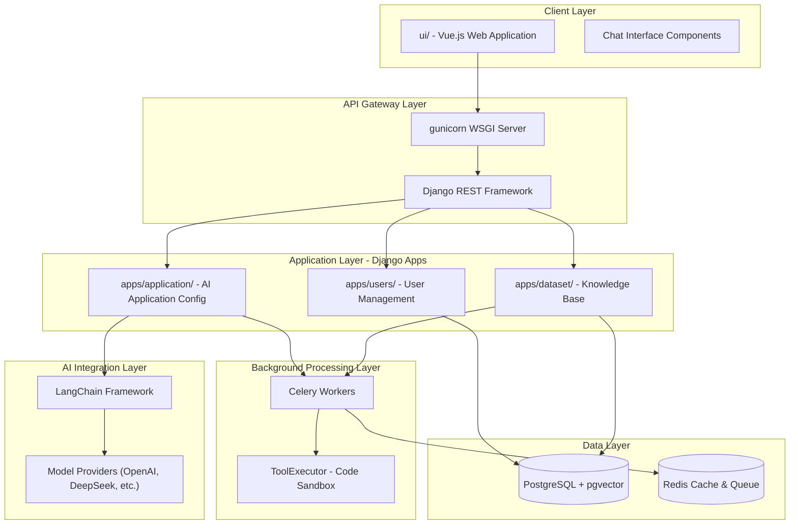
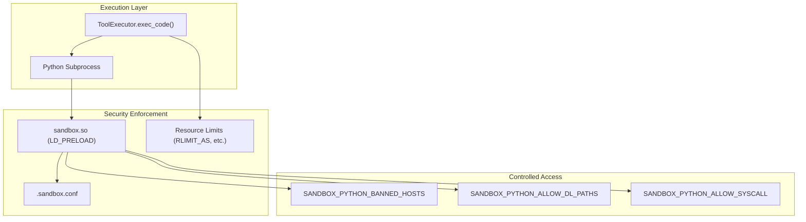

<!-- source: DeepWiki mcp.deepwiki.com · repo 1Panel-dev/MaxKB · page 1 Overview · fetched 2026-10-29 -->

# Overview

Relevant source files

The following files were used as context for generating this wiki page:

- [.dockerignore](.dockerignore)
- [.github/workflows/build-and-push-python-pg.yml](.github/workflows/build-and-push-python-pg.yml)
- [.github/workflows/build-and-push-vector-model.yml](.github/workflows/build-and-push-vector-model.yml)
- [.github/workflows/build-and-push.yml](.github/workflows/build-and-push.yml)
- [CODE_OF_CONDUCT.md](CODE_OF_CONDUCT.md)
- [CONTRIBUTING.md](CONTRIBUTING.md)
- [README.md](README.md)
- [README_CN.md](README_CN.md)
- [SECURITY.md](SECURITY.md)
- [USE-CASES.md](USE-CASES.md)
- [apps/application/flow/backend/__init__.py](apps/application/flow/backend/__init__.py)
- [apps/application/flow/backend/sandbox_shell.py](apps/application/flow/backend/sandbox_shell.py)
- [apps/application/migrations/0011_application_skill_tool_ids.py](apps/application/migrations/0011_application_skill_tool_ids.py)
- [apps/common/utils/tool_code.py](apps/common/utils/tool_code.py)
- [apps/models_provider/constants/model_provider_constants.py](apps/models_provider/constants/model_provider_constants.py)
- [apps/models_provider/impl/minimax_model_provider/__init__.py](apps/models_provider/impl/minimax_model_provider/__init__.py)
- [apps/models_provider/impl/minimax_model_provider/credential/__init__.py](apps/models_provider/impl/minimax_model_provider/credential/__init__.py)
- [apps/models_provider/impl/minimax_model_provider/credential/llm.py](apps/models_provider/impl/minimax_model_provider/credential/llm.py)
- [apps/models_provider/impl/minimax_model_provider/credential/tts.py](apps/models_provider/impl/minimax_model_provider/credential/tts.py)
- [apps/models_provider/impl/minimax_model_provider/icon/__init__.py](apps/models_provider/impl/minimax_model_provider/icon/__init__.py)
- [apps/models_provider/impl/minimax_model_provider/icon/minimax_icon_svg](apps/models_provider/impl/minimax_model_provider/icon/minimax_icon_svg)
- [apps/models_provider/impl/minimax_model_provider/model/__init__.py](apps/models_provider/impl/minimax_model_provider/model/__init__.py)
- [apps/models_provider/impl/minimax_model_provider/model/llm.py](apps/models_provider/impl/minimax_model_provider/model/llm.py)
- [apps/models_provider/impl/minimax_model_provider/model/tts.py](apps/models_provider/impl/minimax_model_provider/model/tts.py)
- [installer/Dockerfile](installer/Dockerfile)
- [installer/Dockerfile-base](installer/Dockerfile-base)
- [installer/Dockerfile-vector-model](installer/Dockerfile-vector-model)
- [installer/install_model.py](installer/install_model.py)
- [installer/install_model_bert_base_cased.py](installer/install_model_bert_base_cased.py)
- [installer/sandbox.c](installer/sandbox.c)
- [pyproject.toml](pyproject.toml)
- [ui/src/components/folder-virtualized-tree/CreateFolderDialog.vue](ui/src/components/folder-virtualized-tree/CreateFolderDialog.vue)
- [ui/src/components/folder-virtualized-tree/constant.ts](ui/src/components/folder-virtualized-tree/constant.ts)

## Purpose and Scope

This document provides an overview of MaxKB, an open-source enterprise-grade AI assistant platform that integrates Retrieval-Augmented Generation (RAG) pipelines with robust workflow capabilities. MaxKB is designed to solve high technical barriers, deployment costs, and long iteration cycles faced by enterprises implementing AI solutions [README.md:14-22]().

This overview covers the high-level system architecture, core components, key features, and technology stack. For detailed information about specific subsystems, see the following related pages:
- For high-level architecture details, see [System Architecture](#1.1)
- For core capabilities and modules, see [Key Features](#1.2)

## System Architecture

MaxKB implements a layered architecture with clear separation of concerns across client, API gateway, application logic, processing, AI integration, and data layers.

### Overall Architecture

**Sources:** [installer/Dockerfile:32-57](), [pyproject.toml:9-15](), [README.md:52-56]()

## Core Components

### Django Application Structure

MaxKB is organized into several Django apps, each handling a specific domain. The backend is built on Django 5.2.14 [pyproject.toml:9-9]().

### Key Code Entities

| Component | Location | Primary Responsibility |
|-----------|----------|------------------------|
| **ToolExecutor** | [apps/common/utils/tool_code.py:42-44]() | Orchestrates Python code execution within a secure sandbox. |
| **sandbox.so** | [installer/sandbox.c:1-26]() | C-based security layer for system call interception. |
| **CONFIG** | [apps/common/utils/tool_code.py:21-21]() | Global configuration management for the system. |
| **WorkflowManage** | Workflow engine | Orchestrates node-based workflow execution (Detail in [Workflow Engine](#5)). |

### Security and Execution Architecture

MaxKB implements a sophisticated security model for custom tool execution using a C-based sandbox and Python wrapper.

The sandbox implementation (`sandbox.c`) intercepts system calls to enforce network and file access restrictions [installer/sandbox.c:124-133](). The `ToolExecutor` initializes this environment by writing to `.sandbox.conf` [apps/common/utils/tool_code.py:70-93]().

**Sources:** [apps/common/utils/tool_code.py:42-155](), [installer/sandbox.c:27-38](), [installer/Dockerfile:16-16]()

## Key Features

MaxKB provides comprehensive AI assistant capabilities through several integrated systems. For a deep dive into these capabilities, see [Key Features](#1.2).

### RAG (Retrieval-Augmented Generation)
MaxKB implements a complete RAG pipeline:
- **Multi-format Support**: Parses PDF, Word, Excel, and HTML [pyproject.toml:52-56]().
- **Vectorization**: Uses `sentence-transformers` (v5.0.0) for local embedding [pyproject.toml:39-39]().
- **Vector Storage**: Leverages `pgvector` within PostgreSQL for similarity search [installer/Dockerfile-base:18-18]().

### Model Context Protocol (MCP)
MaxKB integrates MCP for standardized tool interaction via `langchain-mcp-adapters` [pyproject.toml:31-31](). It can dynamically generate MCP server code from Python tool definitions [apps/common/utils/tool_code.py:157-173]().

### LLM Provider Support
MaxKB integrates with a wide range of LLM providers [pyproject.toml:24-34]():
- **Public Cloud**: OpenAI, Anthropic, Google Gemini, AWS Bedrock.
- **Chinese Providers**: Baidu Qianfan, ZhipuAI, Volcengine, DeepSeek.
- **Local Hosting**: Ollama, Xinference.

## Technology Stack

MaxKB is built on a modern, scalable technology stack [README.md:52-56]():

| Layer | Technology |
|-----------|------------|
| **Frontend** | Vue.js [installer/Dockerfile:1-1]() |
| **Backend** | Python 3.11, Django 5.2.14 [pyproject.toml:6-9]() |
| **AI Framework** | LangChain 1.2.18, LangGraph 1.1.10 [pyproject.toml:24-35]() |
| **Database** | PostgreSQL 17.10 with pgvector [installer/Dockerfile-base:6-18]() |
| **Task Queue** | Celery 5.5.3 with Redis [pyproject.toml:48-49]() |

**Sources:** [pyproject.toml:1-67](), [installer/Dockerfile-base:1-25](), [README.md:52-56]()

---

