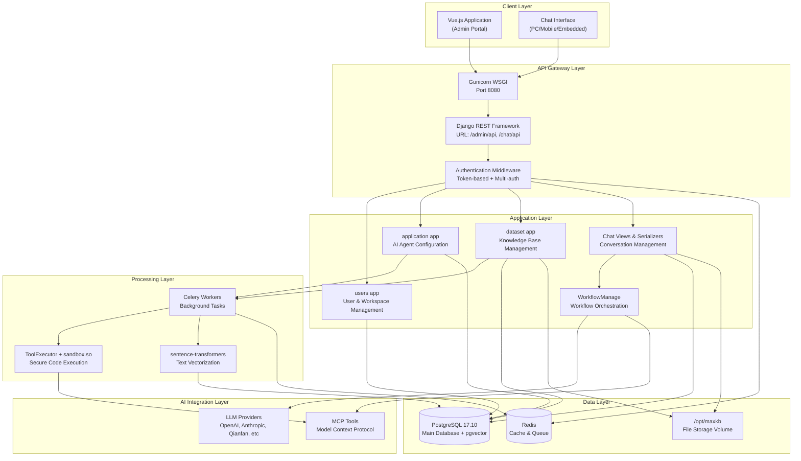
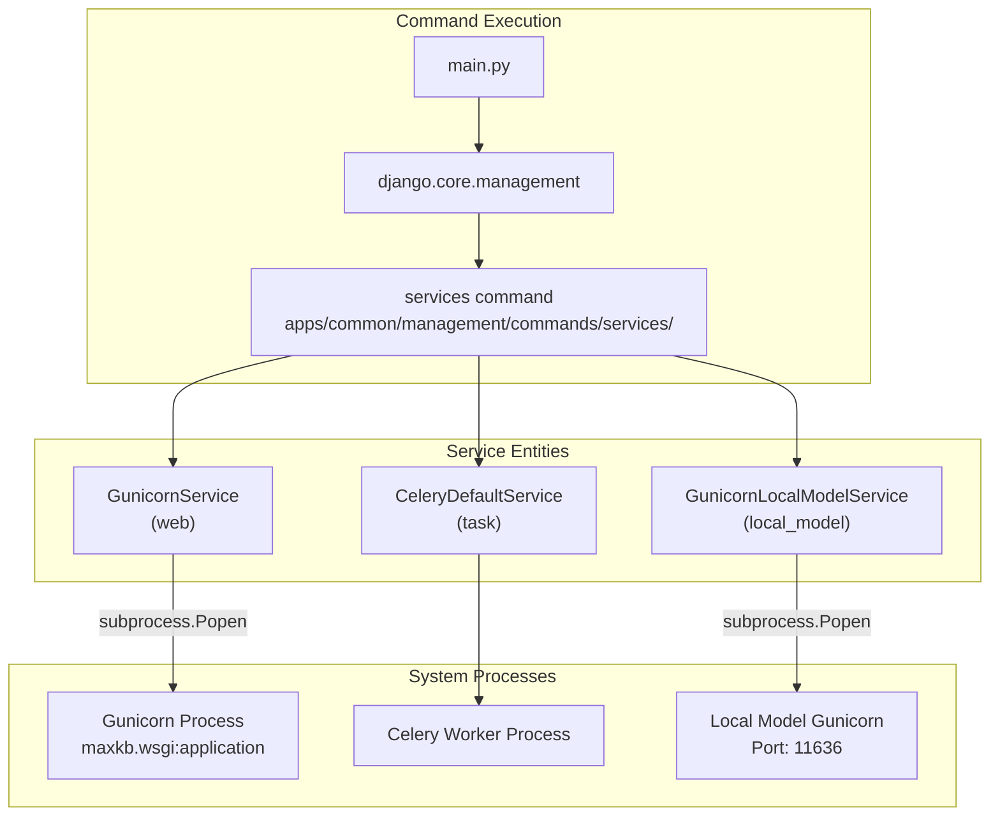
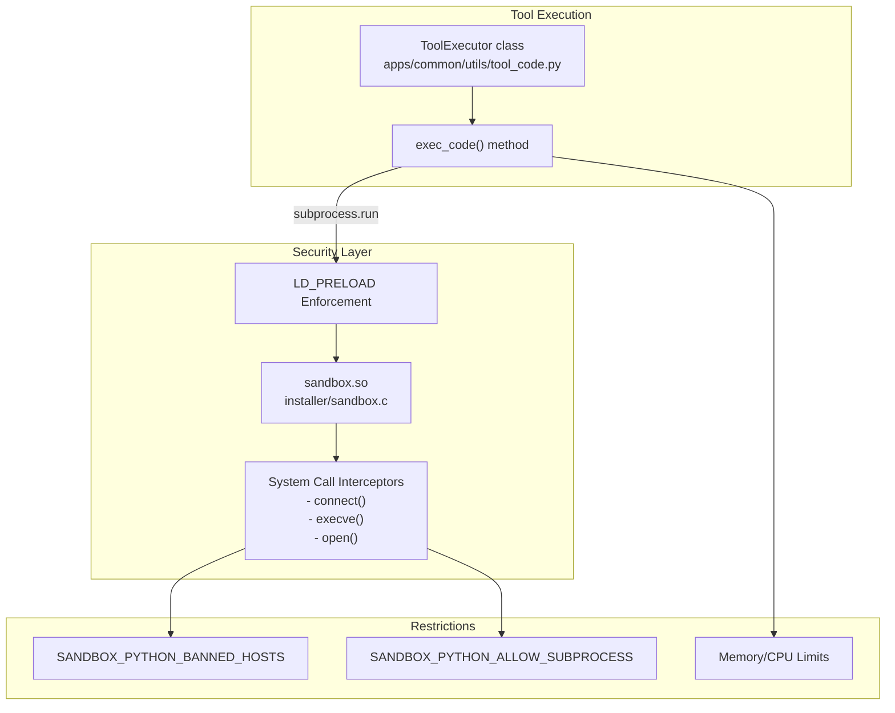

<!-- source: DeepWiki mcp.deepwiki.com · repo 1Panel-dev/MaxKB · page 1.1 System Architecture · fetched 2026-10-29 -->

# System Architecture

Relevant source files

The following files were used as context for generating this wiki page:

- [.dockerignore](.dockerignore)
- [.github/workflows/build-and-push-python-pg.yml](.github/workflows/build-and-push-python-pg.yml)
- [.github/workflows/build-and-push-vector-model.yml](.github/workflows/build-and-push-vector-model.yml)
- [.github/workflows/build-and-push.yml](.github/workflows/build-and-push.yml)
- [apps/application/flow/backend/__init__.py](apps/application/flow/backend/__init__.py)
- [apps/application/flow/backend/sandbox_shell.py](apps/application/flow/backend/sandbox_shell.py)
- [apps/application/migrations/0011_application_skill_tool_ids.py](apps/application/migrations/0011_application_skill_tool_ids.py)
- [apps/common/config/tokenizer_manage_config.py](apps/common/config/tokenizer_manage_config.py)
- [apps/common/locale/__init__.py](apps/common/locale/__init__.py)
- [apps/common/locale/cache.py](apps/common/locale/cache.py)
- [apps/common/locale/config_helper.py](apps/common/locale/config_helper.py)
- [apps/common/locale/manager.py](apps/common/locale/manager.py)
- [apps/common/management/__init__.py](apps/common/management/__init__.py)
- [apps/common/management/commands/__init__.py](apps/common/management/commands/__init__.py)
- [apps/common/management/commands/celery.py](apps/common/management/commands/celery.py)
- [apps/common/management/commands/restart.py](apps/common/management/commands/restart.py)
- [apps/common/management/commands/services/__init__.py](apps/common/management/commands/services/__init__.py)
- [apps/common/management/commands/services/command.py](apps/common/management/commands/services/command.py)
- [apps/common/management/commands/services/hands.py](apps/common/management/commands/services/hands.py)
- [apps/common/management/commands/services/services/__init__.py](apps/common/management/commands/services/services/__init__.py)
- [apps/common/management/commands/services/services/base.py](apps/common/management/commands/services/services/base.py)
- [apps/common/management/commands/services/services/celery_base.py](apps/common/management/commands/services/services/celery_base.py)
- [apps/common/management/commands/services/services/celery_default.py](apps/common/management/commands/services/services/celery_default.py)
- [apps/common/management/commands/services/services/gunicorn.py](apps/common/management/commands/services/services/gunicorn.py)
- [apps/common/management/commands/services/services/local_model.py](apps/common/management/commands/services/services/local_model.py)
- [apps/common/management/commands/services/services/scheduler.py](apps/common/management/commands/services/services/scheduler.py)
- [apps/common/utils/logger.py](apps/common/utils/logger.py)
- [apps/common/utils/tool_code.py](apps/common/utils/tool_code.py)
- [apps/maxkb/conf.py](apps/maxkb/conf.py)
- [apps/maxkb/settings/__init__.py](apps/maxkb/settings/__init__.py)
- [apps/maxkb/settings/base/model.py](apps/maxkb/settings/base/model.py)
- [apps/maxkb/settings/base/web.py](apps/maxkb/settings/base/web.py)
- [apps/maxkb/settings/logging.py](apps/maxkb/settings/logging.py)
- [apps/maxkb/settings/mem.py](apps/maxkb/settings/mem.py)
- [installer/Dockerfile](installer/Dockerfile)
- [installer/Dockerfile-base](installer/Dockerfile-base)
- [installer/Dockerfile-vector-model](installer/Dockerfile-vector-model)
- [installer/init.sql](installer/init.sql)
- [installer/install_model.py](installer/install_model.py)
- [installer/install_model_bert_base_cased.py](installer/install_model_bert_base_cased.py)
- [installer/sandbox.c](installer/sandbox.c)
- [installer/start-all.sh](installer/start-all.sh)
- [installer/start-maxkb.sh](installer/start-maxkb.sh)
- [installer/start-postgres.sh](installer/start-postgres.sh)
- [installer/start-redis.sh](installer/start-redis.sh)
- [main.py](main.py)
- [pyproject.toml](pyproject.toml)

## Purpose and Scope

This document describes the high-level architecture of MaxKB, covering the major system components, their relationships, technology stack, and deployment infrastructure. It provides a structural overview of how the frontend, backend, data storage, AI integration, and security layers work together.

For detailed information about specific subsystems, see:
- User authentication and workspace management: [2]()
- AI chat and conversation systems: [3]()
- Application and workflow management: [4]() and [5]()
- Knowledge base and document processing: [6]()
- Frontend UI components and routing: [10]()
- Deployment and CI/CD pipelines: [11]()

---

## Technology Stack Overview

MaxKB is built as a multi-tier web application with clear separation between presentation, business logic, and data layers.

### Core Technology Stack

| Layer | Technology | Version | Purpose |
|-------|-----------|---------|---------|
| **Frontend** | Vue.js | 3.x | Reactive UI framework |
| | Element Plus | - | UI component library |
| | Pinia | - | State management |
| | Vite | - | Build tool |
| **Backend** | Django | 5.2.14 | Web framework |
| | Django REST Framework | 3.17.1 | REST API framework |
| | Python | 3.11 | Language runtime |
| | Gunicorn | 23.0.0 | WSGI server |
| **AI/ML** | LangChain | 1.2.18 | LLM orchestration |
| | PyTorch | 2.8.0 | ML framework |
| | sentence-transformers | 5.0.0 | Text embeddings |
| **Task Processing** | Celery | 5.5.3 | Distributed task queue |
| | celery-once | 3.0.1 | Task deduplication |
| | django-celery-beat | 2.8.1 | Periodic tasks |
| **Data** | PostgreSQL | 17.10 | Primary database |
| | pgvector | Extension | Vector similarity search |
| | Redis | - | Cache and message broker |
| **Deployment** | Docker | Multi-stage | Containerization |
| | GitHub Actions | - | CI/CD pipeline |

**Sources:** [pyproject.toml:1-67](), [installer/Dockerfile-base:6-19](), [installer/Dockerfile:9-57]()

---

## High-Level Architecture

The system follows a layered architecture pattern with clear separation of concerns across five major layers.

**Sources:** [installer/Dockerfile:9-57](), [pyproject.toml:8-63](), [apps/common/management/commands/services/services/gunicorn.py:9-38]()

---

## Backend Architecture

The Django backend is organized into modular apps following Django's app pattern. The system utilizes `GunicornService` to serve the WSGI application.

### Service Orchestration

The backend services are managed through a custom management command that handles the lifecycle of Gunicorn, Celery, and a local model server.

**Sources:** [main.py:65-87](), [apps/common/management/commands/services/services/gunicorn.py:9-54](), [apps/common/management/commands/services/services/local_model.py:18-63]()

---

## Data Layer Architecture

MaxKB uses a hybrid data storage strategy combining a relational database with vector capabilities and a caching layer.

### Database Configuration

The system uses `django-db-connection-pool` to manage PostgreSQL connections efficiently.

| Variable | Default | Purpose |
|----------|---------|---------|
| `MAXKB_DB_HOST` | 127.0.0.1 | PostgreSQL host [apps/maxkb/conf.py:25]() |
| `MAXKB_DB_PORT` | 5432 | PostgreSQL port [apps/maxkb/conf.py:26]() |
| `MAXKB_DB_NAME` | maxkb | Database name [installer/Dockerfile:33]() |
| `MAXKB_DB_USER` | root | Database user [apps/maxkb/conf.py:27]() |
| `MAXKB_DB_PASSWORD` | Password123@postgres | Database password [apps/maxkb/conf.py:28]() |
| `MAXKB_DB_MAX_OVERFLOW` | 80 | Connection pool overflow [apps/maxkb/conf.py:30]() |
| `MAXKB_REDIS_HOST` | 127.0.0.1 | Redis host [apps/maxkb/conf.py:39]() |
| `MAXKB_REDIS_PORT` | 6379 | Redis port [apps/maxkb/conf.py:41]() |

**Sources:** [apps/maxkb/conf.py:22-106](), [installer/Dockerfile:32-42]()

---

## Security and Sandbox Architecture

MaxKB implements a multi-layered security architecture with sandboxed code execution for user-defined tools using a custom C library `sandbox.so`.

### Sandbox Execution Architecture

**Sandbox Implementation Details:**

The `ToolExecutor` initializes the sandbox environment by writing configuration to `.sandbox.conf` and setting directory permissions.

| Feature | Implementation | Source |
|---------|----------------|--------|
| Network Filtering | `match_banned_ip` / `match_banned_domain` in C | [installer/sandbox.c:133-220]() |
| Process Isolation | `os.setuid` / `os.setgid` to `sandbox` user | [apps/common/utils/tool_code.py:106-110]() |
| Resource Control | `resource.setrlimit` for memory/CPU | [apps/common/utils/tool_code.py:33-39]() |
| Syscall Interception | `dlsym(RTLD_NEXT, ...)` for libc functions | [installer/sandbox.c:124-128]() |

**Sources:** [apps/common/utils/tool_code.py:42-155](), [installer/sandbox.c:1-128](), [installer/Dockerfile:16]()

---

## Deployment and CI/CD

MaxKB is deployed as a multi-stage Docker container. The build process is automated via GitHub Actions, supporting both `amd64` and `arm64` architectures.

### Build Pipeline

1.  **web-build stage**: Compiles the Vue.js frontend [installer/Dockerfile:1-7]().
2.  **stage-build stage**: Installs Python dependencies via `uv`, compiles the C sandbox, and prepares the backend [installer/Dockerfile:9-24]().
3.  **Final image**: Combines the built assets into a minimal runtime environment based on a pre-configured base image [installer/Dockerfile:27-57]().

**Sources:** [installer/Dockerfile:1-57](), [.github/workflows/build-and-push.yml:1-147]()

---

