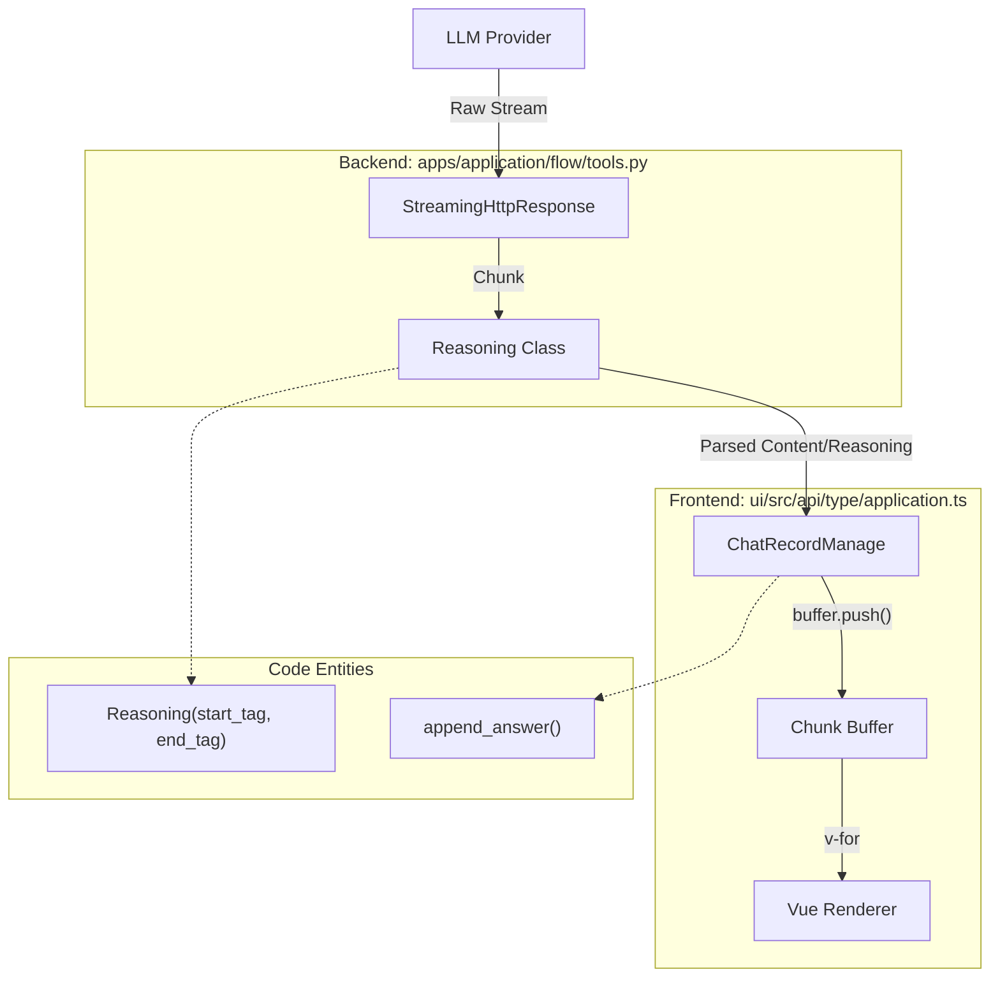
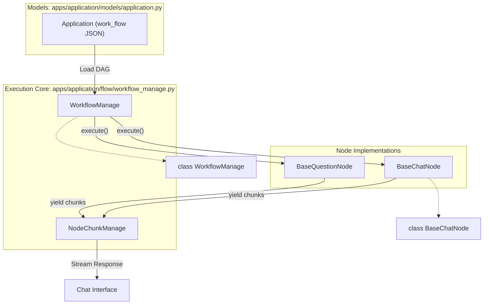

<!-- source: DeepWiki mcp.deepwiki.com · repo 1Panel-dev/MaxKB · page 1.2 Key Features · fetched 2026-10-29 -->

# Key Features

Relevant source files

The following files were used as context for generating this wiki page:

- [CODE_OF_CONDUCT.md](CODE_OF_CONDUCT.md)
- [CONTRIBUTING.md](CONTRIBUTING.md)
- [README.md](README.md)
- [README_CN.md](README_CN.md)
- [SECURITY.md](SECURITY.md)
- [USE-CASES.md](USE-CASES.md)
- [apps/application/chat_pipeline/step/chat_step/i_chat_step.py](apps/application/chat_pipeline/step/chat_step/i_chat_step.py)
- [apps/application/chat_pipeline/step/chat_step/impl/base_chat_step.py](apps/application/chat_pipeline/step/chat_step/impl/base_chat_step.py)
- [apps/application/flow/i_step_node.py](apps/application/flow/i_step_node.py)
- [apps/application/flow/step_node/ai_chat_step_node/i_chat_node.py](apps/application/flow/step_node/ai_chat_step_node/i_chat_node.py)
- [apps/application/flow/step_node/ai_chat_step_node/impl/base_chat_node.py](apps/application/flow/step_node/ai_chat_step_node/impl/base_chat_node.py)
- [apps/application/flow/step_node/intent_node/impl/base_intent_node.py](apps/application/flow/step_node/intent_node/impl/base_intent_node.py)
- [apps/application/flow/step_node/parameter_extraction_node/impl/base_parameter_extraction_node.py](apps/application/flow/step_node/parameter_extraction_node/impl/base_parameter_extraction_node.py)
- [apps/application/flow/step_node/question_node/i_question_node.py](apps/application/flow/step_node/question_node/i_question_node.py)
- [apps/application/flow/step_node/question_node/impl/base_question_node.py](apps/application/flow/step_node/question_node/impl/base_question_node.py)
- [apps/application/flow/step_node/variable_splitting_node/impl/base_variable_splitting_node.py](apps/application/flow/step_node/variable_splitting_node/impl/base_variable_splitting_node.py)
- [apps/application/flow/tools.py](apps/application/flow/tools.py)
- [apps/application/flow/workflow_manage.py](apps/application/flow/workflow_manage.py)
- [apps/application/long_term_memory/__init__.py](apps/application/long_term_memory/__init__.py)
- [apps/application/models/application.py](apps/application/models/application.py)
- [apps/knowledge/task/handler.py](apps/knowledge/task/handler.py)
- [apps/models_provider/constants/model_provider_constants.py](apps/models_provider/constants/model_provider_constants.py)
- [apps/models_provider/impl/minimax_model_provider/__init__.py](apps/models_provider/impl/minimax_model_provider/__init__.py)
- [apps/models_provider/impl/minimax_model_provider/credential/__init__.py](apps/models_provider/impl/minimax_model_provider/credential/__init__.py)
- [apps/models_provider/impl/minimax_model_provider/credential/llm.py](apps/models_provider/impl/minimax_model_provider/credential/llm.py)
- [apps/models_provider/impl/minimax_model_provider/credential/tts.py](apps/models_provider/impl/minimax_model_provider/credential/tts.py)
- [apps/models_provider/impl/minimax_model_provider/icon/__init__.py](apps/models_provider/impl/minimax_model_provider/icon/__init__.py)
- [apps/models_provider/impl/minimax_model_provider/icon/minimax_icon_svg](apps/models_provider/impl/minimax_model_provider/icon/minimax_icon_svg)
- [apps/models_provider/impl/minimax_model_provider/model/__init__.py](apps/models_provider/impl/minimax_model_provider/model/__init__.py)
- [apps/models_provider/impl/minimax_model_provider/model/llm.py](apps/models_provider/impl/minimax_model_provider/model/llm.py)
- [apps/models_provider/impl/minimax_model_provider/model/tts.py](apps/models_provider/impl/minimax_model_provider/model/tts.py)
- [apps/models_provider/impl/ollama_model_provider/ollama_model_provider.py](apps/models_provider/impl/ollama_model_provider/ollama_model_provider.py)
- [ui/src/api/type/application.ts](ui/src/api/type/application.ts)
- [ui/src/components/folder-virtualized-tree/CreateFolderDialog.vue](ui/src/components/folder-virtualized-tree/CreateFolderDialog.vue)
- [ui/src/components/folder-virtualized-tree/constant.ts](ui/src/components/folder-virtualized-tree/constant.ts)

This document provides a technical overview of MaxKB's core capabilities and their underlying implementation. MaxKB (Max Knowledge Brain) is designed as an enterprise-grade agent platform focusing on RAG pipelines, flexible workflow orchestration, and extensive model compatibility.

## AI Chat and Multi-Modal Support

MaxKB provides a native multi-modal chat experience supporting text, images, audio, and video. The system handles streaming responses and complex reasoning processes (e.g., "Think" blocks for models like DeepSeek).

### Chat Streaming and Reasoning Flow

The `ChatRecordManage` class in the frontend manages the buffering and rendering of streaming chunks, while the backend uses `Reasoning` and `StreamingHttpResponse` to handle model outputs.

### Key Multi-Modal Components
| Feature | Implementation | Description |
| :--- | :--- | :--- |
| **Reasoning Blocks** | `Reasoning` class | Extracts content between tags like `` for UI separation. [apps/application/flow/tools.py:86-103]() |
| **Audio Processing** | `pydub`, `pysilk` | Handles conversion and processing of voice inputs/outputs. [pyproject.toml:68-70]() |
| **Streaming** | `ChatRecordManage` | Manages `answer_text_list` for multi-view rendering of workflow nodes. [ui/src/api/type/application.ts:122-180]() |

**Sources:** [apps/application/flow/tools.py:86-103](), [ui/src/api/type/application.ts:122-180](), [README.md:20]()

## Workflow Orchestration Engine

The workflow engine allows for complex DAG (Directed Acyclic Graph) execution of AI tasks. It supports multiple node types, including AI Chat, Question, and Tool execution.

### Workflow Execution Architecture

The `WorkflowManage` class acts as the central orchestrator, managing node transitions and context sharing.

### Workflow Node Capabilities
*   **Context Management**: Nodes share data through a global `workflow_variable` and node-specific `node_variable`. [apps/application/flow/step_node/ai_chat_step_node/impl/base_chat_node.py:36-49]()
*   **Interruption Handling**: Supports task interruption checks during streaming to save resources. [apps/application/flow/step_node/ai_chat_step_node/impl/base_chat_node.py:70-72]()
*   **Dynamic Prompting**: The engine generates prompts by replacing variables in templates. [apps/application/flow/step_node/question_node/impl/base_question_node.py:107-112]()

**Sources:** [apps/application/flow/workflow_manage.py:92-140](), [apps/application/flow/step_node/ai_chat_step_node/impl/base_chat_node.py:148-160](), [apps/application/flow/step_node/question_node/impl/base_question_node.py:74-123]()

## Knowledge Base and RAG Pipeline

MaxKB implements Retrieval-Augmented Generation (RAG) by integrating document processing with vector databases.

*   **Document Ingestion**: Supports direct upload and automatic crawling. [README.md:16]()
*   **Vector Search**: Utilizes `PostgreSQL` with `pgvector` for efficient similarity searches. [README.md:55]()
*   **RAG Configuration**: Applications can be configured with specific knowledge settings, including `top_n`, `similarity` thresholds, and `search_mode`. [apps/application/models/application.py:41-47]()

**Sources:** [README.md:16-19](), [apps/application/models/application.py:71-72]()

## Multi-LLM and Tool Integration

The platform is model-agnostic and supports a wide range of providers and tool protocols.

### Model Providers
MaxKB supports over 15 providers, including:
*   **Private/Local**: DeepSeek, Llama, Qwen (via Ollama/Xinference). [README.md:19]()
*   **Public Cloud**: OpenAI, Claude, Gemini, and major Chinese providers (Zhipu AI, Baidu Qianfan, etc.). [README_CN.md:22]()

### Tool and MCP Integration
*   **MCP (Model Context Protocol)**: Enables advanced tool-use capabilities through standardized adapters. [README.md:14]()
*   **Tool Execution**: Supports custom tool code execution and sandboxed environments. [apps/application/flow/tools.py:40-53]()
*   **Long-Term Memory**: An automated background task提炼 (extracts) user preferences and objective background information from conversations to improve future AI responses. [apps/application/long_term_memory/__init__.py:14-120]()

**Sources:** [README.md:14-19](), [apps/application/long_term_memory/__init__.py:123-155](), [apps/application/flow/tools.py:40-53]()

## Enterprise Features

*   **Multi-Tenant Workspaces**: Isolation of resources and permissions via `workspace_id`. [apps/application/models/application.py:61]()
*   **Application Folders**: Hierarchical organization of AI applications. [apps/application/models/application.py:20-26]()
*   **API Integration**: Zero-coding integration into third-party systems. [README.md:18]()
*   **Long-Term Memory**: Persistent user profiling across sessions based on configurable triggers (e.g., every N rounds). [apps/application/long_term_memory/__init__.py:158-213]()

**Sources:** [apps/application/models/application.py:59-106](), [apps/application/long_term_memory/__init__.py:106-114]()

---

