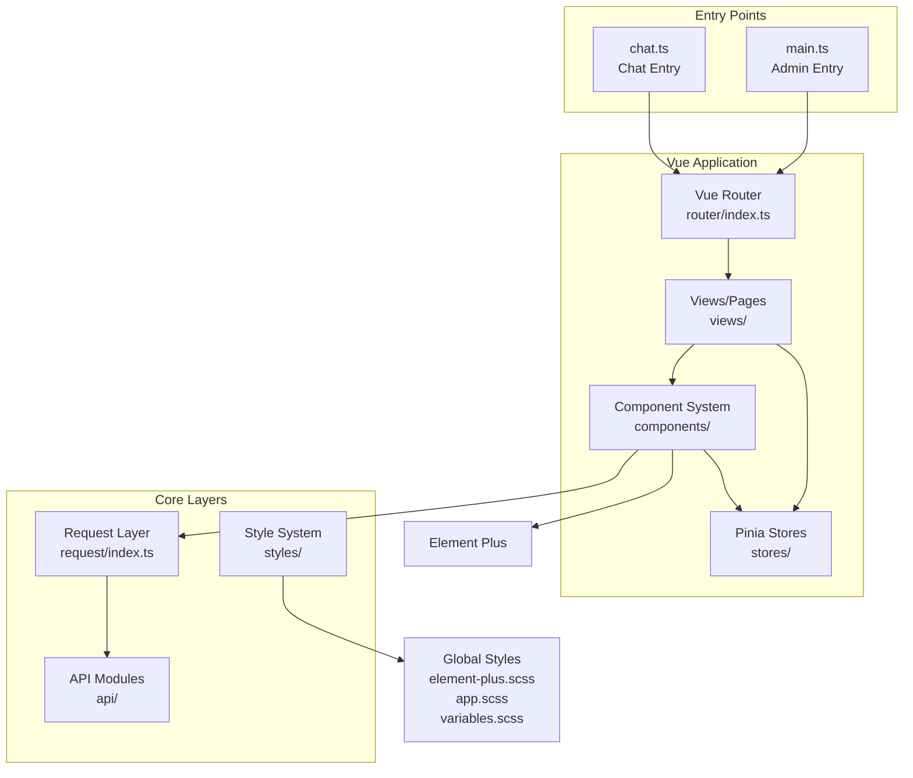
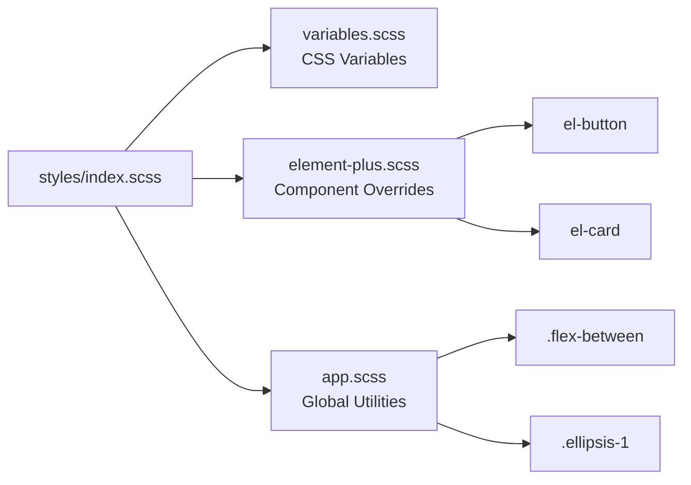

<!-- source: DeepWiki mcp.deepwiki.com · repo 1Panel-dev/MaxKB · page 10 UI System and Components · fetched 2026-10-29 -->

# UI System and Components

Relevant source files

The following files were used as context for generating this wiki page:

- [ui/package.json](ui/package.json)
- [ui/src/App.vue](ui/src/App.vue)
- [ui/src/chat.ts](ui/src/chat.ts)
- [ui/src/components/card-box/index.vue](ui/src/components/card-box/index.vue)
- [ui/src/components/common-list/index.vue](ui/src/components/common-list/index.vue)
- [ui/src/components/index.ts](ui/src/components/index.ts)
- [ui/src/components/markdown/MdEditor.vue](ui/src/components/markdown/MdEditor.vue)
- [ui/src/components/markdown/MdPreview.vue](ui/src/components/markdown/MdPreview.vue)
- [ui/src/enums/model.ts](ui/src/enums/model.ts)
- [ui/src/locales/index.ts](ui/src/locales/index.ts)
- [ui/src/locales/useLocale.ts](ui/src/locales/useLocale.ts)
- [ui/src/main.ts](ui/src/main.ts)
- [ui/src/styles/app.scss](ui/src/styles/app.scss)
- [ui/src/styles/element-plus.scss](ui/src/styles/element-plus.scss)
- [ui/src/styles/index.scss](ui/src/styles/index.scss)
- [ui/src/styles/variables.scss](ui/src/styles/variables.scss)
- [ui/src/utils/message.ts](ui/src/utils/message.ts)
- [ui/src/utils/supPopover.ts](ui/src/utils/supPopover.ts)
- [ui/src/views/model/component/Provider.vue](ui/src/views/model/component/Provider.vue)
- [ui/vite.config.ts](ui/vite.config.ts)

## Overview

This document describes the frontend architecture, component system, and UI patterns used in the MaxKB application. The UI is built with Vue 3, TypeScript, and Element Plus, providing a responsive interface across desktop, mobile, and embedded chat modes. The system includes reusable components, global styling, state management via Pinia, and a comprehensive API layer.

For details on specific UI topics, see the following child pages:
- [UI Components and Styling](#10.1) — Document reusable UI components (CardBox, FolderTree, etc.), Element Plus customization, and global styling architecture.
- [Routing and API Context Switching](#10.2) — Explain Vue Router configuration, API context switching (workspace/systemManage/systemShare), and dynamic API loading.
- [Request Handling and Interceptors](#10.3) — Detail the Axios request module, interceptors, authentication token injection, error handling, and response processing.
- [Internationalization and Theming](#10.4) — Explain the multi-language support system, translation files, language switching, and theme management.
- [Dashboard and Home View](#10.5) — Document the home dashboard including quick-create shortcuts, resource aggregation statistics, usage charts, and application ranking features.

## Frontend Technology Stack

The MaxKB frontend utilizes a modern reactive stack centered around Vue 3 and Vite.

| Technology | Version | Purpose |
|------------|---------|---------|
| Vue 3 | ^3.5.13 | Core reactive framework |
| TypeScript | ~5.8.0 | Type safety and documentation |
| Element Plus | ^2.13.5 | Primary UI component library |
| Pinia | ^3.0.1 | Centralized state management |
| Vue Router | ^4.5.0 | Client-side navigation |
| Axios | ^1.8.4 | HTTP client for backend communication |
| Vite | ^6.2.4 | Frontend build tool and dev server |
| SCSS | ^1.86.3 | CSS preprocessing and variables |

**Sources:** [ui/package.json:1-91]()

## Frontend Architecture

The application is structured into a main administrative interface and a specialized chat interface, both sharing a core layer of components and styles.

### System Entry Points

**Sources:** [ui/src/main.ts:1-118](), [ui/vite.config.ts:1-115](), [ui/src/chat.ts]()

## Component System

MaxKB utilizes a centralized registration system for global components, allowing common UI patterns like cards and layouts to be used throughout the application without local imports.

### Reusable UI Components

The `install` function in the components directory registers core elements:
- **CardBox**: A flexible card container with hover effects and slot-based headers/footers.
- **AiChat**: The primary interface for AI interaction, supporting streaming and multi-modal input.
- **FolderTree**: Hierarchical navigation used for organizing applications and knowledge bases.
- **AppTable**: Standardized data tables with integrated Element Plus patterns.

For details on component implementations, see [UI Components and Styling](#10.1).

**Sources:** [ui/src/components/index.ts:1-66](), [ui/src/components/card-box/index.vue:1-135]()

## Styling System

The styling system is built on SCSS and CSS Custom Properties, providing a consistent look and feel while allowing for theme customization.

### Global Styles and Variables

The style architecture is divided into:
1. **Variables**: Base units (`--app-base-px`), layout colors, and dimensions.
2. **Framework Overrides**: Customizations for Element Plus components to match the MaxKB design language.
3. **Global Utilities**: CSS classes for flexbox, spacing, and typography.

For details on the CSS architecture, see [UI Components and Styling](#10.1).

**Sources:** [ui/src/styles/variables.scss:1-47](), [ui/src/styles/element-plus.scss:1-326](), [ui/src/styles/app.scss:1-554]()

## Internationalization and Theming

MaxKB supports a robust multi-language system and dynamic UI theming.

- **i18n**: Managed via `vue-i18n`, supporting browser language detection and external locale loading.
- **Theming**: Dynamic CSS variable injection for primary colors and backgrounds, particularly for public chat views.

For details on language and theme management, see [Internationalization and Theming](#10.4).

**Sources:** [ui/src/locales/index.ts:1-142](), [ui/src/utils/message.ts:1-64]()

## Request and Routing

- **Routing**: Client-side navigation handles workspace switching and context-specific views (e.g., system management vs. workspace resources).
- **Request Layer**: An Axios-based module handles authentication headers, language injection, and global error notification.

For details, see [Routing and API Context Switching](#10.2) and [Request Handling and Interceptors](#10.3).

**Sources:** [ui/src/main.ts:111-112](), [ui/vite.config.ts:37-81]()

---

