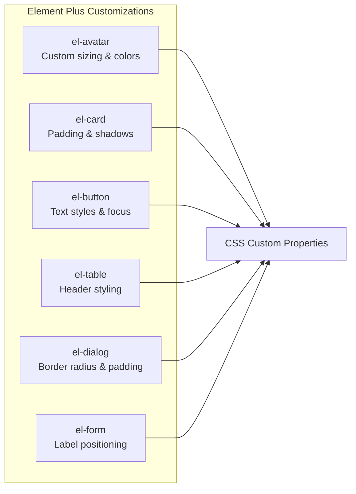
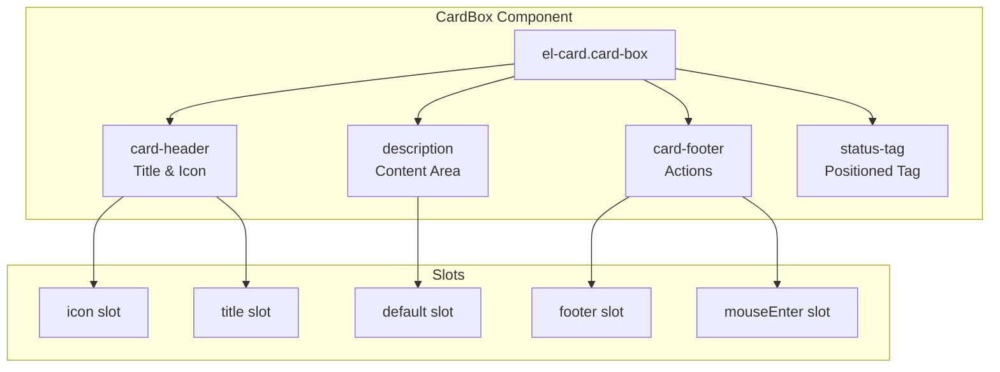
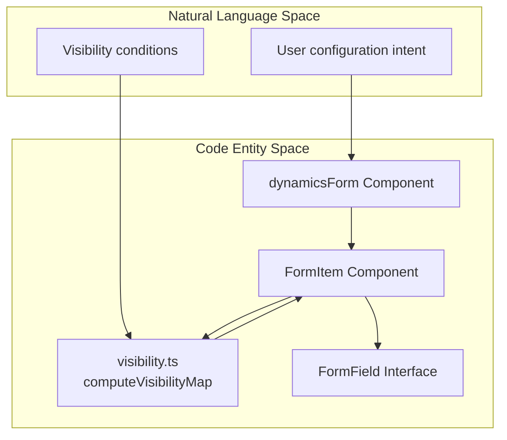

<!-- source: DeepWiki mcp.deepwiki.com · repo 1Panel-dev/MaxKB · page 10.1 UI Components and Styling · fetched 2026-10-29 -->

# UI Components and Styling

<details>
<summary>Relevant source files</summary>

The following files were used as context for generating this wiki page:

- [ui/package.json](ui/package.json)
- [ui/src/components/ai-chat/component/inline-params/constants.ts](ui/src/components/ai-chat/component/inline-params/constants.ts)
- [ui/src/components/ai-chat/component/inline-params/index.vue](ui/src/components/ai-chat/component/inline-params/index.vue)
- [ui/src/components/app-icon/icons/about.ts](ui/src/components/app-icon/icons/about.ts)
- [ui/src/components/app-icon/icons/knowledge.ts](ui/src/components/app-icon/icons/knowledge.ts)
- [ui/src/components/card-box/index.vue](ui/src/components/card-box/index.vue)
- [ui/src/components/common-list/index.vue](ui/src/components/common-list/index.vue)
- [ui/src/components/dynamics-form/Demo.vue](ui/src/components/dynamics-form/Demo.vue)
- [ui/src/components/dynamics-form/DemoConstructor.vue](ui/src/components/dynamics-form/DemoConstructor.vue)
- [ui/src/components/dynamics-form/FormItem.vue](ui/src/components/dynamics-form/FormItem.vue)
- [ui/src/components/dynamics-form/constructor/index.vue](ui/src/components/dynamics-form/constructor/index.vue)
- [ui/src/components/dynamics-form/constructor/items/DatePickerConstructor.vue](ui/src/components/dynamics-form/constructor/items/DatePickerConstructor.vue)
- [ui/src/components/dynamics-form/constructor/items/JsonInputConstructor.vue](ui/src/components/dynamics-form/constructor/items/JsonInputConstructor.vue)
- [ui/src/components/dynamics-form/constructor/items/MultiRowConstructor.vue](ui/src/components/dynamics-form/constructor/items/MultiRowConstructor.vue)
- [ui/src/components/dynamics-form/constructor/items/MultiSelectConstructor.vue](ui/src/components/dynamics-form/constructor/items/MultiSelectConstructor.vue)
- [ui/src/components/dynamics-form/constructor/items/RadioCardConstructor.vue](ui/src/components/dynamics-form/constructor/items/RadioCardConstructor.vue)
- [ui/src/components/dynamics-form/constructor/items/RadioRowConstructor.vue](ui/src/components/dynamics-form/constructor/items/RadioRowConstructor.vue)
- [ui/src/components/dynamics-form/constructor/items/SingleSelectConstructor.vue](ui/src/components/dynamics-form/constructor/items/SingleSelectConstructor.vue)
- [ui/src/components/dynamics-form/constructor/items/SliderConstructor.vue](ui/src/components/dynamics-form/constructor/items/SliderConstructor.vue)
- [ui/src/components/dynamics-form/constructor/items/SwitchInputConstructor.vue](ui/src/components/dynamics-form/constructor/items/SwitchInputConstructor.vue)
- [ui/src/components/dynamics-form/constructor/items/TextInputConstructor.vue](ui/src/components/dynamics-form/constructor/items/TextInputConstructor.vue)
- [ui/src/components/dynamics-form/index.ts](ui/src/components/dynamics-form/index.ts)
- [ui/src/components/dynamics-form/index.vue](ui/src/components/dynamics-form/index.vue)
- [ui/src/components/dynamics-form/items/JsonInput.vue](ui/src/components/dynamics-form/items/JsonInput.vue)
- [ui/src/components/dynamics-form/items/MultiRow.vue](ui/src/components/dynamics-form/items/MultiRow.vue)
- [ui/src/components/dynamics-form/items/complex/ArrayObjectCard.vue](ui/src/components/dynamics-form/items/complex/ArrayObjectCard.vue)
- [ui/src/components/dynamics-form/items/complex/ObjectCard.vue](ui/src/components/dynamics-form/items/complex/ObjectCard.vue)
- [ui/src/components/dynamics-form/items/complex/TabCard.vue](ui/src/components/dynamics-form/items/complex/TabCard.vue)
- [ui/src/components/dynamics-form/items/label/TooltipLabel.vue](ui/src/components/dynamics-form/items/label/TooltipLabel.vue)
- [ui/src/components/dynamics-form/items/radio/RadioCard.vue](ui/src/components/dynamics-form/items/radio/RadioCard.vue)
- [ui/src/components/dynamics-form/items/radio/RadioRow.vue](ui/src/components/dynamics-form/items/radio/RadioRow.vue)
- [ui/src/components/dynamics-form/items/switch/SwitchInput.vue](ui/src/components/dynamics-form/items/switch/SwitchInput.vue)
- [ui/src/components/dynamics-form/items/table/ProgressTableItem.vue](ui/src/components/dynamics-form/items/table/ProgressTableItem.vue)
- [ui/src/components/dynamics-form/items/upload/UploadInput.vue](ui/src/components/dynamics-form/items/upload/UploadInput.vue)
- [ui/src/components/dynamics-form/type.ts](ui/src/components/dynamics-form/type.ts)
- [ui/src/components/dynamics-form/visibility/ConditionRow.vue](ui/src/components/dynamics-form/visibility/ConditionRow.vue)
- [ui/src/components/dynamics-form/visibility/Constructor.vue](ui/src/components/dynamics-form/visibility/Constructor.vue)
- [ui/src/components/dynamics-form/visibility/FieldSelector.vue](ui/src/components/dynamics-form/visibility/FieldSelector.vue)
- [ui/src/components/dynamics-form/visibility/field-type.ts](ui/src/components/dynamics-form/visibility/field-type.ts)
- [ui/src/components/dynamics-form/visibility/index.ts](ui/src/components/dynamics-form/visibility/index.ts)
- [ui/src/components/folder-tree/CreateFolderDialog.vue](ui/src/components/folder-tree/CreateFolderDialog.vue)
- [ui/src/components/folder-virtualized-tree/MoveToDialog.vue](ui/src/components/folder-virtualized-tree/MoveToDialog.vue)
- [ui/src/components/folder-virtualized-tree/VirtualizedTree.vue](ui/src/components/folder-virtualized-tree/VirtualizedTree.vue)
- [ui/src/components/folder-virtualized-tree/index.vue](ui/src/components/folder-virtualized-tree/index.vue)
- [ui/src/components/index.ts](ui/src/components/index.ts)
- [ui/src/components/infinite-scroll/index.vue](ui/src/components/infinite-scroll/index.vue)
- [ui/src/enums/model.ts](ui/src/enums/model.ts)
- [ui/src/layout/layout-header/SystemHeader.vue](ui/src/layout/layout-header/SystemHeader.vue)
- [ui/src/layout/layout-header/top-about/index.vue](ui/src/layout/layout-header/top-about/index.vue)
- [ui/src/locales/lang/en-US/components.ts](ui/src/locales/lang/en-US/components.ts)
- [ui/src/locales/lang/zh-CN/components.ts](ui/src/locales/lang/zh-CN/components.ts)
- [ui/src/locales/lang/zh-Hant/components.ts](ui/src/locales/lang/zh-Hant/components.ts)
- [ui/src/styles/app.scss](ui/src/styles/app.scss)
- [ui/src/styles/element-plus.scss](ui/src/styles/element-plus.scss)
- [ui/src/styles/variables.scss](ui/src/styles/variables.scss)
- [ui/src/views/document/component/EmbeddingContentDialog.vue](ui/src/views/document/component/EmbeddingContentDialog.vue)
- [ui/src/views/model/component/Provider.vue](ui/src/views/model/component/Provider.vue)
- [ui/src/views/system-setting/theme/index.vue](ui/src/views/system-setting/theme/index.vue)
- [ui/src/workflow/common/AddFormCollect.vue](ui/src/workflow/common/AddFormCollect.vue)
- [ui/src/workflow/common/EditFormCollect.vue](ui/src/workflow/common/EditFormCollect.vue)
- [ui/src/workflow/nodes/form-node/index.vue](ui/src/workflow/nodes/form-node/index.vue)
- [ui/vite.config.ts](ui/vite.config.ts)

</details>


This document covers the Vue.js component system, SCSS styling framework, and design system implementation in MaxKB. It details the global styling utilities, Element Plus customizations, reusable UI components, and the overall component architecture.

For routing and permission controls within the UI, see [Routing and API Context Switching](#10.2).

## Styling System Architecture

MaxKB implements a comprehensive SCSS-based styling system with global utility classes, CSS custom properties, and Element Plus framework customizations.

```mermaid
graph TB
    subgraph "Styling Layer"
        AppScss["app.scss<br/>Global Styles & Utilities"]
        Variables["variables.scss<br/>Design Tokens & CSS Custom Properties"]
        ElementPlus["element-plus.scss<br/>Framework Customizations"]
    end
    
    subgraph "Component System"
        ComponentIndex["components/index.ts<br/>Component Registration"]
        CardBox["CardBox<br/>Card Component"]
        LayoutContainer["LayoutContainer<br/>Layout System"]
        ContentContainer["ContentContainer<br/>Content Wrapper"]
        CommonComponents["Common Components<br/>Forms, Tables, etc."]
    end
    
    subgraph "Design System"
        Colors["Color Palette"]
        Typography["Typography Scale"]
        Spacing["Spacing System"]
        BorderRadius["Border Radius"]
        Shadows["Box Shadows"]
    end
    
    Variables --> AppScss
    Variables --> ElementPlus
    Variables --> Design System
    AppScss --> ComponentIndex
    ElementPlus --> ComponentIndex
    ComponentIndex --> CardBox
    ComponentIndex --> LayoutContainer
    ComponentIndex --> ContentContainer
    
    Design System --> Variables
```

**Sources:** [ui/src/styles/app.scss:1-13]() [ui/src/styles/variables.scss:1-12]() [ui/src/styles/element-plus.scss:1-9]() [ui/src/components/index.ts:1-32]()

## CSS Custom Properties and Design Tokens

The styling system uses CSS custom properties defined in `variables.scss` to maintain consistent design tokens across the application.

### Core Design System Variables

| Category | CSS Custom Property | Default Value | Purpose |
|----------|-------------------|---------------|---------|
| Base Unit | `--app-base-px` | `8px` | Base spacing unit for all measurements |
| Layout | `--app-layout-bg-color` | `#f5f6f7` | Background color for layout areas |
| Typography | `--app-text-color-secondary` | `#646a73` | Secondary text color |
| Borders | `--app-border-radius-base` | `8px` | Default border radius |
| Header | `--app-header-height` | `56px` | Fixed header height |
| Sidebar | `--sidebar-width` | `240px` | Fixed sidebar width |
| Cards | `--card-width` | `330px` | Standard card width |

The spacing system is based on multiples of the base unit:

```scss
// Examples from app.scss
.mt-8 { margin-top: var(--app-base-px); }           // 8px [ui/src/styles/app.scss:159-161]()
.mt-16 { margin-top: calc(var(--app-base-px) * 2); } // 16px [ui/src/styles/app.scss:165-167]()
.p-8-16 { padding: var(--app-base-px) calc(var(--app-base-px) * 2); } // 8px 16px [ui/src/styles/app.scss:238-240]()
```

**Sources:** [ui/src/styles/variables.scss:1-48]() [ui/src/styles/app.scss:155-249]()

## Global Utility Classes

The `app.scss` file provides a comprehensive set of utility classes for common styling needs:

### Layout and Flexbox Utilities

```scss
.flex { display: flex; } [ui/src/styles/app.scss:266-268]()
.flex-center { display: flex; align-items: center; justify-content: center; } [ui/src/styles/app.scss:270-274]()
.flex-between { display: flex; justify-content: space-between; align-items: center; } [ui/src/styles/app.scss:276-280]()
.w-full { width: 100%; } [ui/src/styles/app.scss:126-128]()
.h-full { height: 100%; } [ui/src/styles/app.scss:129-131]()
```

### Text and Content Utilities

```scss
.ellipsis { 
  display: inline-block;
  max-width: 130px;
  text-overflow: ellipsis;
  white-space: nowrap;
  overflow: hidden;
} [ui/src/styles/app.scss:378-384]()

.ellipsis-2 {
  display: -webkit-box;
  -webkit-box-orient: vertical;
  -webkit-line-clamp: 2;
  overflow: hidden;
} [ui/src/styles/app.scss:389-394]()
```

### Typography Scale

```scss
h1 { font-size: 24px; } [ui/src/styles/app.scss:91-93]()
h2 { font-size: 20px; font-weight: 500; } [ui/src/styles/app.scss:95-98]()
h3 { font-size: 18px; } [ui/src/styles/app.scss:100-102]()
h4 { font-size: 16px; } [ui/src/styles/app.scss:104-106]()
h5 { font-size: 14px; font-weight: 500; } [ui/src/styles/app.scss:108-111]()
```

**Sources:** [ui/src/styles/app.scss:91-394]()

## Element Plus Framework Customizations

MaxKB extensively customizes the Element Plus UI framework through `element-plus.scss`:

### Component-Specific Customizations



### Key Customizations

| Component | Customization | Implementation |
|-----------|--------------|----------------|
| Avatar | Size and border radius | `--el-avatar-size-small: 33px; --el-avatar-border-radius: 8px` [ui/src/styles/element-plus.scss:11-17]() |
| Card | Padding and shadows | `--el-card-padding: calc(var(--app-base-px) * 2)` [ui/src/styles/element-plus.scss:23-38]() |
| Button | Focus states | Custom `:focus` and `:focus-visible` handling [ui/src/styles/element-plus.scss:64-90]() |
| Table | Header background | `--el-table-header-bg-color: var(--app-layout-bg-color)` [ui/src/styles/element-plus.scss:200-225]() |
| Dialog | Responsive design | `width: 90% !important` on mobile [ui/src/styles/element-plus.scss:228-249]() |

**Sources:** [ui/src/styles/element-plus.scss:11-249]()

## Component Registration System

The component system uses a centralized registration pattern in `ui/src/components/index.ts`:

```typescript
export default {
  install(app: App) {
    app.component('LogoFull', LogoFull)
    app.component('CardBox', CardBox)
    app.component('LayoutContainer', LayoutContainer)
    app.component('ContentContainer', ContentContainer)
    // ... other components
  }
}
```

### Registered Components

| Component Name | Purpose | Key Features |
|----------------|---------|--------------|
| `CardBox` | Reusable card component | Hover states, slots for header/footer [ui/src/components/card-box/index.vue]() |
| `LayoutContainer` | Two-column layout | Collapsible sidebar, responsive [ui/src/components/layout-container/index.vue]() |
| `ContentContainer` | Content wrapper | Header slot, scrollable content [ui/src/components/layout-container/ContentContainer.vue]() |
| `AppTable` | Enhanced table | Built on Element Plus table [ui/src/components/app-table/index.vue]() |
| `AiChat` | Chat interface | Message handling, streaming [ui/src/components/ai-chat/index.vue]() |
| `MdEditor` | Markdown editor | WYSIWYG editing [ui/src/components/markdown/MdEditor.vue]() |
| `FolderTree` | Hierarchical navigation | Tree structure display [ui/src/components/folder-tree/index.vue]() |

**Sources:** [ui/src/components/index.ts:33-65]()

## Reusable Card Component

The `CardBox` component provides a standardized card interface with hover states and flexible content slots:

### CardBox Structure



### Key Features

| Feature | Implementation | CSS |
|---------|---------------|-----|
| Hover States | `cardEnter()` and `cardLeave()` handlers | Dynamic slot visibility [ui/src/components/card-box/index.vue:81-89]() |
| Minimum Dimensions | Fixed card sizing | `min-height: var(--card-min-height)` [ui/src/components/card-box/index.vue:99-101]() |
| Content Truncation | Description text clamping | `-webkit-line-clamp: 2` [ui/src/components/card-box/index.vue:110-115]() |
| Absolute Positioning | Footer and status tag | `position: absolute` [ui/src/components/card-box/index.vue:119-132]() |

**Sources:** [ui/src/components/card-box/index.vue:1-134]()

## Dynamic Form System

MaxKB utilizes a powerful dynamic form system (`dynamicsForm`) to render complex configurations based on metadata.

### Data Flow and Interaction



The system supports complex visibility logic through `computeVisibilityMap`, which evaluates rules against the current form state to determine which fields should be rendered [ui/src/components/dynamics-form/index.vue:85-116](). It also includes "Constructor" components for building form schemas, such as `SingleSelectConstructor.vue` [ui/src/components/dynamics-form/constructor/items/SingleSelectConstructor.vue:1-139]() and `MultiSelectConstructor.vue` [ui/src/components/dynamics-form/constructor/items/MultiSelectConstructor.vue:1-144]().

**Sources:** [ui/src/components/dynamics-form/index.vue:1-257]() [ui/src/components/dynamics-form/visibility/index.ts]()

## Scrollbar Customization

The application implements custom webkit scrollbar styling for a consistent cross-browser experience:

```scss
/* ui/src/styles/app.scss:69-83 */
::-webkit-scrollbar {
  width: 6px;  // Vertical scrollbar width
  height: 6px; // Horizontal scrollbar height
}

::-webkit-scrollbar-thumb {
  border-radius: 5px;
}

::-webkit-scrollbar-track {
  border-radius: 5px;
  background-color: transparent;
}
```

**Sources:** [ui/src/styles/app.scss:69-83]()

## Color System and Theming

### Primary Color Palette

The application uses CSS custom properties for theme-able colors:

| Color Token | Default Value | Usage |
|-------------|---------------|-------|
| `--el-color-primary` | `#3370ff` | Primary brand color [ui/src/styles/element-plus.scss:2]() |
| `--el-color-success` | `#34c724` | Success states [ui/src/styles/element-plus.scss:3]() |
| `--el-text-color-primary` | `#1f2329` | Primary text [ui/src/styles/element-plus.scss:4]() |
| `--app-text-color-secondary` | `#646a73` | Secondary text [ui/src/styles/variables.scss:4]() |

### Gradient System

Special gradient definitions for visual elements in `variables.scss`:

```scss
/* ui/src/styles/variables.scss:18-20 */
--app-header-bg-color: linear-gradient(90deg, #ebf1ff 24.34%, #e5fbf8 56.18%, #f2ebfe 90.18%);
--app-logo-color: linear-gradient(180deg, #3370ff 0%, #7f3bf5 100%);
--app-avatar-gradient-color: linear-gradient(270deg, #9258f7 0%, #3370ff 100%);
```

**Sources:** [ui/src/styles/variables.scss:1-21]() [ui/src/styles/element-plus.scss:1-9]()

---

