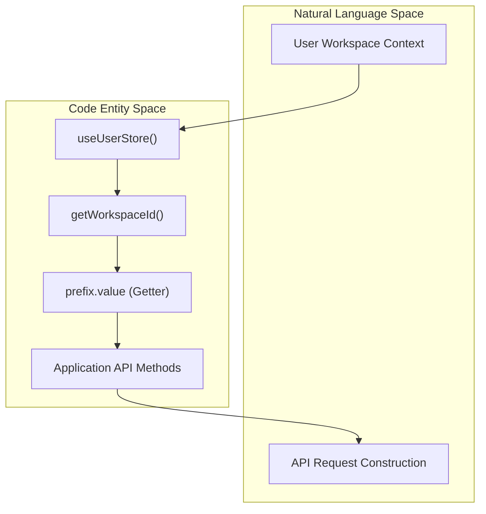
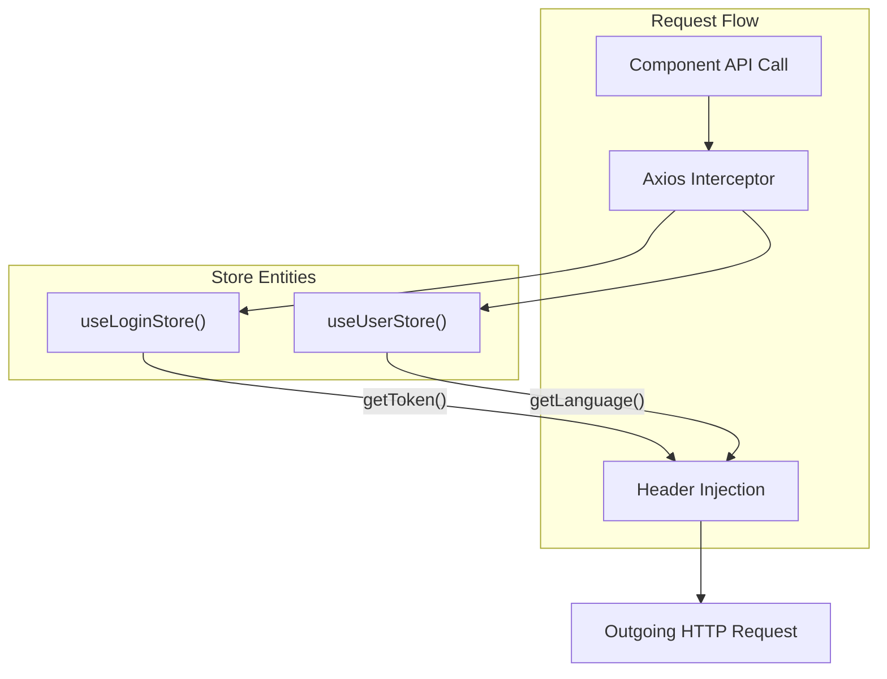

<!-- source: DeepWiki mcp.deepwiki.com · repo 1Panel-dev/MaxKB · page 10.2 Routing and API Context Switching · fetched 2026-10-29 -->

# Routing and API Context Switching

<details>
<summary>Relevant source files</summary>

The following files were used as context for generating this wiki page:

- [ui/src/components/app-icon/icons/menu.ts](ui/src/components/app-icon/icons/menu.ts)
- [ui/src/components/folder-tree/index.vue](ui/src/components/folder-tree/index.vue)
- [ui/src/components/layout-container/index.vue](ui/src/components/layout-container/index.vue)
- [ui/src/directives/hasPermission.ts](ui/src/directives/hasPermission.ts)
- [ui/src/directives/index.ts](ui/src/directives/index.ts)
- [ui/src/layout/layout-header/top-menu/index.vue](ui/src/layout/layout-header/top-menu/index.vue)
- [ui/src/locales/lang/en-US/views/index.ts](ui/src/locales/lang/en-US/views/index.ts)
- [ui/src/locales/lang/zh-CN/views/index.ts](ui/src/locales/lang/zh-CN/views/index.ts)
- [ui/src/locales/lang/zh-Hant/views/index.ts](ui/src/locales/lang/zh-Hant/views/index.ts)
- [ui/src/router/index.ts](ui/src/router/index.ts)
- [ui/src/router/modules/application.ts](ui/src/router/modules/application.ts)
- [ui/src/router/modules/knowledge.ts](ui/src/router/modules/knowledge.ts)
- [ui/src/router/modules/model.ts](ui/src/router/modules/model.ts)
- [ui/src/router/modules/system.ts](ui/src/router/modules/system.ts)
- [ui/src/router/modules/tool.ts](ui/src/router/modules/tool.ts)
- [ui/src/router/routes.ts](ui/src/router/routes.ts)
- [ui/src/utils/permission/index.ts](ui/src/utils/permission/index.ts)
- [ui/src/utils/permission/type.ts](ui/src/utils/permission/type.ts)
- [ui/src/views/application/component/AddKnowledgeDialog.vue](ui/src/views/application/component/AddKnowledgeDialog.vue)
- [ui/src/views/application/index.vue](ui/src/views/application/index.vue)
- [ui/src/views/knowledge/component/KnowledgeListContainer.vue](ui/src/views/knowledge/component/KnowledgeListContainer.vue)
- [ui/src/views/knowledge/index.vue](ui/src/views/knowledge/index.vue)
- [ui/src/views/model/component/ModelCard.vue](ui/src/views/model/component/ModelCard.vue)
- [ui/src/views/model/index.vue](ui/src/views/model/index.vue)
- [ui/src/views/tool/component/ToolListContainer.vue](ui/src/views/tool/component/ToolListContainer.vue)
- [ui/src/views/tool/index.vue](ui/src/views/tool/index.vue)

</details>


This document describes the Vue.js frontend routing system and the dynamic API context switching mechanism that allows the application to operate in different contexts (workspace-scoped, system management, system shared resources). It covers how API base URLs are dynamically constructed, how workspace context is managed, and how requests are routed to the appropriate backend endpoints.

## API Context Architecture

The MaxKB frontend operates with multiple API contexts that determine the base URL and scope of API requests. The primary distinction is between **admin APIs** (workspace-scoped operations) and **chat APIs** (public-facing chat interfaces).

### API Base URL Configuration

The application uses a dynamic base URL configuration that adapts based on the deployment environment and the current context:

```
Admin API Base: (window.MaxKB?.prefix || '/admin') + '/api'
Chat API Base:  (window.MaxKB?.prefix || '/chat') + '/api'
```

The `window.MaxKB` object is a global configuration object that can be set during deployment to customize URL prefixes.

**Sources:** [ui/src/request/index.ts:11-16]()

### Context Types and Scoping

The application dynamically determines the API context based on the current route path. This is primarily handled via computed properties in the main resource index views.

| Context Type | Route Path Match | API Base/Prefix | Use Case |
| :--- | :--- | :--- | :--- |
| **System Share** | `includes('shared')` | `systemShare` | Accessing resources shared across the entire system. |
| **System Manage** | `includes('resource-management')` | `systemManage` | Global resource administration by system admins. |
| **Workspace** | Default (else) | `workspace` | Standard multi-tenant resource management. |

**Context Determination Logic:**
The `apiType` is computed by checking the `route.path` to select the appropriate permission set and API endpoint prefix.

**Sources:** [ui/src/views/application/index.vue:355-360](), [ui/src/views/knowledge/index.vue:37-45](), [ui/src/views/tool/index.vue:55-63](), [ui/src/views/model/index.vue:135-143]()

## Dynamic API Prefix System

The application uses a dynamic prefix system for workspace-scoped APIs. This system automatically injects the current workspace ID into API URLs.

### Prefix Object Pattern

The prefix is implemented as an object with a getter that dynamically retrieves the workspace ID from the `userStore`.



**Sources:** [ui/src/api/application/application.ts:8-14](), [ui/src/api/chat/chat.ts:19-25]()

## Workspace Management

### Workspace ID Storage and Retrieval

The workspace ID is managed by the user store and persisted in `localStorage` for session continuity.

**Storage Mechanism:**
- **Primary Storage**: `localStorage.getItem('workspace_id')`
- **In-Memory Cache**: `this.workspace_id` in `useUserStore`
- **Default Value**: `'default'` if no workspace is set.

**Sources:** [ui/src/stores/modules/user.ts:37-44]()

### Workspace List and Switching

The user store maintains a list of workspaces available to the current user. If a user has `WORKSPACE_MANAGE` role, the system automatically selects an appropriate workspace by extracting IDs from permission strings (e.g., `WORKSPACE_MANAGE:123`).

**Sources:** [ui/src/stores/modules/user.ts:99-113](), [ui/src/stores/modules/user.ts:117-134]()

## Request Interceptor Integration

### Request Interceptor Flow

The axios request interceptor injects workspace context, authentication tokens, and language preferences.



**Sources:** [ui/src/request/index.ts:20-41]()

### Response Interceptor Error Handling

The response interceptor handles authentication and authorization errors by routing to appropriate pages. It specifically allows errors for certain endpoints like `chat/open` to allow the calling component to handle the UI state (e.g., showing a login prompt within the chat).

**Sources:** [ui/src/request/index.ts:43-90]()

## Folder and Resource Routing

Resources like Applications, Knowledge Bases, and Tools are organized into a folder hierarchy. The UI switches context based on the selected folder.

### Folder Context Switching

When a user clicks a node in the `FolderVirtualizedTree`, the `folderStore` updates the `currentFolder`. This triggers a refresh of the resource list (e.g., `application.setApplicationList([])`).

**Sources:** [ui/src/views/application/index.vue:10-13](), [ui/src/views/application/index.vue:395-402](), [ui/src/views/knowledge/index.vue:66-72]()

### Shared Resource Handling

The `FolderVirtualizedTree` component includes a specific "Shared" node for Enterprise Edition (EE) users. Clicking this node switches the context to `share`, changing the API request parameters to fetch shared resources.

**Sources:** [ui/src/components/folder-tree/index.vue:37-52](), [ui/src/components/folder-tree/index.vue:174-175]()

## Chat vs Admin API Separation

The application maintains two distinct API contexts with different base paths and purposes.

| Feature | Admin API | Chat API |
| :--- | :--- | :--- |
| **Base URL** | `/admin/api` | `/chat/api` |
| **Auth Store** | `useLoginStore` | `useChatUserStore` |
| **Token Storage** | `localStorage` | `sessionStorage` / `localStorage` |
| **Token Key** | `token` | `{accessToken}-accessToken` |

**Sources:** [ui/src/request/index.ts:12](), [ui/src/api/chat/chat.ts:43-44](), [ui/src/stores/modules/chat-user.ts:82-116]()

## Route Configuration

The application routing is modularized. The main router imports modules from the `router/modules` directory.

### Core Route Modules

- **System**: Handles user management, workspace management, and resource management (`/system/resource-management`). [ui/src/router/modules/system.ts:1-213]()
- **Application**: Main agent management interface. [ui/src/router/modules/application.ts:1-32]()
- **Workflow**: High-level orchestration routes for applications, knowledge bases, and tools. [ui/src/router/routes.ts:59-77]()
- **Chat**: Public-facing chat routes using `accessToken`. [ui/src/router/routes.ts:79-83]()

**Sources:** [ui/src/router/routes.ts:3-7](), [ui/src/router/index.ts:1-50]()

## Dynamic API Loading (Shared API)

The utility `loadSharedApi` is used to dynamically switch between standard workspace APIs and shared resource APIs based on the current context. This is frequently used in dialogs that need to list resources (like adding a Knowledge Base to an Application).

**Sources:** [ui/src/views/application/component/AddKnowledgeDialog.vue:155](), [ui/src/views/model/component/ModelCard.vue:170](), [ui/src/views/model/index.vue:128]()

---

