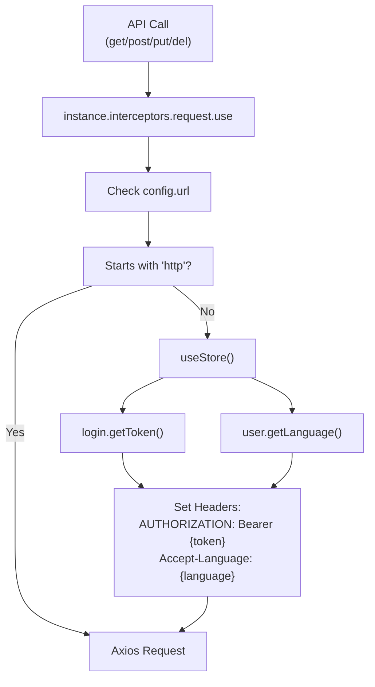
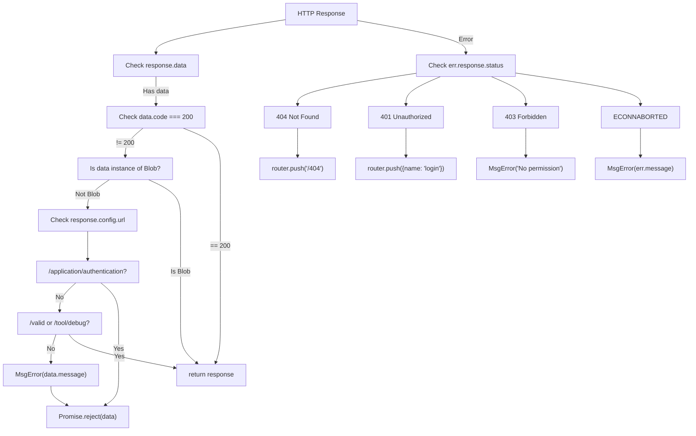

<!-- source: DeepWiki mcp.deepwiki.com · repo 1Panel-dev/MaxKB · page 10.3 Request Handling and Interceptors · fetched 2026-10-29 -->

# Request Handling and Interceptors

<details>
<summary>Relevant source files</summary>

The following files were used as context for generating this wiki page:

- [ui/admin.html](ui/admin.html)
- [ui/chat.html](ui/chat.html)
- [ui/env/.env](ui/env/.env)
- [ui/env/.env.chat](ui/env/.env.chat)
- [ui/src/api/chat/chat.ts](ui/src/api/chat/chat.ts)
- [ui/src/api/type/chat.ts](ui/src/api/type/chat.ts)
- [ui/src/api/type/login.ts](ui/src/api/type/login.ts)
- [ui/src/request/chat/index.ts](ui/src/request/chat/index.ts)
- [ui/src/request/index.ts](ui/src/request/index.ts)
- [ui/src/router/chat/index.ts](ui/src/router/chat/index.ts)
- [ui/src/router/chat/routes.ts](ui/src/router/chat/routes.ts)
- [ui/src/stores/modules/application.ts](ui/src/stores/modules/application.ts)
- [ui/src/stores/modules/chat-user.ts](ui/src/stores/modules/chat-user.ts)
- [ui/src/stores/modules/theme.ts](ui/src/stores/modules/theme.ts)
- [ui/src/stores/modules/user.ts](ui/src/stores/modules/user.ts)
- [ui/src/views/chat/index.vue](ui/src/views/chat/index.vue)
- [ui/src/views/chat/no-service/index.vue](ui/src/views/chat/no-service/index.vue)
- [ui/src/views/chat/user-login/index.vue](ui/src/views/chat/user-login/index.vue)
- [ui/src/views/login/index.vue](ui/src/views/login/index.vue)

</details>


This document describes the Axios-based HTTP client layer used throughout the MaxKB frontend application. It covers request/response interceptors, authentication token injection, error handling, loading state management, streaming support, and specialized functions for file operations.

## Overview

The request handling system is implemented in [ui/src/request/index.ts]() and provides a centralized Axios instance with interceptors for authentication, language preferences, error handling, and loading state management. The module exports wrapper functions that simplify API calls and provide consistent error handling across the application.

**Sources:** [ui/src/request/index.ts:1-125]()

## Axios Instance Configuration

The Axios instance is configured with a dynamic base URL, credentials settings, and timeout:

```typescript
const axiosConfig = {
  baseURL: (window.MaxKB?.prefix ? window.MaxKB?.prefix : '/admin') + '/api',
  withCredentials: false,
  timeout: 1800000, // 30 minutes
  headers: {},
}

const instance = axios.create(axiosConfig)
```

The `baseURL` construction allows the application to work with different deployment contexts based on the entry point (Admin vs Chat):
- **Admin Context**: `window.MaxKB.prefix` is set to `/admin` in [ui/admin.html:16-17]().
- **Chat Context**: `window.MaxKB.prefix` is set to `/chat` in [ui/chat.html:15-16]().
- The interceptor appends `/api` to form the complete API path [ui/src/request/index.ts:12]().

**Key Configuration Parameters:**

| Parameter | Value | Purpose |
|-----------|-------|---------|
| `baseURL` | `${prefix}/api` | Dynamic API endpoint based on deployment context |
| `withCredentials` | `false` | No cookies sent with cross-origin requests |
| `timeout` | `1800000` ms | 30-minute timeout for long-running operations |

**Sources:** [ui/src/request/index.ts:11-18](), [ui/admin.html:15-19](), [ui/chat.html:14-19]()

## Request Interceptor Flow

The request interceptor ensures every outgoing request is decorated with necessary authentication and localization metadata.



The request interceptor in [ui/src/request/index.ts:21-41]() performs the following operations:

1. **Header Initialization**: Creates `AxiosHeaders` if not present [ui/src/request/index.ts:23-25]().
2. **External URL Detection**: Bypasses interceptor for absolute URLs starting with 'http' [ui/src/request/index.ts:26-28]().
3. **Store Access**: Retrieves `user` and `login` stores via `useStore()` [ui/src/request/index.ts:29]().
4. **Token Injection**: Adds `AUTHORIZATION: Bearer ${token}` header if a token is retrieved from the store [ui/src/request/index.ts:33-35]().
5. **Language Injection**: Adds `Accept-Language` header from user preferences [ui/src/request/index.ts:31-32]().

**Sources:** [ui/src/request/index.ts:21-41](), [ui/src/stores/modules/user.ts:34-36]()

## Response Interceptor Flow

The response interceptor handles both successful data transformations and global error states like session expiration or resource unavailability.



### Success and Application-Level Errors
The success handler [ui/src/request/index.ts:45-61]() filters for application-level status codes (standardized as `code: 200` in the JSON response body). If the code is not 200, it triggers a `MsgError` unless the URL is specifically excluded (e.g., `/valid` or `/tool/debug`).

### HTTP Error Status Handling
The error handler [ui/src/request/index.ts:62-90]() manages standard HTTP status codes:

| Status Code | Logic | Action |
|-------------|-------|--------|
| **404** | If not `/application/authentication` | Redirect to `/404` [ui/src/request/index.ts:67-71]() |
| **401** | If not `chat/open` or `application/profile` | Redirect to `login` route [ui/src/request/index.ts:72-79]() |
| **403** | If not `chat/open` | Show "No permission" message [ui/src/request/index.ts:81-87]() |
| **Timeout** | `ECONNABORTED` | Show error message [ui/src/request/index.ts:63-66]() |

**Sources:** [ui/src/request/index.ts:44-90](), [ui/src/utils/message.ts:2]()

## Loading State Management

The `promise` wrapper function in [ui/src/request/index.ts:95-125]() centralizes the management of loading indicators (both global progress bars and component-level boolean flags).

```typescript
const promise: (
  request: Promise<any>,
  loading?: NProgress | Ref<boolean> | WritableComputedRef<boolean>,
) => Promise<Result<any>> = (request, loading = ref(false)) => {
  return new Promise((resolve, reject) => {
    // Start loading
    if ((loading as NProgress).start) {
      ;(loading as NProgress).start()
    } else {
      ;(loading as Ref).value = true
    }
    
    request
      .then((response) => {
        if (response.status === 200) {
          resolve(response?.data || response)
        } else {
          reject(response?.data || response)
        }
      })
      .catch((error) => {
        reject(error)
      })
      .finally(() => {
        // Stop loading
        if ((loading as NProgress).start) {
          ;(loading as NProgress).done()
        } else {
          ;(loading as Ref).value = false
        }
      })
  })
}
```

**Sources:** [ui/src/request/index.ts:95-125]()

## Streaming Request Support

For real-time AI responses, MaxKB uses the Fetch API instead of Axios to handle Server-Sent Events (SSE) or chunked transfer encoding. The `postStream` function [ui/src/request/index.ts:207-224]() manually constructs the request to ensure authentication tokens are included in the Fetch headers.

```typescript
export const postStream: (url: string, data?: unknown) => Promise<Result<any> | any> = (
  url,
  data,
) => {
  const { user, login } = useStore()
  const token = login.getToken()
  const language = user.getLanguage()
  const headers: HeadersInit = { 'Content-Type': 'application/json' }
  if (token) {
    headers['AUTHORIZATION'] = `Bearer ${token}`
  }
  headers['Accept-Language'] = `${language}`
  return fetch(url, {
    method: 'POST',
    body: data ? JSON.stringify(data) : undefined,
    headers: headers,
  })
}
```

This is utilized in chat APIs to facilitate message streaming [ui/src/api/chat/chat.ts:42-45]().

**Sources:** [ui/src/request/index.ts:207-224](), [ui/src/api/chat/chat.ts:42-45]()

## File Export and Download

MaxKB provides specialized handlers for exporting data to Excel or generic files. These functions manage the transformation of response data into a downloadable `Blob`.

### Excel Export
The `exportExcel` function [ui/src/request/index.ts:226-253]() sets the `responseType` to `blob` and creates a temporary `<a>` element to trigger the browser download.

### Filename Extraction
The utility `extractFilename` [ui/src/request/index.ts:255-283]() parses the `Content-Disposition` header, supporting:
- Standard URL encoding [ui/src/request/index.ts:259-268]()
- Base64 encoded UTF-8 strings [ui/src/request/index.ts:271-280]()

**Sources:** [ui/src/request/index.ts:226-283]()

## Integration with Stores

The request handling module relies on Pinia stores to retrieve session information and user preferences.

| Code Entity | File | Role |
|-------------|------|------|
| `useUserStore` | [ui/src/stores/modules/user.ts:23]() | Provides `getLanguage()` and `getWorkspaceId()` |
| `useChatUserStore` | [ui/src/stores/modules/chat-user.ts:21]() | Manages tokens and profiles for the chat interface |
| `LoginApi` | [ui/src/api/user/login.ts]() | Handles login requests that eventually populate these stores |

In the chat interface, the `useChatUserStore` manages a specific `accessToken` logic where tokens are keyed by the application access token to support multiple concurrent chat sessions [ui/src/stores/modules/chat-user.ts:65-75]().

**Sources:** [ui/src/stores/modules/user.ts:23-44](), [ui/src/stores/modules/chat-user.ts:21-76]()

---

