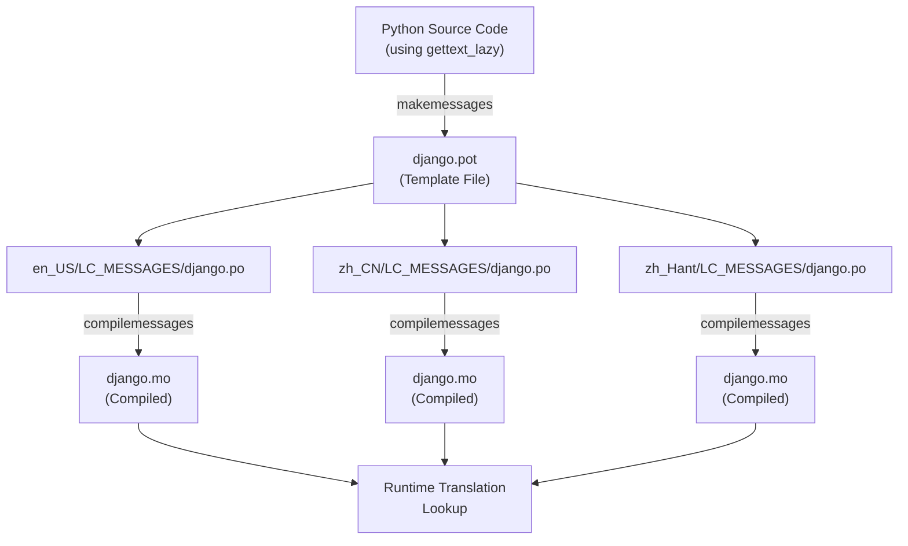
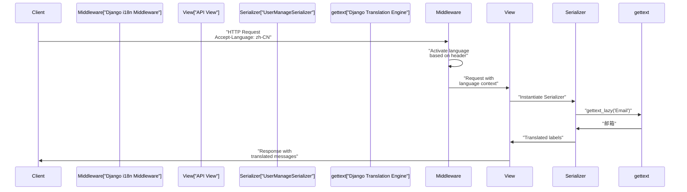
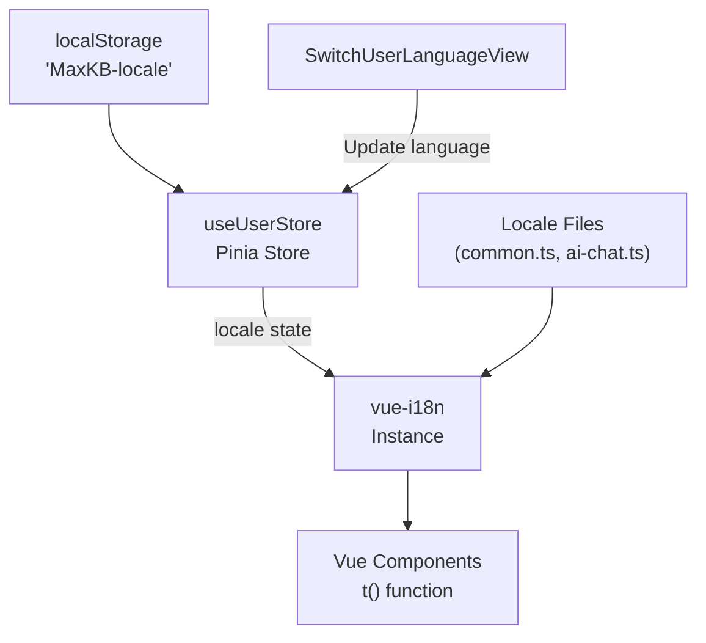
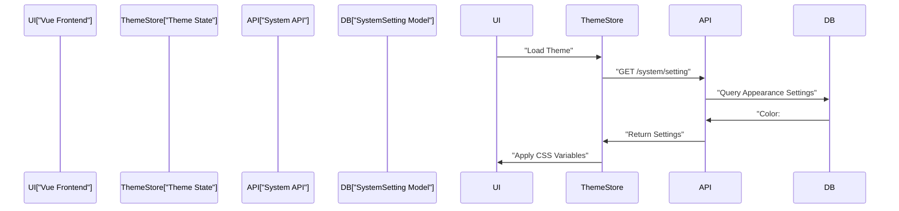

<!-- source: DeepWiki mcp.deepwiki.com · repo 1Panel-dev/MaxKB · page 10.4 Internationalization and Theming · fetched 2026-10-29 -->

# Internationalization and Theming

<details>
<summary>Relevant source files</summary>

The following files were used as context for generating this wiki page:

- [apps/common/auth/authenticate.py](apps/common/auth/authenticate.py)
- [apps/common/auth/handle/impl/user_token.py](apps/common/auth/handle/impl/user_token.py)
- [apps/common/constants/cache_version.py](apps/common/constants/cache_version.py)
- [apps/common/constants/permission_constants.py](apps/common/constants/permission_constants.py)
- [apps/common/exception/app_exception.py](apps/common/exception/app_exception.py)
- [apps/common/log/log.py](apps/common/log/log.py)
- [apps/common/utils/common.py](apps/common/utils/common.py)
- [apps/locales/en_US/LC_MESSAGES/django.po](apps/locales/en_US/LC_MESSAGES/django.po)
- [apps/locales/zh_CN/LC_MESSAGES/django.po](apps/locales/zh_CN/LC_MESSAGES/django.po)
- [apps/locales/zh_Hant/LC_MESSAGES/django.po](apps/locales/zh_Hant/LC_MESSAGES/django.po)
- [apps/users/api/user.py](apps/users/api/user.py)
- [apps/users/serializers/login.py](apps/users/serializers/login.py)
- [apps/users/serializers/user.py](apps/users/serializers/user.py)
- [apps/users/urls.py](apps/users/urls.py)
- [apps/users/views/login.py](apps/users/views/login.py)
- [apps/users/views/user.py](apps/users/views/user.py)
- [ui/src/App.vue](ui/src/App.vue)
- [ui/src/chat.ts](ui/src/chat.ts)
- [ui/src/components/markdown/MdEditor.vue](ui/src/components/markdown/MdEditor.vue)
- [ui/src/components/markdown/MdPreview.vue](ui/src/components/markdown/MdPreview.vue)
- [ui/src/locales/index.ts](ui/src/locales/index.ts)
- [ui/src/locales/lang/en-US/ai-chat.ts](ui/src/locales/lang/en-US/ai-chat.ts)
- [ui/src/locales/lang/en-US/common.ts](ui/src/locales/lang/en-US/common.ts)
- [ui/src/locales/lang/zh-CN/ai-chat.ts](ui/src/locales/lang/zh-CN/ai-chat.ts)
- [ui/src/locales/lang/zh-CN/common.ts](ui/src/locales/lang/zh-CN/common.ts)
- [ui/src/locales/lang/zh-Hant/ai-chat.ts](ui/src/locales/lang/zh-Hant/ai-chat.ts)
- [ui/src/locales/lang/zh-Hant/common.ts](ui/src/locales/lang/zh-Hant/common.ts)
- [ui/src/locales/useLocale.ts](ui/src/locales/useLocale.ts)
- [ui/src/main.ts](ui/src/main.ts)
- [ui/src/styles/index.scss](ui/src/styles/index.scss)
- [ui/src/utils/message.ts](ui/src/utils/message.ts)
- [ui/src/utils/supPopover.ts](ui/src/utils/supPopover.ts)
- [ui/src/views/knowledge-workflow/component/action/KnowledgeBase.vue](ui/src/views/knowledge-workflow/component/action/KnowledgeBase.vue)
- [ui/src/workflow/nodes/base-node/component/UserInputFieldTable.vue](ui/src/workflow/nodes/base-node/component/UserInputFieldTable.vue)
- [ui/src/workflow/nodes/base-node/component/UserInputTitleDialog.vue](ui/src/workflow/nodes/base-node/component/UserInputTitleDialog.vue)
- [ui/src/workflow/nodes/knowledge-base-node/component/UserInputFieldTable.vue](ui/src/workflow/nodes/knowledge-base-node/component/UserInputFieldTable.vue)

</details>


This document describes MaxKB's internationalization (i18n) and theming systems. It covers the backend Django translation framework, frontend Vue i18n implementation, language preference management, and the dynamic theming system that allows customization of the application's visual appearance.

---

## Backend Internationalization System

MaxKB uses Django's built-in internationalization framework based on GNU gettext. The backend provides translations for API error messages, permission labels, and other server-generated content.

### Translation File Structure

The system maintains three language variants with standard `.po` files:

| Language | Locale Code | File Path |
|----------|-------------|-----------|
| English | en_US | `apps/locales/en_US/LC_MESSAGES/django.po` |
| Simplified Chinese | zh_CN | `apps/locales/zh_CN/LC_MESSAGES/django.po` |
| Traditional Chinese | zh_Hant | `apps/locales/zh_Hant/LC_MESSAGES/django.po` |

Each `.po` file contains message pairs with `msgid` (source string) and `msgstr` (translated string).

**Translation File Structure**

Sources: [apps/locales/zh_CN/LC_MESSAGES/django.po:1-17](), [apps/locales/zh_Hant/LC_MESSAGES/django.po:1-17](), [apps/locales/en_US/LC_MESSAGES/django.po:1-18]()

### Translation Usage in Code

The backend uses `gettext_lazy` (aliased as `_`) to mark translatable strings. This lazy evaluation ensures translations are resolved at render time based on the request's language context.

```python
from django.utils.translation import gettext_lazy as _

# Example usage patterns:
permission_label = _("User Management")
form_field = serializers.CharField(label=_("Username"))
```

Key translation locations:
- **Permission labels**: [apps/common/constants/permission_constants.py:13-13]()
- **API field descriptions**: [apps/users/serializers/user.py:38-38]()
- **Form validation messages**: [apps/users/serializers/user.py:165-168]()

**Backend Translation Flow**

Sources: [apps/users/serializers/user.py:38-38](), [apps/users/serializers/user.py:162-170]()

---

## Frontend Internationalization System

The frontend uses `vue-i18n` for client-side translations, managing UI labels, messages, and dynamic content.

### Language Configuration

The i18n system is configured with multiple locale files located in `ui/src/locales/lang/`.

- **Simplified Chinese**: `ui/src/locales/lang/zh-CN/common.ts` [ui/src/locales/lang/zh-CN/common.ts:1-161]()
- **English**: `ui/src/locales/lang/en-US/common.ts` [ui/src/locales/lang/en-US/common.ts:1-160]()
- **Traditional Chinese**: `ui/src/locales/lang/zh-Hant/common.ts` [ui/src/locales/lang/zh-Hant/common.ts:1-159]()

### Language Selection and Persistence

Language preferences are stored and retrieved through Pinia stores:

1. **User Store** (`useUserStore`):
   - Manages current language state for the main application.
   - Persistence is handled via `localStorage` under the key `MaxKB-locale`.

2. **Chat User Store** (`useChatUserStore`):
   - Separate language storage for external chat users.

**Frontend Language Architecture**

Sources: [ui/src/locales/lang/en-US/common.ts:1-5](), [apps/users/views/user.py:92-108]()

---

## User Language Preference Management

### Backend Language Storage

User language preferences are persisted in the `User` model. The `SwitchLanguageSerializer` handles the logic for updating a user's language setting.

[apps/users/views/user.py:92-108]()

### API Endpoints

| Method | Endpoint | Purpose | View Class |
|--------|----------|---------|------------|
| POST | `/api/user/switch_language` | Update user language preference | `SwitchUserLanguageView` |
| GET | `/api/user/profile` | Retrieve user profile (includes language) | `UserProfileView` |

The `SwitchUserLanguageView` is protected by permissions and logs the operation:
[apps/users/views/user.py:102-108]()

---

## Theme System

MaxKB supports dynamic theming, allowing the application to adapt its visual style (colors, logos, slogans) based on system settings or edition (Community vs. Enterprise).

### Theme Store and State

The theme system is managed on the frontend via state management that interacts with the backend `SystemSetting` model.

**Theme Application Flow**

Sources: [apps/common/constants/permission_constants.py:92-92](), [apps/users/views/user.py:64-75]()

### Dynamic Theming via CSS Variables

The application utilizes CSS variables to apply theme colors across components. Key elements like the primary color are injected into the DOM at runtime.

### Theming and Branding

The system allows customization of:
- **Primary Color**: Used for buttons, active states, and links.
- **Slogan**: Displayed on login and landing pages.
- **Logo/Icon**: Custom branding for the interface.

---

## Implementation Details

### Request Header Injection

To ensure the backend returns error messages and labels in the correct language, the frontend injects the `Accept-Language` header into every request based on the current locale.

### Utility Functions

The codebase includes utility functions for processing content that might be displayed in the UI, such as `markdown_to_plain_text` to ensure clean rendering in various UI components regardless of language.

[apps/common/utils/common.py:152-183]()

### Operation Logging with i18n

When users perform actions (like switching language), the system logs these events. The logs themselves are internationalized using the `@log` decorator which resolves menu and operation names.

[apps/users/views/user.py:102-103]()

Sources: [apps/common/utils/common.py:25-25](), [apps/users/views/user.py:102-103]()

---

