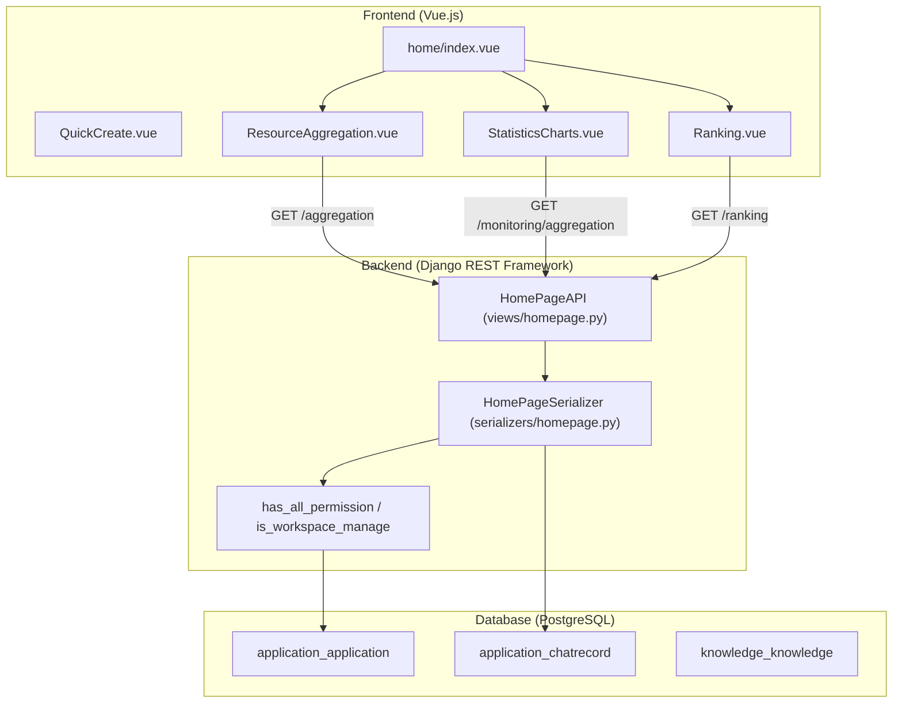
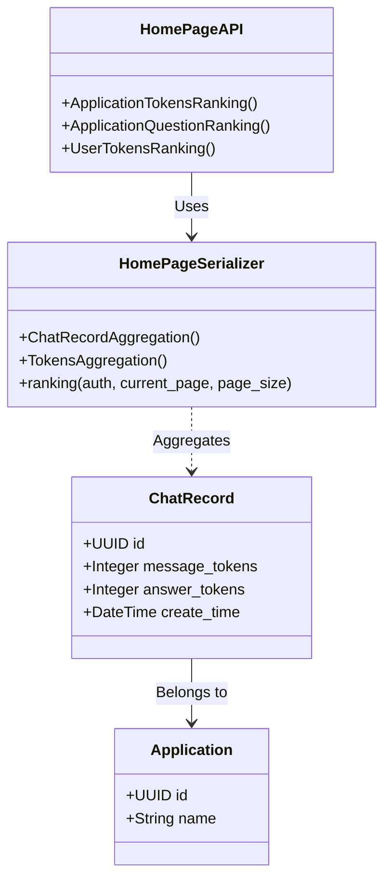

<!-- source: DeepWiki mcp.deepwiki.com · repo 1Panel-dev/MaxKB · page 10.5 Dashboard and Home View · fetched 2026-10-29 -->

# Dashboard and Home View

Relevant source files

The following files were used as context for generating this wiki page:

- [apps/homepage/__init__.py](apps/homepage/__init__.py)
- [apps/homepage/admin.py](apps/homepage/admin.py)
- [apps/homepage/api/home_page_api.py](apps/homepage/api/home_page_api.py)
- [apps/homepage/apps.py](apps/homepage/apps.py)
- [apps/homepage/migrations/__init__.py](apps/homepage/migrations/__init__.py)
- [apps/homepage/serializers/__init__.py](apps/homepage/serializers/__init__.py)
- [apps/homepage/serializers/homepage.py](apps/homepage/serializers/homepage.py)
- [apps/homepage/sql/has_permission.sql](apps/homepage/sql/has_permission.sql)
- [apps/homepage/tests.py](apps/homepage/tests.py)
- [apps/homepage/urls.py](apps/homepage/urls.py)
- [apps/homepage/views/__init__.py](apps/homepage/views/__init__.py)
- [apps/homepage/views/homepage.py](apps/homepage/views/homepage.py)
- [apps/local_model/urls.py](apps/local_model/urls.py)
- [ui/src/api/home-page/home.ts](ui/src/api/home-page/home.ts)
- [ui/src/assets/home/icon_create-agent.svg](ui/src/assets/home/icon_create-agent.svg)
- [ui/src/assets/home/icon_create-knowledge.svg](ui/src/assets/home/icon_create-knowledge.svg)
- [ui/src/assets/home/icon_create-model.svg](ui/src/assets/home/icon_create-model.svg)
- [ui/src/assets/home/icon_create-tool.svg](ui/src/assets/home/icon_create-tool.svg)
- [ui/src/components/app-charts/components/BarCharts.vue](ui/src/components/app-charts/components/BarCharts.vue)
- [ui/src/components/app-charts/components/LineCharts.vue](ui/src/components/app-charts/components/LineCharts.vue)
- [ui/src/components/app-charts/index.vue](ui/src/components/app-charts/index.vue)
- [ui/src/layout/app-main/index.vue](ui/src/layout/app-main/index.vue)
- [ui/src/locales/lang/en-US/layout.ts](ui/src/locales/lang/en-US/layout.ts)
- [ui/src/locales/lang/zh-CN/layout.ts](ui/src/locales/lang/zh-CN/layout.ts)
- [ui/src/locales/lang/zh-Hant/layout.ts](ui/src/locales/lang/zh-Hant/layout.ts)
- [ui/src/utils/time.ts](ui/src/utils/time.ts)
- [ui/src/views/application-overview/component/StatisticsCharts.vue](ui/src/views/application-overview/component/StatisticsCharts.vue)
- [ui/src/views/home/component/QuickCreate.vue](ui/src/views/home/component/QuickCreate.vue)
- [ui/src/views/home/component/Ranking.vue](ui/src/views/home/component/Ranking.vue)
- [ui/src/views/home/component/RankingDrawer.vue](ui/src/views/home/component/RankingDrawer.vue)
- [ui/src/views/home/component/ResourceAggregation.vue](ui/src/views/home/component/ResourceAggregation.vue)
- [ui/src/views/home/component/StatisticsCharts.vue](ui/src/views/home/component/StatisticsCharts.vue)
- [ui/src/views/home/index.vue](ui/src/views/home/index.vue)

The Dashboard and Home View serves as the primary landing page for authenticated users in MaxKB. It provides a high-level overview of system resources, operational monitoring statistics, and resource consumption rankings. The system is designed to provide quick access to resource creation and detailed analytical insights through data aggregation.

## System Overview and Data Flow

The dashboard aggregates data from across the workspace, including applications, knowledge bases, tools, and model usage. Data flow originates from the Django backend via specific aggregation serializers and is consumed by Vue.js components using ECharts for visualization.

### Dashboard Data Flow

The following diagram illustrates how the frontend components interact with the backend API to populate the dashboard.

**Dashboard Data Retrieval Flow**

**Sources:** [apps/homepage/views/homepage.py:23-24](), [ui/src/views/home/index.vue:1-50](), [apps/homepage/serializers/homepage.py:87-94]()

## Core Components

### 1. Quick Create Shortcuts
The `QuickCreate.vue` component provides immediate action items for users to build new assets. These shortcuts link directly to the creation workflows for:
- **Applications**: AI agents and workflows.
- **Knowledge Bases**: Document and dataset management.
- **Models**: LLM and embedding provider configuration.
- **Tools**: Custom API and code execution tools.

**Sources:** [ui/src/assets/home/icon_create-agent.svg:1-5](), [ui/src/assets/home/icon_create-knowledge.svg:1-5]()

### 2. Resource Aggregation Statistics
The `ResourceAggregation.vue` component displays the total count of resources within the current workspace context. The backend fetches these counts by filtering based on the user's workspace permissions.

| Resource Type | Backend Model | Aggregation Logic |
| :--- | :--- | :--- |
| Applications | `Application` | Counts applications where user has `VIEW` or `MANAGE` permissions [apps/homepage/serializers/homepage.py:35-36](). |
| Knowledge Bases | `Knowledge` | Counts datasets associated with the workspace. |
| Tools | `Tool` | Counts integrated tools (Custom or MCP). |
| Models | `Model` | Counts configured model providers. |

**Sources:** [apps/homepage/urls.py:10-17](), [apps/homepage/serializers/homepage.py:24-33]()

### 3. Monitoring Statistics and Charts
The `StatisticsCharts.vue` component visualizes system usage over time. It supports filtering by time range (7, 30, 90, 183 days or custom) [ui/src/views/home/component/StatisticsCharts.vue:152-173]().

Key metrics include:
- **Active Users**: Daily count of unique chat users [ui/src/views/home/component/StatisticsCharts.vue:204-219]().
- **Chat Count**: Total number of chat records generated [ui/src/views/home/component/StatisticsCharts.vue:158-173]().
- **Token Consumption**: Aggregated tokens used by LLM calls [ui/src/views/home/component/StatisticsCharts.vue:175-191]().
- **User Satisfaction**: Aggregation of "Star" (approval) and "Trample" (disapproval) feedback [ui/src/views/home/component/StatisticsCharts.vue:193-218]().

**Sources:** [ui/src/views/home/component/StatisticsCharts.vue:1-138](), [apps/homepage/views/homepage.py:14-18]()

## Ranking and Usage Features

The dashboard includes a ranking system to identify the most utilized resources and the highest-consuming users.

### Ranking Logic Implementation
Rankings are calculated in `HomePageSerializer` using Django's aggregation functions. For example, `ApplicationTokensRanking` calculates total tokens by summing `message_tokens` and `answer_tokens` from `ChatRecord` [apps/homepage/serializers/homepage.py:37-38]().

**Entity Association Diagram**

**Sources:** [apps/homepage/serializers/homepage.py:87-148](), [apps/homepage/views/homepage.py:92-112]()

### Ranking Types
1. **Application Token Usage**: Top 5 applications by token consumption [ui/src/views/home/component/Ranking.vue:33-45]().
2. **Application Chat Count**: Top 5 applications by volume of messages [ui/src/views/home/component/Ranking.vue:86-101]().
3. **User Token Usage**: Top 5 users consuming tokens across all applications [ui/src/views/home/component/Ranking.vue:143-160]().

### Detail and Export
The `RankingDrawer.vue` component provides an expanded view of these rankings with pagination support via `app-table` [ui/src/views/home/component/RankingDrawer.vue:52-61](). It also allows exporting ranking data to Excel files using the `RankingBaseExportAPI` [apps/homepage/views/homepage.py:114-134]().

**Sources:** [ui/src/views/home/component/RankingDrawer.vue:1-123](), [apps/homepage/api/home_page_api.py:108-142]()

## Permission and Security
The dashboard enforces strict workspace isolation.
- **Permission Checking**: The functions `has_all_permission` and `is_workspace_manage` verify if the requesting user has the rights to view specific application data within a workspace [apps/homepage/serializers/homepage.py:56-68]().
- **Query Filtering**: All aggregation queries are filtered by `workspace_id` and the user's `permission_list` [apps/homepage/serializers/homepage.py:102-143]().

**Sources:** [apps/homepage/serializers/homepage.py:40-69]()

---

