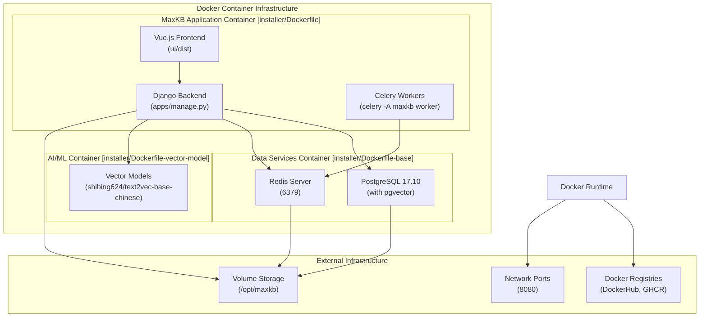
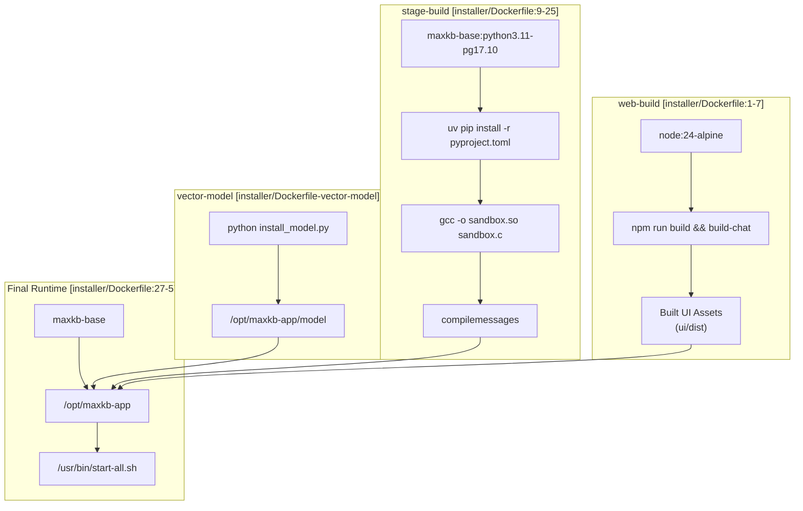

<!-- source: DeepWiki mcp.deepwiki.com · repo 1Panel-dev/MaxKB · page 11 Deployment and Infrastructure · fetched 2026-10-29 -->

# Deployment and Infrastructure

Relevant source files

The following files were used as context for generating this wiki page:

- [.dockerignore](.dockerignore)
- [.github/workflows/build-and-push-python-pg.yml](.github/workflows/build-and-push-python-pg.yml)
- [.github/workflows/build-and-push-vector-model.yml](.github/workflows/build-and-push-vector-model.yml)
- [.github/workflows/build-and-push.yml](.github/workflows/build-and-push.yml)
- [apps/application/flow/backend/__init__.py](apps/application/flow/backend/__init__.py)
- [apps/application/flow/backend/sandbox_shell.py](apps/application/flow/backend/sandbox_shell.py)
- [apps/application/migrations/0011_application_skill_tool_ids.py](apps/application/migrations/0011_application_skill_tool_ids.py)
- [apps/common/config/tokenizer_manage_config.py](apps/common/config/tokenizer_manage_config.py)
- [apps/common/utils/logger.py](apps/common/utils/logger.py)
- [apps/common/utils/tool_code.py](apps/common/utils/tool_code.py)
- [apps/maxkb/settings/logging.py](apps/maxkb/settings/logging.py)
- [installer/Dockerfile](installer/Dockerfile)
- [installer/Dockerfile-base](installer/Dockerfile-base)
- [installer/Dockerfile-vector-model](installer/Dockerfile-vector-model)
- [installer/init.sql](installer/init.sql)
- [installer/install_model.py](installer/install_model.py)
- [installer/install_model_bert_base_cased.py](installer/install_model_bert_base_cased.py)
- [installer/sandbox.c](installer/sandbox.c)
- [installer/start-all.sh](installer/start-all.sh)
- [installer/start-maxkb.sh](installer/start-maxkb.sh)
- [installer/start-postgres.sh](installer/start-postgres.sh)
- [installer/start-redis.sh](installer/start-redis.sh)
- [pyproject.toml](pyproject.toml)

This document covers the deployment architecture, infrastructure setup, and container orchestration for MaxKB. It details the Docker-based deployment system, multi-stage build processes, system configuration management, and CI/CD pipelines.

For information about specific system configurations and dependencies, see [System Configuration and Dependencies](#11.2). For Docker build processes and container orchestration details, see [Docker Build and Deployment](#11.1).

## Deployment Architecture Overview

MaxKB uses a containerized deployment architecture built on Docker with multi-stage builds to optimize image size and deployment efficiency. The system consists of multiple interconnected services including PostgreSQL with `pgvector`, Redis, Celery workers, and the main Django application.

**Sources:** [installer/Dockerfile:1-57](), [installer/Dockerfile-base:1-54](), [installer/start-all.sh:12-32]()

## Multi-Stage Docker Build Process

The MaxKB deployment uses a multi-stage Docker build process to separate frontend compilation, backend dependency management, and model inclusion.

**Sources:** [installer/Dockerfile:1-57](), [installer/Dockerfile-vector-model:13-35](), [installer/Dockerfile-base:4-9]()

### Frontend Build Stage
The frontend uses Node 24 to compile both the main dashboard and the embedded chat interface. It optimizes memory usage during build with `NODE_OPTIONS="--max-old-space-size=4096"`.
**Sources:** [installer/Dockerfile:1-7]()

### Backend and Sandbox Stage
The backend stage utilizes `uv` for high-speed Python dependency installation from `pyproject.toml`. It also compiles the `sandbox.so` security layer and prepares a dedicated Python package environment for sandboxed tool execution.
**Sources:** [installer/Dockerfile:9-25](), [installer/sandbox.c:1-32]()

## Infrastructure Component Dependencies

MaxKB's infrastructure consists of core services defined in the base image and orchestrated via shell scripts.

| Component | Version | Purpose | Configuration Source |
|-----------|---------|---------|---------------------|
| PostgreSQL | 17.10 | Primary database with vector extensions | [installer/Dockerfile-base:6]() |
| Redis | Latest (Testing) | Caching and Celery message broker | [installer/Dockerfile-base:23-24]() |
| Python | 3.11 | Backend runtime environment | [installer/Dockerfile-base:1]() |
| pgvector | 17 | Vector similarity search | [installer/Dockerfile-base:18]() |
| ffmpeg | - | Audio/Video processing | [installer/Dockerfile-base:27]() |

**Sources:** [installer/Dockerfile-base:1-35](), [pyproject.toml:9-67]()

### Service Orchestration
The `start-all.sh` script acts as a lightweight orchestrator, ensuring PostgreSQL and Redis are healthy before launching the MaxKB application.
**Sources:** [installer/start-all.sh:12-32]()

## Environment Configuration Management

MaxKB uses environment variables to manage everything from database credentials to model paths.

| Variable | Default Value | Purpose |
|----------|---------------|---------|
| `MAXKB_DB_NAME` | maxkb | PostgreSQL database name |
| `MAXKB_REDIS_HOST` | 127.0.0.1 | Redis server host |
| `MAXKB_EMBEDDING_MODEL_NAME` | .../shibing624_text2vec-base-chinese | Default vector model |
| `MAXKB_SANDBOX` | 1 | Enable/Disable code sandbox |
| `MAXKB_SANDBOX_HOME` | /opt/maxkb-app/sandbox | Root directory for sandbox files |

**Sources:** [installer/Dockerfile:32-48](), [installer/Dockerfile-base:38-52]()

### Security Sandbox Configuration
The sandbox is configured via `.sandbox.conf`, which is dynamically generated by `ToolExecutor.init_sandbox_dir()`. It enforces network blacklists, restricted syscalls, and file path permissions.
**Sources:** [apps/common/utils/tool_code.py:69-94](), [installer/sandbox.c:27-38]()

## CI/CD Pipelines

MaxKB utilizes GitHub Actions for automated image building across multiple architectures (`amd64`, `arm64`).

*   **Main Build:** `build-and-push.yml` handles the multi-stage build and pushes to DockerHub and FIT2CLOUD registry.
*   **Base Image:** `build-and-push-python-pg.yml` builds the foundational image containing Python 3.11 and PostgreSQL 17.
*   **Vector Models:** `build-and-push-vector-model.yml` packages the embedding models and tokenizers.

**Sources:** [.github/workflows/build-and-push.yml:1-35](), [.github/workflows/build-and-push-python-pg.yml:1-14]()

## Volume and Data Persistence

The system is designed to be stateful with a single primary volume mount point.

| Mount Point | Purpose |
|-------------|---------|
| `/opt/maxkb` | Primary data volume containing PostgreSQL data, Redis AOF, and logs. |
| `/opt/maxkb/logs` | Centralized log storage for Redis, Postgres, and MaxKB. |
| `/opt/maxkb/conf` | Persistent configuration files (e.g., `redis.conf`). |

**Sources:** [installer/Dockerfile:55](), [installer/start-redis.sh:3-15](), [installer/start-maxkb.sh:3-11]()

---

