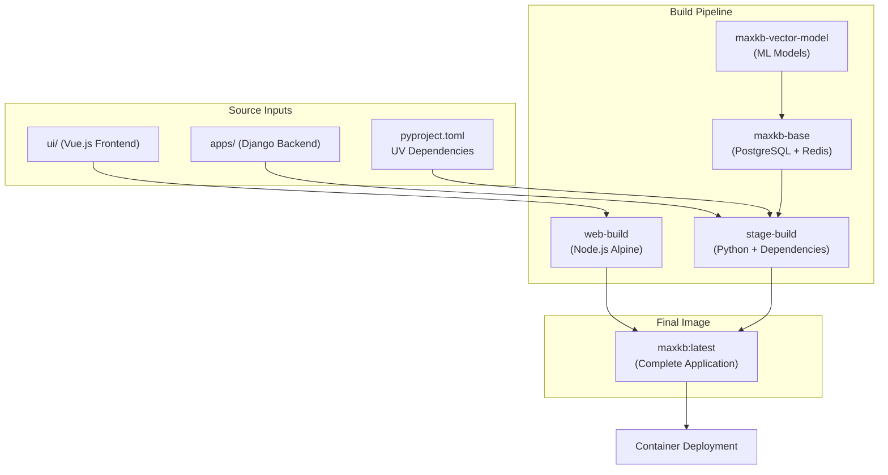
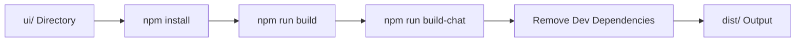
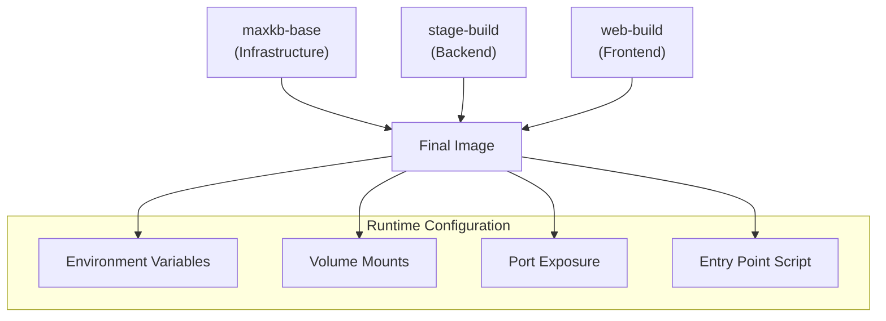
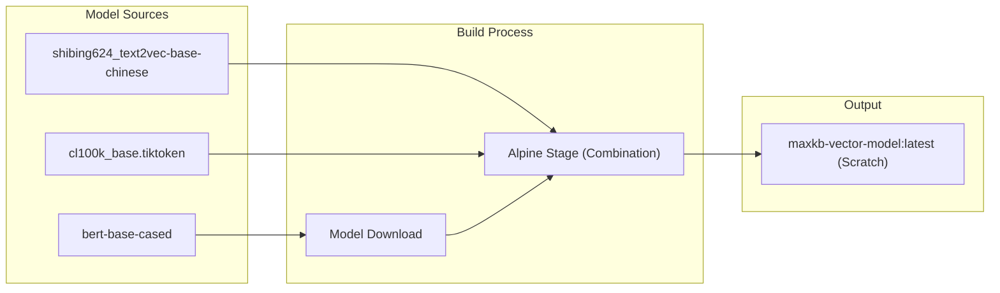
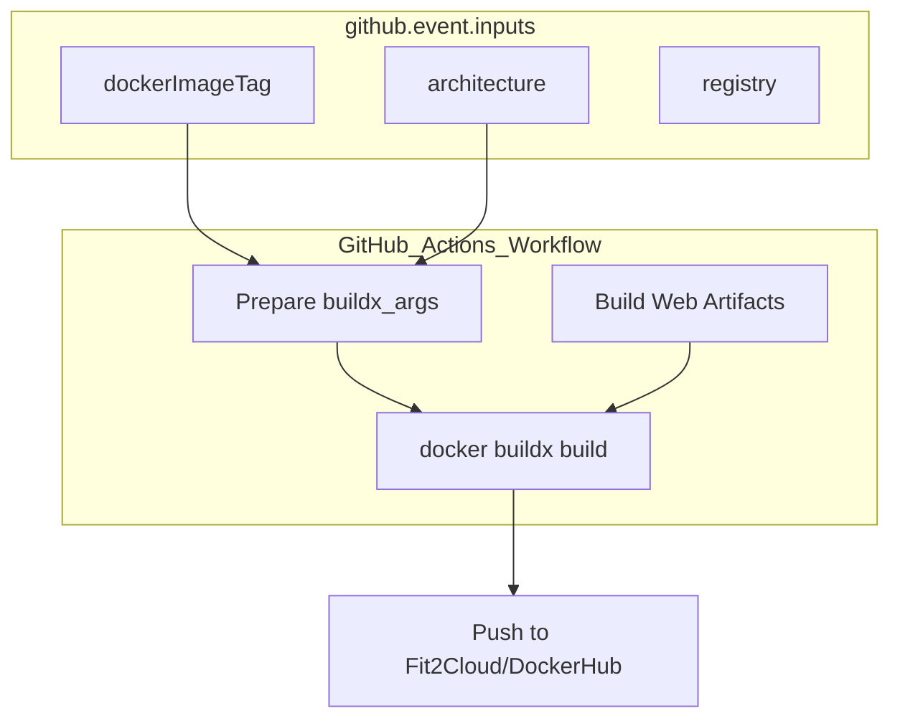

<!-- source: DeepWiki mcp.deepwiki.com · repo 1Panel-dev/MaxKB · page 11.1 Docker Build and Deployment · fetched 2026-10-29 -->

# Docker Build and Deployment

Relevant source files

The following files were used as context for generating this wiki page:

- [.dockerignore](.dockerignore)
- [.github/dependabot.yml](.github/dependabot.yml)
- [.github/workflows/build-and-push-python-pg.yml](.github/workflows/build-and-push-python-pg.yml)
- [.github/workflows/build-and-push-vector-model.yml](.github/workflows/build-and-push-vector-model.yml)
- [.github/workflows/build-and-push.yml](.github/workflows/build-and-push.yml)
- [.gitignore](.gitignore)
- [.idea/icon.png](.idea/icon.png)
- [LICENSE](LICENSE)
- [apps/application/flow/backend/__init__.py](apps/application/flow/backend/__init__.py)
- [apps/application/flow/backend/sandbox_shell.py](apps/application/flow/backend/sandbox_shell.py)
- [apps/application/migrations/0011_application_skill_tool_ids.py](apps/application/migrations/0011_application_skill_tool_ids.py)
- [apps/common/utils/tool_code.py](apps/common/utils/tool_code.py)
- [apps/maxkb/const.py](apps/maxkb/const.py)
- [installer/Dockerfile](installer/Dockerfile)
- [installer/Dockerfile-base](installer/Dockerfile-base)
- [installer/Dockerfile-vector-model](installer/Dockerfile-vector-model)
- [installer/install_model.py](installer/install_model.py)
- [installer/install_model_bert_base_cased.py](installer/install_model_bert_base_cased.py)
- [installer/sandbox.c](installer/sandbox.c)
- [pyproject.toml](pyproject.toml)

This document covers MaxKB's Docker-based containerization strategy, including multi-stage builds, CI/CD pipelines, and deployment orchestration. The system uses a sophisticated multi-container architecture with separate build stages for frontend, backend, and base infrastructure components.

## Docker Build Architecture Overview

MaxKB employs a multi-stage Docker build strategy that separates concerns across different build phases. The architecture consists of three primary Docker images: a base infrastructure image, a vector model image, and the main application image.

**Sources:** [installer/Dockerfile:1-57](), [installer/Dockerfile-base:1-52](), [installer/Dockerfile-vector-model:1-35]()

## Multi-Stage Build Process

The main Dockerfile implements a three-stage build process that optimizes image size and build efficiency.

### Stage 1: Frontend Build (`web-build`)

The frontend build stage uses Node.js Alpine to compile the Vue.js application:

The build process includes memory optimization (`--max-old-space-size=4096`) and produces both the main application and chat interface builds concurrently. Build artifacts are cleaned to minimize the final layer size [installer/Dockerfile:1-7]().

### Stage 2: Backend Build (`stage-build`)

The backend stage installs Python dependencies and prepares the Django application. Notably, it has transitioned from Poetry to `uv` for faster dependency resolution [installer/Dockerfile:18-19]().

| Component | Purpose | Configuration |
|-----------|---------|---------------|
| Python | Runtime | 3.11 [installer/Dockerfile:9]() |
| `uv` | Dependency manager | Used for `pyproject.toml` [installer/Dockerfile:19]() |
| `sandbox.so` | Security layer | Compiled from `sandbox.c` [installer/Dockerfile:16]() |
| `compilemessages` | i18n | Django translation compilation [installer/Dockerfile:21]() |

**Sources:** [installer/Dockerfile:9-25](), [pyproject.toml:1-67]()

### Stage 3: Final Assembly

The final stage combines all components into a minimal production image, using the base image `ghcr.io/1panel-dev/maxkb-base:python3.11-pg17.10-20260525` [installer/Dockerfile:27]().

**Sources:** [installer/Dockerfile:27-57]()

## Base Infrastructure Image

The base image (`Dockerfile-base`) provides the foundational infrastructure including PostgreSQL 17.10 with pgvector extension and Redis server.

### Infrastructure Components

| Service | Version | Purpose | Configuration |
|---------|---------|---------|---------------|
| PostgreSQL | 17.10 | Primary database | pgvector + age extensions [installer/Dockerfile-base:6,18-19]() |
| Redis | testing | Caching layer | Password protected [installer/Dockerfile-base:24,43]() |
| Python | 3.11-slim | Runtime environment | Virtualenv at `/opt/py3` [installer/Dockerfile-base:1-2]() |
| Vector Model | v2.0.3 | ML embeddings | Pre-bundled models [installer/Dockerfile-base:4]() |

### Security Configuration

The base image implements several security measures:
- Creation of a `sandbox` user with no login shell [installer/Dockerfile-base:29]().
- Restricted file permissions (`chmod g-rx`) on system binaries and libraries [installer/Dockerfile-base:26,30]().
- Pre-configured environment variables for the sandbox environment [installer/Dockerfile-base:49-51]().

**Sources:** [installer/Dockerfile-base:1-52]()

## Vector Model Management

The vector model image (`Dockerfile-vector-model`) handles machine learning model distribution. It uses a scratch-based image to deliver model weights to the base image.

The process involves downloading specific models like `bert-base-cased` and combining them with pre-existing model layers from previous versions to optimize build time [installer/Dockerfile-vector-model:13-35]().

**Sources:** [installer/Dockerfile-vector-model:1-35]()

## GitHub Actions CI/CD Pipeline

The deployment process is automated through GitHub Actions workflows that handle building and publishing multi-architecture Docker images.

### Main Build Workflow (`build-and-push`)

The `build-and-push.yml` workflow allows manual triggers with specific inputs for tags, architecture, and target registries [ .github/workflows/build-and-push.yml:5-35]().

### Multi-Architecture Support

The build system supports `linux/amd64` and `linux/arm64` through Docker Buildx and QEMU [ .github/workflows/build-and-push.yml:17-25](). It also includes memory management optimizations during the build process, such as dropping caches on the runner [ .github/workflows/build-and-push.yml:90]().

**Sources:** [.github/workflows/build-and-push.yml:1-147](), [.github/workflows/build-and-push-python-pg.yml:1-51]()

## Container Runtime Environment

The final container provides a comprehensive runtime environment with extensive configuration options:

### Environment Configuration

| Variable | Default | Purpose |
|----------|---------|---------|
| `MAXKB_DB_NAME` | maxkb | Database name [installer/Dockerfile:33]() |
| `MAXKB_REDIS_PORT` | 6379 | Cache port [installer/Dockerfile:40]() |
| `MAXKB_EMBEDDING_MODEL_NAME` | shibing624_text2vec-base-chinese | Default embedding model [installer/Dockerfile:44]() |
| `MAXKB_SANDBOX_HOME` | `/opt/maxkb-app/sandbox` | Sandbox root [installer/Dockerfile-base:49]() |
| `MAXKB_LOCAL_MODEL_PORT` | 11636 | Local model service port [installer/Dockerfile:46]() |

### Sandbox Security Implementation

The `ToolExecutor` class in `apps/common/utils/tool_code.py` initializes the sandbox environment by creating a `.sandbox.conf` file [apps/common/utils/tool_code.py:71-93](). This configuration is read by `sandbox.so` (compiled from `sandbox.c`) to enforce:
- **Network Restrictions:** `SANDBOX_PYTHON_BANNED_HOSTS` prevents access to local or sensitive networks [apps/common/utils/tool_code.py:87]().
- **Library Isolation:** `SANDBOX_PYTHON_ALLOW_DL_PATHS` restricts which shared libraries can be loaded [apps/common/utils/tool_code.py:89]().
- **System Call Interception:** Controls for `allow_subprocess` and `allow_syscall` [apps/common/utils/tool_code.py:91-93]().

The `SandboxShellBackend` utilizes `gosu` to switch to the `sandbox` user and injects the `LD_PRELOAD` library for enforcement [apps/application/flow/backend/sandbox_shell.py:65]().

**Sources:** [apps/common/utils/tool_code.py:42-137](), [apps/application/flow/backend/sandbox_shell.py:15-70](), [installer/sandbox.c:1-123]()

## Deployment Orchestration

The application uses a custom entry point script `/usr/bin/start-all.sh` to coordinate the startup of PostgreSQL, Redis, and the Django/Celery services [installer/Dockerfile:57](). 

### Volume Management

The container exposes `/opt/maxkb` as a persistent volume [installer/Dockerfile:55](). This volume is intended to house:
- **PostgreSQL Data:** `/opt/maxkb/data/postgresql/pgdata` [installer/Dockerfile-base:39]().
- **User Packages:** `/opt/maxkb/python-packages` [installer/Dockerfile:48]().

**Sources:** [installer/Dockerfile:27-57](), [installer/Dockerfile-base:38-52]()

---

