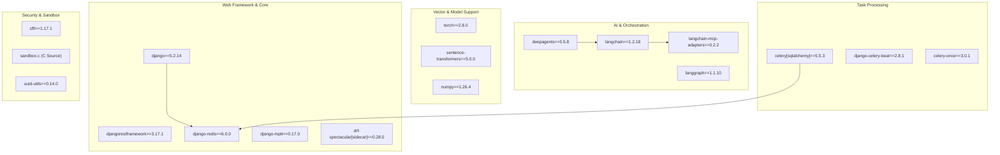
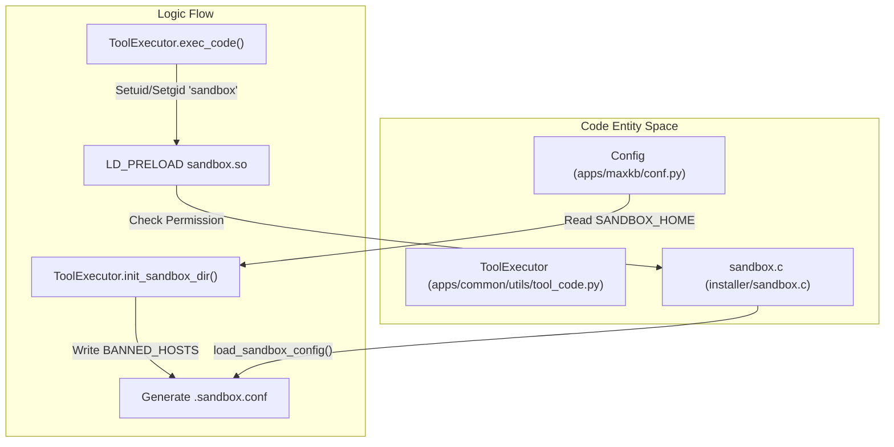
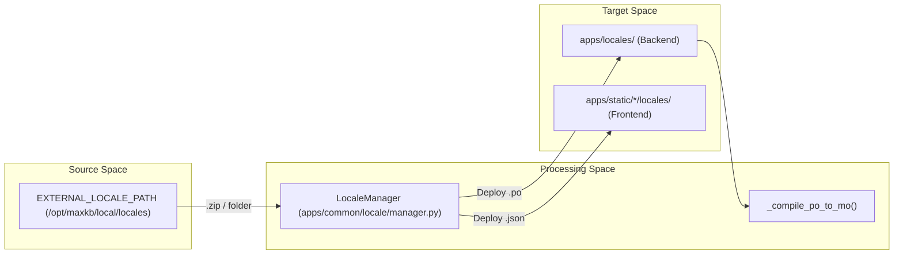

<!-- source: DeepWiki mcp.deepwiki.com · repo 1Panel-dev/MaxKB · page 11.2 System Configuration and Dependencies · fetched 2026-10-29 -->

# System Configuration and Dependencies

Relevant source files

The following files were used as context for generating this wiki page:

- [.dockerignore](.dockerignore)
- [.github/workflows/build-and-push-python-pg.yml](.github/workflows/build-and-push-python-pg.yml)
- [.github/workflows/build-and-push-vector-model.yml](.github/workflows/build-and-push-vector-model.yml)
- [.github/workflows/build-and-push.yml](.github/workflows/build-and-push.yml)
- [apps/application/flow/backend/__init__.py](apps/application/flow/backend/__init__.py)
- [apps/application/flow/backend/sandbox_shell.py](apps/application/flow/backend/sandbox_shell.py)
- [apps/application/migrations/0011_application_skill_tool_ids.py](apps/application/migrations/0011_application_skill_tool_ids.py)
- [apps/common/locale/__init__.py](apps/common/locale/__init__.py)
- [apps/common/locale/cache.py](apps/common/locale/cache.py)
- [apps/common/locale/config_helper.py](apps/common/locale/config_helper.py)
- [apps/common/locale/manager.py](apps/common/locale/manager.py)
- [apps/common/utils/tool_code.py](apps/common/utils/tool_code.py)
- [apps/maxkb/conf.py](apps/maxkb/conf.py)
- [apps/maxkb/settings/base/model.py](apps/maxkb/settings/base/model.py)
- [apps/maxkb/settings/base/web.py](apps/maxkb/settings/base/web.py)
- [installer/Dockerfile](installer/Dockerfile)
- [installer/Dockerfile-base](installer/Dockerfile-base)
- [installer/Dockerfile-vector-model](installer/Dockerfile-vector-model)
- [installer/install_model.py](installer/install_model.py)
- [installer/install_model_bert_base_cased.py](installer/install_model_bert_base_cased.py)
- [installer/sandbox.c](installer/sandbox.c)
- [pyproject.toml](pyproject.toml)

This document covers the system configuration architecture, dependency management, environment setup, and infrastructure configuration for MaxKB. It details how the platform manages its technical dependencies, platform-specific builds, and the secure execution environment.

## Overview

MaxKB uses a robust configuration system built around Django's settings, the `uv` package manager for dependency resolution, and multi-stage Docker builds. The system is designed for enterprise environments, featuring a secure code execution sandbox and a localized internationalization management system.

## Dependency Management and Technology Stack

The system utilizes `pyproject.toml` to define its dependency graph. It has migrated to using `uv` for faster, more reliable package installation and environment management [pyproject.toml:69-70]().

### Core Technology Dependencies

**Sources:** [pyproject.toml:8-67](), [installer/Dockerfile:16]()

### Platform-Specific Builds
MaxKB supports cross-platform execution (Linux, Windows, macOS) by utilizing platform markers in the dependency configuration, specifically for high-performance libraries like PyTorch.

| Platform | Torch Index | URL |
| :--- | :--- | :--- |
| Linux | `pytorch` | `https://download.pytorch.org/whl/cpu` |
| Windows | `pytorch` | `https://download.pytorch.org/whl/cpu` |
| macOS (Darwin) | `macpytorch` | `https://download.pytorch.org/whl` |

**Sources:** [pyproject.toml:72-87]()

## Secure Execution Sandbox Configuration

MaxKB implements a secure environment for executing custom tool code. This is achieved through a C-based shared library (`sandbox.so`) that intercepts system calls and a dedicated `sandbox` user.

### Sandbox Implementation Flow

**Sources:** [apps/common/utils/tool_code.py:42-110](), [installer/sandbox.c:40-98](), [installer/Dockerfile:16-18]()

### Sandbox Restrictions
The `sandbox.c` utility enforces the following security boundaries:
*   **Network Filtering:** Banned hosts and CIDR blocks are checked during `connect` and `getaddrinfo` calls [installer/sandbox.c:133-200]().
*   **System Call Interception:** Restricts `execve`, `fork`, and `system` calls unless explicitly allowed via `SANDBOX_PYTHON_ALLOW_SUBPROCESS` [installer/sandbox.c:31-38]().
*   **Resource Limits:** Python process memory is capped via `SANDBOX_PYTHON_PROCESS_LIMIT_MEM_MB` (default 256MB) [apps/common/utils/tool_code.py:39]().

## System Configuration Management

Configuration is handled by the `ConfigManager` class, which supports loading settings from YAML files or environment variables.

### Configuration Hierarchy
1.  **Default Settings:** Defined in `Config.defaults` [apps/maxkb/conf.py:23-50]().
2.  **YAML Files:** Loads `config.yaml` or `config.yml` from the project root [apps/maxkb/conf.py:203-208]().
3.  **Environment Variables:** Variables prefixed with `MAXKB_` or standard DB/Redis variables [installer/Dockerfile:32-48]().

### Key Runtime Variables
| Variable | Default | Description |
| :--- | :--- | :--- |
| `MAXKB_DB_MAX_OVERFLOW` | 80 | Max database connection overflow [apps/maxkb/conf.py:30]() |
| `MAXKB_REDIS_DB` | 0 | Redis database index [apps/maxkb/conf.py:45]() |
| `MAXKB_EMBEDDING_MODEL_PATH` | `/opt/maxkb-app/model/embedding` | Path to local vector models [installer/Dockerfile:43]() |
| `SANDBOX_PYTHON_BANNED_HOSTS` | (Internal IPs) | Network blocks restricted for custom code [installer/Dockerfile-base:51]() |

**Sources:** [apps/maxkb/conf.py:23-143](), [installer/Dockerfile:32-48]()

## Internationalization (i18n) and Localization

MaxKB features a `LocaleManager` that allows for dynamic deployment of external language packages without rebuilding the core application.

### Locale Deployment Process

**Sources:** [apps/common/locale/manager.py:18-83](), [apps/maxkb/conf.py:49]()

The manager automatically detects new `.po` (gettext) and `.json` (frontend) files, compiles them into binary `.mo` files for Django, and updates a static `index.json` for the frontend to consume [apps/common/locale/manager.py:157-205]().

## Build and Deployment Infrastructure

The project uses GitHub Actions for multi-architecture builds (`linux/amd64`, `linux/arm64`).

### Build Pipelines
*   **Base Image Build:** `build-and-push-python-pg.yml` creates the environment with Python 3.11 and PostgreSQL 17.10 [build-and-push-python-pg.yml:28-50]().
*   **Vector Model Build:** `build-and-push-vector-model.yml` packages the embedding models separately to optimize layer caching [build-and-push-vector-model.yml:31-56]().
*   **Application Build:** `build-and-push.yml` orchestrates the final image, combining the Vue.js frontend (built in `web-build` stage) and the Django backend [build-and-push.yml:82-91]().

**Sources:** [.github/workflows/build-and-push.yml:1-147](), [installer/Dockerfile:1-25]()

---

