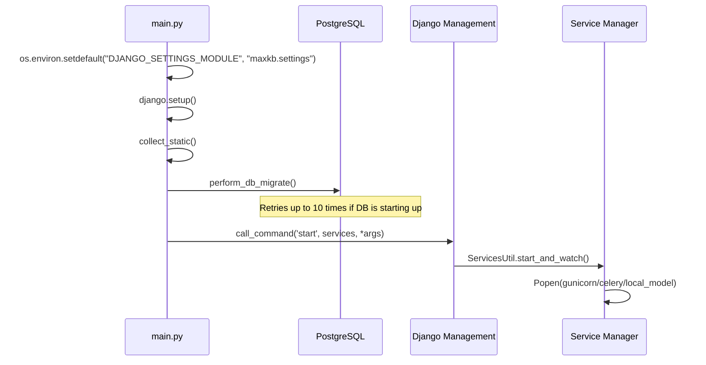
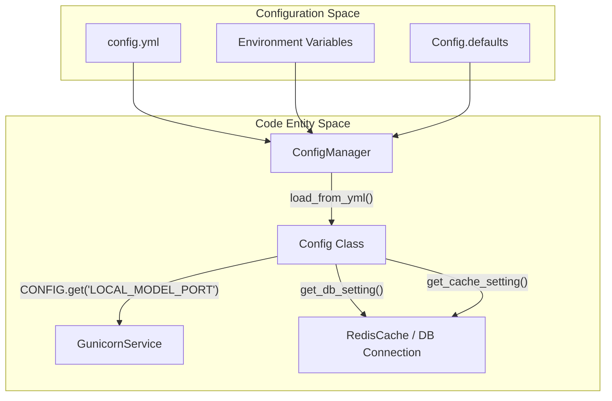

<!-- source: DeepWiki mcp.deepwiki.com · repo 1Panel-dev/MaxKB · page 11.3 Runtime Architecture and Services · fetched 2026-10-29 -->

# Runtime Architecture and Services

Relevant source files

The following files were used as context for generating this wiki page:

- [apps/common/config/tokenizer_manage_config.py](apps/common/config/tokenizer_manage_config.py)
- [apps/common/locale/__init__.py](apps/common/locale/__init__.py)
- [apps/common/locale/cache.py](apps/common/locale/cache.py)
- [apps/common/locale/config_helper.py](apps/common/locale/config_helper.py)
- [apps/common/locale/manager.py](apps/common/locale/manager.py)
- [apps/common/management/__init__.py](apps/common/management/__init__.py)
- [apps/common/management/commands/__init__.py](apps/common/management/commands/__init__.py)
- [apps/common/management/commands/celery.py](apps/common/management/commands/celery.py)
- [apps/common/management/commands/restart.py](apps/common/management/commands/restart.py)
- [apps/common/management/commands/services/__init__.py](apps/common/management/commands/services/__init__.py)
- [apps/common/management/commands/services/command.py](apps/common/management/commands/services/command.py)
- [apps/common/management/commands/services/hands.py](apps/common/management/commands/services/hands.py)
- [apps/common/management/commands/services/services/__init__.py](apps/common/management/commands/services/services/__init__.py)
- [apps/common/management/commands/services/services/base.py](apps/common/management/commands/services/services/base.py)
- [apps/common/management/commands/services/services/celery_base.py](apps/common/management/commands/services/services/celery_base.py)
- [apps/common/management/commands/services/services/celery_default.py](apps/common/management/commands/services/services/celery_default.py)
- [apps/common/management/commands/services/services/gunicorn.py](apps/common/management/commands/services/services/gunicorn.py)
- [apps/common/management/commands/services/services/local_model.py](apps/common/management/commands/services/services/local_model.py)
- [apps/common/management/commands/services/services/scheduler.py](apps/common/management/commands/services/services/scheduler.py)
- [apps/common/utils/logger.py](apps/common/utils/logger.py)
- [apps/maxkb/conf.py](apps/maxkb/conf.py)
- [apps/maxkb/settings/__init__.py](apps/maxkb/settings/__init__.py)
- [apps/maxkb/settings/base/model.py](apps/maxkb/settings/base/model.py)
- [apps/maxkb/settings/base/web.py](apps/maxkb/settings/base/web.py)
- [apps/maxkb/settings/logging.py](apps/maxkb/settings/logging.py)
- [apps/maxkb/settings/mem.py](apps/maxkb/settings/mem.py)
- [installer/init.sql](installer/init.sql)
- [installer/start-all.sh](installer/start-all.sh)
- [installer/start-maxkb.sh](installer/start-maxkb.sh)
- [installer/start-postgres.sh](installer/start-postgres.sh)
- [installer/start-redis.sh](installer/start-redis.sh)
- [main.py](main.py)

This document describes the runtime architecture of MaxKB, focusing on service orchestration, the Django/Gunicorn application server, Celery task processing, and environment-driven configuration. For information about the Docker build process, see [Docker Build and Deployment]().

## Overview

MaxKB follows a multi-service architecture typically deployed within a single container or orchestrated via Docker Compose. The system coordinates several specialized services to handle HTTP traffic, background processing, and data persistence.

- **Django Application Server**: Handles REST API requests, workspace management, and workflow orchestration.
- **Celery Workers**: Process asynchronous tasks such as document embedding, knowledge base synchronization, and scheduled triggers.
- **PostgreSQL**: Primary relational database with `pgvector` for vector similarity search.
- **Redis**: Acts as the Celery message broker and the application cache backend.
- **Local Model Service**: An internal WSGI server for managing local LLM interactions.

## Service Orchestration and Startup

The system uses a centralized management script `main.py` and Django management commands to orchestrate service lifecycles.

### Startup Sequence

The orchestration logic in `main.py` ensures that the environment is prepared before services start.

**Sources:** [main.py:15-135](), [apps/common/management/commands/services/command.py:123-125]()

### Service Definitions
The `Services` class defines the available runtime components and maps them to their respective implementation classes.

| Service Name | Implementation Class | Role |
| :--- | :--- | :--- |
| `gunicorn` / `web` | `GunicornService` | Main WSGI HTTP Server for the API and UI. |
| `local_model` | `GunicornLocalModelService` | WSGI Server for internal model management. |
| `celery_default` | `CeleryDefaultService` | Background task worker for embeddings and syncs. |
| `scheduler` | `SchedulerService` | Dedicated Django instance with `ENABLE_SCHEDULER=1`. |

**Sources:** [apps/common/management/commands/services/command.py:10-45](), [apps/common/management/commands/services/services/scheduler.py:9-53]()

## Application Runtime Components

### Gunicorn WSGI Server
The primary web interface is served via Gunicorn using the `gthread` worker class. This provides a balance of performance for both I/O-bound and CPU-bound requests.

**Configuration Details:**
- **Threads**: 200 threads per worker [apps/common/management/commands/services/services/gunicorn.py:26]().
- **Max Requests**: 10240 (with jitter) to prevent memory leaks [apps/common/management/commands/services/services/gunicorn.py:28-29]().
- **Timeouts**: 30s request timeout with a 300s graceful shutdown period [apps/common/management/commands/services/services/gunicorn.py:30-31]().

**Sources:** [apps/common/management/commands/services/services/gunicorn.py:15-38]()

### Local Model Service
MaxKB runs a secondary Gunicorn instance specifically for local model interactions. It binds to the host and port defined in `LOCAL_MODEL_HOST` and `LOCAL_MODEL_PORT`.

**Sources:** [apps/common/management/commands/services/services/local_model.py:25-47]()

### Memory Management
To maintain stability in long-running container environments, MaxKB implements a forced Garbage Collection (GC) mechanism. If `ENABLE_FORCE_GC` is set to "1", a background thread triggers `gc.collect()` and `malloc_trim(0)` every hour to release unreferenced memory back to the OS.

**Sources:** [apps/maxkb/settings/mem.py:14-30]()

## Environment and Configuration

The `Config` and `ConfigManager` classes handle the merging of default values, YAML files, and environment variables.

### Data Flow: Configuration to Code
The following diagram illustrates how runtime configurations are injected into service entities.

**Sources:** [apps/maxkb/conf.py:22-106](), [apps/maxkb/conf.py:157-216]()

### Database and Cache Settings
MaxKB uses `dj_db_conn_pool` for PostgreSQL to manage persistent connections efficiently.

- **DB Engine**: `dj_db_conn_pool.backends.postgresql` [apps/maxkb/conf.py:29]().
- **Connection Pool**: Default size of 20 with a configurable `MAX_OVERFLOW` [apps/maxkb/conf.py:67-73]().
- **Redis Cache**: Uses `django_redis.cache.RedisCache` and supports Sentinel configurations for high availability [apps/maxkb/conf.py:76-106]().

## Internationalization (i18n) Runtime
MaxKB supports dynamic deployment of external language packs without rebuilding the image.

The `LocaleManager` scans the `EXTERNAL_LOCALE_PATH` (default: `/opt/maxkb/local/locales`) for `.zip` or folder-based language packs. During service startup, it:
1. Deploys `.po` files to the internal locales directory [apps/common/locale/manager.py:136-156]().
2. Compiles `.po` to `.mo` using `msgfmt` [apps/common/locale/manager.py:159]().
3. Generates a static `index.json` for the frontend to discover available languages [apps/common/locale/manager.py:189-203]().

**Sources:** [apps/common/locale/manager.py:18-83](), [apps/common/locale/config_helper.py:17-45]()

## Logging Architecture
The system employs a structured logging configuration defined in `apps/maxkb/settings/logging.py`. It uses a custom `DailyTimedRotatingFileHandler` to manage log rotation.

| Logger | Level | Handlers | Destination |
| :--- | :--- | :--- | :--- |
| `max_kb` | Configurable | `console`, `file` | `maxkb.log` |
| `django.request` | Configurable | `console`, `file`, `syslog` | Request audit trail |
| `sqlalchemy` | `ERROR` | `console`, `file` | Database ORM errors |

**Sources:** [apps/maxkb/settings/logging.py:12-120]()

## Shell Scripts and Container Entrypoints
For Docker-based deployments, several shell scripts handle the initial setup of PostgreSQL and Redis before starting the Python application.

- **`start-all.sh`**: Orchestrates the startup of PostgreSQL, Redis, and MaxKB in sequence, using `wait-for-it` to ensure port availability [installer/start-all.sh:12-32]().
- **`start-postgres.sh`**: Initializes the database and applies `init.sql` [installer/start-postgres.sh:1-20]().
- **`start-redis.sh`**: Generates `redis.conf` with optimized persistence settings (AOF + RDB) and starts the server [installer/start-redis.sh:11-39]().
- **`start-maxkb.sh`**: Runs any user-provided initialization scripts in `/opt/maxkb/local/init-shells` before executing `main.py start` [installer/start-maxkb.sh:15-27]().

**Sources:** [installer/start-all.sh:1-37](), [installer/start-redis.sh:1-39](), [installer/start-maxkb.sh:1-27]()

---

