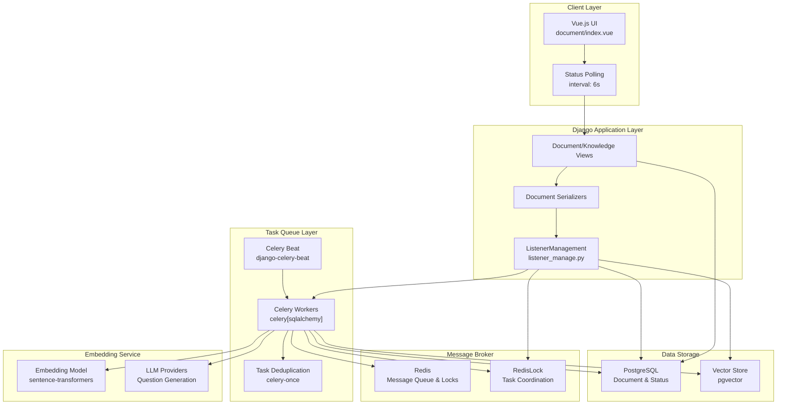
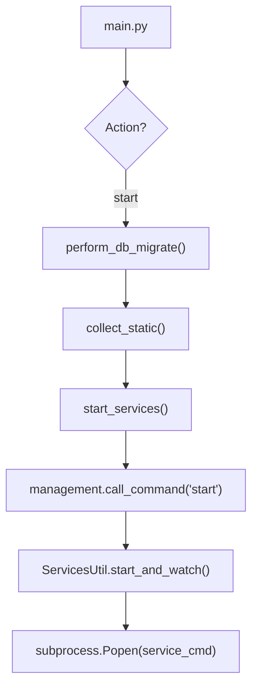

<!-- source: DeepWiki mcp.deepwiki.com · repo 1Panel-dev/MaxKB · page 12 Asynchronous Task Processing · fetched 2026-10-29 -->

# Asynchronous Task Processing

Relevant source files

The following files were used as context for generating this wiki page:

- [apps/common/config/embedding_config.py](apps/common/config/embedding_config.py)
- [apps/common/event/__init__.py](apps/common/event/__init__.py)
- [apps/common/event/common.py](apps/common/event/common.py)
- [apps/common/job/__init__.py](apps/common/job/__init__.py)
- [apps/common/job/clean_chat_job.py](apps/common/job/clean_chat_job.py)
- [apps/common/job/clean_debug_file_job.py](apps/common/job/clean_debug_file_job.py)
- [apps/common/job/client_access_num_job.py](apps/common/job/client_access_num_job.py)
- [apps/common/job/scheduler.py](apps/common/job/scheduler.py)
- [apps/common/management/__init__.py](apps/common/management/__init__.py)
- [apps/common/management/commands/__init__.py](apps/common/management/commands/__init__.py)
- [apps/common/management/commands/celery.py](apps/common/management/commands/celery.py)
- [apps/common/management/commands/restart.py](apps/common/management/commands/restart.py)
- [apps/common/management/commands/services/__init__.py](apps/common/management/commands/services/__init__.py)
- [apps/common/management/commands/services/command.py](apps/common/management/commands/services/command.py)
- [apps/common/management/commands/services/hands.py](apps/common/management/commands/services/hands.py)
- [apps/common/management/commands/services/services/__init__.py](apps/common/management/commands/services/services/__init__.py)
- [apps/common/management/commands/services/services/base.py](apps/common/management/commands/services/services/base.py)
- [apps/common/management/commands/services/services/celery_base.py](apps/common/management/commands/services/services/celery_base.py)
- [apps/common/management/commands/services/services/celery_default.py](apps/common/management/commands/services/services/celery_default.py)
- [apps/common/management/commands/services/services/gunicorn.py](apps/common/management/commands/services/services/gunicorn.py)
- [apps/common/management/commands/services/services/local_model.py](apps/common/management/commands/services/services/local_model.py)
- [apps/common/management/commands/services/services/scheduler.py](apps/common/management/commands/services/services/scheduler.py)
- [apps/common/utils/lock.py](apps/common/utils/lock.py)
- [apps/common/utils/rsa_util.py](apps/common/utils/rsa_util.py)
- [apps/maxkb/settings/__init__.py](apps/maxkb/settings/__init__.py)
- [apps/maxkb/settings/mem.py](apps/maxkb/settings/mem.py)
- [main.py](main.py)

This document describes the asynchronous task processing system in MaxKB, which handles long-running operations such as document embedding, web content synchronization, and scheduled jobs. The system is built on Celery with Redis as the message broker and PostgreSQL for result storage.

For details on the Celery configuration and worker setup, see [Celery Architecture and Configuration](#12.1). For information about specific embedding and vectorization task workflows, see [Embedding and Vectorization Tasks](#12.2).

## Overview

MaxKB uses a Celery-based asynchronous task processing system to handle computationally intensive operations that would otherwise block the main Django application. The primary use cases include:

- **Document Vectorization**: Converting document paragraphs into vector embeddings for semantic search.
- **Web Content Synchronization**: Periodically fetching and updating web-based knowledge sources.
- **Problem Generation**: Using LLMs to generate related questions from document content.
- **Batch Operations**: Processing multiple documents or paragraphs in parallel.
- **Scheduled Tasks**: Periodic maintenance, such as cleaning chat logs or temporary files.

The system provides real-time status tracking, task cancellation, and progress monitoring through a state machine integrated with the UI polling mechanism.

Sources: [apps/common/management/commands/services/command.py:10-45](), [apps/common/job/clean_chat_job.py:16-45]()

## System Architecture

The following diagram illustrates the overall architecture of the asynchronous task processing system and how it integrates with other MaxKB components:

Sources: [apps/common/management/commands/services/command.py:10-18](), [apps/common/management/commands/services/services/celery_default.py:1-20](), [apps/common/config/embedding_config.py:66-83]()

## Service Management and Lifecycle

MaxKB uses a custom management command system to orchestrate the various background services. The `Services` class defines the available components and their respective service classes.

| Service Name | Code Entity | Role |
|--------------|-------------|------|
| `gunicorn` | `GunicornService` | Main WSGI HTTP Server for the web application [apps/common/management/commands/services/services/gunicorn.py:9-38]() |
| `celery_default` | `CeleryDefaultService` | Standard task worker handling embeddings and sync tasks [apps/common/management/commands/services/services/celery_default.py:1-20]() |
| `local_model` | `GunicornLocalModelService` | WSGI server specifically for local model serving [apps/common/management/commands/services/services/local_model.py:18-47]() |
| `scheduler` | `SchedulerService` | Dedicated service for running periodic jobs [apps/common/management/commands/services/services/scheduler.py:9-38]() |

### Service Startup Flow

Sources: [main.py:65-87](), [apps/common/management/commands/services/command.py:123-125](), [apps/common/management/commands/services/services/base.py:1-50]()

## Scheduled Jobs

In addition to user-triggered tasks, MaxKB runs several background maintenance jobs using an APScheduler-based system managed via the `SchedulerService`.

| Job Name | Code Entity | Function | Frequency |
|----------|-------------|----------|-----------|
| Clean Chat Log | `clean_chat_log_job` | Removes old chat records and associated files based on application settings [apps/common/job/clean_chat_job.py:16-47]() | Daily (00:05) |
| Clean Debug Files | `clean_debug_file` | Deletes temporary files (30 min, 2 hr, or 24 hr TTL) [apps/common/job/clean_debug_file_job.py:13-31]() | Every 30 minutes |
| Reset Access Num | `client_access_num_reset_job` | Resets daily access counters for application chat users [apps/common/job/client_access_num_job.py:18-28]() | Daily (00:00) |
| Force GC | `enable_force_gc` | Periodically triggers Python garbage collection and memory trimming [apps/maxkb/settings/mem.py:14-27]() | Hourly |

Sources: [apps/common/job/clean_chat_job.py:107-108](), [apps/common/job/clean_debug_file_job.py:42](), [apps/common/job/client_access_num_job.py:39-40]()

## System Initialization Events

When the system starts, certain cleanup and state correction tasks are executed to ensure data consistency, particularly after an unexpected shutdown.

The `run()` function in `apps/common/event/__init__.py` performs the following:
1. **Model Status Reset**: Updates models stuck in `DOWNLOAD` status to `ERROR` [apps/common/event/__init__.py:31-35]().
2. **Document Status Reset**: Executes a raw SQL update to transition documents in transient states (`0`, `1`, `4`) to a safe state (`3`) [apps/common/event/__init__.py:18-22]().
3. **Cache Invalidation**: Deletes cached RSA keys [apps/common/event/__init__.py:38-39]().

Sources: [apps/common/event/__init__.py:25-42]()

## Concurrency and Locking

MaxKB utilizes a `RedisLock` implementation to prevent race conditions during task execution and job scheduling.

- **Distributed Locks**: Used in scheduled jobs (e.g., `clean_chat_log_job`) to ensure only one worker executes the job across a cluster [apps/common/job/clean_chat_job.py:99-110]().
- **Task Locking**: Used in `ListenerManagement` to prevent concurrent embedding tasks for the same document.
- **Memory Management**: A background thread handles `ModelManage.clear_timeout_cache()` to recycle embedding model instances from memory [apps/common/config/embedding_config.py:55-58]().

Sources: [apps/common/utils/lock.py:1-50](), [apps/common/config/embedding_config.py:19-64]()

---

