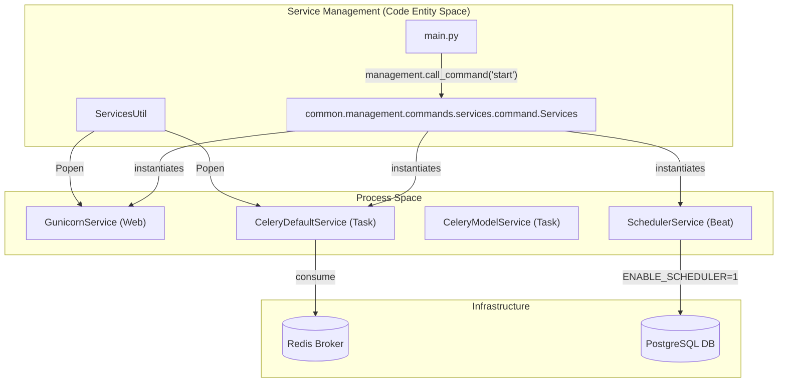
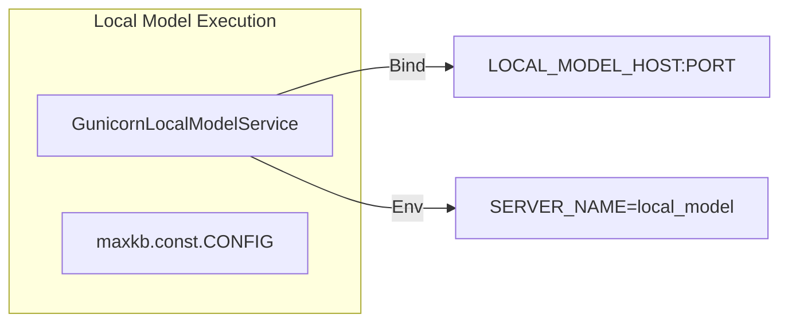
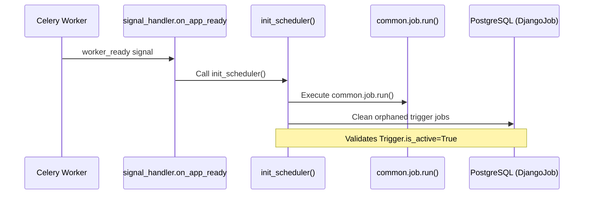

<!-- source: DeepWiki mcp.deepwiki.com · repo 1Panel-dev/MaxKB · page 12.1 Celery Architecture and Configuration · fetched 2026-10-29 -->

# Celery Architecture and Configuration

<details>
<summary>Relevant source files</summary>

The following files were used as context for generating this wiki page:

- [apps/common/config/embedding_config.py](apps/common/config/embedding_config.py)
- [apps/common/event/__init__.py](apps/common/event/__init__.py)
- [apps/common/event/common.py](apps/common/event/common.py)
- [apps/common/init/init_template.py](apps/common/init/init_template.py)
- [apps/common/job/__init__.py](apps/common/job/__init__.py)
- [apps/common/job/clean_chat_job.py](apps/common/job/clean_chat_job.py)
- [apps/common/job/clean_debug_file_job.py](apps/common/job/clean_debug_file_job.py)
- [apps/common/job/client_access_num_job.py](apps/common/job/client_access_num_job.py)
- [apps/common/job/scheduler.py](apps/common/job/scheduler.py)
- [apps/common/management/__init__.py](apps/common/management/__init__.py)
- [apps/common/management/commands/__init__.py](apps/common/management/commands/__init__.py)
- [apps/common/management/commands/celery.py](apps/common/management/commands/celery.py)
- [apps/common/management/commands/restart.py](apps/common/management/commands/restart.py)
- [apps/common/management/commands/services/__init__.py](apps/common/management/commands/services/__init__.py)
- [apps/common/management/commands/services/command.py](apps/common/management/commands/services/command.py)
- [apps/common/management/commands/services/hands.py](apps/common/management/commands/services/hands.py)
- [apps/common/management/commands/services/services/__init__.py](apps/common/management/commands/services/services/__init__.py)
- [apps/common/management/commands/services/services/base.py](apps/common/management/commands/services/services/base.py)
- [apps/common/management/commands/services/services/celery_base.py](apps/common/management/commands/services/services/celery_base.py)
- [apps/common/management/commands/services/services/celery_default.py](apps/common/management/commands/services/services/celery_default.py)
- [apps/common/management/commands/services/services/gunicorn.py](apps/common/management/commands/services/services/gunicorn.py)
- [apps/common/management/commands/services/services/local_model.py](apps/common/management/commands/services/services/local_model.py)
- [apps/common/management/commands/services/services/scheduler.py](apps/common/management/commands/services/services/scheduler.py)
- [apps/common/utils/lock.py](apps/common/utils/lock.py)
- [apps/common/utils/rsa_util.py](apps/common/utils/rsa_util.py)
- [apps/maxkb/settings/__init__.py](apps/maxkb/settings/__init__.py)
- [apps/maxkb/settings/mem.py](apps/maxkb/settings/mem.py)
- [apps/maxkb/wsgi/web.py](apps/maxkb/wsgi/web.py)
- [apps/ops/celery/logger.py](apps/ops/celery/logger.py)
- [apps/ops/celery/signal_handler.py](apps/ops/celery/signal_handler.py)
- [apps/ops/celery/utils.py](apps/ops/celery/utils.py)
- [apps/system_manage/serializers/email_setting.py](apps/system_manage/serializers/email_setting.py)
- [apps/trigger/handler/base_task.py](apps/trigger/handler/base_task.py)
- [apps/trigger/handler/base_trigger.py](apps/trigger/handler/base_trigger.py)
- [apps/trigger/handler/impl/trigger/scheduled_trigger.py](apps/trigger/handler/impl/trigger/scheduled_trigger.py)
- [apps/trigger/handler/simple_tools.py](apps/trigger/handler/simple_tools.py)
- [apps/trigger/migrations/0001_initial.py](apps/trigger/migrations/0001_initial.py)
- [apps/trigger/sql/get_trigger_task_record_page_list.sql](apps/trigger/sql/get_trigger_task_record_page_list.sql)
- [apps/trigger/tasks.py](apps/trigger/tasks.py)
- [apps/users/apps.py](apps/users/apps.py)
- [main.py](main.py)

</details>


## Purpose and Scope

This document details the Celery-based asynchronous task processing architecture in MaxKB. It covers the configuration of Celery workers, task queues, the beat scheduler for periodic tasks, task deduplication mechanisms, and result backends.

MaxKB uses Celery to handle long-running operations asynchronously, including document processing, embedding generation, knowledge base synchronization, and scheduled maintenance tasks.

---

## Overview

MaxKB employs Celery as its distributed task queue system to offload time-consuming operations from the Django web server. The system is orchestrated through a service management layer that handles the lifecycle of Gunicorn, Celery, and local model services.

**Key Components:**
- **Broker**: Redis serves as the message broker for task distribution.
- **Workers**: Multiple Celery worker types (Default and Model) execute tasks.
- **Beat Scheduler**: Managed via `django-celery-beat` and augmented by a custom `SchedulerService`.
- **Deduplication**: Prevention of redundant task execution using `celery-once`.

Sources: [apps/ops/celery/signal_handler.py:7-13](), [apps/common/management/commands/services/command.py:10-18]()

---

## Celery Architecture Components

### High-Level Architecture and Service Management

The diagram below illustrates how the service management layer (invoked via `main.py` or `manage.py services`) bridges the gap between the Natural Language configuration and the actual Code Entities.



Sources: [main.py:65-80](), [apps/common/management/commands/services/command.py:20-45](), [apps/common/management/commands/services/services/scheduler.py:44-54]()

### Component Details

| Component | Code Entity / Class | Purpose |
|-----------|----------------------|---------|
| **Service Entry** | `main.py` | Entry point for starting all backend services. |
| **Worker Manager** | `GunicornService` | Manages the Django WSGI application lifecycle. |
| **Default Worker** | `CeleryDefaultService` | Handles standard background tasks (Sync, Cleanup). |
| **Model Worker** | `CeleryModelService` | Specialized worker for embedding and vectorization. |
| **Task Scheduler** | `SchedulerService` | A Gunicorn-wrapped service that enables APScheduler via `ENABLE_SCHEDULER`. |
| **Signal Handler** | `ops.celery.signal_handler` | Manages Celery lifecycle events like `worker_ready`. |

Sources: [apps/common/management/commands/services/command.py:10-18](), [apps/common/management/commands/services/services/scheduler.py:9-15](), [apps/ops/celery/signal_handler.py:67-68]()

---

## Task Queue and Service Configuration

### Service Definition and Worker Scaling

MaxKB defines its services in a structured `TextChoices` class, allowing for granular control over which processes start.

- **Web Services**: Includes `gunicorn` and `local_model`.
- **Task Services**: Includes `celery_default` and `celery_model`.

The number of workers is dynamically calculated based on CPU count:
`default=3 if os.cpu_count() > 6 else max(1, math.floor(os.cpu_count() / 2))`

Sources: [apps/common/management/commands/services/command.py:31-40](), [apps/common/management/commands/services/command.py:98-99]()

### Local Model Service

For environments requiring local model execution, `GunicornLocalModelService` starts a separate WSGI server.



Sources: [apps/common/management/commands/services/services/local_model.py:18-47]()

---

## Task Deduplication with Celery-Once

MaxKB uses `celery-once` to ensure that specific tasks, particularly those related to triggers and scheduling, do not execute concurrently if they are already in the queue.

**Implementation Example: Scheduled Trigger**
The `ScheduledTrigger` utilizes `QueueOnce` to manage task uniqueness.

```python
# apps/trigger/handler/impl/trigger/scheduled_trigger.py
from celery_once import QueueOnce
from ops import celery_app

@celery_app.task(base=QueueOnce, once={'graceful': True})
def execute_task(trigger_id, task_id):
    # Implementation logic
    pass
```

Sources: [apps/trigger/handler/impl/trigger/scheduled_trigger.py:2-9]()

---

## Scheduled Tasks and Beat Architecture

MaxKB employs a dual-scheduler strategy: `django-celery-beat` for distributed tasks and `django-apscheduler` for process-specific jobs.

### Scheduler Initialization Flow

When a Celery worker becomes ready, it triggers the `on_app_ready` signal which initializes the schedulers.



Sources: [apps/ops/celery/signal_handler.py:23-58](), [apps/ops/celery/signal_handler.py:67-74]()

### Core Maintenance Jobs

Several system-level jobs are registered during initialization:

1.  **Chat Log Cleanup**: `clean_chat_log_job` runs daily at 00:05 to remove old records based on application-specific retention settings.
2.  **Debug File Cleanup**: `clean_debug_file` runs every 30 minutes to purge temporary files.
3.  **Access Reset**: `client_access_num_reset_job` resets daily access counters at midnight.

Sources: [apps/common/job/clean_chat_job.py:107-108](), [apps/common/job/clean_debug_file_job.py:42](), [apps/common/job/client_access_num_job.py:39-40]()

---

## Task State and Lifecycle Management

### Interrupted Task Recovery

On system startup, MaxKB performs a cleanup of tasks that were interrupted (e.g., during a container restart). The `apps/common/event/__init__.py` module handles this:

- **Model Status**: Any model stuck in `Status.DOWNLOAD` is moved to `Status.ERROR`.
- **Document Status**: Documents in transient states (0, 1, 4) are reset to status 3 (Error/Interrupted) using raw SQL.

Sources: [apps/common/event/__init__.py:25-37]()

### Memory Management

To prevent memory bloat in long-running worker processes, MaxKB implements a forced Garbage Collection (GC) mechanism.

- **Mechanism**: Uses `gc.collect()` and `ctypes.CDLL("libc.so.6").malloc_trim(0)`.
- **Interval**: Runs every hour (`GC_INTERVAL = 3600`) with a random jitter to prevent synchronized GC spikes across multiple workers.

Sources: [apps/maxkb/settings/mem.py:10-31]()

---

