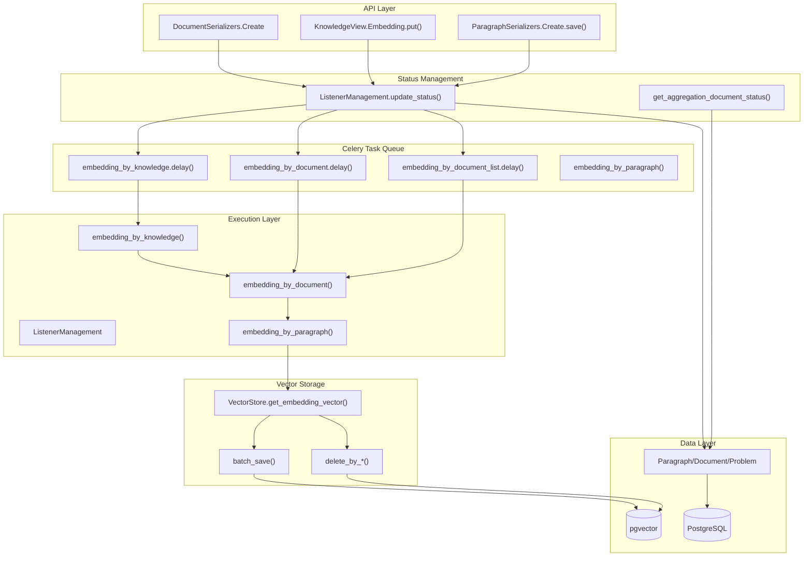
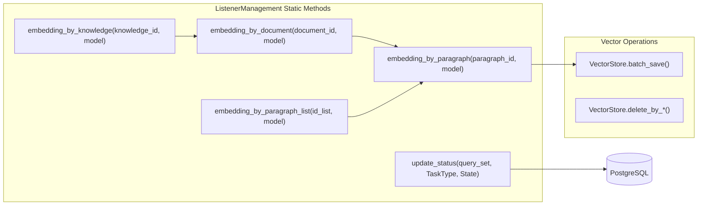
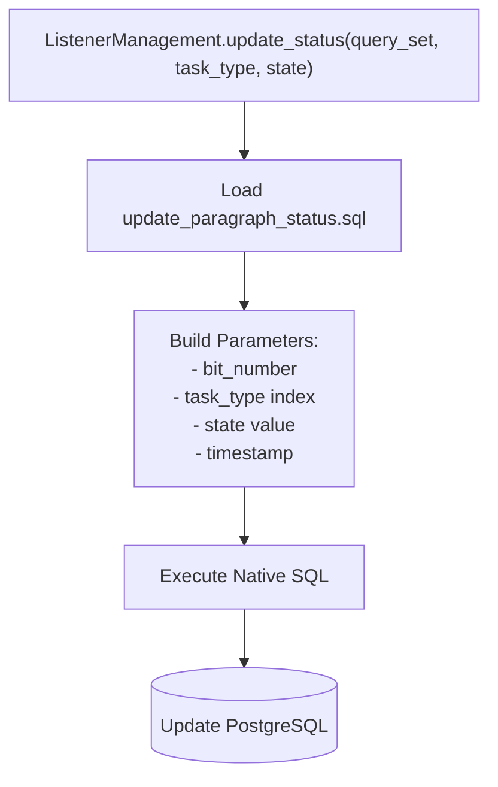
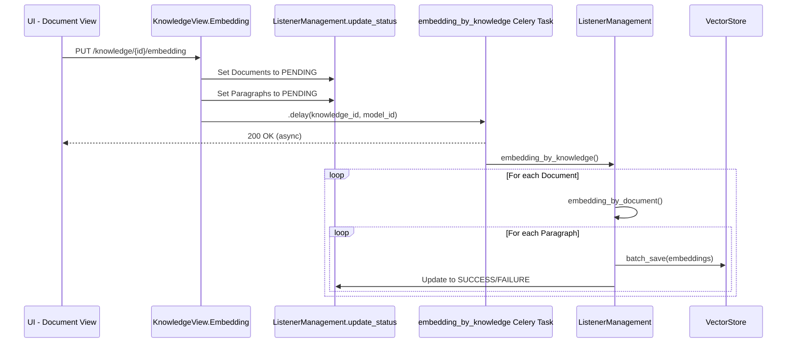
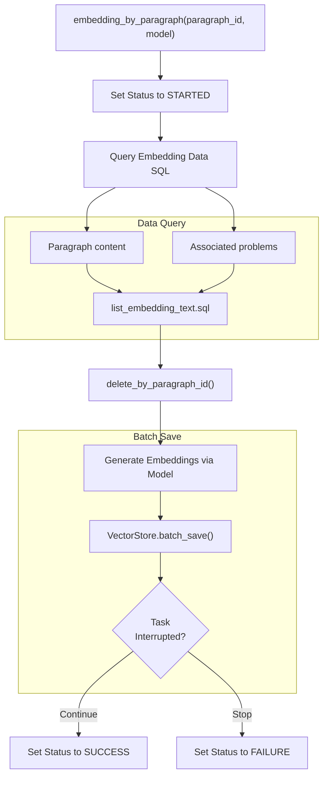

<!-- source: DeepWiki mcp.deepwiki.com · repo 1Panel-dev/MaxKB · page 12.2 Embedding and Vectorization Tasks · fetched 2026-10-29 -->

# Embedding and Vectorization Tasks

<details>
<summary>Relevant source files</summary>

The following files were used as context for generating this wiki page:

- [apps/common/event/listener_manage.py](apps/common/event/listener_manage.py)
- [apps/folders/views/folder.py](apps/folders/views/folder.py)
- [apps/knowledge/api/document.py](apps/knowledge/api/document.py)
- [apps/knowledge/api/knowledge.py](apps/knowledge/api/knowledge.py)
- [apps/knowledge/api/paragraph.py](apps/knowledge/api/paragraph.py)
- [apps/knowledge/api/problem.py](apps/knowledge/api/problem.py)
- [apps/knowledge/serializers/common.py](apps/knowledge/serializers/common.py)
- [apps/knowledge/serializers/document.py](apps/knowledge/serializers/document.py)
- [apps/knowledge/serializers/knowledge.py](apps/knowledge/serializers/knowledge.py)
- [apps/knowledge/serializers/paragraph.py](apps/knowledge/serializers/paragraph.py)
- [apps/knowledge/serializers/problem.py](apps/knowledge/serializers/problem.py)
- [apps/knowledge/sql/blend_search.sql](apps/knowledge/sql/blend_search.sql)
- [apps/knowledge/sql/embedding_search.sql](apps/knowledge/sql/embedding_search.sql)
- [apps/knowledge/sql/hit_test.sql](apps/knowledge/sql/hit_test.sql)
- [apps/knowledge/sql/keywords_search.sql](apps/knowledge/sql/keywords_search.sql)
- [apps/knowledge/task/embedding.py](apps/knowledge/task/embedding.py)
- [apps/knowledge/urls.py](apps/knowledge/urls.py)
- [apps/knowledge/vector/base_vector.py](apps/knowledge/vector/base_vector.py)
- [apps/knowledge/vector/pg_vector.py](apps/knowledge/vector/pg_vector.py)
- [apps/knowledge/views/document.py](apps/knowledge/views/document.py)
- [apps/knowledge/views/knowledge.py](apps/knowledge/views/knowledge.py)
- [apps/knowledge/views/paragraph.py](apps/knowledge/views/paragraph.py)
- [apps/knowledge/views/problem.py](apps/knowledge/views/problem.py)
- [apps/system_manage/views/email_setting.py](apps/system_manage/views/email_setting.py)
- [ui/src/components/dynamics-form/items/table/TableCheckbox.vue](ui/src/components/dynamics-form/items/table/TableCheckbox.vue)
- [ui/src/components/dynamics-form/items/table/TableRadio.vue](ui/src/components/dynamics-form/items/table/TableRadio.vue)
- [ui/src/views/document/index.vue](ui/src/views/document/index.vue)
- [ui/src/views/document/tag/TaglinkedDocumentDialog.vue](ui/src/views/document/tag/TaglinkedDocumentDialog.vue)
- [ui/src/views/problem/index.vue](ui/src/views/problem/index.vue)
- [ui/src/views/termbase/component/CreateTermbaseDialog.vue](ui/src/views/termbase/component/CreateTermbaseDialog.vue)
- [ui/src/views/termbase/index.vue](ui/src/views/termbase/index.vue)

</details>


## Purpose and Scope

This document describes the asynchronous embedding and vectorization task system in MaxKB. It covers how documents and paragraphs are processed into vector embeddings, stored in the vector database, and tracked through their lifecycle states. The system uses Celery workers to perform vectorization tasks asynchronously while maintaining status information for UI feedback.

For information about the Celery configuration and task queue architecture, see [Celery Architecture and Configuration](#12.1). For knowledge base creation and document management workflows, see [Document Management and Processing](#6.1).

---

## System Overview

The embedding and vectorization system transforms text content (documents, paragraphs, and questions) into vector embeddings that enable semantic search. The system operates asynchronously using Celery workers and maintains detailed status tracking for each vectorization task.

### High-Level Architecture



**Sources:** 
- [apps/common/event/listener_manage.py:90-396]()
- [apps/knowledge/serializers/knowledge.py:246-271]()
- [apps/knowledge/serializers/document.py:518-582]()

---

## Core Components

### ListenerManagement Class

The `ListenerManagement` class in [apps/common/event/listener_manage.py:90-396]() is the central orchestrator for all embedding operations. It provides static methods for vectorization at different granularities.

**Key Methods:**

| Method | Purpose | Scope |
|--------|---------|-------|
| `embedding_by_knowledge()` | Vectorize entire knowledge base | All documents in knowledge |
| `embedding_by_document()` | Vectorize single document | All paragraphs in document |
| `embedding_by_paragraph()` | Vectorize single paragraph | Single paragraph + problems |
| `embedding_by_paragraph_list()` | Vectorize multiple paragraphs | List of paragraphs |
| `update_status()` | Update task status | QuerySet of entities |



**Sources:** [apps/common/event/listener_manage.py:90-325]()

### Celery Task Functions

Celery tasks are defined in the `knowledge.task` module to enable asynchronous processing. These tasks wrap the `ListenerManagement` methods and ensure that model instances are correctly initialized before processing.

**Sources:** [apps/knowledge/task/embedding.py]()

---

## Task Lifecycle and Status Management

### Status State Machine

Each document and paragraph maintains a composite status string representing multiple task types. The status is managed using a bit-string approach where each character position represents a specific task type.

**Task Types and States:**

| TaskType | Value | Description |
|----------|-------|-------------|
| EMBEDDING | 1 | Vector embedding generation |
| GENERATE_PROBLEM | 2 | Question generation from content |
| SYNC | 3 | Web document synchronization |

| State | Value | Character |
|-------|-------|-----------|
| PENDING | "0" | Queued, waiting to start |
| STARTED | "1" | Currently processing |
| SUCCESS | "2" | Completed successfully |
| FAILURE | "3" | Failed with error |
| REVOKE | "r" | Cancellation requested |
| REVOKED | "n" | Cancelled and cleaned up |

**Sources:** [apps/knowledge/models.py:63-65](), [apps/common/event/listener_manage.py:230-251]()

### Status Update Mechanism

The `ListenerManagement.update_status()` method updates status using SQL to manipulate the status bit-string. It loads a native SQL template and executes it to ensure atomic updates across large QuerySets.



**Sources:** [apps/common/event/listener_manage.py:230-251]()

---

## Vectorization Workflows

### Knowledge Base Vectorization

Full knowledge base re-vectorization is triggered via the API and processes all documents sequentially.



**Key Code Flow:**
1. [apps/knowledge/urls.py:28]() - API route definition.
2. [apps/knowledge/serializers/knowledge.py:246-271]() - `embedding()` method sets PENDING status and triggers task.
3. [apps/knowledge/task/embedding.py]() - Celery task enqueued with `AlreadyQueued` protection.
4. [apps/common/event/listener_manage.py:305-324]() - `embedding_by_knowledge()` iterates through documents.

**Sources:** 
- [apps/knowledge/views/knowledge.py:12-14]()
- [apps/knowledge/serializers/knowledge.py:246-271]()
- [apps/common/event/listener_manage.py:305-324]()

### Document Vectorization

Individual document vectorization processes paragraphs in batches using pagination. This is managed by the `embedding_by_document` function which utilizes a Redis lock to prevent concurrent processing of the same document.

**Batch Processing:**
- Processes 5 paragraphs per batch to manage memory usage.
- Each paragraph's status is individually tracked.
- Document status aggregates from all paragraph statuses using `get_aggregation_document_status`.

**Sources:** [apps/common/event/listener_manage.py:253-303]()

### Paragraph Vectorization

Single paragraph vectorization includes both paragraph content and associated problems (questions).



**Embedding Text Query:** The SQL at `apps/common/sql/list_embedding_text.sql` joins paragraphs with their associated problems to create combined embedding records for the vector store.

**Sources:** 
- [apps/common/event/listener_manage.py:151-188]()
- [apps/knowledge/serializers/paragraph.py:35-47]()

---

## Status Aggregation

### Document Status Aggregation

Document status is dynamically aggregated from its paragraph statuses to provide real-time feedback in the UI. This is performed by `get_aggregation_document_status` which queries the distribution of states among the document's paragraphs.

**Status Resolution Rules:**
1. If any paragraph is `STARTED` → Document is `STARTED`.
2. If any paragraph is `FAILURE` (and none `STARTED`) → Document is `FAILURE`.
3. If any paragraph is `PENDING` (and none `STARTED/FAILURE`) → Document is `PENDING`.
4. If all paragraphs are `SUCCESS` → Document is `SUCCESS`.

**Sources:** 
- [apps/common/event/listener_manage.py:178-204]()

---

## User Interface Integration

### Document List Status Display

The document list view [ui/src/views/document/index.vue:1-64]() allows users to trigger vectorization and monitor progress.

**Actions:**
- **Vectorization Button:** Triggers `batchRefresh` which calls the `batch_refresh` API.
- **Word Indexing Button:** Triggers `batchTokenize` for keyword search indexing.
- **Status Filtering:** The UI filters documents based on their `status` field.

**Sources:** [ui/src/views/document/index.vue:47-58]()

### Batch Operations

Users can select multiple documents and trigger batch operations via the `DocumentView` API.

**Batch Endpoints:**
- `PUT /workspace/{workspace_id}/knowledge/{knowledge_id}/document/batch_refresh` - Re-vectorize multiple documents.
- `PUT /workspace/{workspace_id}/knowledge/{knowledge_id}/document/batch_cancel_task` - Cancel multiple tasks.

**Sources:** 
- [apps/knowledge/urls.py:43-53]()
- [apps/knowledge/views/document.py:48-83]()

---

## Vector Storage Operations

### VectorStore Interface

The `VectorStore` class provides an abstraction over the vector database (pgvector). It handles the actual insertion, deletion, and searching of vectors.

**Key Operations:**
- `batch_save()`: Handles bulk vector insertion with interruption support.
- `delete_by_paragraph_id()`: Removes vectors associated with a specific paragraph.
- `delete_by_document_id()`: Removes all vectors for a document.

**Sources:** [apps/common/config/embedding_config.py](), [apps/common/event/listener_manage.py:126-132]()

---

## Task Cancellation and Revocation

### Cancel Task Workflow

Users can cancel ongoing vectorization tasks from the UI. This sets the status to `REVOKE` (`r`), which is then picked up by the execution loop.

**Interruption Check Function:**
Within the `batch_save` loop, the system periodically executes a callback to check if the paragraph status has been updated to `REVOKE`. If so, the process terminates early.

**Sources:** 
- [apps/knowledge/views/document.py:53]()
- [apps/knowledge/serializers/document.py:123-134]()
- [apps/common/event/listener_manage.py:175-179]()

---

## Integration Points

### Trigger Points for Vectorization

Vectorization is automatically or manually triggered at several points:

| Trigger | Location | Method |
|---------|----------|--------|
| Knowledge base creation | `KnowledgeBaseView.post()` | Triggers initial embedding |
| Document upload | `DocumentView.post()` | Triggers document embedding |
| Paragraph edit | `ParagraphView.post()` | Triggers paragraph re-embedding |
| Manual re-vectorization | UI button → API | User-initiated batch refresh |

**Sources:**
- [apps/knowledge/views/knowledge.py:13]()
- [apps/knowledge/views/document.py:78-83]()
- [apps/knowledge/serializers/paragraph.py:133-172]()

### Model Provider Integration

The system retrieves embedding models through helper functions in `common.serializers`.

```python
def get_embedding_model_by_knowledge_id(knowledge_id: str):
    knowledge = QuerySet(Knowledge).select_related('embedding_model').filter(id=knowledge_id).first()
    # ... logic to get model instance ...
```

This ensures that the correct model parameters and provider configurations are used during the vectorization process.

**Sources:** [apps/knowledge/serializers/common.py:135-141]()

---

