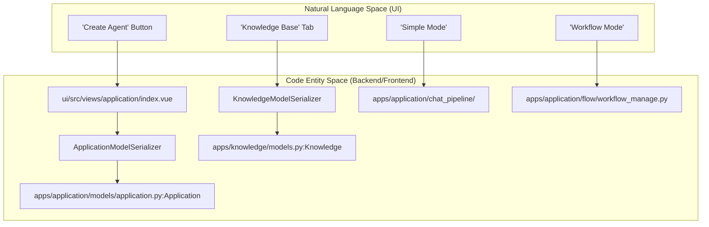
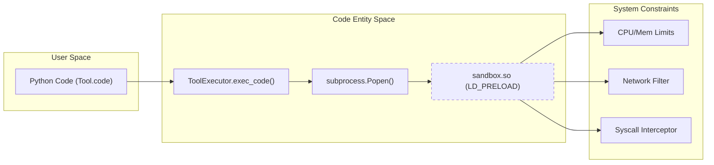

<!-- source: DeepWiki mcp.deepwiki.com · repo 1Panel-dev/MaxKB · page 13 Glossary · fetched 2026-10-29 -->

# Glossary

Relevant source files

The following files were used as context for generating this wiki page:

- [.dockerignore](.dockerignore)
- [.github/workflows/build-and-push-python-pg.yml](.github/workflows/build-and-push-python-pg.yml)
- [.github/workflows/build-and-push-vector-model.yml](.github/workflows/build-and-push-vector-model.yml)
- [.github/workflows/build-and-push.yml](.github/workflows/build-and-push.yml)
- [apps/application/chat_pipeline/step/chat_step/i_chat_step.py](apps/application/chat_pipeline/step/chat_step/i_chat_step.py)
- [apps/application/chat_pipeline/step/chat_step/impl/base_chat_step.py](apps/application/chat_pipeline/step/chat_step/impl/base_chat_step.py)
- [apps/application/flow/backend/__init__.py](apps/application/flow/backend/__init__.py)
- [apps/application/flow/backend/sandbox_shell.py](apps/application/flow/backend/sandbox_shell.py)
- [apps/application/flow/compare/__init__.py](apps/application/flow/compare/__init__.py)
- [apps/application/flow/compare/end_with.py](apps/application/flow/compare/end_with.py)
- [apps/application/flow/compare/not_equal_compare.py](apps/application/flow/compare/not_equal_compare.py)
- [apps/application/flow/compare/regex_compare.py](apps/application/flow/compare/regex_compare.py)
- [apps/application/flow/compare/start_with.py](apps/application/flow/compare/start_with.py)
- [apps/application/flow/compare/wildcard_compare.py](apps/application/flow/compare/wildcard_compare.py)
- [apps/application/flow/i_step_node.py](apps/application/flow/i_step_node.py)
- [apps/application/flow/step_node/__init__.py](apps/application/flow/step_node/__init__.py)
- [apps/application/flow/step_node/ai_chat_step_node/i_chat_node.py](apps/application/flow/step_node/ai_chat_step_node/i_chat_node.py)
- [apps/application/flow/step_node/ai_chat_step_node/impl/base_chat_node.py](apps/application/flow/step_node/ai_chat_step_node/impl/base_chat_node.py)
- [apps/application/flow/step_node/intent_node/impl/base_intent_node.py](apps/application/flow/step_node/intent_node/impl/base_intent_node.py)
- [apps/application/flow/step_node/parameter_extraction_node/impl/base_parameter_extraction_node.py](apps/application/flow/step_node/parameter_extraction_node/impl/base_parameter_extraction_node.py)
- [apps/application/flow/step_node/question_node/i_question_node.py](apps/application/flow/step_node/question_node/i_question_node.py)
- [apps/application/flow/step_node/question_node/impl/base_question_node.py](apps/application/flow/step_node/question_node/impl/base_question_node.py)
- [apps/application/flow/step_node/variable_splitting_node/impl/base_variable_splitting_node.py](apps/application/flow/step_node/variable_splitting_node/impl/base_variable_splitting_node.py)
- [apps/application/flow/tools.py](apps/application/flow/tools.py)
- [apps/application/flow/workflow_manage.py](apps/application/flow/workflow_manage.py)
- [apps/application/long_term_memory/__init__.py](apps/application/long_term_memory/__init__.py)
- [apps/application/migrations/0011_application_skill_tool_ids.py](apps/application/migrations/0011_application_skill_tool_ids.py)
- [apps/application/models/application.py](apps/application/models/application.py)
- [apps/common/auth/authenticate.py](apps/common/auth/authenticate.py)
- [apps/common/auth/handle/impl/user_token.py](apps/common/auth/handle/impl/user_token.py)
- [apps/common/constants/cache_version.py](apps/common/constants/cache_version.py)
- [apps/common/constants/permission_constants.py](apps/common/constants/permission_constants.py)
- [apps/common/exception/app_exception.py](apps/common/exception/app_exception.py)
- [apps/common/log/log.py](apps/common/log/log.py)
- [apps/common/utils/common.py](apps/common/utils/common.py)
- [apps/common/utils/tool_code.py](apps/common/utils/tool_code.py)
- [apps/folders/views/folder.py](apps/folders/views/folder.py)
- [apps/knowledge/api/document.py](apps/knowledge/api/document.py)
- [apps/knowledge/api/knowledge.py](apps/knowledge/api/knowledge.py)
- [apps/knowledge/api/paragraph.py](apps/knowledge/api/paragraph.py)
- [apps/knowledge/api/problem.py](apps/knowledge/api/problem.py)
- [apps/knowledge/serializers/document.py](apps/knowledge/serializers/document.py)
- [apps/knowledge/serializers/knowledge.py](apps/knowledge/serializers/knowledge.py)
- [apps/knowledge/serializers/paragraph.py](apps/knowledge/serializers/paragraph.py)
- [apps/knowledge/serializers/problem.py](apps/knowledge/serializers/problem.py)
- [apps/knowledge/task/handler.py](apps/knowledge/task/handler.py)
- [apps/knowledge/urls.py](apps/knowledge/urls.py)
- [apps/knowledge/views/document.py](apps/knowledge/views/document.py)
- [apps/knowledge/views/knowledge.py](apps/knowledge/views/knowledge.py)
- [apps/knowledge/views/paragraph.py](apps/knowledge/views/paragraph.py)
- [apps/knowledge/views/problem.py](apps/knowledge/views/problem.py)
- [apps/locales/en_US/LC_MESSAGES/django.po](apps/locales/en_US/LC_MESSAGES/django.po)
- [apps/locales/zh_CN/LC_MESSAGES/django.po](apps/locales/zh_CN/LC_MESSAGES/django.po)
- [apps/locales/zh_Hant/LC_MESSAGES/django.po](apps/locales/zh_Hant/LC_MESSAGES/django.po)
- [apps/models_provider/impl/ollama_model_provider/ollama_model_provider.py](apps/models_provider/impl/ollama_model_provider/ollama_model_provider.py)
- [apps/system_manage/views/email_setting.py](apps/system_manage/views/email_setting.py)
- [apps/tools/api/tool.py](apps/tools/api/tool.py)
- [apps/tools/serializers/tool.py](apps/tools/serializers/tool.py)
- [apps/tools/urls.py](apps/tools/urls.py)
- [apps/tools/views/tool.py](apps/tools/views/tool.py)
- [apps/users/api/user.py](apps/users/api/user.py)
- [apps/users/serializers/login.py](apps/users/serializers/login.py)
- [apps/users/serializers/user.py](apps/users/serializers/user.py)
- [apps/users/urls.py](apps/users/urls.py)
- [apps/users/views/login.py](apps/users/views/login.py)
- [apps/users/views/user.py](apps/users/views/user.py)
- [installer/Dockerfile](installer/Dockerfile)
- [installer/Dockerfile-base](installer/Dockerfile-base)
- [installer/Dockerfile-vector-model](installer/Dockerfile-vector-model)
- [installer/install_model.py](installer/install_model.py)
- [installer/install_model_bert_base_cased.py](installer/install_model_bert_base_cased.py)
- [installer/sandbox.c](installer/sandbox.c)
- [pyproject.toml](pyproject.toml)
- [ui/src/api/type/application.ts](ui/src/api/type/application.ts)
- [ui/src/components/folder-tree/index.vue](ui/src/components/folder-tree/index.vue)
- [ui/src/components/layout-container/index.vue](ui/src/components/layout-container/index.vue)
- [ui/src/enums/application.ts](ui/src/enums/application.ts)
- [ui/src/views/application/component/AddKnowledgeDialog.vue](ui/src/views/application/component/AddKnowledgeDialog.vue)
- [ui/src/views/application/index.vue](ui/src/views/application/index.vue)
- [ui/src/views/knowledge/component/KnowledgeListContainer.vue](ui/src/views/knowledge/component/KnowledgeListContainer.vue)
- [ui/src/views/knowledge/index.vue](ui/src/views/knowledge/index.vue)
- [ui/src/views/model/component/ModelCard.vue](ui/src/views/model/component/ModelCard.vue)
- [ui/src/views/model/index.vue](ui/src/views/model/index.vue)
- [ui/src/views/tool/component/ToolListContainer.vue](ui/src/views/tool/component/ToolListContainer.vue)
- [ui/src/views/tool/index.vue](ui/src/views/tool/index.vue)
- [ui/src/workflow/common/data.ts](ui/src/workflow/common/data.ts)

This page provides definitions for codebase-specific terms, jargon, and domain concepts used throughout the MaxKB platform. It serves as a reference for onboarding engineers to understand the mapping between conceptual terminology and technical implementation.

## Core Concepts

### Application (Agent)
In MaxKB, an **Application** (often referred to as an **Agent** in the UI) is the top-level entity that interacts with users. It encapsulates configurations for Large Language Models (LLMs), knowledge base associations, and execution logic (Simple or Workflow-based).
*   **Implementation**: Defined by the `Application` model [apps/application/models/application.py]().
*   **Types**: 
    *   `SIMPLE`: A linear chat pipeline.
    *   `WORK_FLOW`: A directed acyclic graph (DAG) of nodes.
*   **Code Pointer**: [ui/src/views/application/index.vue:108-132]() (UI creation logic).

### Knowledge Base (Dataset)
A collection of documents and structured data used for Retrieval-Augmented Generation (RAG). It manages the lifecycle of data from upload to vectorization.
*   **Implementation**: Managed via the `Knowledge` model [apps/knowledge/models.py]() and processed through `KnowledgeModelSerializer` [apps/knowledge/serializers/knowledge.py:89-106]().
*   **Key Operations**: Document parsing, paragraph splitting, and vector embedding.

### Workspace
A multi-tenant isolation unit. All resources (Applications, Knowledge Bases, Tools) belong to a specific workspace.
*   **Implementation**: Controlled via `WorkspaceUserResourcePermission` [apps/system_manage/models.py]() and validated in serializers [apps/users/serializers/user.py:74-83]().

---

## Technical Jargon & Abbreviations

| Term | Definition | Code Reference |
| :--- | :--- | :--- |
| **RAG** | Retrieval-Augmented Generation. The process of fetching relevant paragraphs to inform LLM responses. | [apps/knowledge/serializers/knowledge.py:156-172]() |
| **STT / TTS** | Speech-to-Text and Text-to-Speech. Modules for voice interaction. | [apps/application/flow/step_node/speech_to_text_step_node/i_speech_to_text_node.py:12]() |
| **MCP** | Model Context Protocol. A standardized way to connect AI models to external data and tools. | [apps/tools/serializers/tool.py:38-40]() |
| **Embedding** | Converting text into high-dimensional vectors for similarity search. | [apps/knowledge/task/embedding.py]() |
| **Hit Test** | A utility to test the retrieval accuracy of a Knowledge Base. | `HitTestSerializer` [apps/knowledge/serializers/knowledge.py:156-172]() |

**Sources:** [apps/knowledge/serializers/knowledge.py:156-172](), [apps/application/flow/step_node/speech_to_text_step_node/i_speech_to_text_node.py:12](), [apps/tools/serializers/tool.py:38-40]()

---

## Execution Components

### Workflow Node
A discrete step in a `WORK_FLOW` application. Each node performs a specific function (e.g., AI Chat, Tool Execution, Condition Branching).
*   **Base Interface**: `INode` [apps/application/flow/i_step_node.py]().
*   **Common Nodes**: 
    *   `ai-chat-node`: Executes LLM prompts [apps/application/flow/step_node/ai_chat_step_node/i_chat_node.py:18]().
    *   `question-node`: Handles user input [apps/application/flow/step_node/question_node/i_question_node.py:18]().

### Tool Executor
The component responsible for executing custom Python code or API calls defined in Tools. It utilizes a sandbox environment for security.
*   **Class**: `ToolExecutor` [apps/common/utils/tool_code.py:42]().
*   **Sandbox**: Implemented via `sandbox.c` and loaded as a shared library `sandbox.so` [installer/Dockerfile:16]().

### Chat Pipeline
A sequential execution flow used for `SIMPLE` applications, consisting of predefined steps like "Search Dataset", "Generate Human Message", and "Chat".
*   **Implementation**: `apps/application/chat_pipeline/` [apps/application/chat_pipeline/step/chat_step/i_chat_step.py:26]().

---

## Domain Mapping Diagrams

### From UI Concept to Code Entity
This diagram maps what a user sees in the "Application" management interface to the underlying backend classes and models.

**Sources:** [ui/src/views/application/index.vue:1-165](), [apps/application/models/application.py](), [apps/knowledge/serializers/knowledge.py:89-106](), [apps/application/flow/workflow_manage.py]()

### Tool Execution & Sandboxing
This diagram illustrates the relationship between a user-defined tool and the secure execution environment.

**Sources:** [apps/common/utils/tool_code.py:101-156](), [installer/sandbox.c](), [installer/Dockerfile:16-17]()

---

## Infrastructure Terms

### Celery Workers
Used for long-running asynchronous tasks such as document vectorization and large-scale knowledge synchronization.
*   **Tasks**: `embedding_by_knowledge` [apps/knowledge/task/embedding.py]().
*   **Configuration**: Found in `pyproject.toml` [pyproject.toml:48-50]().

### Vector Store
The database used to store and search high-dimensional embeddings. MaxKB primarily uses PostgreSQL with the `pgvector` extension.
*   **Implementation**: `VectorStore` config [apps/knowledge/serializers/knowledge.py:19]().

### Sandbox
A security layer for executing arbitrary user code. It restricts system calls, network access, and resource consumption.
*   **Config**: `_enable_sandbox` [apps/common/utils/tool_code.py:25]().
*   **Logic**: `installer/sandbox.c` [installer/sandbox.c]().

**Sources:** [apps/common/utils/tool_code.py:25-40](), [pyproject.toml:48-50](), [apps/knowledge/serializers/knowledge.py:19]()