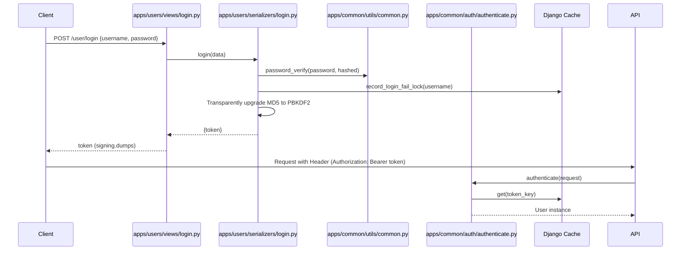
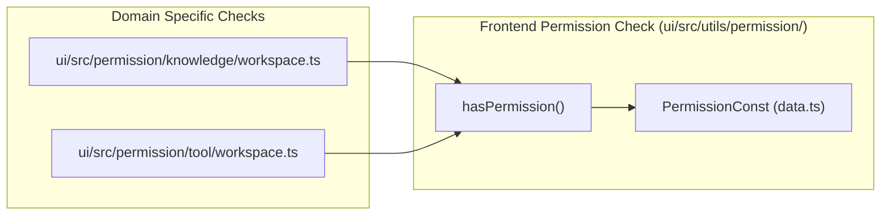

<!-- source: DeepWiki mcp.deepwiki.com · repo 1Panel-dev/MaxKB · page 2 Authentication and Authorization System · fetched 2026-10-29 -->

# Authentication and Authorization System

<details>
<summary>Relevant source files</summary>

The following files were used as context for generating this wiki page:

- [apps/common/auth/authenticate.py](apps/common/auth/authenticate.py)
- [apps/common/auth/handle/impl/user_token.py](apps/common/auth/handle/impl/user_token.py)
- [apps/common/constants/cache_version.py](apps/common/constants/cache_version.py)
- [apps/common/constants/permission_constants.py](apps/common/constants/permission_constants.py)
- [apps/common/exception/app_exception.py](apps/common/exception/app_exception.py)
- [apps/common/log/log.py](apps/common/log/log.py)
- [apps/common/utils/common.py](apps/common/utils/common.py)
- [apps/locales/en_US/LC_MESSAGES/django.po](apps/locales/en_US/LC_MESSAGES/django.po)
- [apps/locales/zh_CN/LC_MESSAGES/django.po](apps/locales/zh_CN/LC_MESSAGES/django.po)
- [apps/locales/zh_Hant/LC_MESSAGES/django.po](apps/locales/zh_Hant/LC_MESSAGES/django.po)
- [apps/users/api/user.py](apps/users/api/user.py)
- [apps/users/serializers/login.py](apps/users/serializers/login.py)
- [apps/users/serializers/user.py](apps/users/serializers/user.py)
- [apps/users/urls.py](apps/users/urls.py)
- [apps/users/views/login.py](apps/users/views/login.py)
- [apps/users/views/user.py](apps/users/views/user.py)
- [ui/src/permission/application/system-manage.ts](ui/src/permission/application/system-manage.ts)
- [ui/src/permission/application/workspace.ts](ui/src/permission/application/workspace.ts)
- [ui/src/permission/knowledge/system-manage.ts](ui/src/permission/knowledge/system-manage.ts)
- [ui/src/permission/knowledge/system-share.ts](ui/src/permission/knowledge/system-share.ts)
- [ui/src/permission/knowledge/workspace-share.ts](ui/src/permission/knowledge/workspace-share.ts)
- [ui/src/permission/knowledge/workspace.ts](ui/src/permission/knowledge/workspace.ts)
- [ui/src/permission/model/system-manage.ts](ui/src/permission/model/system-manage.ts)
- [ui/src/permission/model/system-share.ts](ui/src/permission/model/system-share.ts)
- [ui/src/permission/model/workspace.ts](ui/src/permission/model/workspace.ts)
- [ui/src/permission/tool/system-manage.ts](ui/src/permission/tool/system-manage.ts)
- [ui/src/permission/tool/system-share.ts](ui/src/permission/tool/system-share.ts)
- [ui/src/permission/tool/workspace.ts](ui/src/permission/tool/workspace.ts)
- [ui/src/utils/permission/data.ts](ui/src/utils/permission/data.ts)

</details>


This document covers MaxKB's comprehensive authentication and authorization system, including role-based access control (RBAC), permission management, user authentication flows, and workspace-based security. The system provides both system-level and workspace-level permissions with fine-grained resource access control.

For details, see [Permission Constants and Role Management](#2.1), [User Authentication Flow](#2.2), and [Multi-Tenant Workspace System](#2.3).

## System Architecture

MaxKB implements a multi-layered authentication and authorization system that supports both system-wide and workspace-specific permissions. The system is built around a permission constants framework that defines hierarchical access control with support for enterprise multi-tenancy.

```mermaid
graph TB
    subgraph "Permission System Core"
        [PermissionConstants]
        [RoleConstants]
        [Group]
        [Operate]
    end

    subgraph "Authentication Layer"
        [TokenAuth]
        [UserTokenHandle]
        [LoginSerializer]
        [UserProfileSerializer]
    end

    subgraph "User Management"
        User["User Model (apps/users/models.py)"]
        [UserManageSerializer]
        [UserViews]
    end

    subgraph "Permission Storage"
        [WorkspaceUserResourcePermission]
        RolePermissionMapping["role_permission_mapping (DatabaseModelManage)"]
        WorkspaceUserRoleMapping["workspace_user_role_mapping (DatabaseModelManage)"]
    end

    subgraph "API Endpoints"
        LoginView["/user/login (apps/users/views/login.py)"]
        UserProfileView["/user/profile (apps/users/views/user.py)"]
        UserManageView["/user_manage (apps/users/views/user.py)"]
    end

    [TokenAuth] --> [UserTokenHandle]
    [UserTokenHandle] --> [PermissionConstants]
    LoginView --> [LoginSerializer]
    UserProfileView --> [UserProfileSerializer]
    UserManageView --> [UserManageSerializer]
    
    [PermissionConstants] --> [Group]
    [PermissionConstants] --> [Operate]
    [RoleConstants] --> [PermissionConstants]
    
    [UserManageSerializer] --> User
    [UserTokenHandle] --> [WorkspaceUserResourcePermission]
    [UserTokenHandle] --> RolePermissionMapping
```

**Permission System Architecture**

Sources: [apps/common/constants/permission_constants.py:1-425](), [apps/common/auth/handle/impl/user_token.py:1-30](), [apps/users/serializers/user.py:74-106]()

## Permission Constants and Role Management

The permission system is built around a comprehensive constants framework that defines access control at multiple levels. Roles are categorized into system roles (e.g., `ADMIN`, `USER`) and workspace roles (e.g., `WORKSPACE_MANAGE`).

### Permission Groups and Operations

| Group Type | Purpose | Examples |
|------------|---------|-----------|
| `Group` | Maps to frontend menu items | `APPLICATION`, `KNOWLEDGE`, `MODEL`, `TOOL` |
| `Operate` | Defines specific operations | `READ`, `EDIT`, `CREATE`, `DELETE`, `USE` |
| `Permission` | Combines group + operation | `APPLICATION_READ`, `KNOWLEDGE_EDIT` |

### Role Hierarchy

The system defines roles in `RoleConstants` enum with inheritance patterns for workspace-specific permissions. A user can be an `ADMIN` at the system level while being a regular `USER` or `WORKSPACE_MANAGE` within a specific workspace context.

For details, see [Permission Constants and Role Management](#2.1).

Sources: [apps/common/constants/permission_constants.py:18-105](), [apps/common/constants/permission_constants.py:148-201](), [apps/users/serializers/user.py:26-27]()

## User Authentication Flow

### Token-Based Authentication

MaxKB uses a token-based authentication system. The login process involves credential verification, optional captcha, and account locking mechanisms for failed attempts.



**Authentication Flow Sequence**

### Multi-Factor and External Auth
The system supports standard local login and provides infrastructure for enterprise authentication methods. Password verification includes a transparent upgrade path from legacy MD5 hashes to modern Django PBKDF2 hashes.

For details, see [User Authentication Flow](#2.2).

Sources: [apps/users/serializers/login.py:99-176](), [apps/common/utils/common.py:44-90](), [apps/users/views/user.py:64-75]()

## Multi-Tenant Workspace System

MaxKB implements a workspace-based multi-tenancy architecture. Resources like applications, knowledge bases, and tools are isolated within workspaces.

### Workspace Permission Resolution

The system calculates user permissions through a resolution process that combines system roles, workspace roles, and specific resource permissions.

| Permission Type | String Format Pattern |
|-----------------|-----------------------|
| System | `{permission_id}` |
| Workspace | `{permission_id}:/WORKSPACE/{workspace_id}` |
| Resource | `{permission_id}:/WORKSPACE/{workspace_id}/{resource_type}/{target_id}` |

### Workspace Switching
Users can belong to multiple workspaces and switch contexts. The `UserProfileSerializer` provides a `workspace_list` for the current user to facilitate this.

For details, see [Multi-Tenant Workspace System](#2.3).

Sources: [apps/common/auth/handle/impl/user_token.py:32-68](), [apps/common/auth/handle/impl/user_token.py:107-151](), [apps/users/serializers/user.py:117-151]()

## User Management and Profiles

The system provides APIs for managing user profiles, switching languages, and administrative user management.

| Endpoint | View Class | Permission Required |
|----------|------------|---------------------|
| `/user/profile` | `UserProfileView` | Authenticated |
| `/user/switch_language` | `SwitchUserLanguageView` | `SWITCH_LANGUAGE` |
| `/user/list` | `UserList` | Admin/Workspace Manage |

Sources: [apps/users/views/user.py:64-154](), [apps/users/urls.py:1-29]()

## Resource Permissions in Frontend

The frontend uses a set of utility functions to check permissions before rendering UI elements or allowing actions.



**Frontend Permission Mapping**

Sources: [ui/src/utils/permission/data.ts:26-150](), [ui/src/permission/knowledge/workspace.ts:4-62](), [ui/src/permission/tool/workspace.ts:4-42]()

---

