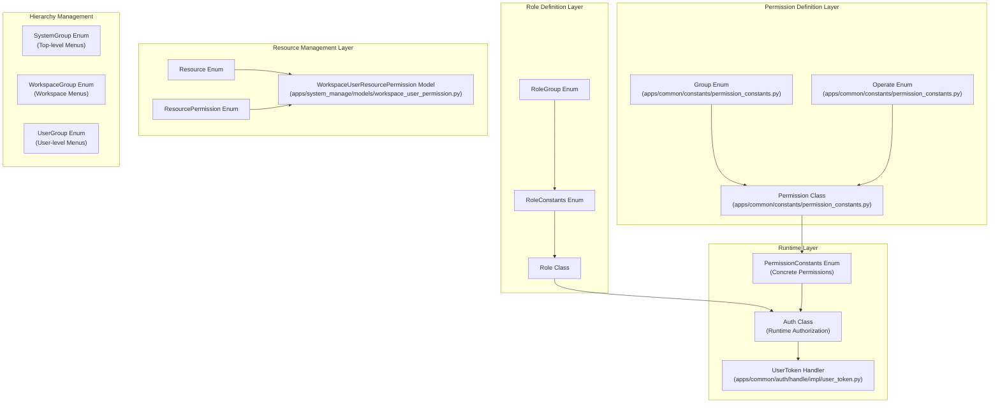
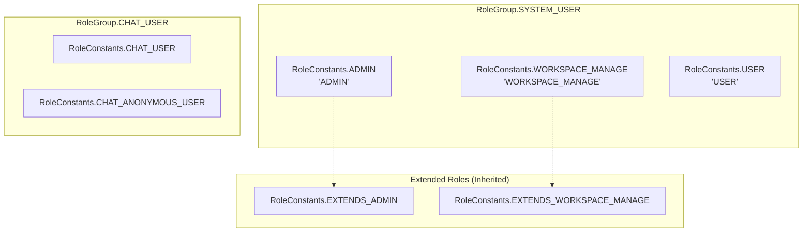
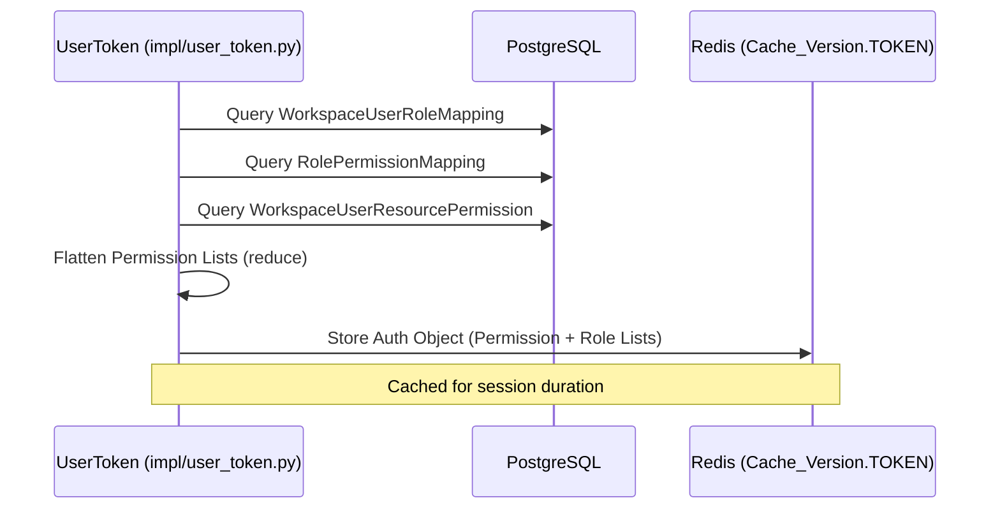

<!-- source: DeepWiki mcp.deepwiki.com · repo 1Panel-dev/MaxKB · page 2.1 Permission Constants and Role Management · fetched 2026-10-29 -->

# Permission Constants and Role Management

<details>
<summary>Relevant source files</summary>

The following files were used as context for generating this wiki page:

- [apps/common/auth/authenticate.py](apps/common/auth/authenticate.py)
- [apps/common/auth/handle/impl/user_token.py](apps/common/auth/handle/impl/user_token.py)
- [apps/common/constants/cache_version.py](apps/common/constants/cache_version.py)
- [apps/common/constants/permission_constants.py](apps/common/constants/permission_constants.py)
- [apps/common/exception/app_exception.py](apps/common/exception/app_exception.py)
- [apps/common/log/log.py](apps/common/log/log.py)
- [apps/common/utils/common.py](apps/common/utils/common.py)
- [apps/folders/serializers/folder.py](apps/folders/serializers/folder.py)
- [apps/knowledge/serializers/knowledge_folder.py](apps/knowledge/serializers/knowledge_folder.py)
- [apps/locales/en_US/LC_MESSAGES/django.po](apps/locales/en_US/LC_MESSAGES/django.po)
- [apps/locales/zh_CN/LC_MESSAGES/django.po](apps/locales/zh_CN/LC_MESSAGES/django.po)
- [apps/locales/zh_Hant/LC_MESSAGES/django.po](apps/locales/zh_Hant/LC_MESSAGES/django.po)
- [apps/system_manage/api/user_resource_permission.py](apps/system_manage/api/user_resource_permission.py)
- [apps/system_manage/migrations/0003_alter_workspaceuserresourcepermission_target.py](apps/system_manage/migrations/0003_alter_workspaceuserresourcepermission_target.py)
- [apps/system_manage/models/workspace_user_permission.py](apps/system_manage/models/workspace_user_permission.py)
- [apps/system_manage/serializers/user_resource_permission.py](apps/system_manage/serializers/user_resource_permission.py)
- [apps/system_manage/sql/get_application_user_resource_permission.sql](apps/system_manage/sql/get_application_user_resource_permission.sql)
- [apps/system_manage/sql/get_knowledge_user_resource_permission.sql](apps/system_manage/sql/get_knowledge_user_resource_permission.sql)
- [apps/system_manage/sql/get_model_user_resource_permission.sql](apps/system_manage/sql/get_model_user_resource_permission.sql)
- [apps/system_manage/sql/get_resource_user_permission_detail.sql](apps/system_manage/sql/get_resource_user_permission_detail.sql)
- [apps/system_manage/sql/get_resource_user_permission_detail_ee.sql](apps/system_manage/sql/get_resource_user_permission_detail_ee.sql)
- [apps/system_manage/sql/get_tool_user_resource_permission.sql](apps/system_manage/sql/get_tool_user_resource_permission.sql)
- [apps/system_manage/views/user_resource_permission.py](apps/system_manage/views/user_resource_permission.py)
- [apps/users/api/user.py](apps/users/api/user.py)
- [apps/users/serializers/login.py](apps/users/serializers/login.py)
- [apps/users/serializers/user.py](apps/users/serializers/user.py)
- [apps/users/urls.py](apps/users/urls.py)
- [apps/users/views/login.py](apps/users/views/login.py)
- [apps/users/views/user.py](apps/users/views/user.py)
- [ui/src/permission/application/system-manage.ts](ui/src/permission/application/system-manage.ts)
- [ui/src/permission/application/workspace.ts](ui/src/permission/application/workspace.ts)
- [ui/src/permission/knowledge/system-manage.ts](ui/src/permission/knowledge/system-manage.ts)
- [ui/src/permission/knowledge/system-share.ts](ui/src/permission/knowledge/system-share.ts)
- [ui/src/permission/knowledge/workspace-share.ts](ui/src/permission/knowledge/workspace-share.ts)
- [ui/src/permission/knowledge/workspace.ts](ui/src/permission/knowledge/workspace.ts)
- [ui/src/permission/model/system-manage.ts](ui/src/permission/model/system-manage.ts)
- [ui/src/permission/model/system-share.ts](ui/src/permission/model/system-share.ts)
- [ui/src/permission/model/workspace.ts](ui/src/permission/model/workspace.ts)
- [ui/src/permission/tool/system-manage.ts](ui/src/permission/tool/system-manage.ts)
- [ui/src/permission/tool/system-share.ts](ui/src/permission/tool/system-share.ts)
- [ui/src/permission/tool/workspace.ts](ui/src/permission/tool/workspace.ts)
- [ui/src/utils/permission/data.ts](ui/src/utils/permission/data.ts)

</details>


This document details the hierarchical permission and role management system in MaxKB, including permission constants, role definitions, resource-based access control, and workspace-level authorization. The system provides fine-grained access control for applications, knowledge bases, models, tools, and system administration functions.

## System Architecture Overview

The permission system is built around several core components that work together to provide comprehensive access control. It bridges the "Natural Language Space" (menus and operations) to the "Code Entity Space" (Enums and Classes).

### Core Permission Architecture



**Sources:** [apps/common/constants/permission_constants.py:18-147](), [apps/common/constants/permission_constants.py:203-244](), [apps/system_manage/models/workspace_user_permission.py:1-50](), [apps/common/auth/handle/impl/user_token.py:16-28]()

## Permission Groups and Operations

The permission system uses a matrix approach where `Group` defines functional areas and `Operate` defines actions.

### Core Permission Groups
Groups typically correspond to frontend menus or resource categories.

| Group Category | Key Groups | Code Identifier |
|----------------|------------|-----------------|
| **Core Resources** | `APPLICATION`, `KNOWLEDGE`, `MODEL`, `TOOL` | `Group.APPLICATION`, `Group.KNOWLEDGE` |
| **Folders** | `APPLICATION_FOLDER`, `KNOWLEDGE_FOLDER`, `TOOL_FOLDER` | `Group.APPLICATION_FOLDER` |
| **System Settings** | `USER`, `ROLE`, `WORKSPACE`, `OPERATION_LOG` | `Group.USER`, `Group.ROLE` |
| **Specific Features** | `KNOWLEDGE_HIT_TEST`, `APPLICATION_CHAT_LOG` | `Group.KNOWLEDGE_HIT_TEST` |

**Sources:** [apps/common/constants/permission_constants.py:18-105]()

### Operation Types
The `Operate` enum defines specific actions allowed within a group.

| Action Category | Operations | Code Identifier |
|-------------------|------------|-----------------|
| **Standard CRUD** | `READ`, `EDIT`, `CREATE`, `DELETE` | `Operate.READ`, `Operate.EDIT` |
| **Resource Specific**| `VECTOR`, `PUBLISH`, `SYNC`, `ANNOTATION` | `Operate.VECTOR`, `Operate.SYNC` |
| **Batch Ops** | `BATCH_DELETE`, `BATCH_MOVE` | `Operate.BATCH_DELETE` |
| **Access Control** | `ADD_MEMBER`, `REMOVE_MEMBER`, `AUTH` | `Operate.ADD_MEMBER`, `Operate.AUTH` |

**Sources:** [apps/common/constants/permission_constants.py:148-201]()

## Role Management System

### Role Hierarchy and Constants
The system defines roles for both system users and chat users.



**Sources:** [apps/common/constants/permission_constants.py:203-282]()

### Role-Permission Resolution
Permissions are resolved by mapping roles to permission strings. For workspace-specific roles, the permission string includes the workspace ID.

- **System Permission:** `f"{permission_id}"` [apps/common/auth/handle/impl/user_token.py:40-40]()
- **Workspace Permission:** `f"{permission_id}:/WORKSPACE/{workspace_id}"` [apps/common/auth/handle/impl/user_token.py:56-56]()
- **Role Workspace Permission:** `f"{role}:/WORKSPACE/{workspace_id}"` [apps/common/auth/handle/impl/user_token.py:68-68]()

## Workspace and Resource Permission Management

### Resource Permission Model
Resource permissions allow for fine-grained control over specific instances (e.g., a specific Application or Knowledge Base).

| Permission Level | Enum Value | Description |
|------------------|------------|-------------|
| **View** | `ResourcePermission.VIEW` | Permission to view the resource. |
| **Manage** | `ResourcePermission.MANAGE` | Permission to edit/delete/manage the resource. |
| **Role-based** | `ResourcePermissionRole.ROLE` | Permissions inherited from the user's workspace role. |

**Sources:** [apps/common/constants/permission_constants.py:210-230](), [apps/system_manage/serializers/user_resource_permission.py:38-42]()

### Permission Check Logic
The system provides utility functions to check permissions at various levels:

1.  **Workspace Admin Check:** `is_workspace_manage(user_id, workspace_id)` checks if a user is an admin of a specific workspace. [apps/users/serializers/user.py:74-82]()
2.  **Resource Permission Check:** `UserResourcePermissionSerializer().is_auth(resource_id)` checks if a user has access to a specific resource instance. [apps/system_manage/serializers/user_resource_permission.py:145-156]()
3.  **Folder Permission Check:** `has_target_permission` verifies management rights over folders. [apps/folders/serializers/folder.py:119-122]()

### Data Flow for Permission Calculation
When a user authenticates, `UserToken.get_auth` aggregates permissions from multiple sources.



**Sources:** [apps/common/auth/handle/impl/user_token.py:71-104](), [apps/common/auth/handle/impl/user_token.py:172-175]()

## Implementation Details

### Permission Constants Definition
Permissions are explicitly defined as `Permission` objects in `PermissionConstants`. For example:
- `USER_READ = Permission(Group.USER, Operate.READ)` [apps/common/constants/permission_constants.py:442]()
- `APPLICATION_EDIT = Permission(Group.APPLICATION, Operate.EDIT)` [apps/common/constants/permission_constants.py:504]()

### Decorator-based Access Control
The `@has_permissions` decorator is used in Django views to enforce access control. It supports both system-level and workspace-level permission checks.

```python
# Example from apps/users/views/user.py
@has_permissions(PermissionConstants.USER_EDIT, RoleConstants.ADMIN)
def get(self, request: Request):
    ...
```

**Sources:** [apps/users/views/user.py:87-87](), [apps/users/views/user.py:104-105]()

### Internationalization (i18n)
Permission labels are translated using Django's `gettext_lazy`. Mappings are maintained in `Permission_Label`.

**Sources:** [apps/common/constants/permission_constants.py:284-422](), [apps/locales/zh_CN/LC_MESSAGES/django.po:82-91]()

## Key Files and Classes

| File Path | Key Entity | Purpose |
|-----------|------------|---------|
| `apps/common/constants/permission_constants.py` | `PermissionConstants`, `RoleConstants` | Central definition of all permissions and roles. |
| `apps/common/auth/handle/impl/user_token.py` | `get_workspace_permission_list` | Logic for aggregating permissions from DB to Auth object. |
| `apps/system_manage/models/workspace_user_permission.py` | `WorkspaceUserResourcePermission` | Database model for per-resource access control. |
| `apps/users/serializers/user.py` | `is_workspace_manage` | Utility for checking administrative status. |
| `ui/src/utils/permission/data.ts` | `PermissionConst` | Frontend counterparts for permission constants. |

**Sources:** [apps/common/constants/permission_constants.py:1-425](), [apps/common/auth/handle/impl/user_token.py:71-85](), [apps/system_manage/models/workspace_user_permission.py:1-50](), [ui/src/utils/permission/data.ts:26-147]()

---

