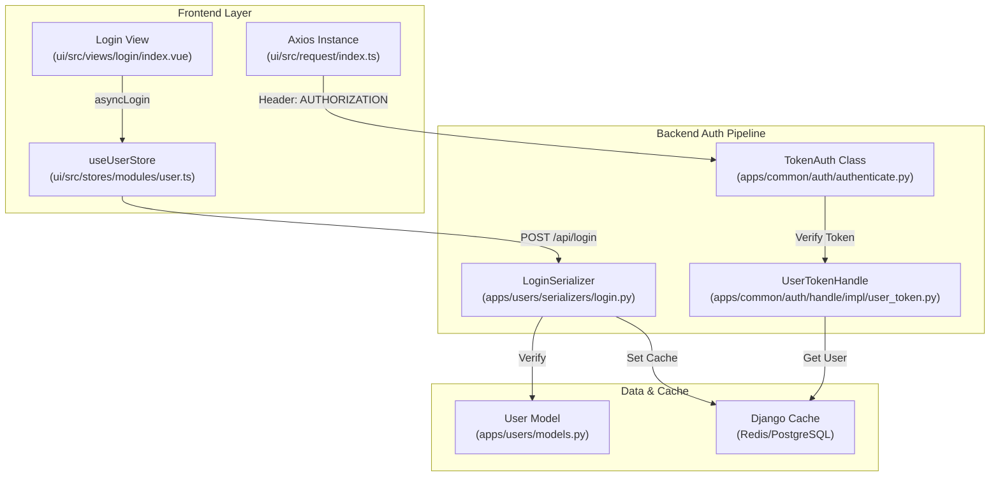
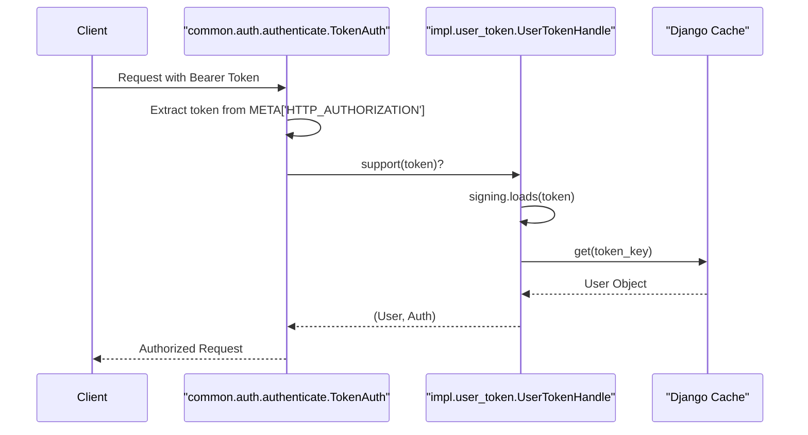

<!-- source: DeepWiki mcp.deepwiki.com · repo 1Panel-dev/MaxKB · page 2.2 User Authentication Flow · fetched 2026-10-29 -->

# User Authentication Flow

<details>
<summary>Relevant source files</summary>

The following files were used as context for generating this wiki page:

- [apps/common/auth/authenticate.py](apps/common/auth/authenticate.py)
- [apps/common/auth/handle/impl/user_token.py](apps/common/auth/handle/impl/user_token.py)
- [apps/common/constants/cache_version.py](apps/common/constants/cache_version.py)
- [apps/common/constants/permission_constants.py](apps/common/constants/permission_constants.py)
- [apps/common/exception/app_exception.py](apps/common/exception/app_exception.py)
- [apps/common/log/log.py](apps/common/log/log.py)
- [apps/common/utils/common.py](apps/common/utils/common.py)
- [apps/locales/en_US/LC_MESSAGES/django.po](apps/locales/en_US/LC_MESSAGES/django.po)
- [apps/locales/zh_CN/LC_MESSAGES/django.po](apps/locales/zh_CN/LC_MESSAGES/django.po)
- [apps/locales/zh_Hant/LC_MESSAGES/django.po](apps/locales/zh_Hant/LC_MESSAGES/django.po)
- [apps/users/api/user.py](apps/users/api/user.py)
- [apps/users/serializers/login.py](apps/users/serializers/login.py)
- [apps/users/serializers/user.py](apps/users/serializers/user.py)
- [apps/users/urls.py](apps/users/urls.py)
- [apps/users/views/login.py](apps/users/views/login.py)
- [apps/users/views/user.py](apps/users/views/user.py)
- [ui/src/api/chat-user/auth-setting.ts](ui/src/api/chat-user/auth-setting.ts)
- [ui/src/api/chat/chat.ts](ui/src/api/chat/chat.ts)
- [ui/src/api/type/chat.ts](ui/src/api/type/chat.ts)
- [ui/src/api/type/login.ts](ui/src/api/type/login.ts)
- [ui/src/request/index.ts](ui/src/request/index.ts)
- [ui/src/stores/modules/application.ts](ui/src/stores/modules/application.ts)
- [ui/src/stores/modules/chat-user.ts](ui/src/stores/modules/chat-user.ts)
- [ui/src/stores/modules/theme.ts](ui/src/stores/modules/theme.ts)
- [ui/src/stores/modules/user.ts](ui/src/stores/modules/user.ts)
- [ui/src/views/chat/index.vue](ui/src/views/chat/index.vue)
- [ui/src/views/chat/user-login/index.vue](ui/src/views/chat/user-login/index.vue)
- [ui/src/views/chat/user-login/scanCompinents/QrCodeTab.vue](ui/src/views/chat/user-login/scanCompinents/QrCodeTab.vue)
- [ui/src/views/chat/user-login/scanCompinents/dingtalkQrCode.vue](ui/src/views/chat/user-login/scanCompinents/dingtalkQrCode.vue)
- [ui/src/views/chat/user-login/scanCompinents/larkQrCode.vue](ui/src/views/chat/user-login/scanCompinents/larkQrCode.vue)
- [ui/src/views/chat/user-login/scanCompinents/wecomQrCode.vue](ui/src/views/chat/user-login/scanCompinents/wecomQrCode.vue)
- [ui/src/views/login/index.vue](ui/src/views/login/index.vue)
- [ui/src/views/login/scanCompinents/dingtalkQrCode.vue](ui/src/views/login/scanCompinents/dingtalkQrCode.vue)
- [ui/src/views/login/scanCompinents/wecomQrCode.vue](ui/src/views/login/scanCompinents/wecomQrCode.vue)
- [ui/src/views/system-chat-user/authentication/component/CAS.vue](ui/src/views/system-chat-user/authentication/component/CAS.vue)
- [ui/src/views/system-chat-user/authentication/component/LDAP.vue](ui/src/views/system-chat-user/authentication/component/LDAP.vue)
- [ui/src/views/system-chat-user/authentication/component/OAuth2.vue](ui/src/views/system-chat-user/authentication/component/OAuth2.vue)
- [ui/src/views/system-chat-user/authentication/component/OIDC.vue](ui/src/views/system-chat-user/authentication/component/OIDC.vue)
- [ui/src/views/system-chat-user/authentication/component/SCAN.vue](ui/src/views/system-chat-user/authentication/component/SCAN.vue)
- [ui/src/views/system-chat-user/authentication/index.vue](ui/src/views/system-chat-user/authentication/index.vue)
- [ui/src/views/system-setting/authentication/component/CAS.vue](ui/src/views/system-setting/authentication/component/CAS.vue)
- [ui/src/views/system-setting/authentication/component/LDAP.vue](ui/src/views/system-setting/authentication/component/LDAP.vue)
- [ui/src/views/system-setting/authentication/component/OAuth2.vue](ui/src/views/system-setting/authentication/component/OAuth2.vue)
- [ui/src/views/system-setting/authentication/component/OIDC.vue](ui/src/views/system-setting/authentication/component/OIDC.vue)
- [ui/src/views/system-setting/authentication/component/SCAN.vue](ui/src/views/system-setting/authentication/component/SCAN.vue)
- [ui/src/views/system-setting/authentication/index.vue](ui/src/views/system-setting/authentication/index.vue)
- [ui/src/views/system-setting/email/index.vue](ui/src/views/system-setting/email/index.vue)

</details>


## Purpose and Scope

This document covers the multi-method authentication system in MaxKB, including local login, LDAP, OAuth2, OIDC, CAS, SAML2, and QR code authentication. It details the implementation of the authentication pipeline, token management via Django's signing module, and the integration with the frontend Pinia state management.

For information about permission constants and role management, see [ Permission Constants and Role Management](2.1). For details about user management APIs, see [User Management](9).

## Authentication System Overview

MaxKB implements a flexible authentication architecture supporting both internal (local) and external (LDAP/SSO) identity providers. The system uses a token-based mechanism where the backend generates signed tokens and the frontend manages them via persistent storage and request interceptors.

### Code-to-System Mapping


Sources: [ui/src/views/login/index.vue:128-213](), [ui/src/stores/modules/user.ts:23-176](), [apps/common/auth/authenticate.py:18-89](), [apps/common/auth/handle/impl/user_token.py:1-84]()

## Authentication Methods

MaxKB supports a wide array of authentication methods, primarily configured via `SystemSetting` and handled in the login views.

| Method | Implementation Detail | Source |
| :--- | :--- | :--- |
| **Local** | Username/Password with RSA encryption and Captcha validation. | [ui/src/views/login/index.vue:203-211]() |
| **LDAP** | Direct authentication against an LDAP server. | [ui/src/views/login/index.vue:192-198]() |
| **OAuth2 / OIDC** | Redirect-based flow to external providers. | [ui/src/views/login/index.vue:89-104]() |
| **CAS / SAML2** | Enterprise SSO protocols (handled via dedicated components). | [ui/src/views/system-setting/authentication/index.vue:1-100]() |
| **QR Code** | Scanning via DingTalk, WeCom, or Lark. | [ui/src/views/login/index.vue:82-84]() |

### Local Login Security
For local authentication, the system employs RSA encryption for credentials sent over the wire. The frontend uses `JSEncrypt` to encrypt the login form data with a public key fetched from the backend [ui/src/views/login/index.vue:204-208]().

## Token Management and Validation

MaxKB uses Django's `signing` module to create stateless but verifiable tokens. These tokens are stored in the server-side cache for session management.

### Token Generation Flow
When a user successfully authenticates, the `LoginSerializer` (in `apps/users/serializers/login.py`) generates a token containing the user's ID, username, and authentication type.

```python
# Conceptual implementation in LoginSerializer
token = signing.dumps({
    'id': str(user.id),
    'username': user.username,
    'type': AuthenticationType.SYSTEM_USER.value
})
```
Sources: [apps/users/serializers/login.py:55-64](), [apps/common/auth/handle/impl/user_token.py:17-28]()

### Server-Side Validation Pipeline
Every request requiring authentication is processed by the `TokenAuth` class.


Sources: [apps/common/auth/authenticate.py:76-89](), [apps/common/auth/handle/impl/user_token.py:71-84]()

## Frontend State Management (`useUserStore`)

The `useUserStore` in Pinia acts as the central hub for authentication state on the client side.

### Key State Properties
- `userInfo`: Stores basic user profile, including `permissions` and `role` [ui/src/stores/modules/user.ts:14-25]().
- `workspace_id`: Tracks the current active workspace, persisting to `localStorage` [ui/src/stores/modules/user.ts:37-44]().
- `rsaKey`: The public key used for encrypting passwords during login [ui/src/stores/modules/user.ts:31-145]().

### Profile Synchronization
The `profile()` action fetches the current user's details and synchronizes the local environment (language, theme, workspace list) [ui/src/stores/modules/user.ts:117-135]().

```typescript
async profile(loading?: Ref<boolean>) {
  return UserApi.getUserProfile(loading).then((ok) => {
    this.userInfo = ok.data
    // Handle workspace and language defaults
    this.workspace_list = ok.data.workspace_list
    // ... theme and locale setup
    return this.asyncGetProfile()
  })
}
```
Sources: [ui/src/stores/modules/user.ts:117-135](), [apps/users/views/user.py:64-75]()

## Request and Response Interceptors

The system ensures all outgoing requests are authenticated and all incoming responses are checked for session validity.

### Request Interceptor
Located in `ui/src/request/index.ts`, this interceptor injects the `AUTHORIZATION` header and the `Accept-Language` header for internationalization.

```typescript
instance.interceptors.request.use(
  (config: InternalAxiosRequestConfig) => {
    const { user, login } = useStore()
    const token = login.getToken()
    const language = user.getLanguage()
    config.headers['Accept-Language'] = `${language}`
    if (token) {
      config.headers['AUTHORIZATION'] = `Bearer ${token}`
    }
    return config
  }
)
```
Sources: [ui/src/request/index.ts:21-37]()

### Response Interceptor (401 Handling)
If a response returns a `401 Unauthorized` status, the interceptor redirects the user to the login page, unless the request was for a public chat view.

```typescript
instance.interceptors.response.use(
  (response: any) => response,
  (err: any) => {
    if (err.response?.status === 401) {
      if (!err.response.config.url.includes('chat/open')) {
        router.push({ name: 'login' })
      }
    }
    return Promise.reject(err)
  }
)
```
Sources: [ui/src/request/index.ts:72-79]()

## Multi-Platform Authentication Support

MaxKB provides specialized authentication flows for different contexts:
1.  **System Login**: The primary login for administrators and workspace members [ui/src/views/login/index.vue:1-127]().
2.  **Chat User Login**: A simplified login interface for end-users accessing specific AI applications, supporting password-based application limits [ui/src/views/chat/user-login/index.vue:44-49]().

Sources: [ui/src/views/chat/user-login/index.vue:1-167](), [apps/users/views/user.py:142-155]()

---

