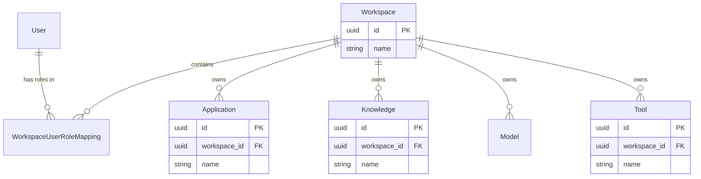
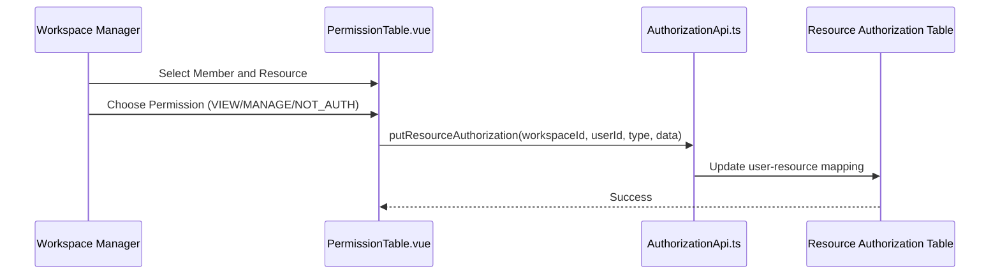
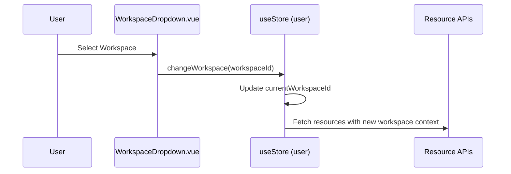
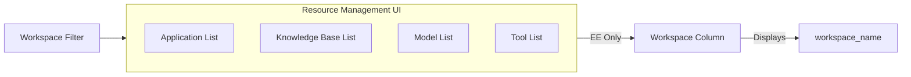
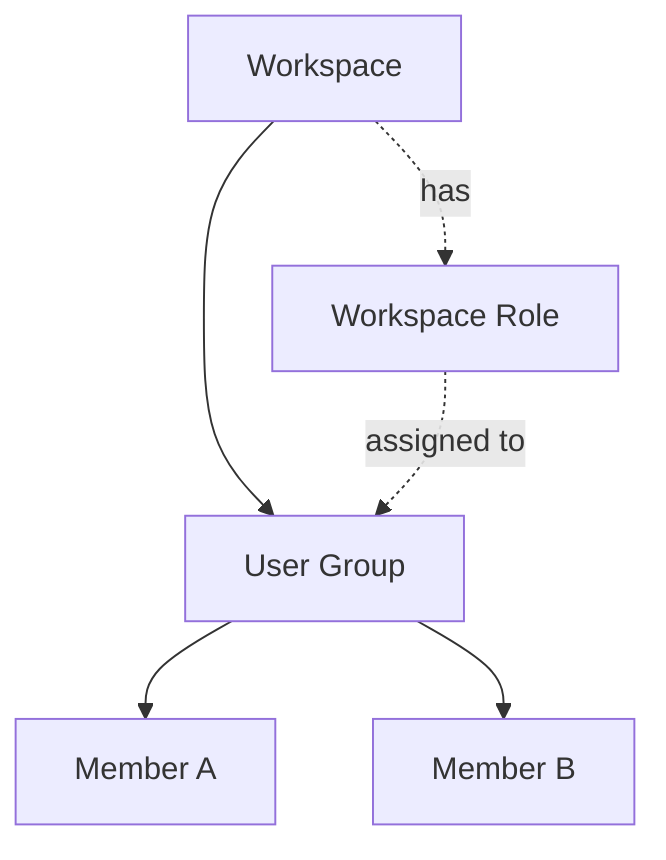

<!-- source: DeepWiki mcp.deepwiki.com · repo 1Panel-dev/MaxKB · page 2.3 Multi-Tenant Workspace System · fetched 2026-10-29 -->

# Multi-Tenant Workspace System

Relevant source files

The following files were used as context for generating this wiki page:

- [ui/src/api/system/resource-authorization.ts](ui/src/api/system/resource-authorization.ts)
- [ui/src/components/resource-authorization-drawer/index.vue](ui/src/components/resource-authorization-drawer/index.vue)
- [ui/src/components/resource_mapping/index.vue](ui/src/components/resource_mapping/index.vue)
- [ui/src/components/workspace-dropdown/index.vue](ui/src/components/workspace-dropdown/index.vue)
- [ui/src/enums/system.ts](ui/src/enums/system.ts)
- [ui/src/locales/lang/en-US/views/system.ts](ui/src/locales/lang/en-US/views/system.ts)
- [ui/src/locales/lang/zh-CN/views/system.ts](ui/src/locales/lang/zh-CN/views/system.ts)
- [ui/src/locales/lang/zh-Hant/views/system.ts](ui/src/locales/lang/zh-Hant/views/system.ts)
- [ui/src/utils/dynamics-api/permission-api.ts](ui/src/utils/dynamics-api/permission-api.ts)
- [ui/src/views/system-chat-user/group/index.vue](ui/src/views/system-chat-user/group/index.vue)
- [ui/src/views/system-resource-management/ApplicationResourceIndex.vue](ui/src/views/system-resource-management/ApplicationResourceIndex.vue)
- [ui/src/views/system-resource-management/KnowledgeResourceIndex.vue](ui/src/views/system-resource-management/KnowledgeResourceIndex.vue)
- [ui/src/views/system-resource-management/ModelResourceIndex.vue](ui/src/views/system-resource-management/ModelResourceIndex.vue)
- [ui/src/views/system-resource-management/ToolResourceIndex.vue](ui/src/views/system-resource-management/ToolResourceIndex.vue)
- [ui/src/views/system-setting/authentication/component/Setting.vue](ui/src/views/system-setting/authentication/component/Setting.vue)
- [ui/src/views/system/resource-authorization/component/PermissionTable.vue](ui/src/views/system/resource-authorization/component/PermissionTable.vue)
- [ui/src/views/system/resource-authorization/constant.ts](ui/src/views/system/resource-authorization/constant.ts)
- [ui/src/views/system/resource-authorization/index.vue](ui/src/views/system/resource-authorization/index.vue)
- [ui/src/views/system/role/component/Member.vue](ui/src/views/system/role/component/Member.vue)
- [ui/src/views/system/role/component/PermissionConfiguration.vue](ui/src/views/system/role/component/PermissionConfiguration.vue)
- [ui/src/views/system/role/index.vue](ui/src/views/system/role/index.vue)
- [ui/src/views/system/workspace/component/Member.vue](ui/src/views/system/workspace/component/Member.vue)
- [ui/src/views/system/workspace/index.vue](ui/src/views/system/workspace/index.vue)

## Purpose and Scope

This document describes MaxKB's multi-tenant workspace system, which provides organizational isolation for resources and users. Each workspace functions as a separate tenant with its own set of applications, knowledge bases, models, tools, and users. The system enables enterprise deployments where multiple teams or organizations can operate independently within the same MaxKB instance.

For information about user authentication and login mechanisms, see [User Authentication Flow](#2.2). For permission enforcement details, see [Permission Constants and Role Management](#2.1).

## Workspace Architecture Overview

The workspace system implements a hierarchical multi-tenancy model where:
- **System Level**: Global administrators and system settings.
- **Workspace Level**: Isolated environments with workspace administrators and members.
- **Resource Level**: Applications, knowledge bases, models, and tools owned by specific workspaces.

**Workspace Multi-Tenancy Architecture**

```mermaid
graph TB
    SystemAdmin["System Administrator<br/>(ADMIN role)"]
    
    subgraph SystemLevel["System Level"]
        SystemSettings["System Settings"]
        SystemResources["Shared Resources"]
        UserManagement["User Management"]
    end
    
    subgraph Workspace1["Workspace: workspace_id_1"]
        WS1Admin["Workspace Manager<br/>(WORKSPACE_MANAGE)"]
        WS1Members["Workspace Members<br/>(USER role)"]
        
        subgraph WS1Resources["Isolated Resources"]
            WS1Apps["Applications"]
            WS1KB["Knowledge Bases"]
            WS1Models["Models"]
            WS1Tools["Tools"]
        end
    end
    
    subgraph Workspace2["Workspace: workspace_id_2"]
        WS2Admin["Workspace Manager"]
        WS2Members["Workspace Members"]
        
        subgraph WS2Resources["Isolated Resources"]
            WS2Apps["Applications"]
            WS2KB["Knowledge Bases"]
            WS2Models["Models"]
            WS2Tools["Tools"]
        end
    end
    
    subgraph WorkspaceDefault["Workspace: default"]
        WSDefAdmin["Workspace Manager"]
        WSDefMembers["Workspace Members"]
        
        subgraph WSDefResources["Isolated Resources"]
            WSDefApps["Applications"]
            WSDefKB["Knowledge Bases"]
            WSDefModels["Models"]
            WSDefTools["Tools"]
        end
    end
    
    SystemAdmin --> SystemSettings
    SystemAdmin --> SystemResources
    SystemAdmin --> UserManagement
    
    SystemAdmin -.->|"can manage all workspaces"| Workspace1
    SystemAdmin -.->|"can manage all workspaces"| Workspace2
    SystemAdmin -.->|"can manage all workspaces"| WorkspaceDefault
    
    WS1Admin --> WS1Resources
    WS1Members --> WS1Resources
    
    WS2Admin --> WS2Resources
    WS2Members --> WS2Resources
    
    WSDefAdmin --> WSDefResources
    WSDefMembers --> WSDefResources
```

Sources: [ui/src/views/system-resource-management/ApplicationResourceIndex.vue:155-160](), [ui/src/views/system-resource-management/KnowledgeResourceIndex.vue:89-94]()

## Workspace Data Model

The multi-tenancy system relies on `workspace_id` scoping across all primary resource tables.

**Workspace Entity Relationships**

**Key Resource Tables and Scoping:**

| Resource Type | Backend Model Reference | UI Management Component |
| :--- | :--- | :--- |
| Application | `Application` | [ui/src/views/system-resource-management/ApplicationResourceIndex.vue:1-10]() |
| Knowledge Base | `DataSet` | [ui/src/views/system-resource-management/KnowledgeResourceIndex.vue:1-10]() |
| AI Model | `Model` | [ui/src/views/system-resource-management/ModelResourceIndex.vue:1-10]() |
| Custom Tool | `Tool` | [ui/src/views/system-resource-management/ToolResourceIndex.vue:1-10]() |

Sources: [ui/src/views/system-resource-management/ApplicationResourceIndex.vue:155-160](), [ui/src/views/system-resource-management/KnowledgeResourceIndex.vue:89-94](), [ui/src/views/system-resource-management/ModelResourceIndex.vue:109-114](), [ui/src/views/system-resource-management/ToolResourceIndex.vue:128-133]()

## Workspace Role and Permission System

### Resource Authorization

MaxKB provides a granular resource authorization system that allows workspace administrators to delegate specific permissions (View/Manage) for individual resources to specific members.

**Resource Authorization Flow**

The authorization logic differentiates between resource types:
- **Applications, Knowledge Bases, Tools**: Use folder-based or direct resource authorization [ui/src/views/system/resource-authorization/index.vue:169-181]().
- **Models**: Authorized directly at the model provider/instance level [ui/src/views/system/resource-authorization/index.vue:171-172]().

Sources: [ui/src/views/system/resource-authorization/index.vue:143-155](), [ui/src/views/system/resource-authorization/component/PermissionTable.vue:112-123](), [ui/src/components/resource-authorization-drawer/index.vue:112-121]()

### Permission Options

| Level | Label | Description |
| :--- | :--- | :--- |
| **Manage** | `views.system.resourceAuthorization.setting.management` | Can delete or modify the resource [ui/src/locales/lang/en-US/views/system.ts:137-138](). |
| **View** | `views.system.resourceAuthorization.setting.check` | Can only view and use the resource [ui/src/locales/lang/en-US/views/system.ts:139-140](). |
| **No Auth** | `views.system.resourceAuthorization.setting.notAuthorized` | No access to the resource [ui/src/locales/lang/en-US/views/system.ts:143](). |

Sources: [ui/src/locales/lang/en-US/views/system.ts:136-144](), [ui/src/views/system/resource-authorization/constant.ts:1-20]()

## Workspace Context and Switching

### Frontend Workspace State

The current workspace context is maintained in the `user` store. This state determines which resources are fetched and displayed in the UI.

**Workspace Context Switching**

Sources: [ui/src/views/system/resource-authorization/index.vue:16-21](), [ui/src/views/system/resource-authorization/index.vue:96-101]()

### Enterprise Edition (EE) Enhancements

In the Enterprise Edition, administrators can manage resources across all workspaces through a centralized "Resource Management" interface. This interface allows filtering resources by workspace and managing their status globally.

**Global Resource Management**

Sources: [ui/src/views/system-resource-management/ApplicationResourceIndex.vue:155-160](), [ui/src/views/system-resource-management/ToolResourceIndex.vue:128-133](), [ui/src/views/system-resource-management/KnowledgeResourceIndex.vue:89-94]()

## Resource Mapping and Dependencies

The system tracks dependencies between resources (e.g., an Application depending on a Knowledge Base). This mapping is workspace-aware and helps prevent accidental deletion of dependent resources.

**Dependency Tracking UI**
- **Dependency**: Resources that the current resource depends on [ui/src/components/resource_mapping/index.vue:107-108]().
- **Dependent**: Resources that depend on the current resource [ui/src/components/resource_mapping/index.vue:247-248]().

Sources: [ui/src/components/resource_mapping/index.vue:1-50](), [ui/src/locales/lang/en-US/views/system.ts:167-172]()

## User and Group Isolation

Users can be organized into groups within a workspace. Permissions can then be applied to these groups rather than individual users, simplifying large-scale multi-tenant management.

**Group Management Hierarchy**

Sources: [ui/src/views/system-chat-user/group/index.vue:1-14](), [ui/src/views/system-chat-user/group/index.vue:120-138]()

---

